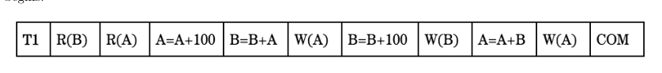
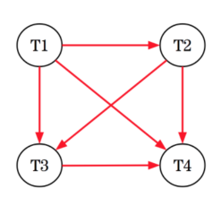

# Berkeley CS186 Spring 2018: Midterm 2: Official solutions

> Copied from the original: <https://hkn.eecs.berkeley.edu/exams/course/cs/186>. Text and figures are taken from the PDF as is; nothing was answered or rewritten. The original PDF is in this folder.

---

**Page 1**

&emsp;&emsp;&emsp;CS 186/286 Spring 2018 Midterm 2 
• Do not turn this page until instructed to start the exam. 
• You should receive 1 single-page answer sheet and a 15-page exam packet. 
• All answers should be written on the answer sheet. The exam packet will be collected but not graded. 
• You have 80 minutes to complete the midterm. 
• The midterm has 4 questions, each with multiple parts. 
• The midterm is worth a total of 60 points. 
• For each question, place only your final answer on the answer sheet; do not show work. 
• For multiple choice questions, please fill in the bubble or box completely, **do not mark the box with** 
**an X or checkmark**. 
• Use the blank spaces in your exam for scratch paper. 
• You are allowed **one** 8.5” × 11” double-sided page of notes. 
• No electronic devices are allowed.

---

**Page 2**

**1**   **Joins (20 points)**

Note: Assume that when we write X ▷◁Y , X (on the left) is the outer, and Y (on the right) is the inner for 
the remainder of these questions. 
1\. (1 point) Suppose we do a Page-oriented Nested Loop Join on two tables, P and Q. We are told that 
&emsp;the same amount of pages are required to store P and Q, but Q has three times more records per page 
&emsp;than P, on average. Which one of the following options is true: 
&emsp;&emsp;&emsp;A. P ▷◁Q does fewer I/Os than Q ▷◁P. 
&emsp;&emsp;&emsp;B. Q ▷◁P does fewer I/Os than P ▷◁Q. 
&emsp;&emsp;&emsp;**C.** P ▷◁Q **does the same number of I/Os as** Q ▷◁P**.**

&emsp;**Solution:** What is the cost for PNLJ on P ▷◁Q? \[P\] ∗\[Q\] + \[P\]. 
&emsp;What is the cost for PNLJ on Q ▷◁P? \[Q\] ∗\[P\] + \[Q\]. 
&emsp;But we are told that \[P\] == \[Q\]. 
&emsp;Therefore C.

2\. (5 points) Next, we consider a Simple Nested Loop Join on three tables: P, Q, and S. 
&emsp;&emsp;• Please use \[X\] to denote the number of pages of X, and {X} to denote the number of records in 
&emsp;&emsp;X (note the curly braces rather than vertical bars, for legibility). 
&emsp;&emsp;• Do not materialize intermediary results into a temporary table. Assume the results of a subplan 
&emsp;&emsp;are pipelined to the next operator. 
&emsp;&emsp;• Assume P ▷◁Q is foreign key to primary key join, and the following join with S is also a foriegn 
&emsp;&emsp;key to primary key join. The (non null) foreign keys are in P, and primary keys are in Q and S.

&emsp;(a) (1 point) What is the I/O cost for P ▷◁Q?

&emsp;&emsp;&emsp;**Solution:** {P} ∗\[Q\] + \[P\]

&emsp;(b) (1 point) What is the cardinality of P ▷◁Q?

&emsp;&emsp;&emsp;**Solution:** Every record in P has a single matching record in Q because of the foreign key to 
&emsp;&emsp;&emsp;primary key constraint. Thus, the result size is simply {P}.

&emsp;(c) (2 points) What is the I/O cost for (P ▷◁Q) ▷◁S?

&emsp;&emsp;&emsp;**Solution:** {P} ∗(\[Q\] + \[S\]) + \[P\] 
&emsp;&emsp;&emsp;This is the cost of P ▷◁Q plus {P ▷◁Q} ∗\[S\]. 
&emsp;&emsp;&emsp;Using the result from above, this implies {P} ∗\[Q\] + \[P\] plus {P} ∗\[S\]. 
&emsp;&emsp;&emsp;Therefore, {P} ∗(\[Q\] + \[S\]) + \[P\].

&emsp;(d) (1 point) What is the cardinality of (P ▷◁Q) ▷◁S?

&emsp;&emsp;&emsp;**Solution:** Every record in (P ▷◁Q) has a single matching record in S because of the foreign 
&emsp;&emsp;&emsp;key to primary key constraint between P and Q. Thus, the result size is {P}.

&emsp;&emsp;&emsp;&emsp;&emsp;&emsp;&emsp;&emsp;Page 2 of 15

---

**Page 3**

3\. (1 point) Which one of the following options is true about the IO cost of a self join (i.e. joining a table 
with itself)? Assume B ≫3 where B is the pages of memory available. 
&emsp;&emsp;A. IO(SNLJ) \> IO(PNLJ) ≥IO(BNLJ) 
&emsp;&emsp;B. IO(SNLJ) ≤IO(PNLJ) ≤IO(BNLJ) 
&emsp;&emsp;**C. IO(SNLJ)** ≥**IO(PNLJ)** ≥**IO(BNLJ)** 
&emsp;&emsp;D. IO(PNLJ) ≤IO(SNLJ) ≤IO(BNLJ)

&emsp;**Solution:** C. The I/O cost of BNLJ is guaranteed to be at least as good as PNLJ and SNLJ. PNLJ 
&emsp;is guaranteed to be at least as good as SNLJ.

4\. (3 points) Suppose there are two tables: R with 40 pages and S with 75 pages. What is the cost of 
sort-merge join between tables R and S? Assume the operator has 6 pages of RAM, and it is not writing 
the output to disk. Use the optimization from lecture if possible.

&emsp;**Solution:** After the first sorting pass — 
&emsp;There are 7 runs of R, 6 of 6 pages and 1 of 4 pages. 
&emsp;There are 13 runs of S, 12 of 6 pages and 1 of 3 pages. 
&emsp;After the second sorting pass – 
&emsp;There are 2 runs of R, 1 of 30 pages and 1 of 10 pages. 
&emsp;There are 3 runs of S, 2 of 30 pages and 1 of 15 pages. 
&emsp;Then — 
&emsp;We can merge R and S in the final pass because there are 5 total runs and 5 input buffers.

&emsp;&emsp;&emsp;&emsp;&emsp;&emsp;&emsp;&emsp;2 ∗2 ∗(\[R\] + \[S\]) + (\[R\] + \[S\]) = 4 ∗115 + 115 = 575

5\. (10 points) Suppose there are two tables: P and Q. Table P has 1,200 pages and 35 records per page. 
Table Q has 100 pages and 50 records per page. In this question, we consider an equality join P ▷◁Q. 
Assume that join key values are widely and uniformly distributed. That is, there is no skew. Also assume 
that although the join operator allocates 1 buffer for the output, it does not write the output to disk.

&emsp;(a) (1 point) What is the I/O cost of a grace hash join? Assume the join has 11 buffer pages of memory 
&emsp;&emsp;available.

&emsp;&emsp;&emsp;**Solution:** After pass 1, Q has 10 partitions of 10 pages each. There are only 9 pages for the 
&emsp;&emsp;&emsp;hash table, so it needs to do another pass over the data. Each pass is 2 ∗(\[Q\] + \[P\]) and the 
&emsp;&emsp;&emsp;last pass (build and probe) does not write to disk. 
&emsp;&emsp;&emsp;So, total I/O cost is: 5 ∗(\[Q\] + \[P\]) = 1300 ∗5 = 6500 I/Os.

&emsp;(b) (1 point) If we use a hybrid hash join, how many pages will be allocated for the hash table in 
&emsp;&emsp;the first phase assuming a fill factor of 0.9? Also assume the join has 32 buffer pages of memory 
&emsp;&emsp;available.

&emsp;&emsp;&emsp;**Solution:** 
&emsp;&emsp;&emsp;&emsp;&emsp;&emsp;&emsp;&emsp;k = (100 −(32 −2) ∗0.9)/(32 −.9 −2) = ceil(73/29.1) = 3 
&emsp;&emsp;&emsp;number of pages for the hash table = B-k-2 = 32-3-2 = 27

&emsp;&emsp;&emsp;&emsp;&emsp;&emsp;&emsp;&emsp;Page 3 of 15

---

**Page 4**

(c) (3 points) How many I/Os will the first pass of the hybrid hash join incur?

&emsp;**Solution:** 2275 I/Os. 
&emsp;To read in P and Q, it will take 1200 + 100 = 1300 I/Os. Roughly, 1/4 of the data will hash 
&emsp;into memory, and the remainder into the 3 spilled partitions. So, 75 IOs to write 3 Q runs, and 
&emsp;900 to write 3 P runs. 
&emsp;The total cost of the first phase is 1300 + 900 + 75 = 2275 I/Os.

&emsp;Or —

&emsp;It starts with 1300 IOs.   If they used the method taught in section, .73 of the buffers will 
&emsp;spill to disk. So, 73 IOs to write 3 Q runs and 876 to write 3 R runs. Total = 2249 I/Os.

(d) (3 points) How many I/Os will the second pass of the hybrid hash join incur?

&emsp;**Solution:** 975 I/Os 
&emsp;To read in and join the remaining partitions on disk is 3 ∗25 = 75 IOs for Q, and 3 ∗300 = 900 
&emsp;for P. Thus, the total is 975 I/Os.

&emsp;Or —

&emsp;If we consider the method taught in section, it will be the time to process the remaining 
&emsp;partitions on disk. This is 876 + 73 = 949 I/Os.

(e) (2 points) Suppose we have an index on Q with a compound key whose prefix is the join key. It is 
&emsp;an alternative 2 clustered index with 40 leaf pages total. Assume that the upper levels of the tree 
&emsp;are cached with a few spare (extra) buffer pages in the cache. Also assume that the query needs no 
&emsp;additional columns from Q. Assume that the join key is a primary key in Q. 
&emsp;How many I/Os does INLJ take?

&emsp;**Solution:** This will be an index only plan. Each record in P will fetch a leaf page. There are 
&emsp;1200 ∗35 = 42, 000 records. So, this will take 1200 + 42, 000 = 43200 I/Os.

&emsp;&emsp;&emsp;&emsp;&emsp;&emsp;&emsp;&emsp;Page 4 of 15

---

**Page 5**

**2**   **Parallel Queries (8 points)**

The Jedi Order decides to create a database tracking all the Fighter Pilots, Sith Lords, and Jedi Masters 
throughout history. The order creates the following relations: 
&emsp;• `Jedi` (name, planet, padawan) 
&emsp;• `Sith` (name, planet, apprentice) 
&emsp;• `Pilot`(name, droid, plane, num fighters destroyed) 
And they are partitioned across 3 machines, each with B pages of memory in the following manner (note 
that the Jedi Order –mistakenly–assumes a uniform distribution for all values when partitioning): 
&emsp;• `Jedi`: Hash-partitioned on padawan over machines 1, 2, 3. 
&emsp;• `Sith`: Hash-partitioned on apprentice over machines 1, 2, 3. 
&emsp;• `Pilot`: Range-partitioned on num fighters destroyed over machines 1, 2, 3. 
1\. (1 point) The Jedi Order realizes its pilots are woefully inexperienced - 80% of them have 
&emsp;num fighters destroyed = 0, because they have never had any combat experience! Let us say that we 
&emsp;wish to do a parallel scan on this table. Let \[P\] denote the number of pages in `Pilot` and let T denote 
&emsp;the time taken for one I/O. How long will it take for a parallel scan to complete? 
&emsp;&emsp;&emsp;A. 1/3\*\[P\]\*T 
&emsp;&emsp;&emsp;B. \[P\]\*T 
&emsp;&emsp;&emsp;**C. 0.8 \* \[P\] \* T** 
&emsp;&emsp;&emsp;D. 0.2\*\[P\]\*T

&emsp;**Solution:** Because 80% of records will end up on the same machine, the longest time taken for 
&emsp;one of the machines to do a scan on its portion of the table will be 0.8 \* \[P\] \* T. Then, this is the 
&emsp;bottleneck, so it will take 0.8 \* \[P\] \* T time for the scan to complete

&emsp;The order knows that many of the Sith used to be Jedi, and so they decide to perform a hash-based join 
&emsp;on the `Jedi` and `Sith` tables to find who exactly is both Jedi and Sith. Assume that we join **only** on 
&emsp;the name field, that we are using perfect hash functions and that the distribution of name values is not 
&emsp;skewed for both `Jedi` and `Sith`. Let \[J\] be the number of pages in `Jedi` and \[S\] be the number of pages 
&emsp;in `Sith`, with \[S\] \< \[J\]. 
2\. (1.5 points) Suppose we first wanted to remove duplicate entries in `Sith` using hashing. What is the 
&emsp;number of passes required to re-partition `Sith` across all 3 machines and de-duplicate the Sith records? 
&emsp;Include the shuffle phase in your calculations. Assume we are using the optimized variant of parallel 
&emsp;hashing in which shuffling the records is pipelined into the hashing operator. Assume the operator has 
&emsp;B buffer pages of available memory. 
&emsp;&emsp;&emsp;A. 2 + ⌈logB−1(⌈\[S\] 
&emsp;&emsp;&emsp;&emsp;&emsp;&emsp;&emsp;&emsp;B ⌉)⌉ 
&emsp;&emsp;&emsp;B. 2 + ⌈logB−1(⌈\[S\] 
&emsp;&emsp;&emsp;&emsp;&emsp;&emsp;&emsp;&emsp;3B ⌉)⌉ 
&emsp;&emsp;&emsp;C. 1 + ⌈logB−1(⌈\[S\] 
&emsp;&emsp;&emsp;&emsp;&emsp;&emsp;&emsp;&emsp;B ⌉)⌉ 
&emsp;&emsp;&emsp;**D.** 1 + ⌈logB−1(⌈\[S\] 
&emsp;&emsp;&emsp;&emsp;&emsp;&emsp;&emsp;&emsp;3B ⌉)⌉

&emsp;&emsp;&emsp;&emsp;&emsp;&emsp;&emsp;&emsp;Page 5 of 15

---

**Page 6**

&emsp;**Solution:** In the **optimized** version each machine will get \[S\]/3 pages. If S/3 is ≤B, we are done 
&emsp;with only 1 pass. Otherwise, we apply the single-machine hashing formula to a relation with \[S\] 
&emsp;&emsp;&emsp;&emsp;&emsp;&emsp;&emsp;&emsp;3B 
&emsp;pages to then get our answer of 1 + ⌈logB−1(⌈\[S\] 
&emsp;&emsp;&emsp;&emsp;&emsp;&emsp;&emsp;&emsp;3B ⌉)⌉

Now assume that the order introduces a new table called `padawans`, which tracks apprentice Jedi who 
aspire to (but are not yet) be Knights. Each Padawan has one master who trains them. The schema for 
padawans is as follows:

&emsp;&emsp;&emsp;&emsp;&emsp;&emsp;&emsp;&emsp;`padawans` `(name,` `age,` `master)`

**Assume this table is round-robin partitioned across the 3 machines**. Now, assume that **60%** 
**of all padawans in the table have ”Yoda” as their master**. We wish to run the following query 
on the table:

&emsp;&emsp;&emsp;&emsp;&emsp;&emsp;&emsp;&emsp;`SELECT` `*` `FROM` `padawans` `WHERE` `master` `=` `"Yoda"`

3\. (1 point) What is the time taken for the above query to complete, if each machine has B buffer pages 
and `padawans` has \[P\] pages in total? Let T denote the time taken for 1 I/O. 
&emsp;&emsp;3**\*\[P\]\*TA.**1 
&emsp;&emsp;B. 0.6\*\[P\]\*T 
&emsp;&emsp;C. \[P\]\*T 
&emsp;&emsp;D. 0.6\* \[P \] 
&emsp;&emsp;&emsp;&emsp;&emsp;B \*T

&emsp;**Solution:** Because this is round-robin partitioning and we are only dealing with a single table 
&emsp;lookup, we can just run the query locally on each of the 3 machines and concatenate the results. 
&emsp;Key skew will not be an issue because round-robin partitioning evenly distributes records across 
&emsp;machines irrespective of key skew.

4\. (1 point) If we wanted to sort padawans by the age key, whose values are uniformly distributed, what 
partitioning scheme would result in the fewest I/Os? 
&emsp;&emsp;A. Hash Partitioning on age 
&emsp;&emsp;B. Hash Partitioning on name 
&emsp;&emsp;C. Range Partitioning on name 
&emsp;&emsp;**D. Range Partitioning on age**

&emsp;**Solution:** Range partitioning will be the best for this, because we can individually sort on each of 
&emsp;the machines and concatenate the runs together at the end by appending one onto the other instead 
&emsp;of having to merge them like in another sorting pass.

5\. (1.5 points) Suppose we have time series of all monitoring events from all our fighter ships for the last 
2 years:

&emsp;&emsp;&emsp;`events(event` `time,` `event` `type,` `duration,` `ship` `id,` `pilot` `name,` `pilot` `rating)`

&emsp;&emsp;&emsp;&emsp;&emsp;&emsp;&emsp;&emsp;Page 6 of 15

---

**Page 7**

These records tell us what is going on with our fighter fleet. To keep the fleet fighting aggressively, our 
engineers are constantly running queries over the latest data and for a specific event – the low fuel alert. 
Which partitioning scheme and physical design will achieve the best average latency if we have many 
engineers querying concurrently ? 
&emsp;&emsp;A. Hash partition on `event` `type` and clustered index on `event` `time` 
&emsp;&emsp;B. Range partition on `event` `time` and unclustered index on `event` `type` 
&emsp;&emsp;**C. Hash partition on** `(ship` `id,` `pilot` `name)` **and clustered index on** `(event` `time,` `event` `type)`

&emsp;&emsp;D. Range partition on `duration` and unclustered index on `event` `time`

&emsp;**Solution:** The queries will be spread across all machines, and they will quickly find the latest data.

6\. (2 points) True or False. Mark all of the true answers and leave all of the false ones blank. 
&emsp;&emsp;A. If we partition data using the round robin scheme and then perform some operations on the 
&emsp;&emsp;&emsp;data, every machine is guaranteed to have the same number of records ± 1 record.

&emsp;&emsp;&emsp;&emsp;**Solution:** False, deletes could remove from mainly one machine and we did not say they 
&emsp;&emsp;&emsp;&emsp;had to stay balanced

&emsp;&emsp;B. Range partitioning keeps data stored in sorted order on each machine.

&emsp;&emsp;&emsp;&emsp;**Solution:** False, data is partitioned according to range, but not stored in sorted order

&emsp;&emsp;C. A join over two tables that requires an asymmetric shuffle will incur fewer network I/Os than 
&emsp;&emsp;&emsp;one that requires a symmetric shuffle.

&emsp;&emsp;&emsp;&emsp;**Solution:** True

&emsp;&emsp;D. If data is partitioned using round robin, when searching for a record, we have to perform 
&emsp;&emsp;&emsp;broadcast lookup to only a subset of the machines.

&emsp;&emsp;&emsp;&emsp;**Solution:** False, must do it to all machines

&emsp;&emsp;&emsp;&emsp;&emsp;&emsp;&emsp;&emsp;Page 7 of 15

---

**Page 8**

**3**   **Query Optimization (20 points)**

For this section, remember that **the height of a one level tree is defined to be 0, the height of a** 
**tree with two levels is defined to be 1, and so on.**

&emsp;Suppose the System R assumptions about uniformity and independence from lecture hold.   Assume 
&emsp;that costs are estimated as a number of I/Os, without differentiating random and sequential I/O cost. 
&emsp;Consider the following relational schema: 
&emsp;`Item` `(iid,` `name,` `price,` `popularity)` 
&emsp;`Store` `(sid,` `zip,` `city)` 
&emsp;`Sales` `(iid,` `sid,` `quantity)`

&emsp;Consider the following query:

&emsp;`SELECT` `name` 
&emsp;`FROM` `Item` 
&emsp;`WHERE` `price` `>=` `100` `AND` `price` `<` `200`

&emsp;Suppose we have the following statistics on table Item: 
&emsp;&emsp;&emsp;&emsp;&emsp;**tuples:** 5000, **tuples/page:** 100, **total pages:** 50, **price range:** 0 −4999

1\. (1 point) What is the estimate for the number of records output from this query?

&emsp;**Solution:** The selectivity factor for the prices in the range \[100,200) is 100/5000 = 1/50. So the 
&emsp;number of matching tuples in the table becomes 100/5000 × 5000 = 100 tuples.

2\. (1 point) If we build an unclustered alternative 2 B+-tree index of height 2 on Item.price and use an 
&emsp;index scan to process this query, what is the number of IOs incurred? Assume that that we only need 
&emsp;to read at most one leaf node and assume that we can cache the index.

&emsp;**Solution:** If we use the unclustered B+ tree index, it takes one IO to retrieve each tuple. Thus the 
&emsp;total IO cost is 3 + 100 = 103 I/Os.

3\. (1 point) True or False: If we build a clustered alternative 2 B+-tree index of height 2 on Item.price 
&emsp;and use an index scan to process this query, the number of IOs is less than the number of IOs required 
&emsp;for a sequential scan. Assume that that we only need to read at most one leaf node and assume that we 
&emsp;can cache the index. 
&emsp;&emsp;&emsp;**A. True** 
&emsp;&emsp;&emsp;B. False

&emsp;**Solution:** True. The number of matching tuples for the predicate is still 100 as above. However, 
&emsp;since we are using a clustered B+ tree index, it takes 1 IO to retrieve a page of sequential tuples. 
&emsp;Thus the total IO cost is 3+100/100 = 4 IOs, which is less than the 50 IOs required for a sequential 
&emsp;table scan.

&emsp;&emsp;&emsp;&emsp;&emsp;&emsp;&emsp;&emsp;Page 8 of 15

---

**Page 9**

Consider the following query with a histogram on Sales.quantity:

`SELECT` `name,` `price` 
`FROM` `Item,` `Store,` `Sales` 
`WHERE` `Item.iid` `=` `Sales.iid` `AND` `Store.sid` `=` `Sales.sid` `AND` `Sales.quantity` `>=` `100` 
`ORDER` `BY` `price`

&emsp;&emsp;&emsp;&emsp;&emsp;&emsp;&emsp;&emsp;0-100   100-200   200-300   300-400   400-500 
&emsp;&emsp;&emsp;&emsp;&emsp;&emsp;&emsp;&emsp;15%   20%   20%   15%   30% 
&emsp;&emsp;&emsp;&emsp;&emsp;&emsp;&emsp;&emsp;Figure 1: Histogram on Sales.quantity.

4\. (1 point) True or False: Assume a sale always has a corresponding item and store. Applying a filter 
using the histogram on Sales.quantity before joining always yields a cheaper plan for this query. 
&emsp;&emsp;A. True 
&emsp;&emsp;**B. False**

&emsp;**Solution:** If Sales is the inner table when it is joined, then pushing the select down would not 
&emsp;reduce the I/O cost unless we materialized the results.

5\. (1 point) Based on the histogram on Sales.quantity, what is the selectivity for Sales.quantity \>= 100 ? 
Assume that the histogram boundaries are left inclusive and right exclusive.

&emsp;**Solution:** 1 −.15 = .85.

6\. (1 point) True or False: The reason System R optimizer will not consider joining two tables with no 
join predicate (i.e. performing a Cartesian product) is because these plans will always be suboptimal. 
&emsp;&emsp;A. True 
&emsp;&emsp;**B. False**

&emsp;**Solution:** False. Sometimes a Cartesian product does result in an optimal plan. For the most part, 
&emsp;however, it doesn’t so Selinger optimizer prunes these plans to reduce search space.

7\. (2 points) Suppose we have the following list of 2 table subplans and their costs. Mark the letters of 
the plans that will be chosen by the optimizer. Ignore interesting orders. 
&emsp;&emsp;A. Item ▷◁Sales (2,000 IO) 
&emsp;&emsp;**B. Sales** ▷◁**Item (1,500 IO)** 
&emsp;&emsp;**C. Store** ▷◁**Sales (3,000 IO)** 
&emsp;&emsp;D. Sales ▷◁Store (4,000 IO)

&emsp;**Solution:** Plans B and C will be chosen. Since Plans A and B both join the same sets of tables, 
&emsp;we retain B over A because it has a cheaper IO cost. The same reasoning applies when we decide 
&emsp;to retain Plan C over Plan D.

&emsp;&emsp;&emsp;&emsp;&emsp;&emsp;&emsp;&emsp;Page 9 of 15

---

**Page 10**

8\. (4 points) Based on the plans that were retained in the last pass (the previous question), now suppose we 
have the following list of 3 table access plans and their costs. Mark the letters for all 3 table access plans 
that would be considered by the optimizer and write down the letter of the final query plan that will 
be chosen. (Cost given are cumulative for the full query. Again, ignore interesting orders in formulating 
your answer.) 
&emsp;&emsp;A. (Item ▷◁Sales) ▷◁Store (2,500,000 IO) 
&emsp;&emsp;**B. (Sales** ▷◁**Item)** ▷◁**Store (2,000,000 IO)** 
&emsp;&emsp;C. Store ▷◁(Item ▷◁Sales) (1,800,000 IO) 
&emsp;&emsp;D. Store ▷◁(Sales ▷◁Item) (1,500,000 IO) 
&emsp;&emsp;E. (Sales ▷◁Store) ▷◁Item (4,500,000 IO) 
&emsp;&emsp;**F. (Store** ▷◁**Sales)** ▷◁**Item (3,500,000 IO)** 
&emsp;&emsp;G. Item ▷◁(Sales ▷◁Store) (3,000,000 IO) 
&emsp;&emsp;H. Item ▷◁(Store ▷◁Sales) (2,800,000 IO)

&emsp;**Solution:** Plans B and F will be considered (System R doesn’t consider right-deep plans, and only 
&emsp;(Store ▷◁Sales) and (Sales ▷◁Item) are retained from the last pass, eliminating all other choices). 
&emsp;B will be picked because it is the cheapest of the two remaining plans.

9\. (1 point) True or False: If we have an unclustered B+-tree index on Sales.quantity, the System R 
optimizer may consider the index scan due to interesting order even if a sequential scan is cheaper. 
&emsp;&emsp;A. True 
&emsp;&emsp;**B. False**

&emsp;**Solution:** False. since quantity is not used in the query downstream, it is not an interesting order.

&emsp;&emsp;&emsp;&emsp;&emsp;&emsp;&emsp;&emsp;Page 10 of 15

---

**Page 11**

&emsp;Consider the above histogram for Sales.quantity and the additional histograms below on Item.price and 
&emsp;Item.popularity. Assume that all histogram boundaries are left inclusive and right exclusive. (Simplify 
&emsp;all your answers, and use 2 significant digits.)

&emsp;&emsp;&emsp;&emsp;&emsp;&emsp;&emsp;&emsp;0-100   100-300   300-900   900-2000   2000-4999 
&emsp;&emsp;&emsp;&emsp;&emsp;&emsp;&emsp;&emsp;50%   25%   15%   7%   3% 
&emsp;&emsp;&emsp;&emsp;&emsp;&emsp;&emsp;&emsp;Figure 2: Histogram on Item.price.

&emsp;&emsp;&emsp;&emsp;&emsp;&emsp;&emsp;&emsp;0-4   4-6   6-8   8-9   9-10 
&emsp;&emsp;&emsp;&emsp;&emsp;&emsp;&emsp;&emsp;10%   20%   40%   25%   5% 
&emsp;&emsp;&emsp;&emsp;&emsp;&emsp;&emsp;&emsp;Figure 3: Histogram on Item.popularity.

10\. (2 points) What is the selectivity for the predicate:

&emsp;&emsp;&emsp;&emsp;&emsp;Sales.quantity \>= 225 AND Item.popularity \>= 2 AND Item.popularity \< 6

&emsp;**Solution:** Using independence and uniformity in the bins: (.15 + .15 + 0.3) \* (.05 + 0.20) = 
&emsp;(.6)\*(.25) = .15.

11\. (2 points) What is the selectivity for the predicate:

&emsp;&emsp;&emsp;&emsp;&emsp;&emsp;(Item.price \>= 50 and Item.price \< 700) OR (Item.popularity \>= 7)

&emsp;**Solution:** Again, using uniformity and independence assumptions 
&emsp;the first part of disjunct: .25 + .25 + .10 = 0.60. 
&emsp;the Second part of disjunct: .20 + .25 + .05 = 0.5 
&emsp;Overall = 0.60 + 0.50 - (0.50)\*(0.60) = .80

&emsp;&emsp;&emsp;&emsp;&emsp;&emsp;&emsp;&emsp;Page 11 of 15

---

**Page 12**

&emsp;Consider the same query above. Suppose the optimizer has narrowed the candidate plans to the following 
&emsp;two:

&emsp;Plan 1: (Item ▷◁Sales) ▷◁Store) Estimated total IO: 2,500,000

&emsp;Plan 2: (Sales ▷◁Store) ▷◁Item) Estimated total IO: 4,500,000

&emsp;In this case, the optimizer will choose plan 1 as its estimated IO is less than that of plan 2. In the 
&emsp;lecture, we have been making assumptions that the data distribution is uniform and the columns are 
&emsp;independent of each other. However, these assumptions rarely hold in real life. Consequently, the actual 
&emsp;IO might differ significantly from the estimated IO. 
&emsp;One way to potentially improve the plan selection is to incorporate feedback; after executing the query 
&emsp;using plan 1 and observing the actual IO of this plan, we can feed this information back to the optimizer 
&emsp;to let it better optimize executions of the same query in the future. 
12\. (1 point) Suppose we observe that the actual IO is 5,000,000 for plan 1. If we rerun the same query, 
&emsp;which plan will the optimizer choose this time? 
&emsp;&emsp;&emsp;A. Plan 1 
&emsp;&emsp;&emsp;**B. Plan 2**

&emsp;**Solution:** Plan 2, since its estimated IO cost is cheaper than the actual IO cost for Plan 1.

13\. (1 point) Suppose we observe that the actual IO is 2,000,000 for plan 1. If we rerun the same query, 
&emsp;which plan will the optimizer choose this time? 
&emsp;&emsp;&emsp;**A. Plan 1** 
&emsp;&emsp;&emsp;B. Plan 2

&emsp;**Solution:** Plan 1, since its actual IO cost is cheaper than the estimated IO cost for Plan 2.

14\. (1 point) True or False: With this feedback mechanism, the optimizer will eventually find the optimal 
&emsp;execution plan (in terms of the actual IO, not estimated IO) after running the same query over and over 
&emsp;again. 
&emsp;&emsp;&emsp;A. True 
&emsp;&emsp;&emsp;**B. False**

&emsp;**Solution:** False. Consider the case where Plan 1 has an estimated IO cost of 2,500,000 and an 
&emsp;actual cost of 2,000,000, while Plan 2 has an estimated IO cost of 4,500,000 and an actual IO cost 
&emsp;of 1,500,000. The optimizer will always choose Plan 1 since both its actual and estimated IO costs 
&emsp;are lower than Plan 2’s estimated IO cost, when in reality Plan 2 has a cheaper actual IO cost.

&emsp;&emsp;&emsp;&emsp;&emsp;&emsp;&emsp;&emsp;Page 12 of 15

---

**Page 13**

**4**   **Transactions and Concurrency Control (12 points)**

1\. (1.5 points) Fill in the corresponding box on the answer sheet if True. 
&emsp;&emsp;&emsp;**A. If only the last two operations out of many in a committed transaction do not take** 
&emsp;&emsp;&emsp;&emsp;**effect, it is a violation of the Atomicity principle.** 
&emsp;&emsp;&emsp;B. Interleaving transactions is always faster than doing them one at a time. 
&emsp;&emsp;&emsp;C. All conflict serializable are also serial schedules. 
&emsp;&emsp;&emsp;D. Transaction A reads from relation W, and Transaction B reads from relation W concurrently. 
&emsp;&emsp;&emsp;&emsp;They may possibly read any or all of W. This is considered a conflict. 
&emsp;&emsp;&emsp;**E. Transaction A writes to relation W, and Transaction B writes to relation W con-** 
&emsp;&emsp;&emsp;&emsp;**currently. They may possibly write to any or all of W. This is considered a conflict.**

&emsp;**Solution:** 
&emsp;A is a violation of the Atomicity principle. 
&emsp;For B, there could be no conflicts and since interleaving has a significant overhead cost, interleaving 
&emsp;could actually run slower. 
&emsp;C is false because a serial schedule is one in which each transactions runs from start to finish without 
&emsp;any interweaving whereas conflict serializable schedules can have interweaving. 
&emsp;D is false because a conflict requires at least one operation to be a write and both operations here 
&emsp;are reads. 
&emsp;E is a definition of a conflict

&emsp;Use the schedule below for the next two questions. Assume both A and B have a value of 100 before T1 
&emsp;begins.

2\. (1 point) Suppose T1 successfully commits. 
&emsp;(a) What is the final value of A?

&emsp;&emsp;&emsp;**Solution:** 600

&emsp;(b) What is the final value of B?

&emsp;&emsp;&emsp;**Solution:** 400

3\. (2 points) Suppose T1 starts and its execution is **not** atomic. (You may mark none or more than one 
&emsp;for the choices below.) 
&emsp;(a) Which of the following are possible final states of A? 
&emsp;&emsp;&emsp;&emsp;**A. 100** 
&emsp;&emsp;&emsp;&emsp;**B. 200** 
&emsp;&emsp;&emsp;&emsp;C. 600 
&emsp;(b) Which of the following are possible final states of B?

&emsp;&emsp;&emsp;&emsp;&emsp;&emsp;&emsp;&emsp;Page 13 of 15

---

**Page 14**

&emsp;&emsp;&emsp;&emsp;**A. 100** 
&emsp;&emsp;&emsp;&emsp;**B. 300** 
&emsp;&emsp;&emsp;&emsp;**C. 400**

4\. (4.5 points) Use the schedule below for this question. (You may mark none or more than one for the 
choices below.)

&emsp;(a) What transactions is T1 pointing to in the conflict graph for the schedule above? 
&emsp;&emsp;&emsp;&emsp;**A. T2** 
&emsp;&emsp;&emsp;&emsp;**B. T3** 
&emsp;&emsp;&emsp;&emsp;**C. T4**

&emsp;&emsp;&emsp;**Solution:**

&emsp;(b) What transactions is T2 pointing to in the dependency graph for the schedule above? 
&emsp;&emsp;&emsp;&emsp;A. T1 
&emsp;&emsp;&emsp;&emsp;**B. T3** 
&emsp;&emsp;&emsp;&emsp;**C. T4** 
&emsp;(c) What transactions is T3 pointing to in the dependency graph for the schedule above? 
&emsp;&emsp;&emsp;&emsp;A. T1 
&emsp;&emsp;&emsp;&emsp;B. T2 
&emsp;&emsp;&emsp;&emsp;**C. T4** 
&emsp;(d) What transactions is T4 pointing to in the dependency graph for the schedule above? 
&emsp;&emsp;&emsp;&emsp;A. T1 
&emsp;&emsp;&emsp;&emsp;B. T2 
&emsp;&emsp;&emsp;&emsp;C. T3

&emsp;&emsp;&emsp;**Solution:** None of these are the correct answers.

&emsp;&emsp;&emsp;&emsp;&emsp;&emsp;&emsp;&emsp;Page 14 of 15

---

**Page 15**

&emsp;(e) True or False: The schedule above is conflict serializable.

&emsp;&emsp;&emsp;**Solution:** True. There are no cycles in the dependency graph.

&emsp;(f) Which of the following schedules below are conflict equivalent to the schedule above? 
&emsp;&emsp;&emsp;&emsp;A. T2, T1, T4, T3 
&emsp;&emsp;&emsp;&emsp;B. T2, T1, T3, T4 
&emsp;&emsp;&emsp;&emsp;**C. T1, T2, T3, T4** 
&emsp;&emsp;&emsp;&emsp;D. T1, T2, T4, T3

&emsp;&emsp;&emsp;**Solution:** C is the correct choice. If you were to do a topological sort on the dependency 
&emsp;&emsp;&emsp;graph, C is the only ordering which is possible. T2 depends on T1 to finish so that eliminates 
&emsp;&emsp;&emsp;A and B and T4 depends on T3 to finish so D is eliminated.

5\. (3 points) Consider the following schedule, with A = 90 and B = 90 at the start. Mark the statements 
below that are True. 
&emsp;&emsp;&emsp;&emsp;&emsp;&emsp;&emsp;T1   T2 
&emsp;&emsp;&emsp;&emsp;&emsp;&emsp;&emsp;&emsp;read(A) 
&emsp;&emsp;&emsp;&emsp;&emsp;&emsp;&emsp;&emsp;read(B) 
&emsp;&emsp;&emsp;&emsp;&emsp;&emsp;&emsp;&emsp;**if** (A\>100) **then** B=A+B 
&emsp;&emsp;&emsp;&emsp;&emsp;&emsp;&emsp;read(B) 
&emsp;&emsp;&emsp;&emsp;&emsp;&emsp;&emsp;read(A) 
&emsp;&emsp;&emsp;&emsp;&emsp;&emsp;&emsp;**if** (B\>100) **then** A=A+B 
&emsp;&emsp;&emsp;&emsp;&emsp;&emsp;&emsp;**else** A=A+10 
&emsp;&emsp;&emsp;&emsp;&emsp;&emsp;&emsp;write(A) 
&emsp;&emsp;&emsp;&emsp;&emsp;&emsp;&emsp;&emsp;**else** B=B+10 
&emsp;&emsp;&emsp;&emsp;&emsp;&emsp;&emsp;&emsp;write(B)

&emsp;&emsp;**A. The schedule is serializable.** 
&emsp;&emsp;B. The schedule is view serializable. 
&emsp;&emsp;**C. The schedule is not conflict serializable**

&emsp;**Solution:** A and C are the correct choices. In this case, A and B are never larger than 100. So 
&emsp;there is no real conflict between T1 and T2. However, both conflict and view serializable definitions 
&emsp;disallow it. There is a cycle between T1 and T2 because of read(B) →write(B) and read(A) → 
&emsp;write(A), it’s not conflict serializable. In a serial schedule, one of the two would read the write from 
&emsp;the other, so it’s not view serializable.

&emsp;&emsp;&emsp;&emsp;&emsp;&emsp;&emsp;&emsp;Page 15 of 15

