# CMU 15-445 Fall 2023: Homework 2: Official solutions

> Copied from the original: <https://15445.courses.cs.cmu.edu/fall2023/assignments.html>. Text and figures are taken from the PDF as is; nothing was answered or rewritten. The original PDF is in this folder.

---

**Page 1**

&emsp;&emsp;&emsp;&emsp;&emsp;&emsp;&emsp;&emsp;CARNEGIE MELLON UNIVERSITY 
&emsp;&emsp;&emsp;&emsp;&emsp;&emsp;&emsp;&emsp;COMPUTER SCIENCE DEPARTMENT 
&emsp;&emsp;&emsp;&emsp;&emsp;&emsp;15-445/645 – DATABASE SYSTEMS (FALL 2023) 
&emsp;&emsp;&emsp;&emsp;&emsp;&emsp;&emsp;PROF. ANDY PAVLO AND JIGNESH PATEL

&emsp;&emsp;&emsp;&emsp;&emsp;&emsp;Homework #2 (by Wiam Eddahri) – Solutions 
&emsp;&emsp;&emsp;&emsp;&emsp;&emsp;Due: **Sunday September 24 2023 @ 11:59pm**

**IMPORTANT:** 
&emsp;• Enter all of your answers into **Gradescope by 11:59pm on Sunday September 24 2023.** 
&emsp;• **Plagiarism**: Homework may be discussed with other students, but all homework is to be 
&emsp;&emsp;completed **individually**. 
For your information: 
&emsp;• Graded out of **100** points; **3** questions total 
&emsp;• Rough time estimate: ≈4-6 hours (1-1.5 hours for each question) 
&emsp;Revision : 2023/10/09 11:08

&emsp;&emsp;&emsp;&emsp;&emsp;&emsp;&emsp;&emsp;Question   Points   Score 
&emsp;&emsp;&emsp;&emsp;&emsp;&emsp;&emsp;&emsp;Storage Models   16 
&emsp;&emsp;&emsp;&emsp;&emsp;&emsp;&emsp;&emsp;Extendible Hashing   19 
&emsp;&emsp;&emsp;&emsp;&emsp;&emsp;&emsp;&emsp;B+Tree   65 
&emsp;&emsp;&emsp;&emsp;&emsp;&emsp;&emsp;&emsp;Total:   100

&emsp;&emsp;&emsp;&emsp;&emsp;&emsp;&emsp;&emsp;1

---

**Page 2**

15-445/645 (Fall 2023)   Homework #2   Page 2 of 13

### **Question 1: Storage Models . . . . . . . . . . . . . . . . . . . . . . . . . . . . . . . . . . . \[16 points\]**

&emsp;**Graded by:** 
&emsp;Consider a database with a single table `T(andrew` `id,full` `name,graduation` `year,` 
&emsp;`department,gpa)`, where `andrew` `id` is the primary key, and all attributes are the same fixed 
&emsp;width. Suppose `T` has 5,000 tuples that fit into 500 pages, Ignore any additional storage over- 
&emsp;head for the table (e.g., page headers, tuple headers). Additionally, you should make the 
&emsp;following assumptions: 
&emsp;&emsp;• The DBMS does not have any additional meta-data (e.g., sort order, zone maps). 
&emsp;&emsp;• `T` does not have any indexes (including for primary key `andrew` `id`) 
&emsp;&emsp;• None of `T`’s pages are already in the buffer pool. 
&emsp;&emsp;• Content-wise, the tuples of `T` will make each query run the longest possible (this assump- 
&emsp;&emsp;&emsp;tion is critical for solving part **(a)**) 
&emsp;&emsp;• The tuples of `T` can be in any order (this assumption is critical for solving part **(b)** when 
&emsp;&emsp;&emsp;you compute the minimum versus maximum number of pages that the DBMS will poten- 
&emsp;&emsp;&emsp;tially have to read)

&emsp;(a) Consider the following query:

&emsp;&emsp;&emsp;i. **\[4 points\]** Suppose the DBMS uses the decomposition storage model (DSM) with 
&emsp;&emsp;&emsp;&emsp;implicit offsets. How many pages will the DBMS potentially have to read from disk 
&emsp;&emsp;&emsp;&emsp;to answer this query? (Keep in mind our assumption about the contents of `T`!) 
&emsp;&emsp;&emsp;&emsp;&emsp;&emsp;&emsp;&emsp;☒ **101-200** 
&emsp;&emsp;&emsp;&emsp;☐  1-100   ☐  201-300   ☐  301-500   ☐  ≥501   ☐  Not possible 
&emsp;&emsp;&emsp;&emsp;to determine

&emsp;&emsp;&emsp;&emsp;**Solution:** 200 pages. There are 100 pages per attribute. 100 pages to find `graduation` `year` 
&emsp;&emsp;&emsp;&emsp;for all tuples. In the worst-case scenario for `T`’s content, `gpa` for all tuples must be 
&emsp;&emsp;&emsp;&emsp;accessed as well. Hence, another 100 pages must be read. 
&emsp;&emsp;&emsp;ii. **\[4 points\]** Suppose the DBMS uses the N-ary storage model (NSM). How many 
&emsp;&emsp;&emsp;&emsp;pages will the DBMS potentially have to read from disk to answer this query? (Keep 
&emsp;&emsp;&emsp;&emsp;in mind our assumption about the contents of `T`!) 
&emsp;&emsp;&emsp;&emsp;&emsp;&emsp;&emsp;&emsp;☒ **401-500** 
&emsp;&emsp;&emsp;&emsp;☐  1-200   ☐  201-300   ☐  301-400   ☐  ≥501   ☐  Not possible 
&emsp;&emsp;&emsp;&emsp;to determine

&emsp;&emsp;&emsp;&emsp;**Solution:** 500 pages. To find `department` for all tuples, all pages must be accessed. 
&emsp;(b) Now consider the following query:

### Question 1 continues...

---

**Page 3**

15-445/645 (Fall 2023)   Homework #2   Page 3 of 13

&emsp;&emsp;&emsp;i. Suppose the DBMS uses the decomposition storage model (DSM) with implicit off- 
&emsp;&emsp;&emsp;&emsp;sets. 
&emsp;&emsp;&emsp;&emsp;α) **\[4 points\]** What is the minimum number of pages that the DBMS will poten- 
&emsp;&emsp;&emsp;&emsp;&emsp;&emsp;tially have to read from disk to answer this query? 
&emsp;&emsp;&emsp;&emsp;&emsp;&emsp;&emsp;&emsp;☒ **100-200** 
&emsp;&emsp;&emsp;&emsp;&emsp;&emsp;☐  1   ☐  2-5   ☐  201-299   ☐  ≥300   ☐  Not possible to 
&emsp;&emsp;&emsp;&emsp;&emsp;&emsp;determine

&emsp;&emsp;&emsp;&emsp;&emsp;&emsp;**Solution:** 200 pages. 100 pages for the inner select, and 100 pages to get 
&emsp;&emsp;&emsp;&emsp;&emsp;&emsp;the andrew id since the the buffer pool will have the gpa pages from the inner 
&emsp;&emsp;&emsp;&emsp;&emsp;&emsp;select. 
&emsp;&emsp;&emsp;&emsp;&emsp;β) **\[4 points\]** What is the maximum number of pages that the DBMS will poten- 
&emsp;&emsp;&emsp;&emsp;&emsp;&emsp;tially have to read from disk to answer this query? 
&emsp;&emsp;&emsp;&emsp;&emsp;&emsp;&emsp;&emsp;☒ **100-200** 
&emsp;&emsp;&emsp;&emsp;&emsp;&emsp;☐  1   ☐  2-5   ☐  201-299   ☐  ≥300   ☐  Not possible to 
&emsp;&emsp;&emsp;&emsp;&emsp;&emsp;determine

&emsp;&emsp;&emsp;&emsp;&emsp;&emsp;**Solution:** 200 pages. 100 pages for the inner select, and 100 pages to get 
&emsp;&emsp;&emsp;&emsp;&emsp;&emsp;the andrew id since the the buffer pool will have the gpa pages from the inner 
&emsp;&emsp;&emsp;&emsp;&emsp;&emsp;select.

&emsp;&emsp;&emsp;&emsp;&emsp;&emsp;&emsp;&emsp;Homework #2 continues...

---

**Page 4**

15-445/645 (Fall 2023)   Homework #2   Page 4 of 13

### **Question 2: Extendible Hashing. . . . . . . . . . . . . . . . . . . . . . . . . . . . . . .\[19 points\]**

&emsp;**Graded by:** 
&emsp;Consider an extendible hashing structure such that: 
&emsp;&emsp;• Each bucket can hold up to four records. 
&emsp;&emsp;• The hashing function uses the lowest g bits, where g is the global depth. 
&emsp;&emsp;• A new extendible hashing structure is initialized with g = 0 and one empty bucket 
&emsp;(a) Starting from an empty table, insert keys 0, 1, 4, 5. 
&emsp;&emsp;&emsp;i. **\[2 points\]** What is the global depth of the resulting table? 
&emsp;&emsp;&emsp;&emsp;☒ **0** 
&emsp;&emsp;&emsp;&emsp;&emsp;&emsp;&emsp;☐  1   ☐  2   ☐  3   ☐  4   ☐  None of the above 
&emsp;&emsp;&emsp;&emsp;**Solution:** No split has occurred yet because the first bucket (on initialization) can 
&emsp;&emsp;&emsp;&emsp;hold 4 arbitrary values. Thus global depth is same as its initial value of 0. 
&emsp;&emsp;&emsp;ii. **\[2 points\]** What is the local depth of the bucket containing 5? 
&emsp;&emsp;&emsp;&emsp;☒ **0** 
&emsp;&emsp;&emsp;&emsp;&emsp;&emsp;&emsp;☐  1   ☐  2   ☐  3   ☐  4   ☐  None of the above 
&emsp;&emsp;&emsp;&emsp;**Solution:** There is only one bucket (created on initialization), and it holds all four 
&emsp;&emsp;&emsp;&emsp;values. Since no split has occurred yet, the bucket has local depth d = 0. 
&emsp;(b) Starting from the result in **(a)**, you insert keys 10, 11, 12, 13. 
&emsp;&emsp;&emsp;i. **\[2 points\]** What is the global depth of the resulting table? 
&emsp;&emsp;&emsp;&emsp;&emsp;&emsp;&emsp;☒ **1** 
&emsp;&emsp;&emsp;&emsp;☐  0   ☐  2   ☐  3   ☐  4   ☐  None of the above 
&emsp;&emsp;&emsp;&emsp;**Solution:** One split occurred when inserting 10, because the first bucket (on initial- 
&emsp;&emsp;&emsp;&emsp;ization) is full. After this split: 
&emsp;&emsp;&emsp;&emsp;&emsp;&emsp;• The global depth is incremented by 1 to g = 1 
&emsp;&emsp;&emsp;&emsp;&emsp;&emsp;• The table doubles in size (the hashing function now reads one more bit than 
&emsp;&emsp;&emsp;&emsp;&emsp;&emsp;before) 
&emsp;&emsp;&emsp;&emsp;&emsp;&emsp;• A new bucket is created and the keys in the bucket that caused the split are 
&emsp;&emsp;&emsp;&emsp;&emsp;&emsp;rehashed. 
&emsp;&emsp;&emsp;ii. **\[2 points\]** What is the local depth of the bucket containing 11? 
&emsp;&emsp;&emsp;&emsp;&emsp;&emsp;&emsp;☒ **1** 
&emsp;&emsp;&emsp;&emsp;☐  0   ☐  2   ☐  3   ☐  4   ☐  None of the above 
&emsp;&emsp;&emsp;&emsp;**Solution:** The table now has two buckets in total (`b0` and `b1`), and keys from the 
&emsp;&emsp;&emsp;&emsp;split bucket are rehashed into buckets `b0` and `b1`. The local depth of destination 
&emsp;&emsp;&emsp;&emsp;buckets equals local depth of split bucket plus 1. Thus, buckets `b0` and `b1` have local 
&emsp;&emsp;&emsp;&emsp;depth d = 1. 
&emsp;(c) Starting from the result in **(b)**, you insert keys 2 and 14. 
&emsp;&emsp;&emsp;i. **\[2 points\]** What is the global depth of the resulting table? 
&emsp;&emsp;&emsp;&emsp;&emsp;&emsp;&emsp;&emsp;☒ **2** 
&emsp;&emsp;&emsp;&emsp;☐  0   ☐  1   ☐  3   ☐  4   ☐  None of the above

### Question 2 continues...

---

**Page 5**

15-445/645 (Fall 2023)   Homework #2   Page 5 of 13

&emsp;&emsp;&emsp;&emsp;**Solution:** Inserting 2 causes one split to occur, because keys 0, 4, 10, 12, and 2 all 
&emsp;&emsp;&emsp;&emsp;hash to the same bucket. 
&emsp;&emsp;&emsp;&emsp;Hence global depth is g = 2. 
&emsp;&emsp;&emsp;ii. **\[3 points\]** Starting from the result in **(c)**, you insert keys 15, 3 and 7, what is the 
&emsp;&emsp;&emsp;&emsp;global depth? 
&emsp;&emsp;&emsp;&emsp;&emsp;&emsp;&emsp;&emsp;☒ **2** 
&emsp;&emsp;&emsp;&emsp;☐  0   ☐  1   ☐  3   ☐  4   ☐  None of the above 
&emsp;&emsp;&emsp;&emsp;**Solution:** The bucket holding 1,5,13,11 will split, causing its local depth to be 2, 
&emsp;&emsp;&emsp;&emsp;the global depth doesn’t change. 
&emsp;&emsp;&emsp;iii. **\[3 points\]** Which value, if inserted, will hash to the same bucket as the bucket con- 
&emsp;&emsp;&emsp;&emsp;taining key 1? 
&emsp;&emsp;&emsp;&emsp;&emsp;&emsp;&emsp;&emsp;☒ **None of the above** 
&emsp;&emsp;&emsp;&emsp;☐  3   ☐  7   ☐  11   ☐  All of the above 
&emsp;&emsp;&emsp;&emsp;**Solution:** We need a key that hashes to 01 
&emsp;(d) **\[3 points\]** Starting from the result in **(c)**, which **key(s)**, if inserted next, will cause a split 
&emsp;&emsp;&emsp;that doubles the table’s size? 
&emsp;&emsp;&emsp;&emsp;&emsp;&emsp;&emsp;&emsp;☒ **None of the above** 
&emsp;&emsp;&emsp;☐  33   ☐  64   ☐  29   ☐  61   ☐  All of the above 
&emsp;&emsp;&emsp;**Solution:** To cause a split that doubles the table size, one must insert a key that hashes 
&emsp;&emsp;&emsp;to a full bucket whose local depth equals global depth. A key that hashes to 0b11 is the 
&emsp;&emsp;&emsp;only key that can cause a split that will double the table’s size, but none of the keys hash 
&emsp;&emsp;&emsp;to 0b11.

&emsp;&emsp;&emsp;&emsp;&emsp;&emsp;&emsp;&emsp;Homework #2 continues...

---

**Page 6**

15-445/645 (Fall 2023)   Homework #2   Page 6 of 13

### **Question 3: B+Tree. . . . . . . . . . . . . . . . . . . . . . . . . . . . . . . . . . . . . . . . . . .\[65 points\]**

&emsp;**Graded by:** 
&emsp;Consider the following B+tree.

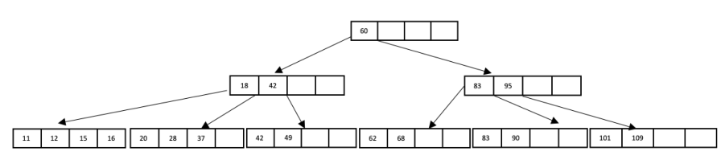

&emsp;&emsp;&emsp;&emsp;&emsp;&emsp;&emsp;Figure 1: B+ Tree of order d = 5 and height h = 3.

&emsp;When answering the following questions, be sure to follow the procedures described in class 
&emsp;and in your textbook. You can make the following assumptions: 
&emsp;&emsp;• A left pointer in an internal node guides towards keys \< than its corresponding key, while 
&emsp;&emsp;&emsp;a right pointer guides towards keys ≥. 
&emsp;&emsp;2 ⌉.• A leaf node underflows when the number of **keys** goes below ⌈d−1 
&emsp;&emsp;2⌉.• An internal node underflows when the number of **pointers** goes below ⌈d

&emsp;&emsp;• You should always consider redistribution before trying to merge two nodes. 
&emsp;Note that B+ tree diagrams for this problem omit leaf pointers for convenience. The leaves of 
&emsp;actual B+ trees are linked together via pointers, forming a singly linked list allowing for quick 
&emsp;traversal through all keys.

### Question 3 continues...

---

**Page 7**

15-445/645 (Fall 2023)   Homework #2   Page 7 of 13

&emsp;(a) **\[5 points\]** How many tree nodes must be fetched to answer the following query: Get all 
&emsp;&emsp;&emsp;records with search key smaller than 42. 
&emsp;&emsp;&emsp;&emsp;&emsp;&emsp;&emsp;&emsp;☒ **5** 
&emsp;&emsp;&emsp;☐  6   ☐  7 
&emsp;&emsp;&emsp;☒ **4** 
&emsp;&emsp;&emsp;&emsp;&emsp;☐  None 
&emsp;&emsp;&emsp;**Solution:** We would first read to fetch the root, and the first internal node, then we can 
&emsp;&emsp;&emsp;either: 
&emsp;&emsp;&emsp;Start from the leftmost leaf and continue fetching leaf nodes until you hit a value bigger 
&emsp;&emsp;&emsp;than 42. 
&emsp;&emsp;&emsp;Start from the leftmost leaf and continue fetching leaf nodes until you reach the leaf 
&emsp;&emsp;&emsp;which page id is equal to the page id of the page before 42.

### Question 3 continues...

---

**Page 8**

15-445/645 (Fall 2023)   Homework #2   Page 8 of 13

&emsp;(b) **\[5 points\]** Insert 40∗into the B+tree. Select the resulting tree. 
&emsp;&emsp;&emsp;☒ **A)**

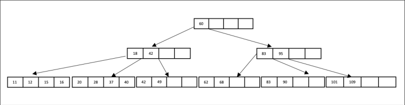

&emsp;&emsp;&emsp;☐  B)

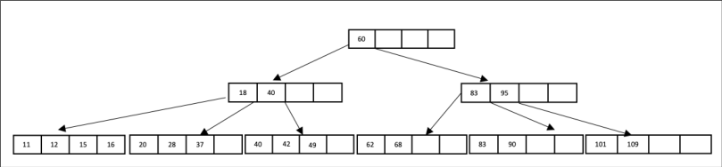

&emsp;&emsp;&emsp;☐  C)

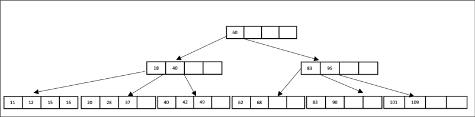

&emsp;&emsp;&emsp;☐  D)

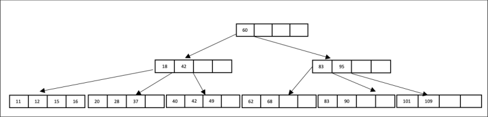

&emsp;&emsp;&emsp;**Solution:** Since the leaf still has space, 40 can be inserted without further action.

### Question 3 continues...

---

**Page 9**

15-445/645 (Fall 2023)   Homework #2   Page 9 of 13

&emsp;(c) **\[5 points\]** Starting with the intial tree, delete 49∗. Select the resulting tree. 
&emsp;&emsp;&emsp;☐  A)

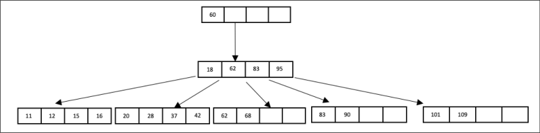

&emsp;&emsp;&emsp;☐  B)

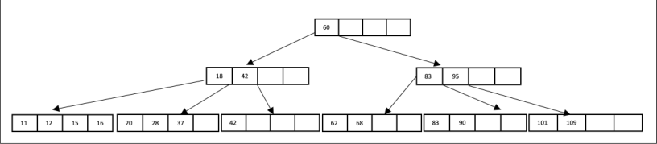

&emsp;&emsp;&emsp;☒ **C)**

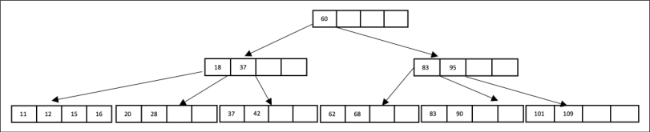

&emsp;&emsp;&emsp;☐  D)

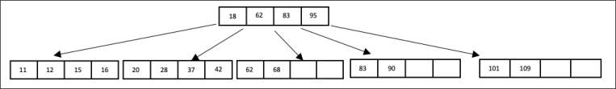

&emsp;&emsp;&emsp;**Solution:** Deleting `49*` causes the leaf node holding it to underflow. The node can 
&emsp;&emsp;&emsp;borrow from its left neighbor, and 37 is copied up.

### Question 3 continues...

---

**Page 10**

15-445/645 (Fall 2023)   Homework #2   Page 10 of 13

&emsp;(d) **\[5 points\]** Starting with the intial tree, delete 62∗and delete 68∗. Select the resulting 
&emsp;&emsp;&emsp;tree. 
&emsp;&emsp;&emsp;☐  A)

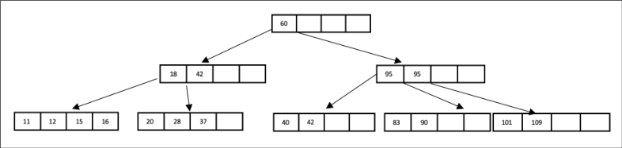

&emsp;&emsp;&emsp;☐  B)

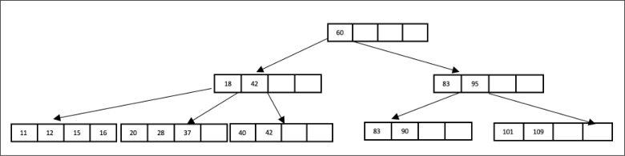

&emsp;&emsp;&emsp;☒ **C)**

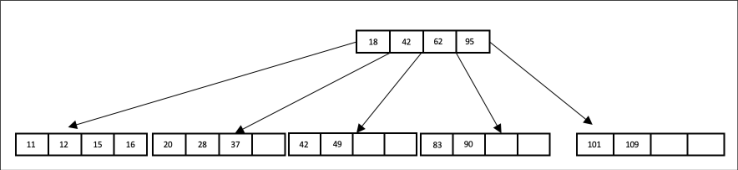

&emsp;&emsp;&emsp;☐  D)

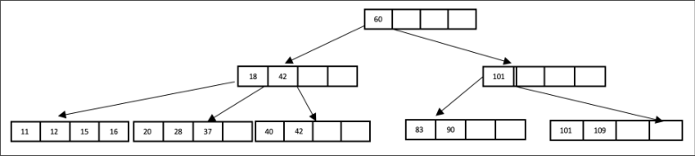

&emsp;&emsp;&emsp;**Solution:** Deleting `62*` and `68*` would delete the leaf node holding their parent to be 
&emsp;&emsp;&emsp;also deleted.

### Question 3 continues...

---

**Page 11**

15-445/645 (Fall 2023)   Homework #2   Page 11 of 13

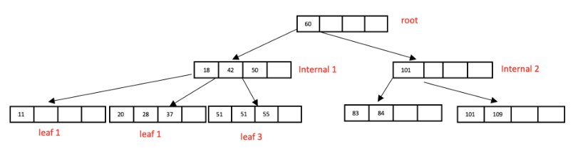

&emsp;&emsp;&emsp;&emsp;&emsp;&emsp;&emsp;&emsp;Figure 2: B+tree with violations

&emsp;(e) The B+Tree shown in Figure 2 is invalid. That is, its nodes violate the correctness prop- 
&emsp;&emsp;&emsp;erties of B+Trees that we discussed in class. If the tree is invalid, select all the properties 
&emsp;&emsp;&emsp;that are violated for each node. If the node is valid, then select ‘None’. There will be **no** 
&emsp;&emsp;&emsp;partial credit for missing violations. 
&emsp;&emsp;&emsp;Note: 
&emsp;&emsp;&emsp;• If a node’s subtrees are not the same height, the balance property is violated at that 
&emsp;&emsp;&emsp;&emsp;node only. 
&emsp;&emsp;&emsp;• If a node’s subtrees contain values not in the range specified by the node’s separator 
&emsp;&emsp;&emsp;&emsp;keys, the separator keys property is violated at that node.

&emsp;&emsp;&emsp;i. **\[2 points\]** Which properties are violated by **Leaf 3**? 
&emsp;&emsp;&emsp;&emsp;☐  Key order property   ☐  Half-full property   ☐  Balance property 
&emsp;&emsp;&emsp;&emsp;&emsp;&emsp;&emsp;&emsp;☒ **None** 
&emsp;&emsp;&emsp;&emsp;☐  Separator keys 
&emsp;&emsp;&emsp;ii. **\[2 points\]** Which properties are violated by **Leaf 1**? 
&emsp;&emsp;&emsp;&emsp;&emsp;&emsp;&emsp;&emsp;☒ **Half-full property** 
&emsp;&emsp;&emsp;&emsp;☐  Key order property   ☐  Balance property 
&emsp;&emsp;&emsp;&emsp;☐  Separator keys   ☐  None 
&emsp;&emsp;&emsp;&emsp;**Solution:** There must be at least 2 keys. 
&emsp;&emsp;&emsp;iii. **\[2 points\]** Which properties are violated by **Internal Node 1**? 
&emsp;&emsp;&emsp;&emsp;☐  Key order property   ☐  Half-full property   ☐  Balance property 
&emsp;&emsp;&emsp;&emsp;☒ **Separator keys** 
&emsp;&emsp;&emsp;&emsp;&emsp;&emsp;&emsp;&emsp;☐  None 
&emsp;&emsp;&emsp;&emsp;**Solution:** The node has only 3 children and 42 is smaller than 51. 
&emsp;&emsp;&emsp;iv. **\[2 points\]** Which properties are violated by **Internal Node 2**? 
&emsp;&emsp;&emsp;&emsp;&emsp;&emsp;&emsp;&emsp;☒ **Half-full property** 
&emsp;&emsp;&emsp;&emsp;☐  Key order property   ☐  Balance property 
&emsp;&emsp;&emsp;&emsp;☐  Separator keys   ☐  None 
&emsp;&emsp;&emsp;&emsp;**Solution:** There must be at least 2 keys. 
&emsp;&emsp;&emsp;v. **\[2 points\]** Which properties are violated by **Root**? 
&emsp;&emsp;&emsp;&emsp;☐  Key order property   ☐  Half-full property   ☐  Balance property 
&emsp;&emsp;&emsp;&emsp;&emsp;&emsp;&emsp;&emsp;☒ **None** 
&emsp;&emsp;&emsp;&emsp;☐  Separator keys

### Question 3 continues...

---

**Page 12**

15-445/645 (Fall 2023)   Homework #2   Page 12 of 13

&emsp;(f)   i. **\[5 points\]** A DBMS may potentially use separate buffer pools for a B+Tree’s inner 
&emsp;&emsp;&emsp;&emsp;node pages and for its leaf node pages. 
&emsp;&emsp;&emsp;&emsp;☒ **True** 
&emsp;&emsp;&emsp;&emsp;&emsp;&emsp;&emsp;&emsp;☐  False 
&emsp;&emsp;&emsp;&emsp;**Solution:** Because the DBMS is aware of whether a page is for a leaf or an inner 
&emsp;&emsp;&emsp;&emsp;node, and because B+Tree transformations never change a leaf into an inner node or 
&emsp;&emsp;&emsp;&emsp;vice- versa, it’s straightforward for a DMBS to use a different buffer pool for inner 
&emsp;&emsp;&emsp;&emsp;node pages than for leaf node pages. Such a configuration would help prevent index 
&emsp;&emsp;&emsp;&emsp;leaf scans from sequentially flooding the buffer pool and harming the performance 
&emsp;&emsp;&emsp;&emsp;of OLTP-style queries on the same index 
&emsp;&emsp;&emsp;ii. **\[5 points\]** A read-only thread needs to hold at most two latches at the same time. 
&emsp;&emsp;&emsp;&emsp;☒ **True** 
&emsp;&emsp;&emsp;&emsp;&emsp;&emsp;&emsp;&emsp;☐  False 
&emsp;&emsp;&emsp;&emsp;**Solution:** A reader needs a latch on the parent and child (or two siblings in a leaf 
&emsp;&emsp;&emsp;&emsp;node scan) at most. 
&emsp;&emsp;&emsp;iii. **\[5 points\]** A write thread needs to hold at most three write latches at the same time 
&emsp;&emsp;&emsp;&emsp;&emsp;&emsp;&emsp;&emsp;☒ **False** 
&emsp;&emsp;&emsp;&emsp;☐  True 
&emsp;&emsp;&emsp;&emsp;**Solution:** A thread may need to hold an arbitrarily large number of write latches, 
&emsp;&emsp;&emsp;&emsp;for every node from the root to a leaf (plus potentially siblings of nodes along the 
&emsp;&emsp;&emsp;&emsp;path), in circumstances where the write might cause a rebalancing of the root 
&emsp;&emsp;&emsp;iv. **\[5 points\]** A write thread might hold only one write latch (Consider a tree that has 
&emsp;&emsp;&emsp;&emsp;more than one leaf node) 
&emsp;&emsp;&emsp;&emsp;☒ **True** 
&emsp;&emsp;&emsp;&emsp;&emsp;&emsp;&emsp;&emsp;☐  False 
&emsp;&emsp;&emsp;&emsp;**Solution:** Using the optimistic latch coupling/crabbing scheme that we discussed 
&emsp;&emsp;&emsp;&emsp;in class, the thread can grab read latches, and only grab one write latch at the leaf 
&emsp;&emsp;&emsp;&emsp;in circumstances where the write doesn’t cause any changes to the structure of the 
&emsp;&emsp;&emsp;&emsp;tree. 
&emsp;&emsp;&emsp;v. **\[5 points\]** A read thread must release its latches in the order they were acquired 
&emsp;&emsp;&emsp;&emsp;(i.e., FIFO) to prevent concurrency errors. 
&emsp;&emsp;&emsp;&emsp;&emsp;&emsp;&emsp;&emsp;☒ **False** 
&emsp;&emsp;&emsp;&emsp;☐  True 
&emsp;&emsp;&emsp;&emsp;**Solution:** Threads can release latches in any order, although FIFO is best for perfor- 
&emsp;&emsp;&emsp;&emsp;mance. 
&emsp;&emsp;&emsp;vi. **\[5 points\]** A write thread must release its latches in the order they were acquired 
&emsp;&emsp;&emsp;&emsp;(i.e., FIFO) to prevent concurrency errors. 
&emsp;&emsp;&emsp;&emsp;&emsp;&emsp;&emsp;&emsp;☒ **False** 
&emsp;&emsp;&emsp;&emsp;☐  True 
&emsp;&emsp;&emsp;&emsp;**Solution:** Threads can release latches in any order, although FIFO is best for perfor- 
&emsp;&emsp;&emsp;&emsp;mance. 
&emsp;&emsp;&emsp;vii. **\[5 points\]** The minimum space utilization for a B+ tree index is 50 percent. 
&emsp;&emsp;&emsp;&emsp;&emsp;&emsp;&emsp;&emsp;☒ **False** 
&emsp;&emsp;&emsp;&emsp;☐  True

### Question 3 continues...

---

**Page 13**

15-445/645 (Fall 2023)   Homework #2   Page 13 of 13

&emsp;&emsp;&emsp;&emsp;**Solution:** By the definition of a B+ tree, each index page, except for the root, has at 
&emsp;&emsp;&emsp;&emsp;least d and at most 2d key entries. Therefore—with the exception of the root—the 
&emsp;&emsp;&emsp;&emsp;minimum space utilization guaranteed by a B+ tree index is 50 percent, but since 
&emsp;&emsp;&emsp;&emsp;the root is part of the tree, the answer is False.

&emsp;&emsp;&emsp;&emsp;&emsp;&emsp;&emsp;&emsp;End of Homework #2

