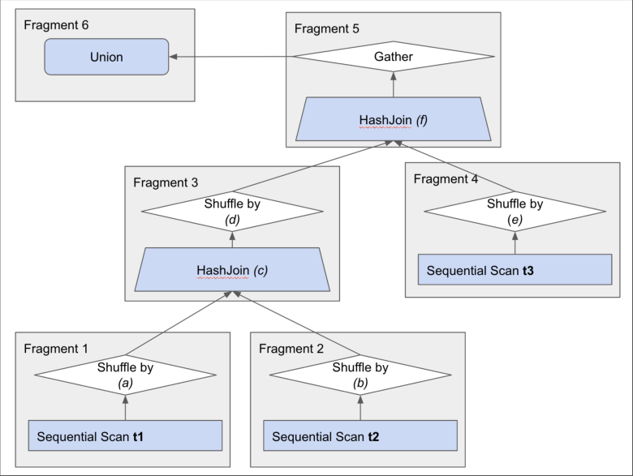

# CMU 15-445 Fall 2023: Homework 5: Official solutions

> Copied from the original: <https://15445.courses.cs.cmu.edu/fall2023/assignments.html>. Text and figures are taken from the PDF as is; nothing was answered or rewritten. The original PDF is in this folder.

---

**Page 1**

&emsp;&emsp;&emsp;&emsp;&emsp;&emsp;&emsp;&emsp;CARNEGIE MELLON UNIVERSITY 
&emsp;&emsp;&emsp;&emsp;&emsp;&emsp;&emsp;&emsp;COMPUTER SCIENCE DEPARTMENT 
&emsp;&emsp;&emsp;&emsp;&emsp;&emsp;15-445/645 – DATABASE SYSTEMS (FALL 2023) 
&emsp;&emsp;&emsp;&emsp;&emsp;&emsp;&emsp;PROF. ANDY PAVLO AND JIGNESH PATEL

&emsp;&emsp;&emsp;&emsp;&emsp;&emsp;Homework #5 (by Fernando Lisboa) – Solutions 
&emsp;&emsp;&emsp;&emsp;&emsp;&emsp;&emsp;&emsp;Due: **Sunday Dec 3, 2023 @ 11:59pm**

**IMPORTANT:** 
&emsp;• **Upload this PDF** with your answers to **Gradescope by 11:59pm on Sunday Dec 3, 2023**. 
&emsp;• **Plagiarism**: Homework may be discussed with other students, but all homework is to be 
&emsp;&emsp;completed **individually**. 
&emsp;• **You have to use this PDF for all of your answers.** 
For your information: 
&emsp;• Graded out of **100** points; **4** questions total 
&emsp;Revision : 2023/12/03 22:57

&emsp;&emsp;&emsp;&emsp;&emsp;&emsp;&emsp;&emsp;Question   Points   Score 
&emsp;&emsp;&emsp;&emsp;&emsp;&emsp;&emsp;&emsp;Write-Ahead Logging   25 
&emsp;&emsp;&emsp;&emsp;&emsp;&emsp;&emsp;&emsp;Two-Phase Commit   18 
&emsp;&emsp;&emsp;&emsp;&emsp;&emsp;&emsp;&emsp;Distributed Query Plan   27 
&emsp;&emsp;&emsp;&emsp;&emsp;&emsp;&emsp;&emsp;Miscellaneous   30 
&emsp;&emsp;&emsp;&emsp;&emsp;&emsp;&emsp;&emsp;Total:   100

&emsp;&emsp;&emsp;&emsp;&emsp;&emsp;&emsp;&emsp;1

---

**Page 2**

15-445/645 (Fall 2023)   Homework #5   Page 2 of 12

### **Question 1: Write-Ahead Logging. . . . . . . . . . . . . . . . . . . . . . . . . . . . .\[25 points\]**

&emsp;Consider a DBMS using write-ahead logging with physical log records with the STEAL and 
&emsp;NO-FORCE buffer pool management policy. Assume the DBMS executes a non-fuzzy check- 
&emsp;point where all dirty pages are written to disk. 
&emsp;Its transaction recovery log contains log records of the following form: 
&emsp;&emsp;`<txnId,` `objectId,` `beforeValue,` `afterValue>` 
&emsp;The log also contains checkpoint, transaction begin, and transaction commit records. 
&emsp;The database contains three objects (i.e., A, B, and C). 
&emsp;The DBMS sees records as in Figure 1 in the WAL on disk after a crash. 
&emsp;Assume the DBMS uses ARIES as described in class to recover from failures.

&emsp;&emsp;&emsp;&emsp;&emsp;&emsp;&emsp;&emsp;**LSN**   **WAL Record** 
&emsp;&emsp;&emsp;&emsp;&emsp;&emsp;&emsp;&emsp;1`<T1` `BEGIN>` 
&emsp;&emsp;&emsp;&emsp;&emsp;&emsp;&emsp;&emsp;2   `<T1,` `A,` `12,` `55>` 
&emsp;&emsp;&emsp;&emsp;&emsp;&emsp;&emsp;&emsp;3`<T1,` `B,` `42,` `8>` 
&emsp;&emsp;&emsp;&emsp;&emsp;&emsp;&emsp;&emsp;4   `<T2` `BEGIN>` 
&emsp;&emsp;&emsp;&emsp;&emsp;&emsp;&emsp;&emsp;5`<T2,` `A,` `55,` `62>` 
&emsp;&emsp;&emsp;&emsp;&emsp;&emsp;&emsp;&emsp;6   `<T1` `COMMIT>` 
&emsp;&emsp;&emsp;&emsp;&emsp;&emsp;&emsp;&emsp;7`<T2,` `C,` `0,` `35>` 
&emsp;&emsp;&emsp;&emsp;&emsp;&emsp;&emsp;&emsp;8   `<T3` `BEGIN>` 
&emsp;&emsp;&emsp;&emsp;&emsp;&emsp;&emsp;&emsp;9   `<T3,` `B,` `8,` `81>` 
&emsp;&emsp;&emsp;&emsp;&emsp;&emsp;&emsp;&emsp;10   `<T2,` `A,` `62,` `67>` 
&emsp;&emsp;&emsp;&emsp;&emsp;&emsp;&emsp;&emsp;11   `<``CHECKPOINT``>` 
&emsp;&emsp;&emsp;&emsp;&emsp;&emsp;&emsp;&emsp;12`<T3,` `B,` `81,` `45>` 
&emsp;&emsp;&emsp;&emsp;&emsp;&emsp;&emsp;&emsp;13   `<T2,` `A,` `67,` `13>` 
&emsp;&emsp;&emsp;&emsp;&emsp;&emsp;&emsp;&emsp;14`<T3` `COMMIT>` 
&emsp;&emsp;&emsp;&emsp;&emsp;&emsp;&emsp;&emsp;15   `<T2,` `C,` `35,` `66>`

&emsp;&emsp;&emsp;&emsp;&emsp;&emsp;&emsp;&emsp;Figure 1: WAL

&emsp;(a) **\[6 points\]** What are the values of A, B, and C in the database stored on disk before the 
&emsp;&emsp;&emsp;DBMS recovers the state of the database? 
&emsp;&emsp;&emsp;&emsp;&emsp;☐  A=67, B=81, C=35 
&emsp;&emsp;&emsp;&emsp;&emsp;☐  A=13, B=45, C=66 
&emsp;&emsp;&emsp;&emsp;&emsp;☐  A=13, B=45, C=Not possible to determine 
&emsp;&emsp;&emsp;&emsp;&emsp;☐  A=55, B=8, C=35 
&emsp;&emsp;&emsp;&emsp;&emsp;☐  A=Not possible to determine, B:42, C=0 
&emsp;&emsp;&emsp;&emsp;&emsp;☐  A=12, B=42, C=Not possible to determine 
&emsp;&emsp;&emsp;&emsp;&emsp;☐  A=Not possible to determine, B=Not possible to determine, C:66 
&emsp;&emsp;&emsp;&emsp;&emsp;☐  A=Not possible to determine, B=81, C=Not possible to determine 
&emsp;&emsp;&emsp;&emsp;&emsp;☐  A=13, B=Not possible to determine C=35

### Question 1 continues...

---

**Page 3**

15-445/645 (Fall 2023)   Homework #5   Page 3 of 12 
&emsp;&emsp;&emsp;&emsp;&emsp;☒ **A,B,C=Not possible to determine** 
&emsp;&emsp;&emsp;**Solution:** The checkpoint flushed everything to disk, but then the data objects A,B and 
&emsp;&emsp;&emsp;C were all modified by transactions after the checkpoint. 
&emsp;&emsp;&emsp;Since we are using STEAL, any dirty page could be written to disk, so therefore we 
&emsp;&emsp;&emsp;don’t know the contents of the database on disk at the crash. 
&emsp;(b) **\[3 points\]** What should be the correct action on T1 when recovering the database from 
&emsp;&emsp;&emsp;WAL? 
&emsp;&emsp;&emsp;&emsp;&emsp;☐  redo all of T1’s changes 
&emsp;&emsp;&emsp;&emsp;&emsp;☐  undo all of T1’s changes 
&emsp;&emsp;&emsp;&emsp;&emsp;☒ **do nothing to T1** 
&emsp;&emsp;&emsp;**Solution:** T1 committed before the checkpoint. All of its changes were written to disk. 
&emsp;&emsp;&emsp;There is nothing to redo or undo.

&emsp;(c) **\[3 points\]** What should be the correct action on T2 when recovering the database from 
&emsp;&emsp;&emsp;WAL? 
&emsp;&emsp;&emsp;&emsp;&emsp;☐  redo all of T2’s changes 
&emsp;&emsp;&emsp;&emsp;&emsp;☒ **undo all of T2’s changes** 
&emsp;&emsp;&emsp;&emsp;&emsp;☐  do nothing to T2 
&emsp;&emsp;&emsp;**Solution:** T2 never committed. All of its changes should only be undone.

&emsp;(d) **\[3 points\]** What should be the correct action on T3 when recovering the database from 
&emsp;&emsp;&emsp;WAL? 
&emsp;&emsp;&emsp;&emsp;&emsp;☒ **redo all of T3’s changes** 
&emsp;&emsp;&emsp;&emsp;&emsp;☐  undo all of T3’s changes 
&emsp;&emsp;&emsp;&emsp;&emsp;☐  do nothing to T3 
&emsp;&emsp;&emsp;**Solution:** T3 committed after the checkpoint, so that means the DBMS has to redo all 
&emsp;&emsp;&emsp;of its changes.

&emsp;(e) **\[10 points\]** Assume that the DBMS flushes all dirty pages when the recovery process 
&emsp;&emsp;&emsp;finishes. What are the values of A, B, and C after the DBMS recovers the state of the 
&emsp;&emsp;&emsp;database from the WAL in Figure 1? 
&emsp;&emsp;&emsp;&emsp;&emsp;☐  A=33, B=6, C=42 
&emsp;&emsp;&emsp;&emsp;&emsp;☐  A=13, B=66, C=55 
&emsp;&emsp;&emsp;&emsp;&emsp;☐  A=13, B=45, C=66 
&emsp;&emsp;&emsp;&emsp;&emsp;☐  A=13, B=7, C=67 
&emsp;&emsp;&emsp;&emsp;&emsp;☐  A=12, B=42, C=0

### Question 1 continues...

---

**Page 4**

15-445/645 (Fall 2023)   Homework #5   Page 4 of 12

&emsp;&emsp;&emsp;&emsp;&emsp;☐  A=33, B=42, C=100 
&emsp;&emsp;&emsp;&emsp;&emsp;☒ **A=55, B=45, C=0** 
&emsp;&emsp;&emsp;&emsp;&emsp;☐  A=13, B=42, C=67 
&emsp;&emsp;&emsp;&emsp;&emsp;☐  A=33, B=20, C=43 
&emsp;&emsp;&emsp;&emsp;&emsp;☐  A=55, B=45, C=66 
&emsp;&emsp;&emsp;&emsp;&emsp;☐  A=55, B=12, C=66 
&emsp;&emsp;&emsp;&emsp;&emsp;☐  Not possible to determine 
&emsp;&emsp;&emsp;**Solution:** A = 55 (Undo changes by T2; rollback to value committed by T1) 
&emsp;&emsp;&emsp;B = 45 (Redo changes by T3; rollback to afterValue of last T3 update) 
&emsp;&emsp;&emsp;C = 0 (Undo changes by T2; rollback to beforeValue of earliest T2 update)

&emsp;&emsp;&emsp;&emsp;&emsp;&emsp;&emsp;&emsp;Homework #5 continues...

---

**Page 5**

15-445/645 (Fall 2023)   Homework #5   Page 5 of 12

### **Question 2: Two-Phase Commit . . . . . . . . . . . . . . . . . . . . . . . . . . . . . . . \[18 points\]**

&emsp;Consider a distributed transaction T operating under the two-phase commit protocol with the 
&emsp;**early acknowledgement optimization**. Let N0 be the coordinator node, and N1, N2, N3 be the 
&emsp;participant nodes. Let the C be the client application issuing the transaction request. Assume 
&emsp;that the client communicates directly with the coordinator node. 
&emsp;The following messages have been sent:

&emsp;&emsp;&emsp;&emsp;&emsp;&emsp;&emsp;&emsp;time   message 
&emsp;&emsp;&emsp;&emsp;&emsp;&emsp;&emsp;&emsp;1C to N0: “`REQUEST:COMMIT`” 
&emsp;&emsp;&emsp;&emsp;&emsp;&emsp;&emsp;&emsp;2   N0 to N2: “`Phase1:PREPARE`” 
&emsp;&emsp;&emsp;&emsp;&emsp;&emsp;&emsp;&emsp;3N2 to N0: “`OK`” 
&emsp;&emsp;&emsp;&emsp;&emsp;&emsp;&emsp;&emsp;4   N0 to N1: “`Phase1:PREPARE`” 
&emsp;&emsp;&emsp;&emsp;&emsp;&emsp;&emsp;&emsp;5N0 to N3: “`Phase1:PREPARE`” 
&emsp;&emsp;&emsp;&emsp;&emsp;&emsp;&emsp;&emsp;6   N1 to N0: “`OK`” 
&emsp;&emsp;&emsp;&emsp;&emsp;&emsp;&emsp;&emsp;7   N3 to N0: “`OK`” 
&emsp;&emsp;&emsp;&emsp;Figure 2: Two-Phase Commit messages for transaction T for parts (a), (b)

&emsp;(a) **\[6 points\]** Who should send a message next at time 8 in Figure 2? Select all the possible 
&emsp;&emsp;&emsp;answers. 
&emsp;&emsp;&emsp;☐  C 
&emsp;&emsp;&emsp;☒ N0 
&emsp;&emsp;&emsp;☐  N1 
&emsp;&emsp;&emsp;☐  N2 
&emsp;&emsp;&emsp;☐  N3 
&emsp;&emsp;&emsp;☐  It is not possible to determine 
&emsp;&emsp;&emsp;**Solution:** At the time when all participant nodes have responded with “`OK`”, T is con- 
&emsp;&emsp;&emsp;sidered to be committed. N0 must notify the participant nodes N1, N2, and N3 of the 
&emsp;&emsp;&emsp;decision to commit. At this time N0 should also notify the client application since the 
&emsp;&emsp;&emsp;protocol is running with the early acknowledgement optimization.

&emsp;(b) **\[6 points\]** To whom? Again, select all the possible answers. 
&emsp;&emsp;&emsp;☒ C 
&emsp;&emsp;&emsp;☐  N0 
&emsp;&emsp;&emsp;☒ N1 
&emsp;&emsp;&emsp;☒ N2 
&emsp;&emsp;&emsp;☒ N3 
&emsp;&emsp;&emsp;☐  It is not possible to determine 
&emsp;&emsp;&emsp;**Solution:** At the time when all participant nodes have responded with “`OK`”, T is con- 
&emsp;&emsp;&emsp;sidered to be committed. N0 must notify the participant nodes N1, N2, and N3 of the 
&emsp;&emsp;&emsp;decision to commit. At this time N0 should also notify the client application since the 
&emsp;&emsp;&emsp;protocol is running with the early acknowledgement optimization.

### Question 2 continues...

---

**Page 6**

15-445/645 (Fall 2023)   Homework #5   Page 6 of 12

&emsp;(c) **\[6 points\]** Now suppose that the two-phase commit protocol is incorrectly implemented 
&emsp;&emsp;&emsp;in our system, and we instead have the message log shown in Figure 3 (below). C, N0, 
&emsp;&emsp;&emsp;N1, N2, and N3 all play the same roles as they did in the previous parts. 
&emsp;&emsp;&emsp;At what timestep(s) is the two-phase commit protocol violated? Select all that apply. 
&emsp;&emsp;&emsp;☐  2 
&emsp;&emsp;&emsp;☐  3 
&emsp;&emsp;&emsp;☐  4 
&emsp;&emsp;&emsp;☐  5 
&emsp;&emsp;&emsp;☐  6 
&emsp;&emsp;&emsp;☐  7 
&emsp;&emsp;&emsp;☒ **8** 
&emsp;&emsp;&emsp;☒ **9**

&emsp;&emsp;&emsp;**Solution:** After receiving the “`ABORT`” from N2 at time 5, the coordinator (N0) will 
&emsp;&emsp;&emsp;mark the transaction as aborted, and it will not proceed to the commit phase with nodes 
&emsp;&emsp;&emsp;N1 and N3 at times 8 and 9. It should instead notify all of the participants of the decision 
&emsp;&emsp;&emsp;to abort the transaction.

&emsp;&emsp;&emsp;&emsp;&emsp;&emsp;&emsp;&emsp;time   message 
&emsp;&emsp;&emsp;&emsp;&emsp;&emsp;&emsp;&emsp;1C to N0: “`REQUEST:COMMIT`” 
&emsp;&emsp;&emsp;&emsp;&emsp;&emsp;&emsp;&emsp;2   N0 to N2: “`Phase1:PREPARE`” 
&emsp;&emsp;&emsp;&emsp;&emsp;&emsp;&emsp;&emsp;3N0 to N1: “`Phase1:PREPARE`” 
&emsp;&emsp;&emsp;&emsp;&emsp;&emsp;&emsp;&emsp;4   N0 to N3: “`Phase1:PREPARE`” 
&emsp;&emsp;&emsp;&emsp;&emsp;&emsp;&emsp;&emsp;5   N2 to N0: “`ABORT`” 
&emsp;&emsp;&emsp;&emsp;&emsp;&emsp;&emsp;&emsp;6N1 to N0: “`OK`” 
&emsp;&emsp;&emsp;&emsp;&emsp;&emsp;&emsp;&emsp;7   N3 to N0: “`OK`” 
&emsp;&emsp;&emsp;&emsp;&emsp;&emsp;&emsp;&emsp;8N0 to N1: “`Phase2:COMMIT`” 
&emsp;&emsp;&emsp;&emsp;&emsp;&emsp;&emsp;&emsp;9   N0 to N3: “`Phase2:COMMIT`” 
&emsp;&emsp;&emsp;Figure 3: Incorrect Two-Phase Commit messages for transaction T for part (c)

&emsp;&emsp;&emsp;&emsp;&emsp;&emsp;&emsp;&emsp;Homework #5 continues...

---

**Page 7**

15-445/645 (Fall 2023)   Homework #5   Page 7 of 12

### **Question 3: Distributed Query Plan . . . . . . . . . . . . . . . . . . . . . . . . . . . \[27 points\]**

&emsp;The CMUDB group is working on a brand new shared-nothing distributed database system 
&emsp;called BusTub\*\*\*. They are developing the distributed query engine. 
&emsp;Given the following schema:

&emsp;&emsp;&emsp;&emsp;&emsp;&emsp;`CREATE` `TABLE` `t1(PARTITION` `KEY` `v1` `int,` `v2` `int);` 
&emsp;&emsp;&emsp;&emsp;&emsp;&emsp;`CREATE` `TABLE` `t2(PARTITION` `KEY` `v3` `int,` `v4` `int);` 
&emsp;&emsp;&emsp;&emsp;&emsp;&emsp;`CREATE` `TABLE` `t3(PARTITION` `KEY` `v5` `int,` `v6` `int);`

&emsp;The database system partitions the tables by key range. That is to say, each node in the system 
&emsp;manages rows of the table within a non-overlapping range of keys. 
&emsp;Given the following query:

&emsp;Assume that the query optimizer doesn’t know the ranges of data stored on each node and only 
&emsp;knows the tables are sharded by some keys, and it generates the following plan:

### Question 3 continues...

---

**Page 8**

15-445/645 (Fall 2023)   Homework #5   Page 8 of 12

&emsp;Note that this query plan is missing some expressions in the Shuffle and HashJoin operators, 
&emsp;corresponding to the following question parts. Fill in the missing parts to this query plan. 
&emsp;(a) **\[3 points\]** In the Shuffle from fragment 1 to fragment 3, which column should be used 
&emsp;&emsp;&emsp;to shuffle the outputted rows of the **t1** scan? 
&emsp;&emsp;&emsp;☒ **v1** 
&emsp;&emsp;&emsp;☐  v2 
&emsp;&emsp;&emsp;☐  v3 
&emsp;&emsp;&emsp;☐  v4 
&emsp;&emsp;&emsp;☐  v5 
&emsp;&emsp;&emsp;☐  v6 
&emsp;&emsp;&emsp;**Solution:** The rows should be shuffled by their join key. For **t1** this is **v1**. 
&emsp;(b) **\[3 points\]** In the Shuffle from fragment 2 to fragment 3, which column should be used 
&emsp;&emsp;&emsp;to shuffle the outputted rows of the **t2** scan? 
&emsp;&emsp;&emsp;☐  v1 
&emsp;&emsp;&emsp;☐  v2 
&emsp;&emsp;&emsp;☒ **v3** 
&emsp;&emsp;&emsp;☐  v4 
&emsp;&emsp;&emsp;☐  v5 
&emsp;&emsp;&emsp;☐  v6 
&emsp;&emsp;&emsp;**Solution:** The rows should be shuffled by their join key in the next fragment. For **t2** 
&emsp;&emsp;&emsp;this is **v3**. 
&emsp;(c) **\[2 points\]** How are tables **t1** and **t2** being joined in the fragment 3 HashJoin? 
&emsp;&emsp;&emsp;☐  v1 = v2 
&emsp;&emsp;&emsp;☐  v2 = v3 
&emsp;&emsp;&emsp;☒ v1 = v3 
&emsp;&emsp;&emsp;☐  v2 = v4 
&emsp;&emsp;&emsp;☐  v3 = v5 
&emsp;&emsp;&emsp;☐  v4 = v5 
&emsp;&emsp;&emsp;**Solution:** Tables **t1** and **t2** are being joined on v1 = v3 in the query. 
&emsp;(d) **\[3 points\]** In the Shuffle from fragment 3 to fragment 5, which column should be used 
&emsp;&emsp;&emsp;to shuffle the outputted rows of the HashJoin? 
&emsp;&emsp;&emsp;☐  v1 
&emsp;&emsp;&emsp;☐  v2 
&emsp;&emsp;&emsp;☐  v3 
&emsp;&emsp;&emsp;☒ **v4** 
&emsp;&emsp;&emsp;☐  v5 
&emsp;&emsp;&emsp;☐  v6 
&emsp;&emsp;&emsp;**Solution:** The rows should be shuffled by their join key in the next fragment. For the 
&emsp;&emsp;&emsp;output of the inner join of tables **t1** and **t2**, this is **v4**.

### Question 3 continues...

---

**Page 9**

15-445/645 (Fall 2023)   Homework #5   Page 9 of 12

&emsp;(e) **\[3 points\]** In the Shuffle from fragment 4 to fragment 5, which column should be used 
&emsp;&emsp;&emsp;to shuffle the outputted rows of the **t3** scan? 
&emsp;&emsp;&emsp;☐  v1 
&emsp;&emsp;&emsp;☐  v2 
&emsp;&emsp;&emsp;☐  v3 
&emsp;&emsp;&emsp;☐  v4 
&emsp;&emsp;&emsp;☒ **v5** 
&emsp;&emsp;&emsp;☐  v6 
&emsp;&emsp;&emsp;**Solution:** The rows should be shuffled by their join key in the next fragment. For **t3**, 
&emsp;&emsp;&emsp;this is **v5**. 
&emsp;(f) **\[3 points\]** How are the input tables being joined in the fragment 5 HashJoin? 
&emsp;&emsp;&emsp;☐  v1 = v2 
&emsp;&emsp;&emsp;☐  v2 = v3 
&emsp;&emsp;&emsp;☐  v1 = v3 
&emsp;&emsp;&emsp;☐  v2 = v4 
&emsp;&emsp;&emsp;☐  v3 = v5 
&emsp;&emsp;&emsp;☒ v4 = v5 
&emsp;&emsp;&emsp;**Solution:** Tables (**t1** INNER JOIN **t2**) and **t3** are being joined on v4 = v5 in the query. 
&emsp;(g) **\[5 points\]** Assume there are 3 nodes in the system and the data ranges in each node are 
&emsp;&emsp;&emsp;as follows: 
&emsp;&emsp;&emsp;&emsp;&emsp;&emsp;&emsp;&emsp;t1.v1   t2.v3   t3.v5 
&emsp;&emsp;&emsp;&emsp;&emsp;&emsp;&emsp;Node 1   0 - 999   0 - 999   0 - 999 
&emsp;&emsp;&emsp;&emsp;&emsp;&emsp;&emsp;Node 2   1000 - 1999   1000 - 1999   1000 - 1999 
&emsp;&emsp;&emsp;&emsp;&emsp;&emsp;&emsp;Node 3   2000 - 2999   2000 - 2999   2000 - 2999 
&emsp;&emsp;&emsp;&emsp;&emsp;&emsp;&emsp;&emsp;Table 1: Data distribution for table t1 to t3

&emsp;&emsp;&emsp;Assume that t2.v4 also has all values across 0-2999, except that they are uniformly ran- 
&emsp;&emsp;&emsp;domly distributed across the three nodes (i.e., the table is not partitioned by v4 and so any 
&emsp;&emsp;&emsp;value of v4 could be in any node).

&emsp;&emsp;&emsp;Given the data ranges on each node and our query plan from earlier **assume that our sys-** 
&emsp;&emsp;&emsp;**tem has generated the best possible execution schedule** (i.e., the optimal scheduling of 
&emsp;&emsp;&emsp;scan/join partitions on nodes within fragments which minimizes the worst case amount 
&emsp;&emsp;&emsp;of data transferred over the network).

&emsp;&emsp;&emsp;What is the worst case number of rows that need to be shuffled from fragments 1 and 2 to 
&emsp;&emsp;&emsp;fragment 3 across the network in this schedule? 
&emsp;&emsp;&emsp;☒ **0** 
&emsp;&emsp;&emsp;☐  1000

### Question 3 continues...

---

**Page 10**

15-445/645 (Fall 2023)   Homework #5   Page 10 of 12

&emsp;&emsp;&emsp;☐  2000 
&emsp;&emsp;&emsp;☐  3000 
&emsp;&emsp;&emsp;**Solution:** Since we know that all equal values of t1.v1 and t2.v3 are on the same node, 
&emsp;&emsp;&emsp;they can be locally joined at each node without needing to shuffle any data from the 
&emsp;&emsp;&emsp;scan fragment to the HashJoin fragment over the network. That is, we can scan and join 
&emsp;&emsp;&emsp;0-999 on Node 1, 1000-1999 on Node 2, and 2000-2999 on Node 3 without needing to 
&emsp;&emsp;&emsp;transfer any data between nodes. 
&emsp;(h) **\[5 points\]** With same assumptions as the previous part, what is the worst case number 
&emsp;&emsp;&emsp;of rows that need to be shuffled from fragments 3 and 4 to fragment 5 across the network 
&emsp;&emsp;&emsp;in this schedule? 
&emsp;&emsp;&emsp;☐  0 
&emsp;&emsp;&emsp;☐  1000 
&emsp;&emsp;&emsp;☐  2000 
&emsp;&emsp;&emsp;☒ **3000** 
&emsp;&emsp;&emsp;**Solution:** Fragment 5 joins on t2.v4 and t3.v5. Since t2.v4 is not a partition key, each 
&emsp;&emsp;&emsp;value can be in any one of the 3 compute nodes. In the worst case, none of the equal 
&emsp;&emsp;&emsp;t2.v4 and t3.v5 values are in the same node and so they must all be shuffled to the same 
&emsp;&emsp;&emsp;node. There are 3000 possible values.

&emsp;&emsp;&emsp;&emsp;&emsp;&emsp;&emsp;&emsp;Homework #5 continues...

---

**Page 11**

15-445/645 (Fall 2023)   Homework #5   Page 11 of 12

### **Question 4: Miscellaneous . . . . . . . . . . . . . . . . . . . . . . . . . . . . . . . . . . . . \[30 points\]**

&emsp;(a) **\[3 points\]** Both PAXOS and Two-Phase Commit protocols can be used to implement 
&emsp;&emsp;&emsp;distributed transactions. 
&emsp;&emsp;&emsp;&emsp;&emsp;☒ **True** 
&emsp;&emsp;&emsp;&emsp;&emsp;☐  False

&emsp;(b) **\[3 points\]** A DBMS implementing transactions via shadow paging never has to undo or 
&emsp;&emsp;&emsp;redo any actions of a transaction. 
&emsp;&emsp;&emsp;&emsp;&emsp;☒ **True** 
&emsp;&emsp;&emsp;&emsp;&emsp;☒ **False** 
&emsp;&emsp;&emsp;**Solution:** The wording to this question was ambiguous as to whether or not cleaning 
&emsp;&emsp;&emsp;up the shadow pages on recovery was considered undoing the actions of a transaction, 
&emsp;&emsp;&emsp;and so both answers were accepted.

&emsp;(c) **\[3 points\]** In reference to recovery algorithms that use a write-ahead log (WAL). Under 
&emsp;&emsp;&emsp;NO-STEAL + FORCE policy, a DBMS will need to redo the changes of a committed 
&emsp;&emsp;&emsp;transaction during recovery. 
&emsp;&emsp;&emsp;&emsp;&emsp;☐  True 
&emsp;&emsp;&emsp;&emsp;&emsp;☒ **False**

&emsp;(d) **\[3 points\]** In reference to recovery algorithms that use a write-ahead log (WAL). Under 
&emsp;&emsp;&emsp;NO-STEAL + FORCE policy, a DBMS will have to undo the changes of an aborted 
&emsp;&emsp;&emsp;transaction during recovery. 
&emsp;&emsp;&emsp;&emsp;&emsp;☐  True 
&emsp;&emsp;&emsp;&emsp;&emsp;☒ **False**

&emsp;(e) **\[3 points\]** Fuzzy checkpoints need to block the execution of all transactions while a 
&emsp;&emsp;&emsp;consistent snapshot is written to disk. 
&emsp;&emsp;&emsp;&emsp;&emsp;☐  True 
&emsp;&emsp;&emsp;&emsp;&emsp;☒ **False**

&emsp;(f) **\[3 points\]** For a DBMS that uses ARIES, all updated pages must be flushed to disk for 
&emsp;&emsp;&emsp;a transaction to commit. 
&emsp;&emsp;&emsp;&emsp;&emsp;☐  True 
&emsp;&emsp;&emsp;&emsp;&emsp;☒ **False**

&emsp;(g) **\[3 points\]** During the undo phase of ARIES, all transactions that committed after the 
&emsp;&emsp;&emsp;last checkpoint are undone.

### Question 4 continues...

---

**Page 12**

15-445/645 (Fall 2023)   Homework #5   Page 12 of 12

&emsp;&emsp;&emsp;&emsp;&emsp;☐  True 
&emsp;&emsp;&emsp;&emsp;&emsp;☒ **False**

&emsp;(h) **\[3 points\]** In ARIES, only transactions that commit will have an associated “TXN- 
&emsp;&emsp;&emsp;END” record in the log. 
&emsp;&emsp;&emsp;&emsp;&emsp;☐  True 
&emsp;&emsp;&emsp;&emsp;&emsp;☒ **False**

&emsp;(i) **\[3 points\]** With consistent hashing, if a node fails then all keys must be reshuffled among 
&emsp;&emsp;&emsp;the remaining nodes. 
&emsp;&emsp;&emsp;&emsp;&emsp;☐  True 
&emsp;&emsp;&emsp;&emsp;&emsp;☒ **False**

&emsp;(j) **\[3 points\]** In a system with strong consistency requirements, it is best for the DBMS to 
&emsp;&emsp;&emsp;implement active-passive replication with asynchronous replication and continuous log 
&emsp;&emsp;&emsp;streaming. 
&emsp;&emsp;&emsp;&emsp;&emsp;☐  True 
&emsp;&emsp;&emsp;&emsp;&emsp;☒ **False**

&emsp;&emsp;&emsp;&emsp;&emsp;&emsp;&emsp;&emsp;End of Homework #5

