# CMU 15-445 Spring 2024: Homework 2: Questions

> Copied from the original: <https://15445.courses.cs.cmu.edu/spring2024/assignments.html>. Text and figures are taken from the PDF as is; nothing was answered or rewritten. The original PDF is in this folder.

---

**Page 1**

&emsp;&emsp;&emsp;&emsp;&emsp;&emsp;&emsp;&emsp;CARNEGIE MELLON UNIVERSITY 
&emsp;&emsp;&emsp;&emsp;&emsp;&emsp;&emsp;&emsp;COMPUTER SCIENCE DEPARTMENT 
&emsp;&emsp;&emsp;&emsp;&emsp;15-445/645 – DATABASE SYSTEMS (SPRING 2024) 
&emsp;&emsp;&emsp;&emsp;&emsp;&emsp;&emsp;&emsp;PROF. JIGNESH PATEL

&emsp;&emsp;&emsp;&emsp;&emsp;&emsp;&emsp;&emsp;Homework #2 (by Shivang and Avery ) 
&emsp;&emsp;&emsp;&emsp;&emsp;&emsp;&emsp;Due: **Friday February 16, 2024 @ 11:59pm**

**IMPORTANT:** 
&emsp;• Enter all of your answers into **Gradescope by 11:59pm on Friday February 16, 2024.** 
&emsp;• **Plagiarism**: Homework may be discussed with other students, but all homework is to be 
&emsp;&emsp;completed **individually**. 
For your information: 
&emsp;• Graded out of **100** points; **4** questions total 
&emsp;• Rough time estimate: ≈4-6 hours (1-1.5 hours for each question) 
&emsp;Revision : 2024/02/05 15:08

&emsp;&emsp;&emsp;&emsp;&emsp;&emsp;&emsp;&emsp;Question   Points   Score 
&emsp;&emsp;&emsp;&emsp;&emsp;&emsp;&emsp;&emsp;Storage Models   24 
&emsp;&emsp;&emsp;&emsp;&emsp;&emsp;&emsp;Linear Hashing and Cuckoo Hashing   24 
&emsp;&emsp;&emsp;&emsp;&emsp;&emsp;&emsp;&emsp;Extendible Hashing   20 
&emsp;&emsp;&emsp;&emsp;&emsp;&emsp;&emsp;&emsp;B+Tree   32 
&emsp;&emsp;&emsp;&emsp;&emsp;&emsp;&emsp;&emsp;Total:   100

&emsp;&emsp;&emsp;&emsp;&emsp;&emsp;&emsp;&emsp;1

---

**Page 2**

15-445/645 (Spring 2024)   Homework #2   Page 2 of 14

### **Question 1: Storage Models . . . . . . . . . . . . . . . . . . . . . . . . . . . . . . . . . . . \[24 points\]**

&emsp;Consider a database with a single table `T(song` `id,song` `name,artist` `id,duration` 
&emsp;`number` `of` `streams)`, where `song` `id` is the primary key, and all attributes are the same fixed 
&emsp;width. Suppose `T` has 10,000 tuples that fit into 500 pages, Ignore any additional storage 
&emsp;overhead for the table (e.g., page headers, tuple headers). Additionally, you should make the 
&emsp;following assumptions: 
&emsp;&emsp;• The DBMS does not have any additional meta-data (e.g., sort order, zone maps). 
&emsp;&emsp;• `T` does not have any indexes (including for primary key `song` `id`). 
&emsp;&emsp;• None of `T`’s pages are already in the buffer pool. The DMBS has an infinite buffer pool. 
&emsp;&emsp;• Content-wise, the tuples of `T` will always make each query run the longest possible and 
&emsp;&emsp;&emsp;do the most page accesses. 
&emsp;&emsp;• The tuples of `T` can be in any order ( keep this in mind when computing minimum versus 
&emsp;&emsp;&emsp;maximum number of pages that the DBMS will potentially have to read and think of all 
&emsp;&emsp;&emsp;possible orderings)

&emsp;(a) Consider the following query:

&emsp;&emsp;&emsp;i. **\[3 points\]** Suppose the DBMS uses the decomposition storage model (DSM) with 
&emsp;&emsp;&emsp;&emsp;implicit offsets. How many pages will the DBMS potentially have to read from disk 
&emsp;&emsp;&emsp;&emsp;to answer this query? (Keep in mind our assumption about the contents of `T`!) 
&emsp;&emsp;&emsp;&emsp;☐  1-100   ☐  101-200   ☐  201-300   ☐  301-500   ☐  ≥501   ☐  Not possible 
&emsp;&emsp;&emsp;&emsp;to determine

&emsp;&emsp;&emsp;ii. **\[3 points\]** Suppose the DBMS uses the N-ary storage model (NSM). How many 
&emsp;&emsp;&emsp;&emsp;pages will the DBMS potentially have to read from disk to answer this query? (Keep 
&emsp;&emsp;&emsp;&emsp;in mind our assumption about the contents of `T`!) 
&emsp;&emsp;&emsp;&emsp;☐  1-100   ☐  101-200   ☐  201-300   ☐  301-500   ☐  ≥501   ☐  Not possible 
&emsp;&emsp;&emsp;&emsp;to determine

&emsp;(b) Now consider the following query:

&emsp;&emsp;&emsp;i. Suppose the DBMS uses the decomposition storage model (DSM) with implicit off- 
&emsp;&emsp;&emsp;&emsp;sets. 
&emsp;&emsp;&emsp;&emsp;α) **\[3 points\]** What is the minimum number of pages that the DBMS will poten- 
&emsp;&emsp;&emsp;&emsp;&emsp;&emsp;tially have to read from disk to answer this query? 
&emsp;&emsp;&emsp;&emsp;&emsp;&emsp;☐  1   ☐  2-4   ☐  5-100   ☐  101-200   ☐  201-500   ☐  ≥501

### Question 1 continues...

---

**Page 3**

15-445/645 (Spring 2024)   Homework #2   Page 3 of 14

&emsp;&emsp;&emsp;&emsp;&emsp;&emsp;☐  Not possible to determine

&emsp;&emsp;&emsp;&emsp;&emsp;β) **\[3 points\]** What is the maximum number of pages that the DBMS will poten- 
&emsp;&emsp;&emsp;&emsp;&emsp;&emsp;tially have to read from disk to answer this query? 
&emsp;&emsp;&emsp;&emsp;&emsp;&emsp;☐  1   ☐  2-4   ☐  5-100   ☐  101-200   ☐  201-500   ☐  ≥501 
&emsp;&emsp;&emsp;&emsp;&emsp;&emsp;☐  Not possible to determine

&emsp;&emsp;&emsp;ii. Suppose the DBMS uses the N-ary storage model (NSM). 
&emsp;&emsp;&emsp;&emsp;α) **\[3 points\]** What is the minimum number of pages that the DBMS will poten- 
&emsp;&emsp;&emsp;&emsp;&emsp;&emsp;tially have to read from disk to answer this query? 
&emsp;&emsp;&emsp;&emsp;&emsp;&emsp;☐  1   ☐  2-4   ☐  5-100   ☐  101-200   ☐  201-500   ☐  ≥501 
&emsp;&emsp;&emsp;&emsp;&emsp;&emsp;☐  Not possible to determine

&emsp;&emsp;&emsp;&emsp;&emsp;β) **\[3 points\]** What is the maximum number of pages that the DBMS will poten- 
&emsp;&emsp;&emsp;&emsp;&emsp;&emsp;tially have to read from disk to answer this query? 
&emsp;&emsp;&emsp;&emsp;&emsp;&emsp;☐  1   ☐  2-4   ☐  5-100   ☐  101-200   ☐  201-500   ☐  ≥501 
&emsp;&emsp;&emsp;&emsp;&emsp;&emsp;☐  Not possible to determine

&emsp;(c) Finally consider the following query:

&emsp;&emsp;&emsp;Suppose the DBMS uses the decomposition storage model (DSM) with implicit offsets. 
&emsp;&emsp;&emsp;i. **\[3 points\]** What is the minimum number of pages that the DBMS will potentially 
&emsp;&emsp;&emsp;&emsp;have to read from disk to answer this query? 
&emsp;&emsp;&emsp;&emsp;☐  1   ☐  2-5   ☐  100-200   ☐  201-299   ☐  ≥300   ☐  Not possible to 
&emsp;&emsp;&emsp;&emsp;determine

&emsp;&emsp;&emsp;ii. **\[3 points\]** What is the maximum number of pages that the DBMS will potentially 
&emsp;&emsp;&emsp;&emsp;have to read from disk to answer this query? 
&emsp;&emsp;&emsp;&emsp;☐  1   ☐  2-5   ☐  100-200   ☐  201-299   ☐  ≥300   ☐  Not possible to 
&emsp;&emsp;&emsp;&emsp;determine

&emsp;&emsp;&emsp;&emsp;&emsp;&emsp;&emsp;&emsp;Homework #2 continues...

---

**Page 4**

15-445/645 (Spring 2024)   Homework #2   Page 4 of 14

### **Question 2: Linear Hashing and Cuckoo Hashing . . . . . . . . . . . . . . \[24 points\]**

&emsp;Consider the following linear probe hashing schema: 
&emsp;&emsp;1\. The table have a size of 4 slots, each slot can only contain one key value pair. 
&emsp;&emsp;2\. The hashing function is 
&emsp;&emsp;&emsp;h1(`x`) = `x` `%` `4`. 
&emsp;&emsp;3\. When there is conflict, it finds the next free slot to insert key value pairs. 
&emsp;&emsp;4\. The original table is empty. 
&emsp;(a) Insert key value pair (3, A) and (4, B). (for (3,A), 3 is the key and A is the value) Select 
&emsp;&emsp;&emsp;the value in each entry of the resulting table.

&emsp;&emsp;&emsp;i. **\[1 point\]** Entry 0 (key % 4 = 0) ☐  A   ☐  B   ☐  Empty 
&emsp;&emsp;&emsp;ii. **\[1 point\]** Entry 1 (key % 4 = 1) ☐  A   ☐  B   ☐  Empty 
&emsp;&emsp;&emsp;iii. **\[1 point\]** Entry 2 (key % 4 = 2) ☐  A   ☐  B   ☐  Empty 
&emsp;&emsp;&emsp;iv. **\[1 point\]** Entry 3 (key % 4 = 3) ☐  A   ☐  B   ☐  Empty 
&emsp;(b) After the changes from part **(a)**, insert key value pair (8, C) and then (9, D). Select the 
&emsp;&emsp;&emsp;value in each entry of the resulting table.

&emsp;&emsp;&emsp;i. **\[1 point\]** Entry 0 (key % 4 = 0) ☐  A   ☐  B   ☐  C   ☐  D   ☐  Empty 
&emsp;&emsp;&emsp;ii. **\[1 point\]** Entry 1 (key % 4 = 1) ☐  A   ☐  B   ☐  C   ☐  D   ☐  Empty 
&emsp;&emsp;&emsp;iii. **\[1 point\]** Entry 2 (key % 4 = 2) ☐  A   ☐  B   ☐  C   ☐  D   ☐  Empty 
&emsp;&emsp;&emsp;iv. **\[1 point\]** Entry 3 (key % 4 = 3) ☐  A   ☐  B   ☐  C   ☐  D   ☐  Empty

### Question 2 continues...

---

**Page 5**

15-445/645 (Spring 2024)   Homework #2   Page 5 of 14

&emsp;Consider the following cuckoo hashing schema: 
&emsp;&emsp;1\. Both tables have a size of 4. 
&emsp;&emsp;2\. The hashing function of the first table returns the fourth and third least significant bits: 
&emsp;&emsp;&emsp;h1(`x`) = `(x` `>>` `2)` `&` `0b11`. 
&emsp;&emsp;3\. The hashing function of the second table returns the least significant two bits: 
&emsp;&emsp;&emsp;h2(`x`) = `x` `&` `0b11`. 
&emsp;&emsp;4\. When inserting, try table 1 first. 
&emsp;&emsp;5\. When replacement is necessary, first select an element in the second table. 
&emsp;&emsp;6\. The original entries in the table are shown in the figure below.

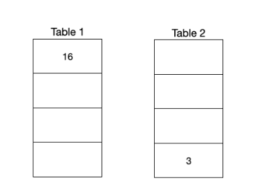

&emsp;&emsp;&emsp;&emsp;&emsp;&emsp;&emsp;&emsp;Figure 1: Initial contents of the hash tables. 
&emsp;(a) Insert key 32 and then delete 16. Select the value in each entry of the resulting two tables.

&emsp;&emsp;&emsp;i. Table 1 
&emsp;&emsp;&emsp;&emsp;α) **\[1 point\]** Entry 0 (`0b00`) ☐  32   ☐  16   ☐  Empty 
&emsp;&emsp;&emsp;&emsp;&emsp;β) **\[1 point\]** Entry 1 (`0b01`) ☐  32   ☐  16   ☐  Empty 
&emsp;&emsp;&emsp;&emsp;&emsp;γ) **\[1 point\]** Entry 2 (`0b10`) ☐  32   ☐  16   ☐  Empty 
&emsp;&emsp;&emsp;&emsp;&emsp;δ) **\[1 point\]** Entry 3 (`0b11`) ☐  32   ☐  16   ☐  Empty

&emsp;&emsp;&emsp;ii. Table 2 
&emsp;&emsp;&emsp;&emsp;α) **\[1 point\]** Entry 0 (`0b00`) ☐  32   ☐  3   ☐  Empty 
&emsp;&emsp;&emsp;&emsp;&emsp;β) **\[1 point\]** Entry 1 (`0b01`) ☐  32   ☐  3   ☐  Empty 
&emsp;&emsp;&emsp;&emsp;&emsp;γ) **\[1 point\]** Entry 2 (`0b10`) ☐  32   ☐  3   ☐  Empty 
&emsp;&emsp;&emsp;&emsp;&emsp;δ) **\[1 point\]** Entry 3 (`0b11`) ☐  32   ☐  3   ☐  Empty

&emsp;(b) After the changes from part **(a)**, insert key 27, then delete 3, then insert key 8. Select the 
&emsp;&emsp;&emsp;value in each entry of the resulting two tables.

### Question 2 continues...

---

**Page 6**

15-445/645 (Spring 2024)   Homework #2   Page 6 of 14

&emsp;&emsp;&emsp;i. Table 1 
&emsp;&emsp;&emsp;&emsp;α) **\[1 point\]** Entry 0 (`0b00`) ☐  8   ☐  32   ☐  27   ☐  Empty 
&emsp;&emsp;&emsp;&emsp;&emsp;β) **\[1 point\]** Entry 1 (`0b01`) ☐  8   ☐  32   ☐  27   ☐  Empty 
&emsp;&emsp;&emsp;&emsp;&emsp;γ) **\[1 point\]** Entry 2 (`0b10`) ☐  8   ☐  32   ☐  27   ☐  Empty 
&emsp;&emsp;&emsp;&emsp;&emsp;δ) **\[1 point\]** Entry 3 (`0b11`) ☐  8   ☐  32   ☐  27   ☐  Empty

&emsp;&emsp;&emsp;ii. Table 2 
&emsp;&emsp;&emsp;&emsp;α) **\[1 point\]** Entry 0 (`0b00`) ☐  32   ☐  8   ☐  27   ☐  Empty 
&emsp;&emsp;&emsp;&emsp;&emsp;β) **\[1 point\]** Entry 1 (`0b01`) ☐  32   ☐  8   ☐  27   ☐  Empty 
&emsp;&emsp;&emsp;&emsp;&emsp;γ) **\[1 point\]** Entry 2 (`0b10`) ☐  32   ☐  8   ☐  27   ☐  Empty 
&emsp;&emsp;&emsp;&emsp;&emsp;δ) **\[1 point\]** Entry 3 (`0b11`) ☐  32   ☐  8   ☐  27   ☐  Empty

&emsp;&emsp;&emsp;&emsp;&emsp;&emsp;&emsp;&emsp;Homework #2 continues...

---

**Page 7**

15-445/645 (Spring 2024)   Homework #2   Page 7 of 14

### **Question 3: Extendible Hashing. . . . . . . . . . . . . . . . . . . . . . . . . . . . . . .\[20 points\]**

&emsp;Consider an extendible hashing structure such that: 
&emsp;&emsp;• Each bucket can hold up to two records. 
&emsp;&emsp;• The hashing function uses the lowest g bits, where g is the global depth. 
&emsp;&emsp;• A new extendible hashing structure is initialized with g = 0 and one empty bucket 
&emsp;&emsp;• If multiple keys are provided in a question, assume they are inserted one after the other 
&emsp;&emsp;&emsp;from left to right. 
&emsp;(a) Starting from an empty table, insert keys 0, 3. 
&emsp;&emsp;&emsp;i. **\[1 point\]** What is the global depth of the resulting table? 
&emsp;&emsp;&emsp;&emsp;☐  0   ☐  1   ☐  2   ☐  3   ☐  4   ☐  None of the above 
&emsp;&emsp;&emsp;ii. **\[1 point\]** What is the local depth of the bucket containing 0? 
&emsp;&emsp;&emsp;&emsp;☐  0   ☐  1   ☐  2   ☐  3   ☐  4   ☐  None of the above 
&emsp;(b) Starting from the result in **(a)**, you insert keys 23, 33. 
&emsp;&emsp;&emsp;i. **\[2 points\]** What is the global depth of the resulting table? 
&emsp;&emsp;&emsp;&emsp;☐  0   ☐  1   ☐  2   ☐  3   ☐  4   ☐  None of the above 
&emsp;&emsp;&emsp;ii. **\[1 point\]** What is the local depth of the bucket containing 0? 
&emsp;&emsp;&emsp;&emsp;☐  0   ☐  1   ☐  2   ☐  3   ☐  4   ☐  None of the above 
&emsp;(c) Starting from the result in **(b)**, you insert keys 13, 27. 
&emsp;&emsp;&emsp;i. **\[2 points\]** What is the global depth of the resulting table? 
&emsp;&emsp;&emsp;&emsp;☐  0   ☐  1   ☐  2   ☐  3   ☐  4   ☐  None of the above 
&emsp;&emsp;&emsp;ii. **\[2 points\]** What is the local depth of the bucket containing 13? 
&emsp;&emsp;&emsp;&emsp;☐  0   ☐  1   ☐  2   ☐  3   ☐  4   ☐  None of the above 
&emsp;&emsp;&emsp;iii. **\[1 point\]** What is the local depth of the bucket containing 3? 
&emsp;&emsp;&emsp;&emsp;☐  0   ☐  1   ☐  2   ☐  3   ☐  4   ☐  None of the above 
&emsp;&emsp;&emsp;iv. **\[1 point\]** Which value, if inserted, will hash to the same bucket as the bucket con- 
&emsp;&emsp;&emsp;&emsp;taining key 27? 
&emsp;&emsp;&emsp;&emsp;☐  43   ☐  4   ☐  21   ☐  13   ☐  None of the above 
&emsp;(d) **\[3 points\]** Starting from the result in **(c)**, which **key(s)**, if inserted next, will **not** cause a 
&emsp;&emsp;&emsp;split? 
&emsp;&emsp;&emsp;☐  35   ☐  9   ☐  17   ☐  41   ☐  16   ☐  None of the above 
&emsp;(e) **\[3 points\]** Starting from the result in **(c)**, which **key(s)**, if inserted next, will cause a split 
&emsp;&emsp;&emsp;and increase the table’s global depth? 
&emsp;&emsp;&emsp;☐  0   ☐  2   ☐  51   ☐  9   ☐  1   ☐  None of the above 
&emsp;(f) **\[3 points\]** Starting from an empty table, insert keys 64, 128, 256, 512. What is the 
&emsp;&emsp;&emsp;global depth of the resulting table? 
&emsp;&emsp;&emsp;☐  4   ☐  5   ☐  6   ☐  7   ☐  8   ☐  ≥9

&emsp;&emsp;&emsp;&emsp;&emsp;&emsp;&emsp;&emsp;Homework #2 continues...

---

**Page 8**

15-445/645 (Spring 2024)   Homework #2   Page 8 of 14

### **Question 4: B+Tree. . . . . . . . . . . . . . . . . . . . . . . . . . . . . . . . . . . . . . . . . . .\[32 points\]**

&emsp;Consider the following B+tree.

&emsp;&emsp;&emsp;&emsp;&emsp;&emsp;&emsp;Figure 2: B+ Tree of order d = 4 and height h = 2.

&emsp;When answering the following questions, be sure to follow the procedures described in class 
&emsp;and in your textbook. You can make the following assumptions: 
&emsp;&emsp;• A left pointer in an internal node guides towards keys \< than its corresponding key, while 
&emsp;&emsp;&emsp;a right pointer guides towards keys ≥. 
&emsp;&emsp;2 ⌉.• A leaf node underflows when the number of **keys** goes below ⌈d−1 
&emsp;&emsp;2⌉.• An internal node underflows when the number of **pointers** goes below ⌈d

&emsp;Note that B+ tree diagrams for this problem omit leaf pointers for convenience. The leaves of 
&emsp;actual B+ trees are linked together via pointers, forming a singly linked list allowing for quick 
&emsp;traversal through all keys.

### Question 4 continues...

---

**Page 9**

15-445/645 (Spring 2024)   Homework #2   Page 9 of 14

&emsp;(a) **\[4 points\]** Insert 24∗into the B+tree. Select the resulting tree. 
&emsp;&emsp;&emsp;☐  A)

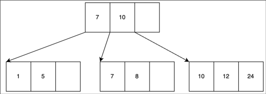

&emsp;&emsp;&emsp;☐  B)

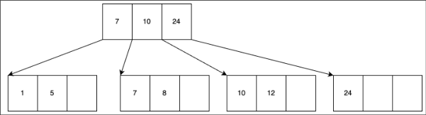

&emsp;&emsp;&emsp;☐  C)

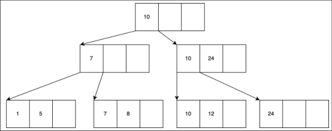

&emsp;&emsp;&emsp;☐  D)

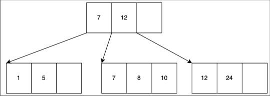

### Question 4 continues...

---

**Page 10**

15-445/645 (Spring 2024)   Homework #2   Page 10 of 14

&emsp;(b) **\[4 points\]** Starting with the tree that results from **(a)**, insert 15∗. Select the resulting 
&emsp;&emsp;&emsp;tree. 
&emsp;&emsp;&emsp;☐  A)

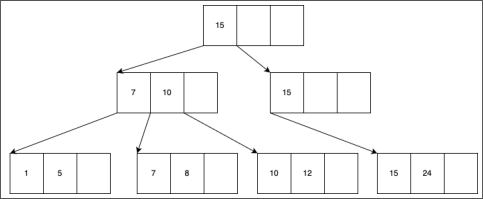

&emsp;&emsp;&emsp;☐  B)

&emsp;&emsp;&emsp;☐  C)

&emsp;&emsp;&emsp;☐  D)

### Question 4 continues...

---

**Page 11**

15-445/645 (Spring 2024)   Homework #2   Page 11 of 14

&emsp;(c) **\[5 points\]** Starting with the tree that results from **(b)**, insert 16∗and then insert 17∗. Se- 
&emsp;&emsp;&emsp;lect the resulting tree (the result after inserting 17∗). 
&emsp;&emsp;&emsp;☐  A)

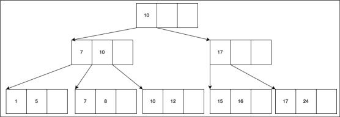

&emsp;&emsp;&emsp;☐  B)

&emsp;&emsp;&emsp;☐  C)

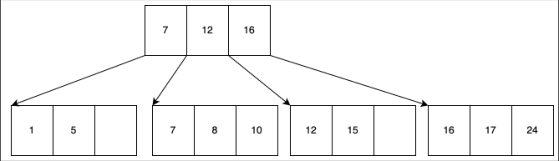

&emsp;&emsp;&emsp;☐  D)

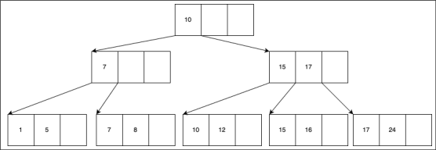

### Question 4 continues...

---

**Page 12**

15-445/645 (Spring 2024)   Homework #2   Page 12 of 14

&emsp;(d) **\[5 points\]** Starting with the tree that results from **(c)**, deletes 5∗. Select the resulting 
&emsp;&emsp;&emsp;tree. 
&emsp;&emsp;&emsp;☐  A)

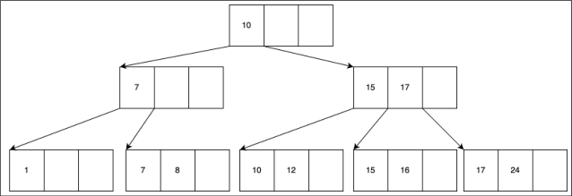

&emsp;&emsp;&emsp;☐  B)

&emsp;&emsp;&emsp;☐  C)

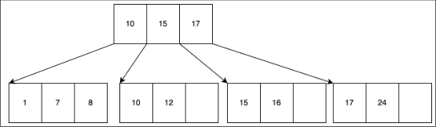

&emsp;&emsp;&emsp;☐  D)

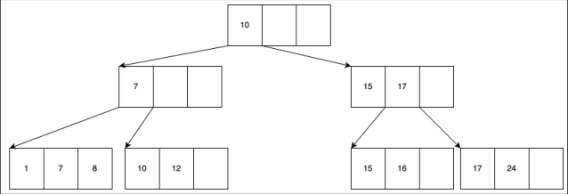

### Question 4 continues...

---

**Page 13**

15-445/645 (Spring 2024)   Homework #2   Page 13 of 14

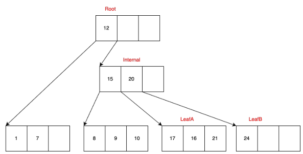

&emsp;&emsp;&emsp;&emsp;&emsp;&emsp;&emsp;&emsp;Figure 3: B+tree with violations

&emsp;(e) The B+Tree shown in Figure 3 is invalid. That is, its nodes violate the correctness prop- 
&emsp;&emsp;&emsp;erties of B+Trees that we discussed in class. If the tree is invalid, select all the properties 
&emsp;&emsp;&emsp;that are violated for each node. If the node is valid, then select ‘None’. There will be **no** 
&emsp;&emsp;&emsp;partial credit for missing violations. 
&emsp;&emsp;&emsp;Note: 
&emsp;&emsp;&emsp;• If a node’s subtrees are not the same height, the balance property is violated at that 
&emsp;&emsp;&emsp;&emsp;node only. 
&emsp;&emsp;&emsp;• If a node’s subtrees contain values not in the range specified by the node’s separator 
&emsp;&emsp;&emsp;&emsp;keys (e.g. internal node has separator keys as 5,10,18, then the first pointer pointed 
&emsp;&emsp;&emsp;&emsp;leaf node values should be less than 5, the second one should be in the range of \[5, 
&emsp;&emsp;&emsp;&emsp;10), etc. The logic also applies to any upper level internal node or root node. If the 
&emsp;&emsp;&emsp;&emsp;values in the leaf node satisfies its parent node’s separator key property but violates 
&emsp;&emsp;&emsp;&emsp;the root node’s, mark root node as separator key violation and not its parent node.), 
&emsp;&emsp;&emsp;&emsp;the separator keys property is violated at that node.

&emsp;&emsp;&emsp;i. **\[2 points\]** Which properties are violated by **Leaf A**? 
&emsp;&emsp;&emsp;&emsp;☐  Key order property   ☐  Half-full property   ☐  Balance property 
&emsp;&emsp;&emsp;&emsp;☐  Separator keys   ☐  None 
&emsp;&emsp;&emsp;ii. **\[2 points\]** Which properties are violated by **LeafB**? 
&emsp;&emsp;&emsp;&emsp;☐  Key order property   ☐  Half-full property   ☐  Balance property 
&emsp;&emsp;&emsp;&emsp;☐  Separator keys   ☐  None 
&emsp;&emsp;&emsp;iii. **\[2 points\]** Which properties are violated by **Internal Node**? 
&emsp;&emsp;&emsp;&emsp;☐  Key order property   ☐  Half-full property   ☐  Balance property 
&emsp;&emsp;&emsp;&emsp;☐  Separator keys   ☐  None 
&emsp;&emsp;&emsp;iv. **\[2 points\]** Which properties are violated by **Root**? 
&emsp;&emsp;&emsp;&emsp;☐  Key order property   ☐  Half-full property   ☐  Balance property 
&emsp;&emsp;&emsp;&emsp;☐  Separator keys   ☐  None

### Question 4 continues...

---

**Page 14**

15-445/645 (Spring 2024)   Homework #2   Page 14 of 14

&emsp;(f)   i. **\[2 points\]** A read-only thread needs to hold at most one latches at the same time. 
&emsp;&emsp;&emsp;&emsp;☐  True   ☐  False 
&emsp;&emsp;&emsp;ii. **\[2 points\]** A write thread needs to hold at most two write latches at the same time 
&emsp;&emsp;&emsp;&emsp;☐  True   ☐  False 
&emsp;&emsp;&emsp;iii. **\[2 points\]** A write thread must release its latches in the order they were acquired 
&emsp;&emsp;&emsp;&emsp;(i.e., FIFO) to prevent concurrency errors. 
&emsp;&emsp;&emsp;&emsp;☐  True   ☐  False

&emsp;&emsp;&emsp;&emsp;&emsp;&emsp;&emsp;&emsp;End of Homework #2

