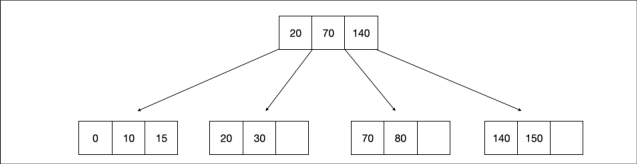
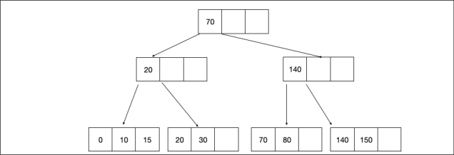
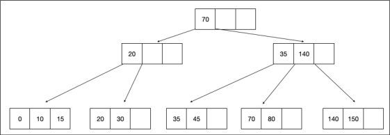
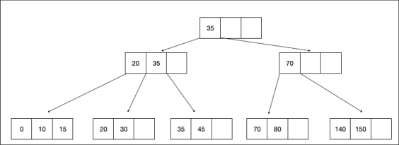
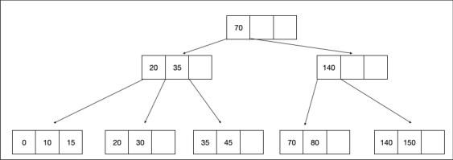
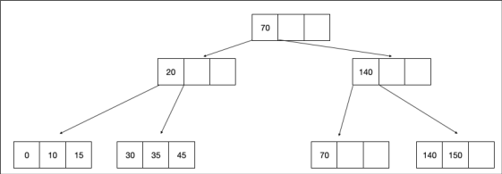
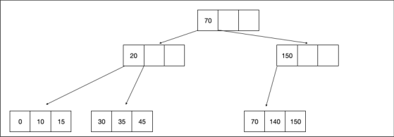
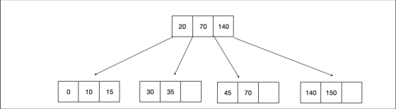

# CMU 15-445 Spring 2025: Homework 3: Official solutions

> Copied from the original: <https://15445.courses.cs.cmu.edu/spring2025/assignments.html>. Text and figures are taken from the PDF as is; nothing was answered or rewritten. The original PDF is in this folder.

---

**Page 1**

&emsp;&emsp;&emsp;&emsp;&emsp;&emsp;&emsp;&emsp;CARNEGIE MELLON UNIVERSITY 
&emsp;&emsp;&emsp;&emsp;&emsp;&emsp;&emsp;&emsp;COMPUTER SCIENCE DEPARTMENT 
&emsp;&emsp;&emsp;&emsp;&emsp;15-445/645 – DATABASE SYSTEMS (SPRING 2025) 
&emsp;&emsp;&emsp;&emsp;&emsp;&emsp;&emsp;&emsp;PROF. JIGNESH PATEL

&emsp;&emsp;&emsp;&emsp;&emsp;&emsp;&emsp;&emsp;Homework #3 (by Ramsey) – Solutions 
&emsp;&emsp;&emsp;&emsp;&emsp;&emsp;Due: **Sunday February 23rd, 2025 @ 11:59pm**

**IMPORTANT:** 
&emsp;• Enter all of your answers into **Gradescope by 11:59pm on Sunday February 23rd, 2025.** 
&emsp;• **Plagiarism**: Homework may be discussed with other students, but all homework is to be 
&emsp;&emsp;completed **individually**. 
For your information: 
&emsp;• Graded out of **100** points; **5** questions total 
&emsp;• Rough time estimate: ≈4-6 hours (1-1.5 hours for each question) 
&emsp;Revision : 2025/02/12 15:16

&emsp;&emsp;&emsp;&emsp;&emsp;&emsp;&emsp;&emsp;Question   Points   Score 
&emsp;&emsp;&emsp;&emsp;&emsp;&emsp;&emsp;Linear Hashing and Cuckoo Hashing   18 
&emsp;&emsp;&emsp;&emsp;&emsp;&emsp;&emsp;&emsp;Extendible Hashing   20 
&emsp;&emsp;&emsp;&emsp;&emsp;&emsp;&emsp;&emsp;B+Tree   27 
&emsp;&emsp;&emsp;&emsp;&emsp;&emsp;&emsp;&emsp;Bloom Filter   20 
&emsp;&emsp;&emsp;&emsp;&emsp;&emsp;&emsp;&emsp;Alternate Index Structures   15 
&emsp;&emsp;&emsp;&emsp;&emsp;&emsp;&emsp;&emsp;Total:   100

&emsp;&emsp;&emsp;&emsp;&emsp;&emsp;&emsp;&emsp;1

---

**Page 2**

15-445/645 (Spring 2025)   Homework #3   Page 2 of 15

### **Question 1: Linear Hashing and Cuckoo Hashing . . . . . . . . . . . . . . \[18 points\]**

&emsp;**Graded by:** 
&emsp;For warmup, consider the following Linear Probe Hashing schema: 
&emsp;&emsp;1\. The table has a size of 4 slots, each slot can only contain one key-value pair. 
&emsp;&emsp;2\. The hashing function is 
&emsp;&emsp;&emsp;h1(`x`) = `x` `%` `4`. 
&emsp;&emsp;3\. When there is a conflict, it finds the next free slot to insert key-value pairs. 
&emsp;&emsp;4\. The original table is empty. 
&emsp;&emsp;5\. Uses a tombstone when deleting a key. 
&emsp;(a) **\[2 points\]** Insert key/value pairs `(2,C)` and `(6,D)`. For `(2,C)`, “2” is the key and “C” is 
&emsp;&emsp;&emsp;the value. Select the value in each entry of the resulting table. 
&emsp;&emsp;&emsp;&emsp;&emsp;&emsp;&emsp;&emsp;☒ **Empty** 
&emsp;&emsp;&emsp;i. Entry 0 (key % 4 = 0) ☐  C   ☐  D 
&emsp;&emsp;&emsp;&emsp;&emsp;&emsp;&emsp;&emsp;☒ **Empty** 
&emsp;&emsp;&emsp;ii. Entry 1 (key % 4 = 1) ☐  C   ☐  D 
&emsp;&emsp;&emsp;iii. Entry 2 (key % 4 = 2) ☒ **C** 
&emsp;&emsp;&emsp;&emsp;&emsp;&emsp;&emsp;&emsp;☐  D   ☐  Empty 
&emsp;&emsp;&emsp;&emsp;&emsp;&emsp;&emsp;&emsp;☒ **D** 
&emsp;&emsp;&emsp;iv. Entry 3 (key % 4 = 3) ☐  C   ☐  Empty 
&emsp;&emsp;&emsp;**Solution:** `C` is inserted into Entry 2, and `D` is inserted into Entry 3.

&emsp;(b) **\[2 points\]** After the changes from part **(a)**, delete `(2,` `C)`, insert key-value `(10,` `E)`, and 
&emsp;&emsp;&emsp;lastly insert `(14,` `F)`. Select the value in each entry of the resulting table. 
&emsp;&emsp;&emsp;&emsp;&emsp;&emsp;&emsp;&emsp;☒ **F** 
&emsp;&emsp;&emsp;i. Entry 0 (key % 4 = 0) ☐  Tombstone   ☐  C   ☐  D   ☐  E   ☐  Empty 
&emsp;&emsp;&emsp;&emsp;&emsp;&emsp;&emsp;&emsp;☒ **Empty** 
&emsp;&emsp;&emsp;ii. Entry 1 (key % 4 = 1) ☐  Tombstone   ☐  C   ☐  D   ☐  E   ☐  F 
&emsp;&emsp;&emsp;&emsp;&emsp;&emsp;&emsp;&emsp;☒ **E** 
&emsp;&emsp;&emsp;iii. Entry 2 (key % 4 = 2) ☐  Tombstone   ☐  C   ☐  D   ☐  F   ☐  Empty 
&emsp;&emsp;&emsp;&emsp;&emsp;&emsp;&emsp;&emsp;☒ **D** 
&emsp;&emsp;&emsp;iv. Entry 3 (key % 4 = 3) ☐  Tombstone   ☐  C   ☐  E   ☐  F   ☐  Empty 
&emsp;&emsp;&emsp;**Solution:** `C` is first deleted, which inserts a tombstone into Entry 2. `E` is then inserted 
&emsp;&emsp;&emsp;into Entry 2 (since there is nothing there). Then, `F` is attempted to be inserted into Entry 
&emsp;&emsp;&emsp;2, but since it’s occupied by `E`, `F` is inserted into Entry 0 instead.

### Question 1 continues...

---

**Page 3**

15-445/645 (Spring 2025)   Homework #3   Page 3 of 15

&emsp;Consider the following Cuckoo Hashing schema: 
&emsp;&emsp;1\. Both tables have a size of 4. 
&emsp;&emsp;2\. The hashing function of the first table returns the fourth and third least significant bits: 
&emsp;&emsp;&emsp;h1(`x`) = `(x` `>>` `2)` `&` `0b11`. 
&emsp;&emsp;3\. The hashing function of the second table returns the least significant two bits: 
&emsp;&emsp;&emsp;h2(`x`) = `x` `&` `0b11`. 
&emsp;&emsp;4\. When inserting, try table 1 first. 
&emsp;&emsp;5\. When replacement is necessary, first select an element in the second table. 
&emsp;&emsp;6\. The original entries in the table are shown below.

&emsp;&emsp;&emsp;&emsp;&emsp;&emsp;&emsp;&emsp;**Table 1**   **Entry 0**   **Entry 1**   **Entry 2**   **Entry 3** 
&emsp;&emsp;&emsp;&emsp;&emsp;&emsp;&emsp;&emsp;Keys   -   20   -   - 
&emsp;&emsp;&emsp;&emsp;&emsp;&emsp;&emsp;&emsp;**Table 2**   **Entry 0**   **Entry 1**   **Entry 2**   **Entry 3** 
&emsp;&emsp;&emsp;&emsp;&emsp;&emsp;&emsp;&emsp;Keys   -   -   -   7 
&emsp;&emsp;&emsp;&emsp;&emsp;&emsp;&emsp;&emsp;Figure 1: Initial contents of the hash tables.

&emsp;(a) **\[2 points\]** Select the sequence of insert operations that results in the initial state. 
&emsp;&emsp;&emsp;☒ **Insert 20, Insert 7** 
&emsp;&emsp;&emsp;&emsp;&emsp;&emsp;&emsp;&emsp;☐  Insert 7, Insert 20   ☐  None of the above 
&emsp;&emsp;&emsp;**Solution:** 20 is inserted into Table 1 `0b01` based on h1, and 7 experiences a collision 
&emsp;&emsp;&emsp;and is hashed to Table 2 `0b11` based on h2.

### Question 1 continues...

---

**Page 4**

15-445/645 (Spring 2025)   Homework #3   Page 4 of 15

&emsp;(b) Starting from the initial contents, insert key `22` and then insert `38`. Select the values in the 
&emsp;&emsp;&emsp;resulting two tables. 
&emsp;&emsp;&emsp;i. Table 1 
&emsp;&emsp;&emsp;&emsp;&emsp;&emsp;&emsp;&emsp;☒ **Empty** 
&emsp;&emsp;&emsp;&emsp;α) **\[1 point\]** Entry 0 (`0b00`) ☐  20   ☐  7   ☐  22   ☐  38 
&emsp;&emsp;&emsp;&emsp;&emsp;&emsp;&emsp;&emsp;☒ **22** 
&emsp;&emsp;&emsp;&emsp;&emsp;β) **\[1 point\]** Entry 1 (`0b01`) ☐  20   ☐  7   ☐  38   ☐  Empty 
&emsp;&emsp;&emsp;&emsp;&emsp;&emsp;&emsp;&emsp;☒ **Empty** 
&emsp;&emsp;&emsp;&emsp;&emsp;γ) **\[1 point\]** Entry 2 (`0b10`) ☐  20   ☐  7   ☐  22   ☐  38 
&emsp;&emsp;&emsp;&emsp;&emsp;&emsp;&emsp;&emsp;☒ **Empty** 
&emsp;&emsp;&emsp;&emsp;&emsp;δ) **\[1 point\]** Entry 3 (`0b11`) ☐  20   ☐  7   ☐  22   ☐  38

&emsp;&emsp;&emsp;ii. Table 2 
&emsp;&emsp;&emsp;&emsp;α) **\[1 point\]** Entry 0 (`0b00`) ☒ **20** 
&emsp;&emsp;&emsp;&emsp;&emsp;&emsp;&emsp;&emsp;☐  7   ☐  22   ☐  38   ☐  Empty 
&emsp;&emsp;&emsp;&emsp;&emsp;&emsp;&emsp;&emsp;☒ **Empty** 
&emsp;&emsp;&emsp;&emsp;&emsp;β) **\[1 point\]** Entry 1 (`0b01`) ☐  20   ☐  7   ☐  22   ☐  38 
&emsp;&emsp;&emsp;&emsp;&emsp;&emsp;&emsp;&emsp;☒ **38** 
&emsp;&emsp;&emsp;&emsp;&emsp;γ) **\[1 point\]** Entry 2 (`0b10`) ☐  20   ☐  7   ☐  22   ☐  Empty 
&emsp;&emsp;&emsp;&emsp;&emsp;&emsp;&emsp;&emsp;☒ **7** 
&emsp;&emsp;&emsp;&emsp;&emsp;δ) **\[1 point\]** Entry 3 (`0b11`) ☐  20   ☐  22   ☐  38   ☐  Empty

&emsp;&emsp;&emsp;**Solution:** 22 tries to insert into Table 1 first but due to conflict, it inserts into Entry 2 of 
&emsp;&emsp;&emsp;Table 2. 38 tries to insert into both tables but conflicts with both, so 38 inserts into Entry 
&emsp;&emsp;&emsp;2 of Table 2, replacing 22. 22 is then rehashed into Table 1 Entry 1, replacing 20. 20 is 
&emsp;&emsp;&emsp;then rehashed into Table 2 Entry 0. 
&emsp;(c) **\[4 points\]** Consider completely empty tables using the same two hash functions. Select 
&emsp;&emsp;&emsp;which sequence of insertions below will cause an infinite loop. 
&emsp;&emsp;&emsp;☐  `[1,` `5,` `9,` `13]` 
&emsp;&emsp;&emsp;☒ `[0,` `8,` `16,` `24]` 
&emsp;&emsp;&emsp;☐  `[2,` `6,` `10,` `14]` 
&emsp;&emsp;&emsp;☐  `[3,` `7,` `11,` `15]` 
&emsp;&emsp;&emsp;☐  None of the above 
&emsp;&emsp;&emsp;**Solution:** The sequence `[0,` `8,` `16,` `24]` will cause an infinite loop because 4 keys 
&emsp;&emsp;&emsp;map to a to 3 entries.

&emsp;&emsp;&emsp;&emsp;&emsp;&emsp;&emsp;&emsp;Homework #3 continues...

---

**Page 5**

15-445/645 (Spring 2025)   Homework #3   Page 5 of 15

### **Question 2: Extendible Hashing. . . . . . . . . . . . . . . . . . . . . . . . . . . . . . .\[20 points\]**

&emsp;**Graded by:** 
&emsp;Consider an extendible hashing structure such that: 
&emsp;&emsp;• Each bucket can hold up to two records. 
&emsp;&emsp;• The hashing function uses the lowest g bits, where g is the global depth. 
&emsp;&emsp;• A new extendible hashing structure is initialized with g = 0 and one empty bucket 
&emsp;&emsp;• If multiple keys are provided in a question, assume they are inserted one after the other 
&emsp;&emsp;&emsp;from left to right. 
&emsp;(a) Starting from an empty table, insert keys 1, 2. 
&emsp;&emsp;&emsp;i. **\[1 point\]** What is the global depth of the resulting table? 
&emsp;&emsp;&emsp;&emsp;☒ **0** 
&emsp;&emsp;&emsp;&emsp;&emsp;&emsp;&emsp;☐  1   ☐  2   ☐  3   ☐  4   ☐  None of the above 
&emsp;&emsp;&emsp;&emsp;**Solution:** No split has occurred yet because the first bucket (on initialization) can 
&emsp;&emsp;&emsp;&emsp;hold 2 arbitrary values. Thus global depth is same as its initial value of 0. 
&emsp;&emsp;&emsp;ii. **\[1 point\]** What is the local depth of the bucket containing 2? 
&emsp;&emsp;&emsp;&emsp;☒ **0** 
&emsp;&emsp;&emsp;&emsp;&emsp;&emsp;&emsp;☐  1   ☐  2   ☐  3   ☐  4   ☐  None of the above 
&emsp;&emsp;&emsp;&emsp;**Solution:** There is only one bucket (created on initialization), and it holds both 1 
&emsp;&emsp;&emsp;&emsp;and 2. Since no split has occurred yet, the bucket has local depth d = 0. 
&emsp;(b) Starting from the result in **(a)**, you insert keys 9, 11. 
&emsp;&emsp;&emsp;i. **\[2 points\]** What is the global depth of the resulting table? 
&emsp;&emsp;&emsp;&emsp;&emsp;&emsp;&emsp;&emsp;☒ **2** 
&emsp;&emsp;&emsp;&emsp;☐  0   ☐  1   ☐  3   ☐  4   ☐  None of the above 
&emsp;&emsp;&emsp;&emsp;**Solution:** After the inserts and splits, the table looks like the following: 
&emsp;&emsp;&emsp;&emsp;Global depth = 2 
&emsp;&emsp;&emsp;&emsp;`b0,b2` = 2 // at local depth 1 
&emsp;&emsp;&emsp;&emsp;`b1` = 1,9 // at local depth 2 
&emsp;&emsp;&emsp;&emsp;`b3` = 11 // at local depth 2

&emsp;&emsp;&emsp;ii. **\[2 points\]** What are the local depths of the buckets for each key? 
&emsp;&emsp;&emsp;&emsp;☐  1 (Depth 1), 2 (Depth 1), 9 (Depth 1), 11 (Depth 1) 
&emsp;&emsp;&emsp;&emsp;☐  1 (Depth 3), 2 (Depth 1), 9 (Depth 3), 11 (Depth 3) 
&emsp;&emsp;&emsp;&emsp;☒ **1 (Depth 2), 2 (Depth 1), 9 (Depth 2), 11 (Depth 2)** 
&emsp;&emsp;&emsp;&emsp;☐  1 (Depth 3), 2 (Depth 1), 9 (Depth 3), 11 (Depth 2) 
&emsp;&emsp;&emsp;&emsp;☐  1 (Depth 2), 2 (Depth 2), 9 (Depth 2), 11 (Depth 2) 
&emsp;&emsp;&emsp;&emsp;☐  None of the above 
&emsp;&emsp;&emsp;&emsp;**Solution:** See the previous solution for an explanation. 
&emsp;(c) Starting from the result in **(b)**, you insert keys 13, 27. 
&emsp;&emsp;&emsp;i. **\[2 points\]** What is the global depth of the resulting table? 
&emsp;&emsp;&emsp;&emsp;&emsp;&emsp;&emsp;&emsp;☒ **3** 
&emsp;&emsp;&emsp;&emsp;☐  0   ☐  1   ☐  2   ☐  4   ☐  None of the above

### Question 2 continues...

---

**Page 6**

15-445/645 (Spring 2025)   Homework #3   Page 6 of 15

&emsp;&emsp;&emsp;&emsp;**Solution:** 13 inserts into `b1` and causes a split. 27 inserts into `b3` without a split. 
&emsp;&emsp;&emsp;&emsp;The updated table looks as follows: Global depth = 3 
&emsp;&emsp;&emsp;&emsp;`b0,b2,b4,b6` = 2 // at local depth 1 
&emsp;&emsp;&emsp;&emsp;`b1` = 1,9 // at local depth 3 
&emsp;&emsp;&emsp;&emsp;`b5` = 13 // at local depth 3 
&emsp;&emsp;&emsp;&emsp;`b3,b7` = 11,27 // at local depth 2

&emsp;&emsp;&emsp;ii. **\[2 points\]** What are the local depths of the buckets for each new key? 
&emsp;&emsp;&emsp;&emsp;☐  13 (Depth 1), 27 (Depth 1) 
&emsp;&emsp;&emsp;&emsp;☐  13 (Depth 1), 27 (Depth 2) 
&emsp;&emsp;&emsp;&emsp;☐  13 (Depth 2), 27 (Depth 2) 
&emsp;&emsp;&emsp;&emsp;☒ **13 (Depth 3), 27 (Depth 2)** 
&emsp;&emsp;&emsp;&emsp;☐  13 (Depth 3), 27 (Depth 3) 
&emsp;&emsp;&emsp;&emsp;☐  None of the above 
&emsp;&emsp;&emsp;&emsp;**Solution:** See the previous solution for an explanation. 
&emsp;(d) **\[3 points\]** Starting from **(c)**’s result, which **key(s)**, if inserted next, will **not** cause a split? 
&emsp;&emsp;&emsp;☒ **5**   ☒ **8** 
&emsp;&emsp;&emsp;&emsp;&emsp;☐  17   ☐  43   ☐  None of the above 
&emsp;&emsp;&emsp;**Solution:** To avoid a split in the current table the value must map to one of the fol- 
&emsp;&emsp;&emsp;lowing: `b0,b2,b4,b6,b5`. Out of the options provided only 5 and 8 hash to one of 
&emsp;&emsp;&emsp;those. 
&emsp;(e) **\[3 points\]** Starting from the result in **(c)**, which **key(s)**, if inserted next, will cause a split 
&emsp;&emsp;&emsp;and increase the table’s global depth? 
&emsp;&emsp;&emsp;&emsp;&emsp;☒ **3**   ☒ **17** 
&emsp;&emsp;&emsp;☐  0   ☐  5   ☐  None of the above 
&emsp;&emsp;&emsp;**Solution:** There are two options. The first is to insert a key that hashes to `b1`, since it 
&emsp;&emsp;&emsp;is the only full bucket whose local depth is equal to the global depth. **17** maps to this 
&emsp;&emsp;&emsp;bucket. 
&emsp;&emsp;&emsp;The other option is **3**. 3 maps to bucket (b3,b7). Inserting **3** causes a local depth increase 
&emsp;&emsp;&emsp;to (depth = 3). However, 3, 11, and 27 all re-hash to the same bucket. This results in 
&emsp;&emsp;&emsp;another split that increases the global depth. 
&emsp;(f) **\[4 points\]** Starting from an empty table, insert keys 32, 64, 128, 512. What is the global 
&emsp;&emsp;&emsp;depth of the resulting table? 
&emsp;&emsp;&emsp;&emsp;&emsp;&emsp;&emsp;&emsp;☒ **7** 
&emsp;&emsp;&emsp;☐  4   ☐  5   ☐  6   ☐  8   ☐  ≥9 
&emsp;&emsp;&emsp;**Solution:** Since each bucket can hold at most two keys, three or more keys cannot hash 
&emsp;&emsp;&emsp;to the same bucket without causing splits. When g = 7, 32 and 64 will each be mapped 
&emsp;&emsp;&emsp;to their own bin. 128 and 512 will share the same bin.

&emsp;&emsp;&emsp;&emsp;&emsp;&emsp;&emsp;&emsp;Homework #3 continues...

---

**Page 7**

15-445/645 (Spring 2025)   Homework #3   Page 7 of 15

### **Question 3: B+Tree. . . . . . . . . . . . . . . . . . . . . . . . . . . . . . . . . . . . . . . . . . .\[27 points\]**

&emsp;**Graded by:** 
&emsp;Consider the following B+tree.

&emsp;&emsp;&emsp;&emsp;&emsp;&emsp;&emsp;Figure 2: B+ Tree of order d = 4 and height h = 2.

&emsp;When answering the following questions, be sure to follow the procedures described in class 
&emsp;and in your textbook. You can make the following assumptions: 
&emsp;&emsp;• A left pointer in an internal node guides towards keys \< than its corresponding key, while 
&emsp;&emsp;&emsp;a right pointer guides towards keys ≥. 
&emsp;&emsp;2 ⌉.• A leaf node underflows when the number of **keys** goes below ⌈d−1 
&emsp;&emsp;2⌉.• An internal node underflows when the number of **pointers** goes below ⌈d

&emsp;Note that B+ tree diagrams for this problem omit leaf pointers for convenience. The leaves of 
&emsp;actual B+ trees are linked together via pointers, forming a singly linked list allowing for quick 
&emsp;traversal through all keys.

### Question 3 continues...

---

**Page 8**

15-445/645 (Spring 2025)   Homework #3   Page 8 of 15

&emsp;(a) **\[4 points\]** Insert 0∗into the B+tree. Select the resulting tree. 
&emsp;&emsp;&emsp;☐  A)

&emsp;&emsp;&emsp;☐  B)

&emsp;&emsp;&emsp;☒ **C)**

&emsp;&emsp;&emsp;☐  D)

&emsp;&emsp;&emsp;**Solution:** Inserting 0∗adds one element in the left-most leaf. It should not cause any 
&emsp;&emsp;&emsp;splits or merges.

### Question 3 continues...

---

**Page 9**

15-445/645 (Spring 2025)   Homework #3   Page 9 of 15

&emsp;(b) **\[5 points\]** Starting with the tree that results from **(a)**, insert 35∗and then 45∗. Select the 
&emsp;&emsp;&emsp;resulting tree. 
&emsp;&emsp;&emsp;☐  A)

&emsp;&emsp;&emsp;☐  B)

&emsp;&emsp;&emsp;☐  C)

&emsp;&emsp;&emsp;☒ **D)**

&emsp;&emsp;&emsp;**Solution:** Inserting 35∗fills in the remaining space of the second leaf node (from the 
&emsp;&emsp;&emsp;left). After inserting 45∗, the second leaf node splits. As the root-level node is full, the 
&emsp;&emsp;&emsp;root-level also splits.

### Question 3 continues...

---

**Page 10**

15-445/645 (Spring 2025)   Homework #3   Page 10 of 15

&emsp;(c) **\[8 points\]** Starting with the tree that results from **(b)**, deletes 80∗and then 20∗. Select 
&emsp;&emsp;&emsp;the resulting tree. 
&emsp;&emsp;&emsp;☐  A)

&emsp;&emsp;&emsp;☒ **B)**

&emsp;&emsp;&emsp;☐  C)

&emsp;&emsp;&emsp;☐  D)

&emsp;&emsp;&emsp;**Solution:** Deleting 80∗causes the third leaf node to underflow and causes the right two 
&emsp;&emsp;&emsp;leaf nodes to merge. After merging, the right internal node underflows, which triggers 
&emsp;&emsp;&emsp;recursive merging. 
&emsp;&emsp;&emsp;Then deleting 20∗causes the second leaf node to underflow. This leads the second and 
&emsp;&emsp;&emsp;third leaf node to then merge into (30, 35, 45).

### Question 3 continues...

---

**Page 11**

15-445/645 (Spring 2025)   Homework #3   Page 11 of 15

&emsp;(d)   i. **\[2 points\]** Under optimistic latch crabbing, read-only thread can drop its latch on 
&emsp;&emsp;&emsp;&emsp;the current page before acquiring the latch on the next page (e.g., child, sibling). 
&emsp;&emsp;&emsp;&emsp;&emsp;&emsp;&emsp;&emsp;☒ **False** 
&emsp;&emsp;&emsp;&emsp;☐  True 
&emsp;&emsp;&emsp;&emsp;**Solution:** During traversal, a reader temporarily needs to hold a latch on both the 
&emsp;&emsp;&emsp;&emsp;parent and child (or two siblings in a leaf node scan) before releasing the latch on 
&emsp;&emsp;&emsp;&emsp;the parent page. 
&emsp;&emsp;&emsp;ii. **\[2 points\]** Under optimistic latch coupling, write threads never take the write latch 
&emsp;&emsp;&emsp;&emsp;on the root to avoid contention. 
&emsp;&emsp;&emsp;&emsp;&emsp;&emsp;&emsp;&emsp;☒ **False** 
&emsp;&emsp;&emsp;&emsp;☐  True 
&emsp;&emsp;&emsp;&emsp;**Solution:** Using the optimistic latch coupling/crabbing scheme that we discussed 
&emsp;&emsp;&emsp;&emsp;in class, the thread will have to take a write latch on the root if it needs to restart. 
&emsp;&emsp;&emsp;iii. **\[2 points\]** Threads can release their latches in any order. 
&emsp;&emsp;&emsp;&emsp;☒ **True** 
&emsp;&emsp;&emsp;&emsp;&emsp;&emsp;&emsp;&emsp;☐  False 
&emsp;&emsp;&emsp;&emsp;**Solution:** Threads can release latches in any order. 
&emsp;&emsp;&emsp;iv. **\[2 points\]** “No-Wait” mode for acquiring sibling latches prevents deadlock by al- 
&emsp;&emsp;&emsp;&emsp;lowing a read thread to inspect what another thread is doing. 
&emsp;&emsp;&emsp;&emsp;&emsp;&emsp;&emsp;&emsp;☒ **False** 
&emsp;&emsp;&emsp;&emsp;☐  True 
&emsp;&emsp;&emsp;&emsp;**Solution:** The “No-Wait” mode does not enable inspecting another thread. Rather, 
&emsp;&emsp;&emsp;&emsp;a “no-wait” mode prevents threads from getting stuck. 
&emsp;&emsp;&emsp;v. **\[2 points\]** For OLTP-style queries, a DBMS will not benefit from using two sepa- 
&emsp;&emsp;&emsp;&emsp;rate buffer pools for inner node and leaf pages. 
&emsp;&emsp;&emsp;&emsp;&emsp;&emsp;&emsp;&emsp;☒ **False** 
&emsp;&emsp;&emsp;&emsp;☐  True 
&emsp;&emsp;&emsp;&emsp;**Solution:** Because the DBMS is aware of whether a page is for a leaf or an inner 
&emsp;&emsp;&emsp;&emsp;node, and because B+Tree transformations never change a leaf into an inner node or 
&emsp;&emsp;&emsp;&emsp;vice- versa, it’s straightforward for a DMBS to use a different buffer pool for inner 
&emsp;&emsp;&emsp;&emsp;node pages than for leaf node pages. Such a configuration would help prevent index 
&emsp;&emsp;&emsp;&emsp;leaf scans from sequentially flooding the buffer pool and harming the performance 
&emsp;&emsp;&emsp;&emsp;of OLTP-style queries on the same index.

&emsp;&emsp;&emsp;&emsp;&emsp;&emsp;&emsp;&emsp;Homework #3 continues...

---

**Page 12**

15-445/645 (Spring 2025)   Homework #3   Page 12 of 15

### **Question 4: Bloom Filter. . . . . . . . . . . . . . . . . . . . . . . . . . . . . . . . . . . . . .\[20 points\]**

&emsp;**Graded by:** 
&emsp;Assume that we have a bloom filter that is used to register words relating to common DBMS 
&emsp;data structures. The filter uses two hash functions h1 and h2 which hash the following words 
&emsp;to the following values: 
&emsp;&emsp;&emsp;&emsp;&emsp;&emsp;&emsp;&emsp;inputh1   h2 
&emsp;&emsp;&emsp;&emsp;&emsp;&emsp;&emsp;&emsp;“Bloom”   2847   7391 
&emsp;&emsp;&emsp;&emsp;&emsp;&emsp;&emsp;&emsp;“Hash”   5123   8642 
&emsp;&emsp;&emsp;&emsp;&emsp;&emsp;&emsp;&emsp;“B+tree”   6078   3210 
&emsp;&emsp;&emsp;&emsp;&emsp;&emsp;&emsp;&emsp;“Cuckoo”   7598   9845

&emsp;(a) **\[6 points\]** Suppose the filter has 8 bits initially set to 0:

&emsp;&emsp;&emsp;&emsp;&emsp;&emsp;&emsp;bit 0   bit 1   bit 2   bit 3   bit 4   bit 5   bit 6   bit 7 
&emsp;&emsp;&emsp;&emsp;&emsp;&emsp;&emsp;0   0   0   0   0   0   0   0

&emsp;&emsp;&emsp;Which bits will be set to 1 after “Bloom” and “Cuckoo” have been inserted? 
&emsp;&emsp;&emsp;&emsp;&emsp;&emsp;&emsp;&emsp;☒ **5**   ☒ **6**   ☒ **7** 
&emsp;&emsp;&emsp;☐  0   ☐  1   ☐  2   ☐  3   ☐  4 
&emsp;&emsp;&emsp;**Solution:** Because the filter has 8 bits, we take the modulo of the hashed output and 8. 
&emsp;&emsp;&emsp;2847 mod 8 = 7; 7391 mod 8 = 7; 7598 mod 8 = 6; 9845 mod 8 = 5 
&emsp;(b) Suppose the filter has 8 bits set to the following values:

&emsp;&emsp;&emsp;&emsp;&emsp;&emsp;&emsp;bit 0   bit 1   bit 2   bit 3   bit 4   bit 5   bit 6   bit 7 
&emsp;&emsp;&emsp;&emsp;&emsp;&emsp;&emsp;0   0   1   1   1   1   0   0

&emsp;&emsp;&emsp;i. **\[4 points\]** What will we learn using the above filter if we lookup “B+tree”? 
&emsp;&emsp;&emsp;&emsp;☐  B+tree has been inserted 
&emsp;&emsp;&emsp;&emsp;☒ **B+tree has not been inserted** 
&emsp;&emsp;&emsp;&emsp;☐  B+tree may have been inserted 
&emsp;&emsp;&emsp;&emsp;☐  Not possible to know

&emsp;&emsp;&emsp;&emsp;**Solution:** 6078 mod 8 = 6; 3210 mod 8 = 2 
&emsp;&emsp;&emsp;&emsp;Because bit 6 is 0, the filter will return false, so B+tree has not been inserted. 
&emsp;&emsp;&emsp;ii. **\[4 points\]** What will we learn if we lookup “Hash”? 
&emsp;&emsp;&emsp;&emsp;☐  Hash has been inserted 
&emsp;&emsp;&emsp;&emsp;☐  Hash has not been inserted 
&emsp;&emsp;&emsp;&emsp;☒ **Hash may have been inserted** 
&emsp;&emsp;&emsp;&emsp;☐  Not possible to know

### Question 4 continues...

---

**Page 13**

15-445/645 (Spring 2025)   Homework #3   Page 13 of 15

&emsp;&emsp;&emsp;&emsp;**Solution:** 5123 mod 8 = 3; 8642 mod 8 = 2 
&emsp;&emsp;&emsp;&emsp;Because both bits are 1, the filter will return true, meaning Hash may have been 
&emsp;&emsp;&emsp;&emsp;inserted. 
&emsp;(c) **\[6 points\]** A colleague is interviewing a candidate and would like to first test your 
&emsp;&emsp;&emsp;knowledge of bloom filters. The colleague has a list of prepared statements and would 
&emsp;&emsp;&emsp;like you to identify which of them are true. Select all true statements. 
&emsp;&emsp;&emsp;☒ **Bloom filters can eliminate unnecessary disk I/Os.** 
&emsp;&emsp;&emsp;☐  We can lower a bloom filter’s false positive rate by using more hash functions. 
&emsp;&emsp;&emsp;☐  Bloom filters are effective for exact-match (or lookup) queries. 
&emsp;&emsp;&emsp;☒ **Add and lookup operations on bloom filters are parallelizable.** 
&emsp;&emsp;&emsp;☐  All of the above.

&emsp;&emsp;&emsp;**Solution:** Using more hash functions can increase the likelihood of false positives due 
&emsp;&emsp;&emsp;to overlapping bits. 
&emsp;&emsp;&emsp;For exact-match queries, query execution is better off using a hash index.

&emsp;&emsp;&emsp;&emsp;&emsp;&emsp;&emsp;&emsp;Homework #3 continues...

---

**Page 14**

15-445/645 (Spring 2025)   Homework #3   Page 14 of 15

### **Question 5: Alternate Index Structures . . . . . . . . . . . . . . . . . . . . . . . . \[15 points\]**

&emsp;**Graded by:** 
&emsp;(a) **\[5 points\]** Your team is considering using a **Radix Tree** for indexing in a new database 
&emsp;&emsp;&emsp;system. They consulted a large language model for some factual statements about Radix 
&emsp;&emsp;&emsp;Trees but are unsure about the accuracy of the model’s responses. They have asked you 
&emsp;&emsp;&emsp;to identify all factually correct statements. 
&emsp;&emsp;&emsp;☒ **Radix Trees are efficient for prefix queries.** 
&emsp;&emsp;&emsp;☐  Radix Trees require re-balancing after every insertion or deletion. 
&emsp;&emsp;&emsp;☒ **Radix Trees can be more space-efficient than B+Trees for certain datasets.** 
&emsp;&emsp;&emsp;☐  Radix Trees support efficient substring searches (e.g., LIKE “%?%”). 
&emsp;&emsp;&emsp;☐  Each level in a Radix Tree must have exactly twice the number of nodes as the level 
&emsp;&emsp;&emsp;above it. 
&emsp;&emsp;&emsp;☐  None of the above. 
&emsp;&emsp;&emsp;**Solution:** Radix Trees are indeed efficient for prefix queries and can be more space- 
&emsp;&emsp;&emsp;efficient than B+Trees for certain datasets, especially when keys share common prefixes. 
&emsp;&emsp;&emsp;Radix Trees do not require re-balancing like balanced trees (e.g., AVL or Red-Black 
&emsp;&emsp;&emsp;Trees). 
&emsp;&emsp;&emsp;Radix Trees do not support efficient substring searches; they are optimized for prefix 
&emsp;&emsp;&emsp;matching. 
&emsp;&emsp;&emsp;There is no requirement that each level in a Radix Tree must have exactly twice the 
&emsp;&emsp;&emsp;number of nodes as the level above it.

&emsp;(b) **\[5 points\]** You are discussing index structures with a colleague. They want to compare 
&emsp;&emsp;&emsp;**B+Trees**, **Skip Lists**, **Radix Trees**, and **Inverted Indexes**. Select all the true statements. 
&emsp;&emsp;&emsp;☐  B+Trees and Skip Lists both guarantee logarithmic complexity for lookups. 
&emsp;&emsp;&emsp;☐  Radix Trees and Inverted Indexes are both efficient at handling range queries. 
&emsp;&emsp;&emsp;☐  Skip Lists perform better than B+Trees for range queries. 
&emsp;&emsp;&emsp;☐  Update overhead is generally Inverted Index \> Skip Lists \> B+Tree. 
&emsp;&emsp;&emsp;☒ **None of the above.** 
&emsp;&emsp;&emsp;**Solution:** All of the above statements are false. 
&emsp;&emsp;&emsp;Skip Lists have **approximate** logarithmic complexity for lookups, but it is not guaran- 
&emsp;&emsp;&emsp;teed. 
&emsp;&emsp;&emsp;Radix Trees are efficient for prefix queries, but they are not designed for range queries. 
&emsp;&emsp;&emsp;Inverted Indexes are not efficient for range queries either. 
&emsp;&emsp;&emsp;B+Trees generally perform better than Skip Lists for range queries due to their sequen- 
&emsp;&emsp;&emsp;tial access patterns. 
&emsp;&emsp;&emsp;Inverted Indexes are expensive to update, but B+Trees are generally more expensive to 
&emsp;&emsp;&emsp;update than Skip Lists due to the need for node splits and merges.

&emsp;(c) **\[5 points\]** Suppose you are trying to run the following query:

### Question 5 continues...

---

**Page 15**

15-445/645 (Spring 2025)   Homework #3   Page 15 of 15

&emsp;&emsp;&emsp;`SELECT`   `*`   `FROM`   `PRODUCTS`   `WHERE`   `description`   `NOT`   `LIKE` 
&emsp;&emsp;&emsp;`‘%organic%’;` 
&emsp;&emsp;&emsp;Assume that there is a non-clustering B+Tree index on `description`. Your query is 
&emsp;&emsp;&emsp;running slowly. Which of the following choices (if any) would make this query go faster? 
&emsp;&emsp;&emsp;☐  Replace the non-clustering B+Tree with a **clustering** B+Tree index on `description`. 
&emsp;&emsp;&emsp;☐  Replace the index with a **hash index** on `description`. 
&emsp;&emsp;&emsp;☐  Drop the index and build a **bloom filter** on `description`. 
&emsp;&emsp;&emsp;☐  Replace the index with a **trie or radix tree** on `description`. 
&emsp;&emsp;&emsp;☒ **None of the above.** 
&emsp;&emsp;&emsp;**Solution:** All of these options would not substantially speed up the query. If such 
&emsp;&emsp;&emsp;queries dominate the workload, the best approach would be to invest in an **inverted** 
&emsp;&emsp;&emsp;**index**, which is specifically designed for text-based searches like the one in the query.

&emsp;&emsp;&emsp;&emsp;&emsp;&emsp;&emsp;&emsp;End of Homework #3

