# CMU 15-445 Spring 2026: Homework 3: Questions

> Copied from the original: <https://15445.courses.cs.cmu.edu/spring2026/assignments.html>. Text and figures are taken from the PDF as is; nothing was answered or rewritten. The original PDF is in this folder.

---

**Page 1**

&emsp;&emsp;&emsp;&emsp;&emsp;&emsp;&emsp;&emsp;CARNEGIE MELLON UNIVERSITY 
&emsp;&emsp;&emsp;&emsp;&emsp;&emsp;&emsp;&emsp;COMPUTER SCIENCE DEPARTMENT 
&emsp;&emsp;&emsp;&emsp;&emsp;15-445/645 – DATABASE SYSTEMS (SPRING 2026) 
&emsp;&emsp;&emsp;&emsp;&emsp;&emsp;&emsp;PROF. ANDY PAVLO AND JIGNESH PATEL

&emsp;&emsp;&emsp;&emsp;&emsp;&emsp;&emsp;&emsp;Homework #3 (by Saransh) 
&emsp;&emsp;&emsp;&emsp;&emsp;&emsp;&emsp;Due: **Sunday Feb 22nd, 2026 @ 11:59pm**

**IMPORTANT:** 
&emsp;• Enter all of your answers into **Gradescope by 11:59pm on Sunday Feb 22nd, 2026.** 
&emsp;• **Plagiarism**: Homework may be discussed with other students, but all homework is to be 
&emsp;&emsp;completed **individually**. 
For your information: 
&emsp;• Graded out of **100** points; **5** questions total 
&emsp;• Rough time estimate: ≈4-6 hours (1-1.5 hours for each question) 
&emsp;Revision : 2026/02/08 14:41

&emsp;&emsp;&emsp;&emsp;&emsp;&emsp;&emsp;&emsp;Question   Points   Score 
&emsp;&emsp;&emsp;&emsp;&emsp;&emsp;&emsp;Linear Hashing and Cuckoo Hashing   18 
&emsp;&emsp;&emsp;&emsp;&emsp;&emsp;&emsp;&emsp;Extendible Hashing   20 
&emsp;&emsp;&emsp;&emsp;&emsp;&emsp;&emsp;&emsp;B+Tree   27 
&emsp;&emsp;&emsp;&emsp;&emsp;&emsp;&emsp;&emsp;Bloom Filter   20 
&emsp;&emsp;&emsp;&emsp;&emsp;&emsp;&emsp;&emsp;Alternate Index Structures   15 
&emsp;&emsp;&emsp;&emsp;&emsp;&emsp;&emsp;&emsp;Total:   100

&emsp;&emsp;&emsp;&emsp;&emsp;&emsp;&emsp;&emsp;1

---

**Page 2**

15-445/645 (Spring 2026)   Homework #3   Page 2 of 15

### **Question 1: Linear Hashing and Cuckoo Hashing . . . . . . . . . . . . . . \[18 points\]**

&emsp;For warmup, consider the following Linear Probe Hashing schema: 
&emsp;&emsp;1\. The table has a size of 4 slots, each slot can only contain one key-value pair. 
&emsp;&emsp;2\. The hashing function is 
&emsp;&emsp;&emsp;h1(`x`) = `x` `%` `4`. 
&emsp;&emsp;3\. When there is a conflict, it finds the next free slot to insert key-value pairs. 
&emsp;&emsp;4\. The original table is empty. 
&emsp;&emsp;5\. Uses a tombstone when deleting a key. 
&emsp;(a) **\[2 points\]** Insert key/value pairs `(1,C)` and `(7,D)`. For `(1,C)`, “1” is the key and “C” is 
&emsp;&emsp;&emsp;the value. Select the value in each entry of the resulting table. 
&emsp;&emsp;&emsp;i. Entry 0 (key % 4 = 0) ☐  C   ☐  D   ☐  Empty 
&emsp;&emsp;&emsp;ii. Entry 1 (key % 4 = 1) ☐  C   ☐  D   ☐  Empty 
&emsp;&emsp;&emsp;iii. Entry 2 (key % 4 = 2) ☐  C   ☐  D   ☐  Empty 
&emsp;&emsp;&emsp;iv. Entry 3 (key % 4 = 3) ☐  C   ☐  D   ☐  Empty

&emsp;(b) **\[2 points\]** After the changes from part **(a)**, delete `(7,` `D)`, insert key-value `(0,` `E)`, 
&emsp;&emsp;&emsp;insert `(4,` `F)`, and lastly delete `(1,` `C)`. Select the value in each entry of the resulting 
&emsp;&emsp;&emsp;table. 
&emsp;&emsp;&emsp;i. Entry 0 (key % 4 = 0) ☐  Tombstone   ☐  C   ☐  D   ☐  E   ☐  F   ☐  Empty 
&emsp;&emsp;&emsp;ii. Entry 1 (key % 4 = 1) ☐  Tombstone   ☐  C   ☐  D   ☐  E   ☐  F   ☐  Empty 
&emsp;&emsp;&emsp;iii. Entry 2 (key % 4 = 2) ☐  Tombstone   ☐  C   ☐  D   ☐  E   ☐  F   ☐  Empty 
&emsp;&emsp;&emsp;iv. Entry 3 (key % 4 = 3) ☐  Tombstone   ☐  C   ☐  D   ☐  E   ☐  F   ☐  Empty

### Question 1 continues...

---

**Page 3**

15-445/645 (Spring 2026)   Homework #3   Page 3 of 15

&emsp;Consider the following Cuckoo Hashing schema: 
&emsp;&emsp;1\. Both tables have a size of 4. 
&emsp;&emsp;2\. The hashing function of the first table returns the fourth and third least significant bits: 
&emsp;&emsp;&emsp;h1(`x`) = `(x` `>>` `2)` `&` `0b11`. 
&emsp;&emsp;3\. The hashing function of the second table returns the least significant two bits: 
&emsp;&emsp;&emsp;h2(`x`) = `x` `&` `0b11`. 
&emsp;&emsp;4\. When inserting, try table 1 first. 
&emsp;&emsp;5\. When replacement is necessary, first select an element in the first table. 
&emsp;&emsp;6\. The original entries in the table are shown below.

&emsp;&emsp;&emsp;&emsp;&emsp;&emsp;&emsp;&emsp;**Table 1**   **Entry 0**   **Entry 1**   **Entry 2**   **Entry 3** 
&emsp;&emsp;&emsp;&emsp;&emsp;&emsp;&emsp;&emsp;Keys   -   -   -   12 
&emsp;&emsp;&emsp;&emsp;&emsp;&emsp;&emsp;&emsp;**Table 2**   **Entry 0**   **Entry 1**   **Entry 2**   **Entry 3** 
&emsp;&emsp;&emsp;&emsp;&emsp;&emsp;&emsp;&emsp;Keys   -   -   62   - 
&emsp;&emsp;&emsp;&emsp;&emsp;&emsp;&emsp;&emsp;Figure 1: Initial contents of the hash tables.

&emsp;(a) **\[2 points\]** Select the sequence of insert operations that results in the initial state. 
&emsp;&emsp;&emsp;☐  Insert 12, Insert 62   ☐  Insert 62, Insert 12   ☐  None of the above

### Question 1 continues...

---

**Page 4**

15-445/645 (Spring 2026)   Homework #3   Page 4 of 15

&emsp;(b) Starting from the initial contents, insert key `190` and then insert `789`. Select the values in 
&emsp;&emsp;&emsp;the resulting two tables. 
&emsp;&emsp;&emsp;i. Table 1 
&emsp;&emsp;&emsp;&emsp;α) **\[1 point\]** Entry 0 (`0b00`) ☐  12   ☐  62   ☐  190   ☐  789   ☐  Empty 
&emsp;&emsp;&emsp;&emsp;&emsp;β) **\[1 point\]** Entry 1 (`0b01`) ☐  12   ☐  62   ☐  190   ☐  789   ☐  Empty 
&emsp;&emsp;&emsp;&emsp;&emsp;γ) **\[1 point\]** Entry 2 (`0b10`) ☐  12   ☐  62   ☐  190   ☐  789   ☐  Empty 
&emsp;&emsp;&emsp;&emsp;&emsp;δ) **\[1 point\]** Entry 3 (`0b11`) ☐  12   ☐  62   ☐  190   ☐  789   ☐  Empty

&emsp;&emsp;&emsp;ii. Table 2 
&emsp;&emsp;&emsp;&emsp;α) **\[1 point\]** Entry 0 (`0b00`) ☐  12   ☐  62   ☐  190   ☐  789   ☐  Empty 
&emsp;&emsp;&emsp;&emsp;&emsp;β) **\[1 point\]** Entry 1 (`0b01`) ☐  12   ☐  62   ☐  190   ☐  789   ☐  Empty 
&emsp;&emsp;&emsp;&emsp;&emsp;γ) **\[1 point\]** Entry 2 (`0b10`) ☐  12   ☐  62   ☐  190   ☐  789   ☐  Empty 
&emsp;&emsp;&emsp;&emsp;&emsp;δ) **\[1 point\]** Entry 3 (`0b11`) ☐  12   ☐  62   ☐  190   ☐  789   ☐  Empty

&emsp;(c) **\[4 points\]** Consider completely empty tables using the same two hash functions. Select 
&emsp;&emsp;&emsp;which sequence of insertions below will cause an infinite loop. 
&emsp;&emsp;&emsp;☐  `[1,` `5,` `9,` `13]` 
&emsp;&emsp;&emsp;☐  `[1,` `9,` `17,` `25]` 
&emsp;&emsp;&emsp;☐  `[2,` `7,` `10,` `14]` 
&emsp;&emsp;&emsp;☐  `[4,` `10,` `11,` `15]` 
&emsp;&emsp;&emsp;☐  None of the above

&emsp;&emsp;&emsp;&emsp;&emsp;&emsp;&emsp;&emsp;Homework #3 continues...

---

**Page 5**

15-445/645 (Spring 2026)   Homework #3   Page 5 of 15

### **Question 2: Extendible Hashing. . . . . . . . . . . . . . . . . . . . . . . . . . . . . . .\[20 points\]**

&emsp;Consider an extendible hashing structure such that: 
&emsp;&emsp;• Each bucket can hold up to two records. 
&emsp;&emsp;• The hashing function uses the lowest g bits, where g is the global depth. 
&emsp;&emsp;• A new extendible hashing structure is initialized with g = 0 and one empty bucket 
&emsp;&emsp;• If multiple keys are provided in a question, assume they are inserted one after the other 
&emsp;&emsp;&emsp;from left to right. 
&emsp;(a) Starting from an empty table, insert keys 1, 7. 
&emsp;&emsp;&emsp;i. **\[1 point\]** What is the global depth of the resulting table? 
&emsp;&emsp;&emsp;&emsp;☐  0   ☐  1   ☐  2   ☐  3   ☐  4   ☐  None of the above 
&emsp;&emsp;&emsp;ii. **\[1 point\]** What is the local depth of the bucket containing 7? 
&emsp;&emsp;&emsp;&emsp;☐  0   ☐  1   ☐  2   ☐  3   ☐  4   ☐  None of the above 
&emsp;(b) Starting from the result in **(a)**, you insert keys 3, 4. 
&emsp;&emsp;&emsp;i. **\[2 points\]** What is the global depth of the resulting table? 
&emsp;&emsp;&emsp;&emsp;☐  0   ☐  1   ☐  2   ☐  3   ☐  4   ☐  None of the above 
&emsp;&emsp;&emsp;ii. **\[2 points\]** What are the local depths of the buckets for each key? 
&emsp;&emsp;&emsp;&emsp;☐  1 (Depth 2), 3 (Depth 2), 4 (Depth 1), 7 (Depth 2) 
&emsp;&emsp;&emsp;&emsp;☐  1 (Depth 1), 3 (Depth 3), 4 (Depth 3), 7 (Depth 3) 
&emsp;&emsp;&emsp;&emsp;☐  1 (Depth 3), 3 (Depth 1), 4 (Depth 3), 7 (Depth 2) 
&emsp;&emsp;&emsp;&emsp;☐  1 (Depth 1), 3 (Depth 2), 4 (Depth 2), 7 (Depth 2) 
&emsp;&emsp;&emsp;&emsp;☐  1 (Depth 2), 3 (Depth 2), 4 (Depth 2), 7 (Depth 2) 
&emsp;&emsp;&emsp;&emsp;☐  None of the above 
&emsp;(c) Starting from the result in **(b)**, you insert keys 11, 19. 
&emsp;&emsp;&emsp;i. **\[2 points\]** What is the global depth of the resulting table? 
&emsp;&emsp;&emsp;&emsp;☐  0   ☐  1   ☐  2   ☐  3   ☐  4   ☐  None of the above 
&emsp;&emsp;&emsp;ii. **\[2 points\]** What are the local depths of the buckets for each new key? 
&emsp;&emsp;&emsp;&emsp;☐  11 (Depth 3), 19 (Depth 3) 
&emsp;&emsp;&emsp;&emsp;☐  11 (Depth 4), 19 (Depth 4) 
&emsp;&emsp;&emsp;&emsp;☐  11 (Depth 4), 19 (Depth 3) 
&emsp;&emsp;&emsp;&emsp;☐  11 (Depth 3), 19 (Depth 4) 
&emsp;&emsp;&emsp;&emsp;☐  11 (Depth 2), 19 (Depth 4) 
&emsp;&emsp;&emsp;&emsp;☐  None of the above 
&emsp;(d) **\[3 points\]** Starting from **(c)**’s result, which **key(s)**, if inserted next, will **not** cause a split? 
&emsp;&emsp;&emsp;Treat each key individually. 
&emsp;&emsp;&emsp;☐  15   ☐  51   ☐  38   ☐  5   ☐  None of the above 
&emsp;(e) **\[3 points\]** Starting from the result in **(c)**, which **key(s)**, if inserted next, will cause a split 
&emsp;&emsp;&emsp;and increase the table’s global depth? Treat each key individually. 
&emsp;&emsp;&emsp;☐  15   ☐  51   ☐  38   ☐  5   ☐  None of the above

### Question 2 continues...

---

**Page 6**

15-445/645 (Spring 2026)   Homework #3   Page 6 of 15

&emsp;(f) **\[4 points\]** Starting from an empty table, insert keys 32, 64, 128, 256. What is the global 
&emsp;&emsp;&emsp;depth of the resulting table? 
&emsp;&emsp;&emsp;☐  4   ☐  5   ☐  6   ☐  7   ☐  8   ☐  ≥9

&emsp;&emsp;&emsp;&emsp;&emsp;&emsp;&emsp;&emsp;Homework #3 continues...

---

**Page 7**

15-445/645 (Spring 2026)   Homework #3   Page 7 of 15

### **Question 3: B+Tree. . . . . . . . . . . . . . . . . . . . . . . . . . . . . . . . . . . . . . . . . . .\[27 points\]**

&emsp;Consider the following B+tree.

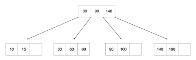

&emsp;&emsp;&emsp;&emsp;&emsp;&emsp;&emsp;Figure 2: B+ Tree of order d = 4 and height h = 2.

&emsp;When answering the following questions, be sure to follow the procedures described in class 
&emsp;and in your textbook. You can make the following assumptions: 
&emsp;&emsp;• A left pointer in an internal node guides towards keys \< than its corresponding key, while 
&emsp;&emsp;&emsp;a right pointer guides towards keys ≥. 
&emsp;&emsp;2 ⌉.• A leaf node underflows when the number of **keys** goes below ⌈d−1 
&emsp;&emsp;2⌉.• An internal node underflows when the number of **pointers** goes below ⌈d

&emsp;Note that B+ tree diagrams for this problem omit leaf pointers for convenience. The leaves of 
&emsp;actual B+ trees are linked together via pointers, forming a singly linked list allowing for quick 
&emsp;traversal through all keys.

### Question 3 continues...

---

**Page 8**

15-445/645 (Spring 2026)   Homework #3   Page 8 of 15

&emsp;(a) **\[4 points\]** Insert 135∗into the B+tree. Select the resulting tree. 
&emsp;&emsp;&emsp;☐  A)

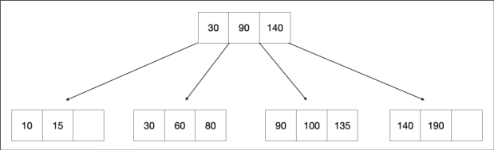

&emsp;&emsp;&emsp;☐  B)

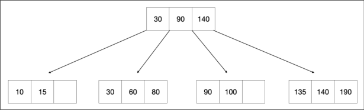

&emsp;&emsp;&emsp;☐  C)

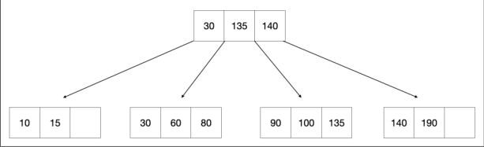

&emsp;&emsp;&emsp;☐  D)

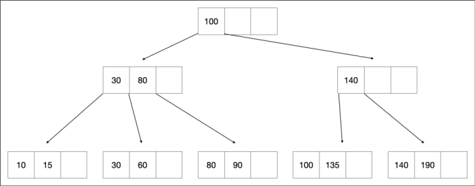

### Question 3 continues...

---

**Page 9**

15-445/645 (Spring 2026)   Homework #3   Page 9 of 15

&emsp;(b) **\[5 points\]** Starting with the tree that results from **(a)**, insert 35∗and then 45∗. Select the 
&emsp;&emsp;&emsp;resulting tree. 
&emsp;&emsp;&emsp;☐  A)

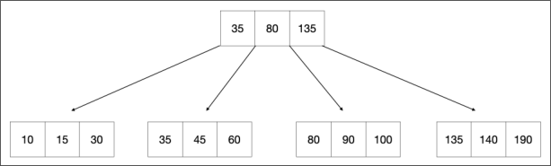

&emsp;&emsp;&emsp;☐  B)

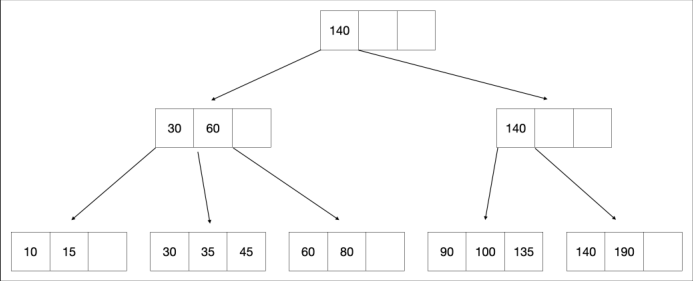

&emsp;&emsp;&emsp;☐  C)

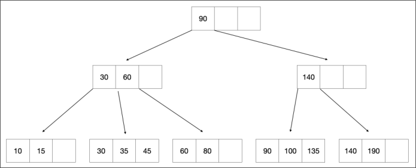

&emsp;&emsp;&emsp;☐  D)

### Question 3 continues...

---

**Page 10**

15-445/645 (Spring 2026)   Homework #3   Page 10 of 15

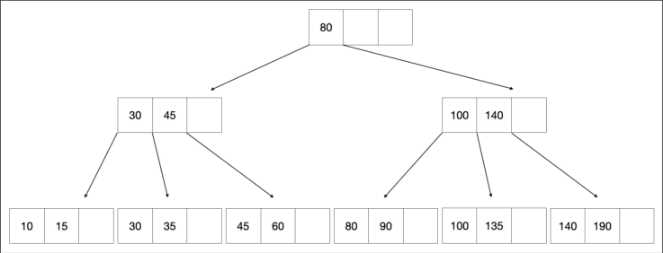

### Question 3 continues...

---

**Page 11**

15-445/645 (Spring 2026)   Homework #3   Page 11 of 15

&emsp;(c) **\[8 points\]** Starting with the tree that results from **(b)**, delete 190∗and then 60∗. Select 
&emsp;&emsp;&emsp;the resulting tree. 
&emsp;&emsp;&emsp;☐  A)

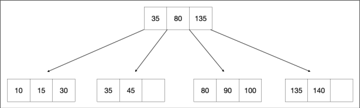

&emsp;&emsp;&emsp;☐  B)

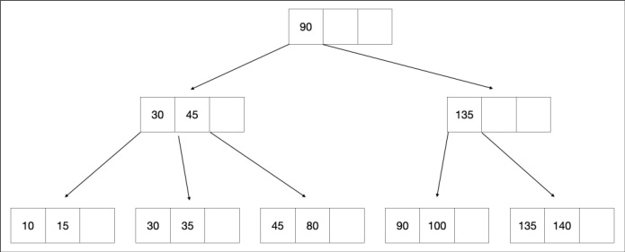

&emsp;&emsp;&emsp;☐  C)

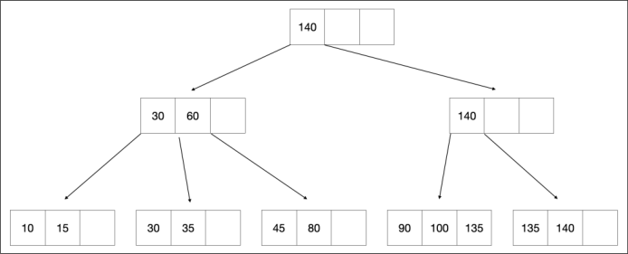

&emsp;&emsp;&emsp;☐  D)

### Question 3 continues...

---

**Page 12**

15-445/645 (Spring 2026)   Homework #3   Page 12 of 15

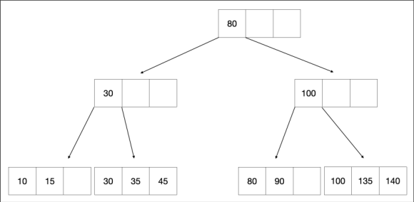

### Question 3 continues...

---

**Page 13**

15-445/645 (Spring 2026)   Homework #3   Page 13 of 15

&emsp;(d)   i. **\[2 points\]** Threads must release their latches in the order they were acquired (i.e., 
&emsp;&emsp;&emsp;&emsp;FIFO). 
&emsp;&emsp;&emsp;&emsp;☐  True   ☐  False 
&emsp;&emsp;&emsp;ii. **\[2 points\]** Under optimistic latch coupling, write threads only take the write latch 
&emsp;&emsp;&emsp;&emsp;on the root when they restart. 
&emsp;&emsp;&emsp;&emsp;☐  True   ☐  False 
&emsp;&emsp;&emsp;iii. **\[2 points\]** A DBMS primarily executes OLTP queries but periodically will execute 
&emsp;&emsp;&emsp;&emsp;OLAP style queries (e.g., analytics, book-keeping). The DBMS will benefit from 
&emsp;&emsp;&emsp;&emsp;using one buffer pool for inner node pages and a different buffer pool for leaf pages 
&emsp;&emsp;&emsp;&emsp;/ table pages. 
&emsp;&emsp;&emsp;&emsp;☐  True   ☐  False 
&emsp;&emsp;&emsp;iv. **\[2 points\]** Under optimistic latch crabbing, read-only thread can drop its latch on 
&emsp;&emsp;&emsp;&emsp;the current page before acquiring the latch on the next page (e.g., child, sibling). 
&emsp;&emsp;&emsp;&emsp;☐  True   ☐  False 
&emsp;&emsp;&emsp;v. **\[2 points\]** “No-Wait” mode for acquiring sibling latches prevents deadlock by al- 
&emsp;&emsp;&emsp;&emsp;lowing the acquirer to fail if another reader already owns the lock. 
&emsp;&emsp;&emsp;&emsp;☐  True   ☐  False

&emsp;&emsp;&emsp;&emsp;&emsp;&emsp;&emsp;&emsp;Homework #3 continues...

---

**Page 14**

15-445/645 (Spring 2026)   Homework #3   Page 14 of 15

### **Question 4: Bloom Filter. . . . . . . . . . . . . . . . . . . . . . . . . . . . . . . . . . . . . .\[20 points\]**

&emsp;Assume that we have a bloom filter that is used to register words relating to Middle Earth. 
&emsp;The filter uses two hash functions h1 and h2 which hash the following words to the following 
&emsp;values: 
&emsp;&emsp;&emsp;&emsp;&emsp;&emsp;&emsp;&emsp;input   h1   h2 
&emsp;&emsp;&emsp;&emsp;&emsp;&emsp;&emsp;&emsp;“Elves”   2031   7380 
&emsp;&emsp;&emsp;&emsp;&emsp;&emsp;&emsp;&emsp;“Hobbits”   9021   1922 
&emsp;&emsp;&emsp;&emsp;&emsp;&emsp;&emsp;&emsp;“Wizards”   7455   2876 
&emsp;&emsp;&emsp;&emsp;&emsp;&emsp;&emsp;&emsp;“Orcs”   1107   6850

&emsp;(a) **\[6 points\]** Suppose the filter has 8 bits initially set to 0: 
&emsp;&emsp;&emsp;&emsp;&emsp;&emsp;&emsp;bit 0   bit 1   bit 2   bit 3   bit 4   bit 5   bit 6   bit 7 
&emsp;&emsp;&emsp;&emsp;&emsp;&emsp;&emsp;0   0   0   0   0   0   0   0

&emsp;&emsp;&emsp;Which bits will be set to 1 after “Hobbits” and “Elves” have been inserted? 
&emsp;&emsp;&emsp;☐  0   ☐  1   ☐  2   ☐  3   ☐  4   ☐  5   ☐  6   ☐  7 
&emsp;(b) Suppose the filter has 8 bits set to the following values: 
&emsp;&emsp;&emsp;&emsp;&emsp;&emsp;&emsp;bit 0   bit 1   bit 2   bit 3   bit 4   bit 5   bit 6   bit 7 
&emsp;&emsp;&emsp;&emsp;&emsp;&emsp;&emsp;0   0   1   1   1   1   0   0

&emsp;&emsp;&emsp;i. **\[4 points\]** What will we learn using the above filter if we lookup “Orcs”? 
&emsp;&emsp;&emsp;&emsp;☐  Orcs has been inserted 
&emsp;&emsp;&emsp;&emsp;☐  Orcs has not been inserted 
&emsp;&emsp;&emsp;&emsp;☐  Orcs may have been inserted 
&emsp;&emsp;&emsp;&emsp;☐  Not possible to know

&emsp;&emsp;&emsp;ii. **\[4 points\]** What will we learn if we lookup “Wizards”? 
&emsp;&emsp;&emsp;&emsp;☐  Wizards has been inserted 
&emsp;&emsp;&emsp;&emsp;☐  Wizards has not been inserted 
&emsp;&emsp;&emsp;&emsp;☐  Wizards may have been inserted 
&emsp;&emsp;&emsp;&emsp;☐  Not possible to know

&emsp;(c) **\[6 points\]** A colleague is interviewing a candidate and would like to first test your 
&emsp;&emsp;&emsp;knowledge of bloom filters. The colleague has a list of prepared statements and would 
&emsp;&emsp;&emsp;like you to identify which of them are true. Select all true statements. 
&emsp;&emsp;&emsp;☐  A Bloom filter may return a false positive, but never a false negative. 
&emsp;&emsp;&emsp;☐  Using more hash functions will always lower a bloom filter’s false positive rate. 
&emsp;&emsp;&emsp;☐  Increasing the size of the bit array has no effect on the false positive rate. 
&emsp;&emsp;&emsp;☐  Add and lookup operations on bloom filters are parallelizable. 
&emsp;&emsp;&emsp;☐  All of the above.

&emsp;&emsp;&emsp;&emsp;&emsp;&emsp;&emsp;&emsp;Homework #3 continues...

---

**Page 15**

15-445/645 (Spring 2026)   Homework #3   Page 15 of 15

### **Question 5: Alternate Index Structures . . . . . . . . . . . . . . . . . . . . . . . . \[15 points\]**

&emsp;(a) **\[5 points\]** Your team is considering using a **Radix Tree** for indexing in a new database 
&emsp;&emsp;&emsp;system. They consulted a large language model for some factual statements about Radix 
&emsp;&emsp;&emsp;Trees but are unsure about the accuracy of the model’s responses. They have asked you 
&emsp;&emsp;&emsp;to identify all factually correct statements. 
&emsp;&emsp;&emsp;☐  Radix Trees are efficient for prefix queries. 
&emsp;&emsp;&emsp;☐  Radix Trees support efficient substring searches (e.g., LIKE “%?%”). 
&emsp;&emsp;&emsp;☐  Search time in a radix tree depends on the length of the key being searched. 
&emsp;&emsp;&emsp;☐  Two keys with a long common prefix will share a path in a radix tree. 
&emsp;&emsp;&emsp;☐  For datasets with lots of common prefixes, radix trees can use less space than B+Trees. 
&emsp;&emsp;&emsp;☐  None of the above.

&emsp;(b) **\[5 points\]** You are discussing index structures with a colleague. They want to compare 
&emsp;&emsp;&emsp;**B+Trees**, **Skip Lists**, **Radix Trees**, and **Inverted Indexes**. Select all the true statements. 
&emsp;&emsp;&emsp;☐  It is on average cheaper to update skip lists than B+Trees. 
&emsp;&emsp;&emsp;☐  B+Trees and Skip Lists both guarantee logarithmic complexity for lookups. 
&emsp;&emsp;&emsp;☐  B+Trees and Inverted Indexes are both efficient at handling substring (e.g., LIKE 
&emsp;&emsp;&emsp;“%?%”) queries. 
&emsp;&emsp;&emsp;☐  Skip Lists perform better than B+Trees for range queries. 
&emsp;&emsp;&emsp;☐  None of the above.

&emsp;(c) **\[5 points\]** Suppose you are trying to run the following query: 
&emsp;&emsp;&emsp;`SELECT` `*` `FROM` `PRODUCTS` `WHERE` `description` `LIKE` `‘%laptop%’;` 
&emsp;&emsp;&emsp;Assume that there is a non-clustering B+Tree index on `description`. Your query is 
&emsp;&emsp;&emsp;running slowly. Which of the following choices (if any) would make this query go faster? 
&emsp;&emsp;&emsp;☐  Drop the index and build a **bloom filter** on `description`. 
&emsp;&emsp;&emsp;☐  Replace the index with a **hash index** on `description`. 
&emsp;&emsp;&emsp;☐  Replace the non-clustering B+Tree with a **clustering** B+Tree index on `description`. 
&emsp;&emsp;&emsp;☐  Replace the index with a **radix tree** on `description`. 
&emsp;&emsp;&emsp;☐  None of the above.

&emsp;&emsp;&emsp;&emsp;&emsp;&emsp;&emsp;&emsp;End of Homework #3

