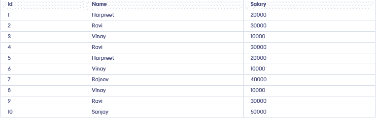
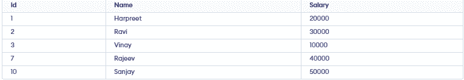
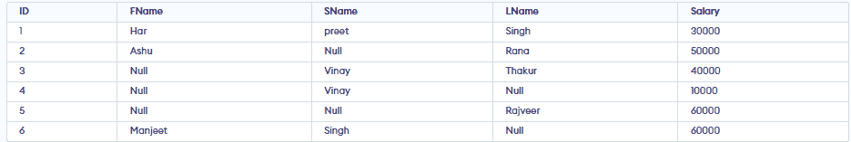
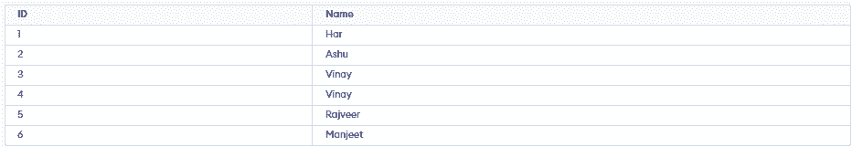
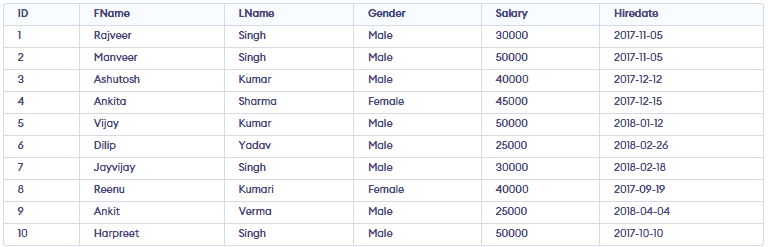

# GeeksforGeeks: SQL interview questions

> Copied from <https://www.geeksforgeeks.org/sql/sql-interview-questions/>. Questions and answers are the source's own; nothing was answered or rewritten here. Each answer is written right under its question, as on the site.

SQL (Structured Query Language) is the standard language used with relational DBMSs to define schemas (DDL), manipulate and query data (DML/DQL) and optimize access so it’s a core skill for developers, data analysts and DBAs and a frequent interview focus. SQL covers:

- Data definition (defining schemas/structures)
- Data manipulation (inserting, updating, deleting data)
- Querying (retrieving data as needed)
- Optimization (tuning access/performance)
- Together, these enable efficient storage, retrieval and management of data in relational database systems.

### 1. What is the difference between CHAR and VARCHAR2?

| CHAR | VARCHAR2 |
| --- | --- |
| CHAR stores fixed-length character data. | VARCHAR2 stores variable-length character data. |
| It pads unused space with trailing spaces. | It does not pad unused space, saving storage. |

### 2. What is a view in SQL?

A view is a virtual table created from a SELECT query that displays data from one or more tables without storing it, helping simplify queries and improve security.

### 3. What is the purpose of the UNIQUE constraint?

The UNIQUE constraint ensures that all values in a column (or combination of columns) are distinct. This prevents duplicate values and helps maintain data integrity.

### 4. What is a query in SQL?

A query is a SQL statement used to retrieve, update or manipulate data in a database. The most common type of query is a [SELECT statement](https://www.geeksforgeeks.org/sql/sql-select-query/), which fetches data from one or more tables based on specified conditions.

### 5. What is a subquery?

A [subquery](https://www.geeksforgeeks.org/sql/sql-subquery/) is a query nested within another query. It is often used in the WHERE clause to filter data based on the results of another query, making it easier to handle complex conditions.

### 6. What is a composite primary key?

A composite primary key uses two or more columns together to uniquely identify each row when one column alone isn’t sufficient.

### 7. Explain the difference between the WHERE and HAVING clauses

- [WHERE](https://www.geeksforgeeks.org/sql/sql-where-clause/) filters individual rows before grouping or aggregation, so it can’t use aggregate functions like SUM or COUNT; it’s best for narrowing raw data early (e.g., a date range or status).
- [HAVING](https://www.geeksforgeeks.org/sql/sql-having-clause-with-examples/) filters the resulting groups after GROUP BY, so it’s meant for conditions on aggregates (e.g., groups with totals above a threshold).

****Example:****

```
SELECT customer_id, COUNT(*) AS orders_2025  
FROM orders  
WHERE order_date >= '2025-01-01' AND order_date < '2026-01-01'        
GROUP BY customer_id  
HAVING COUNT(*) > 5;
```

### 8. What are SQL joins and what are the differences between INNER, LEFT, RIGHT and FULL joins?

[SQL joins](https://www.geeksforgeeks.org/sql/sql-join-set-1-inner-left-right-and-full-joins/) combine rows from two tables based on a matching condition (typically keys) to answer questions that span both tables.

- An INNER JOIN returns only matches that exist in both tables (the intersection).
- A LEFT JOIN returns all rows from the left table and the matching rows from the right; when there’s no match, right-side columns are `NULL.`
- A RIGHT JOIN is the mirror image: all rows from the right table plus matches from the left, `NULL` when absent.
- A FULL (OUTER) JOIN returns all rows from either table, filling in `NULL` where a counterpart is missing.

### 9. Describe a PRIMARY KEY and how it differs from a UNIQUE key

- A [PRIMARY KEY](https://www.geeksforgeeks.org/dbms/primary-key-in-dbms/) uniquely identifies each row in a table: it combines UNIQUE + NOT NULL, there can be only one per table (though it can be composite across multiple columns) and it’s the default target for foreign keys.
- A [UNIQUE key](https://www.geeksforgeeks.org/dbms/unique-key-in-dbms/) also enforces uniqueness, but doesn’t require NOT NULL and you can have many UNIQUE constraints per table.

### 10. What is a CTE (Common Table Expression) and when would you use it?

A [CTE (Common Table Expression)](https://www.geeksforgeeks.org/sql/cte-in-sql/) is a temporary named result set created using the `WITH` clause that exists only during the execution of a single SQL statement. It is used to simplify complex queries, improve readability, avoid repeating subqueries and write recursive queries.

### 11. Explain normalization and briefly describe the different normal forms

[Normalization](https://www.geeksforgeeks.org/dbms/introduction-of-database-normalization/) organizes relational data to minimize redundancy and prevent update/insert/delete anomalies by splitting tables based on dependencies while preserving meaning.

- ****1NF:**** Each column contains atomic values, and there are no repeating groups.
- ****2NF:**** Meets 1NF and removes partial dependencies on a composite primary key.
- ****3NF:**** Meets 2NF and removes transitive dependencies.
- ****BCNF:**** Every determinant must be a candidate key.
- ****4NF:**** Removes multi-valued dependencies.
- ****5NF (PJNF):**** Removes join dependencies to avoid data redundancy.

### 12. What is the difference between UNION and UNION ALL?

| UNION | UNION ALL |
| --- | --- |
| It combines results from multiple SELECT queries and removes duplicate rows. | It combines results from multiple SELECT queries and keeps all duplicate rows. |
| It performs DISTINCT operation, so it can be slower. | It does not remove duplicates, so it is faster. |
| It is used when unique results are required. | It is used when all results, including duplicates, are needed. |

### 13. How do clustered and non‑clustered indexes differ ?

| ****Clustered Index**** | ****Non-Clustered Index**** |
| --- | --- |
| Stores table rows in the physical order of the index key. | Stores index data separately from the table with pointers to rows. |
| Only one clustered index is allowed per table. | Multiple non-clustered indexes can be created on a table. |
| Best for range queries and sorting. | Best for filtering, joins and fast lookups. |
| Commonly created on the primary key. | Commonly created on frequently searched columns. |

### 14. How do you perform pattern matching in SQL ?

Pattern matching in SQL is performed using the [LIKE operator](https://www.geeksforgeeks.org/sql/sql-like/) with wildcard characters.

- % matches zero or more characters.
- \_ matches exactly one character.

### 15. How would you calculate the running total of sales for each product?

A running total is calculated using the SUM() [window function](https://www.geeksforgeeks.org/sql/window-functions-in-sql/) with the OVER() clause. It adds each row's value to the cumulative total while keeping individual rows.

****Example:****

```
SELECT  
    product_id,  
    sale_date,  
    amount,  
    SUM(amount) OVER (  
        PARTITION BY product_id  
        ORDER BY sale_date  
    ) AS running_total  
FROM Sales;
```

This query calculates the cumulative sales total for each product in chronological order.

### 16. Explain correlated subqueries and provide an example use case

A [correlated subquery](https://www.geeksforgeeks.org/sql/sql-correlated-subqueries/) is a subquery that references columns from the outer query. It is executed once for each row processed by the outer query.

****Example:**** Find employees whose salary is greater than the average salary of their department.

```
SELECT e.employee_id, e.name, e.salary, e.department_id  
FROM Employees e  
WHERE e.salary > (  
    SELECT AVG(e2.salary)  
    FROM Employees e2  
    WHERE e2.department_id = e.department_id  
);
```

****Output:**** Returns employees whose salary is higher than the average salary of their department.

### ****17. What are EXISTS and NOT EXISTS and how do they differ from IN?****

- [EXISTS](https://www.geeksforgeeks.org/sql/sql-exists/) returns TRUE if the subquery returns at least one row.
- NOT EXISTS returns TRUE if the subquery returns no rows.
- [IN](https://www.geeksforgeeks.org/sql/sql-between-in-operator/) checks whether a value exists in a list or the result of a subquery.

****Difference:****

- EXISTS and NOT EXISTS stop searching as soon as a matching row is found and work well with correlated subqueries.
- IN compares a value against all values returned by the subquery and is best suited for small result sets.

****Example:****

```
SELECT CustomerID  
FROM Customers c  
WHERE EXISTS (  
    SELECT 1  
    FROM Orders o  
    WHERE o.CustomerID = c.CustomerID  
);
```

****Output:**** Returns customers who have placed at least one order.

### ****18. Explain anti-joins.****

An anti-join returns rows from one table that do not have matching rows in another table. It is commonly implemented using NOT EXISTS or a LEFT JOIN with IS NULL.

****Example:**** Find customers who have not placed any orders.

```
SELECT c.CustomerID, c.CustomerName  
FROM Customers c  
WHERE NOT EXISTS (  
    SELECT 1  
    FROM Orders o  
    WHERE o.CustomerID = c.CustomerID  
);
```

****Output:**** Returns customers who have not placed any orders.

### 19. Explain the difference between RANK(), DENSE\_RANK() and ROW\_NUMBER()

| ROW\_NUMBER() | RANK() | DENSE\_RANK() |
| --- | --- | --- |
| Assigns a unique number to each row. | Assigns the same rank to duplicate values. | Assigns the same rank to duplicate values. |
| Duplicate values receive different numbers. | Duplicate values receive the same rank. | Duplicate values receive the same rank. |
| No gaps in numbering. | Skips the next rank after duplicates. | Does not skip the next rank after duplicates. |

### 20. Explain the purpose of LAG and LEAD functions

LAG and LEAD are window functions used to access values from the previous or next row without using a self-join.

- [LAG()](https://www.geeksforgeeks.org/sql/sql-server-lag-function-overview/) returns the value from the previous row.
- [LEAD()](https://www.geeksforgeeks.org/sql/sql-server-lead-function-overview/) returns the value from the next row.

They are commonly used to compare consecutive rows, calculate differences and analyze trends.

### 21. What is the difference between CROSS JOIN and INNER JOIN?

| CROSS JOIN | INNER JOIN |
| --- | --- |
| Returns the Cartesian product of both tables. | Returns only the matching rows based on a join condition. |
| Does not require a join condition. | Requires a join condition using the ON clause. |
| Every row from the first table is combined with every row from the second table. | Only rows that satisfy the join condition are returned. |
| If Table A has 3 rows and Table B has 4 rows, the result contains 12 rows (3 × 4). | The number of rows depends on the matching records between the tables. |

### 22. Explain foreign keys and how they enforce referential integrity

A foreign key is a column (or set of columns) in one table that references the primary key of another table. It enforces referential integrity by ensuring that values in the child table exist in the parent table, preventing invalid or orphan records.

### 23. Describe set operations like UNION, INTERSECT and EXCEPT and when each is useful

| Operation | Purpose | Use Case |
| --- | --- | --- |
| [UNION](https://www.geeksforgeeks.org/sql/sql-union-clause/) | Combines result sets and removes duplicate rows. | Merge data from multiple tables while keeping unique records. |
| [INTERSECT](https://www.geeksforgeeks.org/sql/sql-intersect-clause/) | Returns only the rows common to both result sets. | Find records that exist in both tables. |
| EXCEPT (`MINUS` in Oracle) | Returns rows from the first query that are not in the second. | Find records present in one table but missing in another. |

### 24. How would you optimize a slow query?

To optimize a [slow query,](https://www.geeksforgeeks.org/sql/best-practices-for-sql-query-optimizations/)

- Use EXPLAIN to find slow parts
- Add proper indexes and update statistics
- Use efficient conditions (avoid functions on columns)
- Filter data early and avoid SELECT \*
- Optimize joins and reduce extra data
- Rewrite queries if needed (JOIN, UNION ALL)
- Use pagination, caching or partitioning for large data

### ****25. Explain database partitioning.****

Database partitioning is the process of dividing a large table into smaller, manageable partitions while treating it as a single logical table. It improves query performance, simplifies maintenance and enhances scalability.

Types:

- ****Horizontal Partitioning****: Splits rows into different partitions.
- ****Vertical Partitioning:**** Splits columns into separate tables.

### ****26. What strategies can protect a web application from SQL injection?****

[SQL injection](https://www.geeksforgeeks.org/sql/sql-injection/) can be prevented by following these best practices:

- Use parameterized queries (prepared statements).
- Validate and sanitize user input.
- Avoid dynamic SQL created through string concatenation.
- Use least-privilege database accounts.
- Use stored procedures securely.

### 27. What are the main types of SQL commands?

[SQL commands](https://www.geeksforgeeks.org/sql/basic-sql-commands/) are broadly classified into:

- ****DDL (Data Definition Language):**** CREATE, ALTER, DROP, TRUNCATE.
- ****DML (Data Manipulation Language):**** SELECT, INSERT, UPDATE, DELETE.
- ****DCL (Data Control Language):**** GRANT, REVOKE.
- ****TCL (Transaction Control Language):**** COMMIT, ROLLBACK, SAVEPOINT.

### 28. What is the purpose of the DEFAULT constraint?

The [DEFAULT constraint](https://www.geeksforgeeks.org/sql/sql-default-constraint/) assigns a default value to a column when no value is provided during an INSERT operation. This helps maintain consistent data and simplifies data entry.

### 29. What is denormalization and when is it used?

[Denormalization](https://www.geeksforgeeks.org/dbms/denormalization-in-databases/) is the process of combining normalized tables into larger tables for performance reasons. It is used when complex queries and joins slow down data retrieval and the performance benefits outweigh the drawbacks of redundancy.

### 30. What are the different operators available in SQL?

- ****Arithmetic Operators:**** +, -, \*, /, %
- ****Comparison Operators:**** =, !=, <>, >, <, >=, <=
- ****Logical Operators:**** AND, OR, NOT
- ****Set Operators:**** UNION, INTERSECT, EXCEPT
- ****Special Operators:**** BETWEEN, IN, LIKE, IS NULL
- ****Concatenation Operators:****`||` (Oracle, PostgreSQL) or `+` (SQL Server) to combine strings.

### 31. What is a SELF JOIN and when is it used?

A [SELF JOIN](https://www.geeksforgeeks.org/sql/sql-self-join/) is a join in which a table is joined with itself. It is useful when rows within the same table have a relationship, such as employees and their managers or products with parent products. Separate table aliases are used to distinguish between the two instances of the same table.

```
SELECT e.EmployeeName,  
       m.EmployeeName AS Manager  
FROM Employees e  
LEFT JOIN Employees m  
ON e.ManagerID = m.EmployeeID;
```

****Output:**** Returns each employee along with their manager's name.

### ****32. What is the purpose of the GROUP BY clause?****

The [GROUP BY](https://www.geeksforgeeks.org/sql/sql-group-by/) clause is used to arrange identical data into groups. It is typically used with aggregate functions (such as COUNT, SUM, AVG) to perform calculations on each group rather than on the entire dataset.

### 33. What are aggregate functions in SQL?

[Aggregate functions](https://www.geeksforgeeks.org/sql/aggregate-functions-in-sql/) perform calculations on a set of values and return a single value. Common aggregate functions include:

- COUNT(): Returns the number of rows.
- SUM(): Returns the total sum of values.
- AVG(): Returns the average of values.
- MIN(): Returns the smallest value.
- MAX(): Returns the largest value.

### 34. What are indexes and why are they used?

[Indexes](https://www.geeksforgeeks.org/sql/sql-indexes/) are database objects that improve query performance by allowing faster retrieval of rows. They function like a book’s index, making it quicker to find specific data without scanning the entire table. However, indexes require additional storage and can slightly slow down data modification operations. Types of Indexes:

- ****Clustered Index:**** Sorts and stores data rows in order of the key (only one per table).
- ****Non-Clustered Index:**** Separate structure with pointers to data rows (can be many per table).
- ****Unique Index:**** Ensures no duplicate values.
- ****Composite Index:**** Index on multiple columns.

### 35. What is the difference between DELETE and TRUNCATE commands?

| DELETE | TRUNCATE |
| --- | --- |
| Removes rows one by one, logs each deletion, allows rollback and supports WHERE clause. | Removes all rows at once, minimal logging, faster, no rollback and no WHERE clause. |
| It is a [DML](https://www.geeksforgeeks.org/dbms/dml-full-form/) command. | It is a [DDL](https://www.geeksforgeeks.org/sql/ddl-full-form/) command. |

### 36. What are the differences between SQL and NoSQL databases?

| SQL Databases | NoSQL Databases |
| --- | --- |
| They use structured tables with rows and columns. | They use flexible, schema-less structures like key-value or documents. |
| They follow a fixed schema. | They do not require a fixed schema. |
| They support ACID properties for reliable transactions. | They often prioritize performance and scalability over strict consistency. |
| They are best for structured and stable data. | They are suitable for large, fast-changing and unstructured data. |
| They scale vertically (by increasing resources). | They scale horizontally (by adding more servers). |

### 37. What are the types of constraints in SQL?

Common constraints include:

- ****NOT NULL:**** Ensures a column cannot have NULL values.
- ****UNIQUE:**** Ensures all values in a column are distinct.
- ****PRIMARY KEY:**** Uniquely identifies each row in a table.
- ****FOREIGN KEY:**** Ensures referential integrity by linking to a primary key in another table.
- ****CHECK:**** Ensures that all values in a column satisfy a specific condition.
- ****DEFAULT:**** Sets a default value for a column when no value is specified.

### 38. What is a cursor in SQL?

A [cursor](https://www.geeksforgeeks.org/sql/what-is-cursor-in-sql/) is a database object used to retrieve, manipulate and traverse through rows in a result set one row at a time. Cursors are helpful when performing operations that must be processed sequentially rather than in a set-based manner.

Types of Cursors (SQL Server):

- ****STATIC:**** Snapshot of result set, does not reflect changes.
- ****DYNAMIC:**** Reflects all changes made while the cursor is open.
- ****FORWARD\_ONLY:**** Can only move forward through the result set.
- ****KEYSET:**** Uses a key to fetch rows; changes to non-key columns are visible.

### 39. What is a trigger in SQL?

A [trigger](https://www.geeksforgeeks.org/sql/sql-trigger-student-database/) is a set of SQL statements that automatically execute in response to certain events on a table, such as INSERT, UPDATE or DELETE. Triggers help maintain data consistency, enforce business rules and implement complex integrity constraints.

- ****Types:**** BEFORE or AFTER triggers (depending on DB).
- ****Uses:**** Enforce business rules, maintain audit logs, check data consistency.

### 40. What is the purpose of the SQL SELECT statement?

The [SELECT](https://www.geeksforgeeks.org/sql/sql-select-query/) statement retrieves data from one or more tables. It is the most commonly used command in SQL, allowing users to filter, sort and display data based on specific criteria.

### 41. What is the purpose of the ORDER BY clause?

ORDER BY sorts the result set of a query in ascending or descending order based on one or more columns.

### 42. What is a table in SQL?

A table is a structured collection of related data organized into rows and columns. Columns define the type of data stored, while rows contain individual records.

### 43. What are NULL values in SQL?

NULL represents a missing or unknown value. It is different from zero or an empty string. NULL values indicate that the data is not available or applicable.

### 44. What is a stored procedure?

A [stored procedure](https://www.geeksforgeeks.org/sql/what-is-stored-procedures-in-sql/) is a precompiled set of SQL statements stored in the database. It can take input parameters, perform logic and queries and return output values or result sets. Stored procedures improve performance and maintainability by centralizing business logic.

### 45. What is the difference between DDL and DML commands?

| DDL (Data Definition Language) | DML (Data Manipulation Language) |
| --- | --- |
| It is used to define and modify the structure of the database. | It is used to manage and manipulate the data inside the database. |
| It works on tables, schemas and database objects. | It works on the rows stored in tables. |
| It includes commands like CREATE, ALTER and DROP. | It includes commands like INSERT, UPDATE and DELETE. |
| It changes the overall structure of the database. | It changes the actual data present in the database. |

### 46. What is the purpose of the ALTER command in SQL?

The [ALTER](https://www.geeksforgeeks.org/sql/sql-alter-add-drop-modify/) command is used to modify the structure of an existing database object. This command is essential for adapting our database schema as requirements evolve.

- Add or drop a column in a table.
- Change a column’s data type.
- Add or remove constraints.
- Rename columns or tables.
- Adjust indexing or storage settings.

### 47. How is data integrity maintained in SQL databases?

Data integrity refers to the accuracy, consistency and reliability of the data stored in the database. SQL databases maintain data integrity through several mechanisms:

- ****Constraints:**** Ensuring that certain conditions are always met. For example, NOT NULL ensures a column cannot have missing values, FOREIGN KEY ensures a valid relationship between tables and UNIQUE ensures no duplicate values.
- ****Transactions:**** Ensuring that a series of operations either all succeed or all fail, preserving data consistency.
- ****Triggers:**** Automatically enforcing rules or validations before or after changes to data.
- ****Normalization:**** Organizing data into multiple related tables to minimize redundancy and prevent anomalies.
- ****Cascading actions:**** Foreign keys can enforce integrity with ON DELETE CASCADE and ON UPDATE CASCADE, automatically updating or removing related rows.
- These measures collectively ensure that the data remains reliable and meaningful over time.

### 48. How does the CASE statement work in SQL?

The [CASE](https://www.geeksforgeeks.org/sql/sql-case-statement/) statement is SQL’s way of implementing conditional logic in queries. It evaluates conditions and returns a value based on the first condition that evaluates to true. If no condition is met, it can return a default value using the ELSE clause.

****Example:****

```
SELECT ID,    
       CASE    
           WHEN Salary > 100000 THEN 'High'    
           WHEN Salary BETWEEN 50000 AND 100000 THEN 'Medium'    
           ELSE 'Low'    
       END AS SalaryLevel    
FROM Employees;
```

### 49. What is the purpose of the COALESCE function?

The [COALESCE function](https://www.geeksforgeeks.org/sql/use-of-coalesce-function-in-sql-server/) returns the first non-NULL value from a list of expressions. It’s commonly used to provide default values or handle missing data gracefully.

****Example:****

```
SELECT COALESCE(NULL, NULL, 'Default Value') AS Result;
```

### 50. What are the differences between SQL’s COUNT() and SUM() functions?

| ****COUNT()**** | ****SUM()**** |
| --- | --- |
| Counts number of rows or non-NULL values | Adds all numeric values in a column |
| **`Query:`** SELECT COUNT(\*) FROM Orders;<br> | **`Query:`** SELECT SUM(TotalAmount) FROM Orders; |

### 51. What is the difference between the NVL and NVL2 functions?

| ****NVL()**** | ****NVL2()**** |
| --- | --- |
| Replaces NULL with a given value | Returns one value if NOT NULL, another if NULL |
| Takes 2 arguments | Takes 3 arguments |
| SELECT NVL(Salary, 0) FROM Employees; | SELECT NVL2(Salary, 'Has Salary', 'No Salary') FROM Employees; |

### 52. What are scalar functions in SQL?

[Scalar functions](https://www.geeksforgeeks.org/sql/sql-functions-aggregate-scalar-functions/) operate on individual values and return a single value as a result. They are often used for formatting or converting data. Common examples include:

- ****LEN():**** Returns the length of a string.
- ****ROUND():**** Rounds a numeric value.
- ****CONVERT():**** Converts a value from one data type to another.

### 53. What happens if you use COUNT() on NULLs?

- COUNT(column) ignores NULL values and only counts non-NULL entries.
- COUNT(\*) counts all rows, including those with NULL values in columns.

****Example:****

```
SELECT Name, ROW_NUMBER() OVER (ORDER BY Salary DESC) AS RowNum    
FROM Employees;
```

### 54. What are window functions and how are they used?

Window functions perform calculations across a group of related rows while keeping each row separate. They are used for tasks like running totals, rankings and moving averages.

#### ****Example:**** Calculating a running total

```
SELECT Name, Salary,   
    SUM(Salary) OVER (ORDER BY Salary) AS RunningTotal    
FROM Employees;
```

### 55. What is the difference between an index and a key in SQL?

| ****Index**** | ****Key**** |
| --- | --- |
| Used to improve data retrieval speed | Used to enforce data integrity and relationships |
| Physical database object | Logical concept |
| Does not ensure uniqueness (can be non-unique) | Ensures uniqueness (e.g., Primary Key) |
| Helps in faster searching of data | Defines relationships (e.g., Foreign Key) |

### 56. How does indexing improve query performance?

Indexing helps the database quickly find data without scanning the whole table, reducing time and improving query performance.

****Example:****

```
CREATE INDEX idx_lastname ON Employees(LastName);  
SELECT * FROM Employees WHERE LastName = 'Smith';
```

The index on LastName lets the database quickly find all rows matching ‘Smith’ without scanning every record.

### 57. What are the trade-offs of using indexes in SQL databases?

****Advantages****

- Faster query performance, especially for SELECT queries with [WHERE](https://www.geeksforgeeks.org/sql/sql-where-clause/) clauses, JOIN conditions or ORDER BY clauses.
- Improved sorting and filtering efficiency.

****Disadvantages:****

- Increased storage space for the index structures.
- Additional overhead for write operations (INSERT, UPDATE, DELETE), as indexes must be updated whenever the underlying data changes.

### 58. What are temporary tables and how are they used?

[Temporary tables](https://www.geeksforgeeks.org/sql/what-is-temporary-table-in-sql/) are tables that exist only for the duration of a session or a transaction. They are useful for storing intermediate results, simplifying complex queries, or performing operations on subsets of data without modifying the main tables.

### ****59. What is a materialized view and how does it differ from a standard view?****

****Standard View:****

- A virtual table defined by a query.
- Does not store data; the underlying query is executed each time the view is referenced.
- A standard view shows real-time data.

****Materialized View:****

- A physical table that stores the result of the query.
- Data is precomputed and stored, making reads faster.
- Requires periodic refreshes to keep data up to date.
- materialized view is used to store aggregated sales data, updated nightly, for fast reporting.

****In Oracle/Postgres, you use:****

```
REFRESH MATERIALIZED VIEW my_view;
```

- They can also be set up with ON DEMAND or ON COMMIT refresh policies depending on DBMS.

### 60. What is a sequence in SQL?

A [sequence](https://www.geeksforgeeks.org/sql/sql-sequences/) is a database object that generates a series of unique numeric values. It’s often used to produce unique identifiers for primary keys or other columns requiring sequential values.

****Example:****

```
CREATE SEQUENCE seq_emp_id START WITH 1 INCREMENT BY 1;  
SELECT NEXT VALUE FOR seq_emp_id; -- Returns 1  
SELECT NEXT VALUE FOR seq_emp_id; -- Returns 2
```

### 61. What is the purpose of the SQL EXCEPT operator?

The [EXCEPT operator](https://www.geeksforgeeks.org/sql/sql-except-clause/) is used to return rows from one query’s result set that are not present in another query’s result set. It effectively performs a set difference, showing only the data that is unique to the first query.

****Example:****

```
SELECT ProductID FROM ProductsSold  
EXCEPT  
SELECT ProductID FROM ProductsReturned;
```

****Use Case:****

- To find discrepancies between datasets.
- To verify that certain data exists in one dataset but not in another.

****Performance Considerations:****

- EXCEPT works best when the datasets involved have appropriate indexing and when the result sets are relatively small.
- Large datasets without indexes may cause slower performance because the database has to compare each row.

### 62. How do constraints improve database integrity?

Constraints enforce rules that the data must follow, preventing invalid or inconsistent data from being entered:

- ****NOT NULL:**** Ensures that a column cannot contain NULL values.
- ****UNIQUE:**** Ensures that all values in a column are distinct.
- ****PRIMARY KEY:**** Combines NOT NULL and UNIQUE, guaranteeing that each row is uniquely identifiable.
- ****FOREIGN KEY:**** Ensures referential integrity by requiring values in one table to match primary key values in another.
- ****CHECK:**** Validates that values meet specific criteria (e.g., CHECK (Salary > 0)).

By automatically enforcing these rules, constraints maintain data reliability and consistency.

### 63. What is the difference between a local and a global temporary table?

****Local Temporary Table:****

- Prefixed with # (e.g., #TempTable).
- Exists only within the session that created it.
- Automatically dropped when the session ends.

****Global Temporary Table:****

- Prefixed with ## (e.g., ##GlobalTempTable).
- Visible to all sessions.
- Dropped only when all sessions referencing it are closed.

****Example:****

```
CREATE TABLE #LocalTemp (ID INT);  
CREATE TABLE ##GlobalTemp (ID INT);
```

### 64. What is the purpose of the SQL MERGE statement?

The MERGE statement combines multiple operations INSERT, UPDATE and DELETE into one. It is used to synchronize two tables by:

- Inserting rows that don’t exist in the target table.
- Updating rows that already exist.
- Deleting rows from the target table based on conditions
- In SQL Server, MERGE can cause concurrency issues (race conditions or deadlocks).

****Example:****

```
MERGE INTO TargetTable T    
USING SourceTable S    
ON T.ID = S.ID    
WHEN MATCHED THEN    
    UPDATE SET T.Value = S.Value    
WHEN NOT MATCHED THEN    
    INSERT (ID, Value) VALUES (S.ID, S.Value);
```

### 65. How can you handle duplicates in a query without using DISTINCT?

****GROUP BY:**** Aggregate rows to eliminate duplicates

```
SELECT Column1, MAX(Column2)    
FROM TableName    
GROUP BY Column1;
```

****ROW\_NUMBER():**** Assign a unique number to each row and filter by that

```
WITH CTE AS (  
    SELECT  
        Column1,  
        Column2,  
        ROW_NUMBER() OVER (  
            PARTITION BY Column1  
            ORDER BY Column2  
        ) AS RowNum  
    FROM TableName  
)  
SELECT *  
FROM CTE  
WHERE RowNum = 1;
```

### 66. What are the ACID properties of a transaction?

ACID ensures database transactions are reliable and maintain data integrity.

- Atomicity: A transaction is completed entirely or not at all. If one operation fails, all changes are rolled back.  
  Example: A bank transfer fails if either debit or credit is unsuccessful.
- ****Consistency:**** Ensures the database remains valid by following all rules and constraints.  
  Example: Inventory quantity cannot become negative.
- ****Isolation:**** Multiple transactions execute independently without affecting each other.  
  Example: Two users cannot book the same seat simultaneously.
- ****Durability:**** Once a transaction is committed, its changes are permanently saved, even after a system failure.  
  Example: A confirmed order remains stored after a server restart.

### 67. What are the differences between isolation levels in SQL?

Isolation levels control how transactions interact to maintain data consistency.

- ****Read Uncommitted:**** Allows reading uncommitted data, which may cause dirty reads.
- ****Read Committed:**** Reads only committed data, preventing dirty reads.
- ****Repeatable Read:**** Ensures the same data remains unchanged during a transaction, preventing dirty and non-repeatable reads.
- ****Serializable:**** Provides the highest isolation level, preventing dirty reads, non-repeatable reads, and phantom reads, but may reduce performance due to increased locking.

### 68. What is the purpose of the WITH (NOLOCK) hint in SQL Server?

- The WITH (NOLOCK) hint allows a query to read data without acquiring shared locks, effectively reading uncommitted data.
- It can improve performance by reducing contention for locks, especially on large tables that are frequently updated.
- Results may be inconsistent or unreliable, as the data read might change or be rolled back.

****Example:****

```
SELECT *    
FROM Orders WITH (NOLOCK);
```

This query fetches data from the `Orders` table without waiting for other transactions to release their locks.

### 69. How do you handle deadlocks in SQL databases?

A deadlock occurs when two or more transactions wait indefinitely for each other to release resources.

- ****Deadlock Detection & Retry:**** The database detects the deadlock, aborts one transaction and retries it later.
- ****Reduce Lock Contention:**** Use indexes, optimize queries and keep transactions short.
- ****Choose Appropriate Isolation Levels:**** Select suitable isolation levels to balance consistency and locking.
- ****Consistent Resource Ordering:**** Access resources in the same order across transactions to avoid circular waits.

### 70. What is a database snapshot and how is it used?

Database Snapshot is a read-only copy of a database at a specific point in time.

****Uses:****

- Reporting on a consistent dataset.
- Point-in-time recovery.
- Testing without affecting the original database.

****Example:****

```
CREATE DATABASE MySnapshot ON  
(  
    NAME = MyDatabase_Data,  
    FILENAME = 'C:\Snapshots\MyDatabase_Snapshot.ss'  
)  
AS SNAPSHOT OF MyDatabase;
```

### 71. What are the differences between OLTP and OLAP systems?

| ****OLTP (Online Transaction Processing)**** | ****OLAP (Online Analytical Processing)**** |
| --- | --- |
| Handles simple, frequent transactions | Handles complex queries and data analysis |
| Optimized for fast read and write operations | Optimized for read-heavy workloads and aggregation |
| Uses normalized schema for data consistency | Uses denormalized schema (star/snowflake) |
| Example: E-commerce, banking systems | Example: Data warehousing, business intelligence |

### 72. What is a live lock and how does it differ from a deadlock?

****Live Lock****

- Occurs when two or more transactions keep responding to each other’s changes, but no progress is made.
- Unlike a deadlock, the transactions are not blocked; they are actively running, but they cannot complete.

****Deadlock****

- A deadlock occurs when two or more transactions are waiting on each other’s resources indefinitely, blocking all progress.
- No progress can be made unless one of the transactions is terminated

### 73. How do you implement dynamic SQL and what are its advantages and risks?

[Dynamic SQL](https://www.geeksforgeeks.org/sql/dynamic-sql/) is SQL code created and executed at runtime using variables or user input.

****Advantages:****

- Builds flexible queries dynamically.
- Useful for dynamic filtering, sorting, and table selection.

****Risks:****

- Vulnerable to SQL injection if inputs are not validated.
- Harder to debug and maintain.
- May reduce query performance due to limited execution plan reuse.

### 74. What is the difference between horizontal and vertical partitioning?

| ****Horizontal Partitioning**** | ****Vertical Partitioning**** |
| --- | --- |
| Divides rows of a table based on column values | Divides columns of a table into separate parts |
| Data is split row-wise (same columns, different rows) | Data is split column-wise (different columns) |
| Improves performance by reducing number of rows scanned | Improves performance by separating frequently and rarely used data |
| Example: Table divided by region or year | Example: Large text columns stored separately |

### 75. What are the considerations for indexing very large tables?

- ****Index Frequently Used Columns:**** Create indexes on columns used in WHERE, JOIN and ORDER BY clauses. Avoid indexing every column.
- ****Choose the Right Index Type:**** Use clustered indexes for primary keys and range queries, and non-clustered indexes for filtering and sorting.
- ****Use Partitioned Indexes:**** Create local indexes for partitioned tables to improve performance.
- ****Maintain Indexes:**** Rebuild fragmented indexes and perform maintenance during off-peak hours.
- ****Monitor Performance:**** Analyze execution plans and remove unused indexes to reduce maintenance overhead.

### 76. What is the difference between database sharding and partitioning?

| ****Sharding**** | ****Partitioning**** |
| --- | --- |
| Splits database into multiple independent databases | Splits a table into parts within the same database |
| Used for horizontal scaling across servers | Used for better performance and data management |
| Data is stored on different servers | Data stays in one database |
| Example: Database divided by region | Example: Table divided by year |

### 77. What are the best practices for writing optimized SQL queries?

- ****Write Simple Queries:**** Keep SQL queries clear and avoid unnecessary complexity.
- ****Filter Data Early:**** Use `WHERE` clauses to reduce the amount of data processed.
- ****Avoid**** **`SELECT *`******:**** Retrieve only the required columns.
- ****Use Indexes Effectively:**** Index frequently used columns in `WHERE`, `JOIN` and `ORDER BY` clauses.
- ****Analyze Execution Plans:**** Identify and fix slow query operations.
- ****Optimize Joins & Aggregations:**** Use appropriate joins and efficient `GROUP BY` operations.
- ****Monitor Performance:**** Regularly review and tune queries as data grows.

### 78. How can you monitor query performance in a production database?

- ****Use Execution Plans:**** Identify bottlenecks and optimize query performance.
- ****Analyze Wait Statistics:**** Detect delays caused by locks, I/O or CPU usage.
- ****Use Monitoring Tools:**** Use tools like EXPLAIN, Query Store and Performance Schema to analyze queries.
- ****Track Performance Metrics:**** Monitor query time, CPU usage and I/O to detect issues early.
- ****Continuously Tune Queries:**** Optimize queries and update indexes as data and workloads grow.

### 79. What are the trade-offs of using indexing versus denormalization?

| ****Indexing**** | ****Denormalization**** |
| --- | --- |
| Improves query performance by speeding up data retrieval. | Improves read performance by reducing joins. |
| Does not duplicate data. | Introduces data redundancy. |
| Slows insert, update, and delete operations. | Makes updates more complex due to redundant data. |
| Requires additional storage for indexes. | Requires additional storage for duplicated data. |

### ****80. How does SQL handle recursive queries?****

SQL uses recursive CTEs to retrieve hierarchical or tree-structured data.

```
WITH RecursiveCTE (ID, ParentID, Depth) AS (  
    SELECT ID, ParentID, 1  
    FROM Categories  
    WHERE ParentID IS NULL  
  
    UNION ALL  
  
    SELECT c.ID, c.ParentID, r.Depth + 1  
    FROM Categories c  
    JOIN RecursiveCTE r  
    ON c.ParentID = r.ID  
)  
SELECT * FROM RecursiveCTE;
```

### ****81. What are the differences between transactional and analytical queries?****

| Transactional Queries | Analytical Queries |
| --- | --- |
| Focus on short, day-to-day operations like INSERT, UPDATE and DELETE. | Focus on complex analysis, aggregations and data transformations. |
| Optimized for high speed and quick response (low latency). | Process large volumes of data and are usually read-heavy. |
| Mainly used in OLTP systems for routine operations. | Mainly used in OLAP systems for analysis and reporting. |
| Help maintain data integrity in regular operations. | Help in decision-making by providing insights from data. |

### ****82. How can you ensure data consistency across distributed databases?****

- ****Distributed Transactions:**** Ensure all databases commit or roll back together (e.g., 2PC).
- ****Eventual Consistency:**** Allow data to become consistent over time.
- ****Conflict Resolution:**** Use timestamps or versioning to resolve conflicts.
- ****Data Replication:**** Keep data synchronized across databases.
- ****Audits & Validation:**** Regularly check and fix inconsistencies.

### 83. What is the purpose of the SQL PIVOT operator?

The [PIVOT operator](https://www.geeksforgeeks.org/sql/pivot-and-unpivot-in-sql/) transforms rows into columns, making it easier to summarize or rearrange data for reporting.

****Example:****

Converting a dataset that lists monthly sales into a format that displays each month as a separate column.

```
SELECT ProductID, [2021], [2022]    
FROM (    
    SELECT ProductID, YEAR(SaleDate) AS SaleYear, Amount    
    FROM Sales    
) AS Source    
PIVOT (    
    SUM(Amount)    
    FOR SaleYear IN ([2021], [2022])    
) AS PivotTable;
```

### ****84. What is a bitmap index and how does it differ from a B-tree index?****

| Bitmap Index | B-tree Index |
| --- | --- |
| It uses bitmaps (arrays of bits) to represent data. | It uses a balanced tree structure to store data in sorted order. |
| It is suitable for low-cardinality columns (e.g., gender, yes/no). | It is suitable for high-cardinality columns (e.g., IDs, large ranges). |
| It is efficient for logical operations like AND, OR, NOT. | It is efficient for range-based queries. |
| It is best for filtering and boolean conditions. | It is best for searching and sorting large datasets. |

### ****85:**** Difference between blocking and deadlocking.

| ****Blocking**** | ****Deadlocking**** |
| --- | --- |
| One transaction waits because another holds the lock | Two or more transactions wait for each other (circular wait) |
| Resolves automatically after lock release | Needs detection and rollback to resolve |

### 86: Delete duplicate data from table only first data remains constant.

****Managers :****



****Query:****

```
DELETE M1   
From managers M1, managers M2   
Where M2.Name = M1.Name AND M1.Id>M2.Id;
```



### 87 : Find the employee name using COALESCE() when First\_Name, Second\_Name, or Last\_Name may contain NULL values.

****Employee Table:****



****Query:****

```
SELECT ID, COALESCE(FName, SName, LName) as Name   
FROM employees;
```



### 88: Find employees hired in the last n months using the TIMESTAMPDIFF() function.

****Query -****

```
Select *, TIMESTAMPDIFF (month, Hiredate, current_date()) as DiffMonth   
From employees  
Where TIMESTAMPDIFF (month, Hiredate, current_date())   
Between 1 and 5 Order by Hiredate desc;
```

****Output:****



### Topic-wise Interview Questions

- [Data Definition and Control (DDL + DCL + TCL)](https://www.geeksforgeeks.org/dbms/data-definition-and-control-ddl-dcl-tcl-interview-questions-sql/)
- [Data Manipulation and Querying (DML + Query Processing)](https://www.geeksforgeeks.org/sql/data-manipulation-and-querying-dml-query-processing-interview-questions-sql/)
- [Advanced SQL and Optimization](https://www.geeksforgeeks.org/sql/advanced-sql-and-optimization-interview-questions-sql/)

> To learn SQL from scratch, refer to the complete [SQL tutorial](https://www.geeksforgeeks.org/sql/sql-tutorial/).
