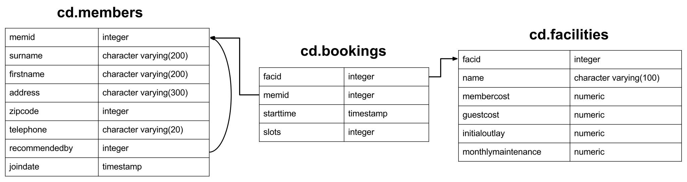

# PostgreSQL Exercises: every exercise with its official answer and discussion

> Copied from <https://pgexercises.com/>. Questions and answers are the source's own; nothing was answered or rewritten here. Expected results and the schema diagram are included. Run the queries yourself on the site or on the downloadable database.

| Category | Exercises |
|---|---|
| [basic](basic.md) | 12 |
| [joins](joins.md) | 8 |
| [updates](updates.md) | 9 |
| [aggregates](aggregates.md) | 22 |
| [date](date.md) | 10 |
| [string](string.md) | 7 |
| [recursive](recursive.md) | 3 |
