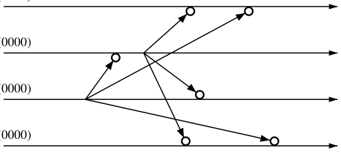

# Cambridge Computer Science Tripos 2010, Paper 5, Question 6: Questions

> Copied from the original: <https://www.cl.cam.ac.uk/teaching/exams/pastpapers/y2010p5q6.pdf>. Text and figures are taken from the PDF as is; nothing was answered or rewritten. The original PDF is in this folder.

---

**Page 1**

**2010 Paper 5 Question 6**

**Concurrent and Distributed Systems**

(a) When distributed systems are designed and engineered, certain fundamental 
&emsp;characteristics have to be taken into account, including:

&emsp;&emsp;&emsp;1\.   Concurrent execution of components. 
&emsp;&emsp;&emsp;2\.   Independent failure modes. 
&emsp;&emsp;&emsp;3\.   Communication delay. 
&emsp;&emsp;&emsp;4\.   No global time.

&emsp;In the light of these characteristics, discuss the monitoring of a widely 
&emsp;distributed industrial process with the following properties:

&emsp;Distributed monitoring computers analyse regions of the process. Each region 
&emsp;contains a number of sensors at identified locations and with the ability to 
&emsp;generate timestamps.   Some sensors monitor temperature, others monitor 
&emsp;pressure.

&emsp;If both temperature and pressure are found by a monitoring computer to be 
&emsp;above their defined thresholds in a given locality within its region it sends an 
&emsp;alarm signal to the process control centre, indicating the time and place of 
&emsp;the occurrence. The control centre initiates action to bring the values under 
&emsp;control.   \[10 marks\]

(b) The diagram below represents a process group that communicates by means 
&emsp;of multicast messages.

&emsp;&emsp;&emsp;&emsp;&emsp;&emsp;&emsp;&emsp;time --\> 
&emsp;&emsp;&emsp;&emsp;P1 (0000)

&emsp;&emsp;&emsp;&emsp;&emsp;&emsp;&emsp;&emsp;= message delivery software

&emsp;At each process-hosting node, message delivery software decides whether an 
&emsp;incoming message should be delivered to the process or buffered for later 
&emsp;delivery. This is achieved by the use of vector clocks.

&emsp;With reference to the example shown in the diagram, describe the vector clock 
&emsp;algorithm for delivery of messages in causal order.   \[10 marks\]

&emsp;&emsp;&emsp;&emsp;&emsp;&emsp;&emsp;&emsp;1

