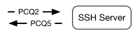
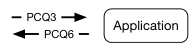

# Cambridge Computer Science Tripos 2018, Paper 5, Question 7: Questions

> Copied from the original: <https://www.cl.cam.ac.uk/teaching/exams/pastpapers/y2018p5q7.pdf>. Text and figures are taken from the PDF as is; nothing was answered or rewritten. The original PDF is in this folder.

---

**Page 1**

**COMPUTER SCIENCE TRIPOS Part IB – 2018 – Paper 5**

**7**   **Concurrent and Distributed Systems (RNW)**

&emsp;UNIX pipes and SSH connections can be modeled as single-recipient producer- 
&emsp;consumer queues (PCQs).   Consider the following processes linked by PCQs 
&emsp;forwarding console input to the application, and output back to the console:

&emsp;Each queue has a fixed limit of **N** (≥1) bytes. A PCQ is readable if there is a 
&emsp;non-zero number of bytes in its buffer. A PCQ is writable if there are fewer than **N** 
&emsp;bytes of data in its buffer. Four (simplified) I/O system calls are used: 
&emsp;&emsp;**b = readbyte(pcq)**   Read one byte of data from **pcq**; blocks if **pcq** is empty. 
&emsp;&emsp;**writebyte(pcq, b)**   Writes one byte of data to **pcq**; blocks if **pcq** is full. 
&emsp;&emsp;**waitread(pcq1, ..)**   Block until at least one argument is readable. 
&emsp;&emsp;**pollread(pcq)**   Returns true if **pcq** is readable. 
&emsp;With crypto omitted, SSH client and server workloops are implemented as: 
&emsp;`1:`   `while` `(1)` `{` 
&emsp;`2:`   `waitread(input1,` `input2);`   `//` `Wait` `for` `input` `on` `either` `PCQ` 
&emsp;`3:`   `if` `(pollread(input1))` `{` 
&emsp;`4:`   `b` `=` `readbyte(input1);` 
&emsp;`5:`   `writebyte(output2,` `b);` 
&emsp;`6:`   `}` 
&emsp;`7:`   `if` `(pollread(input2))` `{` 
&emsp;`8:`   `b` `=` `readbyte(input2);` 
&emsp;`9:`   `writebyte(output1,` `b);` 
&emsp;`10:`   `}`

&emsp;(a) What is the maximum amount of data buffered across all PCQs?   \[2 marks\]

&emsp;(b)   Applications often echo user keypresses, printing input characters as they process 
&emsp;&emsp;&emsp;them. If the user hits the ‘A’ key, at most how many times will PCQ semaphores 
&emsp;&emsp;&emsp;be signaled before the character is printed on the console?   \[2 marks\]

&emsp;(c)   The system operator sets **N** to 1 and pastes a long list of commands into the 
&emsp;&emsp;&emsp;console. Part way through, the SSH Server and Application processes hang. 
&emsp;&emsp;&emsp;Succinctly explain what happened, describing PCQ3 and PCQ6 starting states, 
&emsp;&emsp;&emsp;initial line number for the SSH Server, and event sequence.   \[6 marks\]

&emsp;(d) Explain why, on a busy system, key press echoes might be delayed when a 
&emsp;&emsp;&emsp;high-priority user interacts with a low-priority application. Propose a solution, 
&emsp;&emsp;&emsp;describing how each of the above system calls should be changed, and any 
&emsp;&emsp;&emsp;additional state required. Describe limitations that might apply.   \[10 marks\]

&emsp;&emsp;&emsp;&emsp;&emsp;&emsp;&emsp;&emsp;1

