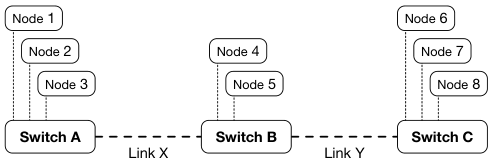

# Cambridge Computer Science Tripos 2018, Paper 5, Question 8: Questions

> Copied from the original: <https://www.cl.cam.ac.uk/teaching/exams/pastpapers/y2018p5q8.pdf>. Text and figures are taken from the PDF as is; nothing was answered or rewritten. The original PDF is in this folder.

---

**Page 1**

**COMPUTER SCIENCE TRIPOS Part IB – 2018 – Paper 5**

**8**   **Concurrent and Distributed Systems (RNW)**

&emsp;The Bully Algorithm allows a set of nodes to elect a unique leader in the presence 
&emsp;of node failures. For the purposes of this question, assume that: the set of nodes 
&emsp;is known in advance by all nodes; each process knows its own identifier; processes 
&emsp;fail and restart cleanly; node failure can be reliably detected; and message delivery 
&emsp;is reliable unless the destination node has failed. Our network contains eight nodes 
&emsp;(1–8), which are connected via three switches (A–C):

&emsp;(a) In the absence of node or switch failures, which node will be elected leader using 
&emsp;&emsp;&emsp;the Bully Algorithm?   \[1 mark\]

&emsp;(b)   A new Node 9 is added to the network, attached to Switch C. Which node will 
&emsp;&emsp;&emsp;be elected leader using the Bully Algorithm?   \[1 mark\]

&emsp;(c)   If there is a network partition between Switches B and C, what node will be 
&emsp;&emsp;&emsp;elected leader using the Bully Algorithm?   \[2 marks\]

&emsp;(d) To address the concern about network partition, the authors of a distributed 
&emsp;&emsp;&emsp;system introduce a majority rule: for a node to declare itself leader, it must 
&emsp;&emsp;&emsp;receive OK messages from a majority of nodes (including itself). 
&emsp;&emsp;&emsp;&emsp;&emsp;&emsp;&emsp;&emsp;Which 
&emsp;&emsp;&emsp;combinations of links can fail while still permitting a successful election, and, 
&emsp;&emsp;&emsp;for each of those combinations, which node is elected leader?   \[4 marks\]

&emsp;(e) One key metric used in evaluating distributed algorithms is the number of 
&emsp;&emsp;&emsp;messages generated. What is the worst-case cost (using O-notation) in messages 
&emsp;&emsp;&emsp;with n nodes participating in the Bully Algorithm? Explain why this is the case. 
&emsp;&emsp;&emsp;&emsp;&emsp;&emsp;&emsp;&emsp;\[2 marks\]

&emsp;(f )   The Bully Algorithm provides a strong invariant that a node can identify that 
&emsp;&emsp;&emsp;it is the unique leader in a distributed system. However, that leadership status 
&emsp;&emsp;&emsp;can be preempted (revoked) without node failure. Explain how this may occur. 
&emsp;&emsp;&emsp;&emsp;&emsp;&emsp;&emsp;&emsp;\[4 marks\]

&emsp;(g) Describe how a distributed application can utilise elected leadership status to 
&emsp;&emsp;&emsp;safely allocate unique transaction IDs. Explain why this works, considering in 
&emsp;&emsp;&emsp;particular: (1) the steady state; (2) leader change due to leader crash; and (3) 
&emsp;&emsp;&emsp;leader change due to leadership revocation.   \[6 marks\]

&emsp;&emsp;&emsp;&emsp;&emsp;&emsp;&emsp;&emsp;1

