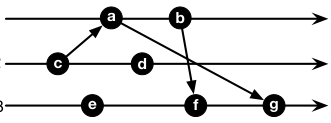

# Cambridge Computer Science Tripos 2019, Paper 5, Question 7: Questions

> Copied from the original: <https://www.cl.cam.ac.uk/teaching/exams/pastpapers/y2019p5q7.pdf>. Text and figures are taken from the PDF as is; nothing was answered or rewritten. The original PDF is in this folder.

---

**Page 1**

**COMPUTER SCIENCE TRIPOS Part IB – 2019 – Paper 5**

**7**   **Concurrent and Distributed Systems (rmm1002)**

&emsp;(a) In the Network Time Protocol (NTP), a client (C) and a server (S) exchange 
&emsp;&emsp;&emsp;(request, reply) messages to compute corrections to the time at C. Assume the 
&emsp;&emsp;&emsp;time at S is always correct, and that C is synchronised to S at 13:30:00.

&emsp;&emsp;&emsp;(i)   Thirty days later the time at S is again 13:30:00 but C now believes the 
&emsp;&emsp;&emsp;&emsp;&emsp;time to be 13:28:30. Define and compute skew and drift for C.   \[2 marks\]

&emsp;&emsp;&emsp;(ii) NTP estimates the offset and delay using four timestamps (T0, T1, T2, T3) 
&emsp;&emsp;&emsp;&emsp;&emsp;from a request-reply message exchange. Two such exchanges occur between 
&emsp;&emsp;&emsp;&emsp;&emsp;C and S, producing timestamps (310.000, 400.100, 400.102, 310.202) and 
&emsp;&emsp;&emsp;&emsp;&emsp;(311.000, 401.150, 401.160, 311.410) respectively, denoting all timestamps 
&emsp;&emsp;&emsp;&emsp;&emsp;as seconds since a common fixed point.   Show on a diagram the point 
&emsp;&emsp;&emsp;&emsp;&emsp;in the message exchange at which each timestamp T0 . . . T3 is taken. 
&emsp;&emsp;&emsp;&emsp;&emsp;Give definitions for offset and delay, and compute both for each set of 
&emsp;&emsp;&emsp;&emsp;&emsp;timestamps. Which of the two offsets you have computed would you prefer 
&emsp;&emsp;&emsp;&emsp;&emsp;to use to adjust the time at C, and why?   \[5 marks\]

&emsp;&emsp;&emsp;(iii) What happens to your estimates of offset and delay if network delays are 
&emsp;&emsp;&emsp;&emsp;&emsp;no longer symmetric?   \[2 marks\]

&emsp;(b)   It is often necessary to agree only on the ordering of events, not their times.

&emsp;&emsp;&emsp;(i)   x →y indicates event x happens-before event y. Define happens-before. 
&emsp;&emsp;&emsp;&emsp;&emsp;Explain why it provides only a partial order on events.   \[2 marks\]

&emsp;&emsp;&emsp;(ii) Vector clocks can be used to implement happens-before. Give the vector 
&emsp;&emsp;&emsp;&emsp;&emsp;clock values at each event, a . . . g, and explain whether each of the following 
&emsp;&emsp;&emsp;&emsp;&emsp;relations is true or false: b →c, c →e, c →f, d →g. If false, give the 
&emsp;&emsp;&emsp;&emsp;&emsp;relation that does hold between the given pair of events.

&emsp;&emsp;&emsp;&emsp;&emsp;&emsp;&emsp;&emsp;P1 
&emsp;&emsp;&emsp;&emsp;&emsp;&emsp;&emsp;&emsp;physical time 
&emsp;&emsp;&emsp;&emsp;&emsp;&emsp;&emsp;&emsp;processes 
&emsp;&emsp;&emsp;&emsp;&emsp;&emsp;&emsp;&emsp;P2

&emsp;&emsp;&emsp;&emsp;&emsp;&emsp;&emsp;&emsp;P3

&emsp;&emsp;&emsp;&emsp;&emsp;&emsp;&emsp;&emsp;\[8 marks\]

&emsp;&emsp;&emsp;(iii) An earlier approach used Lamport Clocks, defining L(x) such that, for two 
&emsp;&emsp;&emsp;&emsp;&emsp;events x and y, x →y ⇒L(x) \< L(y) but L(x) \< L(y)̸ ⇒x →y. Explain 
&emsp;&emsp;&emsp;&emsp;&emsp;how vector clocks resolve this issue and ensure L(x) \< L(y) ⇒x →y.

&emsp;&emsp;&emsp;&emsp;&emsp;&emsp;&emsp;&emsp;\[1 mark\]

&emsp;&emsp;&emsp;&emsp;&emsp;&emsp;&emsp;&emsp;1

