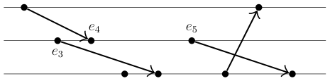

# Cambridge Computer Science Tripos 2024, Paper 5, Question 5: Questions

> Copied from the original: <https://www.cl.cam.ac.uk/teaching/exams/pastpapers/y2024p5q5.pdf>. Text and figures are taken from the PDF as is; nothing was answered or rewritten. The original PDF is in this folder.

---

**Page 1**

**COMPUTER SCIENCE TRIPOS Part IB – 2024 – Paper 5**

**5**   **Concurrent and Distributed Systems (tlh20)**

&emsp;Distributed systems often use logical timestamps to capture the possible ordering 
&emsp;between operations on different nodes. 
&emsp;(a) Three nodes N1 . . . N3 communicate using point-to-point messages: 
&emsp;&emsp;&emsp;&emsp;&emsp;&emsp;&emsp;e1   e2

&emsp;&emsp;&emsp;&emsp;&emsp;N1

&emsp;&emsp;&emsp;&emsp;&emsp;N2

&emsp;&emsp;&emsp;&emsp;&emsp;N3 
&emsp;&emsp;&emsp;&emsp;&emsp;&emsp;&emsp;&emsp;e6   e7   e8   e9

&emsp;&emsp;&emsp;(i)   Give Lamport timestamps for each of the events e1 . . . e9, assuming clocks 
&emsp;&emsp;&emsp;&emsp;&emsp;start from 0.   \[2 marks\]

&emsp;&emsp;&emsp;(ii) What is a necessary condition on Lamport timestamps for an event x to 
&emsp;&emsp;&emsp;&emsp;&emsp;have happened before an event y? Is this a sufficient condition? Briefly 
&emsp;&emsp;&emsp;&emsp;&emsp;justify your answer based on the events in the example.   \[2 marks\] 
&emsp;&emsp;&emsp;(iii) Now give possible vector timestamps for each of the events e1 . . . e9. 
&emsp;&emsp;&emsp;&emsp;&emsp;&emsp;&emsp;&emsp;\[2 marks\]

&emsp;&emsp;&emsp;(iv) What is a necessary and sufficient condition on vector timestamps for an 
&emsp;&emsp;&emsp;&emsp;&emsp;event x to have happened before an event y?   \[2 marks\]

&emsp;(b)   An alternate form of vector timestamps can be used to build causal broadcast. 
&emsp;&emsp;&emsp;That is, if the broadcast of one message happened before the broadcast of 
&emsp;&emsp;&emsp;another message, then all nodes must deliver those two messages in that order.

&emsp;&emsp;&emsp;(i)   Write pseudo-code to implement causal broadcast, assuming access to an 
&emsp;&emsp;&emsp;&emsp;&emsp;underlying reliable broadcast protocol. You should describe the local state 
&emsp;&emsp;&emsp;&emsp;&emsp;held at each node along with the algorithm used to broadcast a message, 
&emsp;&emsp;&emsp;&emsp;&emsp;and to decide when a message can be delivered locally.   \[8 marks\]

&emsp;&emsp;&emsp;(ii) A colleague suggests that the space required by vector timestamps makes 
&emsp;&emsp;&emsp;&emsp;&emsp;this algorithm inefficient. They suggest basing the algorithm on Lamport 
&emsp;&emsp;&emsp;&emsp;&emsp;timestamps instead. Do you agree with this suggestion?   \[4 marks\]

&emsp;&emsp;&emsp;&emsp;&emsp;&emsp;&emsp;&emsp;1

