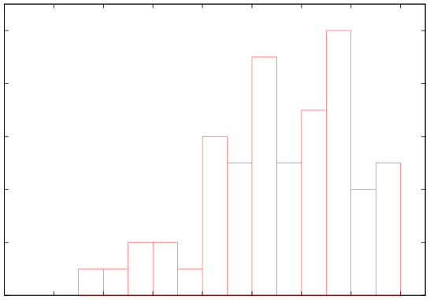

# MIT 6.824/6.5840 2002: Quiz 1: Official solutions

> Copied from the original: <https://pdos.csail.mit.edu/6.824/quizzes.html>. Text and figures are taken from the PDF as is; nothing was answered or rewritten. The original PDF is in this folder.

---

**Page 1**

&emsp;&emsp;&emsp;&emsp;&emsp;Department of Electrical Engineering and Computer Science 
&emsp;&emsp;&emsp;MASSACHUSETTS INSTITUTE OF TECHNOLOGY 
&emsp;&emsp;&emsp;&emsp;&emsp;&emsp;&emsp;&emsp;**6.824 Fall 2002** 
&emsp;&emsp;&emsp;**Midterm Exam Answers**

&emsp;&emsp;&emsp;The average score was 55 (out of 80). Here’s the distribution:

10

&emsp;8 
Number of Students 
&emsp;6

&emsp;4

&emsp;2

&emsp;0 
&emsp;0   10   20   30   40   50   60   70   80 
&emsp;&emsp;&emsp;&emsp;&emsp;&emsp;&emsp;&emsp;Score

---

**Page 2**

6.824 Fall 2002 Midterm Exam Answers   **Page 2 of 10** 
**I**   **Interaction of Architecture and O/S Design**

&emsp;**1. \[10 points\]:**   Look at the paper “The Interaction of Architecture and Operating System Design,” 
&emsp;by Anderson et. al. The authors discuss two worrying trends. First, that the performance of new 
&emsp;microprocessors is relatively worse for O/S code than for application code. Second, that new operating 
&emsp;systems perform less well than old operating systems. Suppose I spend most of my time using latex to 
&emsp;format 150-page documents. I upgrade from a CVAX microprocessor running Mach 2.5 to an R3000 
&emsp;running Mach 3.0. The R3000’s manufacturer claims that it runs applications 6.7 times faster than the 
&emsp;CVAX (see the bottom row of Table 1 in the paper). However, I find that my new setup runs my latex 
&emsp;jobs only X times faster, where X \< 6.7. Which of the two worrying trends is likely to be the largest 
&emsp;contributor to the gap between X and 6.7, and why? Base your argument on the evidence in Tables 1 
&emsp;and 7.

**Answer:** Table 1 shows that the R3000 runs O/S primitives only about 4 times as fast as the CVAX, which 
is quite a bit less than 6.7. However, Table 7 shows that latex only spends about 5% of its time in O/S 
primitives, so the first trend will only have about a 3% effect on latex run time. Table 7 shows that moving 
from Mach 2.5 to Mach 3.0 adds about 17% to latex run-time on the R3000. Thus the second trend has a 
greater effect than the first.

---

**Page 3**

6.824 Fall 2002 Midterm Exam Answers   **Page 3 of 10** 
**II**   **Flash**

&emsp;**2.**   **\[10 points\]:**   Look at the right-hand end of Figure 10 in “Flash: An efficient and portable 
&emsp;Web server.” The value for MT is about 50 megabits/second, while the value for SPED is about 37 
&emsp;megabits/second. What are the main reasons why MT’s performance in this situation is higher than 
&emsp;SPED’s performance?

**Answer:** Figure 10 shows that MT and SPED perform about the same if all requests are served from the 
cache. They would probably also perform similarly if all documents had to be read from the disk, because 
they would both be limited by disk speed. There’s only a substantial performance difference when some 
requests come from the cache, and some come from disk; in that case, MT can serve from the cache while 
waiting for the disk, while SPED cannot.

---

**Page 4**

6.824 Fall 2002 Midterm Exam Answers   **Page 4 of 10** 
**III**   **Atomic List Insert**

Suppose you want to maintain a linked list of integers using this code:

`struct` `Element` `{` 
`int` `x;` 
`Element` `*next;` 
`};` 
`struct` `Element` `*list` `=` `0;` 
`void` 
`insert(int` `x)` `{` 
`Element` `*n` `=` `new` `Element;` 
`n->x` `=` `x;` 
`n->next` `=` `list;`   `//` `A` 
`list` `=` `n;`   `//` `B` 
`}` 
If you run the following example code, `list` will end up holding 33 followed by 22:

`void` 
`example()` `{` 
`insert(22);` 
`insert(33);` 
`}` 
You want to use `insert()` in a multi-threaded operating system kernel that runs on a machine with mul- 
tiple CPUs. `list` is a global variable, and more than one thread might want to insert elements into the 
list. You’re worried that two concurrent calls to `insert()` may lead to incorrect results. One reasonable 
solution would be to acquire a lock before the line marked `A`, and release it after the line marked `B`. 
However, you’ve read in the Fast Mutual Exclusion and Scheduler Activations papers that locks don’t always 
perform well; for example, a thread might be pre-empted or interrupted while holding the lock, preventing 
other threads from making progress. You would like to be able to perform a “non-blocking” atomic linked 
list insert. “Non-blocking” means that if thread T1 is executing the insert routine, and is pre-empted, and 
control is passed to thread T2, T2 would be able to execute insert without waiting for T1. Note that insert 
would be blocking if you used locks. 
While reading the operating system source, you notice that it implements locks as follows:

`struct` `Lock` `{` 
`unsigned` `int` `locked;` 
`};`

---

**Page 5**

6.824 Fall 2002 Midterm Exam Answers   **Page 5 of 10**

`void` 
`acquire(struct` `Lock` `*l,` `int` `my_thread_id)` `{` 
`while(CMPXCHG(&(l->locked),` `0,` `my_thread_id)` `!=` `1)` 
&emsp;`;` 
`}` 
`void` 
`release(struct` `Lock` `*l)` `{` 
`l->locked` `=` `0;` 
`}`

The call to CMPXCHG is actually a single instruction on the CPU you’re using (the Intel PentiumPro). The 
CMPXCHG instruction takes three operands: a memory address and two values in registers. If the contents 
of memory at that address are equal to the first value, CMPXCHG writes the second value to the memory; 
otherwise CMPXCHG doesn’t change memory. CMPXCHG sets a condition code to tell you whether it 
wrote memory. CMPXCHG does its work atomically. Addresses are 32 bits wide, and CMPXCHG reads 
and writes 32-bit values in memory. The CPU hardware implements CMPXCHG something like this:

`int` 
`CMPXCHG(addr,` `v1,` `v2)` `{` 
`int` `ret` `=` `0;` `//` `condition` `code` 
`//` `Stop` `all` `memory` `activity` `on` `all` `other` `CPUs,` `and` 
`//` `start` `ignoring` `interrupts.` 
`if(*addr` `==` `v1){` 
&emsp;`*addr` `=` `v2;` 
&emsp;`ret` `=` `1;` 
`}` 
`//` `Resume` `other` `activity,` `and` `stop` `ignoring` `interrupts.` 
`return(ret);` 
`}`

It occurs to you that you might be able to use CMPXCHG to update the linked list directly, without using 
locks, thus achieving non-blocking atomic insert.

---

**Page 6**

6.824 Fall 2002 Midterm Exam Answers   **Page 6 of 10**

&emsp;**3. \[15 points\]:**Write a new version of `insert()` that uses CMPXCHG, is atomic, and is non- 
&emsp;blocking. You only need to specify the code that replaces lines `A` and `B` of the original `insert()`.

**Answer:**

`void` 
`insert(int` `x)` `{` 
`Element` `*n` `=` `new` `Element;` 
`n->x` `=` `x;` 
`do` `{` 
&emsp;`n->next` `=` `list;` 
`}` `while(CMPXCHG(&list,` `n->next,` `n)` `==` `0);` 
`}`

---

**Page 7**

6.824 Fall 2002 Midterm Exam Answers   **Page 7 of 10** 
**IV**   **NFS**

&emsp;**4. \[5 points\]:**   Consider the NFS protocol described in the 1985 paper “Design and Implementation 
&emsp;of the Sun Network File System.” How does an NFS client cope with the fact that networks do not 
&emsp;deliver all packets?

**Answer:** The NFS client keeps re-sending each RPC until the client receives a reply from the server. 
You’re logged into a workstation running UNIX. Your home directory is on a file server, and your worksta- 
tion uses NFS to talk to the file server. NFS operates as described in the 1985 paper. Your workstation is the 
only client of the file server. You are in an empty directory, you try to create a new directory using mkdir, 
you get an error message back from the mkdir command, but you find that somehow the new directory was 
created anyway. That is, you experience a terminal session like this one:

`%` `ls` `-l` 
`%` `mkdir` `d` 
`mkdir:` `d:` `File` `exists` 
`%` `ls` `-l` 
`total` `1` 
`drwxrwxr-x`   `2` `yourname`   `512` `Oct` `28` `12:27` `d` 
`%`

There is no activity on the file server or the workstation other than that caused by your commands. The 
mkdir command just calls the UNIX `mkdir()` system call, which asks the NFS client code in the UNIX 
kernel to invoke the NFS MKDIR RPC.

&emsp;**5. \[15 points\]:**   Describe a sequence of events which might cause this curious behavior.

**Answer:** The client sends a MKDIR RPC to the server. The server receives the MKDIR RPC, creates 
the directory “d”, and sends a response to the client. The network drops the response packet, so the client 
doesn’t receive it. The client re-sends the MKDIR RPC. The server sees that “d” already exists and sends 
an error response back.

---

**Page 8**

6.824 Fall 2002 Midterm Exam Answers   **Page 8 of 10** 
**V**   **Ivy Distributed Shared Memory**

Suppose you are using the Ivy distributed shared memory system, and in particular the version described 
in Section 3.1 of the paper “Memory Coherence in Shared Virtual Memory Systems.” You are running 
a parallel program on three different computers, CPU1, CPU2, and CPU3. The manager is running on a 
separate computer, CPU0. The computers are connected by a LAN. Page number 217 is owned by CPU1, 
and no other CPU has a copy of that page. The program on CPU2 tries to write page 217 (i.e. executes a 
store instruction whose target address is in page 217).

&emsp;**6.**   **\[5 points\]:**   Please list the sequence of network messages that the code in Section 3.1 sends 
&emsp;among the CPUs as a result of CPU2’s write.

**Answer:** 1) CPU2’s write fault handler asks CPU0 for write access to page 217. 2) CPU0 asks CPU1 to 
send the page to CPU2. 3) CPU1 sends the page to CPU2. 4) CPU2 sends a confirmation to CPU0. We 
eliminated this question because the pseudo-code in the paper isn’t easy to understand.

&emsp;**7. \[15 points\]:**   Note that the write fault handler in Section 3.1 ends by sending a confirmation to the 
&emsp;manager, and that the “Write server” code on the manager waits for this confirmation. Suppose you 
&emsp;eliminated this confirmation (both the send and the wait) from Ivy. Describe a scenario in which lack 
&emsp;of the confirmation would cause Ivy to behave incorrectly. You can assume that the network delivers 
&emsp;all messages, and that none of the computers fail.

**Answer:** It turns out that we don’t know any answer to this question. We originally believed that the 
confirmation (along with the locks) was necessary to ensure that the manager did not forward a subsequent 
request to the new owner before the owner had a copy of the page. But it looks like the requester’s lock on 
ptable\[p\].lock until it receives the page is enough to guarantee this. Let us know if you know the reason for 
the confirmation.

---

**Page 9**

6.824 Fall 2002 Midterm Exam Answers   **Page 9 of 10** 
**VI**   **Logging and Group Commit**

Suppose you are using the new FSD file system described in “Reimplementing the Cedar File System Using 
Logging and Group Commit.” You’re using FSD on a disk directly attached to your workstation. You start 
with a directory with no files in it. You execute a program that creates a file named f1, writes “111” into f1, 
deletes f1, creates a file named f2, and finally writes “222” into f2. On UNIX, the program would look like 
this:

`main()` `{` 
`int` `fd;` 
`fd` `=` `creat("f1",` `0666);` 
`write(fd,` `"111",` `3);` 
`close(fd);` 
`unlink("f1");` 
`fd` `=` `creat("f2",` `0666);` 
`write(fd,` `"222",` `3);` 
`close(fd);` 
`//` `A` 
`}`

Tragically, but perhaps not unexpectedly, the power fails just as your program reaches the line marked `A`. 
Then power is restored, your workstation re-starts, it runs FSD’s recovery program, and you look at the state 
of your directory.

&emsp;**8. \[5 points\]:**   Suppose you notice that file f2 does not exist. What is the most likely explanation?

**Answer:** FSD appended updates describing the creation of f2 to the log in memory, but (due to batch 
commit) FSD had not yet written that part of the log to the disk. So the power failure destroyed the only 
record of f2’s existence.

---

**Page 10**

6.824 Fall 2002 Midterm Exam Answers   **Page 10 of 10**

&emsp;**9. \[5 points\]:**Is it possible for f1 and f2 to both exist? Why or why not?

**Answer:** No. FSD appends operations to the log in the order in which the program issues them. FSD writes 
the log to disk in order. The FSD recovery program replays the log contents in order. These constraints 
ensure that if the recovery program replays the record that creates f2, it must already have replayed the 
record that deleted f1.

&emsp;**10. \[15 points\]:**   Is it possible for f1 to exist, but contain “222”? Why or why not?

**Answer:** No. FSD does not log file contents; instead, it writes them synchronously to the disk at the time 
the application calls `write()`. So the `write()` to f2 might have caused FSD to allocate a free disk page 
and write “222” to it (on the disk), even though the delete record for f1 was not yet on the disk. The danger is 
that FSD might have allocated the page that used to hold f1’s contents, since it was freed by the `unlink()`, 
but that a crash would effectively un-do the delete while leaving the “222” on disk. FSD avoids this problem 
by delaying adding a disk page from a deleted file to the free list (the VAM) until it has written the delete 
log record to disk.

&emsp;&emsp;&emsp;&emsp;&emsp;&emsp;&emsp;&emsp;End of Exam

