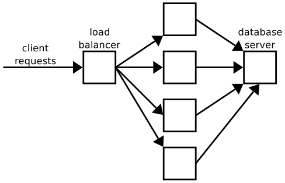
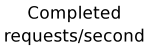
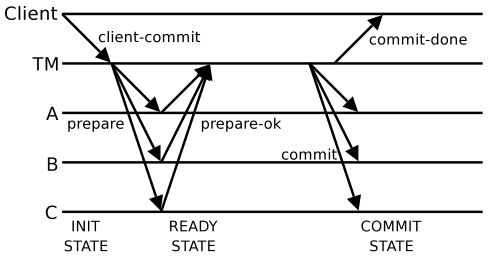
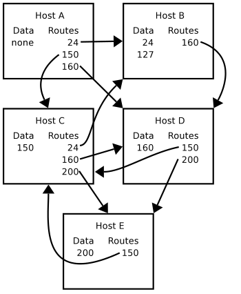

# MIT 6.824/6.5840 2004: Quiz 2: Official solutions

> Copied from the original: <https://pdos.csail.mit.edu/6.824/quizzes.html>. Text and figures are taken from the PDF as is; nothing was answered or rewritten. The original PDF is in this folder.

---

**Page 1**

&emsp;&emsp;Department of Electrical Engineering and Computer Science 
MASSACHUSETTS INSTITUTE OF TECHNOLOGY 
&emsp;&emsp;&emsp;&emsp;&emsp;**6.824 Spring 2004** 
&emsp;**Final Exam Solutions**

The average score was 84, the standard deviation was 6.

&emsp;&emsp;&emsp;&emsp;&emsp;&emsp;&emsp;&emsp;1

---

**Page 2**

**I**   **Short Questions**

&emsp;**1.**   **\[5 points\]:**   Consider the system described in the paper “Hypervisor-based Fault Tolerance.” 
&emsp;Suppose the primary fails due to a power failure, the backup takes over, and then power to the primary 
&emsp;is restored. You would like the primary to resume replicated execution so that the system could tolerate 
&emsp;a subsequent failure of the backup. Is this likely to be easy with hypervisor-based fault-tolerance? 
&emsp;Why or why not? 
&emsp;**It would be difficult to install the correct state on the old primary. The backup would have been** 
&emsp;**executing for a while, changing its memory, registers, disk etc. All of the backup’s state would** 
&emsp;**have to be transferred to the old primary. Alternately, the old primary could be started afresh,** 
&emsp;**and one could re-issue the entire history of operations over the life of the system.**

&emsp;**2.**   **\[5 points\]:**   The Coral paper (“Democratizing content publication with Coral”) mentions in 
&emsp;Sections 2.3 and 4.2 that Coral’s “sloppy” DHT can store multiple different values for each key. What 
&emsp;would break, or not work as well, if Coral’s DHT only stored one value for each key? 
&emsp;**CoralCDN uses the multiple key feature to allow it to associate multiple proxies with each URL** 
&emsp;**and with each IP address prefix. The choice provided by these multiple proxies helps CoralCDN** 
&emsp;**spread the load of serving cached pages, and allows it to choose a proxy that’s close to the client.**

&emsp;&emsp;&emsp;&emsp;&emsp;&emsp;&emsp;&emsp;2

---

**Page 3**

**II**   **Performance**

Samantha, a web site design consultant, is helping Acme Services build a web server system for on-line 
commerce. The system has three parts. A single load balancer routes each incoming HTTP request to 
a different front end server. Each front end server is in charge of generating personalized web pages for 
different visitors. The front end servers consult a back-end database server for information such as visitor 
preferences, shopping cart contents, and inventory levels.

The load balancer sends HTTP requests to the front ends in round-robin order. The front ends communicate 
with the database server using UDP RPCs. Each client HTTP request involves the front end sending just 
one RPC to the database server. The front ends do not re-send these RPCs; if the front end gets no response 
after 100 seconds, it sends an error message to the HTTP client. 
Each front end has a CPU fast enough to complete one client HTTP request per second. Since a front end 
may have to wait for the database server, each front end can keep track of many requests at the same time. 
Every time a front end receives a client HTTP request, it immediately issues an RPC to the database server. 
The front end can keep track of an unlimited number of client HTTP requests, and thus keep an unlimited 
number of RPCs in flight to the database server. 
The database server is fast enough to process three RPCs per second. The database server has an input queue 
that can contain 100 RPCs: if RPCs arrive faster than the server can process them, the RPCs are placed on 
this queue. If an RPC arrives when the queue is full, the database server simply discards the RPC. The 
database server serves queued RPCs in the order that they arrived. 
Samantha decides to measure the performance of this system. She collects lots of hosts to simulate clients, 
and sets up the clients so that she can control the total load (in HTTP requests issued per second) that the 
clients place on the server system. Samantha tests the system over a range of loads, measuring the number 
of client HTTP requests completed per second. Here is what she sees: 
&emsp;&emsp;&emsp;&emsp;&emsp;&emsp;&emsp;&emsp;3

---

**Page 4**

&emsp;**3. \[5 points\]:** Why does the performance curve stop rising at 3? 
&emsp;**The database server can only finish three RPCs per second. Since each client HTTP request** 
&emsp;**involves one RPC, only three of them can be completed per second.**

&emsp;**4. \[5 points\]:** When the input rate is 4 requests/second, the output rate is only 3 requests/second. 
&emsp;What happens to the extra request per second? 
&emsp;**The database server drops the extra RPCs because its input queue is full.**

Samantha’s employer, Henryk Acme, reviews her design and notices that the front ends do not re-send 
RPCs. Henryk demands that Samantha change the front ends so that they re-send an RPC if no response is 
received after five seconds. Samantha makes this change, but arranges that a front end re-sends an RPC at 
most once (for a total of two times at most). As before, a front end waits for 100 seconds after it sends the 
second RPC, then (if it still gets no response from the database server) the front end sends an error message 
to the HTTP client. 
Samantha re-runs her performance tests and sees this result:

&emsp;&emsp;&emsp;&emsp;&emsp;&emsp;&emsp;&emsp;4

---

**Page 5**

**5. \[5 points\]:** Why does the completion rate drop after 3 requests/second, instead of staying flat at 
y=3 as in the previous graph? 
**As soon as the request rate hits 3 per second, the database server’s input RPC queue will be full** 
**most of the time. Since the queue has 100 entries, and each entry takes a third of a second to** 
**process, an RPC will stay on the queue for about 33 seconds. This is longer than the front end’s** 
**timeout period of 5 seconds, which means that the front ends will send every RPC twice. Thus** 
**the database server will waste time executing some RPCs twice, and complete fewer than three** 
**useful RPCs per second.**

**6. \[5 points\]:** Why does the completion rate level out at about 1.5 completions/second? 
**If the front end executes every RPC twice, it will complete only 1.5 useful RPCs per second.** 
**(Mike Walfish points out that the fraction of useful RPC completions will rise as the input load** 
**rises, since it’s unlikely that both transmissions of a given RPC will encounter a non-full queue.)**

&emsp;&emsp;&emsp;&emsp;&emsp;&emsp;&emsp;&emsp;5

---

**Page 6**

**III**   **TreadMarks**

Look at the paper “TreadMarks: Distributed Shared Memory on Standard Workstations and Operating Sys- 
tems,” by Keleher et al. Suppose you are running the following parallel shared-memory program on three 
workstations, W1, W2, and W3.

`A1()` `{` 
`x` `=` `1;` 
`Acquire(L1);` 
`y` `=` `1;` 
`Release(L1);` 
`}` 
`A2()` `{` 
`Acquire(L1);` 
`z` `=` `y;` 
`Release(L1);` 
`}` 
`A3()` `{` 
`Acquire(L1);` 
`printf("x=%d` `y=%d` `z=%dn",` `x,` `y,` `z);` 
`Release(L1);` 
`}`

At about the same time, W1 executes `A1()`, W2 executes `A2()`, W3 executes `A3()`. The variables `x`, 
`y`, and `z` all start out containing zero. `Acquire()` and `Release()` are the functions that TreadMarks 
supplies to acquire and release locks. `L1` is the name of a lock. There are no failures, the network delivers 
all messages, and there is no other activity in the system.

&emsp;**7. \[5 points\]:**   Workstation W3 prints three numbers. Given TreadMark’s consistency algorithms, 
&emsp;only some outputs from W3 are possible. For each of the following outputs, write “yes” if it is a 
&emsp;possible output, and “no” if it is not.

&emsp;&emsp;&emsp;`x=0` `y=1` `z=1`   `No.` `x=0` `means` `A3` `executed` `before` `the` `y=1` `in` `A1.` 
&emsp;&emsp;&emsp;`x=1` `y=1` `z=0`   `Yes.` `A3` `executed` `after` `A1` `and` `before` `A2.` 
&emsp;&emsp;&emsp;`x=1` `y=0` `z=1`   `No.` `W2` `would` `have` `told` `W3` `about` `y=1` `as` `well` `as` `z=1.`

&emsp;&emsp;&emsp;&emsp;&emsp;&emsp;&emsp;&emsp;6

---

**Page 7**

Now consider this shared-memory TreadMarks program:

`B1()` `{` 
`x` `=` `1;` 
`printf("x=%d` `y=%dn",` `x,` `y);` 
`}` 
`B2()` `{` 
`y` `=` `1;` 
`printf("x=%d` `y=%dn",` `x,` `y);` 
`}`

Workstation W1 starts executing `B1()` at about the same time as workstation W2 starts executing `B2()`. 
`x` and `y` start out containing zero. There are no failures, the network delivers all messages, and there is no 
other activity in the system.

&emsp;**8. \[5 points\]:**   Is it possible for W1 to print “x=1 y=0” `and` for W2 to print “x=0 y=1”? Describe 
&emsp;how this might occur, or explain how TreadMarks prevents it from occurring. 
&emsp;**This could occur. Neither program acquired any locks, so neither will learn about the other’s** 
&emsp;**writes to variables.**

&emsp;&emsp;&emsp;&emsp;&emsp;&emsp;&emsp;&emsp;7

---

**Page 8**

Finally, suppose you now run this shared-memory TreadMarks program:

`C1()` `{` 
`Acquire(L1);` 
`x` `=` `1;` 
`Release(L1);` 
`Acquire(L2);` 
`y` `=` `1;` 
`Release(L2);` 
`}` 
`C2()` `{` 
`Acquire(L1);` 
`printf("xa=%dn",` `x);` 
`x` `=` `2;` 
`Release(L1);` 
`}` 
`C3()` `{` 
`Acquire(L1);` 
`printf("xb=%dn",` `x);` 
`Release(L1);` 
`Acquire(L2);` 
`printf("y=%dn",` `y);` 
`printf("xc=%dn",` `x);` 
`Release(L2);` 
`}`

At about the same time, W1 starts executing `B1()`, W2 starts executing `B2()`, and W3 starts executing 
`B3()`. `x` and `y` start out containing zero. There are no failures, the network delivers all messages, and there 
is no other activity in the system.

&emsp;**9.**   **\[5 points\]:**   Suppose you run this parallel program and it prints “xa=1”, then “xb=2”, then 
&emsp;“y=1”. Is it possible for the next printout to be “xc=1”? Describe how this might occur, or explain 
&emsp;how TreadMarks prevents this from occurring. 
&emsp;**This could not occur. The xa=1 means that C2 acquired L1 after C1 set x=1; the xb=2 means** 
&emsp;**that C3 acquired L1 after C2 released it. Thus C2 would have sent C3 a version vector that** 
&emsp;**included C1’s assignment to x. C3 then knows when it acquires L2 from C1 that it already** 
&emsp;**knows about any writes C1 performed before C1 release L1, and thus C3 knows to ignore C1’s** 
&emsp;**write to x. Equivalently, the version vectors tell C3 to order C2’s write to x after C1’s write to x.**

&emsp;&emsp;&emsp;&emsp;&emsp;&emsp;&emsp;&emsp;8

---

**Page 9**

**IV**   **Two-Phase Commit**

The figure below shows a successful execution of two-phase commit. The client asks the transaction man- 
ager (TM) to organize an atomic transaction involving servers A, B, and C. A transaction is atomic if either 
all three servers execute their part of the transaction, or none of them execute it. The TM sends prepare 
messages over the network to the three servers asking them if they are willing to perform the transaction. 
Each server that is willing (in this case all of them) sends a prepare-ok message to the TM. If the TM collects 
prepare-ok messages from all three servers, the TM sends a commit message to each server, and then sends 
a commit-done message to the client. A server executes the transaction when it receives a commit message.

If a server receives a prepare message and thinks it won’t be able to commit, it returns a prepare-abort 
message to the TM, and the TM sends abort messages to all the servers and an abort-done message to the 
client. 
For example, in a banking application, a transfer transaction might involve server A debiting account #1, 
server B crediting account #2, and server C appending an audit record to a file. When server A receives 
the prepare message, server A must check that the account #1 exists and contains enough money; if it does, 
server A sends a prepare-ok; if it does not, server A sends a prepare-abort. If server A send a prepare-ok, 
it must lock account #1 to ensure that it continues to contain enough money. If A then receives a commit 
message, it debits the account and then releases the lock. If A receives an abort from the TM, it just releases 
the lock. 
The tricky part about two-phase commit is how to handle server or TM failures. The immediate symptom 
of a server or TM failure will be that one or more hosts will block: they will wait indefinitely for a message 
from the failed host. For example, if server A fails before sending its prepare-ok message, then the TM 
will block waiting for that message. A host may block even if there are no host failures, for example if 
the network breaks or drops packets or delays packets. When possible the participants would like to avoid 
blocking forever. The general approach is to have each host impose a timeout on how long it is willing to 
wait for each message, and to take some action after a timeout in order to attempt to resolve the transaction 
(either committing or aborting it). In some cases this works, but in other cases the participants have to wait 
for the failed host to re-start.

&emsp;&emsp;&emsp;&emsp;&emsp;&emsp;&emsp;&emsp;9

---

**Page 10**

For all of these questions you should assume that there is never any confusion about which transaction a 
message is part of (because the messages carry transaction IDs). You should also assume that all participants 
follow the protocol to the best of their ability.

&emsp;**10. \[5 points\]:**   Suppose that the TM has sent all the prepare messages but has not yet received a 
&emsp;prepare-ok (or prepare-abort) from server A. Would it be correct for the TM to abort the transaction 
&emsp;at this point, sending abort messages to the servers and an abort-done message to the client? Why or 
&emsp;why not? 
&emsp;**Yes. No server has executed the transaction since the TM hasn’t sent any commit messages yet.** 
&emsp;**Thus it’s still OK to abort.**

&emsp;**11.**   **\[5 points\]:**   Suppose again that the TM has sent all the prepare messages but has not yet 
&emsp;received a prepare-ok (or prepare-abort) from server A. Would it be correct for the TM to commit the 
&emsp;transaction at this point? Why or why not? 
&emsp;**No. Server A might be unable to execute the transaction. Perhaps server A sent a prepare-abort** 
&emsp;**that the network lost or delayed, or perhaps server A has crashed.**

&emsp;**12.**   **\[5 points\]:**   Suppose that server A has received the prepare, sent the prepare-ok, but has not 
&emsp;yet received a commit or abort message. Server A contacts server B and discovers that server B has 
&emsp;received a commit message. Would it be correct for server A to execute its part of the transaction at 
&emsp;this point, as if it too had received a commit message? Why or why not? 
&emsp;**Yes. The TM must have sent commit messages to all the servers, so it’s OK for server A to** 
&emsp;**pretend it received the message.**

&emsp;**13. \[5 points\]:** Suppose again that server A has received the prepare, sent the prepare-ok, but has 
&emsp;not yet received a commit or abort message. Server A contacts server B and discovers that server B 
&emsp;has also received the prepare, sent a prepare-ok, but has not yet received a commit or abort. Server 
&emsp;A cannot reach server C. It turns out that it’s not correct for A to either abort or commit in this case; 
&emsp;it must wait until it can contact the TM and find out whether the TM decided to abort or commit. 
&emsp;Describe two sequences of events that are consistent with A’s observations: one in which the TM 
&emsp;decides to commit the transaction, and another in which the TM decides to abort the transaction. 
&emsp;**Commit case: C sent a prepare-ok to the TM, the TM sent commit messages to the servers** 
&emsp;**and commit-done to the client, server C received the commit and executed, the network lost the** 
&emsp;**commit messages to the other two servers, then TM and C crash.** 
&emsp;**Abort case: C sent a prepare-abort to the TM, the TM sent abort messages to the servers and** 
&emsp;**abort-done to the client, the network lost the abort messages to the other two servers, then TM** 
&emsp;**and C crash.**

&emsp;&emsp;&emsp;&emsp;&emsp;&emsp;&emsp;&emsp;10

---

**Page 11**

**14. \[5 points\]:** Suppose again that server A has received the prepare, sent the prepare-ok, but has 
not yet received a commit or abort message. This time server A contacts both server B and server C 
and discovers that both of them have received the prepare, sent a prepare-ok, but have not yet received 
a commit or abort. Would it be correct for server A to execute its part of the transaction at this point, 
as if it too had received a commit message? Why or why not? 
**It would not be correct for A to execute the transaction. The TM might have timed out waiting** 
**for one of the prepare-ok messages and decided to abort. (The “too” is a typo.)**

&emsp;&emsp;&emsp;&emsp;&emsp;&emsp;&emsp;&emsp;11

---

**Page 12**

**V**   **Frangipani**

Suppose you have a file service that uses the system described in “Frangipani: A Scalable Distributed File 
System” by Thekkath et al. You have four Frangipani servers, S1, S2, S3, and S4, as well as some clients 
and Petal servers. The Petal servers are separate computers. 
Suppose you start with two empty directories, “d1” and “d2”. The following sequence of events occurs: 
**A.** A client asks S1 to create a file “d1/a”, and S1 returns a successful reply. 
**B.** A client asks S1 to create a file “d2/b”, and S1 returns a successful reply. 
**C.** A client asks S2 to delete file “d2/b”, and S2 returns a successful reply. 
**D.** S1 stops executing unexpectedly, and does not reboot. 
**E.** S3 runs the recovery demon for S1, and recovery completes. 
There is no activity in the system except activity caused by these events, and there are no failures other than 
the crash of S1.

&emsp;**15. \[5 points\]:**   After recovery is complete, will file “d1/a” exist, not exist, or can you not predict? 
&emsp;Please explain your answer. 
&emsp;**It will exist. When S1 gave up the lock on d2/b to S2, S1 would have flushed its in-memory log** 
&emsp;**to Petal, including the log record describing the creation of d1/a. The recovery demon will see** 
&emsp;**that log record and re-execute the create.**

&emsp;**16. \[5 points\]:**   After recovery is complete, will file “d2/b” exist, not exist, or can you not predict? 
&emsp;Please explain your answer. 
&emsp;**d2/b will not exist. If S2 hasn’t given up its lock on d2 by the time that the recovery demon** 
&emsp;**finishes, then next time anyone looks at d2/b S2 will write its changes to d2 to Petal before giving** 
&emsp;**up the lock. These changes will override any changes to d2 made by the recovery demon. If S2** 
&emsp;**gave up its lock and wrote its changes to d2 before the recovery demon ran, then the recovery** 
&emsp;**demon will see that the version number for d2 in S1’s log is less than the version number for d2** 
&emsp;**that S2 wrote to Petal, and the recovery demon will ignore that log entry.**

&emsp;**17. \[5 points\]:**   Suppose (as would probably be the case) that S2 holds an exclusive lock on “d2” 
&emsp;when recovery starts. Does the recovery demon need to acquire the lock on “d2”? Why or why not? 
&emsp;**No, the recovery demon does not need to acquire the lock on d2. The version number mechanism** 
&emsp;**is sufficient for the recovery demon to decide which log records it can replay.**

&emsp;&emsp;&emsp;&emsp;&emsp;&emsp;&emsp;&emsp;12

---

**Page 13**

**VI**   **Freenet**

A Freenet host (“Freenet: A Distributed Anonymous Information Storage and Retrieval System”) contains 
a routing table and a data store. Both are indexed by numeric keys. A routing table entry contains the IP 
address of a Freenet host, while a data store entry contains the data (file) associated with the corresponding 
key. 
Here are five Freenet nodes, each labeled with its routing table and data store. The keys are in decimal.

For example, host B’s routing table contains an entry with key 160 referring to host D, and B’s data store 
contains two files, one with key 24 and one with key 127.

&emsp;**18. \[5 points\]:** What sequence of hosts would be visited by a query from A for key 200? Assume a 
&emsp;hops-to-live limit of 20. 
&emsp;**A D E**

&emsp;**19. \[5 points\]:** What sequence of hosts would be visited by a query from A for key 127? Assume a 
&emsp;hops-to-live limit of 20. 
&emsp;**A C D C (D) E C (E) (D) (C) E (C) B. The parentheses mark nodes to which the query back-** 
&emsp;**tracks after failure.**

&emsp;&emsp;&emsp;&emsp;&emsp;&emsp;&emsp;&emsp;13

