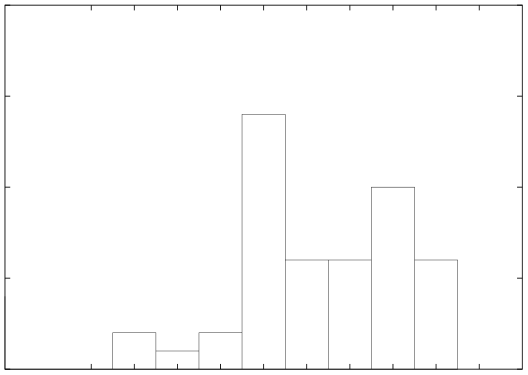

# MIT 6.824/6.5840 2005: Quiz 1: Official solutions

> Copied from the original: <https://pdos.csail.mit.edu/6.824/quizzes.html>. Text and figures are taken from the PDF as is; nothing was answered or rewritten. The original PDF is in this folder.

---

**Page 1**

&emsp;&emsp;&emsp;&emsp;&emsp;Department of Electrical Engineering and Computer Science 
&emsp;&emsp;&emsp;MASSACHUSETTS INSTITUTE OF TECHNOLOGY 
&emsp;&emsp;&emsp;&emsp;&emsp;&emsp;&emsp;&emsp;**6.824 Spring 2005** 
&emsp;&emsp;&emsp;**Midterm Exam Answers**

&emsp;20

&emsp;15 
Number of students 
&emsp;10

&emsp;5

&emsp;0 
&emsp;&emsp;&emsp;&emsp;&emsp;60    70    80    90    100    110    120    130    140    150 
&emsp;&emsp;&emsp;&emsp;&emsp;&emsp;&emsp;&emsp;Score in Range \[x,x+10)

&emsp;&emsp;&emsp;&emsp;&emsp;The average is 117. The standard deviation is 19.

&emsp;&emsp;&emsp;&emsp;&emsp;&emsp;&emsp;&emsp;1

---

**Page 2**

**I**   **Part One**

&emsp;**1.**   **\[10 points\]:**   Suppose you’re running Mach 3.0 on a MIPS R3000. You’re getting tired of 
&emsp;how slow your 15-year-old CPU is. You hear that Anderson et al., authors of the Interaction pa- 
&emsp;per, have started a company that sells a MIPS R3000-compatible CPU called the Mathom2000. The 
&emsp;Mathom2000 runs operating system primitives about 100 times as fast as the R3000, and application 
&emsp;code at the same speed as the R3000. If you upgraded to the Mathom2000, approximately how much 
&emsp;faster overall would your programs run? Explain your answer based on evidence presented in the 
&emsp;Interaction paper. 
&emsp;**Based on Table 7, applications spend 5-20% of their running time in OS primitives. On the** 
&emsp;100 + .95x **to** .2x**Mathom2000, a program that runs in x seconds on the R3000 will take** .05x 
&emsp;&emsp;&emsp;&emsp;&emsp;&emsp;&emsp;&emsp;100 + 
&emsp;.8x = .9505x **to** .802x **seconds. The corresponding speedup is approximately** (1−.95)x   ∗100 **to** 
&emsp;&emsp;&emsp;&emsp;&emsp;&emsp;&emsp;&emsp;x 
&emsp;&emsp;(1−.8)x   ∗100 ≈5 −20%**. If my programs follow similar behavior as the ones in Table 7, I can** 
&emsp;&emsp;x 
&emsp;**expect an overall speedup of 5-20% when I upgrade to the Mathom2000.**

&emsp;**2. \[10 points\]:**   Look at Figure 3 of Backtracking Intrusions, by King and Chen. The paper says 
&emsp;that GraphGen ignores the event at time 7. Why is that correct? Why couldn’t the contents of file 2 
&emsp;have been part of the attack? 
&emsp;**The result of the attack is that file X has the wrong contents, so GraphGen should include all** 
&emsp;**events that can affect the contents of file X. The event at time 6 is the one that directly changes** 
&emsp;**the contents of file X. The event at time 7 does not affect the contents of file X because it happens** 
&emsp;**after the event that directly modified the contents of file X. The contents of file 2 were not read** 
&emsp;**at any point in time before the write to file X or the creation of any processes that affect file X.** 
&emsp;**File 2 might have been part of the attack, but its contents did not have any effect on the contents** 
&emsp;**of file X.**

**II**   **Part Two: Porcupine**

&emsp;**3. \[10 points\]:**   Look at Figure 6 of the Porcupine paper by Saito et al. When skew is zero, most 
&emsp;of the policies process about 700 to 800 messages per second. Suppose the CPUs were replaced with 
&emsp;CPUs ten times as fast. Approximately how many more messages per second would the system be 
&emsp;able to process? Why? 
&emsp;**Each of the nodes in the Figure 6 experiments has a single slow disk. Therefore, the disk is** 
&emsp;**most likely to be the bottleneck at each node. According to Table 1, the CPU utilization of a** 
&emsp;**single server running at maximum throughput is only 15% in the no replication case. Hence,** 
&emsp;**increasing the speed of the CPUs will increase the message throughput by less than 15%.**

&emsp;&emsp;&emsp;&emsp;&emsp;&emsp;&emsp;&emsp;2

---

**Page 3**

&emsp;**4. \[10 points\]:**Look at the S1 and S2 policies in Figure 6 when skew is 1.0. As you can see, the data 
&emsp;points are hard to read. Based on the explanations in the rest of the paper, how many messages/second 
&emsp;would you expect S1 to process with skew of 1.0? And how much faster than S1 would you expect 
&emsp;S2 to be? Explain your answers. 
&emsp;**With skew of 1.0, all messages are handled by one machine, so the result for S1 should be the** 
&emsp;**same as for the maximum throughput for one node with a single disk with no replication, which** 
&emsp;**according to Figure 4 is 23 messages/second. S2 should double the message throughput of S1,** 
&emsp;**since S2 spreads the load over two servers.**

&emsp;**5.**   **\[10 points\]:**   Suppose you run a Porcupine experiment like D1 in Figure 6 with skew of 1.0. 
&emsp;However, when the system is first started all the users’ mailbox fragments are placed on the same 
&emsp;server, node N0. Towards the beginning of the experiment, approximately how many messages/second 
&emsp;will the Porcupine cluster be able to process? Towards the end? If there is a change in performance, 
&emsp;explain when this change occurs, and what specific steps Porcupine takes as it is running that lead to 
&emsp;the change. 
&emsp;**Towards the beginning, the throughput should be similar to the maximum throughput of a single** 
&emsp;**node, 23 messages/second, because all messages are handled by node N0. The D1 policy will only** 
&emsp;**append new mail to a user’s existing mailbox fragment. However, after a user deletes all mail,** 
&emsp;**which deletes the fragment, the next arriving mail message will be placed in a new fragment on** 
&emsp;**an unloaded server. This gradual load-balancing causes throughput to increase to the level of** 
&emsp;**ordinary D1 with skew 1.0.**

&emsp;**6. \[10 points\]:** Figure 6 suggests that the dynamic spread policy is only useful when skew is high. 
&emsp;The authors generate the high-skew workloads by using user names that all hash to the same value. 
&emsp;How valuable would dynamic spread be in real life? Are there any specific situations, that are likely 
&emsp;to occur, in which the dynamic spread policy would significantly increase performance? 
&emsp;**Dynamic spread would be useful if a small fraction of the users received a large fraction of the** 
&emsp;**mail.**

**III**   **Part Three: OK Auctions**

You’ve been hired as a consultant by OK Auctions to help make their web site secure. OK Auctions runs an 
on-line auction system. At any given time there are thousands of auctions in progress. Users can log into 
the system, get a list of current auctions, and place bids on one or more auctions. Each auction lasts for a 
few days; when it ends, the highest bidder wins, and must pay the amount of his or her bid. 
OK Auctions’ most pressing security concern is to ensure that users do not learn each others’ bids while an 
auction is in progress. OK Auctions wants to prevent users from placing bids that are only slightly higher 
than the existing high bid, since that would decrease winning bid values and thus profits. They are worried 
that someone might exploit a bug in their software and steal high bids. 
&emsp;&emsp;&emsp;&emsp;&emsp;&emsp;&emsp;&emsp;3

---

**Page 4**

OK Auctions current web site consists of a single process running on a UNIX server. The process accepts 
HTTP connections, checks usernames and passwords, maintains the list of all auctions, and maintains the 
state of each auction (including the current high bid). The process keeps all this information in memory (it 
doesn’t use a separate database). 
After reading Krohn’s OKWS paper, OK Auctions decides to use OKWS and to split their software into 
multiple service programs. The LOGIN service will display a web page asking for a username and password, 
and check that the results are valid. The LIST service will display a list of all auctions. There will be one 
AUCTION service process per auction. Each AUCTION service will keep track of the current high bid for 
the auction, will display a page asking for a new bid to any authenticated user, and will update its internal 
current high bid if the new bid is higher. The service processes keep the state they need in memory (they 
don’t use a separate database).

&emsp;**\[10 points\]:7.**Will the use of OKWS with the LOGIN/LIST/AUCTION services make OK 
&emsp;Auctions’ web site more secure? If yes, explain how this arrangement would make it harder for a user 
&emsp;to steal the high bid of an auction; if no, explain why attacks that work with the single-process design 
&emsp;are still likely to work in the LOGIN/LIST/AUCTION arrangement. 
&emsp;**Yes. Since the LOGIN/LIST/AUCTION services are separate processes, each with its own ad-** 
&emsp;**dress space, a compromised LOGIN or LIST process would not be able to read bids from an** 
&emsp;**AUCTION process. On the other hand, a bug in the AUCTION service could still reveal the** 
&emsp;**high bid.**

&emsp;**8. \[10 points\]:**Suggest a partition of functionality among service processes that would be more 
&emsp;secure, and explain why it’s more secure. Outline an attack that might have successfully stolen a 
&emsp;current high bid in the LOGIN/LIST/AUCTION arrangement that would fail with your arrangement. 
&emsp;**Split the AUCTION service into two processes. The first process should talk to the user, accept-** 
&emsp;**ing the input bid and formatting the response. The second process should hold the current high** 
&emsp;**bid, and talk to the first process through an RPC interface that only accepts a “bid” RPC. The** 
&emsp;**response to this RPC should not contain the current high bid. As a result, a bug in the first pro-** 
&emsp;**cess cannot result in the attacker learning the high bid. It’s unlikely that the second process’s** 
&emsp;**narrow RPC interface would have an exploitable bug (though not impossible).**

**IV**   **Part Four: Lab Four**

Larry Locker is working on adding locks to his file server for Lab 4. Remember that Lab 4 had locking but 
no caching of blocks or locks (no REVOKE, no flush()). The point of the locking is to serialize concurrent 
NFS RPCs that affect the same file or directory, so that the final results are as if the RPCs executed one at a 
time. Thus, for example, concurrent CREATEs of the same file name would not result in two separate files 
with the same name.

&emsp;&emsp;&emsp;&emsp;&emsp;&emsp;&emsp;&emsp;4

---

**Page 5**

Larry is working on SETATTR. He knows that at the end of the SETATTR he must release the lock on the 
file handle, reply to the RPC, and put() the attributes to the block server. But he’s not sure what the right 
order is.

&emsp;**9. \[10 points\]:**   Please write “yes” after each of the following orders that would result in proper 
&emsp;serialization of NFS RPCs, and “no” after each order that would not. You can assume that Larry would 
&emsp;implement each order without bugs (for example by using callbacks to ensure the correct sequence). 
&emsp;**Any sequence where release follows put is correct.** 
&emsp;&emsp;release, reply, put   **no** 
&emsp;&emsp;release, put, reply   **no** 
&emsp;&emsp;reply, release, put   **no** 
&emsp;&emsp;reply, put, release   **yes** 
&emsp;&emsp;put, release, reply   **yes** 
&emsp;&emsp;put, reply, release   **yes**

&emsp;**10.**   **\[10 points\]:**   Larry stores everything about a file (both attributes and contents) in a single 
&emsp;block, whose key is the file handle. Larry observes that the READ RPC does not modify the file or its 
&emsp;attributes, and thinks that means he doesn’t have to acquire any locks in READ. Is Larry right? Explain 
&emsp;why or why not, or what extra information you need to decide. If Larry is wrong, describe a specific 
&emsp;situation in which lack of locking would lead to an incorrect file system state; include a description 
&emsp;of the incorrect state and what the correct state should be. Remember that Larry is working on Lab 4, 
&emsp;not Lab 5. 
&emsp;**He is right, assuming that other RPCs (such as WRITE) update the block with a single put. In** 
&emsp;**that case a concurrent READ and WRITE will result in the READ seeing the state either before** 
&emsp;**or after the WRITE, but not an intermediate invalid state.**

&emsp;**11.**   **\[10 points\]:**   Larry also thinks he doesn’t need to acquire any locks for WRITE. After all, 
&emsp;WRITE replaces bytes in the file: it doesn’t need to know the old values of the bytes. Is Larry right? 
&emsp;Explain why or why not, or what extra information you need to decide. If Larry is wrong, describe 
&emsp;a specific situation in which lack of locking would lead to an incorrect file system state; include a 
&emsp;description of the incorrect state and what the correct state should be. 
&emsp;**Wrong. For example, there are concurrent writes to the same file (from different ccfs processes).** 
&emsp;**One write updates bytes 0 to 19, and the other write updates bytes 20 through 39. If there is no** 
&emsp;**locking, the resulting file will contain new bytes 0-19 or 20-39, but not both. The correct result** 
&emsp;**is to see all 40 new bytes.**

&emsp;&emsp;&emsp;&emsp;&emsp;&emsp;&emsp;&emsp;5

---

**Page 6**

&emsp;**\[10 points\]:12.**Larry is considering a different design in which he stores the attributes in one 
&emsp;block and the file contents in a different block. The file content block’s key would be the file handle 
&emsp;with an “x” added to the end. Does this design change whether READ needs to lock? How about 
&emsp;WRITE? Explain your answers. 
&emsp;**READ now needs to lock, since a process writing to a file might put the attribute block before** 
&emsp;**the file content block. If a READ RPC happens in between the two PUTs, then the reader will** 
&emsp;**see attributes that are inconsistent with the file data.** 
&emsp;**WRITE still needs a lock for the same reason as the previous question, and also because the** 
&emsp;**WRITE’s two puts should be atomic.**

**V**   **Part Five: XOM**

The XOM paper by Lie et al. describes store   secure and load   secure instructions that use encryption and 
hashing to protect data stored in off-chip RAM (see Sections 2.1 and 3).

&emsp;**13. \[10 points\]:**   XOM’s stated goal is to copy-protect programs. Why does XOM need to protect 
&emsp;data as well as instructions? Explain an example application in which copy-protected instructions are 
&emsp;not useful without protected data. 
&emsp;**Suppose the application checks with a license server to see if this CPU is allowed to run the** 
&emsp;**application. The application is likely to read and write variables in memory as part of the** 
&emsp;**license decision. If the user could modify these variables, the user might be able to trick the** 
&emsp;**program into believing that the user was allowed to run the application.**

&emsp;**14.**   **\[10 points\]:**   Suppose a XOM program in compartment 17 executes store   secure, giving an 
&emsp;address of 1024 and a 32-bit data value of 55. Assume that a cache block holds just one 32-bit data 
&emsp;value. What information will XOM store in RAM as a result? Write each distinct value stored in 
&emsp;RAM on a different line below (there may be fewer than four). For example, write “L0: 1024 L1: 
&emsp;Hash(17, current time, 55)” if you think XOM stores the value 1024, followed by the value computed 
&emsp;by a cryptographic hash of the concatenation of the three indicated arguments. 
&emsp;L0: **55 encrypted with compartment’s session key** 
&emsp;L1: **Hash(1024, 55, compartment’s session key)** 
&emsp;L2: 
&emsp;L3:

&emsp;&emsp;&emsp;&emsp;&emsp;&emsp;&emsp;&emsp;6

---

**Page 7**

**15. \[10 points\]:**How does XOM decide whether data it fetches from off-chip RAM is correct? 
Assume that the address given to load   secure is Addr, and that the current compartment number is 
Comp. Express the steps in terms of the locations from your previous answer. For example, you 
might answer “XOM accepts the data in L3 if L0 is equal to the current time and L1 is equal to 
Comp.” 
**XOM loads the value at L0 and decrypts it; call the result** v**. XOM accepts** v **if the value at L1** 
**is equal to Hash(Addr,** v**, session key).**

&emsp;&emsp;&emsp;&emsp;&emsp;&emsp;&emsp;&emsp;End of Exam

&emsp;&emsp;&emsp;&emsp;&emsp;&emsp;&emsp;&emsp;7

