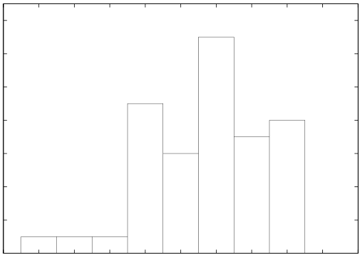
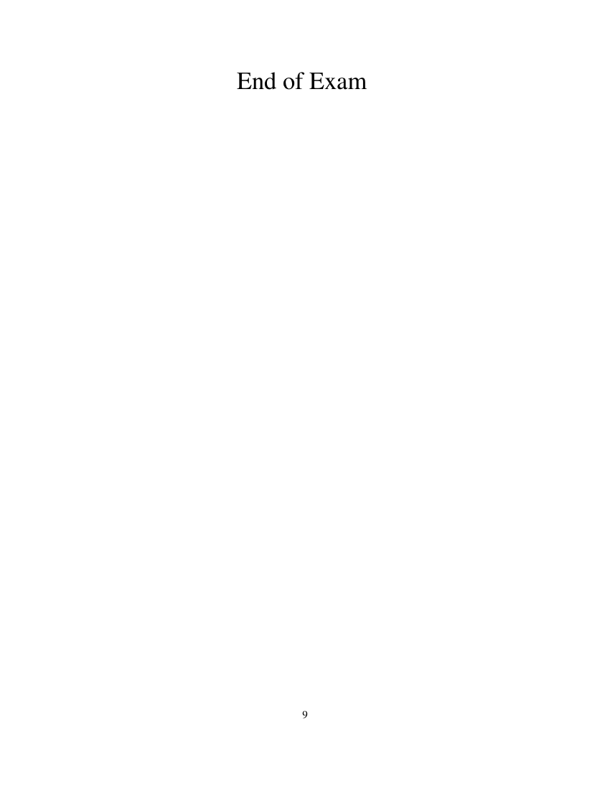

# MIT 6.824/6.5840 2005: Quiz 2: Official solutions

> Copied from the original: <https://pdos.csail.mit.edu/6.824/quizzes.html>. Text and figures are taken from the PDF as is; nothing was answered or rewritten. The original PDF is in this folder.

---

**Page 1**

&emsp;&emsp;&emsp;&emsp;&emsp;&emsp;&emsp;Department of Electrical Engineering and Computer Science 
&emsp;&emsp;&emsp;&emsp;&emsp;MASSACHUSETTS INSTITUTE OF TECHNOLOGY 
&emsp;&emsp;&emsp;&emsp;&emsp;&emsp;&emsp;&emsp;**6.824 Spring 2005** 
&emsp;&emsp;&emsp;&emsp;&emsp;&emsp;&emsp;&emsp;**Second Exam** 
&emsp;&emsp;&emsp;&emsp;&emsp;&emsp;&emsp;&emsp;Answers

&emsp;&emsp;14

&emsp;&emsp;12

&emsp;&emsp;10 
&emsp;Number of students 
&emsp;&emsp;&emsp;8

&emsp;&emsp;&emsp;6

&emsp;&emsp;&emsp;4

&emsp;&emsp;&emsp;2

&emsp;&emsp;&emsp;0 
&emsp;&emsp;&emsp;0    10    20    30    40    50    60    70    80    90    100 
&emsp;&emsp;&emsp;&emsp;&emsp;&emsp;&emsp;&emsp;Score in Range \[x,x+10) 
The average is 62. The standard deviation is 16.

&emsp;&emsp;&emsp;&emsp;&emsp;&emsp;&emsp;&emsp;1

---

**Page 2**

**I**   **Part One**

&emsp;**1. \[10 points\]:**   Why does Frangipani distinguish between read locks and write locks? Why is that 
&emsp;a better approach than having a single kind of lock? 
&emsp;**The read locks allow multiple Frangipani servers to cache and use files and directories at the** 
&emsp;**same time. This concurrency will increase total performance for read-intensive workloads.**

&emsp;**2. \[15 points\]:**   Look at the pseudo-code in Section 3.1 of the Ivy paper (Li and Hudak’s Memory 
&emsp;Coherence in Shared Virtual Memory Systems). Observe this code at the end of the Write Server:

&emsp;`IF` `I` `am` `manager` `THEN` `BEGIN` 
&emsp;&emsp;`lock(info[p].lock);` 
&emsp;&emsp;`invalidate(p,` `info[p].copy_set);` 
&emsp;Suppose that the programmer implementing this code accidentally swaps the lock and invalidate, so 
&emsp;that the implementation looked like this:

&emsp;`IF` `I` `am` `manager` `THEN` `BEGIN` 
&emsp;&emsp;`invalidate(p,` `info[p].copy_set);` 
&emsp;&emsp;`lock(info[p].lock);` 
&emsp;Explain a specific situation in which this erroneous code would cause Ivy to produce incorrect memory 
&emsp;contents. 
&emsp;**Host H1 takes a write fault on a page, asks the manager for write access, and the manager** 
&emsp;**executes the invalidate but has not yet locked. Host H2 takes a read fault on the same page, and** 
&emsp;**completes the entire read process, which involves the manager adding H2 to copy**   **set. Now the** 
&emsp;**manager gets the lock on behalf of H1’s write, clears copy**   **set, and gives ownership of the page** 
&emsp;**to H1. Now H1 can write the page, which will result in H2 having a stale copy of the page.**

&emsp;&emsp;&emsp;&emsp;&emsp;&emsp;&emsp;&emsp;2

---

**Page 3**

**II**   **Paxos**

The Reliable Computing Corporation (RCC) has designed a fault-tolerant airline seat reservation service. 
Travel agents send reservation requests to the service over the Internet, and the service responds with either 
a seat reservation or an error indication. Obviously it is vital that the service not assign the same seat to two 
different passengers. 
RCC’s system achieves fault-tolerance by replicating the reservation state on three servers. The state consists 
of a list of the reservation requests that have been granted, in the order that they were granted. Each entry in 
the list contains the seat number, the passenger name, and a request ID included by the travel agent in each 
request message. The request ID allows the service to recognize retransmitted requests, and reply with the 
information from the record that’s already in the list, rather than incorrectly allocating a new seat. A server 
can tell which seats have already been reserved by scanning the reservation list. 
RCC uses a replicated state machine to ensure that the servers have identical reservation lists. The three 
servers use Paxos (see the notes for Lecture 15) to agree on each new reservation to be added to the list. 
They execute Paxos for each reservation (rather than just using Paxos to agree on a new view and primary 
after each server failure). Each value that the servers agree on looks like “reservation list entry number 37 
assigns seat 32 to passenger Robert Morris with request ID 997.” When a server receives a request from a 
travel agent, it scans its reservation list to find the next available seat and the next list entry number, and uses 
Paxos to propose the value for that list entry number. The system runs a separate instance of Paxos to agree 
on the value for each numbered list entry. 
The three servers are S1, S2, and S3. S1 receives a request from a travel agent asking for a seat for Aaron 
Burr. S1 picks Paxos proposal number 101 (this is the n in Lecture 15). At about the same time S2 receives 
a request asking for a seat for Alexander Hamilton. S2 picks Paxos proposal number 102. Both servers look 
at their reservation lists and see that the next entry number is 38, and that the next seat available is seat 33. 
Both servers start executing Paxos as a leader for reservation list entry number 38. 
Each of the three sequences below indicates the initial sequence of messages of a possible execution of Paxos 
when both S1 and S2 are acting as leader. Each message shown is received successfully. The messages are 
sent and received one by one in the indicated order. No other messages are sent until after the last message 
shown is received. Your job is to answer these questions about the final outcomes that could result from 
each of the initial sequences: Is it possible for the servers to agree on Aaron Burr in seat 33 as entry 38? Is 
it possible for them to agree on Alexander Hamilton in seat 33 as entry 38? For each of these two outcomes, 
how it could occur or how does Paxos prevent it from occurring?

&emsp;&emsp;&emsp;&emsp;&emsp;&emsp;&emsp;&emsp;3

---

**Page 4**

`S1` `->` `S1` `PREPARE(101)` 
`S1` `->` `S1` `RESPONSE(nil,` `nil)` 
`S1` `->` `S2` `PREPARE(101)` 
`S2` `->` `S1` `RESPONSE(nil,` `nil)` 
`S1` `->` `S3` `PREPARE(101)` 
`S3` `->` `S1` `RESPONSE(nil,` `nil)` 
`S2` `->` `S1` `PREPARE(102)` 
`S2` `->` `S2` `PREPARE(102)` 
`S2` `->` `S3` `PREPARE(102)` 
`...` `the` `rest` `of` `the` `Paxos` `messages.`

&emsp;**3.**   **\[5 points\]:**   Answers: **Only Alexander Hamilton, because S2’s PREPARE will cause all** 
&emsp;**servers to ignore S1’s subsequent ACCEPT.**

`S1` `->` `S1` `PREPARE(101)` 
`S1` `->` `S1` `RESPONSE(nil,` `nil)` 
`S1` `->` `S2` `PREPARE(101)` 
`S2` `->` `S1` `RESPONSE(nil,` `nil)` 
`S1` `->` `S3` `PREPARE(101)` 
`S3` `->` `S1` `RESPONSE(nil,` `nil)` 
`S1` `->` `S3` `ACCEPT(101,` `‘‘Aaaron` `Burr...’’)` 
`S2` `->` `S1` `PREPARE(102)` 
`S2` `->` `S2` `PREPARE(102)` 
`S2` `->` `S3` `PREPARE(102)` 
`...` `the` `rest` `of` `the` `Paxos` `messages.`

&emsp;**4. \[5 points\]:**   Answers: **Either Aaron Burr or Alexander Hamilton. If S2 hears a RESPONSE** 
&emsp;**from S3, S2 will propose Aaron Burr. If S2 does not hear a RESPONSE from S3, S2 will propose** 
&emsp;**Alexander Hamilton.**

&emsp;&emsp;&emsp;&emsp;&emsp;&emsp;&emsp;&emsp;4

---

**Page 5**

`S1` `->` `S1` `PREPARE(101)` 
`S1` `->` `S1` `RESPONSE(nil,` `nil)` 
`S1` `->` `S2` `PREPARE(101)` 
`S2` `->` `S1` `RESPONSE(nil,` `nil)` 
`S1` `->` `S3` `PREPARE(101)` 
`S3` `->` `S1` `RESPONSE(nil,` `nil)` 
`S1` `->` `S3` `ACCEPT(101,` `‘‘Aaaron` `Burr...’’)` 
`S1` `->` `S1` `ACCEPT(101,` `‘‘Aaaron` `Burr...’’)` 
`S2` `->` `S1` `PREPARE(102)` 
`S2` `->` `S2` `PREPARE(102)` 
`S2` `->` `S3` `PREPARE(102)` 
`...` `the` `rest` `of` `the` `Paxos` `messages.`

&emsp;**5.**   **\[5 points\]:**   Answers: **Only Aaron Burr. Any majority of RESPONSEs that S2 hears in** 
&emsp;**Phase 2 will include the value Aaron Burr, so S2 will propose Aaron Burr.**

&emsp;**6. \[10 points\]:**Suppose one of the RCC servers has received an ACCEPT for a particular instance 
&emsp;of Paxos (i.e. for a particular reservation list entry), but never received any indication about what 
&emsp;the final outcome of the Paxos protocol was. Outline what steps the server should take to figure out 
&emsp;whether agreement was reached and to find out the agreed-on value. Explain why your procedure is 
&emsp;correct even if there are still active leaders executing this instance of Paxos. 
&emsp;**The server should send messages to all the servers asking them whether they accepted an AC-** 
&emsp;**CEPT message. If a majority of them respond with the same value, then agreement has been** 
&emsp;**reached. This procedure is safe even if there are still active leaders because any such leader** 
&emsp;**must hear from someone from that majority in Phase 2. (It’s actually more complex than this;** 
&emsp;**a real argument would include an inductive proof that there cannot be a minority value with** 
&emsp;**higher** n **number.)**

&emsp;&emsp;&emsp;&emsp;&emsp;&emsp;&emsp;&emsp;5

---

**Page 6**

**III**   **FAB**

&emsp;**7.**   **\[15 points\]:**   Suppose that a FAB system has three bricks, b1, b2, and b3. There is just one 
&emsp;seggroup, and it contains all three bricks. FAB is using replication, as detailed in Figure 4 of the FAB 
&emsp;paper. Block x starts out containing value 100 (all replicas have value 100, and all replicas have ordTs 
&emsp;equal to valTs). Coordinator c1 starts to execute write(200) for block x, but crashes after it sends the 
&emsp;Write message to b1 and before it sends Writes to the other two bricks. b1 receives and processes 
&emsp;the Write. This is the only execution of the write() function by any coordinator. Then coordinator c2 
&emsp;performs two read()s for block x, the second starting after the first completes, and prints the resulting 
&emsp;pair of values. For each pair below, indicate whether that pair is possible, and explain how it could 
&emsp;arise or how FAB prevents that pair of read values from occurring.

100 100: **Yes. The first read apparently didn’t hear from** b1**, but it would have seen that ordTs and** 
**valTs were not equal, repaired** b2 **and** b3**, and the repaired valTs would be greater than the valTs on** 
b1**. Thus the second read would prefer the repaired 100 even if the second read heard from** b1**.** 
100 200: **No. In order for the first read to return 100, it must have performed a repair. The repair** 
**would have guaranteed that the second read returned 200.** 
200 100: **No, for reasons similar to the previous question.** 
200 200: **Yes. The first read must have heard an Order reply from** b1 **and repaired to 200.**

&emsp;**8. \[10 points\]:**   You’re the system administrator of a FAB with three replicated bricks. Your users 
&emsp;use the FAB at all times to read and write data. You accidentally step on the Ethernet cable of one of 
&emsp;the bricks, which permanently damages the cable and causes the brick to lose its network connection. 
&emsp;It will take you about fifteen minutes to run out to CompUSA and buy a replacement Ethernet cable. 
&emsp;Before you leave for CompUSA, you can either start a reconfiguration (as in Section 5) or not start a 
&emsp;reconfiguration. Which is the best plan? Explain your reasoning. If you would need more information 
&emsp;to answer, explain what that information is and how you would use it to decide. 
&emsp;**If you don’t reconfigure, the system will keep serving reads and writes even with the missing** 
&emsp;**server, since only a quorum is required. The two live servers will keep timestamps for each** 
&emsp;**written block in NVRAM, so that after the Ethernet cable is repaired it will be clear that the** 
&emsp;**repaired server’s data is out of date.** 
&emsp;**If you reconfigure, then when you repair the Ethernet cable you’ll have to reconfigure again (to** 
&emsp;**get back up to three replicas), and the second reconfigure will require a copy of the entire disk** 
&emsp;**to the repaired server. This could take a long time. So the only reason to reconfigure is if the two** 
&emsp;**live servers run out of NVRAM in which to store timestamps. Thus the information you need to** 
&emsp;**answer the question is how long it will take for the NVRAM to fill up.**

&emsp;&emsp;&emsp;&emsp;&emsp;&emsp;&emsp;&emsp;6

---

**Page 7**

**IV**   **Ruthenian Consistency**

You are a member of the Ruthenian People’s Popular Front (RPPF), whose aim is to plot the overthrow 
of the oppressive government of Ruthenia. The RPPF is organized as a large number of “cells,” each cell 
consisting of three members. Each cell knows the members of a few other cells, but no-one knows all the 
members. However, everyone knows how many cells there are, and each cell knows its own unique ID (a 
number between 1 and the total number of cells). The total number of cells is constant. The cell structure is 
intended to make it hard for the government to arrest the whole RPPF, even if they have arrested a few of its 
members. 
From time to time various RPPF cells generate instructions that they want to communicate to every other 
cell. Cells that know each other can exchange messages written on slips of paper. Thus a message will need 
to be forwarded between many cells before every cell has a copy. 
The RPPF is worried about cells being confused by deceptive orders of arrival of messages. They are 
particularly anxious to ensure that cells can recognize situations in which two messages are originated 
simultaneously, by cells that were not aware of the other message. The reason is as follows. Suppose cell 
c0 receives two messages m1 and m2 that are originated by different cells, and that m1 and m2 contain 
conflicting instructions. If the originator of m2 knew about m1 before it generated m2, then c0 should 
ignore m1 and pay attention to m2. But if m1 and m2 were generated without knowledge of each other, then 
c0 will know that it should exercise extraordinary care when interpreting the two sets of instructions. 
More formally, the RPPF wants every cell be able to decide the relative order in which any pair of messages 
was originated. Suppose cell c0 has a copy of message m1 originated by cell c1, and m2 originated by c2. 
Cell c0 should be able to decide whether c2 had a copy of m1 when it originated m2, or c1 had a copy of m2 
when it originated m1, or neither had a copy of the other message. Call these situations “m2 is after m1,” 
“m1 is after m2,” and “m1 and m2 are concurrent.” 
Your job is to design an ordering system for the RPPF. 
Each cell is allowed to keep a copy of each message it sees, and can also maintain any state it can derive 
from those messages. The only form of communication allowed to a cell is passing written notes to the cells 
it knows about. Your solution should continue to operate even if the Ruthenian government eliminates a few 
cells, so it should not depend on any special cells. You can assume that the government is not aware of your 
communication system. 
You should try to minimize the amount of communication required by your system; it would not be good if 
each message had to include a huge amount of book-keeping information.

&emsp;&emsp;&emsp;&emsp;&emsp;&emsp;&emsp;&emsp;7

---

**Page 8**

**9. \[25 points\]:**Please explain how your ordering system works. You should describe the contents 
of each message, the state that each cell must keep, any communication protocol the cells must adhere 
to, and the algorithm a cell should use to decide whether one messages is after another or whether two 
messages are concurrent. 
**The hard part is deciding whether two messages are concurrent. A simple scheme is for the orig-** 
**inating cell to include a complete list of all messages it has received in each message it originates.** 
**Then any cell can decide if two messages are concurrent by noticing that neither message’s list** 
**mentions the other message. This solution requires a lot of communication to carry the lists,** 
**and the lists will grow in size as time passes.** 
**If the messages originated by each cell arrive in order at every other cell, a cell can summarize** 
**what it has seen by just reporting the highest message number it has seen originated from each** 
**other cell. That is, a cell should include a version vector in each message it originates. This** 
**scheme requires less communication, but must include a protocol that ensures that each cell** 
**sees each other cell’s messages in order.**

&emsp;&emsp;&emsp;&emsp;&emsp;&emsp;&emsp;&emsp;8

---

**Page 9**

