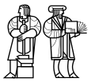

# MIT 6.824/6.5840 2006: Quiz 2: Questions

> Copied from the original: <https://pdos.csail.mit.edu/6.824/quizzes.html>. Text and figures are taken from the PDF as is; nothing was answered or rewritten. The original PDF is in this folder.

---

**Page 1**

&emsp;&emsp;&emsp;&emsp;&emsp;&emsp;&emsp;&emsp;Department of Electrical Engineering and Computer Science 
&emsp;&emsp;&emsp;&emsp;&emsp;&emsp;&emsp;MASSACHUSETTS INSTITUTE OF TECHNOLOGY 
&emsp;&emsp;&emsp;&emsp;&emsp;&emsp;&emsp;&emsp;**6.824 Spring 2006** 
&emsp;&emsp;&emsp;&emsp;&emsp;&emsp;&emsp;&emsp;**Exam Two**

&emsp;Please write your name on this cover sheet and on any exam pages you detach from this sheet. 
&emsp;Some questions may be much harder than others. Read them all through first and attack them in 
&emsp;the order that allows you to make the most progress. If you find a question ambiguous, be sure 
&emsp;to write down any assumptions you make. Be neat. If we can’t understand your answer, we can’t 
&emsp;give you credit. 
&emsp;You have 80 minutes to complete this exam. 
&emsp;&emsp;&emsp;&emsp;&emsp;&emsp;&emsp;&emsp;**THIS IS AN OPEN BOOK, OPEN NOTES EXAM.**

&emsp;&emsp;&emsp;&emsp;&emsp;&emsp;&emsp;&emsp;Please do not write in the boxes below.

&emsp;&emsp;&emsp;&emsp;&emsp;&emsp;**1 (xx/40)**   **2 (xx/20)**   **3 (xx/10)**   **4 (xx/30)**   **Total (xx/100)**

**Name:**

&emsp;&emsp;&emsp;&emsp;&emsp;&emsp;&emsp;&emsp;1

---

**Page 2**

**I**   **Atomic Commit Protocols**

Recall the two-phase commit protocol from Lecture 11. The goal of two-phase commit is to ensure that a 
transaction that involves work at multiple sites either commits at all the sites, or commits at none of them. 
The protocol goes through the following steps:

**A.** The transaction coordinator (TC) sends a PREPARE message to each site; the PREPARE message 
&emsp;describes the transaction. 
**B.** Each site responds with YES or NO, depending on whether it is willing to do its part of the transaction. 
**C.** The TC waits for all sites to respond. If any site said NO, the TC sends out an ABORT message to 
&emsp;each site. If all sites said YES, the TC sends out a COMMIT message to each site. 
**D.** If a site receives a COMMIT message, it executes its part of the transaction and updates its permanent 
&emsp;state.

The lecture notes explain how the TC and sites should react if they time out at any step waiting for the next 
expected message. 
For the following questions you should assume that the only failures involve hosts halting with disks intact, 
followed (eventually) by re-boots. There are no network failures: if a host sends a message, and the desti- 
nation host is alive, then the network delivers the message. The network does not delay or drop messages. 
All sites cooperate with the protocol to the best of their ability; there are no malicious entities. 
Syd Synker reviews his 6.824 notes and sees that two-phase commit must block in some cases when the TC 
crashes (blocking means that the participants must wait until the TC recovers). He proposes a new protocol 
called two-phase-commit-with-voting (2pcv). In his new protocol, if a site times out while waiting for a 
COMMIT from the TC, it starts an instance of the Paxos protocol to elect a substitute TC. The election can 
only succeed if a majority of nodes (including all sites and the TC) respond; for example, if there are three 
sites and a TC, and the TC has failed, then all three sites are required in order to form a majority (three 
of four nodes). If a site manages to persuade a majority of the nodes (including itself) to elect it as the 
substitute TC, it asks each reachable site whether it voted NO or received a COMMIT or ABORT from the 
old TC. You can assume that every live site responds. If any site says it voted NO or received an ABORT, the 
substitute TC decides to abort. If any site says it received a COMMIT, the substitute TC decides to commit. 
Syd claims that in other cases the substitute TC is free to decide either commit or abort; that either is always 
correct. 
You disagree! You think there are situations in which a substitute TC can neither abort nor commit, and thus 
must block. Suppose there is a TC and four sites S1, S2, S3, and S4. S1 receives a PREPARE from the TC, 
sends back a YES, and times out while waiting for the TC to send it another message. S1 runs Paxos and 
collects a majority agreeing that S1 is the substitute TC. None of the sites in the majority report that they 
voted NO, and none report receiving an ABORT or COMMIT.

&emsp;&emsp;&emsp;&emsp;&emsp;&emsp;&emsp;&emsp;2

---

**Page 3**

**\[10 points\]:1.**Explain why S1 cannot decide to commit in the situation at the bottom of the 
previous page, by describing a specific situation (consistent with the situation on the previous page) 
in which committing would be incorrect.

**2. \[10 points\]:**   Explain why S1 cannot decide to abort in the situation on the previous page, by 
describing a specific situation (consistent with the situation on the previous page) in which aborting 
would be incorrect.

&emsp;&emsp;&emsp;&emsp;&emsp;&emsp;&emsp;&emsp;3

---

**Page 4**

Syd agrees he was wrong. But he has another plan for a non-blocking atomic commit protocol, which he 
calls three-phase-commit-with-voting (3pcv). Here’s his protocol:

**A.** The TC sends PREPARE messages to all sites. 
**B.** Each site sends back YES or NO, depending on whether it is willing to perform the transaction. 
**C.** The TC waits for all YES/NO messages. If any site voted NO, the TC aborts the transaction. If all 
&emsp;sites vote YES, the TC sends a PRE-COMMIT message to each site. 
**D.** Each site sends an ACK when it receives the PRE-COMMIT. The TC waits for all the ACK messages, 
&emsp;then sends a COMMIT message to each site. 
**E.** When a site receives a COMMIT, it performs its part of the transaction, and updates its permanent 
&emsp;state.

Again, if a site times out while waiting for a message from the TC, it runs Paxos to try to persuade a majority 
of the nodes to agree on a substitute TC. If a majority is not alive, then no substitute TC can be elected, and 
the system must wait for sites to recover. Assume that a majority are alive, so a substitute can be elected. 
The substitute TC asks each reachable site for a copy of the last message it sent or received. If any site 
reports that it sent a NO or received an ABORT, the substitute TC aborts; if any site reports that it received 
a COMMIT the substitute TC commits. Syd claims that in every other situation, there is a legal action for 
the TC to take (either commit or abort); he says the system never needs to block if a majority of nodes are 
alive. The substitute TC sends each site in the majority a COMMIT or ABORT according to its decision. 
Syd notes that the old TC (and any other failed site), when it recovers and re-starts, should ask the sites for 
the identity of the substitute TC, and take whatever action the substitute TC decided. 
Again, suppose there is originally a TC and four sites.

&emsp;&emsp;&emsp;&emsp;&emsp;&emsp;&emsp;&emsp;4

---

**Page 5**

**3. \[10 points\]:**Suppose S1 times out waiting for the PRE-COMMIT, is elected substitute TC, and 
no site in the majority reports voting NO or receiving an ABORT, PRE-COMMIT, or COMMIT. If S1 
can correctly decide to commit or abort, indicate which, and outline an argument that such a decision 
is safe. If S1 cannot safely do either, explain why not.

**4.**   **\[10 points\]:**   Suppose S1, as substitute TC, receives a report from one site that it received a 
PRE-COMMIT, and that no site reports receiving either ABORT or COMMIT. Can S1 safely decide 
to commit? If yes, outline an argument that such a decision is safe. If S1 cannot safely commit, 
explain why not.

&emsp;&emsp;&emsp;&emsp;&emsp;&emsp;&emsp;&emsp;5

---

**Page 6**

**II**   **Argus**

Page 398 of the Argus paper (Guardians and Actions: Linguistic Support for Robust, Distributed Programs) 
shows a code fragment which sends an e-mail message to a list of user names. The text says that the e- 
mail message will be delivered to all the users in the list, or to none of them. The code calls the mailer’s 
`send``mail` handler (Figure 2) for each user, which in turn calls each user’s mail drop’s `send`   `mail` 
handler (Figure 4). The handler calls are a form of remote procedure call, since the various guardians may 
be on different network hosts. 
Suppose that the list of user names is Alice, Bob, Charles, and Diane, but that there is no user named Charles.

&emsp;**5. \[10 points\]:**   Outline the mechanisms in Argus that cause the message to not be delivered to Alice 
&emsp;and Bob, despite the fact that the code has already called Alice’s and Bob’s `send`   `mail` handlers at 
&emsp;the point at which it realizes that Charles doesn’t exist.

&emsp;**6. \[10 points\]:**   Suppose that Alice reads her mail after the code above has called Alice’s and Bob’s 
&emsp;`send``mail` handler, but before it has called Charles’ (thus before it realizes that Charles doesn’t 
&emsp;exist). Outline the specific Argus mechanism(s) that prevent Alice from seeing the message.

&emsp;&emsp;&emsp;&emsp;&emsp;&emsp;&emsp;&emsp;6

---

**Page 7**

**III**   **Harp**

&emsp;**7.**   **\[10 points\]:**   Recall the paper Replication in the Harp File System. Suppose that a Harp 
&emsp;installation has three servers: S1, S2, and S3. S1 is the designated primary, S2 is the designated 
&emsp;backup, and S3 is the designated witness. Suppose that a network failure prevents S1 and S2 from 
&emsp;talking to each other, but allows S1 and S3 to communicate and allows S2 and S3 to communicate. 
&emsp;Explain how Harp is likely to handle this situation. Which server (if any) will end up as primary? 
&emsp;Which (if any) as backup?

**IV**   **SUNDR**

Consider the straw-man version of SUNDR described in Section 3.1 of the paper. Suppose there are two 
clients (Alice and Bob) sharing a SUNDR file server. The clients don’t talk directly to each other, or to 
any trusted third party or “time stamp box”. Suppose that Alice performs two modify operations, mod(f1) 
followed by mod(f2), and that the SUNDR server wants to convince Bob that mod(f2) happened but that 
mod(f1) did not happen.

&emsp;**8. \[10 points\]:**   Could the server not append mod(f1) to the log, append mod(f2) to the log, and 
&emsp;show the result to both users? Would Alice notice, and if so, how? Would Bob notice, and if so, how?

&emsp;&emsp;&emsp;&emsp;&emsp;&emsp;&emsp;&emsp;7

---

**Page 8**

Suppose three users, U1, U2, and U3, are sharing a SUNDR file server and interact with it as described in 
Section 3.1. The server might be maliciously trying to confuse the users. The users mount the file system 
on `/sundr` on their hosts. All three users agree that the file system starts out with four empty files: `u1/a`, 
`u1/b`, `u2/a2`, and `u2/a2`. User U1 runs the following two commands, one at a time:

`echo` `aa` `>` `/sundr/u1/a` 
`echo` `bb` `>` `/sundr/u1/b`

U1 calls U2 on the telephone and says “your turn”. Then U2 runs these commands, one at a time:

`cp` `/sundr/u1/a` `/sundr/u2/a2` 
`cp` `/sundr/u1/b` `/sundr/u2/b2`

U2 calls U3 on the telephone and says “your turn,” after which U3 runs these commands, one at a time:

`cat` `/sundr/u1/a` 
`cat` `/sundr/u1/b` 
`cat` `/sundr/u2/a2` 
`cat` `/sundr/u2/b2`

There is no other user activity. Each command waits for all file system work to complete before it exits. The 
client hosts do no caching. The users and their client machines do not directly communicate except to say 
“your turn,” and they do not use any kind of timestamp server.

&emsp;&emsp;&emsp;&emsp;&emsp;&emsp;&emsp;&emsp;8

---

**Page 9**

&emsp;**9. \[20 points\]:**U3 will see four outputs from the four cat commands (which display the contents 
&emsp;of the indicated file). Given the description in Section 3.1, which of the following six combinations 
&emsp;of outputs are possible? A `-` in a column indicates an empty file. Mark a Y or an N to the right of 
&emsp;each combination, to indicate whether or not it is possible. For example, we’ve already marked a Y 
&emsp;to the right of the output combination `aa` `bb` `aa` `bb`. For each Y, outline how the server could have 
&emsp;caused that result to occur. For each N, outline why the clients are guaranteed to prevent the output.

`a`   `b`   `a2`   `b2` 
`--------------` 
`aa`   `bb`   `aa`   `bb`   `Y`

`aa`   `-`   `aa`   `-`

`aa`   `-`   `aa`   `bb`

`aa`   `bb`   `aa`   `-`

`-`   `bb`   `-`   `bb`

`aa`   `aa`   `aa`   `aa`

&emsp;&emsp;&emsp;&emsp;&emsp;&emsp;&emsp;&emsp;9

---

**Page 10**

