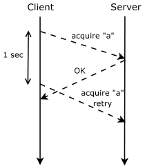
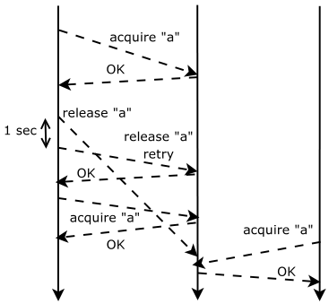
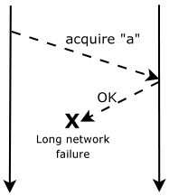
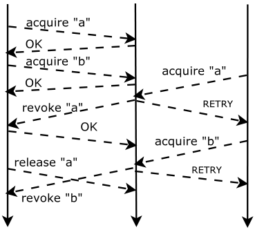

# MIT 6.824/6.5840 2007: Quiz 1: Official solutions

> Copied from the original: <https://pdos.csail.mit.edu/6.824/quizzes.html>. Text and figures are taken from the PDF as is; nothing was answered or rewritten. The original PDF is in this folder.

---

**Page 1**

&emsp;&emsp;&emsp;&emsp;&emsp;&emsp;&emsp;&emsp;Department of Electrical Engineering and Computer Science 
&emsp;&emsp;&emsp;&emsp;&emsp;&emsp;&emsp;MASSACHUSETTS INSTITUTE OF TECHNOLOGY 
&emsp;&emsp;&emsp;&emsp;&emsp;&emsp;**6.824 Distributed System Engineering: Fall 2007** 
&emsp;&emsp;&emsp;&emsp;&emsp;&emsp;&emsp;&emsp;**Quiz I**

&emsp;All problems are open-ended questions. In order to receive credit you must answer the question 
&emsp;as precisely as possible. You have 80 minutes to answer this quiz. 
&emsp;Write your name on this cover sheet AND at the bottom of each page of this booklet. 
&emsp;Some questions may be much harder than others. Read them all through first and attack them in 
&emsp;the order that allows you to make the most progress. If you find a question ambiguous, be sure 
&emsp;to write down any assumptions you make. Be neat. If we can’t understand your answer, we can’t 
&emsp;give you credit! 
&emsp;&emsp;&emsp;&emsp;&emsp;&emsp;&emsp;&emsp;**THIS IS AN OPEN BOOK, OPEN NOTES QUIZ.**

**I (xx/25)**   **II (xx/10)**   **III (xx/10)**   **IV (xx/15)**   **V (xx/15)**   **VI (xx/15)**   **VII (xx/10)**   **Total (xx/100)**

**Name:**

---

**Page 2**

---

**Page 3**

6.824 FALL 2007, Quiz 1   **Page 3 of 12** 
**I**   **Remote procedure call**

Ben finds writing programs with the YFS RPC library painful. After struggling with sequence numbers in 
lab 1 (lock server) and lab 5 (caching lock server), Ben wonders if he could get rid of sequence numbers 
(and the corresponding code) if the RPC library sends all RPCs over TCP instead of UDP. TCP is a reliable 
transport protocol that delivers packets to their destination even when the network may lose packets, and 
delivers all packets of a connection in order. 
Ben modifies lock client, server, and YFS RPC library as follows:

&emsp;• He removes the code that handles sequence numbers from client and server (i.e., the code to detect 
&emsp;out of order, duplicate, etc. messages); 
&emsp;• He removes his sequence numbers as arguments from `cl.call` calls (where `cl` is an `rpcc` object); 
&emsp;• He changes the implementation of `cl.call` to start a TCP connection to the destination, if no TCP 
&emsp;connection to the destination exists; 
&emsp;• `cl.call` sends the request over the TCP connection; 
&emsp;• He keeps the retransmission code so that the library retransmits after a second or so to recover from 
&emsp;potentially failed TCP connections (e.g., if the destination fails or there is long enough network par- 
&emsp;tition). The retry code will keep attempting to connect and set up a new TCP connection to the 
&emsp;destination until the source has received the RPC response from the server.

&emsp;**1. \[10 points\]:** Show a scenario in which the server sees a duplicate request for lock “a” from the 
&emsp;same client. (Draw a message time diagram. Use a time line for each client and server involves, and 
&emsp;show labeled arrows between the lines for each message.) 
&emsp;&emsp;Any situation is fine that involved a packet being delayed long enough in the network to cause YFS 
&emsp;RPC to start a new TCP connection and retransmit. The simplest, and most common, solution:

**Name:**

---

**Page 4**

6.824 FALL 2007, Quiz 1   **Page 4 of 12**

&emsp;**2. \[10 points\]:** Show a scenario in which the server gives lock “a” to two different clients, violating 
&emsp;the goal that only one client should have the lock at any time. (Draw a message time diagram.) 
&emsp;&emsp;The most straightforward solution is to have a delayed release reach the lock server after a second 
&emsp;acquire, falsely making the lock server think the client had released its lock, freeing it up for another 
&emsp;client. The network or the operating system must delay the original release long enough for YFS 
&emsp;to create a new TCP connection and resend the release. Note that the diagram below assumes a 
&emsp;non-caching lock server, though you can make it work with the caching lock server as well.

&emsp;**3. \[5 points\]:** Frustrated, Ben removes the retransmission code from the RPC library too, completely 
&emsp;relying on TCP for retransmission. But, now he observes that the client can get into a state where it 
&emsp;cannot successfully complete its RPC (i.e., it receives no response from the lock server). Show a 
&emsp;scenario that results in this behavior. (Draw a message time diagram.) 
&emsp;&emsp;Without RPC retries, any long network failure will cause TCP to give up and fail the connection, 
&emsp;returning -1 to the lock client’s call. For example:

**Name:**

---

**Page 5**

6.824 FALL 2007, Quiz 1   **Page 5 of 12** 
**II**   **Threads and mutexes**

Ben used fine-grain pthread locking in lab 5, but otherwise followed the instructions of the staff. After 
60 hours of debugging a concurrency hell, he throws away his fine-grained locking implementation and 
switches to very coarse-grain locking. The sketch of his new client code is as follows:

`//` `Release` `l,` `and` `send` `the` `lock` `to` `the` `server` `if` `the` `lock` `has` `been` `revoked` 
`release(lock` `l)` 
`{` 
`pthread_mutex_lock(&client_lock);` 
`...` 
`if` `(revoked[l])` 
&emsp;&emsp;`cl.call(server,` `RELEASE,` `...)` 
`...` 
`pthread_mutex_unlock(&client_lock);` 
`}` 
`//` `A` `revoke` `request` `from` `the` `lock` `server,` `which` `sets` `revoked` `for` `lock` `l` 
`revokereq(lock` `l)` 
`{` 
`pthread_mutex_lock(&client_lock);` 
`...` 
`revoked[l]` `=` `true;`   `//` `tell` `client` `that` `it` `should` `release` `lock` `l` 
`...` 
`pthread_mutex_unlock(&client_lock);` 
`}` 
The relevant server code is as follows:

`//` `A` `client` `asks` `for` `lock` `l` 
`acquirereq(lock` `l)` 
`{` 
`pthread_mutex_lock(&server_lock);` 
`...` 
`if` `(taken[l])` 
&emsp;`cl.call(holder_of_lock,` `REVOKE,` `...);`   `//` `tell` `holder` `to` `release` `lock` `l` 
`...` 
`taken[l]` `=` `true;`   `//` `a` `client` `has` `taken` `lock` `l` 
`...` 
`pthread_mutex_unlock(&server_lock);` 
`}` 
`//` `A` `client` `asks` `to` `release` `l` 
`releasereq(lock` `l)` 
`{` 
`pthread_mutex_lock(&server_lock);` 
`...` 
`taken[l]` `=` `false;`   `//` `client` `releases` `lock` `l` 
`...` 
`pthread_mutex_unlock(&server_lock);` 
`}` 
**Name:**

---

**Page 6**

6.824 FALL 2007, Quiz 1   **Page 6 of 12**

&emsp;**4. \[10 points\]:** Now the system deadlocks once in a while. Show a scenario that results in a deadlock. 
&emsp;(Draw a message time diagram.) 
&emsp;&emsp;There are a few ways by which the system can deadlock. One good way is for a release RPC and a 
&emsp;revoke RPC to cross paths. The server will be holding its lock waiting for the response for the revoke, 
&emsp;while the client will be holding its lock waiting for the response to the release. Neither will be able 
&emsp;to process the incoming RPC until it gets the response for its outstanding RPC (which will of course 
&emsp;never be processed).

**Name:**

---

**Page 7**

6.824 FALL 2007, Quiz 1   **Page 7 of 12** 
**III**   **Peer-to-peer: lookup**

The pseudocode for Chord’s join implementation, from figure 7 of the paper “Chord: a scalable peer-to-peer 
lookup service for Internet applications”, is as follows:

`n.join(n1)` 
`predecessor` `=` `nil;` 
`successor` `=` `n1.find_successor(n);` 
`n.stabilize()` 
`x` `=` `successor.predecessor;` 
`if` `(x` `in` `(n,` `successor))` 
&emsp;`successor` `=` `x;` 
`successor.notify(n);` 
`n.notify(n1)` 
`if` `(predecessor` `is` `nil` `or` `n1` `in` `(predecessor,` `n))` 
&emsp;`predecessor` `=` `n1;`

Ben observes that the Chord code for stabilization uses an indirect method to set the predecessor of a node, 
and proposes the following modifications to this pseudocode:

`n.joinnew(n1)` 
`successor` `=` `n1.find_successor(n)` 
`if` `(successor` `is` `not` `nil)` 
&emsp;`predecessor` `=` `successor.predecessor;` 
&emsp;`if` `(predecessor` `is` `not` `nil)` 
&emsp;&emsp;`predecessor.set_successor(n);` 
&emsp;`successor.set_predecessor(n);`

`joinnew` replaces the existing join implementation from the paper, and Ben removes `stabilize` and 
`notify`.

&emsp;**5. \[10 points\]:** Why is this change a bad one? (Give a brief explanation and a scenario that illustrates 
&emsp;your explanation.) 
&emsp;If nodes with close node IDs join at the same time, only one might appear in the succ ring. For 
&emsp;example, if a Chord ring consists of nodes 1 and 4, and nodes 2 and 3 join the ring concurrently, it’s 
&emsp;possible for both new nodes to have node 4 for a successor, and node 1 for a predecessor, and never 
&emsp;find out about each other. In addition, if node leave the system, the ring doesn’t repair because Ben 
&emsp;deleted stabilize.

**Name:**

---

**Page 8**

6.824 FALL 2007, Quiz 1   **Page 8 of 12** 
**IV**   **Peer-to-peer: data distribution**

&emsp;**6. \[5 points\]:** Explain briefly the purpose of Bittorrent’s choke algorithm. 
&emsp;To implement a tit-for-tat scheme so that nodes download at a rate proportional to their upload rate.

&emsp;**7.**   **\[10 points\]:** If there are a few high-upload peers and many low-upload peers, does Bittorrent 
&emsp;achieve the lowest total download time (across all peers)? If yes, give a brief argument why. If no, 
&emsp;give a modification to the Bittorrent protocol that is likely to reduce the total download time. 
&emsp;No. The choke algorithm will make it likely that high upload peers match up with other high upload 
&emsp;peers, and low upload peers with low upload peers. The high upload peers will finish quickly and then 
&emsp;are likely to leave the system. Several fixes are possible: incentive high upload peers to stay online, 
&emsp;remove penalty for low-upload nodes, etc.

**Name:**

---

**Page 9**

6.824 FALL 2007, Quiz 1   **Page 9 of 12** 
**V**   **Consistency**

Ben runs the following program on a computer with two processors and a single shared memory (with 
in-order execution of memory operations and no caches):

`processor` `0:` 
&emsp;`x` `=` `1;` 
&emsp;`if(y` `==` `0)` 
&emsp;&emsp;`critical` `section;` 
`processor` `1:` 
&emsp;`y` `=` `1;` 
&emsp;`if(x` `==` `0)` 
&emsp;&emsp;`critical` `section;`

On his computer at most one processor enters the critical section, as it should.

&emsp;**8. \[5 points\]:** Ben ports the program to the distributed shared memory (DSM) system described by 
&emsp;Li and Hudak in “Memory Coherence in Shared Virtual Memory Systems”. What consistency model 
&emsp;is implemented by DSM that makes this program work correctly? “Correctly” in this question means 
&emsp;if two computers share `x` and `y` through DSM only one computer enters `critical` `section`. 
&emsp;(Explain your answer briefly.) 
&emsp;DSM provides sequentially consistency. An implementation of a sequentially-consistent memory must 
&emsp;ensure that there is some total order for all concurrent read and write operations that is also consistent 
&emsp;with the order of the operations on a given processor. There is no total order that can result in 
&emsp;computer 0 and 1 both entering the critical section.

**Name:**

---

**Page 10**

6.824 FALL 2007, Quiz 1   **Page 10 of 12**

Ben modifies DSM slightly to get a bit more parallelism. The relevant portion of the pseudocode is the 
following fragment from section 3.2:

`Write` `fault` `handler:` 
`lock(ptable[p].lock);` 
`IF` `I` `am` `manager` `THEN` `BEGIN` 
&emsp;`receive` `page` `p` `from` `owner[p];` 
`ELSE` 
&emsp;`ask` `manager` `for` `write` `access` `to` `p;` 
`invalidate(p,` `ptable[p].copyset);` 
`ptable[p].access` `=` `write;` 
`ptable[p].copy_set` `=` `{};` 
`unlock(ptable[p].lock)`

Ben changes the implementation of `invalidate`. The implementation in the paper returns from the call 
to `invalidate` after it has received acknowledgements from all of the computers listed in `copyset`. 
Ben modifies `invalidate` to return as soon it has sent off the invalidation messages to all computers in 
`copyset`. His hope is to get better performance because the write fault handler doesn’t have to wait until 
the acknowledgements on the invalidate messages have been received.

&emsp;**9. \[10 points\]:** Does Ben’s program still run correctly? (Briefly explain.) 
&emsp;No. For example, consider the case that processor 0 and 1 have both a read-only copy of the pages 
&emsp;that contain x and y, and that x and y are on different pages. After processor 0 updates x, it may take a 
&emsp;long time before processor 1 finds out about the update and processor 0 doesn’t wait until processor 
&emsp;1 acknowledges that it has received the update. In the mean time processor 1 can get ownership of 
&emsp;the page that contains y, update y, and then read its out-of-date copy of the page that contains x. The 
&emsp;update of y might not arrive at processor 0 before it has read an out-of-date copy of the page that 
&emsp;contains y. Processor 0 will read 0 for x and processor 1 will 0 for y, and both will enter the critical 
&emsp;section.

**Name:**

---

**Page 11**

6.824 FALL 2007, Quiz 1   **Page 11 of 12** 
**VI**   **Caching in YFS**

When running YFS with the caching lock server and extent server (lab 6), an alert 6.824 student observes 
the following communication pattern often. When two clients are sharing the same file “f”, YFS transfers 
the extent for file “f” between the two clients through the extent server. That is, when client 1 has modified 
“f” and client 2 wants the file, client 1 writes the extent on the release of the lock for file “f” to the extent 
server. When client 2 receives the lock for file “f” from the lock server, it reads the extent for file “f” from 
the extent server. The extent for file f is transferred twice over the network, and when “f” is large, the student 
observes long delays before client 2 receives the extent for “f”.

&emsp;**10. \[15 points\]:** Describe a small, simple set of changes to the YFS protocols used in lab 6 so that 
&emsp;YFS transfers the extent for “f” only once over the network (i.e., directly from client 1 to 2). Your 
&emsp;modified protocol should pass all the tests for lab 6 and work under lossy conditions (i.e., the network 
&emsp;may lose packets). Make sure to specify the RPCs in your modified protocol, their arguments, and 
&emsp;their results. 
&emsp;&emsp;There were several possible correct solutions to this problem. One very simple one is to store **pointers** 
&emsp;to extents at the extent server, rather than the extents themselves. Thus, on a `dorelease()/flush()`, 
&emsp;the YFS server will `put()` its own hostname:port on the extent server, instead of the extent itself, and 
&emsp;keep the extent locally cached. Then a `get()` call from another client fetches the hostname:port, 
&emsp;and then uses a new RPC (say `get`   `cached`   `extent`) to retrieve the extent directly from the client. 
&emsp;Though this adds an extra round trip time, it doesn’t involve modifying the lock protocol. This assumes 
&emsp;clients never fail.

&emsp;&emsp;**–** `put(extentid`   `t` `id,` `int` `seqno,` `std::string` `&client)` 
&emsp;&emsp;**–** `get`   `cached`   `extent(extentid`   `t` `id,` `int` `&dummy)` 
&emsp;Note that the sequence number is necessary in the put to avoid a duplicated delayed packet in a lossy 
&emsp;network overwriting the put from a newer extent owner. The usual extent-locking convention ensures 
&emsp;that a `get()` always see the most recent writer’s hostname:port. 
&emsp;Another workable solution involves modifying the lock protocol to send extents directly to the new 
&emsp;lock owner as part of the `dorelease()/flush()` method. In this solution, the lock server adds 
&emsp;the hostname:port of the new lock holder in the `revoke()` RPC to the current lock holder. The cur- 
&emsp;rent lock holder must then remember this address, and pass it to `flush()` when the lock is released. 
&emsp;Then it sends a new RPC (say `put`   `cached`   `extent()`) to the new lock holder’s YFS server, which 
&emsp;must add the extent to its cache. After that RPC is complete, the current lock holder can release the 
&emsp;lock back to the lock server, which can grant it to the new lock holder. Once the new owner receives 
&emsp;the lock, it is guaranteed to have the current version of the extent in its cache. Note that there should 
&emsp;be a sequence number attached to the new RPC to avoid problems with delayed puts.

**Name:**

---

**Page 12**

6.824 FALL 2007, Quiz 1   **Page 12 of 12** 
**VII**   **6.824**

&emsp;**11. \[5 points\]:** Describe the most memorable error you have made so far in one of the labs. (Provide 
&emsp;enough detail so that we can understand your answer.)

We would like to hear your opinions about 6.824, so please answer the following two questions. (Any 
relevant answer will receive full credit!)

&emsp;**12. \[3 points\]:** What is the best aspect of 6.824?

&emsp;**13. \[2 points\]:** What is the worst aspect of 6.824?

&emsp;&emsp;&emsp;&emsp;&emsp;&emsp;&emsp;&emsp;End of Quiz I

**Name:**

