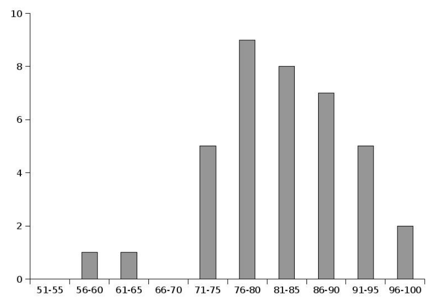

# MIT 6.824/6.5840 2007: Quiz 2: Official solutions

> Copied from the original: <https://pdos.csail.mit.edu/6.824/quizzes.html>. Text and figures are taken from the PDF as is; nothing was answered or rewritten. The original PDF is in this folder.

---

**Page 1**

&emsp;&emsp;&emsp;&emsp;&emsp;&emsp;&emsp;&emsp;Department of Electrical Engineering and Computer Science 
&emsp;&emsp;&emsp;&emsp;&emsp;&emsp;&emsp;MASSACHUSETTS INSTITUTE OF TECHNOLOGY 
&emsp;&emsp;&emsp;&emsp;&emsp;&emsp;**6.824 Distributed System Engineering: Fall 2007** 
&emsp;&emsp;&emsp;&emsp;&emsp;&emsp;&emsp;&emsp;**Quiz II**

&emsp;All problems are open-ended questions. In order to receive credit you must answer the question 
&emsp;as precisely as possible. This quiz is designed to be taken in 80 minutes, but you can take 110. 
&emsp;Write your name on this cover sheet AND at the bottom of each page of this booklet. 
&emsp;Some questions may be much harder than others. Read them all through first and attack them in 
&emsp;the order that allows you to make the most progress. If you find a question ambiguous, be sure 
&emsp;to write down any assumptions you make. Be neat. If we can’t understand your answer, we can’t 
&emsp;give you credit! 
&emsp;&emsp;&emsp;&emsp;&emsp;&emsp;&emsp;&emsp;**THIS IS AN OPEN BOOK, OPEN NOTES QUIZ.**

**I (xx/10)**   **II (xx/15)**   **III (xx/10)**   **IV (xx/20)**   **V (xx/20)**   **VI (xx/20)**   **VII (xx/5)**   **Total (xx/100)**

**Name:**

---

**Page 2**

Grade histogram for Quiz 2

&emsp;&emsp;&emsp;&emsp;Average: 82.7

---

**Page 3**

6.824 FALL 2007, Quiz 2   **Page 3 of 11** 
**I**   **Logging**

&emsp;**1.\[5 points\]:** Why do Frangipani servers (as described in the paper “Frangipani: A scalable dis- 
&emsp;tributed file system” by Thekkath et al.) keep a private log in Petal? If a client creates a file, writes 
&emsp;some data, and then closes the file, what does Frangipani guarantee about the state of the file system 
&emsp;after recovery if a server fails during this set of operations? (Briefly explain.) 
&emsp;&emsp;Servers keep a private log in Petal so that if they crash, another server can use that log to recover 
&emsp;the file system state being modified by the failed server. Frangipani guarantees nothing about the file 
&emsp;data, as this is not logged. It does guarantee that for the file system meta-data, all operations that 
&emsp;were written out successfully to Petal will be applied in the same order they were executed in. But it 
&emsp;makes no guarantees about the atomicity of the operations.

&emsp;**2.**   **\[5 points\]:** The design of YFS is inspired by Frangipani, though it differs in several important 
&emsp;ways. For the same sequence of operations as in the previous question, what does YFS (as specified 
&emsp;through lab 8, not including any lab 9 extensions) guarantee about the state of the file system in the 
&emsp;presence of server failures? (Briefly explain.) 
&emsp;&emsp;YFS guarantees nothing about the state of the file system after the crash, since there is no mechanism 
&emsp;for recovery. Furthermore, there’s not even a requirement that YFS store its data on disk, so an extent 
&emsp;server crash could wipe out all data.

**Name:**

---

**Page 4**

6.824 FALL 2007, Quiz 2   **Page 4 of 11** 
**II**   **Replicated state machine**

Ben Bitdiddle observes that reading the list of servers that constitute the replication state machine from a 
file is lame. He proposes that next year’s lab 7 use a plan that is simpler than Paxos but less lame than a 
configuration file. Ben’s proposed plan is:

&emsp;• As in lab 7, the replicated state machine has a master server that starts first. It assigns sequence 
&emsp;numbers to each client request to be processed by the servers in the replicated state machine. The 
&emsp;master processes a client’s request after all slaves have processed the request and then sends a response 
&emsp;to the client. 
&emsp;• When a new server starts, it joins the replicated state machine by sending a join request to the master. 
&emsp;• The master sends a join message to all the existing slaves in the replicated state machine. The master 
&emsp;stamps this message with the next unused sequence number (like other client requests) so that all 
&emsp;slaves can process the message in the same global order. 
&emsp;• The slaves process the join message when its turn in the global order comes up, and add the node to 
&emsp;the list of servers that constitute the replicated state machine. (Servers ignore duplicate join requests.) 
&emsp;• When all slaves have processed the join message, the master responds to the joiner with an OK re- 
&emsp;sponse, including the sequence number for the next message in the global order, a list of servers that 
&emsp;constitute the replicated state machine, and the master’s state. 
&emsp;• On receiving the response from the master, the joining server updates its list of nodes, initializes its 
&emsp;sequence number, installs the state, and listens for the next message in the global order from the 
&emsp;master. 
&emsp;• The master processes concurrent client requests serially. 
&emsp;• Failed servers (including the master) are handled as in lab 7.

**Name:**

---

**Page 5**

6.824 FALL 2007, Quiz 2   **Page 5 of 11**

&emsp;**3. \[8 points\]:** Assume server failures happen only between processing client requests (i.e., the master 
&emsp;processes each client request, including joins, successfully) and that network partitions don’t happen. 
&emsp;Is it important that the join messages are globally ordered with respect to other client requests? (Ex- 
&emsp;plain briefly.) 
&emsp;&emsp;No, having join messages be globally ordered with respect to the other client operations is not impor- 
&emsp;tant. By processing requests serially until they are completed, the master ensures that the messages 
&emsp;are processed in some global order, and by assumption in the problem statement the master cannot 
&emsp;fail while processing a request. This guarantees all slaves will see the join before the master crashes.

&emsp;**4. \[7 points\]:** In lab 8, failures (including network partitions) may happen at any time. Could we 
&emsp;have used Ben’s protocol in lab 8 to add new servers to the replicated state machine (instead of using 
&emsp;Paxos)? (Explain briefly.) 
&emsp;&emsp;No. In this case, the master can die at any time, notably while it is processing joins. Thus, a join mes- 
&emsp;sage could reach only a subset of the other replicas, which could result in the new master not having 
&emsp;learned about the new node (even though some other replicas may know about it). Furthermore, the 
&emsp;new node will not have gotten a response from the master, and will not believe it is in the current view 
&emsp;– even if some subset of the replicas have elected it master!

**Name:**

---

**Page 6**

6.824 FALL 2007, Quiz 2   **Page 6 of 11** 
**III**   **Two-phase commit**

&emsp;**5. \[5 points\]:** Argus (as described in the paper “Guardians and Actions: Linguistic Support for Ro- 
&emsp;bust, Distributed Programs” by Liskov and Scheifler) provides the programmer with a strong version 
&emsp;of at-most-once remote method invocation: if the invocation times out or returns a connection error, 
&emsp;the program can be sure that the remote handler was not invoked. These semantics seem ideal but are 
&emsp;typically not provided by systems (e.g., YFS, Java RMI, Birrell RPC, etc.) because it is a challenge 
&emsp;for these systems to tell whether a remote server failed right before it processed a request or right 
&emsp;after. How did the Argus designers overcome this challenge and provide at-most-once RPC? (Explain 
&emsp;briefly.) 
&emsp;&emsp;An RPC is implemented as a sub-action in Argus, so when the server side invokes the handler, any 
&emsp;effects on the object’s state are applied to a copy of the object. These effects won’t be committed to 
&emsp;the primary version of the object until the client receives a response and the top-level action commits. 
&emsp;If the reply doesn’t happen successfully for any reason, the RPC can abort and its effects will not be 
&emsp;seen by the program.

&emsp;**6. \[5 points\]:** What is a down side of the Argus solution? (Explain briefly.) 
&emsp;&emsp;This requirement makes Argus significantly more complex than a system like YFS, as the RPC layer 
&emsp;now must log state to disk, and have some way of rolling back changes on the receiver if the sub- 
&emsp;action fails to commit. There is also a performance hit, since an RPC now requires two rounds of 
&emsp;communication (the two-phase commit that implements the sub-action) rather than just one.

**Name:**

---

**Page 7**

6.824 FALL 2007, Quiz 2   **Page 7 of 11** 
**IV**   **Paxos**

Attached as an appendix to the quiz is the pseudocode for the Paxos algorithm that you implemented in lab 
8.

&emsp;**7. \[7 points\]:** In phase 2 the leader must receive responses from a majority of nodes in `views[vid`   `h]`. 
&emsp;Would responses from exactly half of the nodes in `views[vid`   `h]` be sufficient? (Give a brief ex- 
&emsp;planation and illustrate your answer with a scenario.) 
&emsp;&emsp;There are two answers to this question: yes and no. If you assume that all phases can now proceed 
&emsp;after hearing responses from only half of `views[vid`   `h]`, then the answer is no, because the network 
&emsp;could partition the set of nodes in half, resulting in multiple leaders getting elected. If there are four 
&emsp;nodes in a system, and a network failure partitions communication such there are two groups of two 
&emsp;nodes each and the groups cannot communicate with each other, then both groups can elect separate 
&emsp;leaders since they each consist of half the nodes. 
&emsp;However, if you assume that phase 3 still requires a majority of responses from `views[vid`   `h]`, then 
&emsp;it is fine to have fewer responses in phase 2. This will prevent the leader from being able to send out 
&emsp;decide messages, and will require Paxos to abort and restart.

&emsp;**8. \[7 points\]:** Consider a round of Paxos initiated by a leader that wishes to add a new node to the 
&emsp;current view. In phase 2, would it be sufficient if half of the nodes in `views[vid`   `h]` plus the new 
&emsp;member that will be part of the next view responded? (Give a brief explanation and illustrate your 
&emsp;answer with a scenario.) 
&emsp;&emsp;No, the majority must be from the previous view. As in the “no” answer to the last question, a network 
&emsp;partition into two equal-sized groups would allow each half to add a different joining node to its view, 
&emsp;if two nodes joined the network on different sides of the partition.

**Name:**

---

**Page 8**

6.824 FALL 2007, Quiz 2   **Page 8 of 11**

&emsp;**9. \[6 points\]:** In phase 1 why does the response to a prepare includes `n`   `a` and `v`   `a`? (Give a brief 
&emsp;explanation and illustrate your answer with a scenario.) 
&emsp;&emsp;In phase 2, the leader must propose whatever value has been previously accepted in this Paxos round 
&emsp;with the highest sequence number (by invariant P2 in Lamport’s “Paxos Made Simple” paper). If the 
&emsp;previous leader dies without initiating phase 3, the next leader must propose the same value. However 
&emsp;it might only be able to learn about it from some other node during phase 1; thus the information must 
&emsp;be included in the response during phase 1.

**Name:**

---

**Page 9**

6.824 FALL 2007, Quiz 2   **Page 9 of 11** 
**V**   **SUNDR**

&emsp;**10. \[10 points\]:** The strawman design in the SUNDR paper (“Secure Untrusted Data Repository” by 
&emsp;Li et al.) stores fetch operations in the log (which don’t modify data). Why are the fetch operations 
&emsp;stored in the log? Give a brief explanation and illustrate your answer with an attack that will violate 
&emsp;fork consistency if SUNDR didn’t store fetches in the log. 
&emsp;&emsp;If SUNDR didn’t store fetch operations, then modify operations that depend on a previous fetch 
&emsp;operation could be merged into the view of a client that may have previously seen a different fetch 
&emsp;operation. Here’s a specific example: 
&emsp;&emsp;**–** File F1 has been modified twice: F11 and F12. 
&emsp;&emsp;**–** Client C1 fetches F11. 
&emsp;&emsp;**–** Client C2 fetches F12. 
&emsp;&emsp;**–** Client C1 modifies F1, creating version F13. 
&emsp;&emsp;**–** Client C2 fetches F13. 
&emsp;The problem here is that C1 and C2 were forked (which is allowed) when the server showed them 
&emsp;different versions of the file, but by the end they are merged back together again. Thus when C2 reads 
&emsp;the version of the file, it has no idea that C1 has made its modifications based on the old version of a 
&emsp;file, and this violates fork consistency. 
&emsp;One common incorrect answer stated that the server could show a client version 2 of the file, and then 
&emsp;at some later point in time show the same client version 1 (if there were no intervening writes). This 
&emsp;is simply a fork attack, but from the point of a view of a single client (imagine the client rebooted and 
&emsp;lost all state between the two fetches).

&emsp;**11. \[10 points\]:** Clients in the strawman design sign new log entries. This signature covers all the 
&emsp;previous entries that the new entry depends on. Why are entries signed? Why does the signature cover 
&emsp;preceding entries? Give a brief explanation and illustrate your answer with an attack that will violate 
&emsp;fork consistency if SUNDR’s signatures didn’t cover preceding entries. 
&emsp;&emsp;Entries are signed to guarantee that the client created the entry, and that it has not been forged 
&emsp;by the server. The signature covers preceding entries so that clients can detect whether the server 
&emsp;subsequently drops any entries from the log – this would cause the signature on entries following the 
&emsp;missing entry to be incorrect, and thus the client would know that the server is cheating.

**Name:**

---

**Page 10**

6.824 FALL 2007, Quiz 2   **Page 10 of 11** 
**VI**   **BFT**

Phil Tollerenz thinks the Practical BFT algorithm (as described in the paper “Practical Byzantine Fault 
Tolerance” by Castro and Liskov) is too heavyweight, and looks for some optimizations. He wants to 
tolerate f Byzantine failures, and he plans to run it on a lossy network that can arbitrarily re-order and delay 
messages.

&emsp;**12.**   **\[10 points\]:** Phil’s first thought is that a majority of correct nodes should be sufficient for 
&emsp;agreement, and ponders running his system with only 2f+1 replicas. Briefly explain how this could 
&emsp;lead to incorrect behavior. 
&emsp;&emsp;Nodes that exhibit Byzantine failures can decide to arbitrarily delay their responses, or decline to 
&emsp;respond at all. Since BFT is designed to run in an asynchronous network, it is impossible to tell 
&emsp;network delays apart from these Byzantine failures. Thus, in order to tolerate f actual failures, BFT 
&emsp;needs to be prepared to handle an additional f network delays. Therefore, it requires 3f+1 replicas. 
&emsp;Imagine that f = 1, so that with Phil’s change there would be 3 nodes in the system (A, B, and 
&emsp;C). If the network delays the response from C for an arbitrarily long time, and B is malicious, then 
&emsp;no quorum of non-Byzantine nodes is possible, even though there are only f Byzantine failures in 
&emsp;the system. Note that A cannot tell that C is not maliciously withholding its response, so from A’s 
&emsp;perspective it is entirely possible that B is acting Byzantine.

&emsp;**13.**   **\[10 points\]:** Phil wonders whether he can safely save bandwidth by eliminating any all-to-all 
&emsp;communication in the BFT protocol. Instead of having a replica broadcast its messages to all other 
&emsp;replicas in the system, it will send its messages only to the primary. Briefly explain how this could 
&emsp;lead to incorrect behavior. 
&emsp;&emsp;If the master acts maliciously, it could easily hide responses from some of the replicas when it starts 
&emsp;the next round of the protocol. If the replicas never communicate with each other correctly, there is 
&emsp;no way for them to identify that the master is misbehaving.

**Name:**

---

**Page 11**

6.824 FALL 2007, Quiz 2   **Page 11 of 11** 
**VII**   **6.824**

&emsp;**14.\[3 points\]:** Katabi et al. describe their experiences with a distributed file system in the Ana- 
&emsp;logicFS paper; however, in many ways YFS is a much more real system than AnalogicFS, which has 
&emsp;been widely regarded as “fake” by its many critics. What have you learned from building YFS that 
&emsp;less experienced programmers like Leopold Katabi and Rudy Rhea might miss out on? 
&emsp;&emsp;To quote one student’s response: “Something tells me that even with all their impressive talk, Katabi 
&emsp;et al. don’t have any real code to show for it.”

&emsp;**15. \[2 points\]:** Did you learn anything in 6.824? Please give a score on a scale from 0 (nothing) to 
&emsp;10 (more than I had hoped for), and briefly explain. 
&emsp;&emsp;11.

&emsp;&emsp;&emsp;&emsp;End of Quiz II—Enjoy the break!

**Name:**

