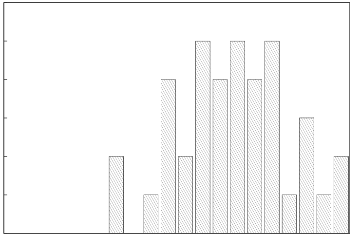

# MIT 6.824/6.5840 2009: Quiz 1: Official solutions

> Copied from the original: <https://pdos.csail.mit.edu/6.824/quizzes.html>. Text and figures are taken from the PDF as is; nothing was answered or rewritten. The original PDF is in this folder.

---

**Page 1**

&emsp;&emsp;&emsp;&emsp;&emsp;&emsp;&emsp;&emsp;Department of Electrical Engineering and Computer Science 
&emsp;&emsp;&emsp;&emsp;&emsp;&emsp;&emsp;MASSACHUSETTS INSTITUTE OF TECHNOLOGY 
&emsp;&emsp;&emsp;&emsp;&emsp;**6.824 Distributed System Engineering: Spring 2009** 
&emsp;&emsp;&emsp;&emsp;&emsp;&emsp;&emsp;&emsp;**Quiz I Solutions**

&emsp;All problems are open-ended questions. In order to receive credit you must answer the question 
&emsp;as precisely as possible. You have 80 minutes to answer this quiz. 
&emsp;Write your name on this cover sheet AND at the bottom of each page of this booklet. 
&emsp;Some questions may be much harder than others. Read them all through first and attack them in 
&emsp;the order that allows you to make the most progress. If you find a question ambiguous, be sure 
&emsp;to write down any assumptions you make. Be neat. If we can’t understand your answer, we can’t 
&emsp;give you credit! 
&emsp;&emsp;&emsp;&emsp;&emsp;&emsp;&emsp;&emsp;**THIS IS AN OPEN BOOK, OPEN NOTES QUIZ.**

&emsp;&emsp;**I (xx/14)**   **II (xx/21)**   **III (xx/20)**   **IV (xx/21)**   **V (xx/14)**   **VI (xx/10)**   **Total (xx/100)**

**Name:**

---

**Page 2**

&emsp;&emsp;&emsp;&emsp;&emsp;&emsp;&emsp;Grade histogram for Quiz 1

6

5

4

3

2

1

0 
&emsp;&emsp;&emsp;&emsp;&emsp;&emsp;&emsp;&emsp;96-100 
&emsp;&emsp;&emsp;91-9586-9081-8576-8071-7566-7061-6556-6051-5546-5041-4536-4031-3526-3021-2516-2011-15 
&emsp;6-10 
1-5

&emsp;&emsp;&emsp;&emsp;&emsp;&emsp;&emsp;&emsp;max   =   100 
&emsp;&emsp;&emsp;&emsp;&emsp;&emsp;&emsp;&emsp;median   =   67 
&emsp;&emsp;&emsp;&emsp;&emsp;&emsp;&emsp;&emsp;=   66.8 
&emsp;&emsp;&emsp;&emsp;&emsp;&emsp;&emsp;&emsp;µ 
&emsp;&emsp;&emsp;&emsp;&emsp;&emsp;&emsp;&emsp;=   16.2 
&emsp;&emsp;&emsp;&emsp;&emsp;&emsp;&emsp;&emsp;σ

---

**Page 3**

6.824 SPRING 2009, Quiz 1 Solutions   **Page 3 of 11** 
**I**   **Remote procedure call** 
Ben Bitdiddle makes the following changes to your RPC client from lab 1: 
&emsp;Each time a request is retransmitted, he assigns it a new sequence number. His client remembers only 
&emsp;the most recent sequence number assigned to each RPC, and if a reply with an unknown sequence 
&emsp;number arrives, it is ignored. Additionally, the client automatically re-binds to the server if the server 
&emsp;crashes. 
Then Ben modifies your RPC server to ignore all RPCs with a sequence number less than or equal to the 
highest sequence number it received from the same client so far. For example, if it receives a request with 
sequence number 5 from client A, it will ignore any subsequent requests it receives from A with sequence 
numbers less than or equal to 5. Note that the RPC client’s retransmission code increases the timeout with 
each retransmission, so RPCs will eventually complete if the server is up. 
In the following problems, assume a single client with one thread, and no crashes. However, the network 
may drop, delay, duplicate, or reorder messages.

&emsp;**1. \[7 points\]:** Recall that the SETATTR operation changes a file’s length and updates the modifi- 
&emsp;cation time, then returns the file’s new attributes. Explain how the behavior of SETATTR could be 
&emsp;different with the at-least-once RPC package the staff provided for Lab 1 versus Ben’s RPC package. 
&emsp;The SETATTR RPC may be executed more than once with both packages. However, Ben’s package 
&emsp;guarantees that the value returned (and hence the modification time) corresponds to the last   execution. 
&emsp;For example, suppose the client does a SETATTR followed by a GETATTR on a file. If no other 
&emsp;clients modify the file, one might expect both calls to return the same modification time, which is what 
&emsp;will happen with Ben’s RPC package. With at-least-once RPC, however, SETATTR might return the 
&emsp;modification time from the first   of two executions of the call, in which case the subsequent GETATTR 
&emsp;will return a different modification time.

&emsp;**2. \[7 points\]:** Circle the FUSE operations below that can fail or produce incorrect results with Ben’s 
&emsp;RPC package, but work with your at-most-once RPC. Then underline one and describe what goes 
&emsp;wrong with that operation. 
&emsp;LOOKUP   READ   WRITE   MKDIR   REMOVE 
&emsp;MKDIR and REMOVE might fail with Ben’s package because it can cause duplicate requests to be 
&emsp;executed. When the server processes a duplicate REMOVE request, for example, it sees that the file 
&emsp;is already deleted and returns an error. LOOKUP, READ, and WRITE are idempotent and therefore 
&emsp;don’t have this problem.

**Name:**

---

**Page 4**

6.824 SPRING 2009, Quiz 1 Solutions   **Page 4 of 11** 
**II**   **Short questions: Tra, Bayou, and DryadLINQ** 
&emsp;**3.**   **\[7 points\]:** On Monday, Alyssa and Ben fully synchronize their filesystems using Tra. On 
&emsp;Tuesday, Alyssa makes some changes on her computer, and on Wednesday, Ben makes some changes 
&emsp;on his computer. Then they fully synchronize again, and Tra reports no conflicts. Ben remarks that 
&emsp;the results are different than they would be if they had performed the same operations on a shared 
&emsp;YFS server (with sequential consistency). Give a simple example of operations Alyssa and Ben might 
&emsp;have performed to lead to this situation, and briefly explain. 
&emsp;Here’s a simple example: 
&emsp;&emsp;&emsp;Alyssa: `cp` `x` `y` 
&emsp;&emsp;&emsp;Ben: `cp` `y` `x` 
&emsp;Suppose `x` originally contained `"foo"` and `y` originally contained `"bar"`. The result with sequential 
&emsp;consistency is `x="foo"` and `y="foo"`, but the result with Tra is `x="bar"` and `y="foo"`. 
&emsp;The key point is that Tra only tracks write-write conflicts, not read-write conflicts. 
&emsp;Some students found answers involving special cases with deletes, but it’s more complicated to con- 
&emsp;struct an example where Tra doesn’t report a conflict.

&emsp;**4. \[7 points\]:** Suppose that while David is disconnected from the network, he uses Bayou’s meeting 
&emsp;room scheduler application to reserve the Stata center playground for a 6.824 post-quiz party. MIT 
&emsp;Daycare reserves the playground for the same time slot, and neither of them specify alternative times. 
&emsp;Under what specific circumstances would David get a confirmed reservation for the playground?1 
&emsp;David gets a confirmed reservation if his update reaches the primary before any conflicting updates.

&emsp;**5. \[7 points\]:** Section 3.3 of the DryadLINQ paper gives DryadLINQ’s implementation of MapRe- 
&emsp;duce. Name an optimization in Dryad that the original MapReduce doesn’t have that might give Dryad 
&emsp;better performance than MapReduce for the word frequency counting program you sketched for the 
&emsp;reading response question. Briefly explain how the optimization helps for this program. 
&emsp;Valid answers include any of the dynamic optimizations performed by DryadLINQ, except for re- 
&emsp;executing slow processes. (MapReduce mainly performs static optimizations.)

1P.S. Daycare won’t let us use it—sorry.

**Name:**

---

**Page 5**

6.824 SPRING 2009, Quiz 1 Solutions   **Page 5 of 11** 
**III**   **Mutexes and condition variables** 
Cy D. Fect has implemented a simplified implementation of the lock server from Lab 1. In Cy’s version, 
there’s a fixed table of 1024 locks; locks are never added or removed. Each lock has an associated condition 
variable `cv` and a mutex `mutex`. There is also a `global`   `cv` and a `global`   `mutex` for the entire lock 
server. Furthermore, `acquire()` and `release()` only take a single argument and don’t return a value. 
`class` `lock_server` `{` 
`struct` `lock` `{` 
&emsp;`pthread_cond_t` `cv;` 
&emsp;`pthread_mutex_t` `mutex;` 
&emsp;`bool` `held;` 
`}` `locks[1024];` 
`pthread_cond_t` `global_cv;` 
`pthread_mutex_t` `global_mutex;` 
`public:` 
`lock_server();`   `//` `initializes` `everything` `appropriately` 
`void` `acquire(lock_protocol::lockid_t` `lid);` 
`void` `release(lock_protocol::lockid_t` `lid);` 
`}` 
Unfortunately, Cy is having trouble writing the `acquire()` and `release()` RPC handlers. For each 
of the following implementations, explain what problems can be caused by the incorrect use of mutexes or 
condition variables. If nothing can go wrong, simply write “CORRECT,” and if there are multiple problems, 
describing one is enough. Ignore efficiency and issues like handling errors due to lack of memory; focus on 
the correctness of the synchronization. 
The first one has been done for you to give you an example of the kind of answer we’re looking for. To save 
you time, the parts that vary from one question to the next have been highlighted; the other lines of code are 
identical in all of the problems. 
&emsp;`void` `lock_server::acquire(lock_protocol::lockid_t` `lid)` `{` 
&emsp;&emsp;&emsp;`pthread_mutex_lock(&global_mutex);` 
&emsp;&emsp;&emsp;`if` `(locks[lid].held)` 
&emsp;&emsp;&emsp;&emsp;&emsp;`pthread_cond_wait(``&global_cv``,` `&global_mutex``);` 
&emsp;&emsp;&emsp;`locks[lid].held` `=` `true;` 
&emsp;&emsp;&emsp;`pthread_mutex_unlock(&global_mutex);` 
&emsp;`}` 
&emsp;`void` `lock_server::release(lock_protocol::lockid_t` `lid)` `{` 
&emsp;&emsp;&emsp;`pthread_mutex_lock(&global_mutex);` 
&emsp;&emsp;&emsp;`locks[lid].held` `=` `false;` 
&emsp;&emsp;&emsp;`pthread_cond_broadcast(&global_cv);` 
&emsp;&emsp;&emsp;`pthread_mutex_unlock(&global_mutex);` 
&emsp;`}` 
&emsp;**ANSWER:** 
&emsp;&emsp;&emsp;INCORRECT 
&emsp;&emsp;&emsp;Thread A acquires lock 1. 
&emsp;&emsp;&emsp;Threads B and C try to acquire 1 and wait on global   cv. 
&emsp;&emsp;&emsp;Thread A releases lock 1 and broadcasts. 
&emsp;&emsp;&emsp;B and C both wake up, and both now think they own the lock.

**Name:**

---

**Page 6**

6.824 SPRING 2009, Quiz 1 Solutions   **Page 6 of 11**

&emsp;**6. \[5 points\]:** 
&emsp;`void` `lock_server::acquire(lock_protocol::lockid_t` `lid)` `{` 
&emsp;&emsp;&emsp;`pthread_mutex_lock(&global_mutex);` 
&emsp;&emsp;&emsp;`while` `(locks[lid].held)` 
&emsp;&emsp;&emsp;&emsp;&emsp;`pthread_cond_wait(``&global_cv``,` `&global_mutex``);` 
&emsp;&emsp;&emsp;`locks[lid].held` `=` `true;` 
&emsp;&emsp;&emsp;`pthread_mutex_unlock(&global_mutex);` 
&emsp;`}` 
&emsp;`void` `lock_server::release(lock_protocol::lockid_t` `lid)` `{` 
&emsp;&emsp;&emsp;`pthread_mutex_lock(&global_mutex);` 
&emsp;&emsp;&emsp;`locks[lid].held` `=` `false;` 
&emsp;&emsp;&emsp;`pthread_cond_signal(&global_cv);` 
&emsp;&emsp;&emsp;`pthread_mutex_unlock(&global_mutex);` 
&emsp;`}` 
&emsp;INCORRECT 
&emsp;Thread A waits for lock 1. 
&emsp;Thread B waits for lock 2. 
&emsp;Lock 1 is released, and thread B gets signaled, but sees lock 2 is still held and waits again. 
&emsp;Thread A continues to wait even though lock 1 is free.

&emsp;**7. \[5 points\]:** 
&emsp;`void` `lock_server::acquire(lock_protocol::lockid_t` `lid)` `{` 
&emsp;&emsp;&emsp;`pthread_mutex_lock(&global_mutex);` 
&emsp;&emsp;&emsp;`while` `(locks[lid].held)` 
&emsp;&emsp;&emsp;&emsp;&emsp;`pthread_cond_wait(``&global_cv``,` `&global_mutex``);` 
&emsp;&emsp;&emsp;`locks[lid].held` `=` `true;` 
&emsp;&emsp;&emsp;`pthread_mutex_unlock(&global_mutex);` 
&emsp;`}` 
&emsp;`void` `lock_server::release(lock_protocol::lockid_t` `lid)` `{` 
&emsp;&emsp;&emsp;`pthread_mutex_lock(&global_mutex);` 
&emsp;&emsp;&emsp;`locks[lid].held` `=` `false;` 
&emsp;&emsp;&emsp;`pthread_mutex_unlock(&global_mutex);` 
&emsp;&emsp;&emsp;`pthread_cond_broadcast(&global_cv);` 
&emsp;`}` 
&emsp;CORRECT 
&emsp;It’s fine to call `pthread`   `cond`   `broadcast()` after releasing the lock. This just means that any 
&emsp;waiters will wake up slightly later; the important part is that the setting and checking of the `held` 
&emsp;flag happens atomically. The example at the end of Section 5.3 of the threading paper does this, too.

**Name:**

---

**Page 7**

6.824 SPRING 2009, Quiz 1 Solutions   **Page 7 of 11**

&emsp;**8. \[5 points\]:** 
&emsp;`void` `lock_server::acquire(lock_protocol::lockid_t` `lid)` `{` 
&emsp;&emsp;&emsp;`pthread_mutex_lock(&global_mutex);` 
&emsp;&emsp;&emsp;`while` `(locks[lid].held)` 
&emsp;&emsp;&emsp;&emsp;&emsp;`pthread_cond_wait(``&locks[lid].cv``,` `&global_mutex``);` 
&emsp;&emsp;&emsp;`locks[lid].held` `=` `true;` 
&emsp;&emsp;&emsp;`pthread_mutex_unlock(&global_mutex);` 
&emsp;`}` 
&emsp;`void` `lock_server::release(lock_protocol::lockid_t` `lid)` `{` 
&emsp;&emsp;&emsp;`pthread_mutex_lock(&global_mutex);` 
&emsp;&emsp;&emsp;`locks[lid].held` `=` `false;` 
&emsp;&emsp;&emsp;`pthread_cond_signal(&locks[lid].cv);` 
&emsp;&emsp;&emsp;`pthread_mutex_unlock(&global_mutex);` 
&emsp;`}` 
&emsp;CORRECT 
&emsp;This is similar to question 6, except that there is one condition variable per lock. It’s okay to use 
&emsp;`pthread`   `cond`   `signal()` here because there’s no chance of waking the “wrong” waiter.

&emsp;**9. \[5 points\]:** 
&emsp;`void` `lock_server::acquire(lock_protocol::lockid_t` `lid)` `{` 
&emsp;&emsp;&emsp;`pthread_mutex_lock(&global_mutex);` 
&emsp;&emsp;&emsp;`pthread_mutex_lock(&locks[lid].mutex);` 
&emsp;&emsp;&emsp;`while` `(locks[lid].held)` 
&emsp;&emsp;&emsp;&emsp;&emsp;`pthread_cond_wait(``&locks[lid].cv``,` `&locks[lid].mutex``);` 
&emsp;&emsp;&emsp;`locks[lid].held` `=` `true;` 
&emsp;&emsp;&emsp;`pthread_mutex_unlock(&locks[lid].mutex);` 
&emsp;&emsp;&emsp;`pthread_mutex_unlock(&global_mutex);` 
&emsp;`}` 
&emsp;`void` `lock_server::release(lock_protocol::lockid_t` `lid)` `{` 
&emsp;&emsp;&emsp;`pthread_mutex_lock(&global_mutex);` 
&emsp;&emsp;&emsp;`locks[lid].held` `=` `false;` 
&emsp;&emsp;&emsp;`pthread_cond_broadcast(&locks[lid].cv);` 
&emsp;&emsp;&emsp;`pthread_mutex_unlock(&global_mutex);` 
&emsp;`}` 
&emsp;INCORRECT 
&emsp;The thread calling `acquire()` waits on `locks[lid].cv` while holding `global`   `mutex`, so 
&emsp;other `acquire()` and `release()` operations are unable to proceed and the system deadlocks.

**Name:**

---

**Page 8**

6.824 SPRING 2009, Quiz 1 Solutions   **Page 8 of 11** 
**IV**   **Entry consistency** 
Alice hears about a new consistency mode, called entry consistency. If a lock l protects shared data D, then 
entry consistency is defined as follows: 
&emsp;• An acquire of l on processor p is not allowed to complete until all updates to D before the last release 
&emsp;of l are visible at p.

&emsp;**10.**   **\[4 points\]:** Write some pseudocode for a simple program that would operate correctly with 
&emsp;sequential consistency but incorrectly with entry consistency. (Briefly explain your answer.) 
&emsp;One example: 
&emsp;&emsp;CPU 0:   CPU 1: 
&emsp;&emsp;`foo` `=` `42;` 
&emsp;&emsp;`foo`   `is`   `set` `=` `true;` 
&emsp;&emsp;&emsp;&emsp;&emsp;&emsp;&emsp;&emsp;`while` `(!foo`   `is`   `set)` 
&emsp;&emsp;&emsp;&emsp;&emsp;&emsp;&emsp;&emsp;`;` 
&emsp;&emsp;&emsp;&emsp;&emsp;&emsp;&emsp;&emsp;`print` `foo;` 
&emsp;Any program that is correctly annotated with locks will work with entry consistency, so you had to 
&emsp;give an example that was not correctly annotated.

&emsp;**11. \[4 points\]:** Give an example program that might induce less communication under entry consis- 
&emsp;tency than lazy release consistency. (Briefly explain why.) 
&emsp;In the following example, we have to send the updates for both `x` and `y` from CPU 0 to CPU 1 in LRC, 
&emsp;whereas in entry consistency, we only have to send the updates for `y`. 
&emsp;&emsp;CPU 0:   CPU 1: 
&emsp;&emsp;`acquire(lx);` 
&emsp;&emsp;`x++;` 
&emsp;&emsp;`release(lx);` 
&emsp;&emsp;`acquire(ly);` 
&emsp;&emsp;`y++;` 
&emsp;&emsp;`release(ly);` 
&emsp;&emsp;&emsp;&emsp;&emsp;&emsp;&emsp;&emsp;`acquire(ly);` 
&emsp;&emsp;&emsp;&emsp;&emsp;&emsp;&emsp;&emsp;`y++;` 
&emsp;&emsp;&emsp;&emsp;&emsp;&emsp;&emsp;&emsp;`release(ly);`

**Name:**

---

**Page 9**

6.824 SPRING 2009, Quiz 1 Solutions   **Page 9 of 11**

&emsp;**12. \[8 points\]:** Alice implements a protocol for entry consistency. Show the messages that Alice’s 
&emsp;protocol might send when a program acquires a lock. (Briefly explain how the protocol differs from 
&emsp;the one for lazy release consistency.) 
&emsp;The protocol is the same as LRC, except that there is a version vector per lock, and only   updates 
&emsp;associated with the lock being acquired are transferred.

It occurs to Alice that she could make a distinction in operations that update D and operations that only read 
D by using reader/writer locks. If two operations take out a read lock for the same critical section, then both 
operations can be executed in parallel. To take advantage of this, she defines reader/writer entry consistency. 
The parts that differ from plain entry consistency are underlined:

&emsp;• Before a lock l in write mode is granted to processor p, no other processor may hold l. 
&emsp;• An acquire of l on processor p in read or write mode   is not allowed to complete until all updates to D 
&emsp;before the last release of l in write mode   are visible at p.

&emsp;**13.**   **\[5 points\]:** Give a program that can induce less communication under reader/writer entry 
&emsp;consistency than under plain entry consistency, where all locks are treated as write locks. (Briefly 
&emsp;explain why this program introduces less communication.) 
&emsp;&emsp;CPU 0:   CPU 1: 
&emsp;&emsp;`acquire`   `write(lx);` 
&emsp;&emsp;`x++;` 
&emsp;&emsp;`release(lx);` 
&emsp;&emsp;&emsp;&emsp;&emsp;&emsp;&emsp;&emsp;`acquire`   `read(lx);` 
&emsp;&emsp;&emsp;&emsp;&emsp;&emsp;&emsp;&emsp;`z` `=` `x;` 
&emsp;&emsp;&emsp;&emsp;&emsp;&emsp;&emsp;&emsp;`release(lx);` 
&emsp;&emsp;`acquire`   `read(lx);` 
&emsp;&emsp;`print(x);` 
&emsp;&emsp;`release(lx);` 
&emsp;This example can induce less communication in two ways. First, CPU 0 doesn’t need to send a vector 
&emsp;timestamp to CPU 1, since CPU 0 itself most recently released the lock in write mode. Second, CPU 1 
&emsp;doesn’t have to send the new value of `z` (which arguably should have been protected by a write lock 
&emsp;anyway.) 
&emsp;This optimization can be applied to LRC, too.

**Name:**

---

**Page 10**

6.824 SPRING 2009, Quiz 1 Solutions   **Page 10 of 11** 
**V**   **Logging with checkpoints** 
&emsp;**14. \[7 points\]:** In the Cedar system, the VAM updates are not recorded with write-ahead logging. 
&emsp;How is the content of the VAM recovered? After recovery, does the VAM have an accurate list of all 
&emsp;free disk blocks? (Briefly explain your answer.) 
&emsp;&emsp;The VAM is reconstructed from the file name table, and is accurate after recovery. (Blocks referenced 
&emsp;in the file name table are marked allocated, and all other blocks are marked free.)

&emsp;**15. \[7 points\]:** In FSD, creating a file might involve the following sequence of events: 
&emsp;&emsp;1\. An application calls `create(``filename``,` `file`   `contents``)`. 
&emsp;&emsp;2\. Cedar writes the data and leader pages to disk. 
&emsp;&emsp;3\. The `create` call returns `OK`. 
&emsp;&emsp;4\. Later, Cedar records the file name table changes in the log. 
&emsp;&emsp;5\. Cedar updates the file name table on disk. 
&emsp;&emsp;6\. The VAM is written to disk later when the system is idle. 
&emsp;Lem E. Tweakit thinks there is no need to write the data and leader pages synchronously, and modifies 
&emsp;Cedar so that creates result in the following sequence of events: 
&emsp;&emsp;1\. An application calls `create(``filename``,` `file`   `contents``)`. 
&emsp;&emsp;2\. The `create` call returns `OK`. 
&emsp;&emsp;3\. Cedar writes the data and leader pages to disk. **(changed)** 
&emsp;&emsp;4\. Later, Cedar records the file name table changes in the log. 
&emsp;&emsp;5\. Cedar updates the file name table on disk. 
&emsp;&emsp;6\. The VAM is written to disk later when the system is idle. 
&emsp;In Lem’s version of FSD, this order is always followed, the log is flushed just as frequently as before, 
&emsp;and everything else is the same. Give an example of what can go wrong with Lem’s modified FSD 
&emsp;that the original FSD handles correctly, or explain why Lem’s changes cause no new problems. Don’t 
&emsp;worry about concurrency, operations other than `create`, hardware failures, or bugs. 
&emsp;Lem’s changes don’t cause problems. A potential concern is that `create` returns `OK` before the data 
&emsp;and leaders are written, so if the system crashes before Step 3 in Lem’s version, the file won’t be there 
&emsp;after recovery. However, this can happen in the original FSD, too! 
&emsp;The key insight is that Step 4, where the log record is written, is the commit point in both versions. 
&emsp;That is, if there is a crash before Step 4, the file will not   be present after recovery; if there is a crash 
&emsp;after Step 4, then the file will   be present after recovery. (Identifying where the commit point is is a 
&emsp;good way to understand any system that provides atomic updates.)

**Name:**

---

**Page 11**

6.824 SPRING 2009, Quiz 1 Solutions   **Page 11 of 11** 
**VI**   **6.824** 
&emsp;**16. \[4 points\]:** Describe the most memorable error you have made so far in one of the labs. (Provide 
&emsp;enough detail so that we can understand your answer.) 
&emsp;&emsp;Most common answers: 
&emsp;&emsp;12   concurrency bugs (many of which were covered on the quiz!) 
&emsp;&emsp;8   miscellaneous issues with STL 
&emsp;&emsp;6   problems with FUSE

We would like to hear your opinions about 6.824, so please answer the following two questions. (Any 
relevant answer will receive full credit!)

&emsp;**17. \[3 points\]:** What is the best aspect of 6.824? 
&emsp;&emsp;Most common answers: 
&emsp;&emsp;31   labs 
&emsp;&emsp;6   papers

&emsp;**18. \[3 points\]:** What is the worst aspect of 6.824? 
&emsp;&emsp;Most common answers: 
&emsp;&emsp;11   issues with papers: too many (6), too old (2), other (3) 
&emsp;&emsp;11   issues with labs: too open-ended (3), not enough comments (3), C++ / STL / RPC (3), other (2) 
&emsp;&emsp;10   quiz

&emsp;&emsp;&emsp;&emsp;&emsp;&emsp;&emsp;&emsp;End of Quiz I

**Name:**

