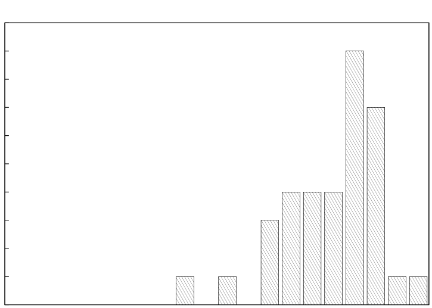
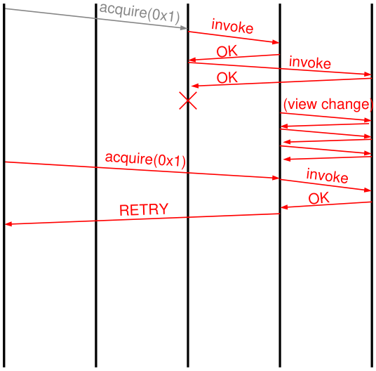
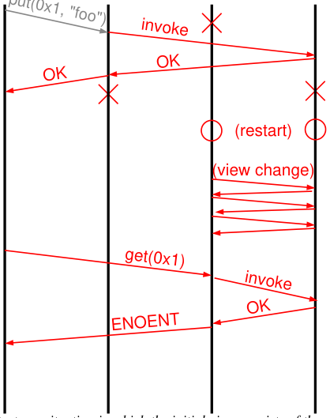

# MIT 6.824/6.5840 2009: Quiz 2: Official solutions

> Copied from the original: <https://pdos.csail.mit.edu/6.824/quizzes.html>. Text and figures are taken from the PDF as is; nothing was answered or rewritten. The original PDF is in this folder.

---

**Page 1**

&emsp;&emsp;&emsp;&emsp;&emsp;&emsp;&emsp;&emsp;Department of Electrical Engineering and Computer Science 
&emsp;&emsp;&emsp;&emsp;&emsp;&emsp;&emsp;MASSACHUSETTS INSTITUTE OF TECHNOLOGY 
&emsp;&emsp;&emsp;&emsp;&emsp;**6.824 Distributed System Engineering: Spring 2009** 
&emsp;&emsp;&emsp;&emsp;&emsp;&emsp;&emsp;&emsp;**Quiz II Solutions**

&emsp;All problems are open-ended questions. In order to receive credit you must answer the question as 
&emsp;precisely as possible. The quiz is designed to take 80 minutes, but you have two hours to complete 
&emsp;it. (If you finish early, we included some light additional reading.) 
&emsp;Write your name on this cover sheet AND at the bottom of each page of this booklet. 
&emsp;Some questions may be much harder than others. Read them all through first and attack them in 
&emsp;the order that allows you to make the most progress. If you find a question ambiguous, be sure 
&emsp;to write down any assumptions you make. Be neat. If we can’t understand your answer, we can’t 
&emsp;give you credit! 
&emsp;&emsp;&emsp;&emsp;&emsp;&emsp;&emsp;&emsp;**THIS IS AN OPEN BOOK, OPEN NOTES QUIZ.**

&emsp;&emsp;&emsp;&emsp;**I (xx/40)**   **II (xx/16)**   **III (xx/25)**   **IV (xx/12)**   **V (xx/7)**   **Total (xx/100)**

**Name:**

---

**Page 2**

&emsp;&emsp;&emsp;&emsp;&emsp;&emsp;&emsp;Grade histogram for Quiz 2

10

9

8

7

6

5

4

3

2

1

0 
&emsp;&emsp;&emsp;&emsp;&emsp;&emsp;&emsp;&emsp;96-100 
&emsp;&emsp;&emsp;91-9586-9081-8576-8071-7566-7061-6556-6051-5546-5041-4536-4031-3526-3021-2516-2011-15 
&emsp;&emsp;6-10 
1-5

&emsp;&emsp;&emsp;&emsp;&emsp;&emsp;&emsp;&emsp;max 
&emsp;&emsp;&emsp;&emsp;&emsp;&emsp;&emsp;&emsp;=   99 
&emsp;&emsp;&emsp;&emsp;&emsp;&emsp;&emsp;&emsp;median 
&emsp;&emsp;&emsp;&emsp;&emsp;&emsp;&emsp;&emsp;=   81 
&emsp;&emsp;&emsp;&emsp;&emsp;&emsp;&emsp;&emsp;µ   =   77.3 
&emsp;&emsp;&emsp;&emsp;&emsp;&emsp;&emsp;&emsp;σ   =   11.3

---

**Page 3**

6.824 SPRING 2009, Quiz 2 Solutions   **Page 3 of 10** 
**I**   **Short Questions** 
&emsp;**1. \[8 points\]:** The Storm authors, tired of pesky researchers infiltrating their botnet, want to prevent 
&emsp;it from being subverted in the future. They propose two defenses to address the attacks used by the 
&emsp;Spamalytics authors, and hire you to evaluate their designs. (For the purposes of this problem, assume 
&emsp;that you have no scruples.) Assume that the Storm authors have a secure way to distribute keys to 
&emsp;proxies and workers. 
&emsp;Which of the following changes would address the attack described in the Spamalytics paper?   Circle 
&emsp;all   that   apply. For each proposal that won’t work, explain why not. If they both work, identify the one 
&emsp;you think is better (for the Storm authors) and give a specific argument why it is superior. 
&emsp;**(a)** Each master adds a MAC to messages for each proxy using a key it shares with that proxy. Each 
&emsp;proxy adds a MAC to messages for each worker using a key it shares with that worker. Proxies and 
&emsp;workers verify the MACs on messages they receive. 
&emsp;**(b)** The masters use their private keys to sign the tasks intended for each worker. Workers verify the 
&emsp;signatures on messages they receive. 
&emsp;Both changes address the attack described in the paper, wherein the researchers run the unmodified 
&emsp;proxy and only intercept and rewrite network traffic. 
&emsp;So which one is better? You could have argued that MACs are better because they solve the problem 
&emsp;and are much cheaper than signatures, which reduces the load on the master. Alternatively, you could 
&emsp;have argued that signatures are better because they would prevent more sophisticated attacks where 
&emsp;the proxies themselves are modified.

&emsp;**2. \[8 points\]:** After seeing the 6.824 Lab 9 demos, Ben Bitdiddle decides to implement his extent 
&emsp;service on top of Chord for better scalability. He implements Chord as described in the paper. He 
&emsp;uses the extent numbers as keys, and stores each extent at the Chord node that is responsible for the 
&emsp;extent’s key. He notices that when a new node is joining, `get`s sometimes fail and report that extents 
&emsp;are missing. Give a specific example to illustrate the problem, and describe a simple way to fix it. 
&emsp;Assume that there are no failures, network partitions, or multiple concurrent joins. 
&emsp;This can happen when a new node joins the ring but has not yet transferred the extents from its 
&emsp;successor. Several fixes are possible, but the simplest is probably the one suggested by the paper, 
&emsp;where clients retry periodically if Chord can’t find the requested extent.

**Name:**

---

**Page 4**

**Page 4 of 10**   6.824 Spring 2009, Quiz 2 Solutions

&emsp;**3. \[8 points\]:** Suppose we took a system that uses SUNDR and made it extra secure by replicating 
&emsp;the SUNDR server with BFT. In what ways does this provide stronger security than just using SUNDR 
&emsp;alone? 
&emsp;One answer is that if between 1 and f replicas are compromised, BFT + SUNDR provides sequential 
&emsp;consistency instead of fork consistency. Another possible answer is that BFT + SUNDR provides 
&emsp;availability when between 1 and f replicas are compromised, whereas with SUNDR alone, a single 
&emsp;compromised server can prevent clients from making progress.

&emsp;**4.**   **\[8 points\]:** Consider the application described in Example 1 in the PNUTS paper. Describe 
&emsp;how you would write this application with the PNUTS primitives (`read-any`, `read-critical`, 
&emsp;`read-latest`, `write`, and `test-and-set-write`.) You only need to discuss the two op- 
&emsp;erations in the example: publishing photos and updating the access control list. Explain why your 
&emsp;implementation would avoid the problem discussed in the example. 
&emsp;One possible solution:

&emsp;`(acl,` `photos)` `=` `read-any();` 
&emsp;`latest`   `version` `=` `write(acl` `-` `’mom’);` 
&emsp;`while` `(!test-and-set-write(latest`   `version,` `photos` `+` `new`   `photo))` 
&emsp;&emsp;`(latest`   `version,` `photos)` `=` `read-latest(photos);`

&emsp;This ensures that the ACL update is applied before the photo is published. Since PNUTS only guar- 
&emsp;antees per-row consistency, the photo list and the ACL must also be in the same row.

&emsp;**5.**   **\[8 points\]:** Ben is designing a new web browser, Chromium, and considering which features 
&emsp;to include to achieve world domination. After reading the Coral paper, he wonders if he could add 
&emsp;something to the browser to simplify the design of the Coral CDN and reduce latency for users. 
&emsp;Describe the additional functionality the web browser should have to achieve Ben’s goals, and explain 
&emsp;how it achieves them. 
&emsp;A good strategy is for the browser to do the measurement and proxy selection itself, rather than 
&emsp;relying on a layer of indirection (the resolver) to do it. This simplifies the resolver and results in more 
&emsp;accurate measurement; the system no longer needs the assumption that proxies that are close to the 
&emsp;resolver are close to the client. It also means that dnssrv does not need to verify that HTTP proxies 
&emsp;are live before returning them. (See the last paragraph of Section 3.1.)

---

**Page 5**

6.824 SPRING 2009, Quiz 2 Solutions   **Page 5 of 10** 
**II**   **Paxos** 
Recall the following snippets from the Paxos pseudocode in lab 7:

`if` `node` `receives` `prepare(instance,` `n):` 
&emsp;`if` `instance` `<=` `instance_h:` 
&emsp;&emsp;`return` `oldinstance(instance,` `values[instance])` 
`[...]` 
`if` `node` `gets` `accept(instance,` `n,` `v):` 
&emsp;`if` `instance` `<=` `instance_h:` 
&emsp;&emsp;`return` `oldinstance(instance,` `values[instance])`

&emsp;**6.\[8 points\]:** Many students noticed that the return type of `acceptreq()` was an integer and 
&emsp;couldn’t encode an `oldinstance` response. It was claimed on the mailing lists that it was okay 
&emsp;to simply reject the `accept` message in the above scenario instead of modifying the return type of 
&emsp;`acceptreq()` to return an `oldinstance` response. Explain why this modification is correct. 
&emsp;If a quorum of nodes are in a later view and reject the `accept` message, the leader will fail to get a 
&emsp;majority, abort, and try again starting from the prepare phase. When it sends out the new `prepare`s, 
&emsp;it will get an `oldinstance`response. (Even though it does not affect correctness, allowing `accept` 
&emsp;to return an `oldinstance` response might improve performance marginally.)

Recall the `rsm`   `tester`’s test 6, which kills the fourth server, then kills the primary after the accept phase 
of Paxos but before the decide phase. Finally, it restarts the fourth server. 
A student asked the following question on the discussion list:

&emsp;When I try test 6, nodes 2/3/4 all manage to agree on the view (2,3,4) in the end, but they don’t 
&emsp;first agree on the view originally proposed by the first node (that is, (1,2,3)), so the test fails. I 
&emsp;don’t see what’s wrong with what my implementation does – why should nodes 2/3/4 agree on 
&emsp;(1,2,3) before moving on to (2,3,4)?

&emsp;**7. \[8 points\]:** Provide a succinct answer to the student’s question: 
&emsp;Once an instance of Paxos has chosen a particular value, no other value should be chosen. Otherwise, 
&emsp;different nodes might disagree about the membership of the new view, which is exactly the problem 
&emsp;Paxos is designed to prevent. Hence, when the coordinator fails after a quorum has accepted the 
&emsp;value `(1,2,3)`, the new coordinator must commit `(1,2,3)`.

**Name:**

---

**Page 6**

**Page 6 of 10**   6.824 Spring 2009, Quiz 2 Solutions 
**III**   **Replicated State Machines** 
Lem E. Tweakitt completes all the 6.824 labs as suggested by the course staff. However, he isn’t sure why 
his lock service needs to add sequence numbers to `acquire` and `release` requests. He reasons that 
the RPC code already attaches sequence numbers to requests and provides at-most-once semantics, and it 
appears that the additional sequence numbers are redundant. 
&emsp;**8. \[8 points\]:** Use the timing diagram below to show what would go wrong if Lem omitted these 
&emsp;sequence numbers (and related code) from the lock service, and made no other changes. Assume that 
&emsp;the clients do not crash and failed replicas do not re-join.   Hint:   The   scenario   must   involve   two   clients. 
&emsp;&emsp;&emsp;&emsp;&emsp;&emsp;&emsp;&emsp;backup 2 
&emsp;&emsp;&emsp;&emsp;&emsp;&emsp;&emsp;&emsp;primarybackup 1 
&emsp;&emsp;&emsp;&emsp;client 1   client 2

&emsp;The diagram illustrates a scenario where the primary sends the `acquire` operation to the backups, 
&emsp;then crashes before it can reply to the client. A view change occurs, and the client retries the request 
&emsp;on the new primary. However, the new primary’s state indicates that the lock is already held, so it 
&emsp;incorrectly replies with `RETRY`. 
&emsp;In principle, Lem could modify his lock server to address the above problem by looking at which client 
&emsp;sent the `acquire` request. However, it’s possible to construct a scenario where sequence numbers 
&emsp;are needed regardless. Suppose the `rsm`   `client` times out and retransmits a `release` request. The 
&emsp;original request is delayed by the network and delivered much later, after the lock has been acquired 
&emsp;again. This confuses the lock server into granting the lock to two different clients.

---

**Page 7**

6.824 SPRING 2009, Quiz 2 Solutions   **Page 7 of 10**

Lem observes that the extent service loses all its state if the extent server crashes. He modifies the extent 
service to keep its state on disk. When a `put` writes an extent, the extent service writes the modified extent 
to the disk before returning an `OK` response. For high availability, he replicates this extent service using his 
correctly working RSM code. As with the lock service, his extent service adds sequence numbers to `put`s 
and `get`s and handles duplicates appropriately. 
Since the extent service stores state on disk, Lem also wants the RSM to recover correctly after nodes fail 
and re-join the RSM. In particular, Lem wants to make it possible for all nodes of the RSM to fail, restart, 
re-join, and continue correctly when a majority of the nodes is back up. 
&emsp;**9. \[8 points\]:** Alyssa argues that the YFS RSM design is insufficient for correct recovery of Lem’s 
&emsp;service. She suggests that Lem should modify the extent service to write the view stamp (view #, 
&emsp;sequence #) of the last RSM operation on disk before acknowledging the operation to primary. The 
&emsp;primary writes the view stamp on disk before responding to a client. Use the timing diagram below to 
&emsp;construct a scenario that shows what might go wrong without Alyssa’s fix. 
&emsp;&emsp;&emsp;&emsp;&emsp;&emsp;&emsp;&emsp;backup 2 
&emsp;&emsp;&emsp;&emsp;&emsp;&emsp;&emsp;&emsp;primarybackup 1 
&emsp;&emsp;&emsp;&emsp;&emsp;&emsp;&emsp;client 1

&emsp;The diagram illustrates a situation in which the initial view consists of the primary and backup 2. All 
&emsp;the replicas crash at a point where backup 2 has extent `0x1`. The two backups restart and recover, 
&emsp;and backup 1 becomes the new primary. However, the backups’ states differ: backup 2 has extent `0x1` 
&emsp;and backup 1 does not. Without knowing the last viewstamp each replica committed, it’s uncertain 
&emsp;which replica has the most up-to-date state. If the recovery procedure guesses wrong, then sequential 
&emsp;consistency is violated, as illustrated in the diagram.

**Name:**

---

**Page 8**

**Page 8 of 10**   6.824 Spring 2009, Quiz 2 Solutions

After implementing Alyssa’s suggestion, Lem observes that his RSM handles failures well. However, Lem’s 
na¨ıve recovery protocol (based on the Lab 8 framework) is inefficient when there are many extents because 
primary and backups transfer all the extents over the network to synchronize their state. For instance, in 
Lem’s system, if a node crashes and immediately re-joins, it will download all of the extents from the 
primary, even if most of the extents on the recovering node’s disk are already up to date.

&emsp;**10. \[9 points\]:** Ben Bitdiddle tells Lem that he may be able to speed up recovery in some cases by 
&emsp;using redo-only logs. Propose a design that uses redo logs for recovery. You may need to change both 
&emsp;the replication protocol and the recovery protocol. 
&emsp;The key challenge in this problem is that if a failure occurs, some of the backups may have received an 
&emsp;operation from the primary that will not commit. For instance, suppose extent `0x1` initially contains 
&emsp;`foo`, and a backup receives `put(0x1,` `"bar")` from the primary. It writes the new value to disk 
&emsp;and logs it, but becomes partitioned from the network before it can reply. The primary aborts the 
&emsp;operation and initiates a view change to remove the partitioned backup. The other replicas, which all 
&emsp;agree that extent `0x1` contains `foo`, continue to process requests. When the excluded backup rejoins, 
&emsp;its log and the contents of extent `0x1` will be inconsistent with the other replicas. 
&emsp;Replication protocol:   A simple solution to this problem is to use a two-phase replication protocol. The 
&emsp;backups log and acknowledge `invoke` requests, but not execute the operations right away. When the 
&emsp;primary replies to the client, it also multicasts a `commit` message to the backups, informing them 
&emsp;that they can execute the requests. (Since the replication protocol we use does not allow multiple 
&emsp;concurrent requests, the primary can implicitly tell the backups to commit request r when it sends 
&emsp;request r + 1.) 
&emsp;Recovery protocol:   Instead of doing full state transfer, nodes send only the needed log entries. A 
&emsp;backup that rejoins and is n operations behind needs the last n committed log entries. Additionally, if 
&emsp;the new primary logged an `invoke` in the old view, it should re-send the request in the new view and 
&emsp;ensure that the backups commit it (since a replica that failed in the old view might have committed it 
&emsp;already.) 
&emsp;An alternative solution is to have the primary ask the backups to checkpoint their logs periodically, 
&emsp;which effectively provides an “undo” mechanism. (To address the problem described above, the 
&emsp;checkpoint must cover up to the most recently committed   operation.) In recovery, nodes send log 
&emsp;entries as described above and roll forward from the most recent checkpoint.

---

**Page 9**

6.824 SPRING 2009, Quiz 2 Solutions   **Page 9 of 10** 
**IV**   **Byzantine Fault Tolerance** 
For each of the following changes to BFT, explain what can go wrong with the resulting protocol. If nothing 
can go wrong, explain why not. (Focus on correctness, not performance.)

&emsp;: Instead of having every replica broadcast pre-**11.**   **\[4 points\]:** Reducing the number of messages 
&emsp;pare and commit messages (O(n2) messages in total) as described in the paper, replicas send these 
&emsp;messages to the primary. The primary collects 2f + 1 `prepare` (or `commit`) messages and then 
&emsp;broadcasts a prepared (or committed) certificate to the replicas (O(n) messages in total). 
&emsp;This change is fine. BFT does not trust the network and signs all messages, so a malicious primary 
&emsp;can’t trick replicas into accepting bogus messages. The primary can try to prevent the replicas for 
&emsp;making progress, but the replicas will eventually notice this and request a view change. 
&emsp;This is the version of the protocol that was presented in lecture.

&emsp;: When replicas receive a `pre-prepare` for a read-only**12.**   **\[4 points\]:** Read-only optimization 
&emsp;request, they reply to the client immediately, and the client accepts f + 1 matching replies as the 
&emsp;answer. 
&emsp;This change sacrifices serializability. Of the f + 1 replies the client receives, up to f could be from 
&emsp;liars, and up to f could be from non-faulty replicas that are behind. For a concrete example, consider 
&emsp;the setup described in Question 13. Suppose A, B, and C commit request r1 from client 1, which 
&emsp;changes the value x from 1 to 2. Then client 2 sends request r2, which reads x. A lies and says that 
&emsp;x is 1, and D is behind and also says x is 1, so client 2 believes that x is still 1. 
&emsp;The paper describes a similar optimization, but points out that it is necessary to wait for 2f + 1 
&emsp;replies.

Suppose we have a BFT deployment with 4 replicas: A, B, C, and D. The malicious primary A, gets 
request r1 from client 1 and r2 from client 2.

&emsp;**13.**   **\[4 points\]:** A tries to get B and C to prepare request r1, and then tries to get D to prepare 
&emsp;request r2 with the same sequence number. Explain in one or two sentences sentence what feature of 
&emsp;BFT prevents the attack and how. 
&emsp;Replicas do not prepare requests unless 2f + 1 other replicas agree to the ordering proposed by the 
&emsp;primary.

**Name:**

---

**Page 10**

**Page 10 of 10**   6.824 Spring 2009, Quiz 2 Solutions 
**V**   **6.824** 
&emsp;**14. \[3 points\]:** Many have speculated that had the authors of AnalogicFS actually implemented their 
&emsp;system completely, they would have discovered that using lambda calculus to manage the lookaside 
&emsp;buffer is harder in practice than it looks on paper. Think back about all the labs you implemented. 
&emsp;What was the biggest challenge you faced and what made it difficult? 
&emsp;Most common answers: 
&emsp;&emsp;16   fault tolerance (labs 7 and 8) 
&emsp;&emsp;10   concurrency / distributed debugging 
&emsp;&emsp;1   implementing Paxos while on flight to Paris 
&emsp;&emsp;6   other

&emsp;**15.**   **\[4 points\]:** If you could change one thing in 6.824, what would it be? (If you think 6.824 is 
&emsp;perfect already, unbridled praise for the course staff is an acceptable answer.) 
&emsp;Most common answers: 
&emsp;&emsp;9   cleaner staff code 
&emsp;&emsp;4   more time/emphasis on the final project 
&emsp;&emsp;3   official answers to reading questions 
&emsp;&emsp;2   unbridled praise 
&emsp;&emsp;17   other

&emsp;&emsp;&emsp;&emsp;&emsp;&emsp;&emsp;&emsp;End of Quiz II

