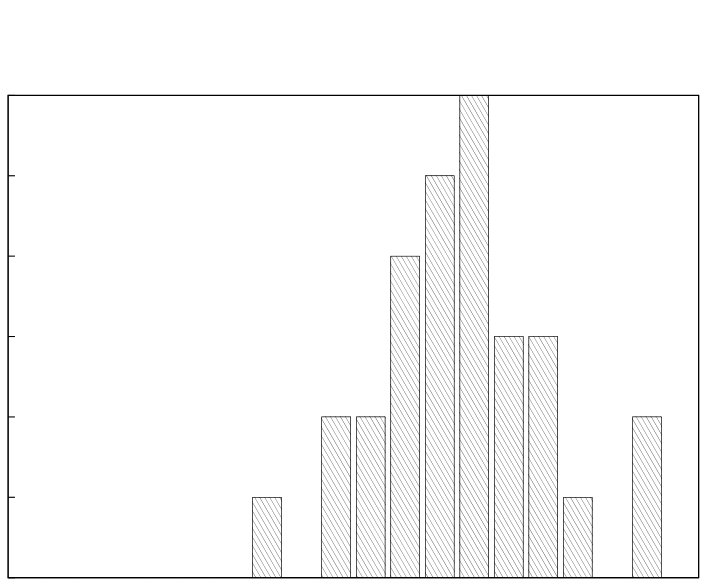

# MIT 6.824/6.5840 2010: Quiz 1: Official solutions

> Copied from the original: <https://pdos.csail.mit.edu/6.824/quizzes.html>. Text and figures are taken from the PDF as is; nothing was answered or rewritten. The original PDF is in this folder.

---

**Page 1**

&emsp;&emsp;&emsp;&emsp;&emsp;&emsp;&emsp;&emsp;Department of Electrical Engineering and Computer Science 
&emsp;&emsp;&emsp;&emsp;&emsp;&emsp;&emsp;MASSACHUSETTS INSTITUTE OF TECHNOLOGY

&emsp;&emsp;&emsp;&emsp;&emsp;**6.824 Distributed System Engineering: Spring 2010** 
&emsp;&emsp;&emsp;&emsp;&emsp;&emsp;&emsp;&emsp;**Quiz I Solutions**

&emsp;All problems are open-ended questions. In order to receive credit you must answer the question 
&emsp;as precisely as possible. You have 80 minutes to answer this quiz. 
&emsp;Write your name on this cover sheet AND at the bottom of each page of this booklet. 
&emsp;Some questions may be much harder than others. Read them all through first and attack them in 
&emsp;the order that allows you to make the most progress. If you find a question ambiguous, be sure 
&emsp;to write down any assumptions you make. Be neat. If we can’t understand your answer, we can’t 
&emsp;give you credit!

&emsp;&emsp;&emsp;&emsp;&emsp;&emsp;&emsp;&emsp;**THIS IS AN OPEN BOOK, OPEN NOTES QUIZ.**

&emsp;&emsp;&emsp;&emsp;&emsp;&emsp;**I (xx/26)**   **II (xx/21)**   **III (xx/49)**   **IV (xx/4)**   **Total (xx/100)**

**Name:**

---

**Page 2**

&emsp;&emsp;&emsp;&emsp;&emsp;&emsp;Grade histogram for Quiz 1

6

5

4

3

2

1

0 
&emsp;&emsp;&emsp;&emsp;&emsp;&emsp;&emsp;&emsp;96-100 
&emsp;&emsp;&emsp;91-9586-9081-8576-8071-7566-7061-6556-6051-5546-5041-4536-4031-3526-3021-2516-2011-15 
&emsp;6-10 
1-5

&emsp;&emsp;&emsp;&emsp;&emsp;&emsp;&emsp;&emsp;max   =   92 
&emsp;&emsp;&emsp;&emsp;&emsp;&emsp;&emsp;&emsp;median   =   66 
&emsp;&emsp;&emsp;&emsp;&emsp;&emsp;&emsp;&emsp;µ   =   66.0 
&emsp;&emsp;&emsp;&emsp;&emsp;&emsp;&emsp;&emsp;σ   =   12.2

---

**Page 3**

6.824 SPRING 2010, Quiz 1   **Page 3 of 12**

**I**   **YFS**

Working on Lab 4, Ben Bitdiddle adds a create function to his YFS client; the function is responsible for 
creating files. Ben wants to use multiple YFS clients so he also adds locking to his YFS client code. He uses 
a lock per inode and wraps each YFS client function with a call to the lock client’s acquire and release 
passing the inode’s inum as the argument. Here are some excerpts from yfs client.cc (error checking code 
omitted): 
yfs\_client::inum yfs\_client::ilookup(inum di, std::string name) 
{ 
std::string buf; 
yfs\_client::inum inum = 0; 
lc-\>acquire(di); 
ec-\>get(di, buf); 
... // parse buf and set inum if file found 
lc-\>release(di); 
return inum; 
}

int yfs\_client::create(inum di, std::string name, inum ci) 
{ 
std::string buf; 
lc-\>acquire(di); 
lc-\>acquire(ci); 
ec-\>get(di, buf); 
... // add (name, ci) pair to buf 
ec-\>put(di, buf); 
ec-\>put(ci, ""); 
lc-\>release(di); 
lc-\>release(ci); 
return OK; 
}

And from fuse.cc: 
yfs\_client::status fuseserver\_createhelper(fuse\_ino\_t parent, 
&emsp;const char \*name, mode\_t mode, struct fuse\_entry\_param \*e) 
{ 
e-\>ino = yfs-\>ilookup(parent, name); 
if (e-\>ino == 0) { 
&emsp;e-\>ino = random() \| 0x80000000; 
&emsp;yfs-\>create(parent, name, e-\>ino); 
} 
getattr(e-\>ino, e-\>attr); 
e-\>attr\_timeout = 0.0; 
e-\>entry\_timeout = 0.0; 
return OK; 
}

**Name:**

---

**Page 4**

6.824 SPRING 2010, Quiz 1   **Page 4 of 12**

&emsp;**1. \[8 points\]:** To Ben’s surprise his implementation fails the standard tests given by the 6.824 staff. 
&emsp;Describe a test on which Ben’s program will fail? How can Ben fix his code to ensure that his code 
&emsp;passes the tests? 
&emsp;**Answer:** If multiple threads are concurrently creating the same file in the same directory then it 
&emsp;is possible for fuseserver createhelper to create multiple files with the same name in the 
&emsp;directory. The following interleaving of instructions demonstrates the problem:

&emsp;Thread 1   Thread 2 
&emsp;e-\>ino = yfs-\>ilookup(parent, 
&emsp;&emsp;&emsp;&emsp;&emsp;&emsp;&emsp;&emsp;name); 
&emsp;&emsp;&emsp;&emsp;&emsp;&emsp;&emsp;&emsp;e-\>ino = yfs-\>ilookup(parent, name); 
&emsp;e-\>ino == 0 so execute: 
&emsp;yfs-\>create(parent, name, 
&emsp;&emsp;&emsp;&emsp;&emsp;&emsp;&emsp;&emsp;e-\>ino); 
&emsp;&emsp;&emsp;&emsp;&emsp;&emsp;&emsp;&emsp;e-\>ino == 0 so execute: 
&emsp;&emsp;&emsp;&emsp;&emsp;&emsp;&emsp;&emsp;yfs-\>create(parent, name, e-\>ino);

&emsp;To fix this,**Answer:**Ben needs to make the calls to yfs client::ilookup and 
&emsp;yfs client::create atomic in fuseserver createhelper. One way to do this is to cre- 
&emsp;ate a yfs client::ilookup wo function that is exactly like yfs client::ilookup but does 
&emsp;not take out any locks and have yfs client::create check, while holding the di lock, if the 
&emsp;file exists using yfs client::ilookup wo.

**Name:**

---

**Page 5**

6.824 SPRING 2010, Quiz 1   **Page 5 of 12**

In another attempt at correctness, Ben modifies his code in yfs client.cc as follows:

yfs\_client::inum yfs\_client::ilookup(inum di, std::string name) 
{ 
std::string buf; 
yfs\_client::inum inum = 0; 
lc-\>acquire(di);   // \<------------------ B 
ec-\>get(di, buf); 
... // parse buf and set inum if file found 
lc-\>release(di); 
return inum; 
}

int yfs\_client::create(inum di, std::string name, inum &ci) 
{ 
std::string buf; 
lc-\>acquire(di);   // \<------------------ A 
ci = ilookup(di, name); 
if (ci == 0) { 
&emsp;lc-\>acquire(ci); 
&emsp;ci = random() \| 0x80000000; 
&emsp;ec-\>get(di, buf); 
&emsp;... // add (name, ci) pair to buf 
&emsp;ec-\>put(di, buf); 
&emsp;ec-\>put(ci, ""); 
&emsp;lc-\>release(ci); 
} 
lc-\>release(di); 
return OK; 
}

And in fuse.cc: 
yfs\_client::status fuseserver\_createhelper(fuse\_ino\_t parent, 
&emsp;const char \*name, mode\_t mode, struct fuse\_entry\_param \*e) 
{ 
yfs-\>create(parent, name, e-\>ino); 
getattr(e-\>ino, e-\>attr); 
e-\>attr\_timeout = 0.0; 
e-\>entry\_timeout = 0.0; 
return OK; 
}

**Name:**

---

**Page 6**

6.824 SPRING 2010, Quiz 1   **Page 6 of 12**

&emsp;**2. \[6 points\]:** To his surprise his code still does not work; his code fails to create a file. What is the 
&emsp;problem and how can he fix it? 
&emsp;**Answer:** The code will deadlock because a lock for di will be taken on the line labeled A and then 
&emsp;the call to ilookup will take out the lock for di again on the line labeled B. 
&emsp;One way to fix this is to create a yfs client::ilookup wo function that is exactly like 
&emsp;yfs client::ilookup but does not take out any locks and have yfs client::create call 
&emsp;yfs client::ilookup wo instead of yfs client::ilookup.

Now Ben wants to simplify YFS by expanding the extent protocol from get, put, and remove to read, 
write, truncate, create, lookup, etc. Every file system operation (i.e., each fuse operation) will be 
handled by the extent server. The YFS client will be a proxy for the extent server.

&emsp;**3. \[6 points\]:** What are the advantages of executing the file system operations on the extent server? 
&emsp;Which functions/features can he remove from YFS using this scheme? 
&emsp;**Answer:** Executing all the file system operations on one server means that there is no longer any need 
&emsp;to have a lock server and the YFS clients do not have to worry about making calls to the lock server. 
&emsp;The extent server can use Pthread mutexes to lock critical sections.

&emsp;**4. \[6 points\]:** What are disadvantages of moving the file system operations out of the YFS client 
&emsp;and into the extent server? 
&emsp;**Answer:** Since one single machine handles all file system requests from all clients, the system pro- 
&emsp;posed by Ben will not be scalable. Even though the number of clients can grow, the processing ca- 
&emsp;pacity of the single extent server will remain constant. Ben’s scheme does not exploit the processing 
&emsp;capacity of the client machines to execute file operations.

**Name:**

---

**Page 7**

6.824 SPRING 2010, Quiz 1   **Page 7 of 12**

**II**   **Short questions**

&emsp;**5.**   **\[7 points\]:** An invocation o1.f(o2) on an RMI object o1 takes another RMI object o2 as an 
&emsp;argument. The method f may invoke a method on o2. The server executing f, however, may not 
&emsp;have heard about o2 before. How does Java RMI arrange that f can invoke a method on o2? What 
&emsp;information is in o2’s handle? Why is that enough for the runtime to do its job? 
&emsp;**Answer:** A reference to o2 is passed to the server executing f. This reference contains the URI of 
&emsp;o2 which consists of the host machine identifier (IP address or host name) and the object ID. The 
&emsp;URI allows the server executing f to uniquely name and find where o2 resides. In addition, the JVM 
&emsp;provides dynamic code loading which allows stubs to be dynamically loaded into the runtime; the 
&emsp;server executing f need not know anything about o2 prior to executing f.

&emsp;**6.**   **\[7 points\]:** Both TreadMarks and Tra use version vectors to maintain consistency, but Ivy as 
&emsp;described in Section 3.1 of the paper doesn’t. What in Ivy’s design allows it to avoid using version 
&emsp;vectors? 
&emsp;**Answer:** Ivy has a central server (the manager) that handles and serializes all requests and all data 
&emsp;movement. For writes, the manager ensures that all readers of a pages respond to the invalidation 
&emsp;request and arranges the movement of data to the writer before allowing the write to proceed. When 
&emsp;the writer receives the data, it knows that it has received the most recent version and no checks 
&emsp;requiring version vectors are necessary.

&emsp;**7. \[7 points\]:** Bayou cannot guarantee the order in which writes are committed is consistent with 
&emsp;the tentative order indicated by their timestamps. Using the calendar application, give a scenario with 
&emsp;a few devices synchronizing with each other that shows the committed order being different from the 
&emsp;tentative order. 
&emsp;**Answer:** Three devices (A, B, and C) need to be used to create such a scenario. All three devices 
&emsp;choose to schedule an appointment for 10am with 11am and 12pm as alternatives. The conflict reso- 
&emsp;lution procedure for all three devices is to choose 11am if 10am is not available and 12pm if 11am is 
&emsp;not available. First, A synchronizes with B; the tentative order is A getting the 10am slot and B the 
&emsp;11am slot. Second, C synchronize with the primary and permanently gets the 10am slot. Finally, A 
&emsp;synchronizes with the master and the final order will be C with the 10am slot, A with the 11am slot 
&emsp;and B with the 12pm slot.

**Name:**

---

**Page 8**

6.824 SPRING 2010, Quiz 1   **Page 8 of 12**

**III**   **Locking and consistency**

Alice P. Hacker wants to understand consistency better and explores it with an application, namely a par- 
allel program for solving the traveling salesman problem (TSP). She starts with the following sequential C 
program with a standard branch-and-bound algorithm:

// matrix that records for each town the distance "dis" to "totown" 
struct dist { 
&emsp;&emsp;&emsp;int totown; 
&emsp;&emsp;&emsp;int dis; 
} distance\[NRTOWNS\]\[NRTOWNS\] =   { 
#include "g.h" 
};

int path\[NRTOWNS\];   // the path tsp is working on 
int best\_path\[NRTOWNS\];// the shortest path found so far 
int min = 10000;   // length of the shortest path

// l is the number of cities on path 
// len is the length of the path 
tsp(l,len) 
{ 
&emsp;&emsp;&emsp;int e,me,i;

&emsp;&emsp;&emsp;if (len \>= min)   // prune? 
&emsp;&emsp;&emsp;&emsp;&emsp;&emsp;&emsp;return; 
&emsp;&emsp;&emsp;if (l == NRTOWNS-1) {   // found a shorter path? 
&emsp;&emsp;&emsp;&emsp;&emsp;&emsp;&emsp;min = len; 
&emsp;&emsp;&emsp;&emsp;&emsp;&emsp;&emsp;for (i = 0; i \< NRTOWNS; i++) best\_path\[i\] = path\[i\]; 
&emsp;&emsp;&emsp;} else { 
&emsp;&emsp;&emsp;&emsp;&emsp;&emsp;&emsp;me = path\[l\]; 
&emsp;&emsp;&emsp;&emsp;&emsp;&emsp;&emsp;for (i=0; i \< NRTOWNS; i++) { 
&emsp;&emsp;&emsp;&emsp;&emsp;&emsp;&emsp;&emsp;e = distance\[me\]\[i\].totown; 
&emsp;&emsp;&emsp;&emsp;&emsp;&emsp;&emsp;&emsp;if (!present(e,l)) {   // if e is not on path, branch 
&emsp;&emsp;&emsp;&emsp;&emsp;&emsp;&emsp;&emsp;path\[l+1\] = e; 
&emsp;&emsp;&emsp;&emsp;&emsp;&emsp;&emsp;&emsp;tsp(l+1, len + distance\[me\]\[i\].dis); 
&emsp;&emsp;&emsp;&emsp;&emsp;&emsp;&emsp;&emsp;} 
&emsp;&emsp;&emsp;&emsp;&emsp;&emsp;&emsp;} 
&emsp;&emsp;&emsp;} 
}

Alice runs the program by invoking tsp(0,0), which computes shortest path starting with city 0 (i.e., 
path\[0\] is 0). In the first invocation of tsp, tsp extends the path through all neighbors of 0, and for 
each neighbor it invokes itself recursively. If the path has a length larger than the length of the best path 
found so far, an invocation returns and doesn’t explore that path further, pruning the search.

**Name:**

---

**Page 9**

6.824 SPRING 2010, Quiz 1   **Page 9 of 12**

She parallelizes the program for a cache-coherent shared-memory multiprocessor. The parallel program first 
creates many jobs, each job consists of a partial path with 4 different cities on it. Once the program is done 
creating jobs, each processor invokes the following procedure worker:

struct job { 
int path\[NRTOWNS\]; 
} jobs\[NJOBS\] 
jobindex = 0;

worker() { 
int myj; 
while (jobindex \< NJOBS) { 
&emsp;myj = jobindex++; 
&emsp;path = jobs\[myj\].path   // copy the job’s partial path in my path 
&emsp;tsp(4, len(path)) 
} 
}

Each worker repeatedly grabs the next uncompleted job and invokes tsp to try to extend the path to a 
complete path. Each processor has its own copy of path, but jobs, jobindex, min, and best path 
are globally shared variables.

&emsp;**8. \[7 points\]:** Rewrite the procedure worker with locks so that this program will work correctly. 
&emsp;**Answer:** Both the reading and the writing of jobindex must be protected. One way of doing that 
&emsp;is as follows:

&emsp;lock jobi\_lock;

&emsp;worker() { 
&emsp;&emsp;int myj; 
&emsp;&emsp;acquire(jobi\_lock); 
&emsp;&emsp;while (jobindex \< NJOBS) { 
&emsp;&emsp;&emsp;myj = jobindex++; 
&emsp;&emsp;&emsp;release(jobi\_lock); 
&emsp;&emsp;&emsp;path = jobs\[myj\].path   // copy the job’s partial path in my path 
&emsp;&emsp;&emsp;tsp(4, len(path)) 
&emsp;&emsp;&emsp;acquire(jobi\_lock); 
&emsp;&emsp;} 
&emsp;&emsp;release(jobi\_lock); 
&emsp;}

**Name:**

---

**Page 10**

6.824 SPRING 2010, Quiz 1   **Page 10 of 12**

&emsp;**9. \[9 points\]:** Annotate/modify the procedure tsp on the previous page with read/write locks for the 
&emsp;shared variable min so that the parallel program will work correctly. (Read/write locks have an extra 
&emsp;argument for acquire that says whether to grab the lock in read mode or write mode. If the lock is 
&emsp;acquired in read mode, other processors can also acquire it in read mode, but a processor acquiring in 
&emsp;write mode will be delayed until all readers have released their lock.) 
&emsp;**Answer:** The reading and writing of min must be protected, but care must be taken when writing 
&emsp;min: min may only be written if the value being written is smaller than the original value of min. In 
&emsp;other words, the check of len \>= min and the write to min must be atomic. There are two ways 
&emsp;to accomplish this: 1) upgrading a read-write lock; or 2) rechecking. A holder of a read-write lock in 
&emsp;read mode can upgrade from read to write mode—a lock upgrade guarantees that no other thread is 
&emsp;holding the same lock in read mode and that no other thread had the lock in write mode between the 
&emsp;read and the upgrade. An alternative solution is to to recheck min before it is modified to make sure 
&emsp;it is still smaller than len. The code for the upgrade solution is as follows: 
&emsp;&emsp;&emsp;&emsp;&emsp;acquire(min\_lock, READ); 
&emsp;&emsp;&emsp;&emsp;&emsp;if (len \>= min)   // prune? 
&emsp;&emsp;&emsp;&emsp;&emsp;&emsp;&emsp;&emsp;release(min\_lock): 
&emsp;&emsp;&emsp;&emsp;&emsp;&emsp;&emsp;&emsp;return; 
&emsp;&emsp;&emsp;&emsp;&emsp;if (l == NRTOWNS-1) {   // found a shorter path? 
&emsp;&emsp;&emsp;&emsp;&emsp;&emsp;&emsp;&emsp;acquire(min\_lock, WRITE); // This is the upgrade 
&emsp;&emsp;&emsp;&emsp;&emsp;&emsp;&emsp;&emsp;min = len; 
&emsp;&emsp;&emsp;&emsp;&emsp;&emsp;&emsp;&emsp;for (i = 0; i \< NRTOWNS; i++) best\_path\[i\] = path\[i\]; 
&emsp;&emsp;&emsp;&emsp;&emsp;&emsp;&emsp;&emsp;release(min\_lock); 
&emsp;&emsp;&emsp;&emsp;&emsp;} else { 
&emsp;&emsp;&emsp;&emsp;&emsp;&emsp;&emsp;&emsp;release(min\_lock);

&emsp;**10. \[5 points\]:** Why is it better to use read/write locks instead of locks that don’t distinguish between 
&emsp;read and write modes? Will the TSP program run faster or slower with read/write locks and why? 
&emsp;**Answer:** A read/write lock allows multiple threads to execute read-only critical sections in parallel; 
&emsp;a regular lock would serialize the execution of all critical sections. TSP will run faster, because tsp 
&emsp;reads min much more often than writing it, and those reads can now proceed in parallel.

Assume that you annotated all shared variables (including, for example, best path) with locks and that 
the program functions correctly on a cache-coherent shared-memory multiprocessor. 
Alice notices that the Athena clusters are seldom used and together they have many more free processors 
than her shared-memory multiprocessor. She installs TreadMarks and runs the parallel program on it. She 
runs TreadMarks with lazy release consistency.

&emsp;**11. \[7 points\]:** Will the program compute the correct answer? (Briefly explain your answer.) 
&emsp;**Answer:** Yes, the program is appropriately labeled with locks. A properly labeled program on release- 
&emsp;consistent memory executes with the same behavior as on a sequentially-consistent memory.

**Name:**

---

**Page 11**

6.824 SPRING 2010, Quiz 1   **Page 11 of 12**

Alice observes that the performance on TreadMarks isn’t great, because each invocation of the procedure 
tsp must take out a lock to read min. To reduce this overhead, she changes the program as follows. He 
modifies the program to use two mins, one per processor (pmin) and one shared (min, as before). Before 
a worker invokes tsp, it copies the shared min into the per processor pmin. She modifies tsp to read the 
per processor pmin at the pruning line. Also, when tsp finds a shorter path, he modifies tsp to read the 
shared min and if the shared min is larger than pmin, he updates the shared min.

&emsp;**12. \[7 points\]:** Will the program compute the correct answer on TreadMarks? (Briefly explain your 
&emsp;answer.) 
&emsp;**Answer:** Yes, even though the program is not properly labeled. A processor may update min while 
&emsp;other processors may keep using pmin, which now contains a stale value. However, that doesn’t 
&emsp;result in incorrect behavior, because if a new path is found, a processor reads min again, and updates 
&emsp;it only if len is indeed smaller than min. In addition, no path will be pruned too early, because pmin 
&emsp;is always smaller or equal to min. So, the correct value of min will be computed.

&emsp;**13. \[7 points\]:** Will the program with the pmin hack run faster than the program without the hack 
&emsp;on TreadMarks? (Briefly explain your answer.) 
&emsp;**Answer:** Yes. A typical job will take out a lock only once, namely to read min at the beginning of 
&emsp;the job and update pmin. So, no locks are acquired during a job and all communication associated 
&emsp;with locks during a job is avoided. Only when min must be updated, will communication happen, but 
&emsp;that will happen seldom, because the bound is strictly decreasing and will decrease quickly initially. 
&emsp;A job may do a few extra recursions of tsp, but that should have a small effect on performance 
&emsp;for three reasons: there are many jobs and each job starts with an up-to-date version of min; min 
&emsp;changes infrequently (initially it will be updated a few times quickly, but then very infrequently); and 
&emsp;communication in a network of workstation is very expensive (i.e., it stalls the computation for many 
&emsp;cycles). The extra work is much less than the cycles saved by avoiding communication.

&emsp;**14. \[7 points\]:** Alice also runs the pmin version on TreadMarks with eager release consistency. Will 
&emsp;this version run faster or slower than with lazy release consistency? (Briefly explain your answer.) 
&emsp;**Answer:** The paper reports on this experiment and shows that eager is slightly faster (figure 9 shows 
&emsp;that eager achieves a higher speedup). As described in Section 5.2, the TSP in the paper uses the same 
&emsp;private minimum hack. The reason eager performs better is that 1) min is immediately updated on 
&emsp;all processors when it is changed on one processor (thereby resulting in more immediate pruning of 
&emsp;longer paths) and 2) the total communication is about the same for both eager and lazy (see figures 
&emsp;10, 11, and 12).

**Name:**

---

**Page 12**

6.824 SPRING 2010, Quiz 1   **Page 12 of 12**

**IV**   **6.824**

&emsp;**15. \[2 points\]:** Describe the most memorable error you have made so far in one of the labs. (Provide 
&emsp;enough detail so that we can understand your answer.) 
&emsp;&emsp;Most common answers:

&emsp;&emsp;concurrency 
&emsp;&emsp;problems with FUSE 
&emsp;&emsp;problems with the RPC library; RPC library does not type check arguments

We would like to hear your opinions about 6.824, so please answer the following two questions. (Any 
relevant answer will receive full credit!)

&emsp;**16. \[1 points\]:** What is the best aspect of 6.824? 
&emsp;&emsp;Most common answers:

&emsp;&emsp;papers 
&emsp;&emsp;labs

&emsp;**17. \[1 points\]:** What is the worst aspect of 6.824? 
&emsp;&emsp;Most common answers:

&emsp;&emsp;FUSE 
&emsp;&emsp;distributed debugging 
&emsp;&emsp;questions at beginning of class 
&emsp;&emsp;some papers are old 
&emsp;&emsp;labs too open ended 
&emsp;&emsp;quiz

&emsp;&emsp;&emsp;&emsp;&emsp;&emsp;&emsp;&emsp;End of Quiz I

**Name:**

