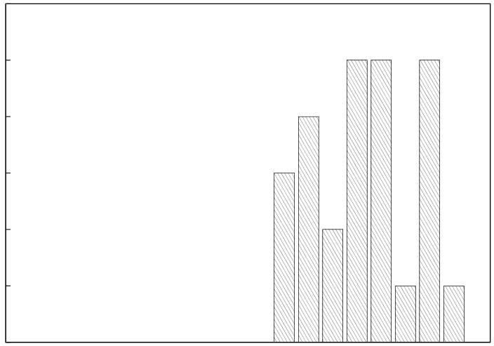
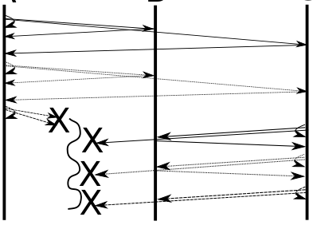
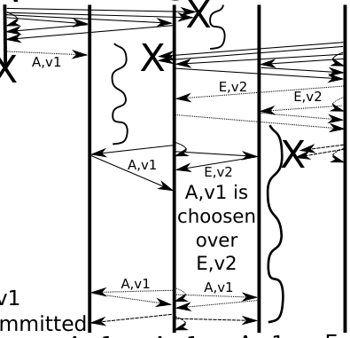

# MIT 6.824/6.5840 2010: Quiz 2: Official solutions

> Copied from the original: <https://pdos.csail.mit.edu/6.824/quizzes.html>. Text and figures are taken from the PDF as is; nothing was answered or rewritten. The original PDF is in this folder.

---

**Page 1**

&emsp;&emsp;&emsp;&emsp;&emsp;&emsp;&emsp;&emsp;Department of Electrical Engineering and Computer Science 
&emsp;&emsp;&emsp;&emsp;&emsp;&emsp;&emsp;MASSACHUSETTS INSTITUTE OF TECHNOLOGY

&emsp;&emsp;&emsp;&emsp;&emsp;**6.824 Distributed System Engineering: Spring 2010** 
&emsp;&emsp;&emsp;&emsp;&emsp;&emsp;&emsp;&emsp;**Quiz II Solutions**

&emsp;All problems are open-ended questions. In order to receive credit you must answer the question as 
&emsp;precisely as possible. The quiz is designed to take 80 minutes, but you have two hours to complete 
&emsp;it. 
&emsp;Write your name on this cover sheet AND at the bottom of each page of this booklet. 
&emsp;Some questions may be much harder than others. Read them all through first and attack them in 
&emsp;the order that allows you to make the most progress. If you find a question ambiguous, be sure 
&emsp;to write down any assumptions you make. Be neat. If we can’t understand your answer, we can’t 
&emsp;give you credit!

&emsp;&emsp;&emsp;&emsp;&emsp;&emsp;&emsp;&emsp;**THIS IS AN OPEN BOOK, OPEN NOTES QUIZ.**

&emsp;&emsp;&emsp;&emsp;&emsp;&emsp;**I (xx/36)**   **II (xx/14)**   **III (xx/48)**   **IV (xx/2)**   **Total (xx/100)**

**Name:**

---

**Page 2**

&emsp;&emsp;&emsp;&emsp;&emsp;&emsp;Grade histogram for Quiz 2

6

5

4

3

2

1

0 
&emsp;&emsp;&emsp;&emsp;&emsp;&emsp;&emsp;&emsp;96-100 
&emsp;&emsp;&emsp;91-9586-9081-8576-8071-7566-7061-6556-6051-5546-5041-4536-4031-3526-3021-2516-2011-15 
&emsp;6-10 
1-5

&emsp;&emsp;&emsp;&emsp;&emsp;&emsp;&emsp;&emsp;max   =   92 
&emsp;&emsp;&emsp;&emsp;&emsp;&emsp;&emsp;&emsp;median   =   75 
&emsp;&emsp;&emsp;&emsp;&emsp;&emsp;&emsp;&emsp;µ   =   74.7 
&emsp;&emsp;&emsp;&emsp;&emsp;&emsp;&emsp;&emsp;σ   =   9.9

---

**Page 3**

6.824 SPRING 2010, Quiz 2   **Page 3 of 13**

**I**   **YFS**

&emsp;**1. \[6 points\]:** Ben is working on Lab 6 and is having problems with his create function. Here it 
&emsp;is omitting error handling code:

&emsp;int yfs\_client::create(inum di, std::string name, int dir, inum &ci) 
&emsp;{ 
&emsp;&emsp;std::string extent; 
&emsp;&emsp;lc-\>acquire(di); 
&emsp;&emsp;ci = ilookup(di, name); 
&emsp;&emsp;if (!ci) { 
&emsp;&emsp;&emsp;ci = random() & (˜0x80000000); 
&emsp;&emsp;&emsp;if (!dir) 
&emsp;&emsp;&emsp;&emsp;ci \|= 0x80000000; 
&emsp;&emsp;&emsp;ec-\>get(di, extent); 
&emsp;&emsp;&emsp;/\* add name and ci to extent \*/ 
&emsp;&emsp;&emsp;ec-\>put(di, extent); 
&emsp;&emsp;&emsp;ec-\>put(ci, ""); 
&emsp;&emsp;} 
&emsp;&emsp;lc-\>release(di); 
&emsp;&emsp;return OK; 
&emsp;}

&emsp;Ben’s code passed all test cases when he turned in Lab 5, but with his Lab 6 additions he can’t create 
&emsp;files correctly. Ben starts two yfs clients, yfs1 and yfs2, creates a file in yfs1 and verifies that it 
&emsp;is created correctly; however, he can’t open the file in yfs2. What is he doing wrong? Why did his 
&emsp;code work in Lab 5 and not in Lab 6? 
&emsp;**Answer:** Ben must add lc-\>acquire(ci) and lc-\>release(ci), so that on an invalidate for 
&emsp;lock ci the corresponding extent will be flushed.

**Name:**

---

**Page 4**

6.824 SPRING 2010, Quiz 2   **Page 4 of 13**

&emsp;**2. \[6 points\]:** Here is the heartbeat handler function that responds to a heartbeat RPC:

&emsp;paxos\_protocol::status 
&emsp;config::heartbeat(std::string m, unsigned vid, int &r) 
&emsp;{ 
&emsp;&emsp;assert(pthread\_mutex\_lock(&cfg\_mutex)==0); 
&emsp;&emsp;int ret = paxos\_protocol::ERR; 
&emsp;&emsp;r = (int) myvid; 
&emsp;&emsp;printf("heartbeat from %s(%d) myvid %d\\n", m.c\_str(), vid, myvid); 
&emsp;&emsp;if (vid == myvid) { 
&emsp;&emsp;&emsp;ret = paxos\_protocol::OK; 
&emsp;&emsp;} else if (pro-\>isrunning()) { 
&emsp;&emsp;&emsp;assert (vid == myvid + 1 \|\| vid + 1 == myvid); 
&emsp;&emsp;&emsp;ret = paxos\_protocol::OK; 
&emsp;&emsp;} else { 
&emsp;&emsp;&emsp;ret = paxos\_protocol::ERR; 
&emsp;&emsp;} 
&emsp;&emsp;assert(pthread\_mutex\_unlock(&cfg\_mutex)==0); 
&emsp;&emsp;return ret; 
&emsp;}

&emsp;Below is a list of events triggered by node C trying to join. The starting view is 2 and contains A and 
&emsp;B where A is the primary;

&emsp;&emsp;**–** C asks A to join. 
&emsp;&emsp;**–** A starts Paxos to decide on view 3 with A,B,C in the view; A goes through the prepare and 
&emsp;&emsp;&emsp;accept phases. 
&emsp;&emsp;**–** In the decide phase, A sends a decidereq to itself and moves to view 3. 
&emsp;&emsp;**–** B’s heartbeat timer expires and the config code sends a heartbeat to A. 
&emsp;&emsp;**–** A sends a decidereq to B. 
&emsp;&emsp;**–** A receives the heartbeat from B and replies with   . 
&emsp;&emsp;**–** B receives the decidereq and moves to view 3. 
&emsp;&emsp;**–** B receives the response to the heartbeat from A.

&emsp;Fill in the blank, what will A’s heartbeat RPC handler (the function above) return? Circle the line of 
&emsp;code that assigns the return value to ret in the code above. 
&emsp;**Answer:** It will reply with OK, since A is running Paxos, and pro-\>isrunning() will return true.

**Name:**

---

**Page 5**

6.824 SPRING 2010, Quiz 2   **Page 5 of 13**

&emsp;**3. \[8 points\]:** The high load on athena.lcs.mit.edu this year has revealed a bug in the YFS provided 
&emsp;code. The problem is a race between the heartbeat RPC and the Paxos decide RPC. Below is a list of 
&emsp;events that leads to this race. The starting view is 2 and contains A and B where A is the primary; 
&emsp;node C is trying to join.

&emsp;&emsp;**–** C asks A to join. 
&emsp;&emsp;**–** A starts Paxos to decide on view 3 with A,B,C in the view; A goes through the prepare and 
&emsp;&emsp;&emsp;accept phases. 
&emsp;&emsp;**–** In the decide phase, A sends a decidereq to itself and moves to view 3. 
&emsp;&emsp;**–** A’s heartbeat timer expires and the config code sends a heartbeat to B. 
&emsp;&emsp;**–** A sends a decidereq to B. 
&emsp;&emsp;**–** B first receives the heartbeat and replies with ERR, since it is still in view number 2. 
&emsp;&emsp;**–** B then receives the decidereq and moves to view 3. 
&emsp;&emsp;**–** A receives the response to the heartbeat from B and starts Paxos again to remove B from view 3.

&emsp;How should the YFS code be changed to address this race so that B is not eliminated from the view? 
&emsp;**Answer:** A few different solutions are possible. For example, A can sends the decidereq to itself 
&emsp;last, avoiding the race. As another example, A can note that it is running the proposer and return OK 
&emsp;to B’s hearbeat in that case.

**Name:**

---

**Page 6**

6.824 SPRING 2010, Quiz 2   **Page 6 of 13**

&emsp;**4.**   **\[8 points\]:** Ben suggests eliminating sequence numbers in the YFS RSM protocol. He plans 
&emsp;to remove sequence numbers sent in the RPCs between the lock server primary and the lock server 
&emsp;backups. Give an argument why Ben’s proposed change is correct or incorrect. 
&emsp;**Answer:** The sequence numbers in the replication protocol between the primary and backups can be 
&emsp;eliminated, because the primary won’t send the next request to the backups until it has received results 
&emsp;from the backups for the current request.

&emsp;**Answer:** The sequence numbers on lock requests cannot be eliminated, because the backups may 
&emsp;have processed the lock request, but the client may not learn about the result because the primary 
&emsp;may fail before responding to the client. In that case, the client will retry and resend its request. 
&emsp;The replicated lock service must be able to detect that this request is a retry, so that it can respond 
&emsp;appropriately.

&emsp;**5. \[8 points\]:** After every view change, the YFS lock servers choose the primary according to these 
&emsp;rules: If the primary in the previous view is a member of the new view, then it will stay the primary. 
&emsp;Otherwise, the node with the lowest-numbered ID of the previous view will be the new primary. In 
&emsp;either case, the new primary will be a node from the previous view. 
&emsp;Ben proposes to simplify the rule so that the lock servers always choose the node with the smallest- 
&emsp;numbered ID as the primary. Give a scenario that shows why the simplified rule isn’t a good idea. 
&emsp;(Draw a timing diagram with a brief explanation.) 
&emsp;**Answer:** Assume 3 nodes, A, B, and C, with A being the lowest ID. A, B, and C are in a view 
&emsp;processing requests. A fails. B and C form a new view, and process new requests, resulting in a lock 
&emsp;table L. A rejoins, it will be the new primary and with B’s simple rule, B and C download A’s lock 
&emsp;state, losing the state of L.

**Name:**

---

**Page 7**

6.824 SPRING 2010, Quiz 2   **Page 7 of 13**

**II**   **Paxos in YFS**

Here are the proposer run and prepare functions omitting all error handling code: 
1   bool proposer::run(int instance, std::vector\<std::string\> c\_nodes, 
2   std::string newv) { 
3   std::vector\<std::string\> accepts, nodes; 
4   std::string v; 
5   bool r = false; 
6   pthread\_mutex\_lock(&pxs\_mutex); 
7   /\* call setn() and set any global state \*/ 
8   v.clear(); 
9   if (prepare(instance, accepts, c\_nodes, v)) { 
10   if (majority(c\_nodes, accepts)) { 
11   if (v.size() == 0) 
12   v = newv; 
13   nodes = accepts; 
14   accepts.clear(); 
15   accept(instance, accepts, nodes, v); 
16   if (majority(c\_nodes, accepts)) { 
17   decide(instance, accepts, v); 
18   r = true; 
19   } 
20   } 
21   } 
22   pthread\_mutex\_unlock(&pxs\_mutex); 
23   return r; 
24 } 
25 bool proposer::prepare(unsigned instance, std::vector\<std::string\> &accepts, 
26   std::vector\<std::string\> nodes, std::string &v) { 
27   prop\_t highn; 
28   highn.n = 0; 
29   highn.m = me; 
30   for (unsigned i = 0; i \< nodes.size(); i++) { 
31   paxos\_protocol::preparearg a; 
32   paxos\_protocol::prepareres r; 
33   /\* setup argument a, zero out r \*/ 
34   pthread\_mutex\_unlock(&pxs\_mutex); 
35   handle(nodes\[i\]).get\_rpcc()-\>call(paxos\_protocol::preparereq, 
36   me, a, r, rpcc::to(1000)); 
37   pthread\_mutex\_lock(&pxs\_mutex); 
38   if (r.oldinstance \|\| !r.accept) { 
39   /\* handle old instance or not accepted \*/ 
40   } else { 
41   accepts.push\_back(nodes\[i\]); 
42   if (r.n\_a \> highn) { 
43   highn = r.n\_a; 
44   v = r.v\_a; 
45   } 
46   } 
47   } 
48   return true; 
49 }

**Name:**

---

**Page 8**

6.824 SPRING 2010, Quiz 2   **Page 8 of 13**

&emsp;**6. \[6 points\]:** Ben removes lines 42 through 45; Alyssa thinks that this change is a bad idea. Give 
&emsp;a scenario that shows it is a bad idea to remove those lines of code. (Draw a timing diagram with a 
&emsp;brief explanation.) 
&emsp;&emsp;&emsp;&emsp;&emsp;&emsp;&emsp;&emsp;Prepare 
&emsp;&emsp;&emsp;&emsp;&emsp;&emsp;ABC 
&emsp;&emsp;&emsp;&emsp;&emsp;&emsp;&emsp;&emsp;Accept

&emsp;&emsp;&emsp;&emsp;&emsp;&emsp;&emsp;&emsp;Decide

&emsp;&emsp;&emsp;&emsp;&emsp;1

&emsp;&emsp;&emsp;&emsp;&emsp;&emsp;&emsp;&emsp;2 
&emsp;**Answer:** 
&emsp;The scenario needs to include two proposing nodes. In the above diagram, node A proposes value v1 
&emsp;and C value v2. A proposes and sends accepts, and nodes A, B, C accept. A sends decides to A, B, C 
&emsp;but is partitioned and only A decides on v1 (marked as time 1 on the diagram). Now C proposes v2 to 
&emsp;A,B,C. B and C reply with v1 in their proposes reply messages, but node C ignores them and sends 
&emsp;accepts on v2; node B, C accept. C sends out decides to B, C (marked as time 2 on the diagram). 
&emsp;Now when the partition heals, A and C have decided on two different values.

**Name:**

---

**Page 9**

6.824 SPRING 2010, Quiz 2   **Page 9 of 13**

&emsp;**7. \[8 points\]:** Ben rethinks the situation and replaces lines 42 through 45 with these lines instead: 
&emsp;&emsp;&emsp;&emsp;if (r.n\_a.n \> 0) 
&emsp;&emsp;&emsp;&emsp;&emsp;v = r.v\_a; 
&emsp;Give a scenario that shows that Paxos fails to meet its specification with Ben’s change. (Draw a 
&emsp;diagram showing the Paxos messages.) 
&emsp;&emsp;&emsp;&emsp;&emsp;&emsp;AB   C   D   E

&emsp;&emsp;&emsp;&emsp;&emsp;&emsp;&emsp;&emsp;Prepare 
&emsp;&emsp;&emsp;&emsp;&emsp;&emsp;&emsp;&emsp;Accept 
&emsp;&emsp;&emsp;&emsp;&emsp;&emsp;&emsp;&emsp;Decide

&emsp;&emsp;&emsp;&emsp;&emsp;&emsp;&emsp;&emsp;E,v2 committed

&emsp;&emsp;&emsp;&emsp;&emsp;A,v1 
&emsp;&emsp;&emsp;&emsp;&emsp;&emsp;&emsp;&emsp;A,v1A,v1A,v1E,v2 
&emsp;**Answer:** 
&emsp;The scenario must again involve two concurrent proposers. With the change the protocol will not 
&emsp;stick to the highestest-numbered proposal. One proposer may chose a lowered-number proposal 
&emsp;while another proposer may chose a higher-numbered proposal. As a a result, proposers commit to 
&emsp;different values. The timing diagram illustrates an example.

**Name:**

---

**Page 10**

6.824 SPRING 2010, Quiz 2   **Page 10 of 13**

**III**   **Short paper questions**

&emsp;**8. \[6 points\]:** Consider the mailer system written for Argus as described on pages 398–400 of the 
&emsp;paper. Suppose Alyssa sends an email to a list (alyssa, bob, and charles), while at the same time a 
&emsp;system administrator is creating an account for charles (using add user). Given that mailboxes for 
&emsp;each user may be on different machines and Charles’s mailbox may exist or not, what are the possible 
&emsp;outcomes of who will receive Alyssa’s message? (Explain your answer briefly.) 
&emsp;**Answer:** The mailer will deliver to all three or none, because of the two-phase commit protocol and 
&emsp;the subactions that Argus uses.

&emsp;**9. \[6 points\]:** A local bank runs a hypervisor-based fault tolerant system as described by Bressoud 
&emsp;and Schneider. One night the cleaner trips over the cables in the machine room and accidentally 
&emsp;disconnects the primary from the backup (but both can still communicate with the shared disk). Does 
&emsp;the system keep operating correctly? (Explain your answer briefly.) 
&emsp;**Answer:** No. Because the communication is broken, the backup will assume the primary has failed, 
&emsp;and thus become a primary. Now the system runs with two primaries, both writing to the shared disk.

&emsp;**10. \[6 points\]:** The same cleaner trips over a wire in a Frangipanni system (as described by Thekkath 
&emsp;et al.) and partitions the network. Could more than one file server, in different partitions, successfully 
&emsp;acquire the same lock concurrently and perform updates? (Explain your answer briefly.) 
&emsp;**Answer:** No. Only the partition with the majority of the nodes will have a lock server that responds 
&emsp;to lock requests, and the server in that partition is able to acquire the lock. In addition, the system’s 
&emsp;use of leases on locks ensures that locks will be “released” after the lease time expires.

**Name:**

---

**Page 11**

6.824 SPRING 2010, Quiz 2   **Page 11 of 13**

&emsp;**11. \[6 points\]:** Given the protocol in the Chord paper, is lookup(k) guaranteed to return the IP 
&emsp;address of the node that stores k? (Explain your answer briefly.) 
&emsp;**Answer:** No. During stabilization, a node responsible for a key may not have that key yet. The 
&emsp;application is supposed to retry when a lookup fails.

&emsp;**12.**   **\[6 points\]:** Alyssa modifies the PBFT protocol described by Castro and Liskov as follows. 
&emsp;Instead of sending a set of 2f+1 responses to the client, she sends only f+1. Describe a scenario under 
&emsp;which Byzantine nodes can fool the client. (Explain your answer briefly.) 
&emsp;**Answer:** The paper describes a slightly different protocol than the lecture notes, but they boil down 
&emsp;to the same thing. With f+1 responses, the client cannot decide what the valid response is from the 
&emsp;f+1. The f faulty nodes can outvote the valid response.

&emsp;**13. \[6 points\]:** Alyssa adds a SUNDR-like feature to PBFT. Clients know the public keys of all other 
&emsp;clients that are using the system. A client signs the data before sending it to the PBFT RSM—you 
&emsp;may assume that clients are not compromised. After a client receives n responses from the RSM, the 
&emsp;client verifies the responses with the public key of the client. How many responses at minimum must 
&emsp;a client receive before the client knows it has received a correct response (i.e., meeting the specs of a 
&emsp;non-faulty replicated state machine)? (Explain your answer briefly.) 
&emsp;**Answer:** The client can verify which response has valid data (i.e., signed by another client.), but the 
&emsp;client must still receive 2f+1 responses to ensure that it can determine the order for responses.

**Name:**

---

**Page 12**

6.824 SPRING 2010, Quiz 2   **Page 12 of 13**

&emsp;**14. \[6 points\]:** Alyssa logs in to Yahoo!, updates her entry in the user database, and views her entry. 
&emsp;Sketch the application code for Alyssa’s update and read operations in terms of the primitives listed 
&emsp;in Section 2.2 of the PNUTS paper. The code must meet the user database specification described in 
&emsp;Section 4. (Sketch the pseudocode.) 
&emsp;**Answer:** Alyssa update to her profile: 
&emsp;v = write(profile) 
&emsp;read-critical(v, profile)

&emsp;**15. \[6 points\]:** Continuing from the previous question, describe a scenario under which Ben might 
&emsp;not see Alyssa’s change, even if he looks up Alyssa’s page after Alyssa made the change. (Draw a 
&emsp;timing diagram with a brief explanation.) 
&emsp;**Answer:** Ben’s code uses read-any(Alyssa’s profile). If Alyssa updates her profile, and if the network 
&emsp;between Ben and Alyssa partitions, any-read may read Alyssa’s profile from a storage node in Ben’s 
&emsp;partition that hasn’t been updated yet.

**Name:**

---

**Page 13**

6.824 SPRING 2010, Quiz 2   **Page 13 of 13**

**IV**   **6.824**

&emsp;**16. \[2 points\]:** Did you learn anything in 6.824? Please give a score on a scale from 0 (nothing) to 
&emsp;10 (more than I had hoped for), and briefly explain. 
&emsp;**Answer:** Thanks for taking the class! Enjoy the sumer.

&emsp;&emsp;&emsp;&emsp;&emsp;&emsp;&emsp;&emsp;End of Quiz II

**Name:**

