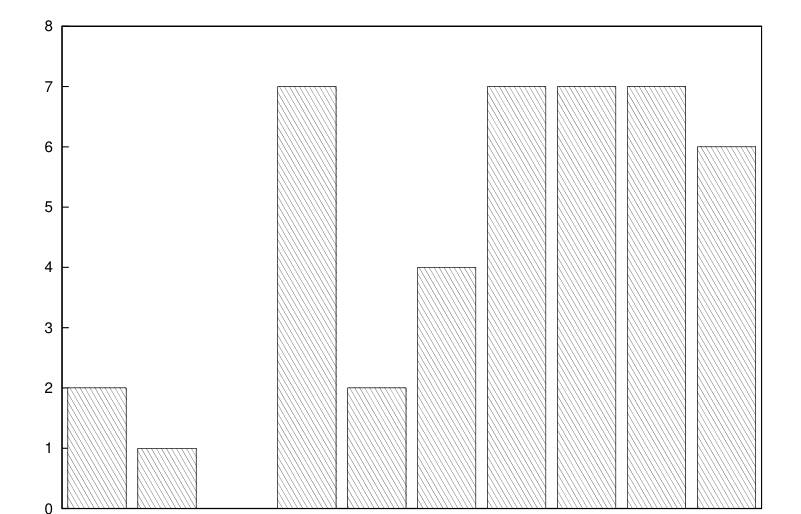

# MIT 6.824/6.5840 2011: Quiz 1: Official solutions

> Copied from the original: <https://pdos.csail.mit.edu/6.824/quizzes.html>. Text and figures are taken from the PDF as is; nothing was answered or rewritten. The original PDF is in this folder.

---

**Page 1**

&emsp;&emsp;&emsp;&emsp;Department of Electrical Engineering and Computer Science 
&emsp;&emsp;MASSACHUSETTS INSTITUTE OF TECHNOLOGY

**6.824 Distributed System Engineering: Spring 2011** 
&emsp;&emsp;&emsp;&emsp;**Quiz I Solutions**

---

**Page 2**

&emsp;&emsp;&emsp;&emsp;&emsp;&emsp;&emsp;Grade histogram for Quiz 1

&emsp;&emsp;&emsp;&emsp;&emsp;&emsp;&emsp;&emsp;96-100 
&emsp;51-55   56-60   61-65   66-70   71-75   76-80   81-85   86-90   91-95

&emsp;&emsp;&emsp;&emsp;&emsp;&emsp;&emsp;&emsp;min   =   52 
&emsp;&emsp;&emsp;&emsp;&emsp;&emsp;&emsp;&emsp;max=   100 
&emsp;&emsp;&emsp;&emsp;&emsp;&emsp;&emsp;&emsp;median   =   82 
&emsp;&emsp;&emsp;&emsp;&emsp;&emsp;&emsp;&emsp;average   =   82 
&emsp;&emsp;&emsp;&emsp;&emsp;&emsp;&emsp;&emsp;σ   =   12

---

**Page 3**

6.824 Spring 2011, Quiz 1 Solutions   **Page 3 of 10**

**I**   **Distributed Shared Memory**

You are running the distributed shared memory system described in Memory Coherence in Shared Virtual 
Memory Systems, by Li and Hudak. You’re using the version described in Section 3.1. 
You’re writing simple lock-like code for mutual exclusion. On computer C1 you execute this program:

x = 1 
if(y == 0) 
&emsp;print "C1 won"

On computer C2 you execute:

y = 1 
if(x == 0) 
&emsp;print "C2 won"

You start the two programs at roughly the same time. Variables x and y start out with value zero. The 
compiler generates machine code that references x and y exactly as shown in the above source code—the 
compiler does not re-order variable references, or eliminate them, or reference variables except as implied 
by the source code. You should assume that the manager is on a third computer, separate from C1 and C2. 
Assume that the invalidate() function waits for acknowledgments indicating that all computers in the 
copy set have invalidated the page. Assume that x and y are on different pages.

&emsp;**1. \[9 points\]:** Which of the following outputs are possible? 
&emsp;&emsp;**A.** neither computer prints anything 
&emsp;&emsp;**B.** C1 prints “C1 won”, C2 prints nothing 
&emsp;&emsp;**C.** C1 prints nothing, C2 prints “C2 won” 
&emsp;&emsp;**D.** C1 prints “C1 won”, C2 prints “C2 won”

**Answer:** A, B, and C. D is not possible: if C2 prints “C2 won,” then its read of x came before C1’s write 
of X, and thus C2’s assignment to y came before C1’s read of y, so C1 should have seen y==1 instead of 
y==0. The “came before” reasoning depends on the distributed shared memory system invalidating readable 
copies of pages before it allows a write.

---

**Page 4**

6.824 Spring 2011, Quiz 1 Solutions   **Page 4 of 10**

&emsp;**2. \[9 points\]:** Suppose both x and y are on the same page, and that no other data is on that page. 
&emsp;You execute the programs, and see that afterwards C1 is the owner of the page, and that C2 is not in 
&emsp;the page’s copy set on the manager. Give an example execution in which that would happen.

**Answer:** C2’s program finishes before C1’s program starts. 
Now suppose that invalidate() does **not** wait for acknowledgements; it just sends a message to each 
computer in the copy set and returns. These messages are reliable; you can think of them as RPCs sent by a 
background thread.

&emsp;**3. \[9 points\]:** Which of the following outputs are possible, given that invalidate() does not 
&emsp;wait?

&emsp;&emsp;**A.** neither computer prints anything 
&emsp;&emsp;**B.** C1 prints “C1 won”, C2 prints nothing 
&emsp;&emsp;**C.** C1 prints nothing, C2 prints “C2 won” 
&emsp;&emsp;**D.** C1 prints “C1 won”, C2 prints “C2 won”

**Answer:** A, B, C, and D.

---

**Page 5**

6.824 Spring 2011, Quiz 1 Solutions   **Page 5 of 10**

**II**   **Logical Clocks**

Recall the logical clocks that Bayou uses to keep track of causality: to ensure that if write X could have 
influenced write Y, that write Y be ordered after X. Each node maintains a logical clock. A node advances 
its logical clock as time passes (perhaps incrementing every nanosecond). When node N1 sees an event 
from another node, marked as having occurred at logical time T, N1 advances its logical clock so that it is 
greater than T. 
Ben thinks that file synchronization protocols could use logical clocks instead of version vectors, for sim- 
plicity. See Section 3.1 of the Tra paper for a summary of version vectors. Ben suggests tagging each node’s 
copy of a file with the logical time at which it was last modified. If node N1 modifies its copy of the file, N1 
sets the file’s modification time to N1’s logical clock. When N1 synchronizes to N2, N2 accepts N1’s copy 
of the file if N1’s copy has a higher logical modification time than N2’s copy. In addition, N2 advances its 
own logical clock to ensure it is greater than the logical modification time of every file N1 sends it.

&emsp;**4.**   **\[9 points\]:** Describe a situation in which Ben’s logical clock scheme would produce better 
&emsp;behavior than using each node’s real-time clock.

**Answer:** If the real-time clocks on different nodes are not exactly synchronized, then file synchronization 
can allow an earlier update to overwrite a later update, even if the later update is derived from the earlier 
update. Logical clocks ensure that a later update that depends on an earlier update will always win.

&emsp;**5. \[9 points\]:** What crucial functionality of a file synchronizer is possible with version vectors but 
&emsp;not possible with Ben’s logical clocks?

**Answer:**   Logical clocks do not allow conflicting updates to be detected. Version vectors can detect con- 
flicting updates.

---

**Page 6**

6.824 Spring 2011, Quiz 1 Solutions   **Page 6 of 10**

**III**   **Bayou**

The Bayou paper says that, when two servers exchange Writes during anti-entropy, they tell each other 
about all the Writes they know of, so that the two servers end up with exactly the same set of Writes. See 
the left-hand column on page 3 of the paper.

&emsp;**6. \[9 points\]:** The above property of anti-entropy usually causes the primary server (Section 6) to 
&emsp;order committed Writes with the same order the Writes had when they were tentative—but not always. 
&emsp;Describe a situation in which the primary would commit Writes in an order that is different from the 
&emsp;tentative order seen on some servers.

**Answer:**   Server A produces a write time-stamped 10. Server B produces a write time-stamped 20. B 
synchronizes with C, then A synchronizes with C, so C orders A’s write first. Server B synchronizes with 
the primary. Server C synchronizes with the primary. Now C orders B’s write first, since it is commited 
while A’s write is not committed.

Suppose, instead, that anti-entropy only exchanged Writes generated by clients of the two servers performing 
anti-entropy. This might make each anti-entropy session complete faster. It would also make it harder for 
all servers to learn about a given Write, since a server could only learn about the Write by performing 
anti-entropy with the server that originated the Write, and not indirectly through other servers.

&emsp;**7.**   **\[9 points\]:** Describe a situation in which this change to anti-entropy would cause incorrect or 
&emsp;surprisingly counter-intuitive behavior in the meeting room scheduler application.

**Answer:** Server A generates a write time-stamped 1 asking for the meeting room at 11:00, 12:00, or 13:00. 
Server B generates a write time-stamped 2 asking for the same times. Server C generates a write time- 
stamped 3 asking for the same times. A synchronizes with B. B synchronizes with C. Now, even though B 
and C have synchronized, they disagree about the times of meetings B and C.

---

**Page 7**

6.824 Spring 2011, Quiz 1 Solutions   **Page 7 of 10**

Now suppose that Bayou anti-entropy behaves as described in the paper, but that a Write’s timestamp is \<ID 
of server, local time\> rather than \<local time, ID of server\>, and that all nodes or- 
der Writes by sorting by the “ID of server” part, and breaking ties by sorting on the “local time” part. Here’s 
an example of some writes in this new order:

\<"server1", 27730\> first write 
\<"server1", 27735\> second write 
\<"server2", 20339\> third write 
\<"server2", 30111\> fourth write

&emsp;**8. \[9 points\]:** Describe a situation in which this change to Write ordering would cause incorrect or 
&emsp;surprisingly counter-intuitive behavior in the meeting room scheduler application.

**Answer:**   Server B might generate a write and synchronize with all other nodes (except the primary). If 
server A then generates a write, all users will know that write was made later, but the system will order it 
before B’s write.

---

**Page 8**

6.824 Spring 2011, Quiz 1 Solutions   **Page 8 of 10**

**IV**   **Cedar FSD**

At the top of the right-hand column of page 158, the paper Reimplementing the Cedar File System Using 
Logging and Group Commit says “Any pages logged in this new third, but not logged in a later third, are 
written to the file name table by the logging code.” This quote is discussing the writing of modified file 
name table pages from the page cache to the disk. Assume that FSD marks a cached page as “clean” when 
writing it to the disk, and will not write it again unless it is subsequently modified in cache.

&emsp;**9. \[9 points\]:** Describe a specific scenario in which the quoted policy results in higher performance 
&emsp;than writing to disk every dirty cached page that is logged in the new third.

**Answer:** Suppose a program performs a long sequence of operations that modify the same file name table 
page over and over. It could be that the system could recycle the whole log many times, each time observing 
that the page was modified in a later third, and not have to write the cached page to disk until the very end. 
This argument doesn’t work for just two operations, since in that case only one write is needed anyway, after 
which the cached page will be clean.

---

**Page 9**

6.824 Spring 2011, Quiz 1 Solutions   **Page 9 of 10**

**V**   **Replicated Extent Server**

Alyssa makes a replicated extent server, intending eventually to use it to increase performance and fault- 
tolerance. She has two extent servers, both of which hold a complete set of extents. Clients can send puts 
and gets to either extent server. Each server sends any puts it receives to the other server. Here’s what some 
of her extent server code looks like:

get\_handler(k){ 
ScopedLock mx(&m); 
if table contains k 
&emsp;return table\[k\] 
else 
&emsp;return an error 
}

put\_handler(k, v){ 
ScopedLock mx(&m); 
table\[k\] = v; 
use RPC to call the other server’s put\_replica(k, v) 
}

put\_replica\_handler(k, v){ 
ScopedLock mx(&m); 
table\[k\] = v; 
}

Alyssa observes that most of the time her replicated extent servers works fine, but sometimes they stop 
replying to RPCs.

&emsp;**10. \[9 points\]:** Explain the problem, and describe a specific scenario under which the problem might 
&emsp;arise.

**Answer:** The problem is deadlock. If two clients each send a put to a different server at the same time, 
each server’s put handler will acquire that server’s mutex. Then both servers will send a put replica 
to the other server, and the put replica handlers will wait forever for the mutexes.

---

**Page 10**

6.824 Spring 2011, Quiz 1 Solutions   **Page 10 of 10**

**VI**   **6.824**

&emsp;**11. \[4 points\]:** Describe the most memorable error you have made so far in one of the labs. (Provide 
&emsp;enough detail so that we can understand your answer.) 
&emsp;**Answer:**   Incorrect RPC parameter types. Mysterious STL (map/list/string) behavior. Deadlock. 
&emsp;Missing locks. Weird FUSE behavior.

We would like to hear your opinions about 6.824, so please answer the following two questions. (Any 
relevant answer will receive full credit!)

&emsp;**12. \[3 points\]:** What is the best aspect of 6.824? 
&emsp;**Answer:** The labs.

&emsp;**13. \[3 points\]:** What is the worst aspect of 6.824? 
&emsp;**Answer:** Poor FUSE documentation. This quiz. Badly written, dry, or old papers.

&emsp;&emsp;&emsp;&emsp;&emsp;&emsp;&emsp;&emsp;End of Quiz I

