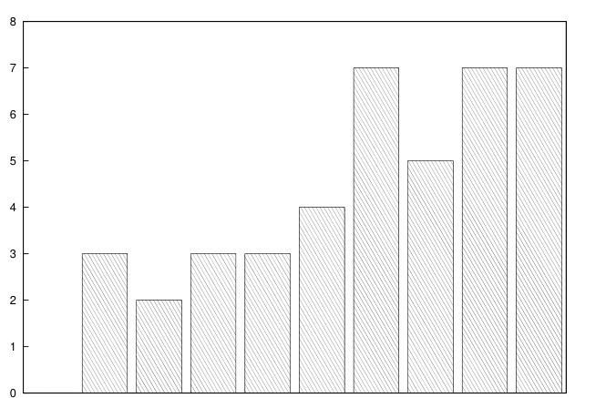

# MIT 6.824/6.5840 2011: Quiz 2: Official solutions

> Copied from the original: <https://pdos.csail.mit.edu/6.824/quizzes.html>. Text and figures are taken from the PDF as is; nothing was answered or rewritten. The original PDF is in this folder.

---

**Page 1**

&emsp;&emsp;&emsp;&emsp;&emsp;&emsp;Department of Electrical Engineering and Computer Science 
&emsp;&emsp;&emsp;&emsp;MASSACHUSETTS INSTITUTE OF TECHNOLOGY

&emsp;&emsp;**6.824 Distributed System Engineering: Spring 2011** 
&emsp;&emsp;&emsp;&emsp;&emsp;&emsp;&emsp;**Quiz II Solutions** 
&emsp;&emsp;&emsp;&emsp;&emsp;Grade histogram for Quiz II

&emsp;&emsp;&emsp;&emsp;&emsp;&emsp;&emsp;&emsp;96-100 
51-55   56-60   61-65   66-70   71-75   76-80   81-85   86-90   91-95

&emsp;&emsp;&emsp;&emsp;&emsp;&emsp;&emsp;&emsp;min   =   60 
&emsp;&emsp;&emsp;&emsp;&emsp;&emsp;&emsp;&emsp;max   =   100 
&emsp;&emsp;&emsp;&emsp;&emsp;&emsp;&emsp;&emsp;median   =   85 
&emsp;&emsp;&emsp;&emsp;&emsp;&emsp;&emsp;&emsp;average   =   83 
&emsp;&emsp;&emsp;&emsp;&emsp;&emsp;&emsp;&emsp;σ   =   11

---

**Page 2**

6.824 Spring 2011, Quiz II Solutions   **Page 2 of 9**

**I**   **Paxos**

&emsp;**1. \[5 points\]:** Circle the earliest point at which Paxos has agreed on a value. There’s a copy of the 
&emsp;Paxos algorithm below. 
&emsp;A. A leader receives prepare ok messages from a majority. 
&emsp;B. A majority send accept ok messages with the same n. 
&emsp;C. A leader receives accept ok messages from a majority, with the n the leader expects. 
&emsp;D. A majority of nodes receive decided messages.

**Answer:** B. Once a majority has received and accepted a given value v, then all future proposed values will 
also be v.

&emsp;**2.**   **\[5**   **points\]:** It is possible for two Paxos leaders (for the same Paxos instance) to both see 
&emsp;prepare ok messages from a majority of nodes. Describe a scenario in which this happens.

**Answer:** Yes. Suppose there are four nodes, n1..4. n1 sends out prepare messages with n = 10 and gets 
replies from all nodes. Then n1 crashes. After a while, node n2’s hearbeat times out and decides to become 
a leader for the same Paxos instance, and sends out prepare messages with n = 11. n2 will likely receive 
responses from n2, n3, and n4, a majority of nodes.

state: 
must persist across reboots 
n\_p (highest prepare seen) 
n\_a, v\_a (highest accept seen)

proposer(v): 
choose n, unique and higher than any n seen so far 
send prepare(n) to all servers including self 
if prepare\_ok(n\_a, v\_a) from majority: 
&emsp;v’ = v\_a with highest n\_a; choose own v otherwise 
&emsp;send accept(n, v’) to all 
&emsp;if accept\_ok(n) from majority: 
&emsp;&emsp;send decided(v’) to all

acceptor’s prepare(n) handler: 
if n \> n\_p 
&emsp;n\_p = n 
&emsp;reply prepare\_ok(n\_a, v\_a)

acceptor’s accept(n, v) handler: 
if n \>= n\_p 
&emsp;n\_a = n 
&emsp;v\_a = v 
&emsp;reply accept\_ok(n)

---

**Page 3**

6.824 Spring 2011, Quiz II Solutions   **Page 3 of 9**

**II**   **Two-phase Commit**

&emsp;**3.**   **\[5 points\]:** Ben is building a replicated storage system. There is just one client, and the client 
&emsp;performs just one storage operation (read or write) at a time, waiting for each operation to complete 
&emsp;before starting the next. Ben wishes to store the data on two servers in order that the system be 
&emsp;available (that it continue operating) even if one server fails. He wants to ensure that the data on 
&emsp;the two servers stay identical, and is worried about the possibility that only one of the two servers 
&emsp;might execute a client write. Ben wonders whether making the writes at the two servers atomic using 
&emsp;two-phase commit (as in Lecture 11) would be a good idea, to ensure both-or-nothing behavior. 
&emsp;In the design he has in mind, the client acts as the transaction coordinator (TC). The client would 
&emsp;execute a write as described in lecture:

&emsp;&emsp;client sends write RPCs to server1 and server2 
&emsp;&emsp;client waits for replies to both write RPCs 
&emsp;&emsp;client sends prepare messages to server1 and server2 
&emsp;&emsp;if both repond "yes" 
&emsp;&emsp;&emsp;client sends commit messages to server1 and server2

&emsp;The system uses the timeout recovery scheme explained in lecture. 
&emsp;Ben thinks about this design for a while, and eventually realizes that two-phase commit as described 
&emsp;in Lecture 11 is fundamentally not suited to providing availability via replication. Please explain why.

**Answer:** If one of the two servers is down, two-phase commit will abort every write; this defeats Ben’s goal 
of availability.

&emsp;**4.**   **\[5 points\]:** Halfway down page 386 of Liskov and Scheifler’s “Guardians and Actions” paper 
&emsp;about Argus, the text says that a parent inherits the locks of a committing subaction. Suppose instead 
&emsp;that a commiting subaction released any locks it held that its parent did not also hold. Explain how that 
&emsp;would result in actions not being indivisible. See the top of page 384 for a definition of indivisibility.

**Answer:**   Here’s a situation in which action A1 executes in a way that another action A2 sees something 
other than the state before or after A1 (i.e., the system does not provide indivisibility). Suppose atomic 
objects X and Y both start out with value 0. Action A1 sets X to 1 in one sub-action, and then sets Y to 1 in 
a second sub-action, and then commits. If A1 doesn’t inherit the first sub-action’s lock on X, then action A2 
could execute between A1’s two sub-actions and observe X = 1 and Y = 0, which is not the state before 
or after A1.

---

**Page 4**

6.824 Spring 2011, Quiz II Solutions   **Page 4 of 9**

&emsp;**5. \[10 points\]:** Here’s a simplified version of some code in Figure 2 of the Argus paper, from the 
&emsp;add user handler:

&emsp;&emsp;action 
&emsp;&emsp;&emsp;drop.add\_user(user) 
&emsp;&emsp;&emsp;reg.add\_user(user, drop) 
&emsp;&emsp;end

&emsp;This code first sends an RPC to a maildrop server to create storage for the user’s mail messages, then 
&emsp;sends an RPC to the registry asking it to add an entry to its table mapping each user name to the 
&emsp;maildrop server that holds the user’s mail messages. 
&emsp;Suppose the RPC to the registry server times out (no reply is received). 
&emsp;If this code were using the YFS RPC package, it would not know whether the registry server had 
&emsp;received and processed the RPC. So it would not know whether to recover by asking the maildrop 
&emsp;server to delete the server (correct if the registry server didn’t receive the RPC) or whether to leave 
&emsp;the user’s entry on the maildrop server (correct if the registry server did receive the RPC). 
&emsp;Explain how Argus handles the above situation.

**Answer:**   Argus uses two-phase commit to ensure that either both the maildrop server and the registry 
server add the user, or neither does. Both servers modify a shadow copy of their data when they execute the 
RPC. If both RPCs succeed and the action finishes normally, then Argus will execute two-phase commit to 
tell both servers to copy the shadow data to the real data storage. If one of the RPCs fails (or anything else 
causes the action to abort), then Argus will tell all servers that participated to abort their part of the action 
and throw away the shadow copy of the data.

---

**Page 5**

6.824 Spring 2011, Quiz II Solutions   **Page 5 of 9**

**III**   **PNUTS**

You’re running a PNUTS system (see the paper by Cooper et al.). Records X and Y both start with value 
zero. Here are two functions that use the API described in Section 2.2 of the PNUTS paper:

fn1: 
x1 = read-any(X) 
x1 = x1 + 1 
write(X, x1) // X = x1 
write(Y, x1) // Y = x1

fn2: 
x1 = read-any(X) 
x2 = read-latest(X) 
y1 = read-any(Y) 
print x1, x2, y1

You execute two calls to fn1, at different sites, at the same time. After both calls to fn1 have returned, you 
execute fn2 at a third site. There is no activity in the system other than described here, and no crashes or 
network failures.

&emsp;**6. \[10 points\]:** What output is it possible to see from fn2, given the design of PNUTS and the above 
&emsp;scenario? Circle Yes for outputs that PNUTS could produce, and No for outputs that PNUTS could 
&emsp;not produce.

&emsp;2, 2, 1   **Yes**

&emsp;1, 2, 2**Yes**

&emsp;1, 1, 2   **No**

&emsp;2, 1, 1   **No**

&emsp;0, 0, 0   **No**

---

**Page 6**

6.824 Spring 2011, Quiz II Solutions   **Page 6 of 9**

**IV**   **Practical Byzantine Fault Tolerance**

&emsp;**7. \[10 points\]:** Consider Castro and Liskov’s paper “Practical Byzantine Fault Tolerance.” Suppose 
&emsp;a client sends a request to the primary, as described in Section 4.1, and then waits for f + 1 replies 
&emsp;to its request with valid signatures from different replicas. Assume that the network never discards 
&emsp;messages, that the network delivers packets quickly, that the PBFT servers are lightly loaded, and that 
&emsp;no computer crashes or becomes disconnected from the network. 
&emsp;Suppose the client waits for a long time (much longer than the time for the network to deliver all 
&emsp;PBFT protocol messages and for the servers to process them), and still has received fewer than f + 1 
&emsp;messages. Must it then be the case that the primary is faulty (either buggy or malicious)? If yes, 
&emsp;explain why. If no, explain why or give a counter-example.

**Answer:** If f or fewer servers are faulty, then the primary must be faulty. If the primary had sent out correct 
messages to all servers, then (given the questions assumptions) at least f + 1 replies would have arrived at 
the client. 
If more than 2f servers are faulty, they can conspire to make a correct primary look faulty by not sending 
anything to the client.

---

**Page 7**

6.824 Spring 2011, Quiz II Solutions   **Page 7 of 9**

**V**   **SUNDR**

&emsp;**8. \[5 points\]:** Alice and Bob share a SUNDR server (see the paper “Secure Untrusted Data Reposi- 
&emsp;tory (SUNDR)” by Li et al.). There are just two files on their SUNDR server, called fx and fy. Both 
&emsp;files start out containing the text “empty”. 
&emsp;One day Alice executes the following commands on her workstation, in the directory served by the 
&emsp;SUNDR server; she runs the commands one at a time and in this order:

&emsp;echo x \> fx 
&emsp;echo y \> fy

&emsp;The next day, Bob runs these commands on his workstation in the directory served by the SUNDR 
&emsp;server; he runs the commands one at a time and in this order:

&emsp;cat fy 
&emsp;cat fx

&emsp;No user sends any operations to the SUNDR server between Alice’s commands and Bob’s commands. 
&emsp;Given the paper’s description of SUNDR, which of the following cat outputs is it possible for Bob 
&emsp;to see? Circle Yes or No for each line.

&emsp;fy: empty, fx: empty   **Yes** The server can show Bob the state before any of Alice’s operations.

&emsp;fy: empty, fx: x   **Yes** The server can show Bob the state after Alice’s write to fx but before her write 
&emsp;to fy.

&emsp;fy: y, fx: empty   **No** The signature on Alice’s write to fy covers her write to fx, so when Bob reads 
&emsp;fy the log must contain Alice’s write to fx. Once Bob has seen the contents of fy, his client will 
&emsp;append a read operation to the log, and his signature on the read operation will cover Alice’s write to 
&emsp;fx. When Bob reads fx, his client ensure that his previous read operation is in the log, and checks 
&emsp;its signature, which ensures that Alice’s write to fx is in the log.

&emsp;fy: y, fx: x**Yes**

&emsp;**9. \[5 points\]:** At the top of the right-hand column on page 3, the SUNDR paper says that a client 
&emsp;checks that its own user’s most recent operation is in the log. This step might be inconvenient – 
&emsp;perhaps the user has rebooted her workstation or switched workstations, making it difficult for the 
&emsp;client to know what the user’s most recent operation is. Suppose a SUNDR client omitted the check 
&emsp;for the user’s most recent operation. Would that change the correct answer to the previous question? 
&emsp;How?

**Answer:** Yes, now the third scenario is possible. The server can first show Bob the log after Alice’s write 
to fy, then show Bob the log before Alice’s write to fx.

---

**Page 8**

6.824 Spring 2011, Quiz II Solutions   **Page 8 of 9**

**VI**   **Coral**

&emsp;**10.**   **\[10 points\]:** CoralCDN, as described in “Democratizing content publication with Coral by 
&emsp;Feedman et al., is aimed at dramatically reducing the load on very low-capacity origin servers. One 
&emsp;could argue that CoralCDN sacrifices client response speed in order to reduce origin server load. 
&emsp;Propose a change that would significantly reduce client latency at the expense of a modest increase in 
&emsp;the load on the origin server.

**Answer:** You could use all layers of the DSHT when finding a Coral HTTP proxy near to a client, but only 
the local DSHT cluster when finding a copy of a page. If the page isn’t in the local cluster, fetch it from the 
origin server. This eliminates high-delay global searches for pages, but keeps the load on the origin server 
for popular pages down to one fetch per local cluster.

**VII**   **Tor**

&emsp;**11.**   **\[10 points\]:** Consider a Tor system with a few dozen Tor routers (see “Tor: The Second- 
&emsp;Generation Onion Router” by Dingledine et al.). Clients always use paths that include exactly three 
&emsp;Tor routers. Describe a serious attack on anonymity that would be possible if an attacker controlled 
&emsp;two Tor routers, but that would not be possible if the attacker controlled only one Tor router.

**Answer:**   If there are lots of users, then some of them will use one of the attacker’s routers as the entry 
router and the other as the exit router. Suppose user U1 is talking to server S1 via OR1, OR2, and OR3, and 
that the attacker controls OR1 and OR3. The attacker will observe packets from U1 arriving at OR1 that 
need to be forwarded to OR2, and packets from OR2 arriving at OR3 that need to be forwarded to S1. That’s 
not quite enough to conclude that U1 is talking to S1, since there might be other users generating OR1/OR2 
and OR2/OR3 traffic. If the attacker sees similar patterns in arrival times of the U1/OR1/OR2 traffic and the 
OR2/OR3/S1 traffic, that might be enough to conclude that U1 was talking to S1 with reasonable certainty.

---

**Page 9**

6.824 Spring 2011, Quiz II Solutions   **Page 9 of 9**

**VIII**   **Chord**

&emsp;**12.**   **\[10 points\]:** You read the Chord paper (“Chord: A Scalable Peer-to-peer Lookup Service for 
&emsp;Internet Applications” by Stoica et al.) and decide to design a slightly different distributed hash table 
&emsp;called Slice. Slice is identical to Chord except that it has different finger table contents. A Slice node’s 
&emsp;finger table contains 11 entries. The first entry points to the node’s immediate successor in the ring 
&emsp;(just as in Chord). The other 10 entries point to randomly chosen nodes in the ring. Roughly how 
&emsp;many messages will the find successor() pseudo-code in Figure 4 send in order to perform a 
&emsp;lookup in Slice, as a function of the number of nodes N in the Chord ring? It is OK to be inaccurate 
&emsp;by a constant factor. Briefly explain your answer.

**Answer:**   O(N) messages. The fingers will rapidly take the lookup to within 1/10th of the ring of the 
destination, but then the lookup will have to proceed hop by hop via the successors.

**IX**   **6.824**

&emsp;**13. \[10 points\]:** If you could change one thing in 6.824 in order to improve the course for future 
&emsp;generations, what would it be?

**Answer:**   Better documented lab code, FUSE in particular; select papers that are more recent or describe 
more practical systems; answers to reading questions; less time for lab6 and more time for lab7/8.

&emsp;&emsp;&emsp;&emsp;&emsp;&emsp;&emsp;&emsp;End of Quiz II

