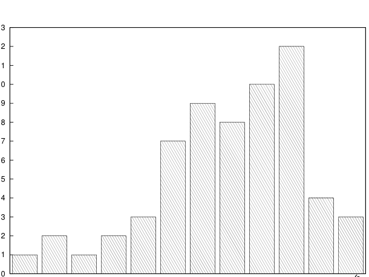

# MIT 6.824/6.5840 2012: Quiz 1: Official solutions

> Copied from the original: <https://pdos.csail.mit.edu/6.824/quizzes.html>. Text and figures are taken from the PDF as is; nothing was answered or rewritten. The original PDF is in this folder.

---

**Page 1**

&emsp;&emsp;&emsp;&emsp;&emsp;&emsp;Department of Electrical Engineering and Computer Science 
&emsp;&emsp;&emsp;&emsp;MASSACHUSETTS INSTITUTE OF TECHNOLOGY

&emsp;&emsp;**6.824 Distributed System Engineering: Spring 2012** 
&emsp;&emsp;&emsp;&emsp;&emsp;&emsp;&emsp;**Quiz I Solutions**

&emsp;&emsp;&emsp;&emsp;&emsp;Grade histogram for Quiz I

13

12

11

10

&emsp;&emsp;&emsp;&emsp;&emsp;&emsp;&emsp;&emsp;101-105 
&emsp;&emsp;&emsp;&emsp;&emsp;&emsp;&emsp;&emsp;96-100 
&emsp;46-50   51-55   56-60   61-65   66-70   71-75   76-80   81-85   86-90   91-95

&emsp;&emsp;&emsp;&emsp;&emsp;&emsp;&emsp;&emsp;min   =   49 
&emsp;&emsp;&emsp;&emsp;&emsp;&emsp;&emsp;&emsp;max   =   104 
&emsp;&emsp;&emsp;&emsp;&emsp;&emsp;&emsp;&emsp;median   =   84 
&emsp;&emsp;&emsp;&emsp;&emsp;&emsp;&emsp;&emsp;average   =   82 
&emsp;&emsp;&emsp;&emsp;&emsp;&emsp;&emsp;&emsp;σ   =   12

---

**Page 2**

6.824 Spring 2012, Quiz 1 Solutions   **Page 2 of 11**

**I**   **Plan 9**

&emsp;**1. \[10 points\]:** The Plan 9 paper says (on page 2) that one of the principles underlying the design is 
&emsp;that there is a standard protocol (9P) used to access all resources. It would have been more traditional 
&emsp;to have each kind of resource (window system, file server, name server, remote login, etc.) define its 
&emsp;own protocol. Does Plan 9 use a single protocol just for convenience, or is it a critical part of the 
&emsp;architecture? Explain your answer. 
&emsp;**Answer:** Having the single 9P protocol is critical. It allows all resources to appear as files, and to be 
&emsp;manipulable with standard file utilities as well as with file-system namespace tools such as exportfs.

---

**Page 3**

6.824 Spring 2012, Quiz 1 Solutions   **Page 3 of 11**

**II**   **Dinner Server**

Bifur and Bombur, graduate students in Course 12, go out to dinner together every evening. They sit in 
different offices, so they need a protocol to agree on the destination. They decide to write software that 
runs on their computers and communicates over the network, using the 6.824 lab RPC system. Each starts a 
dinner program on his computer in the morning. The program contains both a client and a server (it is a 
“peer-to-peer” system). Here is the software; note that on each computer, the client and the server code are 
using the same state and m.

enum rets { OK = 0, CONFLICT }; 
enum states { IDLE, SUGGESTING, AGREED } state; 
pthread\_mutex\_t m;

int 
client::suggest(std::string name) 
{ 
int r = -1; 
pthread\_mutex\_lock(&m); 
if(state == IDLE){ 
&emsp;state = SUGGESTING; 
&emsp;cl-\>call(dinner\_protocol::suggest, name, r); 
&emsp;if(r == OK){ 
&emsp;&emsp;state = AGREED; 
&emsp;&emsp;printf("decision: %s\\n", name.c\_str()); 
&emsp;} else { 
&emsp;&emsp;state = IDLE; 
&emsp;} 
} 
pthread\_mutex\_unlock(&m); 
return r; 
}

int 
server::suggest(std::string name, int &r) 
{ 
pthread\_mutex\_lock(&m); 
if(state == IDLE){ 
&emsp;state = AGREED; 
&emsp;printf("decision: %s\\n", name.c\_str()); 
&emsp;r = OK; 
} else { 
&emsp;r = CONFLICT; 
} 
pthread\_mutex\_unlock(&m); 
return r; 
}

---

**Page 4**

6.824 Spring 2012, Quiz 1 Solutions   **Page 4 of 11**

Just two computers are involved (Bifur’s and Bombur’s). Each computer makes at most one call to client::suggest. 
In a typical execution, Bombur gets hungry first and calls client::suggest("Emma’s"). Bom- 
bur’s client code sends an RPC to Bifur’s program, causing Bifur’s server::suggest handler to print 
decision:   Emma’s and return OK. In response to the OK, Bombur’s client also prints decision: 
Emma’s. 
However, sometimes it takes a few minutes for the client suggest routine to complete. Bifur turns on 
RPC debugging output, and sees that the client RPC system is reporting timeouts, and that call() even- 
tually gives up and returns an error. Bifur thinks perhaps the network is dropping packets, but on further 
examination it turns out that every packet is received. Neither computer ever crashes or malfunctions.

&emsp;**2. \[10 points\]:** Explain the cause of the symptoms that Bifur sees. 
&emsp;**Answer:** The problem occurs when Bifur and Bombur call suggest() at about the same time. The 
&emsp;client code on each of their computers locks the mutex, and then sends an RPC. The RPC handlers 
&emsp;on both machines block waiting for the mutex. After two minutes, the RPC system gives up (since it 
&emsp;has received no reply) and returns from call(). The client suggest()s then release the mutexes, 
&emsp;allowing the server handlers to complete.

---

**Page 5**

6.824 Spring 2012, Quiz 1 Solutions   **Page 5 of 11**

**III**   **Bayou**

Victor is using a tablet computer that runs the meeting room scheduler described in Section 2.1 of the 
Bayou paper. He makes a reservation for 10:00, with 11:00 as the fallback time. After that, Vera makes a 
reservation for 10:00 on her own tablet, also with a fallback time of 11:00. Victor then performs anti-entropy 
with Vera’s tablet, and sees that the scheduler application displays Vera’s reservation at 10:00 and Victor’s 
at 11:00. Both are marked tentative. Victor really wants 10:00, and he knows that the Bayou primary server 
commits operations in the order in which it sees them. So he hurries to the primary server before Vera and 
performs anti-entropy with it. All the computers involved execute Bayou as described in the paper, and 
no-one other than Victor and Vera is trying to reserve the meeting room.

&emsp;**3. \[10 points\]:** At what time will Victor’s committed reservation be? Explain why. 
&emsp;**Answer:**   11:00. His tablet knows about Vera’s reservation, and knows that it is ordered before 
&emsp;his reservation. When Victor performs anti-entropy with the primary server, his tablet will send the 
&emsp;primary server all the tentative Writes it knows about, in order; this means his tablet will tell the 
&emsp;primary about Vera’s reservation before his. As a result the primary will assign Vera’s reservation a 
&emsp;lower CSN, and Vera’s reservation will come first in the committed order as well as the tentative order.

As described on page 6 of the paper, each Bayou server uses a logical clock to time-stamp its new Writes, 
in order to preserve causal ordering. Vera hears about version vectors in 6.824, and in particular that version 
vectors can record causality more precisely than logical clocks. She considers modifying Bayou by replacing 
each server’s logical clock with a version vector (the server’s “vector clock”), and time-stamping new Writes 
with a version vector instead of with a logical clock value. 
A version vector in Vera’s new design would have an entry for each server in the system. When it learns 
about a new Write via anti-entropy, a server would set its vector clock to the element-wise maximum of the 
new Write’s version vector and the server’s current vector clock. When originating a new Write, a server 
would first increment its own element in its vector clock, and then set the Write’s version vector equal to 
the vector clock. Thus the i’th element of a version vector indicates the number of Writes that server i has 
originated. 
These version vectors are not the same as the Timestamp Vectors (O, C, and F) in Figure 4. 
Vera’s new rule for ordering tentative Writes is that Write x comes before Write y if xv \< yv, where xv 
and yv are the version vectors associated with the two Writes. xv \< yv if every element of xv is less 
than or equal to the corresponding element of yv, and at least one element of xv is strictly less than the 
corresponding element of yv. Vera likes her new rule because xv \< yv only if the node that originated Write 
y had actually seen x. Logical clocks do not have this property. 
Vera has not completed her design, but we’d like you to help her understand some of the implications of her 
ideas before she proceeds.

---

**Page 6**

6.824 Spring 2012, Quiz 1 Solutions   **Page 6 of 11**

&emsp;**4. \[10 points\]:** Describe a situation which would lead to two Writes having no order under Vera’s 
&emsp;new rule; that is, a situation in which her rule would order neither Write before the other. 
&emsp;**Answer:** If two Writes are created on different tablets without an intervening anti-entropy session, 
&emsp;they will have version vectors that are neither less than nor greather than each other.

&emsp;**5. \[10 points\]:** If two Writes have no order under Vera’s rule, would it be OK for each server to use 
&emsp;whichever order it likes? Explain why or why not. 
&emsp;**Answer:** It would not be OK. One of Bayou’s goals is that two computers that perform anti-entropy, 
&emsp;and thus have identical sets of Writes, should end up with identical databases. That would not happen 
&emsp;if they ordered the same set of Writes in different ways.

---

**Page 7**

6.824 Spring 2012, Quiz 1 Solutions   **Page 7 of 11**

**IV**   **Argus**

Refer to the 3rd paragraph of page 385 of the Argus paper, which discusses Argus’ use of two-phase commit. 
Suppose a top-level action successfully completes phase one (all participating guardians have responded 
positively), but then one guardian crashes and quickly restarts before the start of the second phase. Nothing 
else goes wrong.

&emsp;**6. \[10 points\]:** Will the top-level action abort or commit? Explain your answer. 
&emsp;**Answer:** It will commit. Once a participant agrees to commit, it cannot change its mind, since others 
&emsp;may then proceed to commit. Thus before a guardian responds positively in phase one, it must write 
&emsp;to disk all information that would be required if the action ends up committing, including all modified 
&emsp;values. The guardian writes the modified values to a temporary area on disk, not to the permanent 
&emsp;locations, since the action has not yet committed. The guardian must record which locks are held in 
&emsp;order that they still be held after restart.

An Argus sub-action’s commit is conditional – it doesn’t really commit unless all its ancestor actions commit 
(see the first paragraph on page 386). Suppose, instead, Argus sub-actions fully committed when they 
finished, so that a sub-action’s updates were visible even if the parent action aborted.

&emsp;**7. \[10 points\]:** Describe a concrete example where having sub-actions commit even if their ancestors 
&emsp;don’t would be an awkward design, and explain why. 
&emsp;**Answer:** Suppose a bank’s guardian defines handlers for debiting and crediting accounts. It would 
&emsp;be good to be able to combine them into a top-level action that transfers money from one account 
&emsp;to another. However, if the debit sub-action commits and the credit sub-action aborts, the account 
&emsp;balances will be left in an inconsistent state.

---

**Page 8**

6.824 Spring 2012, Quiz 1 Solutions   **Page 8 of 11**

**V**   **Tra**

Suppose each element in Tra’s synchronization time and modification time version vectors held a sequence 
number rather than a time. That is, suppose that the i’th element in file f’s modification time version vector 
indicated the number of times that replica i had modified file f.

&emsp;**8. \[10 points\]:** This idea turns out not to work. Explain what would go wrong with the scheme in 
&emsp;the paper’s Section 3.4.1 if version vectors were defined in this way. 
&emsp;**Answer:** One problem is that Section 3.4.1’s definition of directory modification time as the element- 
&emsp;wise maximum of the childrens’ modification times does not work: different files’ version vectors do 
&emsp;not have comparable elements if they hold sequence numbers. 
&emsp;This question is a little confusing because it does not state a definition of synchronization time.

---

**Page 9**

6.824 Spring 2012, Quiz 1 Solutions   **Page 9 of 11**

**VI**   **Piccolo**

The Piccolo paper says, in the 3rd paragraph of page 5, that graph, curr, and next are grouped together 
in Figure 2. This means that all three tables are partitioned across computers by key in the same way, so that 
a given key in all three tables is in the same partition. Here is a copy of Figure 2, with checkpointing and 
restore code omitted:

tuple PageID(site, page) 
const PropagationFactor = 0.85

def PRKernel(Table(PageID, double) curr, 
&emsp;&emsp;&emsp;&emsp;&emsp;&emsp;&emsp;Table(PageID, double) next, 
&emsp;&emsp;&emsp;&emsp;&emsp;&emsp;&emsp;Table(PageID, \[ PageID \]) graph\_partition): 
for page, outlinks in 
&emsp;&emsp;graph.get\_iterator(my\_instance()): \<\<\<--- (B) 
&emsp;rank = curr\[page\] 
&emsp;update = PropagationFactor \* rank / len(outlinks) 
&emsp;for target in outlinks : 
&emsp;&emsp;next.update(target, update) \<\<\<--- (A) (B)

def PageRank(Config conf): 
graph = Table(PageID, \[ PageID \]).init("/dfs/graph") 
curr = Table(PageID, double).init( 
&emsp;&emsp;&emsp;&emsp;&emsp;&emsp;&emsp;graph.numPartitions(), 
&emsp;&emsp;&emsp;&emsp;&emsp;&emsp;&emsp;SumAccumulator, SitePartitioner) 
next = Table(PageID, double).init( 
&emsp;&emsp;&emsp;&emsp;&emsp;&emsp;&emsp;graph.numPartitions(), 
&emsp;&emsp;&emsp;&emsp;&emsp;&emsp;&emsp;SumAccumulator, SitePartitioner)

GroupTables(curr, next, graph)

for i in range(last\_iter, 50): 
&emsp;Run(PRKernel, 
&emsp;&emsp;&emsp;&emsp;instances = curr\_pr.numPartitions(), 
&emsp;&emsp;&emsp;&emsp;locality = LOC\_REQUIRED(curr), 
&emsp;&emsp;&emsp;&emsp;args = (curr, next, graph))

&emsp;Barrier()

&emsp;swap(curr, next)

---

**Page 10**

6.824 Spring 2012, Quiz 1 Solutions   **Page 10 of 11**

&emsp;**9. \[10 points\]:** Identify all the places in Figure 2 where reads or modifications of tables require data 
&emsp;to be moved between computers, assuming that every partition is on a different computer. Mark these 
&emsp;places in the code on the previous page with a circled “A”. 
&emsp;**Answer:** The call to next.update().

&emsp;**10. \[10 points\]:** Suppose the partitioning of graph were changed so that its keys were not grouped 
&emsp;together with those of curr and next. With this new partitioning, identify all the places in Figure 2 
&emsp;where reads or modifications of tables would require data to be moved between computers, assuming 
&emsp;that every partition is on a different computer. Mark these places in the code on the previous page 
&emsp;with a circled “B”. 
&emsp;**Answer:** The call to next.update(), and the call to graph.get iterator().

---

**Page 11**

6.824 Spring 2012, Quiz 1 Solutions   **Page 11 of 11**

**VII**   **6.824**

&emsp;**11. \[2 points\]:** What aspect of 6.824 would you most like to see changed? 
&emsp;**Answer:** Too many papers. Please answer the paper question in every lecture.

&emsp;**12. \[2 points\]:** What is the best aspect of 6.824? 
&emsp;**Answer:** The labs.

&emsp;&emsp;&emsp;&emsp;&emsp;&emsp;&emsp;&emsp;End of Quiz I Solutions

