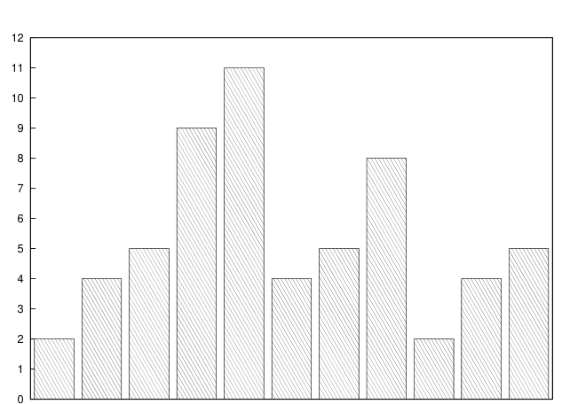

# MIT 6.824/6.5840 2012: Quiz 2: Official solutions

> Copied from the original: <https://pdos.csail.mit.edu/6.824/quizzes.html>. Text and figures are taken from the PDF as is; nothing was answered or rewritten. The original PDF is in this folder.

---

**Page 1**

&emsp;&emsp;&emsp;&emsp;&emsp;&emsp;Department of Electrical Engineering and Computer Science 
&emsp;&emsp;&emsp;&emsp;MASSACHUSETTS INSTITUTE OF TECHNOLOGY

&emsp;&emsp;**6.824 Distributed System Engineering: Spring 2012** 
&emsp;&emsp;&emsp;&emsp;&emsp;&emsp;**Quiz II Solutions**

&emsp;&emsp;&emsp;&emsp;&emsp;Grade histogram for Quiz II

&emsp;&emsp;&emsp;&emsp;&emsp;&emsp;&emsp;&emsp;96-100 
&emsp;46-50   51-55   56-60   61-65   66-70   71-75   76-80   81-85   86-90   91-95

&emsp;&emsp;&emsp;&emsp;&emsp;&emsp;&emsp;&emsp;min   =   47 
&emsp;&emsp;&emsp;&emsp;&emsp;&emsp;&emsp;&emsp;max   =   100 
&emsp;&emsp;&emsp;&emsp;&emsp;&emsp;&emsp;&emsp;median   =   69 
&emsp;&emsp;&emsp;&emsp;&emsp;&emsp;&emsp;&emsp;average   =   73 
&emsp;&emsp;&emsp;&emsp;&emsp;&emsp;&emsp;&emsp;σ   =   14

---

**Page 2**

6.824 Spring 2012, Quiz II Solutions   **Page 2 of 12**

**I**   **SUNDR**

&emsp;**1.**   **\[10 points\]:** Alice and Bob share a SUNDR server that uses the paper’s strawman design (see 
&emsp;Section 3.1). Each accesses SUNDR from his or her own client. Both mount the same SUNDR file 
&emsp;system as “/sundr”. One day, they perform operations on files x and y in the following order. 
&emsp;&emsp;&emsp;&emsp;&emsp;&emsp;&emsp;Operation Order   Alice   Bob 
&emsp;&emsp;&emsp;&emsp;&emsp;&emsp;&emsp;&emsp;1   echo 0 \> /sundr/x 
&emsp;&emsp;&emsp;&emsp;&emsp;&emsp;&emsp;&emsp;2   echo 0 \> /sundr/y 
&emsp;&emsp;&emsp;&emsp;&emsp;&emsp;&emsp;&emsp;3   echo 1 \> /sundr/x 
&emsp;&emsp;&emsp;&emsp;&emsp;&emsp;&emsp;&emsp;4echo 1 \> /sundr/y 
&emsp;&emsp;&emsp;&emsp;&emsp;&emsp;&emsp;&emsp;5   cat /sundr/y 
&emsp;&emsp;&emsp;&emsp;&emsp;&emsp;&emsp;&emsp;6echo 2 \> /sundr/x 
&emsp;&emsp;&emsp;&emsp;&emsp;&emsp;&emsp;&emsp;7   cat /sundr/x

&emsp;Alice and Bob are the only users accessing the SUNDR server, and these are the only operations they 
&emsp;send to the server. Each waits for the SUNDR server to indicate completion of their own previous 
&emsp;command before running the next command. They also talk by telephone to ensure the order of oper- 
&emsp;ations shown above. For example, operation 6 starts after operation 5 has completed, and completes 
&emsp;before operation 7 starts. 
&emsp;Alice sees 0 as the result of operation 5 (i.e. file y contains 0). The SUNDR clients do not detect any 
&emsp;problem.

&emsp;&emsp;**A.** Which of 0, 1, and 2 could Alice see as a result of operation 7? For each value that is possible, 
&emsp;&emsp;&emsp;give **all** possible operation histories that Alice’s client could have downloaded from the SUNDR 
&emsp;&emsp;&emsp;server during operation 7. 
&emsp;&emsp;&emsp;**Answer:** only 0 and 1 are possible. 0 results from the SUNDR server producing operations 1, 
&emsp;&emsp;&emsp;2, and 5 as the history. 1 results from the server producing 1, 2, 3, 5.

&emsp;&emsp;**B.** Suppose the SUNDR client didn’t log fetches. Would this change affect the possible values that 
&emsp;&emsp;&emsp;Alice could see as a result of operation 7? Explain why or why not. 
&emsp;&emsp;&emsp;**Answer:** Yes; this change would make 2 a possible value. The reason is that the SUNDR server 
&emsp;&emsp;&emsp;could conceal operations 3 and 4 from Alice when she fetches during operation 5, but reveal 3 
&emsp;&emsp;&emsp;and 4 (and 6) when Alice performs operation 7.

---

**Page 3**

6.824 Spring 2012, Quiz II Solutions   **Page 3 of 12**

&emsp;**2.**   **\[10 points\]:** Kate thinks that validating each user’s most recent signature (see paragraph 3 of 
&emsp;Section 3.1) is unnecessary. So she modifies her SUNDR client to check for the existence of her own 
&emsp;last operation in the history, and to **validate only her own last operation and the last entry of the** 
&emsp;**downloaded history**. Describe an attack that would succeed on Kate’s modified SUNDR client, but 
&emsp;that would not succeed with the original strawman SUNDR client. 
&emsp;**Answer:** Suppose there are three users, A, B, and C. The SUNDR server is malicious and is coop- 
&emsp;erating with user C (i.e. the server knows C’s private key). The server could send A a history that 
&emsp;included operations A4, A5, B6, C7, where A5 is A’s last operation, B6 is an operation that the server 
&emsp;made up (with an invalid signature), and C7 is properly signed. A would check only the signatures 
&emsp;on A5 and C7, and thus would accept B6 as a valid operation by B even though it is not. This attack 
&emsp;would not succeed with the paper’s actual strawman design because A would check the signature on 
&emsp;B6.

---

**Page 4**

6.824 Spring 2012, Quiz II Solutions   **Page 4 of 12**

**II**   **E-mail anonymizer**

Sammy is designing a simple e-mail anonymizer intended to hide the identities of senders from recipients. 
It consists of a single server. The server accepts incoming messages via https; the encryption prevents 
eavesdroppers from reading incoming messages. For each incoming message, the server deletes all headers 
other than Subject and To, adds an uninformative ”From: nobody@nowhere.com” header, and forwards the 
message to its To address. Sammy’s service becomes popular, and pretty soon his server is handling a few 
dozen messages per hour.

&emsp;**3. \[5 points\]:** Sammy hears from his friends in 6.824 that delaying messages before forwarding them 
&emsp;might help make his system more anonymous. Describe an attack which delaying would probably 
&emsp;defeat. 
&emsp;**Answer:** Suppose the attacker can watch traffic leaving the host of one of Sammy’s users, and can 
&emsp;also watch traffic arriving at the 6.824 complaint server. If the attacker sees a message leaving the 
&emsp;user’s host with Sammy’s server as IP destination, and shortly thereafter sees a message arriving at 
&emsp;the 6.824 server from Sammy’s server, the attacker could reasonably conclude that it was that user 
&emsp;who submitted the complaint. If the server added delays, then this attack would be harder.

&emsp;**4.**   **\[5 points\]:** Sammy is trying to decide between two delaying schemes. Scheme A: delay each 
&emsp;message for an hour before forwarding (e.g., if the message arrives at 10:15, delay it until 11:15). 
&emsp;Scheme B: delay each message until the beginning of the next hour before forwarding (e.g., if the 
&emsp;message arrives at 10:15, delay it until 11:00). Explain which is better, and why. 
&emsp;**Answer:** Scheme B is better. Scheme A preserves a predictable timing relationship between incom- 
&emsp;ing and outgoing messages, while Scheme B does not.

---

**Page 5**

6.824 Spring 2012, Quiz II Solutions   **Page 5 of 12**

**III**   **Web cache**

Acme Enterprises runs a caching web proxy which its 1000 employees all use. The proxy can only cache 
10 megabytes of web content. Acme is considering two plans to improve their web cache. Plan A: increase 
the size of the cache from 10 megabytes to 100 megabytes. Plan B: buy 9 more caching proxies, each with 
10 megabytes of cache space, and divide the employees evenly among the 10 proxies; that way there would 
be 100 megabyte of cache space total. The proxies are independent (not cooperative). 
One advantage of Plan B is that there would be more hardware resources in the caching system (CPU, 
network interfaces, etc), so that it would have higher throughput for local requests. One advantage of Plan 
A is that it would probably cost less.

&emsp;**5. \[10 points\]:** Describe two significant ways in which Plan A would likely be better than Plan B 
&emsp;(other than that mentioned above). 
&emsp;**Answer:**   Plan A stores only one copy of each popular page, whereas Plan B might store one copy 
&emsp;per caching proxy; thus Plan A might be able to store more distinct pages. Plan A is likely to fetch 
&emsp;a popular page fewer times from the origin server. Plan A can cache web pages larger than 10 MB. 
&emsp;Plan A is less subject to load balance problems.

---

**Page 6**

6.824 Spring 2012, Quiz II Solutions   **Page 6 of 12**

**IV**   **Dynamo and PNUTS**

One way in which Dynamo and PNUTS differ is in their support for atomic operations. PNUTS has an 
atomic test-and-set-write request that allows clients to implement things like atomic counter incrementing. 
When a client reads a value and then tries to modify it with test-and-set-write, the test-and-set-write only 
succeeds if the value hasn’t been modified between the read and the test-and-set-write. For example, suppose 
two PNUTS clients try to increment a counter by reading it and using test-and-set-write to change its value 
to the read value plus one. If they do this concurrently, one will succeed, and the other will see a failed 
test-and-set-write and know that it should re-read the value and try again.

&emsp;**6. \[10 points\]:** Why would it be difficult to add atomic test-and-set-write to Dynamo? 
&emsp;**Answer:** Atomic test-and-set-write (TASW) would require that Dynamo only apply the write if the 
&emsp;latest version is the version mentioned as an argument to TASW. However, Dynamo doesn’t have an 
&emsp;easy way to decide if that’s true: Dynamo doesn’t sequence writes, so “latest version” is not well 
&emsp;defined. Another way to look at it is that Dynamo allows updates in any partition, so that it might 
&emsp;not be possible to communicate with the servers that hold various versions to find out if they’ve been 
&emsp;updated recently.

---

**Page 7**

6.824 Spring 2012, Quiz II Solutions   **Page 7 of 12**

**V**   **Frangipani**

&emsp;**7. \[10 points\]:** The Frangipani paper says that recovery is run for a crashed server when some other 
&emsp;server tries to acquire a lock that the crashed server is holding. What would happen if a crashed server 
&emsp;was holding no locks – would the fact that recovery might never be run for it be a problem? Why or 
&emsp;why not? 
&emsp;**Answer:**   If the server isn’t holding any locks, it must have already written its entire log and all 
&emsp;modified blocks to Paxos. Thus recovery wouldn’t need to do anything, and there is no problem.

---

**Page 8**

6.824 Spring 2012, Quiz II Solutions   **Page 8 of 12**

**VI**   **Harp**

The Harp paper says that the primary sends a copy of its CP to the backups in each message, and that a 
backup does not apply operation i to the file system until it hears a CP ≥i, where i is the operation’s index 
in the log (Section 4.2, paragraphs 3 and 4).

&emsp;**8. \[10 points\]:** Consider an alternate design in which backups do not wait for the CP. Each backup 
&emsp;applies operation i to the file system as soon as all operations through i−1 have completed, regardless 
&emsp;of CP. This turns out to be a bad idea. Describe a sequence of events that would lead to a bad outcome 
&emsp;with this alternate design, but that the real Harp handles well. 
&emsp;**Answer:** Suppose there are 5 servers, S1, S2, S3, S4, and S5. S1 starts out as the primary. S1 sends 
&emsp;S2 operation X, S2 applies it to its disk, and then S1 and S2 crash. S3, S4, and S5 form a view and 
&emsp;continue processing client operations. They have never heard of operation X. S2 comes back to life 
&emsp;and tries to re-join the view. The problem is that its disk is now no longer usable, since it reflects 
&emsp;operation X which (according to the replicated state machine as a whole) never occurred. This is not 
&emsp;a problem in real Harp because the fact that S2 waits for CP means that it never applies an operation 
&emsp;unless a majority of servers know about it, and thus that the operation will be known about in the next 
&emsp;view.

---

**Page 9**

6.824 Spring 2012, Quiz II Solutions   **Page 9 of 12**

**VII**   **Paxos**

Here is pseudo-code for Paxos:

&emsp;&emsp;&emsp;--- Paxos Proposer ---

&emsp;&emsp;1   proposer(v): 
&emsp;&emsp;2   choose n   \>   np 
&emsp;&emsp;3   send prepare(n) to all servers including self 
&emsp;&emsp;4   if prepare\_ok(na, va) from majority: 
&emsp;&emsp;5v′   =   va with highest na; choose own v otherwise 
&emsp;&emsp;6send accept(n, v′) to all 
&emsp;&emsp;7   if accept\_ok(n) from majority: 
&emsp;&emsp;8send decided(v′) to all

&emsp;&emsp;&emsp;--- Paxos Acceptor ---

&emsp;&emsp;9   acceptor state on each node (persistent): 
&emsp;np10   --- highest prepare seen 
&emsp;na, va11   --- highest accept seen

&emsp;12   acceptor’s prepare(n) handler: 
&emsp;13   if n   \>   np 
&emsp;14   np   =   n 
&emsp;15   reply prepare\_ok(na, va)

&emsp;16   acceptor’s accept(n, v) handler: 
&emsp;17   if n   ≥   np 
&emsp;18   np   =   n 
&emsp;19   na   =   n 
&emsp;20   va   =   v 
&emsp;21   reply accept\_ok(n)

Suppose line 5 were changed to 
v′ = any non-nil va; choose own v otherwise

That is, suppose that a proposer picked any of the non-nil va’s from acceptors responding to its prepare 
message, rather than the va with the highest na. 
Assume that the va variable in each acceptor starts with value nil.

---

**Page 10**

6.824 Spring 2012, Quiz II Solutions   **Page 10 of 12**

&emsp;**9. \[10 points\]:** Describe a sequence of events where this change to Paxos would cause it to fail to 
&emsp;agree correctly, whereas unmodified Paxos would correctly agree. 
&emsp;**Answer:** There are three acceptors, A1, A2, and A3. Proposer P1 sends propose messages to all, then 
&emsp;accept(X) which only A1 receives, then proposer P1 stops. Proposer P2 sends propose messages to 
&emsp;all, gets replies from just A2 and A3, sends accept(Y) which only A2 and A3 receive, then P2 crashes 
&emsp;after hearing accept ok from A2 and A3. Thus the agreed value is Y, though not everyone knows it. 
&emsp;Proposer P3 now sends propose messages to all, gets value X from A1 and value Y from A2 and A3, 
&emsp;chooses X, and sends accept(X) to all three acceptors. That is an error: Y has already been agreed on, 
&emsp;so all future proposals must be for Y.

&emsp;A1:   p1   aX   p3   aX 
&emsp;A2:   p1   p2   aY   p3   aX 
&emsp;A3:   p1   p2   aY   p3   aX

---

**Page 11**

6.824 Spring 2012, Quiz II Solutions   **Page 11 of 12**

**VIII**   **Hypervisor-based Fault-tolerance**

Bob is running Hypervisor Replication. Bob upgrades his PA-RISC CPU hardware to a new version that 
supports interrupt-free disk reads and writes. The new DISKREAD instruction reads a block from disk to 
memory and waits for the disk transfer to complete, while the DISKWRITE instruction writes a block of 
data from memory to disk, and waits for the write to complete. Bob plans to modify the operating system 
to use these two new instructions. He’ll also modify the hypervisor so that the primary, at the end of each 
epoch, sends the backup the disk blocks read by each of the DISKREADs during the epoch. And he’ll 
modify the hypervisor so that DISKWRITE on the backup doesn’t do anything. He’s excited because he 
thinks that the system will no longer have to wait until the end of each epoch for disk completion interrupts, 
and thus can execute multiple disk operations per epoch.

&emsp;**10. \[10 points\]:** Explain why allowing multiple disk reads and writes per epoch will make fail-over 
&emsp;hard or impossible. 
&emsp;**Answer:**   There is no correct way for the backup to execute disk reads during the fail-over epoch. 
&emsp;The old primary didn’t complete the fail-over epoch, so it never sent the data read from disk to the 
&emsp;backup. The backup cannot actually read the disk during the fail-over epoch, since the old primary 
&emsp;might have written the same block later in the epoch. The backup cannot simply ignore disk reads 
&emsp;during the fail-over epoch, since then it cannot execute conditional code (if statements) that depend 
&emsp;on the data read from disk, and thus cannot execute the fail-over epoch identically to the primary – 
&emsp;which it must do, since the old primary may have done all the disk writes for that epoch.

---

**Page 12**

6.824 Spring 2012, Quiz II Solutions   **Page 12 of 12**

**IX**   **6.824**

&emsp;**11. \[10 points\]:** If you could change one thing in 6.824 in order to improve the course for future 
&emsp;generations, what would it be? 
&emsp;**Answer:** Less time for lab 6, more time for lab 7. More time for the final project. Less lecture time 
&emsp;on big case studies, more time on core ideas. Don’t require paper printouts during exams. Publish 
&emsp;answers to all the paper questions. Document the lab code better.

