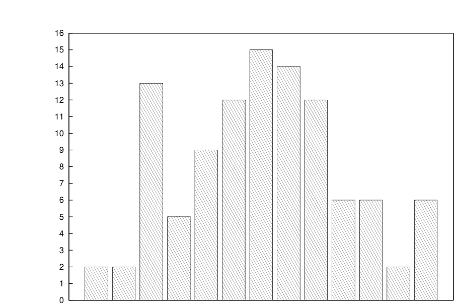

# MIT 6.824/6.5840 2014: Quiz 1: Official solutions

> Copied from the original: <https://pdos.csail.mit.edu/6.824/quizzes.html>. Text and figures are taken from the PDF as is; nothing was answered or rewritten. The original PDF is in this folder.

---

**Page 1**

&emsp;&emsp;&emsp;&emsp;&emsp;&emsp;&emsp;&emsp;Department of Electrical Engineering and Computer Science 
&emsp;&emsp;&emsp;&emsp;&emsp;&emsp;MASSACHUSETTS INSTITUTE OF TECHNOLOGY

&emsp;&emsp;&emsp;&emsp;&emsp;&emsp;&emsp;&emsp;**6.824 Spring 2014** 
&emsp;&emsp;&emsp;&emsp;&emsp;&emsp;&emsp;&emsp;**Quiz I Solutions**

&emsp;&emsp;&emsp;&emsp;&emsp;&emsp;&emsp;&emsp;96-100 
26-30   31-35   36-40   41-45   46-50   51-55   56-60   61-65   66-70   71-75   76-80   81-85   86-90   91-95 
&emsp;&emsp;&emsp;&emsp;&emsp;&emsp;&emsp;&emsp;Histogram of grade distribution

&emsp;&emsp;&emsp;&emsp;&emsp;&emsp;&emsp;&emsp;1

---

**Page 2**

---

**Page 3**

**I**   **MapReduce**

After writing several applications with MapReduce (as described by Dean and Ghemawat), Ben finds it 
annoying that Map and Reduce jobs cannot share state. He changes the MapReduce API so that the Map and 
Reduce functions can invoke key/value operations (i.e., Get and Put) on a key/value store with the semantics 
as in the labs. With this API, a map job can perform a Put operation on a key that another map job can Get.

&emsp;**1. \[7 points\]:** Ben finds that applications that use Get and Put don’t always produce the same result, 
&emsp;if he runs the application several times. Give a scenario how this can happen. (You can assume Ben 
&emsp;implemented Get and Put correctly.) 
&emsp;**Answer:** If a Map job fails, it will re-execute and thus also re-execute any Get and Put operations 
&emsp;again. A re-run of a Map job is likely to read values from the key/value store that are different with the 
&emsp;values returned during the first run, and thus results in different outcomes.

&emsp;&emsp;&emsp;&emsp;&emsp;&emsp;&emsp;&emsp;3

---

**Page 4**

---

**Page 5**

**II**   **Non-determinism and replicated state machines**

Ben changes the semantics of Put and PutHash so that these operations record the last time that each key 
was updated. He changes Get to return the value for a key and the last time it was updated.

&emsp;**2. \[7 points\]:** Describe how you would modify lab 3 to implement the modified API correctly: i.e., 
&emsp;the key-value servers always return the same, correct time stamp for a Get operation, even when clients 
&emsp;retry Put and PutHash operations and servers fail. You can assume that the servers have a function 
&emsp;GetTime for reading the local clock. 
&emsp;**Answer:** The server that receives the client request reads the clock and proposes it along with the 
&emsp;reqeust to Paxos. Replicas use the time stamp from the Paxos log when applying the operation, instead 
&emsp;of reading its own clock.

&emsp;&emsp;&emsp;&emsp;&emsp;&emsp;&emsp;&emsp;5

---

**Page 6**

**III**   **Not quite Replicated State Machines**

Ben has come up with a simple solution to lab 2B. The pseudocode for his solution is shown on the next page. 
This pseudocode captures the following strategy:

&emsp;• The client sends an RPC tagged with its client ID and a unique sequence number to the primary; 
&emsp;• The primary forwards the request to the backup; 
&emsp;• The backup performs the operation (unless it was already performed, in which case it looks up the 
&emsp;result from its duplicate detection table), updates its RPC duplicate detection table, and sends back 
&emsp;to the primary both the result of the operation (possibly from the duplicate detection table) and the 
&emsp;current (new) value of the corresponding key (not from the duplicate detection table); 
&emsp;• The primary updates its key/value store with the value provided by the backup (instead of re-executing 
&emsp;the operation), updates its duplicate-detection table, and sends the response provided by the backup to 
&emsp;the client; 
&emsp;• If the backup told the primary it couldn’t perform the operation (e.g., because it is in a view change), 
&emsp;then the primary tells the client to retry.

Ben points out to Alyssa that his design has only one retry loop: namely at the client. In his implementation, 
there is no retry loop at the primary (or backup); if the primary times out waiting for a response from the 
backup, it returns an error to the client, and it is the client’s job to retry (with the same client ID and sequence 
number). Furthermore, he argues that his implementation is correct, because it has a well-defined commit 
point for each operation (e.g., when the backup executes an operation, and updates its key/value table and 
duplicate-detection table). Alyssa, however, is suspicious about Ben’s implementation.

&emsp;&emsp;&emsp;&emsp;&emsp;&emsp;&emsp;&emsp;6

---

**Page 7**

Ben’s pseudocode for lab 2B:

client\_puthash(k, v): 
seq = choose sequence id 
while True: 
&emsp;send (puthash, client\_id, seq, k, v) to primary 
&emsp;if success: return result 
&emsp;else ask view server for primary

primary\_puthash(client\_id, seq, k, v): 
hold global lock 
if (client\_id, seq) in dups: 
&emsp;return dups\[(client\_id, seq)\] 
if there is a backup: 
&emsp;send (backup\_puthash, cur\_viewnum, client\_id, seq, k, v) to backup 
&emsp;if error: return error 
&emsp;get (result, newval) from backup’s reply 
&emsp;db\[k\] = newval 
else: 
&emsp;result = db\[k\]   // result is prev value 
&emsp;db\[k\] = hash(db\[k\] + v)   // do the puthash 
dups\[(client\_id, seq)\] = result 
return result

backup\_puthash(arg\_viewnum, client\_id, seq, k, v): 
hold global lock 
if arg\_viewnum != cur\_viewnum: return error 
if (client\_id, seq) in dups: 
&emsp;result = dups\[(client\_id, seq)\] 
else: 
&emsp;result = db\[k\]   // result is prev value 
&emsp;db\[k\] = hash(db\[k\] + v)   // do the puthash 
&emsp;dups\[(client\_id, seq)\] = result 
return (result, db\[k\])

&emsp;&emsp;&emsp;&emsp;&emsp;&emsp;&emsp;&emsp;7

---

**Page 8**

Ben’s pseudocode for lab 2B, repeated for your convenience (so you don’t have to flip pages):

client\_puthash(k, v): 
seq = choose sequence id 
while True: 
&emsp;send (puthash, client\_id, seq, k, v) to primary 
&emsp;if success: return result 
&emsp;else ask view server for primary

primary\_puthash(client\_id, seq, k, v): 
hold global lock 
if (client\_id, seq) in dups: 
&emsp;return dups\[(client\_id, seq)\] 
if there is a backup: 
&emsp;send (backup\_puthash, cur\_viewnum, client\_id, seq, k, v) to backup 
&emsp;if error: return error 
&emsp;get (result, newval) from backup’s reply 
&emsp;db\[k\] = newval 
else: 
&emsp;result = db\[k\]   // result is prev value 
&emsp;db\[k\] = hash(db\[k\] + v)   // do the puthash 
dups\[(client\_id, seq)\] = result 
return result

backup\_puthash(arg\_viewnum, client\_id, seq, k, v): 
hold global lock 
if arg\_viewnum != cur\_viewnum: return error 
if (client\_id, seq) in dups: 
&emsp;result = dups\[(client\_id, seq)\] 
else: 
&emsp;result = db\[k\]   // result is prev value 
&emsp;db\[k\] = hash(db\[k\] + v)   // do the puthash 
&emsp;dups\[(client\_id, seq)\] = result 
return (result, db\[k\])

&emsp;&emsp;&emsp;&emsp;&emsp;&emsp;&emsp;&emsp;8

---

**Page 9**

**3. \[15 points\]:** In the presence of failures, Ben’s implementation doesn’t guarantee at-most-once 
RPC. Show a timing diagram with RPC requests and responses that demonstrates incorrect behavior 
for PutHash operations. For each request sent to the primary, clearly indicate which client sent it, 
and what the sequence number was. Clearly indicate any messages lost between the primary and the 
backup, and any primary or backup failures.

&emsp;&emsp;&emsp;&emsp;&emsp;&emsp;&emsp;Primary   Backup 
&emsp;&emsp;&emsp;&emsp;&emsp;&emsp;&emsp;&emsp;\|   \| 
&emsp;&emsp;&emsp;&emsp;&emsp;&emsp;&emsp;&emsp;\|   \| 
&emsp;&emsp;&emsp;&emsp;&emsp;&emsp;&emsp;&emsp;\|   \| 
&emsp;&emsp;&emsp;&emsp;&emsp;&emsp;&emsp;&emsp;\|   \| 
&emsp;&emsp;&emsp;&emsp;&emsp;&emsp;&emsp;&emsp;\|   \| 
&emsp;&emsp;&emsp;&emsp;&emsp;&emsp;&emsp;&emsp;\|   \| 
&emsp;&emsp;&emsp;&emsp;&emsp;&emsp;&emsp;&emsp;\|   \| 
&emsp;&emsp;&emsp;&emsp;&emsp;&emsp;&emsp;&emsp;\|   \| 
&emsp;&emsp;&emsp;&emsp;&emsp;&emsp;&emsp;&emsp;\|   \| 
&emsp;&emsp;&emsp;&emsp;&emsp;&emsp;&emsp;&emsp;\|   \| 
&emsp;&emsp;&emsp;&emsp;&emsp;&emsp;&emsp;&emsp;\|   \| 
&emsp;&emsp;&emsp;&emsp;&emsp;&emsp;&emsp;&emsp;\|   \| 
&emsp;&emsp;&emsp;&emsp;&emsp;&emsp;&emsp;&emsp;\|   \| 
&emsp;&emsp;&emsp;&emsp;&emsp;&emsp;&emsp;&emsp;\|   \| 
&emsp;&emsp;&emsp;&emsp;&emsp;&emsp;&emsp;&emsp;\|   \| 
&emsp;&emsp;&emsp;&emsp;&emsp;&emsp;&emsp;&emsp;\|   \| 
&emsp;&emsp;&emsp;&emsp;&emsp;&emsp;&emsp;&emsp;\|   \| 
&emsp;&emsp;&emsp;&emsp;&emsp;&emsp;&emsp;&emsp;\|   \| 
&emsp;&emsp;&emsp;&emsp;&emsp;&emsp;&emsp;&emsp;\|   \| 
&emsp;&emsp;&emsp;&emsp;&emsp;&emsp;&emsp;&emsp;\|   \| 
&emsp;&emsp;&emsp;&emsp;&emsp;&emsp;&emsp;&emsp;\|   \| 
&emsp;&emsp;&emsp;&emsp;&emsp;&emsp;&emsp;&emsp;\|   \| 
&emsp;&emsp;&emsp;&emsp;&emsp;&emsp;&emsp;&emsp;\|   \| 
&emsp;&emsp;&emsp;&emsp;&emsp;&emsp;&emsp;&emsp;\|   \| 
&emsp;&emsp;&emsp;&emsp;&emsp;&emsp;&emsp;&emsp;\|   \| 
&emsp;&emsp;&emsp;&emsp;&emsp;&emsp;&emsp;&emsp;\|   \| 
&emsp;&emsp;&emsp;&emsp;&emsp;&emsp;&emsp;&emsp;\|   \| 
&emsp;&emsp;&emsp;&emsp;&emsp;&emsp;&emsp;&emsp;\|   \| 
&emsp;&emsp;&emsp;&emsp;&emsp;&emsp;&emsp;&emsp;\|   \| 
&emsp;&emsp;&emsp;&emsp;&emsp;&emsp;&emsp;&emsp;\|   \| 
&emsp;&emsp;&emsp;&emsp;&emsp;&emsp;&emsp;&emsp;\|   \|

**Answer:** 
See the diagram below for a sequence of events that causes a PutHash to be executed twice.

&emsp;&emsp;&emsp;&emsp;&emsp;&emsp;&emsp;&emsp;9

---

**Page 10**

&emsp;&emsp;&emsp;&emsp;&emsp;&emsp;&emsp;Primary   Backup 
&emsp;&emsp;&emsp;&emsp;&emsp;&emsp;&emsp;&emsp;\|   \| 
&emsp;&emsp;&emsp;&emsp;&emsp;&emsp;&emsp;&emsp;\|   \| 
C1 PutHash(k,a) seq 1 \|   \| 
&emsp;&emsp;&emsp;&emsp;&emsp;&emsp;\\   \|   \| 
&emsp;&emsp;&emsp;&emsp;&emsp;&emsp;\\----\|---\\ forward   \| 
&emsp;&emsp;&emsp;&emsp;&emsp;&emsp;&emsp;&emsp;\|   \\-----------------------\\   \| 
&emsp;&emsp;&emsp;&emsp;&emsp;&emsp;&emsp;&emsp;\|   \\---\| executed 
&emsp;&emsp;&emsp;&emsp;&emsp;&emsp;&emsp;&emsp;\|   reply lost   /\| Backup DB: 
&emsp;&emsp;&emsp;&emsp;&emsp;&emsp;&emsp;&emsp;\|   X----------------/ \| k = H(0 \|\| a) 
&emsp;&emsp;&emsp;&emsp;&emsp;&emsp;&emsp;&emsp;\|   \| dup\[C1\] set 
&emsp;&emsp;&emsp;&emsp;&emsp;&emsp;&emsp;&emsp;\|   \| 
C2 PutHash(k,b) seq 1 \|   \| 
&emsp;&emsp;&emsp;&emsp;\\   \|   \| 
&emsp;&emsp;&emsp;&emsp;&emsp;\\--------\|---\\ forward   \| 
&emsp;&emsp;&emsp;&emsp;&emsp;&emsp;&emsp;&emsp;\|   \\-----------------------\\   \| 
&emsp;&emsp;&emsp;&emsp;&emsp;&emsp;&emsp;&emsp;\|   \\---\| executed 
&emsp;&emsp;&emsp;&emsp;&emsp;&emsp;&emsp;&emsp;\|   reply   /\| Backup DB: 
&emsp;&emsp;&emsp;&emsp;&emsp;&emsp;&emsp;&emsp;\|   /--------------------------/ \| k = H(H(0 \|\| a) \|\| b) 
&emsp;&emsp;&emsp;&emsp;&emsp;&emsp;&emsp;&emsp;\|---/   \| dup\[C2\] set 
&emsp;&emsp;&emsp;&emsp;&emsp;&emsp;&emsp;&emsp;/\| stored   \| dup\[C1\] set 
&emsp;&emsp;C2 OK   -------/ \| Primary DB:   \| 
&emsp;&emsp;&emsp;&emsp;&emsp;&emsp;&emsp;&emsp;\| k = H(H(0 \|\| a) \|\| b)   \| 
&emsp;&emsp;&emsp;&emsp;&emsp;&emsp;&emsp;&emsp;\| dup\[C2\] set   \| 
&emsp;&emsp;&emsp;&emsp;&emsp;&emsp;&emsp;&emsp;----------------------------------X Backup FAILS 
C1 Retry   \|   \| 
&emsp;PutHash(k,a) seq 1 \|   \| 
&emsp;&emsp;&emsp;&emsp;\\   \|   \| 
&emsp;&emsp;&emsp;&emsp;&emsp;\\--------\| executed   b/c missing dup\[C1\]   \| 
&emsp;&emsp;&emsp;&emsp;&emsp;&emsp;&emsp;&emsp;\| k = H(H(H(0 \|\| a) \|\| b) \|\| a)   \| 
&emsp;&emsp;&emsp;&emsp;&emsp;&emsp;&emsp;&emsp;\| PutHash(k, a) happened twice!   \| 
&emsp;&emsp;&emsp;&emsp;&emsp;&emsp;&emsp;&emsp;\|   \| 
&emsp;&emsp;&emsp;&emsp;&emsp;&emsp;&emsp;&emsp;\|   \|

&emsp;&emsp;&emsp;&emsp;&emsp;&emsp;&emsp;&emsp;10

---

**Page 11**

---

**Page 12**

**IV**   **Flat Datacenter Storage**

&emsp;**4. \[8 points\]:** In FDS (by Nightingale et al.), a client sends an operation (e.g., Write) directly to the 
&emsp;replicas that are affected by that operation. For a few operations (e.g., ExtendBlobSize), it uses a 
&emsp;two-phase commit protocol. Ben replaces the FDS protocol for ExtendBlobSize with a plan similar 
&emsp;to what FDS uses for Write: it sends the ExtendBlobSize to all replicas, and when it gets a response 
&emsp;from any one of the replicas (the first one to respond), it gives that response back to the application. 
&emsp;Describe an application that fails with Ben’s design but succeeds on original FDS. 
&emsp;**Answer:** Several clients try to extend a log file. Each one wants its own part of the log. One client 
&emsp;issues the ExtendBlobSize, and gets an ok reply from one replica. The ExtendBlobSize requests to 
&emsp;other replicas from this client are lost. The other client issues the ExtendBlobSize concurrently, and 
&emsp;gets an ok reply from another replica. Then the two clients will write the same tract, which is wrong 
&emsp;and cannot happen in original FDS.

&emsp;**5. \[8 points\]:** Consider the PREPARE handler in a replica, which sends back either OK or ABORT 
&emsp;back to the coordinator, for the FDS ExtendBlobSize 2PC protocol. In what circumstances must the 
&emsp;PREPARE handler return ABORT? 
&emsp;**Answer:** When that replica is prepared to order another ExtendBlobSize first, but hasn’t committed 
&emsp;yet and the new PREPARE doesn’t have a new TLT version than the prepared one.

&emsp;&emsp;&emsp;&emsp;&emsp;&emsp;&emsp;&emsp;12

---

**Page 13**

**V**   **Paxos**

Recall the Paxos pseudocode from Lecture 5:

&emsp;&emsp;&emsp;--- Paxos Proposer ---

&emsp;&emsp;1   proposer(v): 
&emsp;&emsp;2   choose n \> n\_p 
&emsp;&emsp;3   send prepare(n) to all servers including self 
&emsp;&emsp;4   if prepare\_ok(n, n\_a, v\_a) from majority: 
&emsp;&emsp;5   v’ = v\_a with highest n\_a; choose own v otherwise 
&emsp;&emsp;6   send accept(n, v’) to all 
&emsp;&emsp;7   if accept\_ok(n) from majority: 
&emsp;&emsp;8   send decided(v’) to all

&emsp;&emsp;&emsp;--- Paxos Acceptor ---

&emsp;&emsp;9   acceptor state on each node (persistent): 
&emsp;10   n\_p   --- highest prepare seen 
&emsp;11   n\_a, v\_a --- highest accept seen

&emsp;12   acceptor’s prepare(n) handler: 
&emsp;13   if n \> n\_p 
&emsp;14   n\_p = n 
&emsp;15   reply prepare\_ok(n, n\_a, v\_a)

&emsp;16   acceptor’s accept(n, v) handler: 
&emsp;17   if n \>= n\_p 
&emsp;18   n\_p = n 
&emsp;19   n\_a = n 
&emsp;20   v\_a = v 
&emsp;21   reply accept\_ok(n)

&emsp;&emsp;&emsp;&emsp;&emsp;&emsp;&emsp;&emsp;13

---

**Page 14**

**6. \[10 points\]:** 
Ben is trying to minimize the amount of storage that each Paxos instance requires on disk. The 
pseudocode from lecture requires storing np, na, and va on disk. Ben decides that it may be sufficient 
to just store np and va on disk, and if a node reboots, the node sets na to the saved np value. 
Is this modified Paxos protocol correct? Circle one of the two answers, and either explain why it is 
correct, or give a counter-example timing diagram along the lines shown in the lecture notes from 
Lecture 5 (use p1 to designate a Prepare message with n = 1, a2v3 to designate an Accept message 
with n = 2 and v = 3, and reboot to designate a node restarting). You do not have to include the state 
after the reboot (though you can draw it on the side for your own benefit).

**Yes, it is correct, because:** 
**Answer:** No, it is not correct. 
**No, it is not correct, and here is a timing diagram:**

S1:

S2:

S3: 
**Answer:** No, it is not correct. Counter-example: 
S1:   p1   p2   a2v2 
S2:   p1   a1v1   p3   reboot   p4   a4v1 
S3:   p1   p2   a2v2   p4   a4v1

&emsp;&emsp;&emsp;&emsp;&emsp;&emsp;&emsp;&emsp;14

---

**Page 15**

---

**Page 16**

Ben is building a key-value store in the style of lab 3, except that the Put and PutHash operations do not 
return any value—that is, they either succeed or fail. 
Ben wants to achieve low latency for Put and PutHash operations, so his server code for both of these 
operations returns to the client immediately after reaching consensus on that specific operation in some slot 
in the overall sequence of Paxos instances. The server will execute the operations later on (e.g., when a 
subsequent Get arrives). 
For Get operations, Ben follows the suggested plan from lab 3: reach consensus on the operation in some 
Paxos slot, execute all slots up to that one, and return the result to the client.

&emsp;**7.**   **\[8 points\]:**   Does Ben’s key-value store provide linearizability? A key-value store provides 
&emsp;linearizability if, whenever operation A completes before B starts, then no client can observe the effects 
&emsp;of B without also observing the effects of A. 
&emsp;Circle one of the following choices, and explain why or why not.

&emsp;**Yes, Ben’s key-value store provides linearizability, because:**

&emsp;**No, Ben’s key-value store does not provide linearizability, because:** 
&emsp;**Answer:** No. A client can issue a PutHash to one replica, get its operation committed in some position 
&emsp;in the log, then talk to another server to commit a subsequent PutHash operation in an earlier hole in 
&emsp;the log. Since the first PutHash does not wait to fill in all previous holes, this leads to the two PutHash 
&emsp;operations executing in an order inconsistent with the causal order observed by the client.

&emsp;&emsp;&emsp;&emsp;&emsp;&emsp;&emsp;&emsp;16

---

**Page 17**

---

**Page 18**

**8. \[8 points\]:** 
Ben decides to switch his lab 3 key-value server to EPaxos instead of regular Paxos with a sequential 
log, and tries to implement the optimization from the previous question again: for Put and PutHash 
operations, the server returns after committing the operation to EPaxos, but without executing the 
operation. Does EPaxos provide linearizability in this case? (The definition of linearizability is the 
same as in the previous question.)

**Yes, Ben’s key-value store in EPaxos provides linearizability.**

**No, Ben’s key-value store in EPaxos does not provide linearizability.** 
**Answer:** Yes, Ben gets linearizability. EPaxos orders conflicting operations on the same key by their 
seq#. If one operation commits, and another conflicting operation is issued after that, it is guaranteed 
to get a higher seq# and will be executed later.

&emsp;&emsp;&emsp;&emsp;&emsp;&emsp;&emsp;&emsp;18

---

**Page 19**

---

**Page 20**

**VI**   **Spanner**

&emsp;**9. \[8 points\]:** 
&emsp;Suppose that client A performs a Put in Spanner, sends a message to client B, and B does a Get on the 
&emsp;same key. How does Spanner ensure that the commit time of Get is higher than the commit time of the 
&emsp;Put (that is, ensuring that the Get will see the Put’s value)? 
&emsp;**Answer:** Spanner will assign the Put a commit timestamp within \[TT.now().earliest, TT.now().latest\]. 
&emsp;Due to commit wait, Spanner will make sure when Put is completed, true time is after the commit 
&emsp;timestamp of the Put. For Get, Spanner will assign it either the commit timestamp of the Put or 
&emsp;TT.now().latest (see 4.2.2). Spanner will then only execute the Get until it sees all writes that may 
&emsp;happen before the commit time of the Get, which means Get will see the Put.

&emsp;&emsp;&emsp;&emsp;&emsp;&emsp;&emsp;&emsp;20

---

**Page 21**

---

**Page 22**

**VII**   **Harp**

&emsp;**10. \[15 points\]:** 
&emsp;Suppose Harp is running in a 5-server configuration, with servers S1, S2, S3, S4, and S5. S1 is the 
&emsp;designated primary, S2 and S3 are designated backups, and S4 and S5 are designated witnesses. For 
&emsp;each of the following scenarios, say whether Harp can continue running (True) or not (False). By crash, 
&emsp;we mean that the machine’s CPU immediately stops executing, and the memory contents are lost. 
&emsp;&emsp;&emsp;&emsp;&emsp;&emsp;&emsp;&emsp;**(Circle True or False for each choice.)** 
**A. True / False**   S1 and S2 crash. **Answer:** True. 
**B. True / False**   S1 and S2 and S3 crash, reboot, and come back up. **Answer:** False, could have lost 
&emsp;operations. 
**C. True / False**   S1 and S2 and S5 crash, reboot, and come back up. **Answer:** True, S3 has a copy of 
&emsp;all committed ops. 
**D. True / False**   S3 and S4 and S5 crash, reboot, and come back up. **Answer:** True, S1 and S2 have 
&emsp;copies of all committed ops. 
**E. True / False**   S3 and S4 and S5 crash and lose their disk, reboot, and come back up with clean disks. 
&emsp;**Answer:** False, the crashed servers may have formed a new view, processed operations, and lost them.

&emsp;&emsp;&emsp;&emsp;&emsp;&emsp;&emsp;&emsp;22

---

**Page 23**

**VIII**   **6.824**

We’d like to hear your opinions about 6.824. Any answer, except no answer, will receive full credit.

&emsp;**11. \[2 points\]:** What aspects of the labs were most time-consuming? How can we make them less 
&emsp;tedious? 
&emsp;**Answer:** debugging, race conditions, deadlock (many); suggestion to add debug messages to RPC 
&emsp;library (print messages and result); explain test cases (many); provide a correct paxos after 3a; fix labs 
&emsp;to not trigger go’s race detector (kill); learning go / need more library function hints; don’t know what 
&emsp;code would be reused between labs (refactoring); not being able to suppress output made debugging 
&emsp;hard (x2); some suggestions were mandatory (piggyback Done on RPC messages), be upfront about 
&emsp;this; code review; duplicate detection; more detailed specs (many);

&emsp;**12. \[2 points\]:** Are there other things you’d like to see improved in the second half of the semester? 
&emsp;**Answer:** due dates on sunday; later deadline for paper questions/answers; less papers, more labs; better 
&emsp;explanation of papers (x2); code review (x2); fewer readings / quizzes (x2); post answers to lecture 
&emsp;questions (x3); make lecture question answers public after 11pm; more case studies (e.g., dropbox; x2); 
&emsp;less coding; later deadline for questions; release lab grades and reviews sooner (x4); better lecture notes 
&emsp;WITH GRAPHS (x2); allow single paper to span multiple lectures; more emphasis on final project and 
&emsp;less on labs; more practical systems, fewer old papers; no papers, MORE CONCEPTS; focus more on 
&emsp;high level concepts (2PC, 2PL, x2); update website with announcements; should have spent more time 
&emsp;on spanner (actual lecture on concepts); feedback on paper question answers; be more clear what will 
&emsp;be on quiz; office hours on different days/times (suggested Th,F,Sat); move to room with wider seats; 
&emsp;better code review site (suggest using 6.005 caesar system for code review); more review sessions for 
&emsp;next quiz; focus more on performance, not reliability; more labs; 2 tests/labs/projects are too much 
&emsp;work;

&emsp;**13. \[2 points\]:** Is there one paper out of the ones we have covered so far in 6.824 that you think we 
&emsp;should definitely remove next year? If not, feel free to say that. 
&emsp;**Answer:** mapreduce (duplicate with 033, x2); pnuts (duplicate with 033); lynx (many), b/c not used 
&emsp;in practice / redundant compared to Spanner spanner (x4); FDS (confusing, not well explained, x3); 
&emsp;hypervisor (old, many); epaxos (too hard/confusing, redundant, x5); harp (many); treadmarks (old, x2); 
&emsp;paxos paper (still confusing, does better one exist?); none (many); spanner later (x2); suggest Raft;

&emsp;&emsp;&emsp;&emsp;&emsp;&emsp;&emsp;&emsp;End of Quiz

&emsp;&emsp;&emsp;&emsp;&emsp;&emsp;&emsp;&emsp;23

