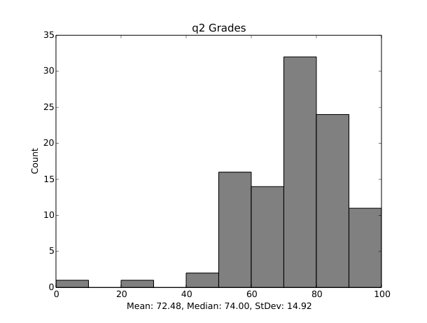
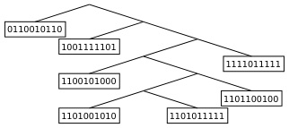
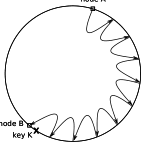
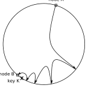
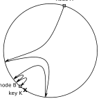
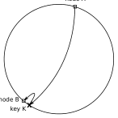

# MIT 6.824/6.5840 2014: Quiz 2: Official solutions

> Copied from the original: <https://pdos.csail.mit.edu/6.824/quizzes.html>. Text and figures are taken from the PDF as is; nothing was answered or rewritten. The original PDF is in this folder.

---

**Page 1**

&emsp;&emsp;&emsp;&emsp;Department of Electrical Engineering and Computer Science 
&emsp;&emsp;MASSACHUSETTS INSTITUTE OF TECHNOLOGY

&emsp;&emsp;&emsp;&emsp;&emsp;&emsp;&emsp;**6.824 Spring 2014** 
&emsp;&emsp;&emsp;&emsp;**Quiz II Solutions**

&emsp;&emsp;&emsp;&emsp;&emsp;&emsp;Histogram of grade distribution

&emsp;&emsp;&emsp;&emsp;&emsp;&emsp;&emsp;&emsp;1

---

**Page 2**

**I**   **Memory models**

Ben writes the following program in a variant of Go that guarantees a sequentially consistent memory model:

var a string = "hello" 
var done bool

func main() { 
done = false; 
go func() { 
&emsp;a = "world"; 
&emsp;done = true 
}() 
for !done { 
&emsp;/\* do nothing: spin until done \*/ 
} 
print(a) 
}

Ben’s hope is that this program prints “world” after the go routine finishes.

&emsp;&emsp;**1. \[4 points\]:** 
&emsp;&emsp;If the memory model is sequentially consistent, as in IVY, what is the output of this program? (Explain 
&emsp;&emsp;briefly why.) 
&emsp;&emsp;**Answer:** world

&emsp;&emsp;&emsp;&emsp;&emsp;&emsp;&emsp;&emsp;2

---

**Page 3**

The actual Go memory model is as follows:

&emsp;A read r of a variable v is allowed to observe a write w to v if both of the following hold:

&emsp;&emsp;**A.** r does not happen before w. 
&emsp;&emsp;**B.** There is no other write w′ to v that happens after w but before r.

&emsp;To guarantee that a read r of a variable v observes a particular write w to v, ensure that w is the 
&emsp;only write r is allowed to observe. That is, r is guaranteed to observe w if both of the following 
&emsp;hold:

&emsp;&emsp;**A.** w happens before r. 
&emsp;&emsp;**B.** Any other write to the shared variable v either happens before w or after r.

&emsp;This pair of conditions is stronger than the first pair; it requires that there are no other writes 
&emsp;happening concurrently with w or r. 
&emsp;Within a single goroutine, there is no concurrency, so the two definitions are equivalent: a read r 
&emsp;observes the value written by the most recent write w to v. When multiple goroutines access a 
&emsp;shared variable v, they must use synchronization events to establish happens-before conditions 
&emsp;that ensure reads observe the desired writes.

&emsp;**2. \[4 points\]:** 
&emsp;If Ben compiles and runs the same program as before in the real Go memory model, what are all of the 
&emsp;possible outcomes that Ben can observe when compiling and running this program? (Briefly explain.) 
&emsp;**Answer:** Several outcomes: 
&emsp;&emsp;• “world”, since the rules allow all writes to be immediately visible. 
&emsp;&emsp;• “hello”, since the rules do not require writes to one variable to be visible even if writes to another 
&emsp;&emsp;&emsp;variable are. 
&emsp;&emsp;• doesn’t terminate, since there’s no happens-before ordering between done = true and the for 
&emsp;&emsp;&emsp;!done loop.

&emsp;**3. \[2 points\]:** If the outcomes are the same under IVY and Go, why are they the same? If they are 
&emsp;not the same, why are they different? 
&emsp;**Answer:** Different: IVY provides sequential consistency, and Go has a more relaxed memory model.

&emsp;&emsp;&emsp;&emsp;&emsp;&emsp;&emsp;&emsp;3

---

**Page 4**

**4. \[4 points\]:** 
Imagine the program from the previous question runs on TreadMarks, with the go routine running on a 
different machine. What are the possible outcomes? Briefly explain why. 
**Answer:** The only outcome is the program not terminating (spinning forever), because the updates are 
never sent.

**5. \[4 points\]:** 
How would you change the program to ensure that the desired behavior (outputting “world”) happens 
under TreadMarks? 
**Answer:** Update the shared variables a and done while holding a lock, and read them while holding 
a lock. Alternatively (not intended but still correct), just simplify the program: func main() { 
print(“world”); }

&emsp;&emsp;&emsp;&emsp;&emsp;&emsp;&emsp;&emsp;4

---

**Page 5**

**II**   **Ficus**

Consider a single file f and 4 hosts: H1, H2, H3, and H4. f has a version vector associated with it with 4 
entries, one for each host. Assume the initial version vector is \[0, 0, 0, 0\].

Let’s say we have the following update and synchronization pattern:

H1: f = 1   -\>H2   -\> H4 
H2:   f = 2   -\> H4 
H3: 
H4:   cat f   cat f

&emsp;**6. \[4 points\]:** What will be the output of the two cat statements of f on H4? 
&emsp;**Answer:** 2, 2

&emsp;**7. \[4 points\]:** What is the version of f at H4 at the first “cat”? 
&emsp;**Answer:** \[1, 1, 0, 0\]

&emsp;**8. \[4 points\]:** What is the version of f that H1 sends to H4 when synchronizing? 
&emsp;**Answer:** \[1, 0, 0, 0\]

&emsp;&emsp;&emsp;&emsp;&emsp;&emsp;&emsp;&emsp;5

---

**Page 6**

Consider the following update and synchronization pattern:

H1: f = 1   -\>H2   f = 3   -\> H4 
H2:   f = 2   -\> H4 
H3: 
H4:   cat f   cat f

&emsp;**9. \[4 points\]:** What will be the output of the two cat statements of f on H4? Explain using version 
&emsp;vectors. 
&emsp;**Answer:** “2”, then some kind of error due to a conflict for the second cat. Version vector from H1 
&emsp;cannot be ordered with H4’s version vector, when H1 syncs with H4.

&emsp;&emsp;&emsp;&emsp;&emsp;&emsp;&emsp;&emsp;6

---

**Page 7**

**III**   **Bayou**

In Bayou each update has a time stamp that consists of three components: a commit sequence number (CSN), 
a local time stamp, and a node identifier. The commit sequence number may be unknown for an update if a 
host hasn’t synchronized with the central server. Consider the following scenario with a shared calendar, 3 
hosts and a central server (S):

H1:   "10am Bob"   -\>H2 
H2:   "11am Alice"   -\> S 
H3: "10am Ben"   -\> S

Assume that the local time stamps start at 0 and central server’s CSN at 0. Both local time stamps and CSNs 
are bumped prior to assigning a value to a new update. For example, H1’s calendar update is stamped with \[-, 
1, H1\]. Further, assume that when nodes A and B synchronize, each node’s clock becomes the max of the two 
node clocks before the sync.

&emsp;&emsp;**10. \[4 points\]:** 
&emsp;What is the time stamp for H2’s update to the calendar before it synchronizes with S? Explain briefly 
&emsp;why. 
&emsp;**Answer:** \[-, 2, H2\]. H2 updates its local time stamp counter after H1 syncs with its.

&emsp;&emsp;**11. \[4 points\]:** 
&emsp;What are the time stamp for H1 and H2’s update to the calendar after synchronizing with S? Briefly 
&emsp;&emsp;explain why. 
&emsp;**Answer:** \[2, 1, H1\], \[3, 2, H2\]. H3 sneaks in first, so it gets the first CSN.

&emsp;&emsp;**12. \[4 points\]:** 
&emsp;After the above events, H4 syncs with H2 and then with H3. What is the displayed content of the 
&emsp;&emsp;shared calendar on H4 for 10am and 11am, in two cases: first, after syncing with H2, and second, after 
&emsp;&emsp;syncing with H3? Explain briefly why. 
&emsp;**Answer:** For both cases, the answer is the same, because H3 has no new updates relative to H2. The 
&emsp;&emsp;specific answer depends on how conflicts are resolved. If the conflicting update gets shifted to the next 
&emsp;&emsp;time slot, then the answer is (for both): “10am Ben” and “11am Bob” (and then “Noon Alice”). If the 
&emsp;&emsp;conflicting update is shifted to some other time slot, then the answer is (for both): “10am Ben” and 
&emsp;“11am Alice”.

&emsp;&emsp;&emsp;&emsp;&emsp;&emsp;&emsp;&emsp;7

---

**Page 8**

**13. \[4 points\]:** 
When the authors of Bayou developed that system, Paxos was not yet widely known or appreciated in 
the broader community. Now that you are all Paxos experts, do you think Bayou should be re-designed 
around the idea of using Paxos to assign CSNs across all of the nodes, instead of relying on a single 
server? Explain your reasoning. 
**Answer:** Bad idea. Nodes may be offline, might never get a majority.

&emsp;&emsp;&emsp;&emsp;&emsp;&emsp;&emsp;&emsp;8

---

**Page 9**

**IV**   **PNUTS**

&emsp;**14. \[8 points\]:** 
&emsp;Consider the following traces of invocations and responses made by a single client process in PNUTS. 
&emsp;For each, say whether a client could observe this behavior on PNUTS (by marking True), or a client 
&emsp;could never observe this on PNUTS (by marking False). Assume there are no failures (either servers or 
&emsp;network). Assume there can be other concurrent clients. 
&emsp;&emsp;&emsp;&emsp;&emsp;&emsp;&emsp;Read-latest("foo") →("xx", 3.7) 
**A. True / False** 
&emsp;&emsp;&emsp;&emsp;&emsp;&emsp;&emsp;&emsp;Read-any("foo") →("xx", 3.5) 
&emsp;**Answer:** True. First goes to master in another data center. Second goes to a stale copy in local data 
&emsp;center. 
&emsp;&emsp;&emsp;&emsp;&emsp;&emsp;&emsp;Read-any("foo") →("xx", 3.7) 
**B. True / False** 
&emsp;&emsp;&emsp;&emsp;&emsp;&emsp;&emsp;Read-any("foo") →("xx", 3.5) 
&emsp;**Answer:** False. Local storage unit never rolls back, and client always talks to local data center when 
&emsp;using read-any. 
&emsp;&emsp;&emsp;&emsp;&emsp;&emsp;&emsp;&emsp;Read-latest("foo")   →("xx", 3.7) 
Read-any("foo")**C. True / False**→("xx", 3.5) 
&emsp;&emsp;&emsp;&emsp;&emsp;&emsp;&emsp;Read-critical("foo", 3.6) →("xx", 3.6) 
&emsp;**Answer:** True. First goes to master in another data center. Second goes to local data center, sees stale 
&emsp;data. Third goes to local data center again, which by now received another update bumping it to version 
&emsp;3.6. 
&emsp;&emsp;&emsp;&emsp;&emsp;&emsp;&emsp;&emsp;Read-latest("foo")   →("xx", 3.7) 
**D. True / False**   Read-critical("foo", 3.6) →("xx", 3.6) 
&emsp;&emsp;&emsp;&emsp;&emsp;&emsp;&emsp;&emsp;Read-any("foo")   →("xx", 3.5) 
&emsp;**Answer:** False. Since read-latest returned 3.7, we know master is at version 3.7. Since read-critical 
&emsp;returned 3.6, we know it went to the local data center, and not the master; and moreover, the local data 
&emsp;center has version 3.6. At this point, read-any cannot return 3.5, because the local data center must 
&emsp;have 3.6. 
&emsp;&emsp;&emsp;&emsp;&emsp;&emsp;&emsp;Read-any("foo")   →("xx", 3.5) 
**E. True / False**   Write("foo", "yy") →3.7 
&emsp;&emsp;&emsp;&emsp;&emsp;&emsp;&emsp;Read-any("foo")   →("xx", 3.6) 
&emsp;**Answer:** True. The first read went to the local data center. The write went to a master in another data 
&emsp;center. The last read went to the local data center again, which by now received another update that 
&emsp;was in flight at some point since the first read. 
&emsp;&emsp;&emsp;&emsp;&emsp;&emsp;&emsp;&emsp;Read-latest("foo")   →("xx", 3.5) 
**F. True / False**   Test-and-set-write("foo", 3.5, "yy") →false (failed) 
&emsp;&emsp;&emsp;&emsp;&emsp;&emsp;&emsp;&emsp;Read-latest("foo")→("yy", 3.6) 
&emsp;**Answer:** True. The test-and-set failed but some other client wrote “yy”.

&emsp;&emsp;&emsp;&emsp;&emsp;&emsp;&emsp;&emsp;9

---

**Page 10**

&emsp;For the next trace, assume that no other clients are active aside from the client whose trace is shown 
&emsp;(but still no failures): 
&emsp;&emsp;&emsp;&emsp;&emsp;&emsp;Read-latest("foo")→("xx", 3.5) 
&emsp;&emsp;&emsp;&emsp;&emsp;&emsp;&emsp;&emsp;Write("foo", "yy") →3.6 
Read-any("foo")**G. True / False**→("yy", 3.6) 
&emsp;&emsp;&emsp;&emsp;&emsp;&emsp;&emsp;&emsp;Write("foo", "zz") →3.7 
&emsp;&emsp;&emsp;&emsp;&emsp;&emsp;&emsp;Read-any("foo")→("yy", 3.6) 
&emsp;**Answer:** True. The write went to another data center, and in the first case it propagated to the local 
&emsp;DC in time, but in the second case it didn’t propagate to the local DC in time for read-any. 
&emsp;&emsp;&emsp;&emsp;&emsp;&emsp;Read-latest("foo")   →("xx", 3.1) 
&emsp;&emsp;&emsp;&emsp;&emsp;&emsp;&emsp;&emsp;Write("foo", "yy") →3.2 
&emsp;&emsp;&emsp;&emsp;&emsp;&emsp;&emsp;&emsp;. . .   →... 
**H. True / False**   Write("foo", "yy") →3.9 
&emsp;&emsp;&emsp;&emsp;&emsp;&emsp;&emsp;Read-any("foo")   →("yy", 3.9) 
&emsp;&emsp;&emsp;&emsp;&emsp;&emsp;&emsp;&emsp;Write("foo", "zz") →3.10 
&emsp;&emsp;&emsp;&emsp;&emsp;&emsp;&emsp;Read-any("foo")→("yy", 3.9) 
&emsp;**Answer:** False. After 3 writes, PNUTS migrates the record to the local data center. Thus, the last write 
&emsp;must be visible to the last read-any.

&emsp;&emsp;&emsp;&emsp;&emsp;&emsp;&emsp;&emsp;10

---

**Page 11**

**15. \[8 points\]:** 
Alyssa P. Hacker is writing a Twitter-like application on top of PNUTS. When a user posts a new 
message, the application sends an email to the user’s friends. Assume that each user has a single 
PNUTS record, storing a list of all messages from that user. Assume that the user’s friends are stored 
elsewhere. The application has two core functions: post(username, friendlist, msg), used by 
a user username with friends in friendlist to post message msg, and view(username), used by 
anyone to view the list of messages from username. 
Sketch out the pseudocode for these two functions below, trying to achieve the lowest latency whenever 
possible. Assume you have access to a function that sends email. You can modify the function 
signatures (arguments or return values) as needed, as long as you describe the semantics of your 
new function signature. The post function must send an email message pointing to a URL, which 
corresponds to some invocation of view; the email cannot contain the posted message in the email 
body. 
**Pseudocode:** 
**Answer:**

post(username, friendlist, msg): 
list, ver = read-any(username) 
while not test-and-set-write(username, ver, list + \[msg\]): 
&emsp;list, ver = read-latest(username) 
for u in friendlist: 
&emsp;email(u, make\_post\_url(username, ver+1))

view(username, ver): 
return read-critical(username, ver)

&emsp;&emsp;&emsp;&emsp;&emsp;&emsp;&emsp;&emsp;11

---

**Page 12**

**V**   **Bitcoin**

Ben Bitdiddle is writing his own implementation of a Bitcoin node. He is worried the blockchain grows 
without bound, so instead of storing the entire blockchain, his client stores:

&emsp;• The last block in the blockchain, last, and 
&emsp;• A list of transactions that have not been spent yet, unspent.

When Ben’s node receives a new block, it performs all of the standard checks that a normal Bitcoin node 
performs: it verifies that the new block chains to last, verifies that all transactions listed in the new block 
are legitimate (i.e., each of them chains to a previously unspent transaction listed in unspent), verifies that 
the new block hash is less than the target, etc. 
Ben’s node then updates the state accordingly, setting last to the new block and updating unspent (removing 
transactions that have been spent, and adding new unspent transactions that are unspent).

&emsp;**16. \[4 points\]:** 
&emsp;Is there a situation where Ben’s node can be tricked into accepting a transaction (e.g., double-spending) 
&emsp;that wouldn’t be accepted by a standard Bitcoin node? 
&emsp;**Answer:** We accepted either “No” or a well-described problem that arises when an adversary crafts two 
&emsp;transactions (double-spending), gets lucky creating two blocks around the same time, one containing 
&emsp;each of the transactions, feeds one block to Ben and one block to the rest of the Bitcoin network. At 
&emsp;this point, since Ben has trouble switching between forks (see next question), Ben might never learn 
&emsp;that his transaction was not widely accepted; the adversary can keep (slowly) mining blocks on Ben’s 
&emsp;fork, to eventually convince Ben that his transaction is valid (i.e., 5 more blocks have appeared after it).

&emsp;**17. \[4 points\]:** 
&emsp;Are there any other problematic situations that might arise with Ben’s node that wouldn’t arise with a 
&emsp;standard Bitcoin node? 
&emsp;**Answer:** Yes: Ben’s node is unable to resolve forks without re-downloading the whole blockchain.

&emsp;&emsp;&emsp;&emsp;&emsp;&emsp;&emsp;&emsp;12

---

**Page 13**

**VI**   **Lab 4**

&emsp;**18. \[10 points\]:** 
&emsp;Lab 4 includes the following hint:

&emsp;&emsp;&emsp;Hint: Think about how should the shardkv client and server deal with ErrWrongGroup. 
&emsp;&emsp;&emsp;Should the client change the sequence number if it receives ErrWrongGroup? Should the 
&emsp;&emsp;&emsp;server update the client state if it returns ErrWrongGroup when executing a Get/Put request?

&emsp;Describe a sequence of events that demonstrates a problem if the client changes the sequence number 
&emsp;when it receives ErrWrongGroup. 
&emsp;**Answer:** Client sent request, lost reply, resent with new seq number, group moved, got ErrWrongGroup, 
&emsp;resent to new group, at which point the operation gets applied again.

&emsp;&emsp;&emsp;&emsp;&emsp;&emsp;&emsp;&emsp;13

---

**Page 14**

**VII**   **Kademlia**

&emsp;**19. \[4 points\]:** Emily A. Cad wrote a Kademlia client. Ben sent Emily a memory dump of his client, 
&emsp;out of which Emily was able to reconstruct Ben’s routing table:

&emsp;Recall that when constructing its routing table, a client splits a k-bucket U into two k-buckets only if 
&emsp;searching for the node ID in the tree reaches U. What is Ben’s node ID? Choose one answer below:

&emsp;**A.** It is 0110010110. 
&emsp;**B.** It is 1101001010. 
&emsp;**C.** It is 1101011111. 
&emsp;**D.** It starts with 11010, and is not B, nor C. 
&emsp;**E.** Either B or C.

&emsp;**Answer:** D. IDs are added to the tree when Ben’s client receives messages from Ben’s peers. It is 
&emsp;those peer addresses that are added to the tree, so Ben’s ID should not be in the tree. The structure of 
&emsp;the tree is determined by the splits, providing Ben’s ID’s prefix.

&emsp;**20. \[4 points\]:** 
&emsp;Node A in a Kademlia network is looking up a key K, for which node B is responsible. Which of 
&emsp;the following would be most representative of the lookup using Kademlia’s XOR metric? Assume 
&emsp;α = k = 1, and that the nodes have correct routing tables, i.e., in every client, if a node exists in a 
&emsp;k-bucket’s range, then that k-bucket is not empty. 
&emsp;**Answer:** C. The routing tables are built such that at every hop, the lookup gets “twice” closer to the 
&emsp;queried key, leaving answers B and C. The traversed nodes have more and more prefix bits in common 
&emsp;with the queried key, but the actual numeric ID might increase and decrease throughout the run (as 
&emsp;in C). Also, node A is in the right half (would have prefix 0\*), while the key K and node B are in the 
&emsp;left half (with prefix 1\*), the first hop should jump to from A to a node on the left half. Answer A has 
&emsp;constant-size jumps (should be decreasing in size). Answer D sends a query to a node with ID K, but 
&emsp;there cannot be a node there because question states B is responsible for K (so it is the closest node).

&emsp;&emsp;&emsp;&emsp;&emsp;&emsp;&emsp;&emsp;14

---

**Page 15**

&emsp;&emsp;&emsp;&emsp;&emsp;&emsp;&emsp;&emsp;node Anode A   node A

&emsp;&emsp;&emsp;&emsp;&emsp;&emsp;&emsp;&emsp;(a)(a)   (b)

&emsp;&emsp;&emsp;&emsp;&emsp;&emsp;&emsp;&emsp;node A   node A

&emsp;&emsp;&emsp;&emsp;&emsp;&emsp;&emsp;&emsp;(c)   (d)

**VIII**   **Operational systems**

&emsp;**21. \[4 points\]:** 
&emsp;Ben Bitdiddle has built a distributed system, and to help him debug problems, he put in many print 
&emsp;statements throughout the code (often multiple print statements in a single function) that get redirected 
&emsp;to a log file. Name three problems that Ben is likely to run into as he scales up his system. 
&emsp;**Answer:** Logs grow to a large size and require their own infrastructure. Print statements should 
&emsp;include request IDs, and be correlated with one another. Print statements might not be reporting enough 
&emsp;information. Print statements might be hard to parse in an automated fashion to look for problems.

&emsp;&emsp;&emsp;&emsp;&emsp;&emsp;&emsp;&emsp;15

---

**Page 16**

**IX**   **6.824**

We’d like to hear your opinions about 6.824. Any answer, except no answer, will receive full credit.

&emsp;**22. \[2 points\]:** What would you recommend changing for next year? 
&emsp;**Answer:**   More time for final project. More answers in lecture notes (no unanswered questions). 
&emsp;Record lectures on video. Avoid race conditions in lab code. More non-storage topics (e.g., Spark). 
&emsp;Avoid inter-lab dependencies, or release solutions (x2). Conceptual overview of paper before reading 
&emsp;it. Describe background for paper before reading it. More options for final project (x8; be less strict 
&emsp;about topic choice). More time for final project (x3). Broader labs (x4; Spark, P2P). No hard deadlines 
&emsp;for homework. Late days instead of late hours. Too much Paxos in labs (x2). Clarify expectations 
&emsp;for final project (x2). More focus on key concepts, not old papers (x3). Recitations. Ask students to 
&emsp;scribe (instead of staff posting lecture notes). Fewer papers and more time on each paper (x2). Better 
&emsp;code review interface (x2). Provide quizzes from past years. Make guest lecturers more relevant. More 
&emsp;coding, less quizzes (x5). Better lab test cases. Fewer guest lectures. Explaining lab 2 could use more 
&emsp;love; it is difficult to understand why it works. Midway check on project. A review of concurrency 
&emsp;models. Don’t cover same topic too much (Ficus, Bayou, Ivy and TreadMarks). Make the lab tests 
&emsp;more mean. In addition to Ficus and Bayou, add Tra. Code reviews and required questions+answers 
&emsp;for lecture were almost useless. More focus on Kademlia and Bitcoin. Problem sets instead of quizzes. 
&emsp;More weight on final project. More recent papers.

&emsp;**23. \[2 points\]:** Is there one paper out of the ones we have covered in the second half of 6.824 that 
&emsp;you think we should definitely remove next year? If not, feel free to say that. 
&emsp;**Answer:** Bitcoin (covered in 2 other classes). Ficus (x4; replace with Tra). PNUTS (x5; unclear; 
&emsp;already in 6.033). AnalogicFS (x4; silly). Bayou (x4; too simple, long). Dynamo (x2; similar to 
&emsp;PNUTS). IVY or Treadmarks (x2; too much DSM). Treadmarks. Ficus or Bayou (redundant). Akamai 
&emsp;(x7). Kademlia (x2; unclear). Spark. Add Raft. Add something on MPI.

&emsp;&emsp;&emsp;&emsp;&emsp;&emsp;&emsp;&emsp;End of Quiz

&emsp;&emsp;&emsp;&emsp;&emsp;&emsp;&emsp;&emsp;16

