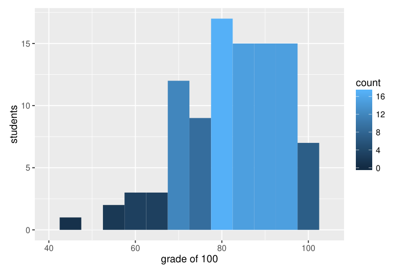

# MIT 6.824/6.5840 2016: Quiz 1: Official solutions

> Copied from the original: <https://pdos.csail.mit.edu/6.824/quizzes.html>. Text and figures are taken from the PDF as is; nothing was answered or rewritten. The original PDF is in this folder.

---

**Page 1**

&emsp;&emsp;&emsp;&emsp;&emsp;&emsp;&emsp;&emsp;Department of Electrical Engineering and Computer Science 
&emsp;&emsp;&emsp;&emsp;&emsp;&emsp;MASSACHUSETTS INSTITUTE OF TECHNOLOGY

&emsp;&emsp;&emsp;&emsp;**6.824 Distributed System Engineering: Spring 2016** 
&emsp;&emsp;&emsp;&emsp;&emsp;&emsp;&emsp;&emsp;**Exam I**

Write your name on this cover sheet. If you tear out any sheets, please write your name on them. 
You have 80 minutes to complete this quiz. 
Some questions may be much harder than others. Read them all through first and attack them in 
the order that allows you to make the most progress. If you find a question ambiguous, write down 
any assumptions you make. Write neatly. In order to receive full credit you must answer each 
question as precisely as possible. 
You may use class notes, papers, and lab material. You may read them on your laptop, but you are 
not allowed to use any network. For example, you may not look at web sites or communicate with 
anyone.

&emsp;**I (14)**   **II (7)**   **III (7)**   **IV (21)**   **V (14)**   **VI (14)**   **VII (21)**   **VIII (2)**   **Total (100)**

**Name:**

---

**Page 2**

&emsp;&emsp;&emsp;&emsp;&emsp;&emsp;Grade histogram for Exam 1

&emsp;&emsp;&emsp;&emsp;&emsp;&emsp;&emsp;&emsp;max   =   100 
&emsp;&emsp;&emsp;&emsp;&emsp;&emsp;&emsp;&emsp;median   =   84 
&emsp;&emsp;&emsp;&emsp;&emsp;&emsp;&emsp;&emsp;µ   =   82.4 
&emsp;&emsp;&emsp;&emsp;&emsp;&emsp;&emsp;&emsp;σ   =   11.3

---

**Page 3**

6.824 Spring 2016, Exam 1   Page 3 of 17

**I**   **Lab 1**

Ben Bitdiddle is writing a simplified version of the schedule() function for the MapReduce lab. This 
function takes in an array of Tasks for a particular map or reduce phase and sends them to available 
workers. The function should return once all of the tasks in this phase have been completed.

1 func (mr \*Master) schedule(tasks \[\]Task) { 
2   done := 0 
3 
4   for \_, task := range tasks { 
5   go func(task Task) { 
6 
7   // Get an available worker and give them the task to run. 
8   worker = \<-mr.registerChannel 
9   call(worker, "Worker.DoTask", task) 
10 
11   // Tell the master this task is done. 
12   done++ 
13 
14   // Reregister the worker as available. 
15   mr.registerChannel \<- worker 
16 
17   }(task) 
18   } 
19 
20   // Wait for all of the jobs to return. 
21   for { 
22   if done == len(tasks) { 
23   break 
24   } 
25   } 
26 
27   return 
28 }

Ben notices that schedule() sometimes never finishes. However, he can see from looking at the 
output files that the workers have completed all of the tasks in the phase.

---

**Page 4**

6.824 Spring 2016, Exam 1   Page 4 of 17

&emsp;**1. \[7 points\]:** Identify a race in Ben’s code that can cause schedule() to never return.

**Answer:** There is a race at line 12: if two threads update done concurrently, they increase by 1 
instead of 2. Read/writes of done must be protected under a lock.

After fixing the race in the previous question, Ben’s code passes all of the MapReduce tests. Now 
he hopes to make his implementation faster by returning an available worker to mr.registerChannel 
as soon as possible, that is, before incrementing done. He implements this by moving line 15 so 
it comes right after line 9. However, he notices that with this new plan schedule() never returns.

&emsp;**2. \[7 points\]:** Why does this happen?

**Answer:** For the last few tasks, no go routine will be reading from the register channel, so the sends 
will block, preventing done from being updated, which prevents schedule from returning.

---

**Page 5**

6.824 Spring 2016, Exam 1   Page 5 of 17

**II**   **GFS**

Alice uses GFS (as described by Ghemawat et al.) to store the output of her MapReduce job. One 
task of the MapReduce job uses a single write call to write MapReduce records to a pre-existing 
“out.txt” file. That is, her job overwrites “out.txt”, which was created by a previous run of her job 
(she doesn’t care about any of the old content). Unfortunately, the GFS write call returns an error. 
A check application runs on another machine while the MapReduce job is attempting to write. 
The check application opens “out.txt”, reads it, and closes the file. To Alice’s surprise the check 
application reads the bytes Alice’s MapReduce job tried to write to “out.txt”, even though the write 
reported an error to the MapReduce job. If she runs the check application again, however, it reads 
the old bytes.

&emsp;**3. \[7 points\]:** Describe a scenario in which this can happen.

**Answer:** Client 1 opens a file, receives a list of chunk servers, and starts writing records. Client 
2 also opens the file and receives a list of chunk servers. While client 1 is writing, the primary 
updates replica 1 for the chunk being written, but fails to update replica 2, perhaps due a network 
failure. Client 2 reads from replica 1 and reads the new bytes. The second read goes to replica 2 
(reads can go to any replica), and thus reads the old bytes.

---

**Page 6**

6.824 Spring 2016, Exam 1   Page 6 of 17

**III**   **VM-FT**

After reading the VM-FT paper (by Scales et al.), Ben explores running the GFS master on VM-FT. 
He reasons that, without modifying the existing GFS master code, he can avoid the master being 
a single point of failure. Unfortunately, he finds that replicating the master with VM-FT results in 
much slower performance than with an unreplicated master: even GFS operations that merely fetch 
data from the master take significantly longer with the master running on VM-FT.

&emsp;**4. \[7 points\]:** Explain what causes this decrease in performance.

**Answer:** The primary in VM-FT cannot respond to a client request (i.e., send a network packet) 
until the primary has received an acknowledgement from a backup for that event.

---

**Page 7**

6.824 Spring 2016, Exam 1   Page 7 of 17

**IV**   **Lab 2**

Ben is having trouble getting his Lab 2 to work. Here’s the part of his code that sends out Appen- 
dEntries RPCs when a server acts as leader: 
&emsp;&emsp;1 for { 
&emsp;&emsp;2   // ... omitted code that waits either for a new client 
&emsp;&emsp;3   // request or for a heartbeat interval. 
&emsp;&emsp;4 
&emsp;&emsp;5   for i, p := range rf.peers { 
&emsp;&emsp;6   if i == rf.me { 
&emsp;&emsp;7   continue 
&emsp;&emsp;8   } 
&emsp;&emsp;9   rf.mu.Lock() 
&emsp;10   if rf.state != LEADER { 
&emsp;11   rf.mu.Unlock() 
&emsp;12   break 
&emsp;13   } 
&emsp;14   n := rf.nextIndex\[i\] 
&emsp;15   args := AppendEntriesArgs{ 
&emsp;16   // ... 
&emsp;17   Term: rf.currentTerm, 
&emsp;18   PrevLogIndex: n-1, 
&emsp;19   PrevLogTerm: rf.log\[n-1\].Term, 
&emsp;20   Entries: make(\[\]LogEntry, len(rf.log\[n:\])), 
&emsp;21   } 
&emsp;22   copy(args.Entries, rf.log\[n:\]) 
&emsp;23   rf.mu.Unlock() 
&emsp;24 
&emsp;25   var reply AppendEntriesReply 
&emsp;26   ok := p.Call("Raft.AppendEntries", args, &reply) 
&emsp;27   if ok && reply.Success { 
&emsp;28   rf.mu.Lock() 
&emsp;29   rf.nextIndex\[i\] = len(rf.log) 
&emsp;30   rf.matchIndex\[i\] = rf.nextIndex\[i\] - 1 
&emsp;31   rf.mu.Unlock() 
&emsp;32   } 
&emsp;33   } 
&emsp;34   // update commitIndex based on rf.matchIndex 
&emsp;35   // ... 
&emsp;36 }

---

**Page 8**

6.824 Spring 2016, Exam 1   Page 8 of 17

&emsp;**5. \[7 points\]:** Ben’s implementation often fails tests because it commits too slowly. De- 
&emsp;scribe a change to his code that will speed it up significantly when there are many Raft 
&emsp;servers.

**Answer:** Send the RPCs asynchronously, and in parallel.

&emsp;**6.**   **\[7 points\]:** Ben discovers that his servers often commit different commands for the 
&emsp;same index in the log. He discovers that this happens when the winner of an election was the 
&emsp;leader in a previous term; in that situation the leader’s matchIndex entries sometimes contain 
&emsp;inexplicably large values shortly after the election, even though Ben’s implementation sets 
&emsp;nextIndex and matchIndex entries to zero when a server is elected leader. Explain how the 
&emsp;code above can cause what Ben sees.

**Answer:**   A delayed reply to an AppendEntries RPC may arrive after the re-election, causing 
matchIndex to be modified. The reply handling code should check that the term hasn’t changed.

---

**Page 9**

6.824 Spring 2016, Exam 1   Page 9 of 17

&emsp;**7. \[7 points\]:** After fixing the problem identified in the previous question, Ben finds that a 
&emsp;leader will sometimes commit a log entry that has not been accepted by a majority of servers. 
&emsp;He finds that this is because the leader sets matchIndex too high after hearing a response from 
&emsp;an AppendEntries RPC. Explain how Ben’s code for updating nextIndex and matchIndex is 
&emsp;wrong.

**Answer:** They should be updated to the log length as of when the AppendEntries was sent, not to 
the current log length.

---

**Page 10**

6.824 Spring 2016, Exam 1   Page 10 of 17

**V**   **Zookeeper**

In Zookeeper (as described by Hunt et al.), any server can respond to a read operation such as 
GetData. In lab 3, read operations such as Get are served by the Raft leader after committing 
the Get operation in Raft log. As a result, read operations in Zookeeper are fast and read operations 
in lab 3 are slow.

&emsp;**8. \[7 points\]:** What does Zookeeper sacrifice compared to lab 3 by allowing each server to 
&emsp;respond to a read operation? (Briefly explain your answer.)

**Answer:** ZooKeeper doesn’t provide linearizable Get operations.

A Zookeeper client C1 calls setData("z", 27) at server S1 to change the value of znode z 
to 27 from its previous value of 0. No further setData calls happen after that one call. Another 
client C2 calls getData("z") at server S1 and reads 27. Now S1 fails and client C2 switches to 
server S2.

&emsp;**9. \[7 points\]:** If client C2 calls getData("z") at server S2 does Zookeeper guarantee 
&emsp;that the client will observe 27 rather than 0? (Briefly explain your answer.)

**Answer:** Yes, Zookeeper will guarantee this thanks to the zxid included with all client requests. A 
Zookeeper server will ensure its state is at least as up to date as the client’s zxid before responding.

---

**Page 11**

6.824 Spring 2016, Exam 1   Page 11 of 17

**VI**   **FaRM**

You’re building a simple auction system using FaRM to store the bids (see the paper “No compro- 
mises: distributed transactions with consistency, availability, and performance”). Your application 
supports just one auction, with just two bidders. You store the two current bids in FaRM, in the 
bids\[\] array. Each user can bid any number of times with the bid() function, which returns a boolean 
indicating whether the bid is the highest so far. The function’s who argument is 0 or 1, and indi- 
cates which user is bidding. The return value from commit transaction() is true if the FaRM commit 
protocol committed the transaction, and false if it aborted.

// each user’s bid is a distinct FaRM object. 
type BidObject struct { 
value int 
// other stuff... 
}

// bids are initialized to zero. 
var bids \[2\]BidObject 
bids\[0\].value = 0 
bids\[1\].value = 0

bid(who, amount): 
start\_transaction() 
if amount \> bids\[0\].value && amount \> bids\[1\].value: 
&emsp;ret = true 
&emsp;bids\[who\].value = amount 
else: 
&emsp;ret = false 
if commit\_transaction(): 
&emsp;return ret 
else: 
&emsp;return false

Each bids\[\] array element is a separate FaRM object, with its own FaRM lock and version number.

---

**Page 12**

6.824 Spring 2016, Exam 1   Page 12 of 17

&emsp;**10.**   **\[7 points\]:** Suppose the bids array starts out containing zeroes, and there are calls 
&emsp;to bid(0,10) and bid(1,20) on different machines at roughly the same time (and no other 
&emsp;activity). Could the bid(1,20) call return false? Explain your answer in terms of the commit 
&emsp;protocol in the paper’s Figure 4.

**Answer:** Yes. Both transactions read the initial values of the two bid objects. bid(0,10) commits 
first, changing the version number of bids\[0\]. bid(1,20) then tries to commit, but its VALIDATE 
for bids\[0\] sees that the version number has changed, so it aborts.

&emsp;**11. \[7 points\]:** You can view FaRM’s VALIDATE as an optimization of LOCK for objects 
&emsp;that a transaction only reads. Suppose FaRM didn’t have this optimization – suppose one 
&emsp;were to eliminate the VALIDATE phase from Figure 4, and instead use LOCK for objects 
&emsp;that are just read as well as for objects that are written. Explain why this would likely hurt 
&emsp;performance.

**Answer:** Two reasons. First, concurrent commits involving just reads of the same object would 
cause conflicts and aborts with LOCK, but proceed in parallel with VALIDATE. Second, VALI- 
DATE is implemented as a one-sided read, which is fast because the server CPU isn’t involved. 
LOCK is a true RPC that has to be executed by the server CPU, so it’s slower.

---

**Page 13**

6.824 Spring 2016, Exam 1   Page 13 of 17

**VII**   **TreadMarks**

Consider the following program with shared variables x and y:

int x = 0; 
int y = 0;

int f() { 
&emsp;x = 10; 
}

int g() { 
&emsp;y = 11; 
}

int p() { 
&emsp;print x, y 
}

This is the entire program. 
For these questions, please assume that the compiler generates instructions that preserve the pro- 
gram order of loads and stores on each processor. 
Now consider the following scenario with time running from left to right:

Processor 1:   f();

Processor 2:   g();

Processor 3:   p();

---

**Page 14**

6.824 Spring 2016, Exam 1   Page 14 of 17

&emsp;**12. \[7 points\]:** For a sequentially-consistent shared-memory system please list all possible 
&emsp;outputs from Processor 3. (The stores to x and y complete as indicated by the time line. For 
&emsp;example, by the time processor 2 updates y, x has been updated.)

**Answer:** 10, 11.

Consider the same program running on TreadMarks (as described by Keleher et al.):

&emsp;**13. \[7 points\]:** For TreadMarks please list all possible outputs from Processor 3.

**Answer:** 10, 0; 0, 11; and 10, 11.

---

**Page 15**

6.824 Spring 2016, Exam 1   Page 15 of 17

Consider the following slight modification: Processor 3 prints only x by calling px and Processor 
4 prints only y by calling py.

int x = 0; 
int y = 0;

int f() { 
&emsp;acquire(x\_lock); // answer 
&emsp;x = 10; 
&emsp;release(x\_lock); // answer 
}

int g() { 
&emsp;acquire(y\_lock); // answer 
&emsp;y = 11; 
&emsp;release(y\_lock); // answer 
}

int px() { 
&emsp;acquire(x\_lock); // answer 
&emsp;print x; 
&emsp;release(x\_lock); // answer 
}

int py() { 
&emsp;acquire(y\_lock); // answer 
&emsp;print y; 
&emsp;release(y\_lock); // answer 
}

Processor 1:   f(); 
Processor 2:   g(); 
Processor 3:   px(); 
Processor 4:   py();

---

**Page 16**

6.824 Spring 2016, Exam 1   Page 16 of 17

&emsp;**14.**   **\[7 points\]:** Annotate f, g, px, and py in the above figure so that the program on 
&emsp;TreadMarks generates the same result as on a sequentially-consistent memory, but minimizes 
&emsp;communication overhead. (Briefly justify your annotations.)

**Answer:** See the lines marked “answer” added to the code above. The locks cause the readers to 
see the writes. Use of two different locks cause Processor 3 to only have to fetch the update to x, 
and Processor 4 to only have to fetch the update to y.

---

**Page 17**

6.824 Spring 2016, Exam 1   Page 17 of 17

**VIII**   **6.824**

&emsp;**15.**   **\[1 points\]:** Lab 2 turned out to be much harder than we anticipated. If you ran into 
&emsp;significant difficulties, what were they?

**Answer:** 16x Synchronization/concurrency; 13x Not following details in fig2; 8x No significant 
difficulties; 8x Overall design; 6x Too much code (all-or-nothing); 6x Edge cases; 5x Leader elec- 
tion; 4x Test cases/testing; 4x The optimization/performance; 3x Started too late; 2x Logs out of 
sync 
Debugging: 26x General (subtle bugs); 9x Locking; 7x Logging

&emsp;**16. \[0.5 points\]:** Which papers should we definitely keep for future years?

**Answer:** 60x Raft; 33x FaRM; 32x ZooKeeper; 26x GFS; 20x Bayou; 20x PNUTS; 17x Tread- 
Marks; 16x MapReduce; 10x Thor; 9x Dynamo; 4x VM-FT; 2x add Paxos; 1x add Spanner; 1x 
add FDS

&emsp;**17. \[0.5 points\]:** Is there any paper that you think we should delete?

**Answer:** 26x TreadMarks; 15x FaRM; 14x PNUTS; 13x Bayou; 11x VM-FT; 9x GFS; 9x MapRe- 
duce; 8x Thor; 1x ZooKeeper; 1x Dynamo

&emsp;&emsp;&emsp;&emsp;&emsp;&emsp;&emsp;&emsp;End of Exam I

