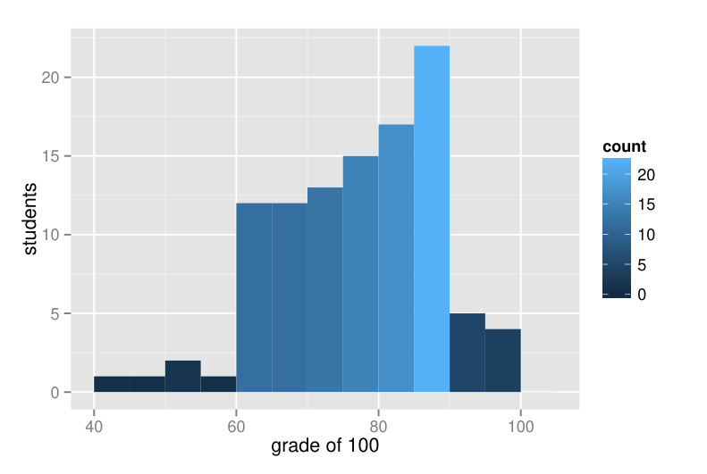
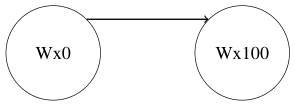
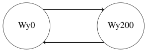
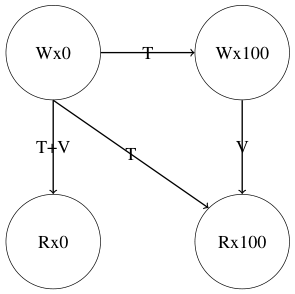
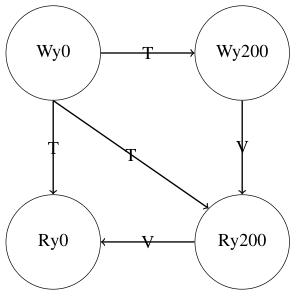

# MIT 6.824/6.5840 2017: Quiz 2: Official solutions

> Copied from the original: <https://pdos.csail.mit.edu/6.824/quizzes.html>. Text and figures are taken from the PDF as is; nothing was answered or rewritten. The original PDF is in this folder.

---

**Page 1**

&emsp;&emsp;&emsp;&emsp;&emsp;&emsp;&emsp;&emsp;Department of Electrical Engineering and Computer Science 
&emsp;&emsp;&emsp;&emsp;&emsp;&emsp;MASSACHUSETTS INSTITUTE OF TECHNOLOGY

&emsp;&emsp;&emsp;&emsp;**6.824 Distributed System Engineering: Spring 2017** 
&emsp;&emsp;&emsp;&emsp;&emsp;&emsp;&emsp;&emsp;**Exam II**

Write your name on this cover sheet. If you tear out any sheets, please write your name on them. 
You have 120 minutes to complete this quiz. 
Some questions may be much harder than others. Read them all through first and attack them in 
the order that allows you to make the most progress. If you find a question ambiguous, write down 
any assumptions you make. Write neatly. In order to receive full credit you must answer each 
question as precisely as possible. 
You may use class notes, papers, and lab material. You may read them on your laptop, but you are 
not allowed to use any network. For example, you may not look at web sites or communicate with 
anyone.

**I (12)**   **II (12)**   **III (6)**   **IV (12)**   **V (6)**   **VI (6)**   **VII (12)**   **VIII (18)**   **IX (12)**   **X (4)**   **Total (100)**

**Name:**

---

**Page 2**

&emsp;&emsp;&emsp;&emsp;&emsp;&emsp;Grade histogram for Exam 2

&emsp;&emsp;&emsp;&emsp;&emsp;&emsp;&emsp;&emsp;max   =   100 
&emsp;&emsp;&emsp;&emsp;&emsp;&emsp;&emsp;&emsp;median   =   77 
&emsp;&emsp;&emsp;&emsp;&emsp;&emsp;&emsp;&emsp;µ   =   76.84 
&emsp;&emsp;&emsp;&emsp;&emsp;&emsp;&emsp;&emsp;σ   =   11.3

---

**Page 3**

**I**   **Spark**

Consider the following Spark program as described in Section 2.2 of the paper Resilient Distributed 
Datasets: A Fault-Tolerant Abstraction for In-Memory Cluster Computing, by Zaharia et al:

1\. lines = spark.textFile("hdfs://...") 
2\. errors = lines.filter(\_.startsWith("ERROR")) 
3\. errors.persist() 
4\. errors.filter(\_.contains("MySQL")).count() 
5\. errors.filter(\_.contains("HDFS")) 
.map(\_.split(\\t)(3)).collect()

&emsp;**1.**   **\[6 points\]:** Mark the lines in the above program during whose execution an RDD is 
&emsp;materialized: that is, computed and saved in memory or persisted on disk for use in future 
&emsp;transformations. (Briefly explain your answer). 
&emsp;**Answer:** Line 4. Spark materializes RDDs only when computed and when marked as persist.

&emsp;**2. \[6 points\]:** Consider the following scenario. The input file is partitioned into 100 pieces 
&emsp;stored in HDFS. The program is executing line 5 on a cluster of 100 worker machines (these 
&emsp;are different machines than the HDFS servers). One worker machine loses power and does 
&emsp;not restart. Explain what data (if any) must be re-computed to recover. (Briefly explain your 
&emsp;answer.) 
&emsp;**Answer:** The worker was working on line 5 for one of the 100 partitions. That work needs 
&emsp;to be re-started on one of the 99 remaining workers. That worker will need one shard of 
&emsp;errors, which was was lost with the failed machine. So it will have re-read the input HDFS 
&emsp;file partition and re-execute the transformations in lines 2 and 5 for that partition.

---

**Page 4**

**II**   **Chord**

Consider the find successor function shown in Figure 4 in the paper Chord: a scalable peer- 
to-peer lookup service for internet applications by Stoica et al..

&emsp;**3. \[6 points\]:** If there are no failures, and node 0 in Figure 5(a) invokes find successor 
&emsp;for key 7, which nodes will node 0 contact to find the successor? Briefly explain. 
&emsp;**Answer:** Node 6

&emsp;**4. \[6 points\]:** If after node 6 has failed (but before stabilize has repaired any fingers) 
&emsp;node 0 invokes find successor for key 7 in Fig 5(a), how will find successor find 
&emsp;the right node? Which nodes will node 0 contact? Briefly explain. 
&emsp;**Answer:** 6, which times out, and then 3.

---

**Page 5**

**III**   **Dynamo**

After reading the paper Dynamo: Amazon’s Highly Available Key-value Store by DeCandia et 
al. Ben Bitdiddle is wondering what R and W values he should choose to achieve the strongest 
consistency. He runs Dynamo with N=3.

&emsp;**5.**   **\[6 points\]:** To make it most likely that a get will return the result of the latest put, 
&emsp;should Ben choose R=3 and W=1, or R=1 and W=3? Briefly explain. 
&emsp;**Answer:** R=1 and W=3. Suppose some servers fail. If W=1, then there’s a good chance that 
&emsp;the one machine with the up-to-date value failed, so even R=3 can’t find it. If W=3, then 
&emsp;R=1 is very likely to consult one of the two remaining fresh copies even if one fails.

---

**Page 6**

**IV**   **PBFT**

The paper Practical Byzantine fault tolerance by Castro and Liskov describes a protocol to handle 
compromised nodes in a replicated state machine.

&emsp;**6. \[6 points\]:** When a primary behaves incorrectly, PBFT initiates a view change to change 
&emsp;to a new primary. Is it possible that the old primary will become primary again in a later 
&emsp;view? Explain briefly. 
&emsp;**Answer:** Yes. Nodes are never ejected and which node is a primary is a function of the view 
&emsp;number. If the old primary was primary in view v, then it will become primary again in view 
&emsp;v+n, since the primary in a view is (v + n) mod n.

&emsp;**7.**   **\[6 points\]:** A PBFT node switches to a new primary if it receives a NEW-VIEW 
&emsp;request from the new primary with 2f+1 signed VIEW-CHANGE messages. Why does the 
&emsp;new primary include the signed VIEW-CHANGE messages in the NEW-VIEW message? 
&emsp;Briefly explain. 
&emsp;**Answer:** The primary maybe lying and so the nodes have to convince themselves that the 
&emsp;non-faulty nodes want to change to a new view. 2f + 1 is enough to convince a node that 
&emsp;enough non-faulty nodes are participating in the new view and have seen committed mes- 
&emsp;sages in previous views.

---

**Page 7**

**V**   **Bayou**

A friend of yours has not been paying much attention to 6.824 lectures or papers. Your friend 
sees that Bayou is described as being weakly consistent (Managing Update Conflicts in Bayou, a 
Weakly Connected Replicated Storage System, by Terry et al.). Your friend observes that in both 
Raft and Bayou, different replicas can have different contents; therefore, your friend claims that 
Raft also provides weak consistency. 
Imagine two versions of the paper’s meeting room scheduler (Section 2.1), one implemented with 
Bayou as described in the paper, and one implemented with the replicated state managed by Raft. 
The Raft version is able to execute operations only when a majority of the replicas is reachable; it 
doesn’t support disconnected operation. The Raft version does not need the Bayou primary (since 
Raft itself effectively commits operations).

&emsp;**8.**   **\[6 points\]:** Using the paper’s meeting room scheduler (Section 2.1) as an example, 
&emsp;explain **two** different situations in which the Bayou version exhibits significantly weaker 
&emsp;consistency than the Raft version. 
&emsp;**Answer:** 1. A client can observe results that disappear. For example, client 1 adds an entry 
&emsp;at 10am, which the user observes and may act on. Then, the client connects to the server and 
&emsp;may learn about a committed entry at 10am, which will replace the meeting that client 1 has 
&emsp;at 10am. 
&emsp;2\. Clients may observe different entries at 10am at the same time. For example, client 1 and 
&emsp;client 2 may have meeting 1 at 10am (because they synced), while client 3 and client 4 have 
&emsp;meeting 2 at 10am (because they synced with each other, but not with client 1 and 2.

---

**Page 8**

**VI**   **PNUTS**

Section 2.2 of the paper PNUTS: Yahoo!’s Hosted Data Serving Platform by Cooper et al. describes 
several read operations. The descriptions of read-any and read-latest imply that PNUTS 
executes them in different ways, since they have different properties.

&emsp;**9. \[6 points\]:** Explain how PNUTS executes them differently, focusing on the differences 
&emsp;that cause read-latest to have stronger consistency properties. 
&emsp;**Answer:** read-any consults the local region’s replica of the record, which may not have 
&emsp;seen recent writes. read-latest consults the master region’s copy of the record, which 
&emsp;has seen all completed writes.

---

**Page 9**

**VII**   **Existential Consistency**

Consider the paper Existential Consistency: Measuring and Understanding Consistency at Face- 
book, by Lu et al. 
Suppose the paper’s storage system holds two objects, x and y. Consider the following trace of 
reads and writes to x and y (in the style of the paper’s Figure 3):

C0: \|-Wx0-\| \|-Wy0-\| 
C1:   \|---------Wx100---------------\| 
C2:   \|---------Wy200---------------\| 
C3:   \|-Rx100-\|   \|-Ry0-\| 
C4:   \|-Ry200-\|   \|-Rx0-\|

The \|--...--\| lines indicate the time between when an operation starts and when it completes. 
Thus, for example, the Ry200 is concurrent with the Wx100, but the Ry200 is not concurrent 
with the Rx100. 
This trace is the result of the following events:

&emsp;• Client C0 writes zero to x and y, and the writes complete. 
&emsp;• Then two clients (C1 and C2) each issue a write at about the same time. C1’s write sets x to 
&emsp;100, and C2’s sets y to 200. 
&emsp;• A third client, C3, reads x and gets value 100; after its first read completes, C3 reads y and 
&emsp;gets value 0. 
&emsp;• A fourth client, C4, reads y and gets value 200; after its first read completes, C4 reads x and 
&emsp;gets value 0.

The paper’s principled linearizability checker (Section 3.2) is tracing both x and y, and the trace 
includes all the reads and writes mentioned above. The clock skew is zero (i.e., the clocks are all 
perfect), and the checker does **not** account for clock skew by expanding the invocation and response 
times. The logging is perfect—it has no losses. There are no failures, and no client actions other 
than those described above.

---

**Page 10**

**10. \[6 points\]:** Draw the graphs the linearizability checker would produce, in the style of 
Figure 4(c). Note that the checker considers each variable separately. 
The final graphs produced by the checker are as follows:

The graph for x is produced from the following intermediate graph for x (T is a time depen- 
dency and V is a value dependency):

The graph for y is produced from the following intermediate graph for y:

---

**Page 11**

**11. \[6 points\]:** Would the paper flag an anomaly in your graph? Briefly explain. 
**Answer:** Yes, because there is a cycle in the graph for y. There is a cycle because there is no 
total order consistent with all read and writes. For example, the reads and writes of C3 and 
C4 cannot be put in a total order that respects linearizability and is consistent with their local 
orders. The checker finds this problem (even though it analyzes x and y independently).

---

**Page 12**

**VIII**   **Bitcoin**

John owns one bitcoin, transferred to him in transaction T1 in block B1. He spends the coin in 
transaction T2 in block B2. A few hours later John realizes that the recipient public key he put into 
T2 is incorrect. He’d like to un-do transaction T2 so that he can spend his coin again. He modifies 
his Bitcoin peer software to generate a block B2a that has the same predecessor block as B2, but 
does not contain transaction T2. B2a is a valid block. After generating B2a, John’s peer sends the 
block to other Bitcoin peers.

&emsp;**12. \[6 points\]:** Explain why John’s actions are not likely to allow him to successfully spend 
&emsp;his coin again. 
&emsp;**Answer:** John’s fork of the blockchain will only be accepted by other Bitcoin peers if his 
&emsp;fork is longer than the main fork. It will likely take John so long to produce B2a that by then 
&emsp;the main blockchain will have many additional blocks, so no peer will accept B2a.

---

**Page 13**

Imagine that there are so many Bitcoin peers and miners operating on the MIT campus network 
that they make up one quarter of the total Bitcoin peers and mining CPU power. 
Late one Friday evening, MIT’s links to the Internet break. The links are not repaired until Monday 
morning, so MIT is disconnected from the Internet for more than two days. During that time, 
communication continues to work within the MIT campus net. The Bitcoin peers and miners 
inside MIT can all talk to each other (i.e. they flood transactions and blocks among themselves), 
so they form a functioning Bitcoin system. 
On Saturday, Alyssa attempts to double-spend in the following way. She owns a single bitcoin, 
which was transferred to her in a transaction that existed well before MIT’s network links failed. 
She sets up two laptops, initially with their network interfaces turned off, each with a copy of her 
Bitcoin private key and the Bitcoin wallet she uses. 
Alyssa connects one laptop to the MIT campus network and uses her bitcoin to buy an MIT T-shirt 
from a store on the campus network; the T-shirt costs an entire bitcoin. Her wallet software signs 
a transaction transferring the bitcoin to the store, and floods the transaction to some MIT peers so 
that they will incorporate the transaction into the next block. 
Then Alyssa takes her second laptop down the street to a cafe whose connection to the main Internet 
works (though of course she cannot contact any MIT computers from the cafe). She connects the 
laptop to the network, and buys a Stanford T-shirt from an online store; this T-shirt also costs a 
whole bitcoin. Her wallet software signs a transaction transferring her bitcoin, this time to the 
Stanford store, and floods the transaction to some (non-MIT) peers reachable on the Internet. 
For both stores, if they see a valid transaction in the block-chain corresponding to an order, they 
wait until the transaction is a few blocks back in the block-chain before they ship anything. Both 
stores ship on weekends.

&emsp;**13.**   **\[6 points\]:** Will Alyssa be able to successfully double-spend? Explain why, or why 
&emsp;not. 
&emsp;**Answer:** Yes, because the peers at MIT are likely to be able to mine 6 blocks before the end 
&emsp;of the weekend and thus the MIT store is likely to accept Alyssa’s transaction in the chain.

---

**Page 14**

**14.**   **\[6 points\]:** Explain what will happen to Alyssa’s bitcoin after MIT’s Internet link is 
fixed. 
**Answer:** The MIT blockchain will likely be shorter than the blockchain on the main Internet, 
because MIT has less mining power than the main part of the Bitcoin system. Thus all MIT 
peers will switch to the longer main blockchain. This will cause Alyssa’s transaction with 
the MIT store to disappear, and preserve her transaction with the Stanford store.

---

**Page 15**

**IX**   **Lab 3**

&emsp;**15.**   **\[6 points\]:** Ben Bitdiddle is working on simplifying his Lab 3. Ben has an RPC 
&emsp;duplicate detection table (processed) along with a table of response to previous Get() 
&emsp;requests (lastResponses). He is planning on eliminating the lastResponses table 
&emsp;and modifying his state machine to satisfy duplicate Get() requests by just reading the 
&emsp;current value from the data map (even if it’s not the same value that was read the first time 
&emsp;the Get() was processed). Is this a correct optimization? If so, explain why. If not, give a 
&emsp;scenario in which Ben’s optimization results in incorrect execution. 
&emsp;**Answer:** Ben’s optimization does not break correctness. If a response to a Get() request is 
&emsp;lost and the request is re-executed, it’s just as if the request had been executed later (nobody 
&emsp;saw the old response). The request still appears to be executed at some point between the 
&emsp;invocation and the response (that is actually received), preserving linearizability.

---

**Page 16**

Alyssa P. Hacker wants to modify her Lab 3 to allow any follower to respond to a Get() request. 
She modifies the client to send Get() requests to a randomly chosen server, but to send Put() 
and PutAppend() requests to the leader. Alyssa modifies her server code to **not** insert Get() 
operations into the log; servers simply return the value that is in their key/value table. She is 
worried that a follower’s key/value table may not reflect all committed operations, so she changes 
her code as follows:

**A.** Modify the Put() and PutAppend() responses to return the Raft log index where the 
&emsp;operation committed. 
**B.** Modify the client to track the latest log index received in a Put() or PutAppend() re- 
&emsp;sponse, and to pass that index as an additional lastPutIndex argument to the Get() 
&emsp;request. 
**C.** Modify servers to execute Get() requests with a given lastPutIndex as follows: 
&emsp;&emsp;• If the state machine has finished processing at least up to index lastPutIndex, then 
&emsp;&emsp;&emsp;read the data from the map and return immediately. 
&emsp;&emsp;• Otherwise, wait until the command at lastPutIndex has been processed, and then 
&emsp;&emsp;&emsp;read the data from the map.

&emsp;**16.**   **\[6 points\]:** Is Alyssa’s optimization correct? If yes, explain why. If not, explain a 
&emsp;scenario in which Alyssa’s optimization results in an incorrect execution. 
&emsp;**Answer:** Alyssa’s optimization is incorrect. Her design can return stale data to clients when 
&emsp;newer writes have been completed by other clients. For example, client 1 can complete a 
&emsp;Put() operation, and then client 2 can issue a Get() operation for the same key that is 
&emsp;satisfied by a server that hasn’t seen client 1’s update.

---

**Page 17**

**X**   **6.824**

&emsp;**17. \[2 points\]:** If you could make one change to 6.824 to improve it (other than firing the 
&emsp;lecturers and dropping the quizzes), what would you change?

**Answer:** More variety in labs, less interdependent labs (13x). Move reading requestion deadline 
from 10pm to 12am (11x). Distribute staff solutions for labs (9x). Reading question answers (4x). 
More office hours (4x). More detailed lecture notes (4x). Textbook instead of papers (3x). Add 
recitations (3x). More guidance on labs (3x). More even difficulty on lab parts (3x).

&emsp;**18. \[1 points\]:** Which papers should we definitely keep for future years?

**Answer:** 40x Bitcoin, 37x Chord, 36x Spark, 26x Dynamo, 25x PNUTS, 24x PBFT, 19x Bayou, 
18x Raft, 11x Existential Facebook, 9x AnalogicFS, 6x Munin, 6x MapReduce, 3x Tail at Scale, 
2x VM-FT, 2x GFS, 2x FaRM, 1x Zookeeper, 1x Kademlia.

&emsp;**19. \[1 points\]:** Is there any paper that you think we should delete?

**Answer:** 26x Munin, 14x Existential Facebook, 14x AnalogicFS, 12x Bitcoin, 8x PBFT, 8x Dy- 
namo, 7x Bayou, 6x Tail at Scale, 5x Chord, 4x PNUTS, 3x Spark, 3x R\*, 1x Bittorrent.

&emsp;&emsp;&emsp;&emsp;&emsp;&emsp;&emsp;&emsp;End of Exam II

