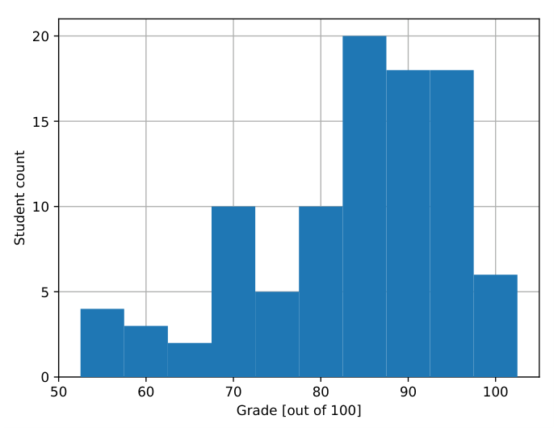

# MIT 6.824/6.5840 2018: Quiz 1: Official solutions

> Copied from the original: <https://pdos.csail.mit.edu/6.824/quizzes.html>. Text and figures are taken from the PDF as is; nothing was answered or rewritten. The original PDF is in this folder.

---

**Page 1**

&emsp;&emsp;&emsp;&emsp;&emsp;&emsp;&emsp;&emsp;Department of Electrical Engineering and Computer Science 
&emsp;&emsp;&emsp;&emsp;&emsp;&emsp;MASSACHUSETTS INSTITUTE OF TECHNOLOGY

&emsp;&emsp;&emsp;&emsp;**6.824 Distributed System Engineering: Spring 2018** 
&emsp;&emsp;&emsp;&emsp;&emsp;&emsp;&emsp;&emsp;**Exam I**

Write your name on this cover sheet. If you tear out any sheets, please write your name on them. 
You have 80 minutes to complete this quiz. 
Some questions may be much harder than others. Read them all through first and attack them in 
the order that allows you to make the most progress. If you find a question ambiguous, write down 
any assumptions you make. Write neatly. In order to receive full credit you must answer each 
question as precisely as possible. 
You may use class notes, papers, and lab material. You may read them on your laptop, but you are 
not allowed to use any network. For example, you may not look at web sites or communicate with 
anyone.

&emsp;**I (16)**   **II (16)**   **III (16)**   **IV (14)**   **V (7)**   **VI (14)**   **VII (14)**   **VIII (3)**   **Total (100)**

**Name:** 
**Kerberos ID:**

---

**Page 2**

&emsp;&emsp;&emsp;&emsp;&emsp;&emsp;Grade histogram for Exam 1

&emsp;&emsp;&emsp;&emsp;&emsp;&emsp;&emsp;&emsp;max=   100 
&emsp;&emsp;&emsp;&emsp;&emsp;&emsp;&emsp;&emsp;median   =   87 
&emsp;&emsp;&emsp;&emsp;&emsp;&emsp;&emsp;&emsp;µ   =   83.9 
&emsp;&emsp;&emsp;&emsp;&emsp;&emsp;&emsp;&emsp;σ   =   11.4

---

**Page 3**

6.824 Spring 2018, Exam 1   Page 3 of 17

**I**   **GFS**

Ben Bitdiddle notices that GFS (as described by Ghemawat et al.) replicates written data on **all** 
chunk servers holding replicas of the affected chunk. Inspired by Raft, Ben suggests reducing write 
latency by returning after the write has been replicated to a **majority** of replicas. Specifically, Ben 
suggests modifying the write flow in Figure 2 (§3.1) as follows:

**Step 1–3.** As before, with chain replication as per §3.2. 
**Step 4.** Once a majority of replicas has acknowledged receiving the data, the client sends a write 
&emsp;request to the primary. \[...\] 
**Step 5.** The primary forwards the write request to all secondary replicas. Each secondary replica 
&emsp;that has already received the data applies the mutations \[...\]; any replica that has not yet 
&emsp;received the data enqueues the write request (in volatile memory) and applies it as soon as 
&emsp;the data arrives. 
**Step 6.** The secondaries reply to the primary as soon as they have completed the operation. 
**Step 7.** The primary replies to the client once it receives an acknowledgment of success in step 6 
&emsp;from a majority of replicas. \[...\] The remaining replicas keep working to finish replicating 
&emsp;the write, retrying indefinitely on failure.

However, Ben’s classmate Alyssa P. Hacker points out that there might be a problem if a replica 
fails and restarts after the write has returned to the client in step 7, but before the chain replicated 
data reaches it. Ben believes that GFS’s stale replica detection (see §4.5) handles this situation 
correctly.

&emsp;**1. \[8 points\]:** Who is right? Explain your answer.

**Answer:** Alyssa is right. The GFS master increases the chunk version number on all replicas when 
it hands out a new lease, before processing client writes. Hence, the replica that failed during write 
replication will appear up-to-date when it restarts, even though it is not.

---

**Page 4**

6.824 Spring 2018, Exam 1   Page 4 of 17

Consider a Raft deployment (without snapshotting) in which each peer stores its persistent Raft 
state (the log, the current term, etc.) in GFS files. Each peer has its own set of files, including a file 
that stores the peer’s current log. Each Raft peer writes new log entries at the end of its existing log 
file. This question refers to GFS as described in the paper, not Ben’s modified GFS.

&emsp;**2.**   **\[8 points\]:** Is it necessary to use GFS’s “record append” mode when appending new 
&emsp;entries to the log file? Explain your answer.

**Answer:** No, using record append here is unnecessary, since we know that only one client (the 
peer) ever modifies the file. Record append guarantees atomic append of several records for a file 
under concurrent modification.

---

**Page 5**

6.824 Spring 2018, Exam 1   Page 5 of 17

**II**   **VMware FT**

Consider the paper The Design of a Practical System for Fault-Tolerant Virtual Machines, by Scales 
et al. 
Suppose you are running MapReduce on a cluster of 100 computers. MapReduce has a mechanism 
to recover from failed workers. You could, in theory, replace MapReduce’s mechanism with use of 
VMware FT to replicate each worker.

&emsp;**3.**   **\[8**   **points\]:** Which makes more sense for coping with MapReduce worker failure, 
&emsp;MapReduce’s existing mechanism, or VMware FT? Explain why.

**Answer:** Replication with VMware FT will allow almost instant recovery from worker failure, with 
no loss of state and no loss of work. MapReduce, in contrast, may need to recompute some tasks 
from the start in order to recover from a failed worker. On the other hand, VMware FT replication 
will cut the effective amount of CPU power in half, making MapReduce jobs take twice as long if 
there are no failures. If there are few failures, the MapReduce approach is more efficient; if failures 
are very common (e.g. every server is expected to fail at least once during a task) then VMware 
FT will be more efficient. We expect failures to be relatively rare on the scale of MapReduce jobs 
(jobs take hours or days, servers stay up for months), so the MapReduce approach is very likely to 
be better.

---

**Page 6**

6.824 Spring 2018, Exam 1   Page 6 of 17

The VMware FT paper says that the primary sends a copy of each received packet to the backup. 
Alyssa P. Hacker points out that one can configure network switches to send a copy of each packet 
addressed to the primary to the backup as well. Then, since the network is taking care of sending 
the backup a copy of the primary’s network traffic, the primary could be modified to no longer do 
so. Of course, one would configure the network switch to not make copies of the primary/backup 
“logging channel” traffic.

&emsp;**4.**   **\[8 points\]:** Explain why it’s critical that the primary send information about received 
&emsp;packets to the backup; that is, why it’s not sufficient for the network to send a copy of all the 
&emsp;primary’s packets to the backup.

**Answer:** The backup must process incoming network packets at exactly the same same points 
in its instruction stream as the primary. It’s very unlikely that this will happen if the network 
independently delivers packets to the backup. So the primary needs to tell the backup the point at 
which the primary processed each packet, so that the backup can process it at the same time.

---

**Page 7**

6.824 Spring 2018, Exam 1   Page 7 of 17

**III**   **Raft and Lab 2**

Ben Bitdiddle decides that, when the last log term of a Raft candidate and a follower are equal, it is 
safer if the follower only votes for the candidate if the candidate’s log is longer than the follower’s 
own, rather than if it is at least as long. 
He therefore modifies his RequestVote RPC handler to respond with voteGranted set to 
true only if either (a) the candidate has a higher last log entry term, or (b) the last log entry’s term 
is equal to the follower’s and the candidate has a longer log.

&emsp;**5. \[8 points\]:** Explain why Ben’s modification will break Raft.

**Answer:** If all peers have identical logs, they will not be able to elect a leader.

---

**Page 8**

6.824 Spring 2018, Exam 1   Page 8 of 17

Alyssa P. Hacker’s Lab 2 Raft implementation has a long-running thread that runs periodic tasks:

&emsp;func (rf \*Raft) mainThread() { 
&emsp;&emsp;&emsp;for { 
&emsp;&emsp;&emsp;&emsp;&emsp;rf.mu.Lock() 
&emsp;&emsp;&emsp;&emsp;&emsp;state := rf.state 
&emsp;&emsp;&emsp;&emsp;&emsp;rf.mu.Unlock()

&emsp;&emsp;&emsp;&emsp;&emsp;if state == Leader { 
&emsp;&emsp;&emsp;&emsp;&emsp;&emsp;&emsp;if a heartbeat is needed { 
&emsp;&emsp;&emsp;&emsp;&emsp;&emsp;&emsp;&emsp;rf.sendAll() 
&emsp;&emsp;&emsp;&emsp;&emsp;&emsp;&emsp;} 
&emsp;&emsp;&emsp;&emsp;&emsp;} else if state == Follower { 
&emsp;&emsp;&emsp;&emsp;&emsp;&emsp;&emsp;... 
&emsp;&emsp;&emsp;&emsp;&emsp;} else { 
&emsp;&emsp;&emsp;&emsp;&emsp;&emsp;&emsp;... 
&emsp;&emsp;&emsp;&emsp;&emsp;} 
&emsp;&emsp;&emsp;&emsp;&emsp;// pause... 
&emsp;&emsp;&emsp;} 
&emsp;}

&emsp;func (rf \*Raft) sendAll() { 
&emsp;&emsp;&emsp;rf.mu.Lock() 
&emsp;&emsp;&emsp;defer rf.mu.Unlock()

&emsp;&emsp;&emsp;for i := 0; i \< len(rf.peers); i++ { 
&emsp;&emsp;&emsp;&emsp;&emsp;if i == rf.me { 
&emsp;&emsp;&emsp;&emsp;&emsp;&emsp;&emsp;continue 
&emsp;&emsp;&emsp;&emsp;&emsp;} 
&emsp;&emsp;&emsp;&emsp;&emsp;var args AppendEntriesArgs 
&emsp;&emsp;&emsp;&emsp;&emsp;args.Term = rf.currentTerm 
&emsp;&emsp;&emsp;&emsp;&emsp;// ... 
&emsp;&emsp;&emsp;&emsp;&emsp;go func(i int) { 
&emsp;&emsp;&emsp;&emsp;&emsp;&emsp;&emsp;var reply AppendEntriesReply 
&emsp;&emsp;&emsp;&emsp;&emsp;&emsp;&emsp;ok := rf.sendAppendEntries(i, &args, &reply) 
&emsp;&emsp;&emsp;&emsp;&emsp;&emsp;&emsp;rf.mu.Lock() 
&emsp;&emsp;&emsp;&emsp;&emsp;&emsp;&emsp;// handle the response... 
&emsp;&emsp;&emsp;&emsp;&emsp;&emsp;&emsp;rf.mu.Unlock() 
&emsp;&emsp;&emsp;&emsp;&emsp;}(i) 
&emsp;&emsp;&emsp;} 
&emsp;}

---

**Page 9**

6.824 Spring 2018, Exam 1   Page 9 of 17

Assume that code that is not shown is correct.

&emsp;**6. \[8 points\]:** Alyssa’s code has a bug. Describe a sequence of events that demonstrates a 
&emsp;violation of Figure 3’s State Machine Safety property, caused by the code above.

**Answer:** Alyssa’s code releases the lock between checking whether the peer is leader and con- 
structing the RPC arguments. Suppose peer P1 is leader for term 11, and mainThread() calls 
sendAll(). While the lock isn’t held, P1 receives an RPC with term 12 (because peer P2 is now the 
leader), so P1’s RPC handler increases rf.currentTerm to 12 and becomes a follower. P1’s sendAll() 
will proceed to send AppendEntries RPC, with Term set to 12. That’s not correct, because P1 was 
leader for term 11, not term 12. If P1 includes uncommitted log entries in the RPCs, P1’s log 
entries may replace different log entries sent by P2. If P2 then advances the commit index, some 
peers may execute P1’s log entries, and others P2’s log entries. That would violate State Machine 
Safety.

---

**Page 10**

6.824 Spring 2018, Exam 1   Page 10 of 17

**IV**   **ZooKeeper**

Ben Bitdiddle uses ZooKeeper (as described by Hunt et al.) to implement master failover for his 
distributed application. Each application instance acts as a ZooKeeper client, and each instance is 
willing to take over as master if there is no live master. 
Ben first manually creates a regular znode /app/master. The value of this znode is either 
“none” (if there is no master) or the ID of the application instance that is the current master. 
Each application instance does the following in order to learn who the master is, and perhaps to 
take over as master if needed:

**A.** Run getData("/app/master", watch) to find out who (if anyone) is the current 
&emsp;master, where watch is a notification handler. 
**B.** If the read returns an instance ID IM, and IM is not the current instance, the instance becomes 
&emsp;a backup with IM as master. 
**C.** If the result is “none”, the instance uses setData("/app/master", \<instance 
&emsp;ID\>, -1) to write its instance ID into the znode. If the write returns successfully, the 
&emsp;instance becomes the master; otherwise it starts again at step A. 
**D.** When watch triggers, it causes the instance to go to step A in order to try to become master.

&emsp;**7. \[7 points\]:** When testing his implementation, Ben notices that his system never chooses 
&emsp;a new master after the existing master fails, no matter how long he waits. Explain why.

**Answer:** The failing master does not reset the znode to “none”. Since Ben used a regular znode, 
rather than an ephemeral one, the protocol cannot recover from a master failure. The znode will 
neither be reset to “none” nor deleted.

---

**Page 11**

6.824 Spring 2018, Exam 1   Page 11 of 17

&emsp;**8. \[7 points\]:** Furthermore, Ben discovers that he sometimes ends up with several masters 
&emsp;(i.e., split brain). Explain why.

**Answer:**   Multiple instances can read “none” and subsequently succeed at writing the znode to 
become master: 
**A.** Instances’ reads can race with a write. 
**B.** ZooKeeper allows stale reads from any replica, so instances can read outdated versions of 
&emsp;/app/master. 
In both cases, split brain ensues because Ben specified -1 as the version number passed to 
setData. This allows multiple writes to succeed, even though they overwrite a value of IM. 
All succeeding writers will believe that they are the master.

---

**Page 12**

6.824 Spring 2018, Exam 1   Page 12 of 17

**V**   **Linearizability**

Alyssa P. Hacker is writing an application that stores data in a key/value server. She uses a client- 
side library that provides get() and put() functions using RPC calls to the server. The library 
and key/value server together guarantee linearizable behavior at the level of library calls (that is, 
the operations that are linearizable are put() and get() function calls as executed by the appli- 
cation). 
Alyssa decides that, since put() does not return a value, there is no point in waiting for it to 
complete. She modifies the library so that put() returns immediately after starting a separate 
goroutine to send the request to the server. 
For this question you should assume that there are no computer crashes and no network problems.

&emsp;**9. \[7 points\]:** Will Alyssa’s modified library result in linearizable behavior? Explain why 
&emsp;or why not.

**Answer:** No. put(x,0); put(x,1); get(x) may yield zero, since put()s are executed concurrently. 
Linearizability requires that the serial order obey real time; this means that the only legal serial 
order is that shown above (the order in which the application performed the operations). gets are 
required to see the value of the most recent put, so the get should have returned 1, not zero.

---

**Page 13**

6.824 Spring 2018, Exam 1   Page 13 of 17

**VI**   **Serializability**

Recall that correctness for transactions means that the results of executing a set of (possibly con- 
current) transactions must be serializable. The results are serializable if they are the same results 
one would obtain by executing the same set of transactions one at a time in some order. “Results” 
include both the final values of records in the database and the output (including printed output) of 
the transactions. 
A read-only transaction is one that only reads records from the database, and does not write any 
records. 
Ben Bitdiddle claims that read-only transactions do not need to use locks at all; they can just read 
the current values of records without worrying about whether other transactions might be writing 
them. As evidence, he provides this pair of transactions:

T1:   T2: 
begin\_transaction()   begin\_transaction() 
x = x + 1   print x, y, z 
end\_transaction()   end\_transaction()

Ben notes that it is correct for T2 to print either x’s value before T1’s increment of x, or after 
T1’s increment (corresponding to serializability orderings T2;T1 and T1;T2). That is, even without 
locking, T2 will produce only correct outputs. 
Assume that a read of a record that another transaction is writing yields either the old value, or the 
new value.

&emsp;**10.**   **\[7 points\]:** Write down a counter-example that shows that read-only transactions do 
&emsp;need locks.

**Answer:** T2a could print x before T1a, and y after T1a, which isn’t serializable. 
T1a:   T2a: 
begin\_transaction()   begin\_transaction() 
x = x + 1   print x, y, z 
y = y + 1   end\_transaction() 
end\_transaction()

---

**Page 14**

6.824 Spring 2018, Exam 1   Page 14 of 17

Ben is thinking about this transaction:

T3: 
begin\_transaction() 
x = x + 1 
print "y=", y 
end\_transaction()

Ben believes that there is no point in holding the lock on x while reading and printing y. He thinks 
it would be OK if a transaction always released each lock after its last use of the locked record. 
Thus, for T3, Ben thinks locking should happen like this:

T3: 
begin\_transaction() 
lock x 
x = x + 1 
unlock x 
lock y 
print "y=", y 
unlock y 
end\_transaction()

It turns out that Ben is wrong: his relaxation of two-phase locking can lead to non-serializable 
executions.

&emsp;**11. \[7 points\]:** Write down a transaction that could produce a non-serializable result if run 
&emsp;concurrently with Ben’s T3, if both transactions used Ben’s locking scheme. Write down the 
&emsp;non-serializable result as well as the transaction. Please assume that there are no failures, no 
&emsp;aborts, and no deadlocks.

**Answer:** Suppose x and y start as zero. The allowed serializable results from running T3 and T4 
(below) are x=1 y=1 “y=0” (for T3;T4), and x=1 y=0 “y=0” (for T4;T3). But if run with Ben’s 
relaxed locking scheme, T4 could completely execute between T3’s statements, yielding x=1 y=1 
“y=1”, which is not one of the two legal serializable results. 
T4: 
begin\_transaction() 
y = x 
end\_transaction()

---

**Page 15**

6.824 Spring 2018, Exam 1   Page 15 of 17

**VII**   **Two-Phase Commit**

A sharded database uses two-phase commit to ensure that either all shard servers commit their 
part of each transaction, or none of them do. A database client executing a transaction sends the 
transaction’s puts and gets to the shard servers, and then uses a transaction coordinator (TC) to 
execute two-phase commit for the transaction. As a reminder, the steps of two-phase commit are 
as follows:

**A.** The TC sends a PREPARE message to each participant (each shard server that is involved in 
&emsp;the transaction). 
**B.** Each participant replies with YES or NO, according to whether the participant is able to 
&emsp;commit. 
**C.** If all participants answer YES, the TC sends a COMMIT message to each participant. If any 
&emsp;participant answers NO, or if the TC times out while waiting for replies, the TC sends out 
&emsp;ABORT messages. 
**D.** If a participant receives a COMMIT message, it makes its part of the transaction’s updates 
&emsp;permanent, and releases locks. If a participant receives an ABORT message, it forgets about 
&emsp;the transaction’s updates, and releases locks.

Suppose a TC sends a COMMIT message to one of a transaction’s multiple participants, but the 
TC crashes before sending any more messages.

&emsp;**12. \[7 points\]:** Explain what the TC must do after it reboots.

**Answer:** The TC must retrieve its decision from persistent storage, and (since it will see that it had 
decided to commit before crashing) send COMMIT messages to all participants.

---

**Page 16**

6.824 Spring 2018, Exam 1   Page 16 of 17

Now suppose a client has asked TC1 to run two-phase commit for a transaction. After a while the 
client has received no reply from TC1, and is unable to contact TC1.

&emsp;**13. \[7 points\]:** Explain why it would not be OK for the client to find a new coordinator, 
&emsp;TC2, and ask TC2 to run two-phase commit again for the transaction (starting with the PRE- 
&emsp;PARE messages). It is sufficient to supply an example scenario that leads to an incorrect 
&emsp;outcome.

**Answer:** Suppose TC1 gets YES from all participants, decides to commit and records that decision, 
crashes before sending any COMMITs, and is about to reboot. TC2 sends PREPAREs, but one of 
the workers doesn’t respond fast enough, so the TC2 decides to abort. TC2 sends out some ABORT 
messages, but meanwhile the TC1 reboots and sends out some COMMIT messages. The result is 
a violation of atomicity: some participants committed, while others aborted.

---

**Page 17**

6.824 Spring 2018, Exam 1   Page 17 of 17

**VIII**   **6.824**

&emsp;**14. \[1 points\]:** What can we do to avoid needless Lab difficulties for future generations of 
&emsp;6.824 students?

**Answer:** More tutorials about Go, concurrent programming, diagnosing common bugs.

&emsp;**15. \[1 points\]:** Which papers should we definitely keep (or add) for future years?

**Answer:** Raft. ZooKeeper. FaRM.

&emsp;**16. \[1 points\]:** Is there any paper we should delete?

**Answer:** Spinnaker.

&emsp;&emsp;&emsp;&emsp;&emsp;&emsp;&emsp;&emsp;End of Exam I

