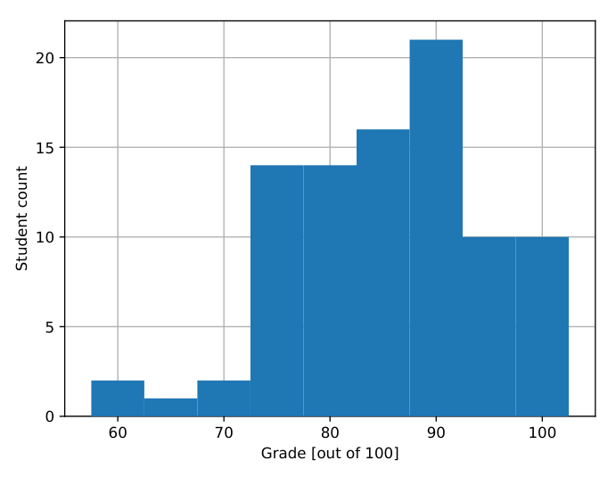
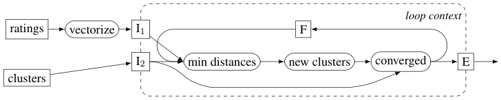

# MIT 6.824/6.5840 2018: Quiz 2: Official solutions

> Copied from the original: <https://pdos.csail.mit.edu/6.824/quizzes.html>. Text and figures are taken from the PDF as is; nothing was answered or rewritten. The original PDF is in this folder.

---

**Page 1**

&emsp;&emsp;&emsp;&emsp;&emsp;&emsp;&emsp;&emsp;Department of Electrical Engineering and Computer Science 
&emsp;&emsp;&emsp;&emsp;&emsp;&emsp;MASSACHUSETTS INSTITUTE OF TECHNOLOGY

&emsp;&emsp;&emsp;&emsp;**6.824 Distributed System Engineering: Spring 2018** 
&emsp;&emsp;&emsp;&emsp;&emsp;&emsp;&emsp;&emsp;**Exam II**

Write your name on this cover sheet. If you tear out any sheets, please write your name on them. 
You have 120 minutes to complete this exam. 
Some questions may be much harder than others. Read them all through first and attack them in 
the order that allows you to make the most progress. If you find a question ambiguous, write down 
any assumptions you make. Write neatly. In order to receive full credit you must answer each 
question as precisely as possible. 
You may use class notes, papers, and lab material. You may read them on your laptop, but you are 
not allowed to use any network. For example, you may not look at web sites or communicate with 
anyone.

&emsp;**I (15)**   **II (15)**   **III (15)**   **IV (7)**   **V (15)**   **VI (15)**   **VII (15)**   **VIII (3)**   **Total (100)**

**Name:** 
**Kerberos ID:**

---

**Page 2**

&emsp;&emsp;&emsp;&emsp;&emsp;&emsp;Grade histogram for Exam 2

&emsp;&emsp;&emsp;&emsp;&emsp;&emsp;&emsp;&emsp;max=   100 
&emsp;&emsp;&emsp;&emsp;&emsp;&emsp;&emsp;&emsp;median   =   86.5 
&emsp;&emsp;&emsp;&emsp;&emsp;&emsp;&emsp;&emsp;µ   =   85.5 
&emsp;&emsp;&emsp;&emsp;&emsp;&emsp;&emsp;&emsp;σ   =   9.1

---

**Page 3**

**I**   **Lab 3**

Ben Bitdiddle claims that put()s in Lab 3 are idempotent – that executing the same put() multiple 
times has the same effect as executing it just once, since after the value has been set by the first 
put(), repeated put()s with the same key and value leave the value unchanged. Ben says that this 
means that his Lab 3 key/value server does not have to check for duplicate put() operations. (Ben 
notes that this reasoning does not apply to append()s.)

&emsp;**1. \[7 points\]:** Give an example scenario which shows that Ben is wrong about put()s. 
&emsp;**Answer:** 
&emsp;Client 1 does put(x,1) 
&emsp;Client 2 does get(x) and sees 1 
&emsp;Client 2 does put(x,100), and the put() completes. 
&emsp;Client 1’s put(x,1) is repeated 
&emsp;Client 2 does get(x) and sees 1 
&emsp;This scenario is not linearizable. In any linear history, the put(x,1) must execute either before 
&emsp;or after the put(x,100). In the above scenario, client 2 observes results that could not arise 
&emsp;with either of those two orders.

---

**Page 4**

Ben’s key/value server RPC handler for client append() operations checks for duplicate requests. 
His key/value server maintains a duplicate-detection table with the last-executed serial number for 
each client, as outlined in the Raft paper’s Section 8. The append() RPC handler checks to see if 
the RPC is already in the table before calling Start(); if so, the handler immediately returns a reply 
to the client, without calling Start(). 
Alyssa believes that a key/value server must also check for duplicate operations just before execut- 
ing each operation from the log (that is, after receiving each operation on the applyCh). She says 
that there are scenarios in which the same operation can appear twice in the log, despite the fact 
that the RPC handler filters out duplicate RPCs.

&emsp;**2. \[8 points\]:** Alyssa is right. Describe an example scenario in which the same operation 
&emsp;(with the same client ID and client serial number) can appear twice in the log, even though 
&emsp;the code that handles client RPCs rejects requests that have already been executed. 
&emsp;**Answer:** A client sends an operation to the current leader, S1. S1 sends out the operation 
&emsp;to followers including S2, but S1 crashes before committing the operation. S2 is elected the 
&emsp;new leader. The client’s RPC times out and and it re-sends the operation, this time to S2. 
&emsp;The previous instance of the operation is in S2’s log but still hasn’t been committed, and thus 
&emsp;hasn’t been executed and isn’t in the duplicate table. So S2 calls Start() for the second copy 
&emsp;of the operation, causing it to be in the log twice. When both copies are committed, they’ll 
&emsp;both be executed unless the server software checks the duplicate table before executing.

---

**Page 5**

**II**   **Spark**

Ben Bitdiddle finds the following Spark code for processing ad click logs in his company’s source 
code repository: 
&emsp;// click logs: DATE,TIME,USER,AD\_ID 
1 
&emsp;clog\_may **=** spark.**textFile**("hdfs:///prod/logs/2018/05/click\*.log", 10) 
2 
&emsp;clog\_jun **=** spark.**textFile**("hdfs:///prod/logs/2018/06/click\*.log", 10) 
3 
&emsp;// ads: AD\_ID,PRICE\_PER\_CLICK 
4 
&emsp;ads **=** spark.**textFile**("hdfs:///proc/ads/current", 10) 
5 
&emsp;&emsp;&emsp;&emsp;&emsp;.**map**(\_.split(",")) 
6 
&emsp;&emsp;&emsp;&emsp;&emsp;.**map**(x **=\>** (x(0), x(2).toFloat)) 
7 
&emsp;// clogs: (AD\_ID, USER) 
8 
&emsp;clogs **=** clog\_may.**union**(clog\_jun) 
9 
&emsp;&emsp;&emsp;&emsp;&emsp;&emsp;&emsp;.**map**(x **=\>** { val f **=** x.split(","); (f(3), f(2)) }) 
10 
&emsp;&emsp;&emsp;&emsp;&emsp;&emsp;&emsp;.persist() 
11 
&emsp;// combined: (USER, PRICE\_PER\_CLICK) 
12 
&emsp;combined **=** clogs.**join**(ads) // by AD\_ID 
13 
&emsp;&emsp;&emsp;&emsp;&emsp;&emsp;&emsp;.**map**(x **=\>** x.\_2) 
14 
&emsp;// user\_rev: (USER, aggregate click revenue) 
15 
&emsp;user\_rev **=** combined.**reduceByKey**((x, y) **=\>** x + y) 
16 
&emsp;// save user with the maximum aggregate click revenue 
17 
&emsp;user\_rev.**max**().**saveAsTextFile**("hdfs:///tmp/top\_revenue\_user") 
18

Note:.split(","), x =\> (...), and x =\> {...} are all syntax for single-argument 
closures in Scala; field numbers and indices into arrays are zero-based; x. 2 extracts the second 
element of a tuple; and the numeric argument to textFile denotes the number of partitions to 
split the input into.

&emsp;&emsp;**3. \[5 points\]:** Spark will generate an RDD lineage graph for this code. The graph contains 
&emsp;&emsp;11 RDDs (one for each bold operation). For which operators will Spark perform a “shuffle” 
&emsp;&emsp;of data? 
&emsp;&emsp;**Answer:** join, reduceByKey, max

---

**Page 6**

&emsp;**4. \[5 points\]:** Alyssa P. Hacker proposes an alternative implementation using three MapRe- 
&emsp;duce jobs: the first one runs lines 1–11 in the map phase, and 12–14 in the reduce phase; the 
&emsp;second runs an identity map phase and line 16 as the reduce phase; the third one runs line 
&emsp;18 using map and reduce phases. Alyssa argues that using Spark only offers modest perfor- 
&emsp;mance gain over this MapReduce implementation. Where does Spark’s performance gain 
&emsp;come from? 
&emsp;**Answer:**   After each of the three jobs, MapReduce writes the full job output to GFS, and 
&emsp;then immediately reads the data back from GFS at the start of the next job. Spark, because it 
&emsp;understands the complete computation, avoids this I/O.

When Ben executes the code, a machine in his ten-server cluster fails while processing a task from 
the reduceByKey step.

&emsp;**5. \[5 points\]:** Assume that the Spark scheduler assigned one task from each stage to each 
&emsp;machine, and that no further failures occur. Does Spark need to recompute none, some, or 
&emsp;all partitions of the clogs RDD? Explain your reasoning. 
&emsp;**Answer:** Just one: the partition in the crashed machine’s memory. That partition is needed 
&emsp;to re-compute the lost partition of the join, in order to feed into the lost partition of the 
&emsp;reduceByKey. The re-execution of the lost join partition requires input from all clogs par- 
&emsp;titions, but the other 9 are still stored in the non-crashed machines’ memories due to the 
&emsp;persist().

---

**Page 7**

**III**   **Naiad**

Alyssa P. Hacker is a 6.824 TA and implements an automated system to help course staff decide 
which papers to keep and which to drop. She plans to have students submit a numerical rating for 
each paper: a positive value indicates that the student liked the paper, and a negative value indicates 
that they did not. Alyssa then uses a clustering algorithm to group papers into “keep” and “discard” 
clusters. 
Since she wishes to monitor intermediate results as the semester progresses, Alyssa implements a 
streaming computation using Naiad (see Naiad: A Timely Dataflow System by Murray et al.). She 
ends up with the data-flow graph shown below.

The students submit ratings for each paper ID to the “ratings” input. Alyssa uses the “clusters” 
input to specify the two initial cluster centers. The data-flow iterates to assign papers to clusters 
and position the cluster centers. 
I1, I2, F, and E are Naiad’s loop context vertices (ingress, egress, and feedback). The other vertices 
function as follows; precise implementation details are not important for this question.

**vectorize** turns a single student rating into a rating vector with a slot for each student’s rating. 
**min distances** computes the distances between paper’s positions (defined by the student ratings) 
&emsp;and the current cluster centers, assigning each paper to the nearest cluster center. 
**new clusters** re-computes the cluster centers based on the changes to paper assignment to clusters 
&emsp;that it receives from “min distances”. 
**converged** compares the latest cluster centers against the ones from the previous iteration. If they 
&emsp;are equal, the algorithm has converged and the vertex outputs the cluster centers to E; if they 
&emsp;are not, the vertex sends the new cluster centers to F for another iteration.

Alyssa submits two initial cluster centers at the “clusters” input at epoch 0, and then closes it. 
Ben Bitdiddle submits a very negative rating for the Naiad paper at epoch 13. The magnitude of 
his rating causes the loop to iterate three times until the clusters have converged again.

---

**Page 8**

&emsp;**6. \[8 points\]:** For the **output** of each of the following three vertices, list the timestamps 
&emsp;that will appear on records derived from Ben’s input: (a) the “vectorize” vertex; (b) the “min 
&emsp;distance” vertex; and (c) the feedback vertex (“F”). 
&emsp;**Answer:** 
&emsp;(a) (13,\<\>) 
&emsp;(b) (13,\< 0 \>) (13,\< 1 \>) (13,\< 2 \>) 
&emsp;(c) (13,\< 1 \>) (13,\< 2 \>)

Alyssa uses the paper numbers as epochs for the ratings input, and programs the “converged” vertex 
to (i) call converged.NOTIFYAT(p) to subscribe to a notification for each paper number, and (ii) to 
buffer the converged cluster centers until the converged.ONNOTIFY(t) callback is invoked with 
t = p, and to emit them to E once this happens. 
At midnight before each lecture, Alyssa arranges for Naiad to call ratings.ONNOTIFY(p) to close 
submissions for this lecture. Often, the loop is processing many last-minute rating submissions at 
this time.

&emsp;**7. \[7 points\]:** At what point will converged.ONNOTIFY(p) be invoked by the Naiad run- 
&emsp;time? 
&emsp;**Answer:** At some point after no timestamps ≤p can appear at the input to converged.

---

**Page 9**

**IV**   **Frangipani**

Consider the paper Frangipani: A Scalable Distributed File System, by Thekkath et al. 
Frangipani has locks associated with file-system metadata such as file and directory inodes, direc- 
tory contents, and information about which blocks and inodes are in-use or free. Section 5 mentions 
that a file’s lock covers both the file’s inode and the file’s content (the data stored in the file). 
You could imagine modifying this aspect of Frangipani, so that a file’s lock only protected the file’s 
metadata, and that file content was not protected by any lock. The modified Frangipani would hold 
the lock on a file’s inode for the duration of operations on the file such as read() or write(); 
but, for purposes of the mechanisms described in Section 5, the lock would only be associated with 
the file’s metadata, not its content. It turns out this modification would be a bad idea.

&emsp;**8. \[7 points\]:** Explain why Frangipani locks file content as well as file metadata. 
&emsp;**Answer:** A file’s lock covers the file’s content in order to drive Frangipani’s cache coherence 
&emsp;protocol for file content, to fulful the promise that changes to a file are immediately visible on 
&emsp;other workstations. The only situation in which the paper says that cached data is invalidated 
&emsp;is when a workstation gives up a lock on that data; if Frangipani associated no lock with file 
&emsp;content, then cached file content would never be invalidated, and application reads could see 
&emsp;stale cached data.

---

**Page 10**

**V**   **Memcached**

Ben Bitdiddle built “Catgram”, a social network for cat owners. Ben initially built Catgram to 
share pictures of his dorm’s cats with a few friends, and all reads and writes hit a backend database. 
Catgram has grown beyond Ben’s wildest expectations, and has recently struggled with frequent 
site outages due to overload on its (already sharded) backend database. 
Ben, **without** having read the paper Scaling Memcache at Facebook by Nishtala et al., instructs 
the engineering team to deploy Memcached to alleviate the load. They modify their application 
frontend to try reading from Memcached first (via a get(key)), and only query the database 
if the Memcached read misses. The application code then writes the database query result into 
Memcached (using set(key, result)). All writes continue to go to the database, and the 
application code invalidates any affected Memcached keys when it writes. 
When the Catgram engineering team enables caching, they observe that common-case database 
load goes down, but periods of high read load still occur. Alyssa P. Hacker points out that the 
Catgram team is experiencing the “thundering herd” problem, where the invalidation following a 
write to a popular key causes many Memcached misses and parallel database queries. 
Ben suggests the following fix to ensure only one client queries the database:

**A.** If get(key) misses, the application frontend invokes set(key, RETRIEVING) on 
&emsp;Memcached and then proceeds to query the database. RETRIEVING is a special value that 
&emsp;does not occur in actual data. 
**B.** Other frontends that read RETRIEVING refrain from querying the database, and instead 
&emsp;retry reading from Memcached after a while. 
**C.** Once the database query returns, the application frontend again invokes set to store the real 
&emsp;value in Memcached.

&emsp;**9.**   **\[5 points\]:** When the team deploys Ben’s fix, they observe that “thundering herds” 
&emsp;of reading clients still hit the database. Explain why, using a specific example situation. 
&emsp;Assume that there are no failures. 
&emsp;**Answer:** If multiple frontends miss on the same key at the same time, they will all simulta- 
&emsp;neously set RETRIEVING (but not see each others’ RETRIEVING), and they will all query 
&emsp;the database.

---

**Page 11**

Ben observes that the cause of get()s missing is usually that a client previously wrote the 
database and invalidated the corresponding Memcached keys. He thinks thundering herds can be 
eliminated by not invalidating, and instead replacing Memcached data when an application fron- 
tend writes. That is, after a frontend writes the database, the same frontend server recomputes the 
correct values for each affected Memcached key, and calls set to insert the new keys/values into 
Memcached.

&emsp;**10.**   **\[5 points\]:** The team applies this fix, but discovers that now the values cached in 
&emsp;Memcached are sometimes permanently different to those to returned when running the read 
&emsp;query on the database. Explain why this happens by describing a specific example situation 
&emsp;that results in divergence between Memcached and the query results. Assume that no failures 
&emsp;or Memcached evictions occur. 
&emsp;**Answer:** Suppose two clients write different values to the same key at the same time: client 
&emsp;C1 writes value 1, and C2 writes value 2. The database may execute C2’s write second (so 
&emsp;the final value is 2), but Memcached may receive the corresponding put()s in the other order, 
&emsp;so that the final value in Memcached is 1.

---

**Page 12**

Ben finally reads the paper Scaling Memcache at Facebook by Nishtala et al., and suggests to the 
team to adopt its lease-based approach (§3.2.1). However, to be absolutely sure that only one client 
queries the database even if the query takes a long time, he suggests that the Memcached server 
grant a lock instead of a lease. Once the frontend server sets the key, Memcached releases the 
lock. Catgram’s Memcached infrastructure is unreplicated, i.e., each key is only cached on one 
server.

&emsp;**11. \[5 points\]:** Explain, with an example, why the lock-based approach is problematic. 
&emsp;**Answer:** If a frontend acquires the lock on a key and then crashes, the key will be locked 
&emsp;forever. The timeout in the lease scheme fixes this problem.

---

**Page 13**

**VI**   **Bayou**

Your club holds an election for club president. For maximum flexibility, the club decides to use a 
voting system based on Bayou. Each club member has their own Bayou device. Each candidate has 
a vote count entry in Bayou’s data collection. Each club member creates a Bayou write operation 
that casts their vote by adding one to the appropriate vote count entry. The club members then 
synchronize their Bayou devices until every device has seen every vote; the member with the 
highest vote count in the Bayou data collection then wins. 
Alyssa would like either of her friends Sam or Mimi to win, but she would be equally happy with 
either outcome. Alyssa decides that she can maximize the chances of one or the other of her 
friends winning by casting her vote for whichever friend has the highest vote count in the Bayou 
data collection. So Alyssa creates this Bayou write operation (patterned after the paper’s Figure 3):

update = { } # do nothing; the mergeproc always runs. 
dependency\_check = { \<always yields false, so the mergproc runs\> } 
mergeproc = { 
if Sam has more votes than Mimi { 
&emsp;increment Sam’s vote count 
} else { 
&emsp;increment Mimi’s vote count 
} 
}

&emsp;**12.**   **\[7 points\]:** After everyone (including Alyssa) has submitted a vote write operation, 
&emsp;and all Bayou devices have seen all the writes and executed them, Mimi turns out to have the 
&emsp;most votes. From this information, can we conclude that Alyssa’s write operation must have 
&emsp;ended up casting its vote for Mimi? Explain your answer. 
&emsp;**Answer:** Alyssa’s vote may be ordered early in the Bayou log, so that her mergeproc doesn’t 
&emsp;observe the effects of many votes that come later in the log. That could cause Alyssa’s 
&emsp;mergeproc to be executed at a time when Sam has more votes, so that Alyssa casts her vote 
&emsp;for Sam; but later votes in the log may swing the outcome to Mimi.

---

**Page 14**

The next year there’s another election for club president. Everyone resets their Bayou devices so 
that the previous election is forgotten, and so that all candidates start with zero votes in the Bayou 
data store. Then, inspired by Alyssa, everyone in the club decides they want to vote for whichever 
of Sam or Mimi is ahead, and everyone submits exactly the Bayou write shown above.

&emsp;**13. \[8 points\]:** Who will win, Mimi or Sam? Explain your reasoning. 
&emsp;**Answer:** Mimi will win. The write that is ordered first in Bayou’s log will see zero votes 
&emsp;for both candidates, and thus will vote for Mimi. All subsequent writes will see that Mimi is 
&emsp;ahead, and vote for Mimi.

---

**Page 15**

**VII**   **DHTs**

Ben Bitdiddle is designing a location service for an Internet instant messaging system. There are 
lots of users, each with a computer. Each user has a unique ID. As each user moves, the user’s 
IP address changes; the location service needs to keep its mapping from user ID to IP address up 
to date as these changes occur. The instant messaging application on each user’s computer knows 
when the computer’s IP address changes. 
Ben is considering two different designs. One, the “centralized design,” uses a single computer as 
a server to store the current mapping from IDs to IP addresses. When a user’s computer changes IP 
addresses, it sends an update request to the server. When a messaging application running on user 
U1’s computer needs to find the current IP address of U2, it sends a request to the server with U2’s 
ID, and the server responds with U2’s current IP address. Ben has in mind that the server would be 
an ordinary computer that never changes its IP address, perhaps his dorm-room PC. The messaging 
application would have the server’s IP address built in. 
The other design uses Chord. Each user computer would join the Chord ring as a Chord node, 
using a hash of the user’s ID as the Chord ID. When user U1 wants to send an instant message to 
U2, U1’s messaging application would use a Chord lookup to find U2’s computer, given U2’s ID; 
a side-effect of this Chord lookup is that U1’s application would learn U2’s computer’s IP address, 
to which it can address instant messages. When a user’s computer changes IP addresses, it re-joins 
the Chord ring. Ben intends to modify Chord so that it recognizes that a join of a node with an ID 
that’s already known but with a different IP address overwrites the old successor-list and finger- 
table information for that ID. Ben intends to run a few computers with well-known unchanging IP 
addresses to help new computers join the Chord ring. 
Assume that user IDs are evenly distributed and random, that each user’s computer changes IP 
address with about the same frequency, and that the popularity of different users (as instant message 
sources or recipients) is roughly uniform. No-one is trying to attack the system. Each computer in 
the system has a small chance of being unavailable due to temporary network or computer failures.

---

**Page 16**

&emsp;**14. \[8 points\]:** Help Ben decide which design to use by marking each of these statements 
&emsp;as true or false.

&emsp;&emsp;&emsp;**True**   **/**   **False**   Chord will result in less total network traffic than the centralized 
&emsp;&emsp;&emsp;design. **Answer:** False 
&emsp;&emsp;&emsp;**True**   **/**   **False**   The server in the centralized design will handle more network traffic 
&emsp;&emsp;&emsp;than any one computer in the Chord design. **Answer:** True 
&emsp;&emsp;&emsp;**True**   **/**   **False**   The work involved in serving lookups will be more evenly divided 
&emsp;&emsp;&emsp;among all the computers with Chord than with the centralized design. **Answer:** True 
&emsp;&emsp;&emsp;**True**   **/**   **False**   Lookups are likely to complete more quickly in the Chord design 
&emsp;&emsp;&emsp;than in the centralized design. **Answer:** False

Ben builds the Chord-based design. Suppose there are a million computers in the Chord ring. 
For the duration of this question each computer is reliable and doesn’t change IP addresses. The 
network is not entirely reliable: the probability of the network losing each Chord request during a 
lookup is 0.01 (one percent).

&emsp;**15. \[7 points\]:** What is the approximate probability that a Chord lookup will encounter at 
&emsp;least one lost message? Circle the best answer.

&emsp;0.01   0.02   0.10   0.18   0.90   0.99 
&emsp;**Answer:** 0.10. It would be 0.18 but a hop is only taken to correct an ID bit, so we expect 
&emsp;0.5 ∗log(N) hops.

---

**Page 17**

**VIII**   **6.824**

&emsp;**16. \[1 points\]:** If you could make one change to 6.824 to improve it (other than firing the 
&emsp;lecturers and dropping the exams), what would you change?

&emsp;**17. \[1 points\]:** Which papers should we definitely keep for future years?

**Answer:** Chord 37, Spark 31, Bitcoin 30, Bayou 19, Dynamo 17, Memcached 16, Raft 15, Farm 
15, Naiad 9

&emsp;**18. \[1 points\]:** Is there any paper we should delete?

**Answer:**   Naiad 20, Frangipani 20, Parameter Server 13, Memcached 11, Bayou 8, Dynamo 5, 
Bitcoin 4, Farm 3, Spinnaker 2

&emsp;&emsp;&emsp;&emsp;&emsp;&emsp;&emsp;&emsp;End of Exam II

