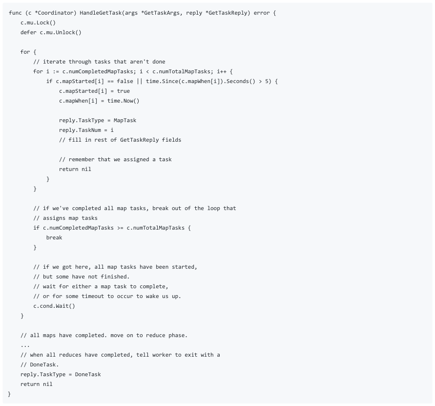
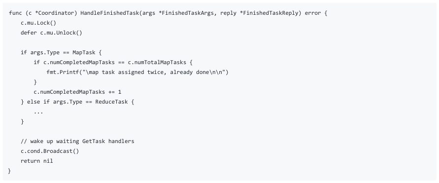
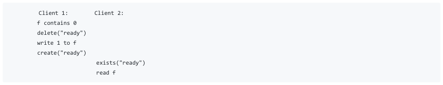

# MIT 6.824/6.5840 2021: Quiz 1: Questions

> Copied from the original: <https://pdos.csail.mit.edu/6.824/quizzes.html>. Text and figures are taken from the PDF as is; nothing was answered or rewritten. The original PDF is in this folder.

---

**Page 1**

6.824 2021 Midterm Exam

This is a 90-minute exam. Please write down any assumptions you make. You are allowed to consult 6.824 papers, notes, and lab code. If you have questions, please 
ask them on Piazza in a private post to the staff, or ask in the Zoom chat if you are taking the exam during lecture time. Please don't collaborate or discuss the exam 
with anyone. 
In particular, please do not discuss the contents of the exam with anyone at all besides the course staff until at least 3:00 PM EDT on Friday, April 2nd, to allow 
students in other timezones to take the test. 
MapReduce

In lab 1, a worker in the MapReduce library doesn't hand out any reduce tasks until all map tasks have completed and have produced all their intermediate files. The 
implementation described in the "MapReduce" paper by Dean and Ghemawat allows reduce workers to start reading intermediate files before all map tasks have 
completed. 
A. Briefly describe the advantage of allowing reduce workers to start reading intermediate files early. 
B. Describe how you would modify your lab implementation to allow reading of intermediate files early, as Google's MapReduce library does, while maintaining 
correctness. (You don't have to write code, but sketch out a design in words. Keep your answer brief.) 
MapReduce (Lab)

Zara Zoom has implemented MapReduce for 6.824 Lab 1. Their worker code loops, and asks the coordinator for tasks using a GetTask RPC call. Their coordinator 
code to handle GetTask RPCs and assign tasks to workers is as follows:

Zara also has their workers send FinishedTask RPCs to tell the coordinator when a particular map task has finished.

---

**Page 2**

You can assume that all code not shown is correct. 
When testing their implementation, Zara notices that a job with map tasks numbered 0, 1, and 2 often fails. 
A. In some scenarios, some reduce workers cannot open intermediate file mr-1-x (where x is the Reduce task number). Explain a scenario that could cause this to 
occur. 
B. Briefly describe what Zara should do to fix this problem. 
GFS

Consider the paper "The Google File System" by Ghemawat et al. 
A. The GFS file system doesn't guarantee linearizability. Give an example of how the lack of linearizability complicates writing programs with GFS. That is, describe a 
feature that one must implement when using GFS that one wouldn't have to implement if GFS would have provided linearizability. Briefly explain your answers. 
B. Briefly explain why append operations are not allowed to span chunk boundaries. 
VMware FT

In VM-FT (as described by in the paper "Fault-Tolerant Virtual Machines" by Scales et al.), the backup lags behind the primary to ensure, for example, that network 
interrupts are delivered at exactly the same instruction at the backup as on the primary. Briefly explain what could go wrong if the backup delivered interrupts at a 
different instruction than the primary? 
Raft

Consider figure 7 of the Raft paper "In search of Understandable Consensus Algorithms (Extended Version)". The last follower (at the bottom of the figure) has term 3 
in its last index 11. Could there have been a scenario under which that follower's log had entries in indexes 12, 13, and 14 in figure 7? What terms could those entries 
have? (Briefly explain your answer.) 
Raft (Lab)

Rob Remote managed to get a correct Raft implementation through Lab 2C (persistence). He is interested in analyzing his correct system. Specifically, Rob wants to 
know how many times a particular value passed into Start() is sent over any of the servers' applyCh . Suppose he has 5 servers. 
After running for a while, the tester calls Start() with a command value 2 and returns isLeader=true and index=100 . 
Determine all possible values for the number of times command 2 is sent through an applyCh in the following cases (i.e., if a command is delivered once on each 
peer's applyCh , then the total number of times is 5). Briefly explain your answers. 
A. No failures of any kind 
B. Network partitions possible (but no crashes) 
C. Crashes possible (but no network partitions) 
Raft (Persistence)

While implementing Raft, Connie Consensus decided that instead of persisting the entire log, she would persist only committed entries. Connie claims that 
uncommitted entries could have been lost because of crashes or network issues so it's safe to ignore them until they've been committed. Does this change affect 
Raft's correctness? If so, provide a sequence of events that would lead to unsafe behavior. You can assume that the rest of Connie's implementation is correct. 
Zookeeper

---

**Page 3**

Consider Zookeeper, as described in the paper "ZooKeeper: Wait-free coordination for Internet-scale systems". 
A. Zookeeper's read throughput scales with the number of servers (e.g., see the red line in Figure 5). The Raft paper describes an optimization for read-only 
operations. Would that optimization allow Raft to scale read throughput with the number of peers as in Zookeeper? (Briefly explain your answer.) 
B. ZooKeeper performs all operations in FIFO client order. Consider the following sequence of operations starting in a state where f contains 0 (time goes down):

For this example, briefly explain what could go wrong if ZooKeeper didn't guarantee FIFO client order. In particular, what values could the read of f by client 2 return? 
6.824

A. Which papers/lectures should we omit in future 6.824 years, because they are not useful or are too hard to understand? 
\[ \] MapReduce 
\[ \] Q&A Lecture MapReduce 
\[ \] GFS 
\[ \] VMware FT 
\[ \] Raft 
\[ \] ZooKeeper 
\[ \] Q&A Lecture Raft 
B. Which papers/lectures did you find most useful? 
\[ \] MapReduce 
\[ \] Q&A Lecture MapReduce 
\[ \] GFS 
\[ \] VMware FT 
\[ \] Raft 
\[ \] Q&A Lecture Raft 
\[ \] ZooKeeper 
C. What should we change about the course to make it better?

