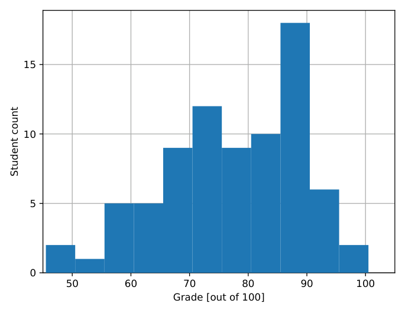

# MIT 6.824/6.5840 2022: Quiz 1: Official solutions

> Copied from the original: <https://pdos.csail.mit.edu/6.824/quizzes.html>. Text and figures are taken from the PDF as is; nothing was answered or rewritten. The original PDF is in this folder.

---

**Page 1**

&emsp;&emsp;&emsp;&emsp;&emsp;&emsp;&emsp;&emsp;Department of Electrical Engineering and Computer Science 
&emsp;&emsp;&emsp;&emsp;&emsp;&emsp;MASSACHUSETTS INSTITUTE OF TECHNOLOGY

&emsp;&emsp;&emsp;&emsp;**6.824 Distributed System Engineering: Spring 2022** 
&emsp;&emsp;&emsp;&emsp;&emsp;&emsp;&emsp;&emsp;**Exam I**

Write your name on this cover sheet. If you tear out any sheets, please write your name on them. 
You have 80 minutes to complete this quiz. 
Some questions may be much harder than others. Read them all through first and attack them in 
the order that allows you to make the most progress. If you find a question ambiguous, write down 
any assumptions you make. Write neatly. In order to receive full credit you must answer each 
question as precisely as possible. 
You may use class notes, papers, and lab material. You may read them on your laptop, but you are 
not allowed to use any network. For example, you may not look at web sites or communicate with 
anyone.

&emsp;&emsp;&emsp;**I (7)**   **II (14)**   **III (14)**   **IV (35)**   **V (14)**   **VI (14)**   **VII (2)**   **Total (100)**

**Name:** 
**Submission Website E-Mail Address:**

---

**Page 2**

&emsp;&emsp;&emsp;&emsp;&emsp;&emsp;Grade histogram for Exam 1

&emsp;&emsp;&emsp;&emsp;&emsp;&emsp;&emsp;&emsp;max=   100 
&emsp;&emsp;&emsp;&emsp;&emsp;&emsp;&emsp;&emsp;median   =   78 
&emsp;&emsp;&emsp;&emsp;&emsp;&emsp;&emsp;&emsp;µ   =   77.2 
&emsp;&emsp;&emsp;&emsp;&emsp;&emsp;&emsp;&emsp;σ   =   11.8

---

**Page 3**

6.824 Spring 2022, Exam 1   Page 3 of 14

**I**   **MapReduce**

You’re writing a MapReduce-based application (a Map function and a Reduce function) that an- 
alyzes the way words are used in documents (the details of the analysis do not matter for this 
question). Each input document corresponds to a separate Map task. Your Reduce function needs 
to know the total number of times each word occurs in the total set of documents. You set up 
a database server that has a table mapping words to counts. You program your Map function to 
connect to that database over the network and tell it to increment the relevant count in the database 
for each word that Map sees in its input. You write your Reduce function to consult the database 
when it needs a word’s total count. You’re careful to reset the counts in the database to zero before 
starting a MapReduce job. You run only a single MapReduce job at a time. 
You find, to your surprise, that sometimes the counts that the Reduces read from the database are 
too high – higher than the total number of times a word actually appears.

&emsp;**1. \[7 points\]:** Explain what is going on.

**Answer:** The MapReduce coordinator might run a given Map task more than once, either because 
of a worker failure or because a Map task took too long. That would cause the words of that task’s 
document to be counted twice in the database, instead of once, so those counts would be too high.

---

**Page 4**

6.824 Spring 2022, Exam 1   Page 4 of 14

**II**   **GFS**

Consider the paper The Google File System by Ghemawat et al. Section 3.1 explains that the 
master grants each primary chunkserver a 60-second lease. The primary can act as primary during 
the lease time, but must stop when the lease expires. The master won’t assign a different server to 
be primary until after the lease has expired, but may do so immediately afterwards. 
The master starts counting the lease time when it sends the network message to the primary granting 
the lease. The primary starts counting the lease time when it receives that message. Assume for 
this question that the primary does not try to renew its lease.

&emsp;**2.**   **\[7 points\]:** Suppose the primary’s clock runs much faster than the master’s clock, so 
&emsp;that the primary thinks the lease expires many seconds before the master thinks it expires. 
&emsp;Briefly explain how the primary’s fast clock will cause a loss of performance.

**Answer:** The effect of a fast primary clock will be that a primary will stop serving a chunk before 
it has to. During the time between when the primary stops serving the chunk, and the master assigns 
a new primary, clients will not be able to write the chunk. This is a loss of performance.

&emsp;**3. \[7 points\]:** Suppose the network delays the lease grant message by ten seconds. For this 
&emsp;question, the master and primary clocks run at the same speed, and the network only delays 
&emsp;the lease grant message, but not other messages. Briefly explain how the delayed delivery of 
&emsp;the lease grant message could cause loss of correctness.

**Answer:**   The delayed lease grant message will cause the primary to think it has lost the lease 
after the master thinks the lease ends. This may cause the master to grant the lease to a different 
chunkserver, so that two different chunkservers think they are primary for the same chunk. The 
older primary may receive a chunk append request from a client, and apply the append to its own 
replica, and send a positive response to the client; but the append may not appear to clients reading 
from the newer primary.

---

**Page 5**

6.824 Spring 2022, Exam 1   Page 5 of 14

**III**   **VMware FT**

The Design of a Practical System for Fault-Tolerant Virtual Machines, by Scales et al., says in 
Section 2.2 and Figure 2 that the Output Rule must be enforced for network packets sent to clients: 
before the Primary sends a packet to a client, it must wait until the Backup acknowledges that it 
has received all log entries up to that point. On the other hand, for operations such as modifying 
CPU registers or writing RAM, the Output Rule does not apply, and the Primary does not need to 
wait for the Backup.

&emsp;**4. \[7 points\]:** When the Primary tells the Backup about an output operation (as in Figure 
&emsp;2), does the Primary need to tell the Backup the content of the output? For example, when 
&emsp;the Primary is about to send a packet to a client, does it need to tell the Backup the content 
&emsp;of the packet? Explain your answer.

**Answer:**   The Primary does not need to tell the Backup the content of output operations. The 
reason is that the Backup will compute exactly the same content.

---

**Page 6**

6.824 Spring 2022, Exam 1   Page 6 of 14

A server replicated with VMware FT has an RPC handler with this code, intended to swap the 
content of two blocks stored in the Shared Disk:

SwapHandler(): 
1\. read block 1 into buffer1 
2\. read block 2 into buffer2 
3\. write buffer2 to block 1 
4\. write buffer1 to block 2 
5\. respond "done" to the client

Block 1 starts out containing XX, and block 2 starts out containing YY. There’s only one client. 
The client sends a SwapHandler RPC request to the server, and (if the client doesn’t get a response) 
re-sends the request periodically until it gets a response. There are no other requests.

&emsp;**5. \[7 points\]:** If the Primary crashes after executing line 3, at that point the Shared Disk 
&emsp;will contain YY in both block 1 and block 2. After the Backup “goes live” and the client 
&emsp;receives a response, what will the Shared Disk end up containing in blocks 1 and 2? What is 
&emsp;the sequence of actions that leads to that outcome?

**Answer:** The Primary will send log entries to the Backup containing the client’s request and the 
content of the two blocks that the Primary received from the Shared Disk. The Output Rule ensures 
that, before the Primary sends line 3’s write to the Shared Disk, that the Backup has received those 
log entries. The Backup, before going live, will execute these log entries, and thus have correct 
content in buffer1 and buffer2. The Backup will likely go live just before it executes line 3. As a 
result, the Backup will write YY to block 1, and XX to block 2, leading to a correct outcome – the 
same as if the Primary had not crashed.

---

**Page 7**

6.824 Spring 2022, Exam 1   Page 7 of 14

**IV**   **Raft**

Refer to Ongaro and Ousterhout’s In Search of an Understandable Consensus Algorithm (Extended 
Version).

&emsp;**6.**   **\[7 points\]:** In the paper’s Figure 8, at time (b), S5’s last log entry has a term of 3. A 
&emsp;friend of yours suggests that the term in S5’s last log entry should instead be 2, since S5 got 
&emsp;votes only from S3 and S4 (and itself), and those servers all have 1 at the ends of their logs. 
&emsp;Explain what it is that forces S5 to be leader for term 3, and not term 2.

**Answer:**   When S1 became leader for term 2 (at time (a)), it exchanged RPCs with at least a 
majority of peers, which caused those peers to set their currentTerm’s to 2. This majority must 
have included at least one of S3, S4, or S5. S5 could not then become leader for term 2, because at 
least one server in whatever majority voted for it must have known that the latest term number was 
2.

Suppose Figure 2’s RequestVote handling code were changed to omit lastLogIndex and lastLogTerm 
from the Arguments, and item 2 were changed to:

2\. If votedFor is candidateId, 
&emsp;or (votedFor is null and term \>= currentTerm), 
&emsp;grant vote.

&emsp;**7. \[7 points\]:** Explain why this change can cause two Raft peers to apply different entries 
&emsp;at the same index.

**Answer:** With this change, a server whose log is missing committed/applied entries could become 
the leader. It will force other peers’ logs to be the same its log, and thus cause the system to forget 
about committed operations. It could then receive, commit, and apply different entries at those 
same log indices.

---

**Page 8**

6.824 Spring 2022, Exam 1   Page 8 of 14

Figure 13 describes a series of steps that the InstallSnapshot RPC handler must follow, including:

6\. If existing log entry has same index and term as snapshot’s last 
&emsp;included entry, retain log entries following it and reply

Recall that Raft’s safety guarantee is that if two servers commit an entry at a particular index, it 
must be the same entry.

&emsp;**8. \[7 points\]:** Consider what would happen if this step were omitted (i.e. we uncondition- 
&emsp;ally proceeded to step 7, discarding the entire log upon receiving an InstallSnapshot RPC). 
&emsp;Would this modified protocol violate Raft’s safety guarantees? If not, explain why not. If it 
&emsp;would, describe an execution of the protocol that results in an observable safety violation.

**Answer:** Yes, it would violate Raft’s safety guarantees. The discarded log entries may be commit- 
ted, but known only to a bare majority. Discarding them might cause them to be known only to a 
minority. A new leader that lacked those entries could be elected without votes from that minority, 
causing committed log entries to be entirely forgotten, and different entries could be applied in 
their place on some peers.

---

**Page 9**

6.824 Spring 2022, Exam 1   Page 9 of 14

Suppose that a correct Lab 2 implementation is running on a cluster of machines, and a cosmic ray 
flips some bits in the memory of the leader. This question asks about possible corruptions and how 
they affect Raft safety. Recall that Raft’s safety guarantee is that if two servers commit an entry at 
a particular index, it must be the same entry.

&emsp;**9.**   **\[7 points\]:** Consider the scenario where the cosmic ray flips bits in the ‘nextIndex\[\]‘ 
&emsp;array, replacing some values with other arbitrary values. Assume that code handles out-of- 
&emsp;bounds values by clipping to the size of the log. Could an execution where this occurs result 
&emsp;in an observable safety violation? If not, explain why not. If it could, describe an execution 
&emsp;of the protocol that results in an observable safety violation.

**Answer:**   This won’t cause a safety violation. If nextIndex is too low, the leader may send log 
entries that the follower already has, which the follower will ignore. If nextIndex is too high, this 
may cause the leader to not send new log entries to a follower, and thus perhaps not be able to 
commit new commands; this may hurt liveness but not safety.

&emsp;**10. \[7 points\]:** Now, consider a scenario where the cosmic ray flips bits in the ‘matchIn- 
&emsp;dex\[\]‘ array, replacing some values with other arbitrary values. Assume that the code handles 
&emsp;out-of-bounds values by clipping to the size of the log. Could an execution where this occurs 
&emsp;result in an observable safety violation? If not, explain why not. If it could, describe an 
&emsp;execution of the protocol that results in an observable safety violation.

**Answer:** This can cause a safety violation, by causing the leader to think that a majority of peers 
have stored a log entry when the really haven’t. The leader may commit that entry; if it then 
crashes, the new leader may not be aware of the entry, and it could commit a different entry at the 
same index.

---

**Page 10**

6.824 Spring 2022, Exam 1   Page 10 of 14

**V**   **ZooKeeper**

Ben Bitdiddle reads ZooKeeper: Wait-free coordination for Internet-scale systems by Hunt, Konar, 
Junqueira, and Reed, and decides to use ZooKeeper in a distributed system he’s building. Ben 
implements the paper’s Simple Locks (page 6) with the following code:

lock(): 
1\. ok = create("/lock", EPHEMERAL) 
2\. if ok == true, return (lock is acquired) 
3\. if exists("/lock", watch=true) wait for watch event 
4\. goto 1

unlock(): 
5\. delete("/lock", -1)

Client C1 calls lock(), which succeeds. 
Client C2 calls lock(), which blocks at line 3. 
Client C1 is running on Ben’s laptop. Ben puts his laptop to sleep; C1 stops executing and does not 
call unlock(). Ben goes off to eat lunch. 
Client C2 is still operating on a different computer, and can talk to the ZooKeeper service.

&emsp;**11. \[7 points\]:** C2 will be able to eventually aquire the lock even though C1 never unlocks 
&emsp;it. Explain how this happens.

**Answer:** ZooKeeper will time out C1’s session, terminate the session, and delete C1’s ephemeral 
/lock file. That will send a watch event to C2, which will wake up and be able to create /lock.

---

**Page 11**

6.824 Spring 2022, Exam 1   Page 11 of 14

At this point C2 holds the lock.

&emsp;**12. \[7 points\]:** Suppose there is another client C3 that has called lock() and is waiting to 
&emsp;get the lock. Ben returns from lunch and opens up his laptop. C1 resumes execution, and 
&emsp;calls unlock(). C2 does not call unlock(). Will C3 now be able to acquire the lock? Explain 
&emsp;your answer.

**Answer:**   No. ZooKeeper ignores requests from terminated sessions, so it will not honor C1’s 
delete of /lock.

---

**Page 12**

6.824 Spring 2022, Exam 1   Page 12 of 14

**VI**   **Chain Replication**

Zara Zoomer is storing a small amount of valuable data in a storage system that replicates data using 
the chain technique from Chain Replication for Supporting High Throughput and Availability by 
van Renesse and Schneider. Zara’s chain has five servers, as well as a replicated master that detects 
server failures and directs the recovery process. Each server sends a few heartbeat messages per 
second to the master, and the master declares a server dead if it doesn’t receive any heartbeats for 
ten seconds. The master has a large pool of idle servers it can use as replacements; after deciding a 
chain server is dead, it takes another second to re-configure the chain to eliminate the dead server, 
incorporate a new server (so that the chain length stays constant), and copy all the data to the new 
server. The master never itself suffers any failures.

&emsp;**13. \[7 points\]:** Zara’s system frequently imposes delays of up to eleven seconds on updates. 
&emsp;Zara feels this is not very fault-tolerant, and would like to reduce the frequency of these 
&emsp;delays. Should she increase the chain length from five to six? Or decrease it to four? Explain.

**Answer:**   Zara should decrease the length of the chain. The eleven-second delays are caused by 
failed servers. The longer the chain, the more likelihood that at least one server is dead; and the 
chain can only process an update if every server is alive.

---

**Page 13**

6.824 Spring 2022, Exam 1   Page 13 of 14

Zara is upset at how much it costs to pay for the servers implementing the master service. She 
reasons that she could eliminate the master altogether, and use the following scheme instead. All 
the servers in a chain send the other servers periodic heartbeat messages. If the head is alive, it will 
monitor the heartbeats and tell the other servers how to re-configure if one dies. If the other servers 
stop getting heartbeats from the head, they will consider the second server to be in charge of the 
configuration, and so on.

&emsp;**14. \[7 points\]:** Explain what is wrong with Zara’s plan, and outline an example situation in 
&emsp;which it will yield incorrect (non-linearizable) results to clients.

**Answer:** If the first and second servers in the chain can’t talk to each other over the network, but 
can talk to all the other servers, then both will believe they are in charge of the configuration, and 
both will decide to be head. Now we have two heads, and the potential for split brain.

---

**Page 14**

6.824 Spring 2022, Exam 1   Page 14 of 14

**VII**   **6.824**

&emsp;**15. \[0.66 points\]:** Which lectures/papers should we definitely keep for future years? 
&emsp;&emsp;**–** MapReduce 
&emsp;&emsp;**–** RPC, Threads, and Go 
&emsp;&emsp;**–** GFS 
&emsp;&emsp;**–** VMware FT 
&emsp;&emsp;**–** Raft 
&emsp;&emsp;**–** Debugging 
&emsp;&emsp;**–** Q+A on Lab 2A/2B 
&emsp;&emsp;**–** ZooKeeper 
&emsp;&emsp;**–** Chain Replication 
&emsp;&emsp;**–** Distributed Transactions

**Answer:** Keep Raft, MapReduce, and GFS. 
&emsp;**16. \[0.66 points\]:** Which lectures/papers should we omit? 
&emsp;&emsp;**–** MapReduce 
&emsp;&emsp;**–** RPC, Threads, and Go 
&emsp;&emsp;**–** GFS 
&emsp;&emsp;**–** VMware FT 
&emsp;&emsp;**–** Raft 
&emsp;&emsp;**–** Debugging 
&emsp;&emsp;**–** Q+A on Lab 2A/2B 
&emsp;&emsp;**–** ZooKeeper 
&emsp;&emsp;**–** Chain Replication 
&emsp;&emsp;**–** Distributed Transactions

**Answer:** Get rid of Chain Replication. 
&emsp;**17. \[0.66 points\]:** What can we do to improve the course?

**Answer:** Better debugging tools for the labs.

---

**Page 15**

6.824 Spring 2022, Exam 1   Page 15 of 14 
&emsp;&emsp;&emsp;&emsp;&emsp;&emsp;&emsp;&emsp;End of Exam I

