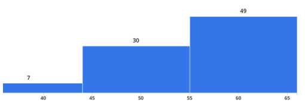

# MIT 6.824/6.5840 2023: Quiz 2: Official solutions

> Copied from the original: <https://pdos.csail.mit.edu/6.824/quizzes.html>. Text and figures are taken from the PDF as is; nothing was answered or rewritten. The original PDF is in this folder.

---

**Page 1**

6.5840 Spring 2023, Exam II   Page 1 of 15

&emsp;&emsp;&emsp;&emsp;&emsp;&emsp;&emsp;&emsp;Department of Electrical Engineering and Computer Science 
&emsp;&emsp;&emsp;&emsp;&emsp;&emsp;MASSACHUSETTS INSTITUTE OF TECHNOLOGY

&emsp;&emsp;&emsp;**6.5840 Distributed System Engineering: Spring 2023** 
&emsp;&emsp;&emsp;&emsp;&emsp;&emsp;&emsp;&emsp;**Exam II**

Please write your name on the bottom of each page. You have 120 minutes to complete this exam. 
Some questions may be much harder than others. Read them all through first and attack them in 
the order that allows you to make the most progress. If you find a question ambiguous, write down 
any assumptions you make. Write neatly. In order to receive full credit you must answer each 
question as precisely as possible. 
You may use class notes, papers, and lab material. You may read them on your laptop, but you 
are not allowed to use any network. For example, you may not look at web sites, use ChatGPT, or 
communicate with anyone. 
The maximum number points available is 66.

**Gradescope E-Mail Address:**

&emsp;**Name:**

---

**Page 2**

6.5840 Spring 2023, Exam II   Page 2 of 15 
&emsp;&emsp;&emsp;&emsp;&emsp;&emsp;Grade histogram for Exam 2

&emsp;&emsp;&emsp;&emsp;&emsp;&emsp;&emsp;&emsp;max   =   66 
&emsp;&emsp;&emsp;&emsp;&emsp;&emsp;&emsp;&emsp;median=   56.5 
&emsp;&emsp;&emsp;&emsp;&emsp;&emsp;&emsp;&emsp;µ   =   54.9 
&emsp;&emsp;&emsp;&emsp;&emsp;&emsp;&emsp;&emsp;σ   =   8.0

&emsp;**Name:**

---

**Page 3**

6.5840 Spring 2023, Exam II   Page 3 of 15

**I**   **Distributed Transactions**

Quentin Querier is designing a distributed transaction processing system. His goal is to provide 
results that are serializable, as described in Lecture 12 (Distributed Transactions) and the assigned 
readings in Chapter 9 of the 6.033 book. 
Quentin is thinking about optimizing read-only transactions, which read database records but do 
not modify any records. He wonders whether it would be OK for read-only transactions to hold 
each lock only for the brief period required to examine each record. That is, for a transaction 
T1 that reads records X and Y and prints the values, Quentin wonders if it would be OK for the 
implementation to acquire and release locks at the indicated places:

BEGIN TRANSACTION T1 
&emsp;&emsp;&emsp;&emsp;&emsp;&emsp;&emsp;&emsp;\<--- lock X 
&emsp;temp1 = read X 
&emsp;&emsp;&emsp;&emsp;&emsp;&emsp;&emsp;&emsp;\<--- unlock X 
&emsp;&emsp;&emsp;&emsp;&emsp;&emsp;&emsp;&emsp;\<--- lock Y 
&emsp;temp2 = read Y 
&emsp;&emsp;&emsp;&emsp;&emsp;&emsp;&emsp;&emsp;\<--- unlock Y 
&emsp;print temp1, temp2 
END TRANSACTION T1

&emsp;**1. \[5 points\]:** It turns out that Quentin’s optimization can result in non-serializable results. 
&emsp;Please demonstrate this to Quentin by providing a second transaction T2 that, when run 
&emsp;at about the same time as T1, could cause T1 to print a result that could not result from 
&emsp;any serializable execution of T1 and T2. Feel free to include writes in your T2. You should 
&emsp;assume that before T1 and T2 begin, records X and Y both contain value zero. Please indicate 
&emsp;where the implementation acquires and releases each lock in T2. Your locking scheme for 
&emsp;T2 must obey two-phase locking.

BEGIN T2 
&emsp;&emsp;&emsp;&emsp;\<--- lock X 
X = 1 
&emsp;&emsp;&emsp;&emsp;\<--- lock Y 
Y = 1 
&emsp;&emsp;&emsp;&emsp;\<--- unlock X 
&emsp;&emsp;&emsp;&emsp;\<--- unlock Y 
END T2

&emsp;**Name:**

---

**Page 4**

6.5840 Spring 2023, Exam II   Page 4 of 15

**II**   **Frangipani**

Ernie and Bert store shared files in the system described in Frangipani: A Scalable Distributed File 
System, by Thekkath et al. Each of them has a workstation that runs Frangipani, connected to a 
Petal storage service. Ernie reads the file called README and sees that its entire content is the two 
bytes xy. At this point, Ernie’s workstation is caching the file README. A few seconds later, Bert 
runs a program that replaces just the first byte in the file with the character z. A few seconds after 
that, Ernie reads the file, and sees that it contains zy.

&emsp;**2. \[5 points\]:** Explain what causes Ernie’s second read to yield zy rather than the content 
&emsp;it cached after the first read, xy.

**Answer:** Bert requests the lock for README, which causes Ernie to discard xy from its cache. 
When Ernie reads the second time, Ernie requests the lock; before Bert releases the lock, Bert 
writes the zy to Petal. Once Ernie gets the lock, since Ernie doesn’t have README cached, Ernie 
reads the new content from Petal.

&emsp;**Name:**

---

**Page 5**

6.5840 Spring 2023, Exam II   Page 5 of 15

**III**   **Spanner**

Consider Spanner: Google’s Globally-Distributed Database by Corbett et al.

&emsp;**3.**   **\[5 points\]:** If read-only transactions used TT.now().earliest as timestamps in- 
&emsp;stead of TT.now().latest, then Spanner wouldn’t be linearizable. Briefly explain why.

**Answer:** This can allow a read-only transaction to choose a timestamp that is before the timestamp 
of an already-commited read-write transaction, and thus not see the results of that prior read-write 
transaction.

&emsp;**4. \[5 points\]:** Consider a read-only transaction that involves reading from multiple Paxos 
&emsp;groups and assume that Spanner picks a random replica in each group to read from. Is there 
&emsp;an upper bound on how long this read-only transaction may block? (Briefly explain your 
&emsp;answer.)

**Answer:** No. A replica in Paxos group may be indefinitely behind if it has missed many messages 
(Paxos only requires a majority for agreement). Thus, it may take a long time before tsafe catches 
up to sread.

&emsp;**Name:**

---

**Page 6**

6.5840 Spring 2023, Exam II   Page 6 of 15

**IV**   **FaRM**

Consider the FaRM execute/commit protocol in Figure 4 of No compromises: distributed trans- 
actions with consistency, availability, and performance. Developers interact with FaRM using 
transactions; the API consists of txCreate, txWrite, txRread and txCommit. Consider 
the following code for transaction T1:

T1: 
txCreate()   // start the transaction 
ox = txRead(x\_oid)   // read object x (an integer) 
txWrite(x\_oid, ox + 1) // write object x 
txCommit()   // start Figure 4’s commit phase

txRead() uses RDMA to read an object with a given object identifier into local memory. ox is a 
local variable. txWrite() buffers the written data, which is written to FaRM during the commit 
phase if the transaction commits. Because FaRM uses optimistic concurrency control it may abort 
a transaction.

&emsp;**5. \[5 points\]:** Write the code for a transaction T2 such that if T1 and T2 run concurrently 
&emsp;on FaRM it is likely that T2 will abort due to failing the VALIDATE phase in Figure 4. 
&emsp;(Briefly explain your answer.) 
&emsp;**Answer:** Any transaction that reads x (but doesn’t write x) could abort in the VALIDATE 
&emsp;phase if T1 happens to be commiting and has set the lock for x. The VALIDATE phase 
&emsp;checks x’s lock flag as well as the version number, since the lock flag is in the high bit of the 
&emsp;version.

&emsp;**Name:**

---

**Page 7**

6.5840 Spring 2023, Exam II   Page 7 of 15

**V**   **DynamoDB**

A customer is using an early version of DynamoDB that lacks the improvements described starting 
at Section 4.1 of Amazon DynamoDB: A Scalable, Predictably Performant, and Fully Managed 
NoSQL Database Service, by Elhemali et al. 
The customer knows that they will never need to perform more than 1000 reads per second. The 
customer tells DynamoDB to provision 1000 RCUs of throughput. The customer also provisions 
sufficient WCUs for writes, which you can ignore for this question. 
At first, DynamoDB stores all of the customer’s data in a single partition. The customer, who 
keeps an eye on performance, notes that DynamoDB never rejects (throttles) any of the customer’s 
requests. 
As time goes on, the amount of data the customer stores in DynamoDB increases, though the 
customer’s read load (in terms of requests per second) stays the same. Because of the increase in 
total data, DynamoDB splits the customer’s partition in half, so that half the customer’s data is in 
one partition, and the other half in the other partition. 
However, after this split, the customer starts seeing that DynamoDB rejects some read requests, 
even though the pattern and volume of the customer’s requests has not changed at all.

&emsp;**6. \[5 points\]:** Explain why going from one to two partitions could cause this throttling.

**Answer:** The customer would see such throttling if the load was not evenly distributed across keys, 
so that one partition received more than half the reads, and the other less. That is, one partition 
might receive more than 500 requests per second, but be provisioned at only 500 RCUs.

&emsp;**Name:**

---

**Page 8**

6.5840 Spring 2023, Exam II   Page 8 of 15

**VI**   **Spark**

Consider the paper Resilient Distributed Datasets: A Fault-Tolerant Abstraction for In-Memory 
Cluster Computing by Zaharia et al.. For each of the following statements indicate it is true or 
false:

&emsp;**7. \[4 points\]:** 
&emsp;**True / False** : Spark will execute MapReduce applications such as K-means faster than 
&emsp;MapReduce because intermediate data is stored in memory instead of on disk.

&emsp;**True / False** : All Spark transformation materializes the output RDD.

&emsp;**True / False** : Invoking the default persist on an RDD avoids having to recompute the 
&emsp;RDD using the lineage graph from its inputs when a node fails.

&emsp;**True / False** : Sparks stores the data of an RDD on a single node.

**Answer:** True, False, False, False.

&emsp;**Name:**

---

**Page 9**

6.5840 Spring 2023, Exam II   Page 9 of 15

**VII**   **Memcached at Facebook**

Replicating and sharding data over thousands of servers are the two main tools used to serve a high 
rate of requests in Scaling Memcache at Facebook by Nishtala et al. Both techniques help per- 
formance in some circumstances but hurt in others. For each of the following statements, indicate 
whether it is true or false.

&emsp;**8. \[4 points\]:** 
&emsp;**True / False** : Sharding is likely to perform better than replication when the same few items 
&emsp;are the targets of most client read requests.

&emsp;**True / False** : Sharding allows more distinct items to be stored in a given amount of RAM 
&emsp;than replication.

&emsp;**True / False** : Sharding requires more work to be performed when the underlying data is 
&emsp;written than replication.

&emsp;**True / False** : Sharding is better than replication at reducing packet rates by packing more 
&emsp;get requests into each packet (this packing is the “multiget” technique mentioned in Section 
&emsp;6.1).

**Answer:** False, True, False, False.

&emsp;**Name:**

---

**Page 10**

6.5840 Spring 2023, Exam II   Page 10 of 15

**VIII**   **Zanzibar**

&emsp;**9. \[5 points\]:** What function do Zanzibar’s zookies perform? Circle the single most correct 
&emsp;answer.

&emsp;&emsp;**A.** They identify the requesting user. 
&emsp;&emsp;**B.** They indicate the order in which Zanzibar executes operations. 
&emsp;&emsp;**C.** They help ensure that decisions use the most recent ACL data. 
&emsp;&emsp;**D.** They help ensure that decisions use ACL data no later than the time in the Zookie. 
&emsp;&emsp;**E.** They help ensure that decisions use ACL data no earlier than the time in the Zookie.

**Answer:** E

&emsp;**Name:**

---

**Page 11**

6.5840 Spring 2023, Exam II   Page 11 of 15

**IX**   **SUNDR**

Users U1 and U2 share files with SUNDR (Secure Untrusted Data Repository, by Li et al.). 
The following sequence of events occurs:

**A.** U2 creates an empty file named README. 
**B.** Then U1 appends x to README. 
**C.** Then U2 appends y. 
**D.** Then U1 appends z. 
**E.** Then U2 reads README.

The server returns a successful result to each of these operations, and neither U1 nor U2 nor their 
client software detect any problems. 
There are no other clients. U1 and U2 run correct software on their client workstations, faithfully 
executing the client side of the SUNDR protocol. U1 and U2 are honest, are legitimate users of the 
SUNDR system, and have permission to read and write README. U1 and U2 do not communicate 
with each other (other than by reading and writing data in SUNDR). 
The SUNDR server may be malicious.

&emsp;**10. \[6 points\]:** What can U2’s final read return? Circle all that apply.

&emsp;&emsp;**A.** File README does not exist. 
&emsp;&emsp;**B.** README exists but is empty. 
&emsp;&emsp;**C.** README contains exactly x. 
&emsp;&emsp;**D.** README contains exactly xy. 
&emsp;&emsp;**E.** README contains exactly y. 
&emsp;&emsp;**F.** README contains exactly z.

**Answer:** D and E. The server has to show U2 all of its previous operations, because U2 checks 
for this and the question says U2 doesn’t detect any problems. But the server can omit any suffix 
of U1’s operations without U2 being able to notice.

&emsp;**Name:**

---

**Page 12**

6.5840 Spring 2023, Exam II   Page 12 of 15

**X**   **PBFT**

Consider the PBFT protocol as described in the paper “Practical Byzantine Fault Tolerance” by 
Castro and Liskov.

&emsp;**11.**   **\[5 points\]:** Ben is worried that a malicious primary can cause a client request to be 
&emsp;executed twice with different sequence numbers, which would break linearizability. For ex- 
&emsp;ample, if the primary receives a message m from a client, and then sends PRE-PREPARE\<v, 
&emsp;n, d\>, m and later PRE-PREPARE\<v, n + 1, d\>, m, will honest replicas execute m twice? 
&emsp;(The PRE-PREPARE messages are correctly signed by the primary, m is correctly signed by 
&emsp;the client, v is the current view, n and is the correct next sequence number, and d is the digest 
&emsp;of m.)

&emsp;**Answer:**No, honest nodes will not execute both of these messages, because m includes 
&emsp;a timestamp, which is signed by the client (and cannot be falsified by the primary). The 
&emsp;first and second message will go through the complete protocol, but a replica will discard 
&emsp;the second message because replicas discard requests whose timestamp is lower than the last 
&emsp;timestamp in the last reply they send to the client.

&emsp;**Name:**

---

**Page 13**

6.5840 Spring 2023, Exam II   Page 13 of 15

**XI**   **Bitcoin**

&emsp;**12.**   **\[5 points\]:** Suppose that one day, all at the same time, 90% of Bitcoin miners (and 
&emsp;90% of the mining hardware) decide to switch to mining the up-and-coming Dogecoin cryp- 
&emsp;tocurrency. Briefly explain what effect this sudden decrease in mining activity would have 
&emsp;on users of Bitcoin.

**Answer:** Initially, it will take more time to mine each block since fewer miners are working. After 
a while, Bitcoin will decrease the hardness, and the rate will return to an average of 10 minutes 
per block. In addition, since there are fewer miners, it would be easier for an attacker to acquire a 
majority of the mining power and thus have a high likelyhood of being able to double-spend.

&emsp;**Name:**

---

**Page 14**

6.5840 Spring 2023, Exam II   Page 14 of 15

**XII**   **GroveKV**

In Figure 2 of the paper “Grove: a separation-logic library for verifying distributed systems with 
leases”, the primary applies an update to its local state before sending the update to the backups.

&emsp;**13.**   **\[5 points\]:** Suppose the primary receives a get operation at line 8 for key that the 
&emsp;primary just updated at line 6. Can the primary serve the get operation from its local state 
&emsp;immediately? (Briefly explain your answer.)

**Answer:**   No – the new value won’t be returned until all the backups have acknowledged the 
update. The potential problem is that if the primary fails after replying to a get at line 8, then the 
client will have seen a value that subsequently disappears.

&emsp;**Name:**

---

**Page 15**

6.5840 Spring 2023, Exam II   Page 15 of 15

**XIII**   **6.5840**

&emsp;**14. \[1 points\]:** Which lectures/papers should we **omit** in future years? 
&emsp;&emsp;**–** Distributed Transactions - 8 
&emsp;&emsp;**–** Frangipani - 11 
&emsp;&emsp;**–** Spanner - 2 
&emsp;&emsp;**–** FaRM - 3 
&emsp;&emsp;**–** DynamoDB - 13 
&emsp;&emsp;**–** Spark - 7 
&emsp;&emsp;**–** Memcached at Facebook - 4 
&emsp;&emsp;**–** Zanzibar - 24 
&emsp;&emsp;**–** SUNDR - 5 
&emsp;&emsp;**–** PBFT - 0 
&emsp;&emsp;**–** Bitcoin - 3 
&emsp;&emsp;**–** Ethereum - 16 
&emsp;&emsp;**–** GroveKV - 18

&emsp;**15. \[1 points\]:** Do you have any feedback for us about 6.5840?

&emsp;**Name:**

---

**Page 16**

6.5840 Spring 2023, Exam II   Page 16 of 15 
&emsp;&emsp;&emsp;&emsp;&emsp;&emsp;&emsp;&emsp;End of Exam II

&emsp;**Name:**

