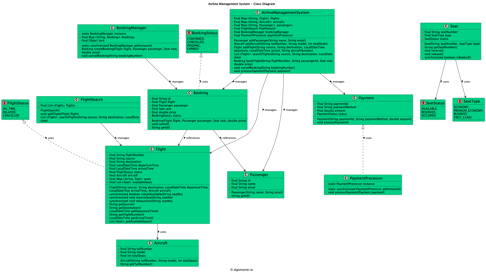

# Low-level design problem: airline management system

> Copied from <https://github.com/ashishps1/awesome-low-level-design/blob/main/problems/airline-management-system.md> (GPL-3.0, by Ashish Pratap Singh). Questions and answers are the source's own; nothing was answered or rewritten here.


# Designing an Airline Management System

## Requirements

1. The airline management system should allow users to search for flights based on source, destination, and date.
2. Users should be able to book flights, select seats, and make payments.
3. The system should manage flight schedules, aircraft assignments, and crew assignments.
4. The system should handle passenger information, including personal details and baggage information.
5. The system should support different types of users, such as passengers, airline staff, and administrators.
6. The system should be able to handle cancellations, refunds, and flight changes.
7. The system should ensure data consistency and handle concurrent access to shared resources.
8. The system should be scalable and extensible to accommodate future enhancements and new features.

## UML Class Diagram



## Implementations

#### [Java Implementation](https://github.com/ashishps1/awesome-low-level-design/blob/main/solutions/java/src/airlinemanagementsystem)

#### [Python Implementation](https://github.com/ashishps1/awesome-low-level-design/blob/main/solutions/python/airlinemanagementsystem)

#### [C++ Implementation](https://github.com/ashishps1/awesome-low-level-design/blob/main/solutions/cpp/airlinemanagementsystem)

#### [C# Implementation](https://github.com/ashishps1/awesome-low-level-design/blob/main/solutions/csharp/airlinemanagementsystem)

#### [Go Implementation](https://github.com/ashishps1/awesome-low-level-design/blob/main/solutions/golang/airlinemanagementsystem)

## Classes, Interfaces and Enumerations

1. The **Flight** class represents a flight in the airline management system, with properties such as flight number, source, destination, departure time, arrival time, and available seats.
2. The **Aircraft** class represents an aircraft, with properties like tail number, model, and total seats.
3. The **Passenger** class represents a passenger, with properties such as ID, name, email, and phone number.
4. The **Booking** class represents a booking made by a passenger for a specific flight and seat, with properties such as booking number, flight, passenger, seat, price, and booking status.
5. The **Seat** class represents a seat on a flight, with properties like seat number, seat type, and seat status.
6. The **Payment** class represents a payment made for a booking, with properties such as payment ID, payment method, amount, and payment status.
7. The **FlightSearch** class provides functionality to search for flights based on source, destination, and date.
8. The **BookingManager** class manages the creation and cancellation of bookings. It follows the Singleton pattern to ensure a single instance of the booking manager.
9. The **PaymentProcessor** class handles the processing of payments. It follows the Singleton pattern to ensure a single instance of the payment processor.
10. The **AirlineManagementSystem** class serves as the main entry point of the system, combining all the components and providing methods for flight management, booking, payment processing, and other operations.


---

## Official solutions from the repository

<details><summary><b>java</b> (17 files)</summary>


**Aircraft.java**

```java
package airlinemanagementsystem;

public class Aircraft {
    private final String tailNumber;
    private final String model;
    private final int totalSeats;

    public Aircraft(String tailNumber, String model, int totalSeats) {
        this.tailNumber = tailNumber;
        this.model = model;
        this.totalSeats = totalSeats;
    }

    public String getTailNumber() {
        return tailNumber;
    }
}
```


**AirlineManagementSystem.java**

```java
package airlinemanagementsystem;

import airlinemanagementsystem.booking.Booking;
import airlinemanagementsystem.booking.BookingManager;
import airlinemanagementsystem.flight.Flight;
import airlinemanagementsystem.flight.FlightSearch;
import airlinemanagementsystem.payment.Payment;
import airlinemanagementsystem.payment.PaymentProcessor;
import airlinemanagementsystem.seat.Seat;

import java.time.LocalDate;
import java.time.LocalDateTime;
import java.util.HashMap;
import java.util.List;
import java.util.Map;

public class AirlineManagementSystem {
    private final Map<String, Flight> flights;
    private final Map<String, Aircraft> aircrafts;
    private final Map<String, Passenger> passengers;
    private final FlightSearch flightSearch;
    private final BookingManager bookingManager;
    private final PaymentProcessor paymentProcessor;

    public AirlineManagementSystem() {
        flights = new HashMap<>();
        aircrafts = new HashMap<>();
        passengers = new HashMap<>();
        flightSearch = new FlightSearch();
        bookingManager = BookingManager.getInstance();
        paymentProcessor = PaymentProcessor.getInstance();
    }

    public Passenger addPassenger(String name, String email) {
        Passenger passenger = new Passenger(name, email);
        passengers.put(passenger.getId(), passenger);
        return passenger;
    }

    public Aircraft addAircraft(String tailNumber, String model, int totalSeats) {
        Aircraft aircraft = new Aircraft(tailNumber, model, totalSeats);
        aircrafts.put(tailNumber, aircraft);
        return aircraft;
    }

    public Flight addFlight(String source, String destination, LocalDateTime departure,
                            LocalDateTime arrival, String aircraftNumber) {
        Aircraft aircraft = aircrafts.get(aircraftNumber);
        Flight flight = new Flight(source, destination, departure, arrival, aircraft);
        flights.put(flight.getFlightNumber(), flight);
        flightSearch.addFlight(flight);
        return flight;
    }

    public List<Flight> searchFlights(String source, String destination, LocalDate date) {
        return flightSearch.searchFlights(source, destination, date);
    }

    public Booking bookFlight(String flightNumber, String passengerId, Seat seat, double price) {
        Flight flight = flights.get(flightNumber);
        Passenger passenger = passengers.get(passengerId);
        return bookingManager.createBooking(flight, passenger, seat, price);
    }

    public void cancelBooking(String bookingNumber) {
        bookingManager.cancelBooking(bookingNumber);
    }

    public void processPayment(Payment payment) {
        paymentProcessor.processPayment(payment);
    }
}
```


**AirlineManagementSystemDemo.java**

```java
package airlinemanagementsystem;

import airlinemanagementsystem.booking.Booking;
import airlinemanagementsystem.flight.Flight;
import airlinemanagementsystem.seat.Seat;
import airlinemanagementsystem.seat.SeatType;

import java.time.LocalDate;
import java.time.LocalDateTime;
import java.util.List;

public class AirlineManagementSystemDemo {
    public static void run() {
        AirlineManagementSystem airlineManagementSystem = new AirlineManagementSystem();

        // Create passengers
        Passenger passenger1 = airlineManagementSystem.addPassenger("John Doe", "john@example.com");
        Passenger passenger2 = airlineManagementSystem.addPassenger("John Smith", "smith@example.com");

        // Create aircrafts
        Aircraft aircraft1 = airlineManagementSystem.addAircraft("A001", "Boeing 747", 300);
        Aircraft aircraft2 = airlineManagementSystem.addAircraft("A002", "Airbus A380", 500);

        // Create flights
        LocalDateTime departureTime1 = LocalDateTime.now().plusDays(1);
        LocalDateTime arrivalTime1 = departureTime1.plusHours(2);
        Flight flight1 = airlineManagementSystem.addFlight("New York", "London", departureTime1, arrivalTime1, aircraft1.getTailNumber());

        LocalDateTime departureTime2 = LocalDateTime.now().plusDays(3);
        LocalDateTime arrivalTime2 = departureTime2.plusHours(5);
        Flight flight2 = airlineManagementSystem.addFlight("Paris", "Tokyo", departureTime2, arrivalTime2, aircraft2.getTailNumber());

        // Search flights
        List<Flight> searchResults = airlineManagementSystem.searchFlights("New York", "London", LocalDate.now().plusDays(1));
        System.out.println("Search Results:");
        for (Flight flight : searchResults) {
            System.out.println("Flight: " + flight.getFlightNumber() + " - " + flight.getSource() + " to " + flight.getDestination());
        }

        // Book a flight
        Booking booking = airlineManagementSystem.bookFlight(flight1.getFlightNumber(), passenger1.getId(), new Seat("25A", SeatType.ECONOMY), 100);
        if (booking != null) {
            System.out.println("Booking successful. Booking ID: " + booking.getId());
        } else {
            System.out.println("Booking failed.");
        }

        // Cancel a booking
        airlineManagementSystem.cancelBooking(booking.getId());
        System.out.println("Booking cancelled.");
    }
}
```


**Passenger.java**

```java
package airlinemanagementsystem;

import java.util.UUID;

public class Passenger {
    private final String id;
    private final String name;
    private final String email;

    public Passenger(String name, String email) {
        this.id = UUID.randomUUID().toString();
        this.name = name;
        this.email = email;
    }

    public String getId() {
        return id;
    }
}
```


**README.md**

```md
# Airline Management System (LLD)

## Problem Statement

Design and implement an Airline Management System that allows users to book flights, manage passengers, handle seat assignments, process payments, and track bookings and flights.

---

## Requirements

- **Flight Management:** The system manages flights, each with a unique flight number, aircraft, source, destination, and schedule.
- **Aircraft Management:** Each flight is associated with an aircraft, which has a model and a set of seats.
- **Seat Management:** The system manages seat assignments and availability for each flight.
- **Passenger Management:** Passengers can be added, updated, and associated with bookings.
- **Booking Management:** Users can book flights, and the system tracks bookings, assigned seats, and passengers.
- **Payment Processing:** The system processes payments for bookings.
- **Extensibility:** Easy to add new features such as loyalty programs, meal selection, or multi-leg journeys.

---

## Core Entities

- **AirlineManagementSystem:** Main class that manages flights, bookings, passengers, and payments.
- **Flight:** Represents a flight with flight number, aircraft, source, destination, schedule, and seats.
- **Aircraft:** Represents an aircraft with a model and a set of seats.
- **Seat:** Represents a seat on an aircraft, with seat number, class, and availability.
- **Passenger:** Represents a user with ID, name, and contact details.
- **Booking:** Represents a booking, including user(s), flight, seat(s), and payment.
- **Payment (in payment/):** Represents a payment transaction for a booking.

---

## Class Design

## UML Class Diagram


### 1. AirlineManagementSystem

- **Fields:** List<Flight> flights, List<Booking> bookings, List<Passenger> passengers, PaymentProcessor paymentProcessor
- **Methods:** addFlight(Flight), addPassenger(Passenger), bookFlight(Passenger, Flight, Seat, Payment), getAvailableSeats(Flight), getBookings(Passenger), etc.

### 2. Flight (in flight/)

- **Fields:** String flightNumber, Aircraft aircraft, String source, String destination, Date schedule, List<Seat> seats

### 3. Aircraft

- **Fields:** String model, List<Seat> seats

### 4. Seat (in seat/)

- **Fields:** String seatNumber, String seatClass, boolean isAvailable

### 5. Passenger

- **Fields:** int id, String name, String contactInfo

### 6. Booking (in booking/)

- **Fields:** int id, Passenger user, Flight flight, List<Seat> seats, Payment payment

### 7. Payment (in payment/)

- **Fields:** int id, double amount, String method, PaymentStatus status

### 8. PaymentProcessor (in payment/)

- **Methods:** process(Payment), validate(Payment)

---

## Example Usage

```java
AirlineManagementSystem system = new AirlineManagementSystem();
Aircraft aircraft = new Aircraft("Boeing 737", seatList);
Flight flight = new Flight("AI101", aircraft, "DEL", "BOM", new Date(), seatList);
system.addFlight(flight);

Passenger alice = new Passenger(1, "Alice", "alice@email.com");
system.addPassenger(alice);

Seat seat = flight.getAvailableSeats().get(0);
Payment payment = new Payment(1, 5000.0, "CREDIT_CARD");
system.bookFlight(alice, flight, seat, payment);
```

---

## Demo

See `AirlineManagementSystemDemo.java` for a sample usage and simulation of the airline management system.

---

## Extending the Framework

- **Add loyalty programs:** Track frequent flyer points and rewards.
- **Add meal selection:** Allow passengers to select meals during booking.
- **Add multi-leg journeys:** Support bookings with multiple connecting flights.

---
```


**booking/Booking.java**

```java
package airlinemanagementsystem.booking;

import airlinemanagementsystem.flight.Flight;
import airlinemanagementsystem.Passenger;
import airlinemanagementsystem.seat.Seat;

import java.util.UUID;

public class Booking {
    private final String id;
    private final Flight flight;
    private final Passenger passenger;
    private final Seat seat;
    private final double price;
    private BookingStatus status;

    public Booking(Flight flight, Passenger passenger, Seat seat, double price) {
        this.id = UUID.randomUUID().toString();
        this.flight = flight;
        this.passenger = passenger;
        this.seat = seat;
        this.price = price;
        this.status = BookingStatus.CONFIRMED;
    }

    public void cancel() {
        status = BookingStatus.CANCELLED;
        seat.release();
    }

    public String getId() {
        return id;
    }
}
```


**booking/BookingManager.java**

```java
package airlinemanagementsystem.booking;

import airlinemanagementsystem.flight.Flight;
import airlinemanagementsystem.Passenger;
import airlinemanagementsystem.seat.Seat;

import java.util.HashMap;
import java.util.Map;
import java.util.UUID;

public class BookingManager {
    private static BookingManager instance;
    private final Map<String, Booking> bookings;
    private final Object lock = new Object();

    private BookingManager() {
        bookings = new HashMap<>();
    }

    public static synchronized BookingManager getInstance() {
        if (instance == null) {
            instance = new BookingManager();
        }
        return instance;
    }

    public Booking createBooking(Flight flight, Passenger passenger, Seat seat, double price) {
        String bookingNumber = UUID.randomUUID().toString();
        Booking booking = new Booking(flight, passenger, seat, price);
        synchronized (lock) {
            bookings.put(bookingNumber, booking);
        }
        return booking;
    }

    public void cancelBooking(String bookingNumber) {
        synchronized (lock) {
            Booking booking = bookings.get(bookingNumber);
            if (booking != null) {
                booking.cancel();
            }
        }
    }
}
```


**booking/BookingStatus.java**

```java
package airlinemanagementsystem.booking;

public enum BookingStatus {
    CONFIRMED,
    CANCELLED,
    PENDING,
    EXPIRED
}
```


**flight/Flight.java**

```java
package airlinemanagementsystem.flight;

import airlinemanagementsystem.Aircraft;
import airlinemanagementsystem.seat.Seat;

import java.time.LocalDateTime;
import java.util.*;

public class Flight {
    private final String flightNumber;
    private final String source;
    private final String destination;
    private final LocalDateTime departureTime;
    private final LocalDateTime arrivalTime;
    private final FlightStatus status;
    private final Aircraft aircraft;
    private final Map<String, Seat> seats;
    private final List<Seat> availableSeats;

    public Flight(String source, String destination, LocalDateTime departureTime, LocalDateTime arrivalTime, Aircraft aircraft) {
        this.flightNumber = UUID.randomUUID().toString();
        this.source = source;
        this.destination = destination;
        this.departureTime = departureTime;
        this.arrivalTime = arrivalTime;
        this.status = FlightStatus.ON_TIME;
        this.aircraft = aircraft;
        this.seats = new HashMap<>();
        this.availableSeats = new ArrayList<>();
    }

    public synchronized boolean isSeatAvailable(String seatNo) {
        Seat seat = seats.get(seatNo);
        return seat != null && !seat.isBooked();
    }

    public synchronized void reserveSeat(String seatNo) {
        Seat seat = seats.get(seatNo);
        if (seat == null) throw new IllegalArgumentException("Invalid seat number");
        seat.reserve();
    }

    public synchronized void releaseSeat(String seatNo) {
        Seat seat = seats.get(seatNo);
        if (seat != null) seat.release();
    }

    public String getSource() {
        return source;
    }

    public String getDestination() {
        return destination;
    }

    public LocalDateTime getDepartureTime() {
        return departureTime;
    }

    public String getFlightNumber() {
        return flightNumber;
    }

    public LocalDateTime getArrivalTime() {
        return arrivalTime;
    }

    public List<Seat> getAvailableSeats() {
        return availableSeats;
    }
}
```


**flight/FlightSearch.java**

```java
package airlinemanagementsystem.flight;

import java.time.LocalDate;
import java.util.ArrayList;
import java.util.List;
import java.util.stream.Collectors;

public class FlightSearch {
    private final List<Flight> flights;

    public FlightSearch() {
        this.flights = new ArrayList<>();
    }

    public void addFlight(Flight flight) {
        flights.add(flight);
    }

    public List<Flight> searchFlights(String source, String destination, LocalDate date) {
        return flights.stream()
                .filter(flight -> flight.getSource().equalsIgnoreCase(source)
                        && flight.getDestination().equalsIgnoreCase(destination)
                        && flight.getDepartureTime().toLocalDate().equals(date))
                .collect(Collectors.toList());
    }
}
```


**flight/FlightStatus.java**

```java
package airlinemanagementsystem.flight;

public enum FlightStatus {
    ON_TIME, DELAYED, CANCELLED
}
```


**payment/Payment.java**

```java
package airlinemanagementsystem.payment;

public class Payment {
    private final String paymentId;
    private final String paymentMethod;
    private final double amount;
    private PaymentStatus status;

    public Payment(String paymentId, String paymentMethod, double amount) {
        this.paymentId = paymentId;
        this.paymentMethod = paymentMethod;
        this.amount = amount;
        this.status = PaymentStatus.PENDING;
    }

    public void processPayment() {
        // Process payment logic
        status = PaymentStatus.COMPLETED;
    }
}
```


**payment/PaymentProcessor.java**

```java
package airlinemanagementsystem.payment;

public class PaymentProcessor {
    private static PaymentProcessor instance;

    private PaymentProcessor() {
    }

    public static synchronized PaymentProcessor getInstance() {
        if (instance == null) {
            instance = new PaymentProcessor();
        }
        return instance;
    }

    public void processPayment(Payment payment) {
        // Process payment using the selected payment method
        payment.processPayment();
    }
}
```


**payment/PaymentStatus.java**

```java
package airlinemanagementsystem.payment;

public enum PaymentStatus {
    PENDING,
    COMPLETED,
    FAILED,
    REFUNDED
}
```


**seat/Seat.java**

```java
package airlinemanagementsystem.seat;

public class Seat {
    private final String seatNumber;
    private final SeatType type;
    private SeatStatus status;

    public Seat(String seatNumber, SeatType type) {
        this.seatNumber = seatNumber;
        this.type = type;
        this.status = SeatStatus.AVAILABLE;
    }

    public String getSeatNumber() {
        return seatNumber;
    }

    public void reserve() {
        status = SeatStatus.RESERVED;
    }

    public void release() {
        status = SeatStatus.AVAILABLE;
    }

    public synchronized boolean isBooked() {
        return status == SeatStatus.OCCUPIED;
    }
}
```


**seat/SeatStatus.java**

```java
package airlinemanagementsystem.seat;

public enum SeatStatus {
    AVAILABLE,
    RESERVED,
    OCCUPIED
}
```


**seat/SeatType.java**

```java
package airlinemanagementsystem.seat;

public enum SeatType {
    ECONOMY,
    PREMIUM_ECONOMY,
    BUSINESS,
    FIRST_CLASS
}
```

</details>

<details><summary><b>python</b> (12 files)</summary>


**README.md**

```md
# Designing an Airline Management System

## Requirements
1. The airline management system should allow users to search for flights based on source, destination, and date.
2. Users should be able to book flights, select seats, and make payments.
3. The system should manage flight schedules, aircraft assignments, and crew assignments.
4. The system should handle passenger information, including personal details and baggage information.
5. The system should support different types of users, such as passengers, airline staff, and administrators.
6. The system should be able to handle cancellations, refunds, and flight changes.
7. The system should ensure data consistency and handle concurrent access to shared resources.
8. The system should be scalable and extensible to accommodate future enhancements and new features.

## Classes, Interfaces and Enumerations
1. The **Flight** class represents a flight in the airline management system, with properties such as flight number, source, destination, departure time, arrival time, and available seats.
2. The **Aircraft** class represents an aircraft, with properties like tail number, model, and total seats.
3. The **Passenger** class represents a passenger, with properties such as ID, name, email, and phone number.
4. The **Booking** class represents a booking made by a passenger for a specific flight and seat, with properties such as booking number, flight, passenger, seat, price, and booking status.
5. The **Seat** class represents a seat on a flight, with properties like seat number, seat type, and seat status.
6. The **Payment** class represents a payment made for a booking, with properties such as payment ID, payment method, amount, and payment status.
7. The **FlightSearch** class provides functionality to search for flights based on source, destination, and date.
8. The **BookingManager** class manages the creation and cancellation of bookings. It follows the Singleton pattern to ensure a single instance of the booking manager.
9. The **PaymentProcessor** class handles the processing of payments. It follows the Singleton pattern to ensure a single instance of the payment processor.
10. The **AirlineManagementSystem** class serves as the main entry point of the system, combining all the components and providing methods for flight management, booking, payment processing, and other operations.
```


**aircraft.py**

```py
class Aircraft:
    def __init__(self, tail_number, model, total_seats):
        self.tail_number = tail_number
        self.model = model
        self.total_seats = total_seats
```


**airline_management_system.py**

```py
from flight import Flight
from aircraft import Aircraft
from flight_search import FlightSearch
from booking_manager import BookingManager
from payment_processor import PaymentProcessor

class AirlineManagementSystem:
    def __init__(self):
        self.flights = []
        self.aircrafts = []
        self.flight_search = FlightSearch(self.flights)
        self.booking_manager = BookingManager()
        self.payment_processor = PaymentProcessor()

    def add_flight(self, flight):
        self.flights.append(flight)

    def add_aircraft(self, aircraft):
        self.aircrafts.append(aircraft)

    def search_flights(self, source, destination, date):
        return self.flight_search.search_flights(source, destination, date)

    def book_flight(self, flight, passenger, seat, price):
        return self.booking_manager.create_booking(flight, passenger, seat, price)

    def cancel_booking(self, booking_number):
        self.booking_manager.cancel_booking(booking_number)

    def process_payment(self, payment):
        self.payment_processor.process_payment(payment)
```


**airline_management_system_demo.py**

```py
from datetime import datetime, timedelta
from typing import List
from airline_management_system import AirlineManagementSystem
from passenger import Passenger
from flight import Flight
from aircraft import Aircraft
from seat import Seat, SeatType

class AirlineManagementSystemDemo:
    @staticmethod
    def run():
        airline_management_system = AirlineManagementSystem()

        # Create users
        passenger1 = Passenger("U001", "John Doe", "john@example.com", "1234567890")

        # Create flights
        departure_time1 = datetime.now() + timedelta(days=1)
        arrival_time1 = departure_time1 + timedelta(hours=2)
        flight1 = Flight("F001", "New York", "London", departure_time1, arrival_time1)

        departure_time2 = datetime.now() + timedelta(days=3)
        arrival_time2 = departure_time2 + timedelta(hours=5)
        flight2 = Flight("F002", "Paris", "Tokyo", departure_time2, arrival_time2)

        airline_management_system.add_flight(flight1)
        airline_management_system.add_flight(flight2)

        # Create aircrafts
        aircraft1 = Aircraft("A001", "Boeing 747", 300)
        aircraft2 = Aircraft("A002", "Airbus A380", 500)
        airline_management_system.add_aircraft(aircraft1)
        airline_management_system.add_aircraft(aircraft2)

        # Search flights
        search_date = datetime.now().date() + timedelta(days=1)
        search_results: List[Flight] = airline_management_system.search_flights("New York", "London", search_date)
        print("Search Results:")
        for flight in search_results:
            print(f"Flight: {flight.flight_number} - {flight.source} to {flight.destination}")

        seat = Seat("25A", SeatType.ECONOMY)

        # Book a flight
        booking = airline_management_system.book_flight(flight1, passenger1, seat, 100)
        if booking:
            print(f"Booking successful. Booking ID: {booking.booking_number}")
        else:
            print("Booking failed.")

        # Cancel a booking
        airline_management_system.cancel_booking(booking.booking_number)
        print("Booking cancelled.")

if __name__ == "__main__":
    AirlineManagementSystemDemo.run()
```


**booking.py**

```py
from enum import Enum

class BookingStatus(Enum):
    CONFIRMED = 1
    CANCELLED = 2
    PENDING = 3
    EXPIRED = 4

class Booking:
    def __init__(self, booking_number, flight, passenger, seat, price):
        self.booking_number = booking_number
        self.flight = flight
        self.passenger = passenger
        self.seat = seat
        self.price = price
        self.status = BookingStatus.CONFIRMED

    def cancel(self):
        self.status = BookingStatus.CANCELLED
```


**booking_manager.py**

```py
import datetime
from booking import Booking
from threading import Lock

class BookingManager:
    _instance = None
    _lock = Lock()

    def __new__(cls):
        if not cls._instance:
            with cls._lock:
                if not cls._instance:
                    cls._instance = super().__new__(cls)
        return cls._instance

    def __init__(self):
        self.bookings = {}
        self.booking_counter = 0

    def create_booking(self, flight, passenger, seat, price):
        booking_number = self._generate_booking_number()
        booking = Booking(booking_number, flight, passenger, seat, price)
        with self._lock:
            self.bookings[booking_number] = booking
        return booking

    def cancel_booking(self, booking_number):
        with self._lock:
            booking = self.bookings.get(booking_number)
            if booking:
                booking.cancel()

    def _generate_booking_number(self):
        self.booking_counter += 1
        timestamp = datetime.datetime.now().strftime("%Y%m%d%H%M%S")
        return f"BKG{timestamp}{self.booking_counter:06d}"
```


**flight.py**

```py
from datetime import datetime

class Flight:
    def __init__(self, flight_number, source, destination, departure_time, arrival_time):
        self.flight_number = flight_number
        self.source = source
        self.destination = destination
        self.departure_time = departure_time
        self.arrival_time = arrival_time
        self.available_seats = []

    def get_source(self):
        return self.source

    def get_destination(self):
        return self.destination

    def get_departure_time(self):
        return self.departure_time
```


**flight_search.py**

```py
from datetime import date

class FlightSearch:
    def __init__(self, flights):
        self.flights = flights

    def search_flights(self, source, destination, date):
        return [flight for flight in self.flights
                if flight.get_source().lower() == source.lower()
                and flight.get_destination().lower() == destination.lower()
                and flight.get_departure_time().date() == date]
```


**passenger.py**

```py
class Passenger:
    def __init__(self, passenger_id, name, email, phone):
        self.id = passenger_id
        self.name = name
        self.email = email
        self.phone = phone
```


**payment.py**

```py
from enum import Enum

class PaymentStatus(Enum):
    PENDING = 1
    COMPLETED = 2
    FAILED = 3
    REFUNDED = 4

class Payment:
    def __init__(self, payment_id, payment_method, amount):
        self.payment_id = payment_id
        self.payment_method = payment_method
        self.amount = amount
        self.status = PaymentStatus.PENDING

    def process_payment(self):
        # Process payment logic
        self.status = PaymentStatus.COMPLETED
```


**payment_processor.py**

```py
from threading import Lock

class PaymentProcessor:
    _instance = None
    _lock = Lock()

    def __new__(cls):
        if not cls._instance:
            with cls._lock:
                if not cls._instance:
                    cls._instance = super().__new__(cls)
        return cls._instance

    def process_payment(self, payment):
        # Process payment using the selected payment method
        payment.process_payment()
```


**seat.py**

```py
from enum import Enum

class SeatStatus(Enum):
    AVAILABLE = 1
    RESERVED = 2
    OCCUPIED = 3

class SeatType(Enum):
    ECONOMY = 1
    PREMIUM_ECONOMY = 2
    BUSINESS = 3
    FIRST_CLASS = 4

class Seat:
    def __init__(self, seat_number, seat_type):
        self.seat_number = seat_number
        self.type = seat_type
        self.status = SeatStatus.AVAILABLE

    def reserve(self):
        self.status = SeatStatus.RESERVED

    def release(self):
        self.status = SeatStatus.AVAILABLE
```

</details>

<details><summary><b>cpp</b> (12 files)</summary>


**AirlineManagementSystem.cpp**

```cpp
#include "AirlineManagementSystem.hpp"
#include <iostream>

AirlineManagementSystem::AirlineManagementSystem() : bookingIdCounter(1) {}

AirlineManagementSystem::~AirlineManagementSystem() {
    for (auto flight : flights) delete flight;
    for (auto passenger : passengers) delete passenger;
    for (auto booking : bookings) delete booking;
}

void AirlineManagementSystem::addFlight(Flight* flight) {
    flights.push_back(flight);
}

void AirlineManagementSystem::addPassenger(Passenger* passenger) {
    passengers.push_back(passenger);
}

std::string AirlineManagementSystem::createBooking(Flight* flight, Passenger* passenger, int seatNumber) {
    if (!flight->bookSeat(seatNumber)) {
        return "";
    }
    
    std::string bookingId = "B" + std::to_string(bookingIdCounter++);
    Booking* booking = new Booking(bookingId, flight, passenger, seatNumber);
    bookings.push_back(booking);
    return bookingId;
}

bool AirlineManagementSystem::cancelBooking(std::string bookingId) {
    Booking* booking = findBooking(bookingId);
    if (!booking) return false;
    
    booking->getFlight()->cancelSeat(booking->getSeatNumber());
    
    auto it = std::find(bookings.begin(), bookings.end(), booking);
    if (it != bookings.end()) {
        bookings.erase(it);
        delete booking;
        return true;
    }
    return false;
}

void AirlineManagementSystem::displayAllFlights() const {
    std::cout << "\nAll Flights:" << std::endl;
    for (const auto& flight : flights) {
        flight->displayFlightInfo();
        std::cout << "------------------------" << std::endl;
    }
}

void AirlineManagementSystem::displayAllPassengers() const {
    std::cout << "\nAll Passengers:" << std::endl;
    for (const auto& passenger : passengers) {
        passenger->displayInfo();
        std::cout << "------------------------" << std::endl;
    }
}

void AirlineManagementSystem::displayAllBookings() const {
    std::cout << "\nAll Bookings:" << std::endl;
    for (const auto& booking : bookings) {
        booking->displayBookingInfo();
        std::cout << "------------------------" << std::endl;
    }
}

Flight* AirlineManagementSystem::findFlight(std::string flightNumber) const {
    for (auto flight : flights) {
        if (flight->getFlightNumber() == flightNumber) return flight;
    }
    return nullptr;
}

Passenger* AirlineManagementSystem::findPassenger(std::string passportNumber) const {
    for (auto passenger : passengers) {
        if (passenger->getPassportNumber() == passportNumber) return passenger;
    }
    return nullptr;
}

Booking* AirlineManagementSystem::findBooking(std::string bookingId) const {
    for (auto booking : bookings) {
        if (booking->getBookingId() == bookingId) return booking;
    }
    return nullptr;
}
```


**AirlineManagementSystem.hpp**

```hpp
#ifndef AIRLINE_MANAGEMENT_SYSTEM_HPP
#define AIRLINE_MANAGEMENT_SYSTEM_HPP

#include <vector>
#include <string>
#include "Flight.hpp"
#include "Passenger.hpp"
#include "Booking.hpp"

class AirlineManagementSystem {
private:
    std::vector<Flight*> flights;
    std::vector<Passenger*> passengers;
    std::vector<Booking*> bookings;
    int bookingIdCounter;

public:
    AirlineManagementSystem();
    ~AirlineManagementSystem();
    
    void addFlight(Flight* flight);
    void addPassenger(Passenger* passenger);
    std::string createBooking(Flight* flight, Passenger* passenger, int seatNumber);
    bool cancelBooking(std::string bookingId);
    
    void displayAllFlights() const;
    void displayAllPassengers() const;
    void displayAllBookings() const;
    
    Flight* findFlight(std::string flightNumber) const;
    Passenger* findPassenger(std::string passportNumber) const;
    Booking* findBooking(std::string bookingId) const;
};

#endif
```


**AirlineManagementSystemDemo.cpp**

```cpp
#include "AirlineManagementSystem.hpp"
#include <iostream>

int main() {
    AirlineManagementSystem ams;
    
    // Create flights
    Flight* flight1 = new Flight("FL001", "New York", "London", "2024-03-20 10:00", 100);
    Flight* flight2 = new Flight("FL002", "London", "Paris", "2024-03-21 15:30", 80);
    ams.addFlight(flight1);
    ams.addFlight(flight2);
    
    // Create passengers
    Passenger* passenger1 = new Passenger("John Doe", "P123456", "+1-555-0123");
    Passenger* passenger2 = new Passenger("Jane Smith", "P789012", "+1-555-0124");
    ams.addPassenger(passenger1);
    ams.addPassenger(passenger2);
    
    // Display all flights and passengers
    ams.displayAllFlights();
    ams.displayAllPassengers();
    
    // Create bookings
    std::string booking1 = ams.createBooking(flight1, passenger1, 1);
    std::string booking2 = ams.createBooking(flight2, passenger2, 1);
    
    if (!booking1.empty()) {
        std::cout << "\nBooking created successfully: " << booking1 << std::endl;
    }
    if (!booking2.empty()) {
        std::cout << "Booking created successfully: " << booking2 << std::endl;
    }
    
    // Display all bookings
    ams.displayAllBookings();
    
    // Cancel a booking
    if (ams.cancelBooking(booking1)) {
        std::cout << "\nBooking " << booking1 << " cancelled successfully" << std::endl;
    }
    
    // Display updated bookings
    ams.displayAllBookings();
    
    return 0;
}
```


**Booking.cpp**

```cpp
#include "Booking.hpp"
#include <iostream>

Booking::Booking(std::string bookingId, Flight* flight, Passenger* passenger, int seatNumber)
    : bookingId(bookingId), flight(flight), passenger(passenger), seatNumber(seatNumber) {}

std::string Booking::getBookingId() const { return bookingId; }
Flight* Booking::getFlight() const { return flight; }
Passenger* Booking::getPassenger() const { return passenger; }
int Booking::getSeatNumber() const { return seatNumber; }

void Booking::displayBookingInfo() const {
    std::cout << "\nBooking Details:" << std::endl;
    std::cout << "Booking ID: " << bookingId << std::endl;
    std::cout << "Seat Number: " << seatNumber << std::endl;
    passenger->displayInfo();
    flight->displayFlightInfo();
}
```


**Booking.hpp**

```hpp
#ifndef BOOKING_HPP
#define BOOKING_HPP

#include "Flight.hpp"
#include "Passenger.hpp"
#include <string>

class Booking {
private:
    std::string bookingId;
    Flight* flight;
    Passenger* passenger;
    int seatNumber;

public:
    Booking(std::string bookingId, Flight* flight, Passenger* passenger, int seatNumber);
    
    std::string getBookingId() const;
    Flight* getFlight() const;
    Passenger* getPassenger() const;
    int getSeatNumber() const;
    void displayBookingInfo() const;
};

#endif
```


**Flight.cpp**

```cpp
#include "Flight.hpp"
#include <iostream>

Flight::Flight(std::string flightNumber, std::string origin, std::string destination, 
               std::string departureTime, int capacity) 
    : flightNumber(flightNumber), origin(origin), destination(destination),
      departureTime(departureTime), capacity(capacity) {
    
    // Initialize seats
    for (int i = 1; i <= capacity; i++) {
        seats.push_back(Seat(i, false));
    }
}

std::string Flight::getFlightNumber() const { return flightNumber; }
std::string Flight::getOrigin() const { return origin; }
std::string Flight::getDestination() const { return destination; }
std::string Flight::getDepartureTime() const { return departureTime; }
int Flight::getCapacity() const { return capacity; }
std::vector<Seat>& Flight::getSeats() { return seats; }

void Flight::displayFlightInfo() const {
    std::cout << "Flight " << flightNumber << std::endl;
    std::cout << "From: " << origin << " To: " << destination << std::endl;
    std::cout << "Departure Time: " << departureTime << std::endl;
    std::cout << "Capacity: " << capacity << " seats" << std::endl;
}

bool Flight::bookSeat(int seatNumber) {
    if (seatNumber < 1 || seatNumber > capacity) return false;
    if (seats[seatNumber - 1].isBooked()) return false;
    
    seats[seatNumber - 1].book();
    return true;
}

bool Flight::cancelSeat(int seatNumber) {
    if (seatNumber < 1 || seatNumber > capacity) return false;
    if (!seats[seatNumber - 1].isBooked()) return false;
    
    seats[seatNumber - 1].cancel();
    return true;
}
```


**Flight.hpp**

```hpp
#ifndef FLIGHT_HPP
#define FLIGHT_HPP

#include <string>
#include <vector>
#include "Seat.hpp"

class Flight {
private:
    std::string flightNumber;
    std::string origin;
    std::string destination;
    std::string departureTime;
    int capacity;
    std::vector<Seat> seats;

public:
    Flight(std::string flightNumber, std::string origin, std::string destination, 
           std::string departureTime, int capacity);
    
    std::string getFlightNumber() const;
    std::string getOrigin() const;
    std::string getDestination() const;
    std::string getDepartureTime() const;
    int getCapacity() const;
    std::vector<Seat>& getSeats();
    
    void displayFlightInfo() const;
    bool bookSeat(int seatNumber);
    bool cancelSeat(int seatNumber);
};

#endif
```


**Passenger.cpp**

```cpp
#include "Passenger.hpp"
#include <iostream>

Passenger::Passenger(std::string name, std::string passportNumber, std::string contactNumber)
    : name(name), passportNumber(passportNumber), contactNumber(contactNumber) {}

std::string Passenger::getName() const { return name; }
std::string Passenger::getPassportNumber() const { return passportNumber; }
std::string Passenger::getContactNumber() const { return contactNumber; }

void Passenger::displayInfo() const {
    std::cout << "Passenger Details:" << std::endl;
    std::cout << "Name: " << name << std::endl;
    std::cout << "Passport Number: " << passportNumber << std::endl;
    std::cout << "Contact Number: " << contactNumber << std::endl;
}
```


**Passenger.hpp**

```hpp
#ifndef PASSENGER_HPP
#define PASSENGER_HPP

#include <string>

class Passenger {
private:
    std::string name;
    std::string passportNumber;
    std::string contactNumber;

public:
    Passenger(std::string name, std::string passportNumber, std::string contactNumber);
    
    std::string getName() const;
    std::string getPassportNumber() const;
    std::string getContactNumber() const;
    void displayInfo() const;
};

#endif
```


**README.md**

```md
# Designing an Airline Management System

## Requirements
1. The airline management system should allow users to search for flights based on source, destination, and date.
2. Users should be able to book flights, select seats, and make payments.
3. The system should manage flight schedules, aircraft assignments, and crew assignments.
4. The system should handle passenger information, including personal details and baggage information.
5. The system should support different types of users, such as passengers, airline staff, and administrators.
6. The system should be able to handle cancellations, refunds, and flight changes.
7. The system should ensure data consistency and handle concurrent access to shared resources.
8. The system should be scalable and extensible to accommodate future enhancements and new features.

## Classes, Interfaces and Enumerations
1. The **Flight** class represents a flight in the airline management system, with properties such as flight number, source, destination, departure time, arrival time, and available seats.
2. The **Aircraft** class represents an aircraft, with properties like tail number, model, and total seats.
3. The **Passenger** class represents a passenger, with properties such as ID, name, email, and phone number.
4. The **Booking** class represents a booking made by a passenger for a specific flight and seat, with properties such as booking number, flight, passenger, seat, price, and booking status.
5. The **Seat** class represents a seat on a flight, with properties like seat number, seat type, and seat status.
6. The **Payment** class represents a payment made for a booking, with properties such as payment ID, payment method, amount, and payment status.
7. The **FlightSearch** class provides functionality to search for flights based on source, destination, and date.
8. The **BookingManager** class manages the creation and cancellation of bookings. It follows the Singleton pattern to ensure a single instance of the booking manager.
9. The **PaymentProcessor** class handles the processing of payments. It follows the Singleton pattern to ensure a single instance of the payment processor.
10. The **AirlineManagementSystem** class serves as the main entry point of the system, combining all the components and providing methods for flight management, booking, payment processing, and other operations.
```


**Seat.cpp**

```cpp
#include "Seat.hpp"

Seat::Seat(int number, bool isBooked) 
    : seatNumber(number), booked(isBooked) {}

int Seat::getSeatNumber() const { return seatNumber; }
bool Seat::isBooked() const { return booked; }
void Seat::book() { booked = true; }
void Seat::cancel() { booked = false; }
```


**Seat.hpp**

```hpp
#ifndef SEAT_HPP
#define SEAT_HPP

class Seat {
private:
    int seatNumber;
    bool booked;

public:
    Seat(int number, bool isBooked = false);
    
    int getSeatNumber() const;
    bool isBooked() const;
    void book();
    void cancel();
};

#endif
```

</details>

<details><summary><b>golang</b> (13 files)</summary>


**README.md**

```md
# Designing an Airline Management System

## Requirements
1. The airline management system should allow users to search for flights based on source, destination, and date.
2. Users should be able to book flights, select seats, and make payments.
3. The system should manage flight schedules, aircraft assignments, and crew assignments.
4. The system should handle passenger information, including personal details and baggage information.
5. The system should support different types of users, such as passengers, airline staff, and administrators.
6. The system should be able to handle cancellations, refunds, and flight changes.
7. The system should ensure data consistency and handle concurrent access to shared resources.
8. The system should be scalable and extensible to accommodate future enhancements and new features.

## Classes, Interfaces and Enumerations
1. The **Flight** class represents a flight in the airline management system, with properties such as flight number, source, destination, departure time, arrival time, and available seats.
2. The **Aircraft** class represents an aircraft, with properties like tail number, model, and total seats.
3. The **Passenger** class represents a passenger, with properties such as ID, name, email, and phone number.
4. The **Booking** class represents a booking made by a passenger for a specific flight and seat, with properties such as booking number, flight, passenger, seat, price, and booking status.
5. The **Seat** class represents a seat on a flight, with properties like seat number, seat type, and seat status.
6. The **Payment** class represents a payment made for a booking, with properties such as payment ID, payment method, amount, and payment status.
7. The **FlightSearch** class provides functionality to search for flights based on source, destination, and date.
8. The **BookingManager** class manages the creation and cancellation of bookings. It follows the Singleton pattern to ensure a single instance of the booking manager.
9. The **PaymentProcessor** class handles the processing of payments. It follows the Singleton pattern to ensure a single instance of the payment processor.
10. The **AirlineManagementSystem** class serves as the main entry point of the system, combining all the components and providing methods for flight management, booking, payment processing, and other operations.
```


**aircraft.go**

```go
package airlinemanagementsystem

type Aircraft struct {
	TailNumber string
	Model      string
	TotalSeats int
}

func NewAircraft(tailNumber, model string, totalSeats int) *Aircraft {
	return &Aircraft{
		TailNumber: tailNumber,
		Model:      model,
		TotalSeats: totalSeats,
	}
}
```


**airline_management_system.go**

```go
package airlinemanagementsystem

import (
    "sync"
    "time"
)

type AirlineManagementSystem struct {
    flights         []*Flight
    aircrafts       []*Aircraft
    flightSearch    *FlightSearch
    bookingManager  *BookingManager
    paymentProcessor *PaymentProcessor
    mu              sync.RWMutex
}

func NewAirlineManagementSystem() *AirlineManagementSystem {
    system := &AirlineManagementSystem{
        flights:          make([]*Flight, 0),
        aircrafts:        make([]*Aircraft, 0),
        bookingManager:   GetBookingManager(),
        paymentProcessor: GetPaymentProcessor(),
    }
    system.flightSearch = NewFlightSearch(system.flights)
    return system
}

func (ams *AirlineManagementSystem) AddFlight(flight *Flight) {
    ams.mu.Lock()
    defer ams.mu.Unlock()
    ams.flights = append(ams.flights, flight)
}

func (ams *AirlineManagementSystem) AddAircraft(aircraft *Aircraft) {
    ams.mu.Lock()
    defer ams.mu.Unlock()
    ams.aircrafts = append(ams.aircrafts, aircraft)
}

func (ams *AirlineManagementSystem) SearchFlights(source, destination string, date time.Time) []*Flight {
    return ams.flightSearch.SearchFlights(source, destination, date)
}

func (ams *AirlineManagementSystem) BookFlight(flight *Flight, passenger *Passenger, seat *Seat, price float64) *Booking {
    return ams.bookingManager.CreateBooking(flight, passenger, seat, price)
}

func (ams *AirlineManagementSystem) CancelBooking(bookingNumber string) {
    ams.bookingManager.CancelBooking(bookingNumber)
}

func (ams *AirlineManagementSystem) ProcessPayment(payment *Payment) {
    ams.paymentProcessor.ProcessPayment(payment)
}
```


**airline_management_system_demo.go**

```go
package airlinemanagementsystem

import (
	"fmt"
	"time"
)

type Demo struct {
	system *AirlineManagementSystem
}

func NewDemo() *Demo {
	return &Demo{
		system: NewAirlineManagementSystem(),
	}
}

func Run() {
	system := NewAirlineManagementSystem()

	// Create users
	passenger1 := NewPassenger(
		"U001",
		"John Doe",
		"john@example.com",
		"1234567890",
	)

	// Create flights
	departureTime1 := time.Now().AddDate(0, 0, 1)
	arrivalTime1 := departureTime1.Add(2 * time.Hour)
	flight1 := NewFlight(
		"F001",
		"New York",
		"London",
		departureTime1,
		arrivalTime1,
	)

	departureTime2 := time.Now().AddDate(0, 0, 3)
	arrivalTime2 := departureTime2.Add(5 * time.Hour)
	flight2 := NewFlight(
		"F002",
		"Paris",
		"Tokyo",
		departureTime2,
		arrivalTime2,
	)

	system.AddFlight(flight1)
	system.AddFlight(flight2)

	// Create aircrafts
	aircraft1 := NewAircraft("A001", "Boeing 747", 300)
	aircraft2 := NewAircraft("A002", "Airbus A380", 500)

	system.AddAircraft(aircraft1)
	system.AddAircraft(aircraft2)

	// Search flights
	searchDate := time.Now().AddDate(0, 0, 1)
	searchResults := system.SearchFlights("New York", "London", searchDate)

	fmt.Println("Search Results:")
	for _, flight := range searchResults {
		fmt.Printf("Flight: %s - %s to %s\n",
			flight.FlightNumber,
			flight.Source,
			flight.Destination,
		)
	}

	// Create seat
	seat := NewSeat("25A", SeatTypeEconomy)

	// Book a flight
	booking := system.BookFlight(flight1, passenger1, seat, 100.0)
	if booking != nil {
		fmt.Printf("Booking successful. Booking ID: %s\n", booking.BookingNumber)
	} else {
		fmt.Println("Booking failed.")
	}

	// Cancel the booking
	system.CancelBooking(booking.BookingNumber)
	fmt.Println("Booking cancelled.")
}
```


**booking.go**

```go
package airlinemanagementsystem

import "sync"

type Booking struct {
	BookingNumber string
	Flight        *Flight
	Passenger     *Passenger
	Seat          *Seat
	Price         float64
	Status        BookingStatus
	mu            sync.RWMutex
}

func NewBooking(bookingNumber string, flight *Flight, passenger *Passenger, seat *Seat, price float64) *Booking {
	return &Booking{
		BookingNumber: bookingNumber,
		Flight:        flight,
		Passenger:     passenger,
		Seat:          seat,
		Price:         price,
		Status:        BookingStatusConfirmed,
	}
}

func (b *Booking) Cancel() {
	b.mu.Lock()
	defer b.mu.Unlock()
	b.Status = BookingStatusCancelled
}
```


**booking_manager.go**

```go
package airlinemanagementsystem

import (
	"fmt"
	"sync"
	"sync/atomic"
	"time"
)

type BookingManager struct {
	bookings       map[string]*Booking
	bookingCounter int64
	mu             sync.RWMutex
}

var (
	bookingManager *BookingManager
	bookingOnce    sync.Once
)

func GetBookingManager() *BookingManager {
	bookingOnce.Do(func() {
		bookingManager = &BookingManager{
			bookings: make(map[string]*Booking),
		}
	})
	return bookingManager
}

func (bm *BookingManager) CreateBooking(flight *Flight, passenger *Passenger, seat *Seat, price float64) *Booking {
	bm.mu.Lock()
	defer bm.mu.Unlock()

	bookingNumber := bm.generateBookingNumber()
	booking := NewBooking(bookingNumber, flight, passenger, seat, price)
	bm.bookings[bookingNumber] = booking
	return booking
}

func (bm *BookingManager) CancelBooking(bookingNumber string) {
	bm.mu.Lock()
	defer bm.mu.Unlock()

	if booking, exists := bm.bookings[bookingNumber]; exists {
		booking.Cancel()
	}
}

func (bm *BookingManager) generateBookingNumber() string {
	counter := atomic.AddInt64(&bm.bookingCounter, 1)
	return fmt.Sprintf("BKG%s%06d",
		time.Now().Format("20060102150405"),
		counter)
}
```


**flight.go**

```go
package airlinemanagementsystem

import (
	"sync"
	"time"
)

type Flight struct {
	FlightNumber   string
	Source         string
	Destination    string
	DepartureTime  time.Time
	ArrivalTime    time.Time
	AvailableSeats []*Seat
	mu             sync.RWMutex
}

func NewFlight(flightNumber, source, destination string, departureTime, arrivalTime time.Time) *Flight {
	return &Flight{
		FlightNumber:   flightNumber,
		Source:         source,
		Destination:    destination,
		DepartureTime:  departureTime,
		ArrivalTime:    arrivalTime,
		AvailableSeats: make([]*Seat, 0),
	}
}
```


**flight_search.go**

```go
package airlinemanagementsystem

import (
	"strings"
	"sync"
	"time"
)

type FlightSearch struct {
	flights []*Flight
	mu      sync.RWMutex
}

func NewFlightSearch(flights []*Flight) *FlightSearch {
	return &FlightSearch{
		flights: flights,
	}
}

func (fs *FlightSearch) SearchFlights(source, destination string, date time.Time) []*Flight {
	fs.mu.RLock()
	defer fs.mu.RUnlock()

	var results []*Flight
	source = strings.ToLower(source)
	destination = strings.ToLower(destination)

	for _, flight := range fs.flights {
		if strings.ToLower(flight.Source) == source &&
			strings.ToLower(flight.Destination) == destination &&
			flight.DepartureTime.Year() == date.Year() &&
			flight.DepartureTime.Month() == date.Month() &&
			flight.DepartureTime.Day() == date.Day() {
			results = append(results, flight)
		}
	}
	return results
}
```


**passenger.go**

```go
package airlinemanagementsystem

type Passenger struct {
	ID    string
	Name  string
	Email string
	Phone string
}

func NewPassenger(id, name, email, phone string) *Passenger {
	return &Passenger{
		ID:    id,
		Name:  name,
		Email: email,
		Phone: phone,
	}
}
```


**payment.go**

```go
package airlinemanagementsystem

import "sync"

type Payment struct {
	PaymentID     string
	PaymentMethod string
	Amount        float64
	status        PaymentStatus
	mu            sync.RWMutex
}

func NewPayment(paymentID, paymentMethod string, amount float64) *Payment {
	return &Payment{
		PaymentID:     paymentID,
		PaymentMethod: paymentMethod,
		Amount:        amount,
		status:        PaymentStatusPending,
	}
}

func (p *Payment) ProcessPayment() {
	p.mu.Lock()
	defer p.mu.Unlock()
	p.status = PaymentStatusCompleted
}
```


**payment_processor.go**

```go
package airlinemanagementsystem

import "sync"

type PaymentProcessor struct {
	mu sync.Mutex
}

var (
	paymentProcessor *PaymentProcessor
	paymentOnce      sync.Once
)

func GetPaymentProcessor() *PaymentProcessor {
	paymentOnce.Do(func() {
		paymentProcessor = &PaymentProcessor{}
	})
	return paymentProcessor
}

func (p *PaymentProcessor) ProcessPayment(payment *Payment) {
	p.mu.Lock()
	defer p.mu.Unlock()
	payment.ProcessPayment()
}
```


**seat.go**

```go
package airlinemanagementsystem

import "sync"

type Seat struct {
	SeatNumber string
	Type       SeatType
	status     SeatStatus
	mu         sync.RWMutex
}

func NewSeat(seatNumber string, seatType SeatType) *Seat {
	return &Seat{
		SeatNumber: seatNumber,
		Type:       seatType,
		status:     SeatStatusAvailable,
	}
}

func (s *Seat) Reserve() {
	s.mu.Lock()
	defer s.mu.Unlock()
	s.status = SeatStatusReserved
}

func (s *Seat) Release() {
	s.mu.Lock()
	defer s.mu.Unlock()
	s.status = SeatStatusAvailable
}

func (s *Seat) GetStatus() SeatStatus {
	s.mu.RLock()
	defer s.mu.RUnlock()
	return s.status
}
```


**types.go**

```go
package airlinemanagementsystem

type SeatType int
type SeatStatus int
type BookingStatus int
type PaymentStatus int

const (
	SeatTypeEconomy SeatType = iota
	SeatTypePremiumEconomy
	SeatTypeBusiness
	SeatTypeFirstClass
)

const (
	SeatStatusAvailable SeatStatus = iota
	SeatStatusReserved
	SeatStatusOccupied
)

const (
	BookingStatusConfirmed BookingStatus = iota
	BookingStatusCancelled
	BookingStatusPending
	BookingStatusExpired
)

const (
	PaymentStatusPending PaymentStatus = iota
	PaymentStatusCompleted
	PaymentStatusFailed
	PaymentStatusRefunded
)
```

</details>

<details><summary><b>csharp</b> (16 files)</summary>


**Aircraft.cs**

```cs
namespace AirlineManagementSystem
{
    public class Aircraft
    {
        public string TailNumber { get; }
        public string Model { get; }
        public int TotalSeats { get; }

        public Aircraft(string tailNumber, string model, int totalSeats)
        {
            TailNumber = tailNumber;
            Model = model;
            TotalSeats = totalSeats;
        }
    }
}
```


**AirlineManagementSystem.cs**

```cs
using System;
using System.Collections.Generic;
using System.Linq;

namespace AirlineManagementSystem
{
    public class AirlineManagementSystem
    {
        private readonly List<Flight> flights;
        private readonly List<Aircraft> aircrafts;
        private readonly FlightSearch flightSearch;
        private readonly BookingManager bookingManager;
        private readonly PaymentProcessor paymentProcessor;

        public AirlineManagementSystem()
        {
            flights = new List<Flight>();
            aircrafts = new List<Aircraft>();
            flightSearch = new FlightSearch(flights);
            bookingManager = BookingManager.Instance;
            paymentProcessor = PaymentProcessor.Instance;
        }

        public void AddFlight(Flight flight)
        {
            flights.Add(flight);
        }

        public void AddAircraft(Aircraft aircraft)
        {
            aircrafts.Add(aircraft);
        }

        public List<Flight> SearchFlights(string source, string destination, DateTime date)
        {
            return flightSearch.SearchFlights(source, destination, date);
        }

        public Booking BookFlight(Flight flight, Passenger passenger, Seat seat, double price)
        {
            return bookingManager.CreateBooking(flight, passenger, seat, price);
        }

        public void CancelBooking(string bookingNumber)
        {
            bookingManager.CancelBooking(bookingNumber);
        }

        public void ProcessPayment(Payment payment)
        {
            paymentProcessor.ProcessPayment(payment);
        }
    }
}
```


**AirlineManagementSystemDemo.cs**

```cs
using System;
using System.Collections.Generic;

namespace AirlineManagementSystem
{
    public class AirlineManagementSystemDemo
    {
        public static void Run()
        {
            var airlineManagementSystem = new AirlineManagementSystem();

            // Create users
            var passenger1 = new Passenger("U001", "John Doe", "john@example.com", "1234567890");

            // Create flights
            var departureTime1 = DateTime.Now.AddDays(1);
            var arrivalTime1 = departureTime1.AddHours(2);
            var flight1 = new Flight("F001", "New York", "London", departureTime1, arrivalTime1);

            var departureTime2 = DateTime.Now.AddDays(3);
            var arrivalTime2 = departureTime2.AddHours(5);
            var flight2 = new Flight("F002", "Paris", "Tokyo", departureTime2, arrivalTime2);

            airlineManagementSystem.AddFlight(flight1);
            airlineManagementSystem.AddFlight(flight2);

            // Create aircrafts
            var aircraft1 = new Aircraft("A001", "Boeing 747", 300);
            var aircraft2 = new Aircraft("A002", "Airbus A380", 500);
            airlineManagementSystem.AddAircraft(aircraft1);
            airlineManagementSystem.AddAircraft(aircraft2);

            // Search flights
            var searchResults = airlineManagementSystem.SearchFlights("New York", "London", DateTime.Now.AddDays(1));
            Console.WriteLine("Search Results:");
            foreach (var flight in searchResults)
            {
                Console.WriteLine($"Flight: {flight.FlightNumber} - {flight.Source} to {flight.Destination}");
            }

            var seat = new Seat("25A", SeatType.ECONOMY);

            // Book a flight
            var booking = airlineManagementSystem.BookFlight(flight1, passenger1, seat, 100);
            if (booking != null)
            {
                Console.WriteLine("Booking successful. Booking ID: " + booking.BookingNumber);
            }
            else
            {
                Console.WriteLine("Booking failed.");
            }

            // Cancel a booking
            airlineManagementSystem.CancelBooking(booking.BookingNumber);
            Console.WriteLine("Booking cancelled.");
        }
    }
}
```


**Booking.cs**

```cs
using System;

namespace AirlineManagementSystem
{
    public class Booking
    {
        public string BookingNumber { get; }
        public Flight Flight { get; }
        public Passenger Passenger { get; }
        public Seat Seat { get; }
        public double Price { get; }
        public BookingStatus Status { get; private set; }

        public Booking(string bookingNumber, Flight flight, Passenger passenger, Seat seat, double price)
        {
            BookingNumber = bookingNumber;
            Flight = flight;
            Passenger = passenger;
            Seat = seat;
            Price = price;
            Status = BookingStatus.CONFIRMED;
        }

        public void Cancel()
        {
            Status = BookingStatus.CANCELLED;
        }
    }
}
```


**BookingManager.cs**

```cs
using System;
using System.Collections.Generic;
using System.Globalization;
using System.Threading;

namespace AirlineManagementSystem
{
    public class BookingManager
    {
        private static BookingManager instance;
        private readonly Dictionary<string, Booking> bookings = new Dictionary<string, Booking>();
        private readonly object lockObject = new object();
        private static int bookingCounter = 0;

        private BookingManager() { }

        public static BookingManager Instance
        {
            get
            {
                if (instance == null)
                {
                    instance = new BookingManager();
                }
                return instance;
            }
        }

        public Booking CreateBooking(Flight flight, Passenger passenger, Seat seat, double price)
        {
            string bookingNumber = GenerateBookingNumber();
            var booking = new Booking(bookingNumber, flight, passenger, seat, price);
            lock (lockObject)
            {
                bookings[bookingNumber] = booking;
            }
            return booking;
        }

        public void CancelBooking(string bookingNumber)
        {
            lock (lockObject)
            {
                if (bookings.TryGetValue(bookingNumber, out var booking))
                {
                    booking.Cancel();
                }
            }
        }

        private string GenerateBookingNumber()
        {
            int bookingId = Interlocked.Increment(ref bookingCounter);
            string timestamp = DateTime.Now.ToString("yyyyMMddHHmmss", CultureInfo.InvariantCulture);
            return $"BKG{timestamp}{bookingId:D6}";
        }
    }
}
```


**BookingStatus.cs**

```cs
namespace AirlineManagementSystem
{
    public enum BookingStatus
    {
        CONFIRMED,
        CANCELLED,
        PENDING,
        EXPIRED
    }
}
```


**Flight.cs**

```cs
using System;
using System.Collections.Generic;

namespace AirlineManagementSystem
{
    public class Flight
    {
        public string FlightNumber { get; }
        public string Source { get; }
        public string Destination { get; }
        public DateTime DepartureTime { get; }
        public DateTime ArrivalTime { get; }
        public List<Seat> AvailableSeats { get; }

        public Flight(string flightNumber, string source, string destination, DateTime departureTime, DateTime arrivalTime)
        {
            FlightNumber = flightNumber;
            Source = source;
            Destination = destination;
            DepartureTime = departureTime;
            ArrivalTime = arrivalTime;
            AvailableSeats = new List<Seat>();
        }
    }
}
```


**FlightSearch.cs**

```cs
using System;
using System.Collections.Generic;
using System.Linq;

namespace AirlineManagementSystem
{
    public class FlightSearch
    {
        private readonly List<Flight> flights;

        public FlightSearch(List<Flight> flights)
        {
            this.flights = flights;
        }

        public List<Flight> SearchFlights(string source, string destination, DateTime date)
        {
            return flights.Where(flight => flight.Source.Equals(source, StringComparison.OrdinalIgnoreCase)
                                           && flight.Destination.Equals(destination, StringComparison.OrdinalIgnoreCase)
                                           && flight.DepartureTime.Date == date.Date).ToList();
        }
    }
}
```


**Passenger.cs**

```cs
namespace AirlineManagementSystem
{
    public class Passenger
    {
        public string Id { get; }
        public string Name { get; }
        public string Email { get; }
        public string Phone { get; }

        public Passenger(string id, string name, string email, string phone)
        {
            Id = id;
            Name = name;
            Email = email;
            Phone = phone;
        }
    }
}
```


**Payment.cs**

```cs
namespace AirlineManagementSystem
{
    public class Payment
    {
        public string PaymentId { get; }
        public string PaymentMethod { get; }
        public double Amount { get; }
        public PaymentStatus Status { get; private set; }

        public Payment(string paymentId, string paymentMethod, double amount)
        {
            PaymentId = paymentId;
            PaymentMethod = paymentMethod;
            Amount = amount;
            Status = PaymentStatus.PENDING;
        }

        public void ProcessPayment()
        {
            // Process payment logic here
            Status = PaymentStatus.COMPLETED;
        }
    }
}
```


**PaymentProcessor.cs**

```cs
namespace AirlineManagementSystem
{
    public class PaymentProcessor
    {
        private static PaymentProcessor instance;

        private PaymentProcessor() { }

        public static PaymentProcessor Instance
        {
            get
            {
                if (instance == null)
                {
                    instance = new PaymentProcessor();
                }
                return instance;
            }
        }

        public void ProcessPayment(Payment payment)
        {
            payment.ProcessPayment();
        }
    }
}
```


**PaymentStatus.cs**

```cs
namespace AirlineManagementSystem
{
    public enum PaymentStatus
    {
        PENDING,
        COMPLETED,
        FAILED,
        REFUNDED
    }
}
```


**README.md**

```md
# Designing an Airline Management System

## Requirements
1. The airline management system should allow users to search for flights based on source, destination, and date.
2. Users should be able to book flights, select seats, and make payments.
3. The system should manage flight schedules, aircraft assignments, and crew assignments.
4. The system should handle passenger information, including personal details and baggage information.
5. The system should support different types of users, such as passengers, airline staff, and administrators.
6. The system should be able to handle cancellations, refunds, and flight changes.
7. The system should ensure data consistency and handle concurrent access to shared resources.
8. The system should be scalable and extensible to accommodate future enhancements and new features.

## Classes, Interfaces and Enumerations
1. The **Flight** class represents a flight in the airline management system, with properties such as flight number, source, destination, departure time, arrival time, and available seats.
2. The **Aircraft** class represents an aircraft, with properties like tail number, model, and total seats.
3. The **Passenger** class represents a passenger, with properties such as ID, name, email, and phone number.
4. The **Booking** class represents a booking made by a passenger for a specific flight and seat, with properties such as booking number, flight, passenger, seat, price, and booking status.
5. The **Seat** class represents a seat on a flight, with properties like seat number, seat type, and seat status.
6. The **Payment** class represents a payment made for a booking, with properties such as payment ID, payment method, amount, and payment status.
7. The **FlightSearch** class provides functionality to search for flights based on source, destination, and date.
8. The **BookingManager** class manages the creation and cancellation of bookings. It follows the Singleton pattern to ensure a single instance of the booking manager.
9. The **PaymentProcessor** class handles the processing of payments. It follows the Singleton pattern to ensure a single instance of the payment processor.
10. The **AirlineManagementSystem** class serves as the main entry point of the system, combining all the components and providing methods for flight management, booking, payment processing, and other operations.
```


**Seat.cs**

```cs
namespace AirlineManagementSystem
{
    public class Seat
    {
        public string SeatNumber { get; }
        public SeatType Type { get; }
        public SeatStatus Status { get; private set; }

        public Seat(string seatNumber, SeatType type)
        {
            SeatNumber = seatNumber;
            Type = type;
            Status = SeatStatus.AVAILABLE;
        }

        public void Reserve()
        {
            Status = SeatStatus.RESERVED;
        }

        public void Release()
        {
            Status = SeatStatus.AVAILABLE;
        }
    }
}
```


**SeatStatus.cs**

```cs
namespace AirlineManagementSystem
{
    public enum SeatStatus
    {
        AVAILABLE,
        RESERVED,
        OCCUPIED
    }
}
```


**SeatType.cs**

```cs
namespace AirlineManagementSystem
{
    public enum SeatType
    {
        ECONOMY,
        PREMIUM_ECONOMY,
        BUSINESS,
        FIRST_CLASS
    }
}
```

</details>
