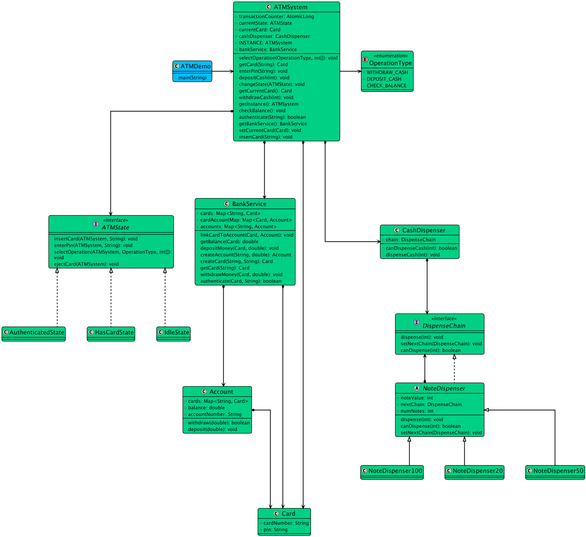

# Low-level design problem: atm

> Copied from <https://github.com/ashishps1/awesome-low-level-design/blob/main/problems/atm.md> (GPL-3.0, by Ashish Pratap Singh). Questions and answers are the source's own; nothing was answered or rewritten here.


# Designing an ATM System

## Requirements
1. The ATM system should support basic operations such as balance inquiry, cash withdrawal, and cash deposit.
2. Users should be able to authenticate themselves using a card and a PIN (Personal Identification Number).
3. The system should interact with a bank's backend system to validate user accounts and perform transactions.
4. The ATM should have a cash dispenser to dispense cash to users.
5. The system should handle concurrent access and ensure data consistency.
6. The ATM should have a user-friendly interface for users to interact with.

## UML Class Diagram



## Implementations
#### [Java Implementation](https://github.com/ashishps1/awesome-low-level-design/blob/main/solutions/java/src/atm) 
#### [Python Implementation](https://github.com/ashishps1/awesome-low-level-design/blob/main/solutions/python/atm)
#### [C++ Implementation](https://github.com/ashishps1/awesome-low-level-design/blob/main/solutions/cpp/atm)
#### [C# Implementation](https://github.com/ashishps1/awesome-low-level-design/blob/main/solutions/csharp/atm)
#### [Go Implementation](https://github.com/ashishps1/awesome-low-level-design/blob/main/solutions/golang/atm)

## Classes, Interfaces and Enumerations
1. The **Card** class represents an ATM card with a card number and PIN.
2. The **Account** class represents a bank account with an account number and balance. It provides methods to debit and credit the account balance.
3. The **Transaction** class is an abstract base class for different types of transactions, such as withdrawal and deposit. It is extended by WithdrawalTransaction and DepositTransaction classes.
4. The **BankingService** class manages the bank accounts and processes transactions. It uses a thread-safe ConcurrentHashMap to store and retrieve account information.
5. The **CashDispenser** class represents the ATM's cash dispenser and handles the dispensing of cash. It uses synchronization to ensure thread safety when dispensing cash.
6. The **ATM** class serves as the main interface for ATM operations. It interacts with the BankingService and CashDispenser to perform user authentication, balance inquiry, cash withdrawal, and cash deposit.
7. The **ATMDriver** class demonstrates the usage of the ATM system by creating sample accounts and performing ATM operations.

---

## Official solutions from the repository

<details><summary><b>java</b> (17 files)</summary>


**ATMDemo.java**

```java
package atm;

import atm.enums.OperationType;

public class ATMDemo {
    public static void main(String[] args) {
        ATMSystem atmSystem = ATMSystem.getInstance();

        // Perform Check Balance operation
        atmSystem.insertCard("1234-5678-9012-3456");
        atmSystem.enterPin("1234");
        atmSystem.selectOperation(OperationType.CHECK_BALANCE); // $1000

        // Perform Withdraw Cash operation
        atmSystem.insertCard("1234-5678-9012-3456");
        atmSystem.enterPin("1234");
        atmSystem.selectOperation(OperationType.WITHDRAW_CASH, 570);

        // Perform Deposit Cash operation
        atmSystem.insertCard("1234-5678-9012-3456");
        atmSystem.enterPin("1234");
        atmSystem.selectOperation(OperationType.DEPOSIT_CASH, 200);

        // Perform Check Balance operation
        atmSystem.insertCard("1234-5678-9012-3456");
        atmSystem.enterPin("1234");
        atmSystem.selectOperation(OperationType.CHECK_BALANCE); // $630

        // Perform Withdraw Cash more than balance
        atmSystem.insertCard("1234-5678-9012-3456");
        atmSystem.enterPin("1234");
        atmSystem.selectOperation(OperationType.WITHDRAW_CASH, 700); // Insufficient balance

        // Insert Incorrect PIN
        atmSystem.insertCard("1234-5678-9012-3456");
        atmSystem.enterPin("3425");
    }
}
```


**ATMSystem.java**

```java
package atm;

import atm.chainofresponsibility.DispenseChain;
import atm.chainofresponsibility.NoteDispenser100;
import atm.chainofresponsibility.NoteDispenser20;
import atm.chainofresponsibility.NoteDispenser50;
import atm.entities.BankService;
import atm.entities.Card;
import atm.entities.CashDispenser;
import atm.enums.OperationType;
import atm.state.ATMState;
import atm.state.IdleState;

import java.util.concurrent.atomic.AtomicLong;

public class ATMSystem {
    private static ATMSystem INSTANCE;
    private final BankService bankService;
    private final CashDispenser cashDispenser;
    private static final AtomicLong transactionCounter = new AtomicLong(0);
    private ATMState currentState;
    private Card currentCard;

    private ATMSystem() {
        this.currentState = new IdleState();
        this.bankService = new BankService();

        // Setup the dispenser chain
        DispenseChain c1 = new NoteDispenser100(10); // 10 x $100 notes
        DispenseChain c2 = new NoteDispenser50(20); // 20 x $50 notes
        DispenseChain c3 = new NoteDispenser20(30); // 30 x $20 notes
        c1.setNextChain(c2);
        c2.setNextChain(c3);
        this.cashDispenser = new CashDispenser(c1);
    }

    public static ATMSystem getInstance() {
        if (INSTANCE == null) {
            INSTANCE = new ATMSystem();
        }
        return INSTANCE;
    }

    public void changeState(ATMState newState) { this.currentState = newState; }
    public void setCurrentCard(Card card) { this.currentCard = card; }

    public void insertCard(String cardNumber) {
        currentState.insertCard(this, cardNumber);
    }

    public void enterPin(String pin) {
        currentState.enterPin(this, pin);
    }

    public void selectOperation(OperationType op, int... args) { currentState.selectOperation(this, op, args); }

    public Card getCard(String cardNumber) {
        return bankService.getCard(cardNumber);
    }

    public boolean authenticate(String pin) {
        return bankService.authenticate(currentCard, pin);
    }

    public void checkBalance() {
        double balance = bankService.getBalance(currentCard);
        System.out.printf("Your current account balance is: $%.2f%n", balance);
    }

    public void withdrawCash(int amount) {
        if (!cashDispenser.canDispenseCash(amount)) {
            throw new IllegalStateException("Insufficient cash available in the ATM.");
        }

        bankService.withdrawMoney(currentCard, amount);

        try {
            cashDispenser.dispenseCash(amount);
        } catch (Exception e) {
            bankService.depositMoney(currentCard, amount); // Deposit back if dispensing fails
        }
    }

    public void depositCash(int amount) {
        bankService.depositMoney(currentCard, amount);
    }

    public Card getCurrentCard() {
        return currentCard;
    }

    public BankService getBankService() {
        return bankService;
    }
}
```


**README.md**

```md
# ATM System (LLD)

## Problem Statement

Design and implement an ATM (Automated Teller Machine) system that allows users to perform basic banking operations such as balance inquiry, cash withdrawal, and cash deposit, with secure authentication and proper cash management.

---

## Requirements

- **User Authentication:** Users must authenticate using a card and PIN.
- **Balance Inquiry:** Users can check their account balance.
- **Cash Withdrawal:** Users can withdraw cash if sufficient balance and cash are available.
- **Cash Deposit:** Users can deposit cash into their account.
- **Transaction Management:** The system records and processes transactions (withdrawal, deposit).
- **Banking Service Integration:** The ATM interacts with a backend banking service to validate accounts and perform transactions.
- **Cash Dispenser:** The ATM manages its own cash inventory and dispenses cash securely.
- **Concurrency & Consistency:** The system handles concurrent access and ensures data consistency.
- **User Interface:** The ATM provides a user-friendly interface for operations.
- **Extensibility:** Easy to add new features such as mini-statements, fund transfers, or multi-currency support.

---

## Core Entities

- **ATM:** Main class for ATM operations; interacts with `BankingService` and `CashDispenser`.
- **Card:** Represents an ATM card with card number and PIN.
- **Account:** Represents a bank account with account number and balance; supports debit and credit operations.
- **Transaction (abstract):** Base class for transactions; extended by `WithdrawalTransaction` and `DepositTransaction`.
- **WithdrawalTransaction / DepositTransaction:** Concrete transaction types for withdrawal and deposit.
- **BankingService:** Manages bank accounts and processes transactions; uses thread-safe data structures.
- **CashDispenser:** Manages the ATM's cash inventory and handles dispensing; ensures thread safety.
- **ATMDemo:** Demonstrates the usage of the ATM system with sample accounts and operations.

---

## Class Design

## UML Class Diagram


### 1. ATM
- **Fields:** BankingService bankService, CashDispenser cashDispenser
- **Methods:** authenticateUser(Card), checkBalance(String accountNumber), withdrawCash(String accountNumber, double amount), depositCash(String accountNumber, double amount)

### 2. Card
- **Fields:** String cardNumber, String pin

### 3. Account
- **Fields:** String accountNumber, double balance
- **Methods:** debit(double), credit(double), getBalance()

### 4. Transaction (abstract)
- **Fields:** String accountNumber, double amount, Date date
- **Methods:** process()

### 5. WithdrawalTransaction / DepositTransaction
- **Inherits:** Transaction
- **Methods:** process()

### 6. BankingService
- **Fields:** Map<String, Account> accounts
- **Methods:** createAccount(String, double), getAccount(String), processTransaction(Transaction)

### 7. CashDispenser
- **Fields:** double cashAvailable
- **Methods:** dispenseCash(double), addCash(double), getCashAvailable()

### 8. ATMDemo
- **Methods:** run() — demonstrates sample ATM operations

---

## Example Usage

```java
BankingService bankService = new BankingService();
CashDispenser cashDispenser = new CashDispenser(10000);
ATM atmSystem = new ATM(bankService, cashDispenser);

bankService.createAccount("1234567890", 1000.0);
Card card = new Card("1234567890", "1234");
atmSystem.authenticateUser(card);

double balance = atmSystem.checkBalance("1234567890");
atmSystem.withdrawCash("1234567890", 500.0);
atmSystem.depositCash("1234567890", 200.0);
```

---

## Demo

See `ATMDemo.java` for a sample usage and simulation of the ATM system.

---

## Extending the Framework

- **Add mini-statements:** Show recent transactions.
- **Add fund transfers:** Allow transfers between accounts.
- **Add multi-currency support:** Handle different currencies and conversions.

---
```


**chainofresponsibility/DispenseChain.java**

```java
package atm.chainofresponsibility;

// The chain interface
public interface DispenseChain {
    void setNextChain(DispenseChain nextChain);
    void dispense(int amount);
    boolean canDispense(int amount);
}
```


**chainofresponsibility/NoteDispenser.java**

```java
package atm.chainofresponsibility;

abstract class NoteDispenser implements DispenseChain {
    private DispenseChain nextChain;
    private final int noteValue;
    private int numNotes;

    public NoteDispenser(int noteValue, int numNotes) {
        this.noteValue = noteValue;
        this.numNotes = numNotes;
    }

    @Override
    public void setNextChain(DispenseChain nextChain) {
        this.nextChain = nextChain;
    }

    @Override
    public synchronized void dispense(int amount) {
        if (amount >= noteValue) {
            int numToDispense = Math.min(amount / noteValue, this.numNotes);
            int remainingAmount = amount - (numToDispense * noteValue);

            if (numToDispense > 0) {
                System.out.println("Dispensing " + numToDispense + " x $" + noteValue + " note(s)");
                this.numNotes -= numToDispense;
            }

            if (remainingAmount > 0 && this.nextChain != null) {
                this.nextChain.dispense(remainingAmount);
            }
        } else if (this.nextChain != null) {
            this.nextChain.dispense(amount);
        }
    }

    @Override
    public synchronized boolean canDispense(int amount) {
        if (amount < 0) return false;
        if (amount == 0) return true;

        int numToUse = Math.min(amount / noteValue, this.numNotes);
        int remainingAmount = amount - (numToUse * noteValue);

        if (remainingAmount == 0) return true;
        if (this.nextChain != null) {
            return this.nextChain.canDispense(remainingAmount);
        }
        return false;
    }
}
```


**chainofresponsibility/NoteDispenser100.java**

```java
package atm.chainofresponsibility;

public class NoteDispenser100 extends NoteDispenser{
    public NoteDispenser100(int numNotes) {
        super(100, numNotes);
    }
}
```


**chainofresponsibility/NoteDispenser20.java**

```java
package atm.chainofresponsibility;

public class NoteDispenser20 extends NoteDispenser{
    public NoteDispenser20(int numNotes) { super(20, numNotes); }
}
```


**chainofresponsibility/NoteDispenser50.java**

```java
package atm.chainofresponsibility;

public class NoteDispenser50 extends NoteDispenser{
    public NoteDispenser50(int numNotes) { super(50, numNotes); }
}
```


**entities/Account.java**

```java
package atm.entities;

import java.util.HashMap;
import java.util.Map;

public class Account {
    private final String accountNumber;
    private double balance;
    private Map<String, Card> cards;

    public Account(String accountNumber, double balance) {
        this.accountNumber = accountNumber;
        this.balance = balance;
        this.cards = new HashMap<>();
    }

    public String getAccountNumber() {
        return accountNumber;
    }

    public double getBalance() {
        return balance;
    }

    public Map<String, Card> getCards() {
        return cards;
    }

    public synchronized void deposit(double amount) {
        balance += amount;
    }

    public synchronized boolean withdraw(double amount) {
        if (balance >= amount) {
            balance -= amount;
            return true;
        }
        return false;
    }
}
```


**entities/BankService.java**

```java
package atm.entities;

import java.util.Map;
import java.util.concurrent.ConcurrentHashMap;

public class BankService {
    private final Map<String, Account> accounts = new ConcurrentHashMap<>();
    private final Map<String, Card> cards = new ConcurrentHashMap<>();
    private final Map<Card, Account> cardAccountMap = new ConcurrentHashMap<>();

    public BankService() {
        // Create sample accounts and cards
        Account account1 = createAccount("1234567890", 1000.0);
        Card card1 = createCard("1234-5678-9012-3456", "1234");
        linkCardToAccount(card1, account1);

        Account account2 = createAccount("9876543210", 500.0);
        Card card2 = createCard("9876-5432-1098-7654", "4321");
        linkCardToAccount(card2, account2);
    }

    public Account createAccount(String accountNumber, double initialBalance) {
        Account account = new Account(accountNumber, initialBalance);
        accounts.put(accountNumber, account);
        return account;
    }

    public Card createCard(String cardNumber, String pin) {
        Card card = new Card(cardNumber, pin);
        cards.put(cardNumber, card);
        return card;
    }

    public boolean authenticate(Card card, String pin) {
        return card.getPin().equals(pin);
    }

    public Card getCard(String cardNumber) {
        return cards.getOrDefault(cardNumber, null);
    }

    public double getBalance(Card card) {
        return cardAccountMap.get(card).getBalance();
    }

    public void withdrawMoney(Card card, double amount) {
        cardAccountMap.get(card).withdraw(amount);
    }

    public void depositMoney(Card card, double amount) {
        cardAccountMap.get(card).deposit(amount);
    }

    public void linkCardToAccount(Card card, Account account) {
        account.getCards().put(card.getCardNumber(), card);
        cardAccountMap.put(card, account);
    }
}
```


**entities/Card.java**

```java
package atm.entities;

public class Card {
    private final String cardNumber;
    private final String pin;

    public Card(String cardNumber, String pin) {
        this.cardNumber = cardNumber;
        this.pin = pin;
    }

    public String getCardNumber() {
        return cardNumber;
    }

    public String getPin() {
        return pin;
    }
}
```


**entities/CashDispenser.java**

```java
package atm.entities;

import atm.chainofresponsibility.DispenseChain;

public class CashDispenser {
    private final DispenseChain chain;

    public CashDispenser(DispenseChain chain) {
        this.chain = chain;
    }

    public synchronized void dispenseCash(int amount) {
        chain.dispense(amount);
    }

    public synchronized boolean canDispenseCash(int amount) {
        if (amount % 10 != 0) {
            return false;
        }
        return chain.canDispense(amount);
    }
}
```


**enums/OperationType.java**

```java
package atm.enums;

public enum OperationType {
    CHECK_BALANCE,
    WITHDRAW_CASH,
    DEPOSIT_CASH
}
```


**state/ATMState.java**

```java
package atm.state;

import atm.ATMSystem;
import atm.enums.OperationType;

public interface ATMState {
    void insertCard(ATMSystem atmSystem, String cardNumber);
    void enterPin(ATMSystem atmSystem, String pin);
    void selectOperation(ATMSystem atmSystem, OperationType op, int... args);
    void ejectCard(ATMSystem atmSystem);
}
```


**state/AuthenticatedState.java**

```java
package atm.state;

import atm.ATMSystem;
import atm.enums.OperationType;

public class AuthenticatedState implements ATMState {
    @Override
    public void insertCard(ATMSystem atmSystem, String cardNumber) {
        System.out.println("Error: A card is already inserted and a session is active.");
    }

    @Override
    public void enterPin(ATMSystem atmSystem, String pin) {
        System.out.println("Error: PIN has already been entered and authenticated.");
    }

    @Override
    public void selectOperation(ATMSystem atmSystem, OperationType op, int... args) {
        // In a real UI, this would be a menu. Here we use a switch.
        switch (op) {
            case CHECK_BALANCE:
                atmSystem.checkBalance();
                break;

            case WITHDRAW_CASH:
                if (args.length == 0 || args[0] <= 0) {
                    System.out.println("Error: Invalid withdrawal amount specified.");
                    break;
                }
                int amountToWithdraw = args[0];

                double accountBalance = atmSystem.getBankService().getBalance(atmSystem.getCurrentCard());

                if (amountToWithdraw > accountBalance) {
                    System.out.println("Error: Insufficient balance.");
                    break;
                }

                System.out.println("Processing withdrawal for $" + amountToWithdraw);
                // Delegate the complex withdrawal logic to the ATM's dedicated method
                atmSystem.withdrawCash(amountToWithdraw);
                break;

            case DEPOSIT_CASH:
                if (args.length == 0 || args[0] <= 0) {
                    System.out.println("Error: Invalid withdrawal amount specified.");
                    break;
                }
                int amountToDeposit = args[0];
                System.out.println("Processing deposit for $" + amountToDeposit);
                atmSystem.depositCash(amountToDeposit);
                break;

            default:
                System.out.println("Error: Invalid operation selected.");
                break;
        }

        // End the session after one transaction
        System.out.println("Transaction complete.");
        ejectCard(atmSystem);
    }

    @Override
    public void ejectCard(ATMSystem atmSystem) {
        System.out.println("Ending session. Card has been ejected. Thank you for using our ATM.");
        atmSystem.setCurrentCard(null);
        atmSystem.changeState(new IdleState());
    }
}
```


**state/HasCardState.java**

```java
package atm.state;

import atm.ATMSystem;
import atm.enums.OperationType;

public class HasCardState implements ATMState {
    @Override
    public void insertCard(ATMSystem atmSystem, String cardNumber) {
        System.out.println("Error: A card is already inserted. Cannot insert another card.");
    }

    @Override
    public void enterPin(ATMSystem atmSystem, String pin) {
        System.out.println("Authenticating PIN...");
        boolean isAuthenticated = atmSystem.authenticate(pin);;

        if (isAuthenticated) {
            System.out.println("Authentication successful.");
            atmSystem.changeState(new AuthenticatedState());
        } else {
            System.out.println("Authentication failed: Incorrect PIN.");
            ejectCard(atmSystem);
        }
    }

    @Override
    public void selectOperation(ATMSystem atmSystem, OperationType op, int... args) {
        System.out.println("Error: Please enter your PIN first to select an operation.");
    }

    @Override
    public void ejectCard(ATMSystem atmSystem) {
        System.out.println("Card has been ejected. Thank you for using our ATM.");
        atmSystem.setCurrentCard(null);
        atmSystem.changeState(new IdleState());
    }
}
```


**state/IdleState.java**

```java
package atm.state;

import atm.ATMSystem;
import atm.entities.Card;
import atm.enums.OperationType;

public class IdleState implements ATMState {
    @Override
    public void insertCard(ATMSystem atmSystem, String cardNumber) {
        System.out.println("\nCard has been inserted.");
        Card card = atmSystem.getCard(cardNumber);

        if (card == null) {
            ejectCard(atmSystem);
        } else {
            atmSystem.setCurrentCard(card);
            atmSystem.changeState(new HasCardState());
        }
    }

    @Override
    public void enterPin(ATMSystem atmSystem, String pin) {
        System.out.println("Error: Please insert a card first.");
    }

    @Override
    public void selectOperation(ATMSystem atmSystem, OperationType op, int... args) {
        System.out.println("Error: Please insert a card first.");
    }

    @Override
    public void ejectCard(ATMSystem atmSystem) {
        System.out.println("Error: Card not found.");
        atmSystem.setCurrentCard(null);
    }
}
```

</details>

<details><summary><b>python</b> (11 files)</summary>


**README.md**

```md
# Designing an ATM System

## Requirements
1. The ATM system should support basic operations such as balance inquiry, cash withdrawal, and cash deposit.
2. Users should be able to authenticate themselves using a card and a PIN (Personal Identification Number).
3. The system should interact with a bank's backend system to validate user accounts and perform transactions.
4. The ATM should have a cash dispenser to dispense cash to users.
5. The system should handle concurrent access and ensure data consistency.
6. The ATM should have a user-friendly interface for users to interact with.

## Classes, Interfaces and Enumerations
1. The **Card** class represents an ATM card with a card number and PIN.
2. The **Account** class represents a bank account with an account number and balance. It provides methods to debit and credit the account balance.
3. The **Transaction** class is an abstract base class for different types of transactions, such as withdrawal and deposit. It is extended by WithdrawalTransaction and DepositTransaction classes.
4. The **BankingService** class manages the bank accounts and processes transactions. It uses a thread-safe ConcurrentHashMap to store and retrieve account information.
5. The **CashDispenser** class represents the ATM's cash dispenser and handles the dispensing of cash. It uses synchronization to ensure thread safety when dispensing cash.
6. The **ATM** class serves as the main interface for ATM operations. It interacts with the BankingService and CashDispenser to perform user authentication, balance inquiry, cash withdrawal, and cash deposit.
7. The **ATMDriver** class demonstrates the usage of the ATM system by creating sample accounts and performing ATM operations.
```


**account.py**

```py
import threading
from typing import Dict
from card import Card

class Account:
    def __init__(self, account_number: str, balance: float):
        self._account_number = account_number
        self._balance = balance
        self._cards: Dict[str, Card] = {}
        self._lock = threading.Lock()
    
    def get_account_number(self) -> str:
        return self._account_number
    
    def get_balance(self) -> float:
        return self._balance
    
    def get_cards(self) -> Dict[str, Card]:
        return self._cards
    
    def deposit(self, amount: float):
        with self._lock:
            self._balance += amount
    
    def withdraw(self, amount: float) -> bool:
        with self._lock:
            if self._balance >= amount:
                self._balance -= amount
                return True
            return False
```


**atm.py**

```py
import threading
from typing import Optional
from atm_state import ATMState, IdleState
from bank_service import BankService
from card import Card
from operation_type import OperationType
from note_dispenser import NoteDispenser100, NoteDispenser50, NoteDispenser20
from cash_dispenser import CashDispenser

class ATM:
    _instance = None
    _lock = threading.Lock()
    
    def __new__(cls):
        if cls._instance is None:
            with cls._lock:
                if cls._instance is None:
                    cls._instance = super().__new__(cls)
                    cls._instance._initialized = False
        return cls._instance
    
    def __init__(self):
        if not self._initialized:
            self._current_state = IdleState()
            self._bank_service = BankService()
            self._current_card: Optional[Card] = None
            self._transaction_counter = 0
            
            # Setup the dispenser chain
            c1 = NoteDispenser100(10)  # 10 x $100 notes
            c2 = NoteDispenser50(20)   # 20 x $50 notes
            c3 = NoteDispenser20(30)   # 30 x $20 notes
            c1.set_next_chain(c2)
            c2.set_next_chain(c3)
            self._cash_dispenser = CashDispenser(c1)
            self._initialized = True
    
    @classmethod
    def get_instance(cls):
        return cls()
    
    def change_state(self, new_state: ATMState):
        self._current_state = new_state
    
    def set_current_card(self, card: Optional[Card]):
        self._current_card = card
    
    def insert_card(self, card_number: str):
        self._current_state.insert_card(self, card_number)
    
    def enter_pin(self, pin: str):
        self._current_state.enter_pin(self, pin)
    
    def select_operation(self, op: OperationType, *args):
        self._current_state.select_operation(self, op, *args)
    
    def check_balance(self):
        balance = self._bank_service.get_balance(self._current_card)
        print(f"Your current account balance is: ${balance:.2f}")
    
    def withdraw_cash(self, amount: int):
        if not self._cash_dispenser.can_dispense_cash(amount):
            raise RuntimeError("Insufficient cash available in the ATM.")
        
        self._bank_service.withdraw_money(self._current_card, amount)
        
        try:
            self._cash_dispenser.dispense_cash(amount)
        except Exception as e:
            self._bank_service.deposit_money(self._current_card, amount)  # Deposit back if dispensing fails
            raise e
    
    def deposit_cash(self, amount: int):
        self._bank_service.deposit_money(self._current_card, amount)
    
    def get_current_card(self) -> Optional[Card]:
        return self._current_card
    
    def get_bank_service(self) -> BankService:
        return self._bank_service
```


**atm_demo.py**

```py
from atm import ATM
from operation_type import OperationType

class ATMDemo:
    @staticmethod
    def main():
        atm = ATM.get_instance()
        
        # Perform Check Balance operation
        atm.insert_card("1234-5678-9012-3456")
        atm.enter_pin("1234")
        atm.select_operation(OperationType.CHECK_BALANCE)  # $1000
        
        # Perform Withdraw Cash operation
        atm.insert_card("1234-5678-9012-3456")
        atm.enter_pin("1234")
        atm.select_operation(OperationType.WITHDRAW_CASH, 570)
        
        # Perform Deposit Cash operation
        atm.insert_card("1234-5678-9012-3456")
        atm.enter_pin("1234")
        atm.select_operation(OperationType.DEPOSIT_CASH, 200)
        
        # Perform Check Balance operation
        atm.insert_card("1234-5678-9012-3456")
        atm.enter_pin("1234")
        atm.select_operation(OperationType.CHECK_BALANCE)  # $630
        
        # Perform Withdraw Cash more than balance
        atm.insert_card("1234-5678-9012-3456")
        atm.enter_pin("1234")
        atm.select_operation(OperationType.WITHDRAW_CASH, 700)  # Insufficient balance
        
        # Insert Incorrect PIN
        atm.insert_card("1234-5678-9012-3456")
        atm.enter_pin("3425")

if __name__ == "__main__":
    ATMDemo.main()
```


**atm_state.py**

```py
from abc import ABC, abstractmethod
from operation_type import OperationType
from typing import TYPE_CHECKING

if TYPE_CHECKING:
    from atm import ATM

class ATMState(ABC):
    @abstractmethod
    def insert_card(self, atm: 'ATM', card_number: str):
        pass
    
    @abstractmethod
    def enter_pin(self, atm: 'ATM', pin: str):
        pass
    
    @abstractmethod
    def select_operation(self, atm: 'ATM', op: OperationType, *args):
        pass
    
    @abstractmethod
    def eject_card(self, atm: 'ATM'):
        pass

class IdleState(ATMState):
    def insert_card(self, atm: 'ATM', card_number: str):
        print("\nCard has been inserted.")
        card = atm.get_bank_service().authenticate_card(card_number)
        
        if card is None:
            self.eject_card(atm)
        else:
            atm.set_current_card(card)
            atm.change_state(HasCardState())
    
    def enter_pin(self, atm: 'ATM', pin: str):
        print("Error: Please insert a card first.")
    
    def select_operation(self, atm: 'ATM', op: OperationType, *args):
        print("Error: Please insert a card first.")
    
    def eject_card(self, atm: 'ATM'):
        print("Error: Card not found.")

class HasCardState(ATMState):
    def insert_card(self, atm: 'ATM', card_number: str):
        print("Error: A card is already inserted. Cannot insert another card.")
    
    def enter_pin(self, atm: 'ATM', pin: str):
        print("Authenticating PIN...")
        card = atm.get_current_card()
        is_authenticated = atm.get_bank_service().authenticate(card, pin)
        
        if is_authenticated:
            print("Authentication successful.")
            atm.change_state(AuthenticatedState())
        else:
            print("Authentication failed: Incorrect PIN.")
            self.eject_card(atm)
    
    def select_operation(self, atm: 'ATM', op: OperationType, *args):
        print("Error: Please enter your PIN first to select an operation.")
    
    def eject_card(self, atm: 'ATM'):
        print("Card has been ejected. Thank you for using our ATM.")
        atm.set_current_card(None)
        atm.change_state(IdleState())

class AuthenticatedState(ATMState):
    def insert_card(self, atm: 'ATM', card_number: str):
        print("Error: A card is already inserted and a session is active.")
    
    def enter_pin(self, atm: 'ATM', pin: str):
        print("Error: PIN has already been entered and authenticated.")
    
    def select_operation(self, atm: 'ATM', op: OperationType, *args):
        if op == OperationType.CHECK_BALANCE:
            atm.check_balance()
        elif op == OperationType.WITHDRAW_CASH:
            if len(args) == 0 or args[0] <= 0:
                print("Error: Invalid withdrawal amount specified.")
                return
            
            amount_to_withdraw = args[0]
            account_balance = atm.get_bank_service().get_balance(atm.get_current_card())
            
            if amount_to_withdraw > account_balance:
                print("Error: Insufficient balance.")
                return
            
            print(f"Processing withdrawal for ${amount_to_withdraw}")
            atm.withdraw_cash(amount_to_withdraw)
        elif op == OperationType.DEPOSIT_CASH:
            if len(args) == 0 or args[0] <= 0:
                print("Error: Invalid deposit amount specified.")
                return
            
            amount_to_deposit = args[0]
            print(f"Processing deposit for ${amount_to_deposit}")
            atm.deposit_cash(amount_to_deposit)
        else:
            print("Error: Invalid operation selected.")
            return
        
        # End the session after one transaction
        print("Transaction complete.")
        self.eject_card(atm)
    
    def eject_card(self, atm: 'ATM'):
        print("Ending session. Card has been ejected. Thank you for using our ATM.")
        atm.set_current_card(None)
        atm.change_state(IdleState())
```


**bank_service.py**

```py
from typing import Dict, Optional
from account import Account
from card import Card

class BankService:
    def __init__(self):
        self._accounts: Dict[str, Account] = {}
        self._cards: Dict[str, Card] = {}
        self._card_account_map: Dict[Card, Account] = {}
        
        # Create sample accounts and cards
        account1 = self.create_account("1234567890", 1000.0)
        card1 = self.create_card("1234-5678-9012-3456", "1234")
        self.link_card_to_account(card1, account1)
        
        account2 = self.create_account("9876543210", 500.0)
        card2 = self.create_card("9876-5432-1098-7654", "4321")
        self.link_card_to_account(card2, account2)
    
    def create_account(self, account_number: str, initial_balance: float) -> Account:
        account = Account(account_number, initial_balance)
        self._accounts[account_number] = account
        return account
    
    def create_card(self, card_number: str, pin: str) -> Card:
        card = Card(card_number, pin)
        self._cards[card_number] = card
        return card
    
    def authenticate(self, card: Card, pin: str) -> bool:
        return card.get_pin() == pin
    
    def authenticate_card(self, card_number: str) -> Optional[Card]:
        return self._cards.get(card_number)
    
    def get_balance(self, card: Card) -> float:
        return self._card_account_map[card].get_balance()
    
    def withdraw_money(self, card: Card, amount: float):
        self._card_account_map[card].withdraw(amount)
    
    def deposit_money(self, card: Card, amount: float):
        self._card_account_map[card].deposit(amount)
    
    def link_card_to_account(self, card: Card, account: Account):
        account.get_cards()[card.get_card_number()] = card
        self._card_account_map[card] = account
```


**card.py**

```py
class Card:
    def __init__(self, card_number: str, pin: str):
        self._card_number = card_number
        self._pin = pin
    
    def get_card_number(self) -> str:
        return self._card_number
    
    def get_pin(self) -> str:
        return self._pin
```


**cash_dispenser.py**

```py
import threading
from dispense_chain import DispenseChain

class CashDispenser:
    def __init__(self, chain: DispenseChain):
        self._chain = chain
        self._lock = threading.Lock()
    
    def dispense_cash(self, amount: int):
        with self._lock:
            self._chain.dispense(amount)
    
    def can_dispense_cash(self, amount: int) -> bool:
        with self._lock:
            if amount % 10 != 0:
                return False
            return self._chain.can_dispense(amount)
```


**dispense_chain.py**

```py
from abc import ABC, abstractmethod

class DispenseChain(ABC):
    @abstractmethod
    def set_next_chain(self, next_chain: 'DispenseChain'):
        pass
    
    @abstractmethod
    def dispense(self, amount: int):
        pass
    
    @abstractmethod
    def can_dispense(self, amount: int) -> bool:
        pass
```


**note_dispenser.py**

```py
import threading
from typing import Optional
from dispense_chain import DispenseChain

class NoteDispenser(DispenseChain):
    def __init__(self, note_value: int, num_notes: int):
        self._note_value = note_value
        self._num_notes = num_notes
        self._next_chain: Optional[DispenseChain] = None
        self._lock = threading.Lock()
    
    def set_next_chain(self, next_chain: DispenseChain):
        self._next_chain = next_chain
    
    def dispense(self, amount: int):
        with self._lock:
            if amount >= self._note_value:
                num_to_dispense = min(amount // self._note_value, self._num_notes)
                remaining_amount = amount - (num_to_dispense * self._note_value)
                
                if num_to_dispense > 0:
                    print(f"Dispensing {num_to_dispense} x ${self._note_value} note(s)")
                    self._num_notes -= num_to_dispense
                
                if remaining_amount > 0 and self._next_chain is not None:
                    self._next_chain.dispense(remaining_amount)
            elif self._next_chain is not None:
                self._next_chain.dispense(amount)
    
    def can_dispense(self, amount: int) -> bool:
        with self._lock:
            if amount < 0:
                return False
            if amount == 0:
                return True
            
            num_to_use = min(amount // self._note_value, self._num_notes)
            remaining_amount = amount - (num_to_use * self._note_value)
            
            if remaining_amount == 0:
                return True
            if self._next_chain is not None:
                return self._next_chain.can_dispense(remaining_amount)
            return False
        
class NoteDispenser20(NoteDispenser):
    def __init__(self, num_notes: int):
        super().__init__(20, num_notes)

class NoteDispenser50(NoteDispenser):
    def __init__(self, num_notes: int):
        super().__init__(50, num_notes)

class NoteDispenser100(NoteDispenser):
    def __init__(self, num_notes: int):
        super().__init__(100, num_notes)
```


**operation_type.py**

```py
from enum import Enum

class OperationType(Enum):
    CHECK_BALANCE = "CHECK_BALANCE"
    WITHDRAW_CASH = "WITHDRAW_CASH"
    DEPOSIT_CASH = "DEPOSIT_CASH"
```

</details>

<details><summary><b>cpp</b> (6 files)</summary>


**ATM.cpp**

```cpp
#include "ATM.hpp"
#include <iostream>
#include <limits>

ATM::ATM() : currentAccount(nullptr), isAuthenticated(false) {}

ATM::~ATM() {
    for (auto account : accounts) {
        delete account;
    }
}

void ATM::addAccount(Account* account) {
    accounts.push_back(account);
}

bool ATM::authenticate(const std::string& accountNumber, const std::string& pin) {
    for (auto account : accounts) {
        if (account->getAccountNumber() == accountNumber && account->validatePin(pin)) {
            currentAccount = account;
            isAuthenticated = true;
            return true;
        }
    }
    return false;
}

void ATM::logout() {
    currentAccount = nullptr;
    isAuthenticated = false;
}

bool ATM::deposit(double amount) {
    if (!isAuthenticated || !currentAccount) return false;
    return currentAccount->deposit(amount);
}

bool ATM::withdraw(double amount) {
    if (!isAuthenticated || !currentAccount) return false;
    return currentAccount->withdraw(amount);
}

void ATM::checkBalance() const {
    if (!isAuthenticated || !currentAccount) return;
    currentAccount->displayBalance();
}

void ATM::displayMenu() const {
    std::cout << "\nATM Menu:" << std::endl;
    std::cout << "1. Check Balance" << std::endl;
    std::cout << "2. Deposit" << std::endl;
    std::cout << "3. Withdraw" << std::endl;
    std::cout << "4. Logout" << std::endl;
    std::cout << "5. Exit" << std::endl;
    std::cout << "Enter your choice: ";
}

void ATM::start() {
    std::string accountNumber, pin;
    int choice;
    double amount;

    while (true) {
        if (!isAuthenticated) {
            std::cout << "\nWelcome to ATM" << std::endl;
            std::cout << "Enter account number: ";
            std::cin >> accountNumber;
            std::cout << "Enter PIN: ";
            std::cin >> pin;

            if (!authenticate(accountNumber, pin)) {
                std::cout << "Invalid account number or PIN" << std::endl;
                continue;
            }
            std::cout << "Authentication successful!" << std::endl;
        }

        displayMenu();
        std::cin >> choice;
        std::cin.ignore(std::numeric_limits<std::streamsize>::max(), '\n');

        switch (choice) {
            case 1:
                checkBalance();
                break;

            case 2:
                std::cout << "Enter amount to deposit: $";
                std::cin >> amount;
                if (deposit(amount)) {
                    std::cout << "Deposit successful" << std::endl;
                    checkBalance();
                } else {
                    std::cout << "Invalid amount" << std::endl;
                }
                break;

            case 3:
                std::cout << "Enter amount to withdraw: $";
                std::cin >> amount;
                if (withdraw(amount)) {
                    std::cout << "Withdrawal successful" << std::endl;
                    checkBalance();
                } else {
                    std::cout << "Invalid amount or insufficient funds" << std::endl;
                }
                break;

            case 4:
                logout();
                std::cout << "Logged out successfully" << std::endl;
                break;

            case 5:
                std::cout << "Thank you for using ATM. Goodbye!" << std::endl;
                return;

            default:
                std::cout << "Invalid choice" << std::endl;
        }
    }
}
```


**ATM.hpp**

```hpp
#ifndef ATM_HPP
#define ATM_HPP

#include "Account.hpp"
#include <vector>
#include <string>

class ATM {
private:
    std::vector<Account*> accounts;
    Account* currentAccount;
    bool isAuthenticated;

public:
    ATM();
    ~ATM();
    
    void addAccount(Account* account);
    bool authenticate(const std::string& accountNumber, const std::string& pin);
    void logout();
    
    bool deposit(double amount);
    bool withdraw(double amount);
    void checkBalance() const;
    
    void displayMenu() const;
    void start();
};

#endif
```


**ATMDemo.cpp**

```cpp
#include "ATM.hpp"
#include <iostream>

int main() {
    ATM atm;
    
    // Create some test accounts
    Account* account1 = new Account("1234", "5678", 1000.0);
    Account* account2 = new Account("4321", "8765", 2000.0);
    
    // Add accounts to ATM
    atm.addAccount(account1);
    atm.addAccount(account2);
    
    // Start the ATM
    atm.start();
    
    return 0;
}
```


**Account.cpp**

```cpp
#include "Account.hpp"
#include <iostream>
#include <iomanip>

Account::Account(std::string accountNumber, std::string pin, double initialBalance)
    : accountNumber(accountNumber), pin(pin), balance(initialBalance) {}

std::string Account::getAccountNumber() const {
    return accountNumber;
}

bool Account::validatePin(const std::string& inputPin) const {
    return pin == inputPin;
}

double Account::getBalance() const {
    return balance;
}

bool Account::deposit(double amount) {
    if (amount <= 0) return false;
    
    balance += amount;
    return true;
}

bool Account::withdraw(double amount) {
    if (amount <= 0 || amount > balance) return false;
    
    balance -= amount;
    return true;
}

void Account::displayBalance() const {
    std::cout << "Current balance: $" << std::fixed << std::setprecision(2) << balance << std::endl;
}
```


**Account.hpp**

```hpp
#ifndef ACCOUNT_HPP
#define ACCOUNT_HPP

#include <string>

class Account {
private:
    std::string accountNumber;
    std::string pin;
    double balance;

public:
    Account(std::string accountNumber, std::string pin, double initialBalance = 0.0);
    
    std::string getAccountNumber() const;
    bool validatePin(const std::string& inputPin) const;
    double getBalance() const;
    
    bool deposit(double amount);
    bool withdraw(double amount);
    void displayBalance() const;
};

#endif
```


**README.md**

```md
# Designing an ATM System

## Requirements
1. The ATM system should support basic operations such as balance inquiry, cash withdrawal, and cash deposit.
2. Users should be able to authenticate themselves using a card and a PIN (Personal Identification Number).
3. The system should interact with a bank's backend system to validate user accounts and perform transactions.
4. The ATM should have a cash dispenser to dispense cash to users.
5. The system should handle concurrent access and ensure data consistency.
6. The ATM should have a user-friendly interface for users to interact with.

## Classes, Interfaces and Enumerations
1. The **Card** class represents an ATM card with a card number and PIN.
2. The **Account** class represents a bank account with an account number and balance. It provides methods to debit and credit the account balance.
3. The **Transaction** class is an abstract base class for different types of transactions, such as withdrawal and deposit. It is extended by WithdrawalTransaction and DepositTransaction classes.
4. The **BankingService** class manages the bank accounts and processes transactions. It uses a thread-safe ConcurrentHashMap to store and retrieve account information.
5. The **CashDispenser** class represents the ATM's cash dispenser and handles the dispensing of cash. It uses synchronization to ensure thread safety when dispensing cash.
6. The **ATM** class serves as the main interface for ATM operations. It interacts with the BankingService and CashDispenser to perform user authentication, balance inquiry, cash withdrawal, and cash deposit.
7. The **ATMDriver** class demonstrates the usage of the ATM system by creating sample accounts and performing ATM operations.
```

</details>

<details><summary><b>golang</b> (11 files)</summary>


**README.md**

```md
# Designing an ATM System

## Requirements
1. The ATM system should support basic operations such as balance inquiry, cash withdrawal, and cash deposit.
2. Users should be able to authenticate themselves using a card and a PIN (Personal Identification Number).
3. The system should interact with a bank's backend system to validate user accounts and perform transactions.
4. The ATM should have a cash dispenser to dispense cash to users.
5. The system should handle concurrent access and ensure data consistency.
6. The ATM should have a user-friendly interface for users to interact with.

## Classes, Interfaces and Enumerations
1. The **Card** class represents an ATM card with a card number and PIN.
2. The **Account** class represents a bank account with an account number and balance. It provides methods to debit and credit the account balance.
3. The **Transaction** class is an abstract base class for different types of transactions, such as withdrawal and deposit. It is extended by WithdrawalTransaction and DepositTransaction classes.
4. The **BankingService** class manages the bank accounts and processes transactions. It uses a thread-safe ConcurrentHashMap to store and retrieve account information.
5. The **CashDispenser** class represents the ATM's cash dispenser and handles the dispensing of cash. It uses synchronization to ensure thread safety when dispensing cash.
6. The **ATM** class serves as the main interface for ATM operations. It interacts with the BankingService and CashDispenser to perform user authentication, balance inquiry, cash withdrawal, and cash deposit.
7. The **ATMDriver** class demonstrates the usage of the ATM system by creating sample accounts and performing ATM operations.
```


**account.go**

```go
package atm

import "sync"

type Account struct {
	accountNumber string
	balance       float64
	mu            sync.Mutex
}

func NewAccount(accountNumber string, balance float64) *Account {
	return &Account{
		accountNumber: accountNumber,
		balance:       balance,
	}
}

func (a *Account) GetAccountNumber() string {
	return a.accountNumber
}

func (a *Account) GetBalance() float64 {
	a.mu.Lock()
	defer a.mu.Unlock()
	return a.balance
}

func (a *Account) Debit(amount float64) error {
	a.mu.Lock()
	defer a.mu.Unlock()
	if a.balance < amount {
		return ErrInsufficientFunds
	}
	a.balance -= amount
	return nil
}

func (a *Account) Credit(amount float64) error {
	a.mu.Lock()
	defer a.mu.Unlock()
	a.balance += amount
	return nil
}
```


**atm.go**

```go
package atm

import (
	"errors"
	"fmt"
	"sync/atomic"
	"time"
)

type ATM struct {
	bankingService *BankingService
	cashDispenser  *CashDispenser
	txnCounter     int64
}

func NewATM(bankingService *BankingService, cashDispenser *CashDispenser) *ATM {
	return &ATM{
		bankingService: bankingService,
		cashDispenser:  cashDispenser,
	}
}

func (a *ATM) AuthenticateUser(card *Card) error {
	// Authentication logic would go here
	return nil
}

func (a *ATM) CheckBalance(accountNumber string) (float64, error) {
	account := a.bankingService.GetAccount(accountNumber)
	if account == nil {
		return 0, errors.New("account not found")
	}
	return account.GetBalance(), nil
}

func (a *ATM) WithdrawCash(accountNumber string, amount float64) error {
	account := a.bankingService.GetAccount(accountNumber)
	if account == nil {
		return errors.New("account not found")
	}

	transaction := NewWithdrawalTransaction(a.generateTransactionID(), account, amount)
	if err := a.bankingService.ProcessTransaction(transaction); err != nil {
		return err
	}

	return a.cashDispenser.DispenseCash(int(amount))
}

func (a *ATM) DepositCash(accountNumber string, amount float64) error {
	account := a.bankingService.GetAccount(accountNumber)
	if account == nil {
		return errors.New("account not found")
	}

	transaction := NewDepositTransaction(a.generateTransactionID(), account, amount)
	return a.bankingService.ProcessTransaction(transaction)
}

func (a *ATM) generateTransactionID() string {
	txnNumber := atomic.AddInt64(&a.txnCounter, 1)
	timestamp := time.Now().Format("20060102150405")
	return fmt.Sprintf("TXN%s%010d", timestamp, txnNumber)
}
```


**atm_demo.go**

```go
package atm

import (
	"fmt"
)

func Run() {
	bankingService := NewBankingService()
	cashDispenser := NewCashDispenser(10000)
	atmMachine := NewATM(bankingService, cashDispenser)

	// Create sample accounts
	bankingService.CreateAccount("1234567890", 1000.0)
	bankingService.CreateAccount("9876543210", 500.0)

	// Create card and authenticate
	card := NewCard("1234567890", "1234")
	if err := atmMachine.AuthenticateUser(card); err != nil {
		fmt.Printf("Authentication failed: %v\n", err)
		return
	}

	// Check balance
	if balance, err := atmMachine.CheckBalance("1234567890"); err == nil {
		fmt.Printf("Account balance: %.2f\n", balance)
	} else {
		fmt.Printf("Error checking balance: %v\n", err)
	}

	// Withdraw cash
	if err := atmMachine.WithdrawCash("1234567890", 500.0); err == nil {
		fmt.Println("Successfully withdrew $500")
	} else {
		fmt.Printf("Error withdrawing cash: %v\n", err)
	}

	// Deposit cash
	if err := atmMachine.DepositCash("9876543210", 200.0); err == nil {
		fmt.Println("Successfully deposited $200")
	} else {
		fmt.Printf("Error depositing cash: %v\n", err)
	}

	// Check updated balance
	if balance, err := atmMachine.CheckBalance("1234567890"); err == nil {
		fmt.Printf("Updated account balance: %.2f\n", balance)
	} else {
		fmt.Printf("Error checking balance: %v\n", err)
	}
}
```


**banking_service.go**

```go
package atm

import (
	"sync"
)

type BankingService struct {
	accounts map[string]*Account
	mu       sync.RWMutex
}

func NewBankingService() *BankingService {
	return &BankingService{
		accounts: make(map[string]*Account),
	}
}

func (bs *BankingService) CreateAccount(accountNumber string, initialBalance float64) {
	bs.mu.Lock()
	defer bs.mu.Unlock()
	bs.accounts[accountNumber] = NewAccount(accountNumber, initialBalance)
}

func (bs *BankingService) GetAccount(accountNumber string) *Account {
	bs.mu.RLock()
	defer bs.mu.RUnlock()
	return bs.accounts[accountNumber]
}

func (bs *BankingService) ProcessTransaction(transaction Transaction) error {
	return transaction.Execute()
}
```


**card.go**

```go
package atm

type Card struct {
	CardNumber string
	PIN        string
}

func NewCard(cardNumber, pin string) *Card {
	return &Card{
		CardNumber: cardNumber,
		PIN:        pin,
	}
}
```


**cash_dispenser.go**

```go
package atm

import (
	"sync"
)

type CashDispenser struct {
	cashAvailable int
	mu            sync.Mutex
}

func NewCashDispenser(initialCash int) *CashDispenser {
	return &CashDispenser{
		cashAvailable: initialCash,
	}
}

func (cd *CashDispenser) DispenseCash(amount int) error {
	cd.mu.Lock()
	defer cd.mu.Unlock()

	if amount > cd.cashAvailable {
		return ErrInsufficientCashInATM
	}
	cd.cashAvailable -= amount
	return nil
}
```


**deposit_transaction.go**

```go
package atm

type DepositTransaction struct {
	BaseTransaction
}

func NewDepositTransaction(transactionID string, account *Account, amount float64) *DepositTransaction {
	return &DepositTransaction{
		BaseTransaction: BaseTransaction{
			TransactionID: transactionID,
			Account:       account,
			Amount:        amount,
		},
	}
}

func (t *DepositTransaction) Execute() error {
	return t.Account.Credit(t.Amount)
}
```


**errors.go**

```go
package atm

import "errors"

var (
	ErrInsufficientFunds     = errors.New("insufficient funds in account")
	ErrInsufficientCashInATM = errors.New("insufficient cash available in ATM")
	ErrInvalidCard           = errors.New("invalid card")
	ErrInvalidPIN            = errors.New("invalid PIN")
)
```


**transaction.go**

```go
package atm

type Transaction interface {
	Execute() error
}

type BaseTransaction struct {
	TransactionID string
	Account       *Account
	Amount        float64
}
```


**withdrawal_transaction.go**

```go
package atm

type WithdrawalTransaction struct {
	BaseTransaction
}

func NewWithdrawalTransaction(transactionID string, account *Account, amount float64) *WithdrawalTransaction {
	return &WithdrawalTransaction{
		BaseTransaction: BaseTransaction{
			TransactionID: transactionID,
			Account:       account,
			Amount:        amount,
		},
	}
}

func (t *WithdrawalTransaction) Execute() error {
	return t.Account.Debit(t.Amount)
}
```

</details>

<details><summary><b>csharp</b> (17 files)</summary>


**ATM.cs**

```cs
class ATM
{
    private static ATM instance;
    private static readonly object lockObject = new object();
    private readonly BankService bankService;
    private readonly CashDispenser cashDispenser;
    private static long transactionCounter = 0;
    private IATMState currentState;
    private Card currentCard;

    private ATM()
    {
        currentState = new IdleState();
        bankService = new BankService();

        // Setup the dispenser chain
        IDispenseChain c1 = new NoteDispenser100(10); // 10 x $100 notes
        IDispenseChain c2 = new NoteDispenser50(20);  // 20 x $50 notes
        IDispenseChain c3 = new NoteDispenser20(30);  // 30 x $20 notes
        c1.SetNextChain(c2);
        c2.SetNextChain(c3);
        cashDispenser = new CashDispenser(c1);
    }

    public static ATM GetInstance()
    {
        if (instance == null)
        {
            lock (lockObject)
            {
                if (instance == null)
                {
                    instance = new ATM();
                }
            }
        }
        return instance;
    }

    public void ChangeState(IATMState newState)
    {
        currentState = newState;
    }

    public void SetCurrentCard(Card card)
    {
        currentCard = card;
    }

    public void InsertCard(string cardNumber)
    {
        currentState.InsertCard(this, cardNumber);
    }

    public void EnterPin(string pin)
    {
        currentState.EnterPin(this, pin);
    }

    public void SelectOperation(OperationType op, int amount = 0)
    {
        currentState.SelectOperation(this, op, amount);
    }

    public void CheckBalance()
    {
        double balance = bankService.GetBalance(currentCard);
        Console.WriteLine($"Your current account balance is: ${balance:F2}");
    }

    public void WithdrawCash(int amount)
    {
        if (!cashDispenser.CanDispenseCash(amount))
        {
            throw new InvalidOperationException("Insufficient cash available in the ATM.");
        }

        bankService.WithdrawMoney(currentCard, amount);

        try
        {
            cashDispenser.DispenseCash(amount);
        }
        catch (Exception)
        {
            bankService.DepositMoney(currentCard, amount); // Deposit back if dispensing fails
            throw;
        }
    }

    public void DepositCash(int amount)
    {
        bankService.DepositMoney(currentCard, amount);
    }

    public Card GetCurrentCard() => currentCard;
    public BankService GetBankService() => bankService;
}
```


**ATMDemo.cs**

```cs
using System;
using System.Collections.Generic;
using System.Threading;

public class ATMDemo
{
    public static void Main(string[] args)
    {
        ATM atm = ATM.GetInstance();

        // Perform Check Balance operation
        atm.InsertCard("1234-5678-9012-3456");
        atm.EnterPin("1234");
        atm.SelectOperation(OperationType.CHECK_BALANCE); // $1000

        // Perform Withdraw Cash operation
        atm.InsertCard("1234-5678-9012-3456");
        atm.EnterPin("1234");
        atm.SelectOperation(OperationType.WITHDRAW_CASH, 570);

        // Perform Deposit Cash operation
        atm.InsertCard("1234-5678-9012-3456");
        atm.EnterPin("1234");
        atm.SelectOperation(OperationType.DEPOSIT_CASH, 200);

        // Perform Check Balance operation
        atm.InsertCard("1234-5678-9012-3456");
        atm.EnterPin("1234");
        atm.SelectOperation(OperationType.CHECK_BALANCE); // $630

        // Perform Withdraw Cash more than balance
        atm.InsertCard("1234-5678-9012-3456");
        atm.EnterPin("1234");
        atm.SelectOperation(OperationType.WITHDRAW_CASH, 700); // Insufficient balance

        // Insert Incorrect PIN
        atm.InsertCard("1234-5678-9012-3456");
        atm.EnterPin("3425");
    }
}
```


**DispenserChain/CashDispenser.cs**

```cs
class CashDispenser
{
    private readonly IDispenseChain chain;
    private readonly object dispenserLock = new object();

    public CashDispenser(IDispenseChain chain)
    {
        this.chain = chain;
    }

    public void DispenseCash(int amount)
    {
        lock (dispenserLock)
        {
            chain.Dispense(amount);
        }
    }

    public bool CanDispenseCash(int amount)
    {
        lock (dispenserLock)
        {
            if (amount % 10 != 0)
            {
                return false;
            }
            return chain.CanDispense(amount);
        }
    }
}
```


**DispenserChain/IDispenseChain.cs**

```cs
interface IDispenseChain
{
    void SetNextChain(IDispenseChain nextChain);
    void Dispense(int amount);
    bool CanDispense(int amount);
}
```


**DispenserChain/NoteDispenser.cs**

```cs
abstract class NoteDispenser : IDispenseChain
{
    private IDispenseChain nextChain;
    private readonly int noteValue;
    private int numNotes;
    private readonly object dispenserLock = new object();

    public NoteDispenser(int noteValue, int numNotes)
    {
        this.noteValue = noteValue;
        this.numNotes = numNotes;
    }

    public void SetNextChain(IDispenseChain nextChain)
    {
        this.nextChain = nextChain;
    }

    public void Dispense(int amount)
    {
        lock (dispenserLock)
        {
            if (amount >= noteValue)
            {
                int numToDispense = Math.Min(amount / noteValue, numNotes);
                int remainingAmount = amount - (numToDispense * noteValue);

                if (numToDispense > 0)
                {
                    Console.WriteLine($"Dispensing {numToDispense} x ${noteValue} note(s)");
                    numNotes -= numToDispense;
                }

                if (remainingAmount > 0 && nextChain != null)
                {
                    nextChain.Dispense(remainingAmount);
                }
            }
            else if (nextChain != null)
            {
                nextChain.Dispense(amount);
            }
        }
    }

    public bool CanDispense(int amount)
    {
        lock (dispenserLock)
        {
            if (amount < 0) return false;
            if (amount == 0) return true;

            int numToUse = Math.Min(amount / noteValue, numNotes);
            int remainingAmount = amount - (numToUse * noteValue);

            if (remainingAmount == 0) return true;
            if (nextChain != null)
            {
                return nextChain.CanDispense(remainingAmount);
            }
            return false;
        }
    }
}
```


**DispenserChain/NoteDispenser100.cs**

```cs
class NoteDispenser100 : NoteDispenser
{
    public NoteDispenser100(int numNotes) : base(100, numNotes) { }
}
```


**DispenserChain/NoteDispenser20.cs**

```cs
class NoteDispenser20 : NoteDispenser
{
    public NoteDispenser20(int numNotes) : base(20, numNotes) { }
}
```


**DispenserChain/NoteDispenser50.cs**

```cs
class NoteDispenser50 : NoteDispenser
{
    public NoteDispenser50(int numNotes) : base(50, numNotes) { }
}
```


**Enums/OperationType.cs**

```cs
enum OperationType
{
    CHECK_BALANCE,
    WITHDRAW_CASH,
    DEPOSIT_CASH
}
```


**Models/Account.cs**

```cs
class Account
{
    private readonly string accountNumber;
    private double balance;
    private readonly Dictionary<string, Card> cards;
    private readonly object accountLock = new object();

    public Account(string accountNumber, double balance)
    {
        this.accountNumber = accountNumber;
        this.balance = balance;
        this.cards = new Dictionary<string, Card>();
    }

    public string GetAccountNumber() => accountNumber;
    public double GetBalance() => balance;
    public Dictionary<string, Card> GetCards() => cards;

    public void Deposit(double amount)
    {
        lock (accountLock)
        {
            balance += amount;
        }
    }

    public bool Withdraw(double amount)
    {
        lock (accountLock)
        {
            if (balance >= amount)
            {
                balance -= amount;
                return true;
            }
            return false;
        }
    }
}
```


**Models/Card.cs**

```cs
class Card
{
    private readonly string cardNumber;
    private readonly string pin;

    public Card(string cardNumber, string pin)
    {
        this.cardNumber = cardNumber;
        this.pin = pin;
    }

    public string GetCardNumber() => cardNumber;
    public string GetPin() => pin;
}
```


**README.md**

```md
# Designing an ATM System

## Requirements
1. The ATM system should support basic operations such as balance inquiry, cash withdrawal, and cash deposit.
2. Users should be able to authenticate themselves using a card and a PIN (Personal Identification Number).
3. The system should interact with a bank's backend system to validate user accounts and perform transactions.
4. The ATM should have a cash dispenser to dispense cash to users.
5. The system should handle concurrent access and ensure data consistency.
6. The ATM should have a user-friendly interface for users to interact with.

## Classes, Interfaces and Enumerations
1. The **Card** class represents an ATM card with a card number and PIN.
2. The **Account** class represents a bank account with an account number and balance. It provides methods to debit and credit the account balance.
3. The **Transaction** class is an abstract base class for different types of transactions, such as withdrawal and deposit. It is extended by WithdrawalTransaction and DepositTransaction classes.
4. The **BankingService** class manages the bank accounts and processes transactions. It uses a thread-safe ConcurrentHashMap to store and retrieve account information.
5. The **CashDispenser** class represents the ATM's cash dispenser and handles the dispensing of cash. It uses synchronization to ensure thread safety when dispensing cash.
6. The **ATM** class serves as the main interface for ATM operations. It interacts with the BankingService and CashDispenser to perform user authentication, balance inquiry, cash withdrawal, and cash deposit.
7. The **ATMDriver** class demonstrates the usage of the ATM system by creating sample accounts and performing ATM operations.
```


**Service/BankService.cs**

```cs
class BankService
{
    private readonly Dictionary<string, Account> accounts = new Dictionary<string, Account>();
    private readonly Dictionary<string, Card> cards = new Dictionary<string, Card>();
    private readonly Dictionary<Card, Account> cardAccountMap = new Dictionary<Card, Account>();

    public BankService()
    {
        // Create sample accounts and cards
        Account account1 = CreateAccount("1234567890", 1000.0);
        Card card1 = CreateCard("1234-5678-9012-3456", "1234");
        LinkCardToAccount(card1, account1);

        Account account2 = CreateAccount("9876543210", 500.0);
        Card card2 = CreateCard("9876-5432-1098-7654", "4321");
        LinkCardToAccount(card2, account2);
    }

    public Account CreateAccount(string accountNumber, double initialBalance)
    {
        Account account = new Account(accountNumber, initialBalance);
        accounts[accountNumber] = account;
        return account;
    }

    public Card CreateCard(string cardNumber, string pin)
    {
        Card card = new Card(cardNumber, pin);
        cards[cardNumber] = card;
        return card;
    }

    public bool Authenticate(Card card, string pin)
    {
        return card.GetPin() == pin;
    }

    public Card AuthenticateCard(string cardNumber)
    {
        return cards.TryGetValue(cardNumber, out Card card) ? card : null;
    }

    public double GetBalance(Card card)
    {
        return cardAccountMap[card].GetBalance();
    }

    public void WithdrawMoney(Card card, double amount)
    {
        cardAccountMap[card].Withdraw(amount);
    }

    public void DepositMoney(Card card, double amount)
    {
        cardAccountMap[card].Deposit(amount);
    }

    public void LinkCardToAccount(Card card, Account account)
    {
        account.GetCards()[card.GetCardNumber()] = card;
        cardAccountMap[card] = account;
    }
}
```


**State/AuthenticatedState.cs**

```cs
class AuthenticatedState : IATMState
{
    public void InsertCard(ATM atm, string cardNumber)
    {
        Console.WriteLine("Error: A card is already inserted and a session is active.");
    }

    public void EnterPin(ATM atm, string pin)
    {
        Console.WriteLine("Error: PIN has already been entered and authenticated.");
    }

    public void SelectOperation(ATM atm, OperationType op, int amount = 0)
    {
        switch (op)
        {
            case OperationType.CHECK_BALANCE:
                atm.CheckBalance();
                break;

            case OperationType.WITHDRAW_CASH:
                if (amount <= 0)
                {
                    Console.WriteLine("Error: Invalid withdrawal amount specified.");
                    break;
                }

                double accountBalance = atm.GetBankService().GetBalance(atm.GetCurrentCard());
                if (amount > accountBalance)
                {
                    Console.WriteLine("Error: Insufficient balance.");
                    break;
                }

                Console.WriteLine($"Processing withdrawal for ${amount}");
                atm.WithdrawCash(amount);
                break;

            case OperationType.DEPOSIT_CASH:
                if (amount <= 0)
                {
                    Console.WriteLine("Error: Invalid deposit amount specified.");
                    break;
                }
                Console.WriteLine($"Processing deposit for ${amount}");
                atm.DepositCash(amount);
                break;

            default:
                Console.WriteLine("Error: Invalid operation selected.");
                break;
        }

        // End the session after one transaction
        Console.WriteLine("Transaction complete.");
        EjectCard(atm);
    }

    public void EjectCard(ATM atm)
    {
        Console.WriteLine("Ending session. Card has been ejected. Thank you for using our ATM.");
        atm.SetCurrentCard(null);
        atm.ChangeState(new IdleState());
    }
}
```


**State/HasCardState.cs**

```cs
class HasCardState : IATMState
{
    public void InsertCard(ATM atm, string cardNumber)
    {
        Console.WriteLine("Error: A card is already inserted. Cannot insert another card.");
    }

    public void EnterPin(ATM atm, string pin)
    {
        Console.WriteLine("Authenticating PIN...");
        Card card = atm.GetCurrentCard();
        bool isAuthenticated = atm.GetBankService().Authenticate(card, pin);

        if (isAuthenticated)
        {
            Console.WriteLine("Authentication successful.");
            atm.ChangeState(new AuthenticatedState());
        }
        else
        {
            Console.WriteLine("Authentication failed: Incorrect PIN.");
            EjectCard(atm);
        }
    }

    public void SelectOperation(ATM atm, OperationType op, int amount = 0)
    {
        Console.WriteLine("Error: Please enter your PIN first to select an operation.");
    }

    public void EjectCard(ATM atm)
    {
        Console.WriteLine("Card has been ejected. Thank you for using our ATM.");
        atm.SetCurrentCard(null);
        atm.ChangeState(new IdleState());
    }
}
```


**State/IATMState.cs**

```cs
interface IATMState
{
    void InsertCard(ATM atm, string cardNumber);
    void EnterPin(ATM atm, string pin);
    void SelectOperation(ATM atm, OperationType op, int amount = 0);
    void EjectCard(ATM atm);
}
```


**State/IdleState.cs**

```cs
class IdleState : IATMState
{
    public void InsertCard(ATM atm, string cardNumber)
    {
        Console.WriteLine("\nCard has been inserted.");
        Card card = atm.GetBankService().AuthenticateCard(cardNumber);

        if (card == null)
        {
            EjectCard(atm);
        }
        else
        {
            atm.SetCurrentCard(card);
            atm.ChangeState(new HasCardState());
        }
    }

    public void EnterPin(ATM atm, string pin)
    {
        Console.WriteLine("Error: Please insert a card first.");
    }

    public void SelectOperation(ATM atm, OperationType op, int amount = 0)
    {
        Console.WriteLine("Error: Please insert a card first.");
    }

    public void EjectCard(ATM atm)
    {
        Console.WriteLine("Error: Card not found.");
        atm.SetCurrentCard(null);
    }
}
```

</details>
