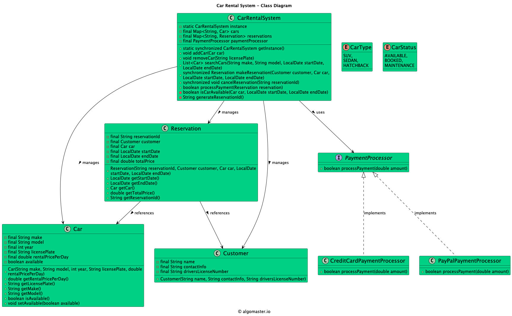

# Low-level design problem: car rental system

> Copied from <https://github.com/ashishps1/awesome-low-level-design/blob/main/problems/car-rental-system.md> (GPL-3.0, by Ashish Pratap Singh). Questions and answers are the source's own; nothing was answered or rewritten here.


# Designing a Car Rental System

## Requirements
1. The car rental system should allow customers to browse and reserve available cars for specific dates.
2. Each car should have details such as make, model, year, license plate number, and rental price per day.
3. Customers should be able to search for cars based on various criteria, such as car type, price range, and availability.
4. The system should handle reservations, including creating, modifying, and canceling reservations.
5. The system should keep track of the availability of cars and update their status accordingly.
6. The system should handle customer information, including name, contact details, and driver's license information.
7. The system should handle payment processing for reservations.
8. The system should be able to handle concurrent reservations and ensure data consistency.

## UML Class Diagram



## Implementations
#### [Java Implementation](https://github.com/ashishps1/awesome-low-level-design/blob/main/solutions/java/src/carrentalsystem) 
#### [Python Implementation](https://github.com/ashishps1/awesome-low-level-design/blob/main/solutions/python/carrentalsystem)
#### [C++ Implementation](https://github.com/ashishps1/awesome-low-level-design/blob/main/solutions/cpp/carrentalsystem)
#### [C# Implementation](https://github.com/ashishps1/awesome-low-level-design/blob/main/solutions/csharp/carrentalsystem)
#### [Go Implementation](https://github.com/ashishps1/awesome-low-level-design/blob/main/solutions/golang/carrentalsystem)

## Classes, Interfaces and Enumerations
1. The **Car** class represents a car in the rental system, with properties such as make, model, year, license plate number, rental price per day, and availability status.
2. The **Customer** class represents a customer, with properties like name, contact information, and driver's license number.
3. The **Reservation** class represents a reservation made by a customer for a specific car and date range. It includes properties such as reservation ID, customer, car, start date, end date, and total price.
4. The **PaymentProcessor** interface defines the contract for payment processing, and the CreditCardPaymentProcessor and PayPalPaymentProcessor classes are concrete implementations of the payment processor.
5. The **RentalSystem** class is the core of the car rental system and follows the Singleton pattern to ensure a single instance of the rental system.
6. The RentalSystem class uses concurrent data structures (ConcurrentHashMap) to handle concurrent access to cars and reservations.
7. The **RentalSystem** class provides methods for adding and removing cars, searching for available cars based on criteria, making reservations, canceling reservations, and processing payments.
8. The **CarRentalSystem** class serves as the entry point of the application and demonstrates the usage of the car rental system.

---

## Official solutions from the repository

<details><summary><b>java</b> (11 files)</summary>


**Car.java**

```java
package carrentalsystem;

public class Car {
    private final String make;
    private final String model;
    private final int year;
    private final String licensePlate;
    private final double rentalPricePerDay;
    private boolean available;

    public Car(String make, String model, int year, String licensePlate, double rentalPricePerDay) {
        this.make = make;
        this.model = model;
        this.year = year;
        this.licensePlate = licensePlate;
        this.rentalPricePerDay = rentalPricePerDay;
        this.available = true;
    }

    public double getRentalPricePerDay() {
        return rentalPricePerDay;
    }

    public String getLicensePlate() {
        return licensePlate;
    }

    public String getMake() {
        return make;
    }

    public String getModel() {
        return model;
    }

    public boolean isAvailable() {
        return available;
    }

    public void setAvailable(boolean available) {
        this.available = available;
    }
}
```


**CarRentalSystem.java**

```java
package carrentalsystem;

import carrentalsystem.payment.CreditCardPaymentProcessor;
import carrentalsystem.payment.PaymentProcessor;

import java.time.LocalDate;
import java.util.ArrayList;
import java.util.List;
import java.util.Map;
import java.util.UUID;
import java.util.concurrent.ConcurrentHashMap;

public class CarRentalSystem {
    private static CarRentalSystem instance = new CarRentalSystem();
    private final Map<String, Car> cars;
    private final Map<String, Reservation> reservations;
    private final PaymentProcessor paymentProcessor;

    private CarRentalSystem() {
        cars = new ConcurrentHashMap<>();
        reservations = new ConcurrentHashMap<>();
        paymentProcessor = new CreditCardPaymentProcessor();
    }

    public static CarRentalSystem getInstance() {
        return instance;
    }

    public void addCar(Car car) {
        cars.put(car.getLicensePlate(), car);
    }

    public void removeCar(String licensePlate) {
        cars.remove(licensePlate);
    }

    public List<Car> searchCars(String make, String model, LocalDate startDate, LocalDate endDate) {
        List<Car> availableCars = new ArrayList<>();
        for (Car car : cars.values()) {
            if (car.getMake().equalsIgnoreCase(make) && car.getModel().equalsIgnoreCase(model) && car.isAvailable()) {
                if (isCarAvailable(car, startDate, endDate)) {
                    availableCars.add(car);
                }
            }
        }
        return availableCars;
    }

    private boolean isCarAvailable(Car car, LocalDate startDate, LocalDate endDate) {
        for (Reservation reservation : reservations.values()) {
            if (reservation.getCar().equals(car)) {
                if (startDate.isBefore(reservation.getEndDate()) && endDate.isAfter(reservation.getStartDate())) {
                    return false;
                }
            }
        }
        return true;
    }

    public synchronized Reservation makeReservation(Customer customer, Car car, LocalDate startDate, LocalDate endDate) {
        if (isCarAvailable(car, startDate, endDate)) {
            String reservationId = generateReservationId();
            Reservation reservation = new Reservation(reservationId, customer, car, startDate, endDate);
            reservations.put(reservationId, reservation);
            car.setAvailable(false);
            return reservation;
        }
        return null;
    }

    public synchronized void cancelReservation(String reservationId) {
        Reservation reservation = reservations.remove(reservationId);
        if (reservation != null) {
            reservation.getCar().setAvailable(true);
        }
    }

    public boolean processPayment(Reservation reservation) {
        return paymentProcessor.processPayment(reservation.getTotalPrice());
    }

    private String generateReservationId() {
        return "RES" + UUID.randomUUID().toString().substring(0, 8).toUpperCase();
    }
}
```


**CarRentalSystemDemo.java**

```java
package carrentalsystem;

import java.time.LocalDate;
import java.util.List;

public class CarRentalSystemDemo {
    public static void run() {
        CarRentalSystem carRentalSystem = CarRentalSystem.getInstance();

        // Add cars to the rental system
        carRentalSystem.addCar(new Car("Toyota", "Camry", 2022, "ABC123", 50.0));
        carRentalSystem.addCar(new Car("Honda", "Civic", 2021, "XYZ789", 45.0));
        carRentalSystem.addCar(new Car("Ford", "Mustang", 2023, "DEF456", 80.0));

        // Create customers
        Customer customer1 = new Customer("John Doe", "john@example.com", "DL1234");

        // Make reservations
        LocalDate startDate = LocalDate.now();
        LocalDate endDate = startDate.plusDays(3);
        List<Car> availableCars = carRentalSystem.searchCars("Toyota", "Camry", startDate, endDate);
        if (!availableCars.isEmpty()) {
            Car selectedCar = availableCars.getFirst();
            Reservation reservation = carRentalSystem.makeReservation(customer1, selectedCar, startDate, endDate);
            if (reservation != null) {
                boolean paymentSuccess = carRentalSystem.processPayment(reservation);
                if (paymentSuccess) {
                    System.out.println("Reservation successful. Reservation ID: " + reservation.getReservationId());
                } else {
                    System.out.println("Payment failed. Reservation canceled.");
                    carRentalSystem.cancelReservation(reservation.getReservationId());
                }
            } else {
                System.out.println("Selected car is not available for the given dates.");
            }
        } else {
            System.out.println("No available cars found for the given criteria.");
        }
    }
}
```


**CarStatus.java**

```java
package carrentalsystem;

public enum CarStatus {
    AVAILABLE, BOOKED, MAINTENANCE
}
```


**CarType.java**

```java
package carrentalsystem;

public enum CarType {
    SUV, SEDAN, HATCHBACK
}
```


**Customer.java**

```java
package carrentalsystem;

public class Customer {
    private final String name;
    private final String contactInfo;
    private final String driversLicenseNumber;

    public Customer(String name, String contactInfo, String driversLicenseNumber) {
        this.name = name;
        this.contactInfo = contactInfo;
        this.driversLicenseNumber = driversLicenseNumber;
    }
}
```


**README.md**

```md
# Designing a Car Rental System

## Requirements
1. The car rental system should allow customers to browse and reserve available cars for specific dates.
2. Each car should have details such as make, model, year, license plate number, and rental price per day.
3. Customers should be able to search for cars based on various criteria, such as car type, price range, and availability.
4. The system should handle reservations, including creating, modifying, and canceling reservations.
5. The system should keep track of the availability of cars and update their status accordingly.
6. The system should handle customer information, including name, contact details, and driver's license information.
7. The system should handle payment processing for reservations.
8. The system should be able to handle concurrent reservations and ensure data consistency.

## UML Class Diagram


## Classes, Interfaces and Enumerations
1. The **Car** class represents a car in the rental system, with properties such as make, model, year, license plate number, rental price per day, and availability status.
2. The **Customer** class represents a customer, with properties like name, contact information, and driver's license number.
3. The **Reservation** class represents a reservation made by a customer for a specific car and date range. It includes properties such as reservation ID, customer, car, start date, end date, and total price.
4. The **PaymentProcessor** interface defines the contract for payment processing, and the CreditCardPaymentProcessor and PayPalPaymentProcessor classes are concrete implementations of the payment processor.
5. The **RentalSystem** class is the core of the car rental system and follows the Singleton pattern to ensure a single instance of the rental system.
6. The RentalSystem class uses concurrent data structures (ConcurrentHashMap) to handle concurrent access to cars and reservations.
7. The **RentalSystem** class provides methods for adding and removing cars, searching for available cars based on criteria, making reservations, canceling reservations, and processing payments.
8. The **CarRentalSystem** class serves as the entry point of the application and demonstrates the usage of the car rental system.
```


**Reservation.java**

```java
package carrentalsystem;

import java.time.LocalDate;
import java.time.temporal.ChronoUnit;

public class Reservation {
    private final String reservationId;
    private final Customer customer;
    private final Car car;
    private final LocalDate startDate;
    private final LocalDate endDate;
    private final double totalPrice;

    public Reservation(String reservationId, Customer customer, Car car, LocalDate startDate, LocalDate endDate) {
        this.reservationId = reservationId;
        this.customer = customer;
        this.car = car;
        this.startDate = startDate;
        this.endDate = endDate;
        this.totalPrice = calculateTotalPrice();
    }

    private double calculateTotalPrice() {
        long daysRented = ChronoUnit.DAYS.between(startDate, endDate) + 1;
        return car.getRentalPricePerDay() * daysRented;
    }

    public LocalDate getStartDate() {
        return startDate;
    }

    public LocalDate getEndDate() {
        return endDate;
    }

    public Car getCar() {
        return car;
    }

    public double getTotalPrice() {
        return totalPrice;
    }

    public String getReservationId() {
        return reservationId;
    }
}
```


**payment/CreditCardPaymentProcessor.java**

```java
package carrentalsystem.payment;

public class CreditCardPaymentProcessor implements PaymentProcessor {
    @Override
    public boolean processPayment(double amount) {
        // Process credit card payment
        // ...
        return true;
    }
}
```


**payment/PayPalPaymentProcessor.java**

```java
package carrentalsystem.payment;

public class PayPalPaymentProcessor implements PaymentProcessor {
    @Override
    public boolean processPayment(double amount) {
        // Process PayPal payment
        // ...
        return true;
    }
}
```


**payment/PaymentProcessor.java**

```java
package carrentalsystem.payment;

public interface PaymentProcessor {
    boolean processPayment(double amount);
}
```

</details>

<details><summary><b>python</b> (9 files)</summary>


**README.md**

```md
# Designing a Car Rental System

## Requirements
1. The car rental system should allow customers to browse and reserve available cars for specific dates.
2. Each car should have details such as make, model, year, license plate number, and rental price per day.
3. Customers should be able to search for cars based on various criteria, such as car type, price range, and availability.
4. The system should handle reservations, including creating, modifying, and canceling reservations.
5. The system should keep track of the availability of cars and update their status accordingly.
6. The system should handle customer information, including name, contact details, and driver's license information.
7. The system should handle payment processing for reservations.
8. The system should be able to handle concurrent reservations and ensure data consistency.

## Classes, Interfaces and Enumerations
1. The **Car** class represents a car in the rental system, with properties such as make, model, year, license plate number, rental price per day, and availability status.
2. The **Customer** class represents a customer, with properties like name, contact information, and driver's license number.
3. The **Reservation** class represents a reservation made by a customer for a specific car and date range. It includes properties such as reservation ID, customer, car, start date, end date, and total price.
4. The **PaymentProcessor** interface defines the contract for payment processing, and the CreditCardPaymentProcessor and PayPalPaymentProcessor classes are concrete implementations of the payment processor.
5. The **RentalSystem** class is the core of the car rental system and follows the Singleton pattern to ensure a single instance of the rental system.
6. The RentalSystem class uses concurrent data structures (ConcurrentHashMap) to handle concurrent access to cars and reservations.
7. The **RentalSystem** class provides methods for adding and removing cars, searching for available cars based on criteria, making reservations, canceling reservations, and processing payments.
8. The **CarRentalSystem** class serves as the entry point of the application and demonstrates the usage of the car rental system.
```


**car.py**

```py
class Car:
    def __init__(self, make, model, year, license_plate, rental_price_per_day):
        self.make = make
        self.model = model
        self.year = year
        self.license_plate = license_plate
        self.rental_price_per_day = rental_price_per_day
        self.available = True

    def get_rental_price_per_day(self):
        return self.rental_price_per_day

    def get_license_plate(self):
        return self.license_plate

    def get_make(self):
        return self.make

    def get_model(self):
        return self.model

    def is_available(self):
        return self.available

    def set_available(self, available):
        self.available = available
```


**car_rental_system_demo.py**

```py

from rental_system import RentalSystem
from car import Car
from customer import Customer
from datetime import date, timedelta

class CarRentalSystemDemo:
    @staticmethod
    def run():
            rental_system = RentalSystem.get_instance()

            # Add cars to the rental system
            rental_system.add_car(Car("Toyota", "Camry", 2022, "ABC123", 50.0))
            rental_system.add_car(Car("Honda", "Civic", 2021, "XYZ789", 45.0))
            rental_system.add_car(Car("Ford", "Mustang", 2023, "DEF456", 80.0))

            # Create customers
            customer1 = Customer("John Doe", "john@example.com", "DL1234")
            customer2 = Customer("Jane Smith", "jane@example.com", "DL5678")

            # Make reservations
            start_date = date.today()
            end_date = start_date + timedelta(days=3)
            available_cars = rental_system.search_cars("Toyota", "Camry", start_date, end_date)

            if available_cars:
                selected_car = available_cars[0]
                reservation = rental_system.make_reservation(customer1, selected_car, start_date, end_date)
                if reservation is not None:
                    payment_success = rental_system.process_payment(reservation)
                    if payment_success:
                        print(f"Reservation successful. Reservation ID: {reservation.get_reservation_id()}")
                    else:
                        print("Payment failed. Reservation canceled.")
                        rental_system.cancel_reservation(reservation.get_reservation_id())
                else:
                    print("Selected car is not available for the given dates.")
            else:
                print("No available cars found for the given criteria.")

if __name__ == "__main__":
    CarRentalSystemDemo.run()
```


**credit_card_payment_processor.py**

```py
from payment_processor import PaymentProcessor

class CreditCardPaymentProcessor(PaymentProcessor):
    def process_payment(self, amount):
        # Process credit card payment
        # ...
        return True
```


**customer.py**

```py
class Customer:
    def __init__(self, name, contact_info, drivers_license_number):
        self.name = name
        self.contact_info = contact_info
        self.drivers_license_number = drivers_license_number
```


**payment_processor.py**

```py
from abc import ABC, abstractmethod

class PaymentProcessor(ABC):
    @abstractmethod
    def process_payment(self, amount):
        pass
```


**paypal_payment_processor.py**

```py
from payment_processor import PaymentProcessor

class PayPalPaymentProcessor(PaymentProcessor):
    def process_payment(self, amount):
        # Process PayPal payment
        # ...
        return True
```


**rental_system.py**

```py
import uuid
from credit_card_payment_processor import CreditCardPaymentProcessor
from reservation import Reservation

class RentalSystem:
    _instance = None

    def __init__(self):
        if RentalSystem._instance is not None:
            raise Exception("This class is a singleton!")
        else:
            RentalSystem._instance = self
            self.cars = {}
            self.reservations = {}
            self.payment_processor = CreditCardPaymentProcessor()

    @staticmethod
    def get_instance():
        if RentalSystem._instance is None:
            RentalSystem()
        return RentalSystem._instance

    def add_car(self, car):
        self.cars[car.license_plate] = car

    def remove_car(self, license_plate):
        self.cars.pop(license_plate, None)

    def search_cars(self, make, model, start_date, end_date):
        available_cars = []
        for car in self.cars.values():
            if car.make.lower() == make.lower() and car.model.lower() == model.lower() and car.available:
                if self.is_car_available(car, start_date, end_date):
                    available_cars.append(car)
        return available_cars

    def is_car_available(self, car, start_date, end_date):
        for reservation in self.reservations.values():
            if reservation.get_car() == car:
                if start_date < reservation.get_end_date() and end_date > reservation.get_start_date():
                    return False
        return True

    def make_reservation(self, customer, car, start_date, end_date):
        if self.is_car_available(car, start_date, end_date):
            reservation_id = self.generate_reservation_id()
            reservation = Reservation(reservation_id, customer, car, start_date, end_date)
            self.reservations[reservation_id] = reservation
            car.set_available(False)
            return reservation
        return None

    def cancel_reservation(self, reservation_id):
        reservation = self.reservations.pop(reservation_id, None)
        if reservation is not None:
            reservation.get_car().set_available(True)

    def process_payment(self, reservation):
        return self.payment_processor.process_payment(reservation.get_total_price())

    def generate_reservation_id(self):
        return "RES" + str(uuid.uuid4())[:8].upper()
```


**reservation.py**

```py
from datetime import date, timedelta

class Reservation:
    def __init__(self, reservation_id, customer, car, start_date, end_date):
        self.reservation_id = reservation_id
        self.customer = customer
        self.car = car
        self.start_date = start_date
        self.end_date = end_date
        self.total_price = self.calculate_total_price()

    def calculate_total_price(self):
        days_rented = (self.end_date - self.start_date).days + 1
        return self.car.rental_price_per_day * days_rented

    def get_start_date(self):
        return self.start_date

    def get_end_date(self):
        return self.end_date

    def get_car(self):
        return self.car

    def get_total_price(self):
        return self.total_price

    def get_reservation_id(self):
        return self.reservation_id
```

</details>

<details><summary><b>cpp</b> (11 files)</summary>


**Car.cpp**

```cpp
#include "Car.hpp"
#include <iostream>
#include <iomanip>

Car::Car(std::string carId, std::string brand, std::string model, double basePrice)
    : carId(carId), brand(brand), model(model), basePrice(basePrice), available(true) {}

std::string Car::getCarId() const { return carId; }
std::string Car::getBrand() const { return brand; }
std::string Car::getModel() const { return model; }
double Car::getBasePrice() const { return basePrice; }
bool Car::isAvailable() const { return available; }

void Car::setAvailable(bool status) {
    available = status;
}

void Car::displayInfo() const {
    std::cout << "Car ID: " << carId << std::endl;
    std::cout << "Brand: " << brand << std::endl;
    std::cout << "Model: " << model << std::endl;
    std::cout << "Base Price per Day: $" << std::fixed << std::setprecision(2) << basePrice << std::endl;
    std::cout << "Status: " << (available ? "Available" : "Rented") << std::endl;
}
```


**Car.hpp**

```hpp
#ifndef CAR_HPP
#define CAR_HPP

#include <string>

class Car {
private:
    std::string carId;
    std::string brand;
    std::string model;
    double basePrice;
    bool available;

public:
    Car(std::string carId, std::string brand, std::string model, double basePrice);
    
    std::string getCarId() const;
    std::string getBrand() const;
    std::string getModel() const;
    double getBasePrice() const;
    bool isAvailable() const;
    
    void setAvailable(bool status);
    void displayInfo() const;
};

#endif
```


**CarRentalSystem.cpp**

```cpp
#include "CarRentalSystem.hpp"
#include <iostream>
#include <algorithm>

CarRentalSystem::CarRentalSystem() : rentalIdCounter(1) {}

CarRentalSystem::~CarRentalSystem() {
    for (auto car : cars) delete car;
    for (auto customer : customers) delete customer;
    for (auto rental : rentals) delete rental;
}

void CarRentalSystem::addCar(Car* car) {
    cars.push_back(car);
}

void CarRentalSystem::addCustomer(Customer* customer) {
    customers.push_back(customer);
}

std::string CarRentalSystem::rentCar(Car* car, Customer* customer, 
                                   std::string startDate, int days) {
    if (!car->isAvailable()) return "";
    
    std::string rentalId = "R" + std::to_string(rentalIdCounter++);
    Rental* rental = new Rental(rentalId, car, customer, startDate, days);
    rentals.push_back(rental);
    car->setAvailable(false);
    return rentalId;
}

bool CarRentalSystem::returnCar(std::string rentalId) {
    Rental* rental = findRental(rentalId);
    if (!rental) return false;
    
    rental->getCar()->setAvailable(true);
    
    auto it = std::find(rentals.begin(), rentals.end(), rental);
    if (it != rentals.end()) {
        rentals.erase(it);
        delete rental;
        return true;
    }
    return false;
}

void CarRentalSystem::displayAvailableCars() const {
    std::cout << "\nAvailable Cars:" << std::endl;
    for (const auto& car : cars) {
        if (car->isAvailable()) {
            car->displayInfo();
            std::cout << "------------------------" << std::endl;
        }
    }
}

void CarRentalSystem::displayRentals() const {
    std::cout << "\nCurrent Rentals:" << std::endl;
    for (const auto& rental : rentals) {
        rental->displayInfo();
        std::cout << "------------------------" << std::endl;
    }
}

void CarRentalSystem::displayCustomers() const {
    std::cout << "\nRegistered Customers:" << std::endl;
    for (const auto& customer : customers) {
        customer->displayInfo();
        std::cout << "------------------------" << std::endl;
    }
}

Car* CarRentalSystem::findCar(std::string carId) const {
    for (auto car : cars) {
        if (car->getCarId() == carId) return car;
    }
    return nullptr;
}

Customer* CarRentalSystem::findCustomer(std::string customerId) const {
    for (auto customer : customers) {
        if (customer->getCustomerId() == customerId) return customer;
    }
    return nullptr;
}

Rental* CarRentalSystem::findRental(std::string rentalId) const {
    for (auto rental : rentals) {
        if (rental->getRentalId() == rentalId) return rental;
    }
    return nullptr;
}
```


**CarRentalSystem.hpp**

```hpp
#ifndef CAR_RENTAL_SYSTEM_HPP
#define CAR_RENTAL_SYSTEM_HPP

#include <vector>
#include <string>
#include "Car.hpp"
#include "Customer.hpp"
#include "Rental.hpp"

class CarRentalSystem {
private:
    std::vector<Car*> cars;
    std::vector<Customer*> customers;
    std::vector<Rental*> rentals;
    int rentalIdCounter;

public:
    CarRentalSystem();
    ~CarRentalSystem();
    
    void addCar(Car* car);
    void addCustomer(Customer* customer);
    std::string rentCar(Car* car, Customer* customer, std::string startDate, int days);
    bool returnCar(std::string rentalId);
    
    void displayAvailableCars() const;
    void displayRentals() const;
    void displayCustomers() const;
    
    Car* findCar(std::string carId) const;
    Customer* findCustomer(std::string customerId) const;
    Rental* findRental(std::string rentalId) const;
};

#endif
```


**CarRentalSystemDemo.cpp**

```cpp
#include "CarRentalSystem.hpp"
#include <iostream>

int main() {
    CarRentalSystem rentalSystem;
    
    // Add some cars
    Car* car1 = new Car("C001", "Toyota", "Camry", 60.0);
    Car* car2 = new Car("C002", "Honda", "Accord", 70.0);
    Car* car3 = new Car("C003", "BMW", "3 Series", 100.0);
    
    rentalSystem.addCar(car1);
    rentalSystem.addCar(car2);
    rentalSystem.addCar(car3);
    
    // Add some customers
    Customer* customer1 = new Customer("CUST001", "John Doe", "+1-555-0123");
    Customer* customer2 = new Customer("CUST002", "Jane Smith", "+1-555-0124");
    
    rentalSystem.addCustomer(customer1);
    rentalSystem.addCustomer(customer2);
    
    // Display available cars
    rentalSystem.displayAvailableCars();
    
    // Rent some cars
    std::string rental1 = rentalSystem.rentCar(car1, customer1, "2024-03-20", 3);
    std::string rental2 = rentalSystem.rentCar(car2, customer2, "2024-03-21", 5);
    
    if (!rental1.empty()) {
        std::cout << "\nRental created successfully: " << rental1 << std::endl;
    }
    if (!rental2.empty()) {
        std::cout << "Rental created successfully: " << rental2 << std::endl;
    }
    
    // Display all rentals
    rentalSystem.displayRentals();
    
    // Display available cars after rentals
    rentalSystem.displayAvailableCars();
    
    // Return a car
    if (rentalSystem.returnCar(rental1)) {
        std::cout << "\nCar returned successfully for rental: " << rental1 << std::endl;
    }
    
    // Display available cars after return
    rentalSystem.displayAvailableCars();
    
    return 0;
}
```


**Customer.cpp**

```cpp
#include "Customer.hpp"
#include <iostream>

Customer::Customer(std::string customerId, std::string name, std::string contactNumber)
    : customerId(customerId), name(name), contactNumber(contactNumber) {}

std::string Customer::getCustomerId() const { return customerId; }
std::string Customer::getName() const { return name; }
std::string Customer::getContactNumber() const { return contactNumber; }

void Customer::displayInfo() const {
    std::cout << "Customer ID: " << customerId << std::endl;
    std::cout << "Name: " << name << std::endl;
    std::cout << "Contact Number: " << contactNumber << std::endl;
}
```


**Customer.hpp**

```hpp
#ifndef CUSTOMER_HPP
#define CUSTOMER_HPP

#include <string>

class Customer {
private:
    std::string customerId;
    std::string name;
    std::string contactNumber;

public:
    Customer(std::string customerId, std::string name, std::string contactNumber);
    
    std::string getCustomerId() const;
    std::string getName() const;
    std::string getContactNumber() const;
    void displayInfo() const;
};

#endif
```


**README.md**

```md
# Designing a Car Rental System

## Requirements
1. The car rental system should allow customers to browse and reserve available cars for specific dates.
2. Each car should have details such as make, model, year, license plate number, and rental price per day.
3. Customers should be able to search for cars based on various criteria, such as car type, price range, and availability.
4. The system should handle reservations, including creating, modifying, and canceling reservations.
5. The system should keep track of the availability of cars and update their status accordingly.
6. The system should handle customer information, including name, contact details, and driver's license information.
7. The system should handle payment processing for reservations.
8. The system should be able to handle concurrent reservations and ensure data consistency.

## Classes, Interfaces and Enumerations
1. The **Car** class represents a car in the rental system, with properties such as make, model, year, license plate number, rental price per day, and availability status.
2. The **Customer** class represents a customer, with properties like name, contact information, and driver's license number.
3. The **Reservation** class represents a reservation made by a customer for a specific car and date range. It includes properties such as reservation ID, customer, car, start date, end date, and total price.
4. The **PaymentProcessor** interface defines the contract for payment processing, and the CreditCardPaymentProcessor and PayPalPaymentProcessor classes are concrete implementations of the payment processor.
5. The **RentalSystem** class is the core of the car rental system and follows the Singleton pattern to ensure a single instance of the rental system.
6. The RentalSystem class uses concurrent data structures (ConcurrentHashMap) to handle concurrent access to cars and reservations.
7. The **RentalSystem** class provides methods for adding and removing cars, searching for available cars based on criteria, making reservations, canceling reservations, and processing payments.
8. The **CarRentalSystem** class serves as the entry point of the application and demonstrates the usage of the car rental system.
```


**Rental.cpp**

```cpp
#include "Rental.hpp"
#include <iostream>
#include <iomanip>

Rental::Rental(std::string rentalId, Car* car, Customer* customer, 
               std::string startDate, int days)
    : rentalId(rentalId), car(car), customer(customer), 
      startDate(startDate), days(days) {
    totalPrice = car->getBasePrice() * days;
}

std::string Rental::getRentalId() const { return rentalId; }
Car* Rental::getCar() const { return car; }
Customer* Rental::getCustomer() const { return customer; }
std::string Rental::getStartDate() const { return startDate; }
int Rental::getDays() const { return days; }
double Rental::getTotalPrice() const { return totalPrice; }

void Rental::displayInfo() const {
    std::cout << "\nRental Details:" << std::endl;
    std::cout << "Rental ID: " << rentalId << std::endl;
    std::cout << "Start Date: " << startDate << std::endl;
    std::cout << "Duration: " << days << " days" << std::endl;
    std::cout << "Total Price: $" << std::fixed << std::setprecision(2) << totalPrice << std::endl;
    std::cout << "\nCustomer Information:" << std::endl;
    customer->displayInfo();
    std::cout << "\nCar Information:" << std::endl;
    car->displayInfo();
}
```


**Rental.hpp**

```hpp
#ifndef RENTAL_HPP
#define RENTAL_HPP

#include "Car.hpp"
#include "Customer.hpp"
#include <string>

class Rental {
private:
    std::string rentalId;
    Car* car;
    Customer* customer;
    std::string startDate;
    int days;
    double totalPrice;

public:
    Rental(std::string rentalId, Car* car, Customer* customer, 
           std::string startDate, int days);
    
    std::string getRentalId() const;
    Car* getCar() const;
    Customer* getCustomer() const;
    std::string getStartDate() const;
    int getDays() const;
    double getTotalPrice() const;
    
    void displayInfo() const;
};

#endif
```


**car_rental**

```
�������!H__PAGEZERO(__TEXT��__text__TEXTt��__stubs__TEXT������__gcc_except_tab__TEXT(�(�__cstring__TEXT,�,,�__const__TEXTX�X�__unwind_info__TEXTp��p��__DATA_CONST�@�@__got__DATA_CONST��8H__LINKEDIT��4��3����pxF�PAI'�Dx /usr/lib/dyld���k;���nІ`�2 �*(���0�@/usr/lib/libc++.1.dylib88/usr/lib/libSystem.B.dylib&HP)���X����{�������������������������_����%��@��@�a����%��@��@����%��@���]�$�(�R@9�{F�����_������/����@������/��%��@��%��@�m%����{�����������������������_����@������@��{C����_�����{���������@���������@�|%��{B�����_�����{���������@���������@�a�m%��{B�����_�����{���������@���������@���^%��{B�����_��C����@�%@��C��_��C����@�AA9�C��_��C���(�R(
�9�@��@9(A9�C��_����{������@��@��������_���A�!��S��@�>��!�0���_��@�A�!��I��@�a�3��@�V��@�A�!��@��@���*��@�M��@�A�!�7��!�3�w���@�R�����@��3ѨC�_��@�%@�%��@�9��@�A�!l�#��@�AA9
I�)��H���Jr����@�)��{C����_�����{�����������_����@�1����@�i��@����@����{B�����_�����{�����������_����@����@��$��@����@����{B�����_�����{��C������@��@�?��{A�����_�����{��C����@����@�	@�)�^�	�A�R�����@��$��@��$��@��{A�����_�����{��C������@�	@�)�^��@�A��	�O��@��{A�����_�����{�����������_����@�*@�J�^� 
�?��@��{B�����_�����{��C����@���R� �R��@��{A�����_�����{��C����@���&���_��{A�����_�����{��������C�����_���@����@���@��C_��@�


(	@�
*(	��@��{B�����_��C������@��@�(	@�*
(	��C��_�����{��������C���_����C_���@��{B�����_��C������@��@���C��_�����{	��C�����������_����G$����}��G��G@�6��_��#���_�����_�	@�)�^�	���C��C@�	�R	
�q���7�_���^�	����_����@����_���^�	�����_�	@�)�^�	�����_�	@�)�^�	����/��/@��@��@��@��@��'@�J����@��Ѩ��@6��_�	@�)�^�	���R�������������������#��]�H$���_�	@�)�^�	�%$�D$���_��{I�����_�����#�����������7$��]��#�������{��C����@�8����@��{A�����_����C����@�@9�C��_�����{	��C���������������8�_�����7�_����z��]���^�	���]����'��'@��\�	��ǟ�7�\��'@�	��'��'��^���^�	��#��#@���ǟ7�_���^��#@����#@�����7���_����P�'@���ǟ�7�'@����8�������@��_��������@��'@������@��'@�	����7���_����(�R��	��������W#�-����R#��@�q��h7��]��^�	��#��#@���ǟ7�_��^��#@�`��#@�����7���_�����]���{��_������_��{I�����_��@��"�����{�����������_����@���@��{B�����_��C����@�	@��C��_�����{��C����@����"��@��@��"� 6�@��R1��@�(���@��@��{A�����_��C����@�@�����C��_�����{��C������@��@�P��{A�����_��{��I#�<#��C����@�
@��C��_�����{�������������_��@��@�@�1@�?��{B�����_�����{����������?9��_����@��?�9��@��{B�����_�����{��C����@�l�f��{A�����_���������@�(
@����@�(
��@�����_�����{����������?9��_����;��7���@��@��?�9�"��@���@��{B�����_�����{�������������_����@��@�	��@��{B�����_��C����C��_����{�������������_�����@�
��@��{C����_��C����@��C��_�����{�������@�����@��{B�����_�����{��C����@�����@��{A�����_��C����@��C��_��C����@��C��_�����{���������_�����6�@�����@�����@��{B�����_�����{��C����@��\@9}Sr���{A�����_�����{��C����@��@��{A�����_�����{��C����@����{A�����_�����{��C����@���{A�����_��C����@��C��_��C����@��C��_�����{�����������_����@�	@�)�^�	�
����@��@���{B�����_�
�������{��C����@���{A�����_��C����@�@��C��_��C������@��@�	k���C��_���_��C��{�������s8��_��c����!��@�����@��s�8����c��!��@��{D��C��_��������c��!��@��!�����{��C����@�A�!�@��!��{A�����_�����{��C����9�@���9@�@�?��{A�����_�����{��C������@� @��@�	*�!��{A�����_�����{��C����@��!��{A�����_�����{���������_���E����6�@�����@�����@��{B�����_�����{��C����@�S���@��{A�����_�����{��C����@�I���\@9	�	�@��{A�����_���������@�(	@����@�(	��@�����_�����{��C����@���
��@�a���@�����@�(�RH��{A�����_�����{��C����@���A��@��{A�����_�����{��C����@������@��{A�����_�����{��C����@������@��{A�����_�����{��C����@��������@��{A�����_�����{	��C����_�����������^�n�����^�w������ѡ��~��6��ч�@����]�������7�@����@�H!���ш�����@�a������\�������\����'����#����6�ѣ�@��#��#@�������7�@����@�&!��Ѥ�����@������@������@�������������6�����@����@�������7�@����@�!����������@������@�a����@�����_��{I�����_�����{��C����@�@�|
����@��{A�����_�����{��C����@�@�p
����@��{A�����_�����{��C������@��@���R�{A�����_��C����@�@��C��_�����{��C����@������@��{A�����_��C����@�@�!���C��_�����{��C����@�@�c
����@��{A�����_�����{��C����@�@�W
����@��{A�����_�����{��C������@��@���R�{A�����_��C����@�@��C��_�����{��C����@������@��{A�����_��C����@�@�!���C��_�����{��C����@�@�J
����@��{A�����_�����{��C����@�@�>
����@��{A�����_�����{��C������@��@���R�{A�����_��C����@�@��C��_�����{��C����@������@��{A�����_��C����@�@�!���C��_�����{��C����@������@��{A�����_�����{��C����@���C��@��{A�����_�����{��C����@������@��{A�����_�����{��C����@��������@��{A�����_�����{��C����������@���{A�����_�����{�����������_���@����	��@�	@�	����7�@��@����@��@����{B�����_�����{��C����������@�a���{A�����_�����{�����������_���@���F��@�	@�	����7�@��@����@��@����{B�����_�����{�����C������@�����	�����������C�@��#���^������7�@�A�!��z�t�#@��R�38 I@�(I��#������@��@�@���v��#�7�
�Ғ����@�(�R�?9��)��@���^����^����C�!��@��@��@��C]����C�K��R�?9�C������@��#@���ѩ���Z���^��R����(�R�38�3]8�7#��������#���'�����������������������������C��������?A9�6�@�:��@����@����{N�����_֠[�������{�����������_����@�e��@��{B�����_�����{��������������@��@��Ҵ����@�k��{B�����_�����{�����������_���@������@�	@�	����7�@��@����@��@����{B�����_����{������������_�����������@��@�^�����ч��@����^�����7�R��8G����������v�F������^���(�R����@���O����@��/���W����@��+��/@��+@�i��@��C�������L������@��#��'�S����6�@��������C��Ҟ��@��#@�r����^�������7�@�Q����@���(�R��8�R��8��_8�{K����_֠\������{������������_������^������^�'�����ѡ��.�`6���7�@����@�����U��@��@������@���
��@��6�@�������'���������_��{G����_�����{�����������C��#�����6�C�����@��@�)@�	���h7�C���������@������_��{B�����_��C��{����C����������^��������@��c������@���(@��@�
����@�!@��@�!������@����@��@�!����@��@��������_��{D��C��_�����{�������������_����@��@���@��{B�����_����{���������_���@��@�A�!����������!�0������@����_�&����_�/����c��C�6�@6�c�?����@�@�)����6�@�@�6���@��@�A�!$���������!�0������c�0�����{C����_�����{��C����@�@������@��{A�����_�����{��C����@�@������@��{A�����_�����{��C������@��@��R�{A�����_��C����@�@��C��_��C����@�@�!���C��_����{���������_���@��@�A�!��G�������!�0�V����@������_� ����_�)����c��C�0��6�c�9����@�@���@��@�A�!$�*�������!�0�9����c�0�����{C����_�����{��C����@�@������@��{A�����_�����{��C����@�@������@��{A�����_�����{��C������@��@���R�{A�����_��C����@�@��C��_��C����@�@�!���C��_����{���������_���@��@�A�!����������!�0������@�a����_� ����_�)����c��C�0��6�c�9����@�@�}�@��@�A�!$���������!�0������c�0�����{C����_�����{��C����@�@�i����@��{A�����_�����{��C����@�@�]����@��{A�����_�����{��C������@��@�u�R�{A�����_��C����@�@��C��_��C����@�@�!���C��_����{������������_����^���������^��������ѡ��
���`6������@����@����������@��@�����@���K��@��6�@������������������_��{G����_��C��{���������_��������@�����^������@�����7�R��88�_�c�������^�`������_������6�@��@��@��q����8$�@����H7�@��9�@�)�9	k���7�R��8�@�����@�����@�������(�R��8��_8�{D��C��_����{������������_�a����^�>�������^�G�������ѡ��N���`6���W���@����@�����m��@��@��������@������@��6�@�������G�����������_��{G����_�����{�����������_�����@�	����@�����{B�����_��C����@�@��C��_�����{��C����@��������@�a����@����@��{A�����_�����{�����������_�����@�	����@�����{B�����_��C����@�@��C��_�����{��C����@�����l��@�a�i��@�g��@��{A�����_�����{�����������_�����@�	����@�����{B�����_��C����@�@��C��_�����{��C����@�����C��@�A��@��{A�����_�����{�����������_�����@�	����@�����{B�����_��C����@�@��C��_�����{�����������_�����@�	����@�����{B�����_��C����@�@��C��_�����{�����������_�����@�	����@�����{B�����_��C����@�@��C��_�����{���������_������C���A��?�
��@���@��{B�����_���������{�������������_����@��@�	��@��{B�����_��C����C��_����{�������������_����_���@���@��{C����_��C������@���C��_�����{�������@�����@��{B�����_�����{��C����@�����@��{A�����_��C����@��C��_�����{���������_������C���A��?�
��@���@��{B�����_֝�������{�������������_����@��@�	��@��{B�����_��C����C��_����{�������������_����_���@���@��{C����_��C������@���C��_�����{�������@�����@��{B�����_�����{��C����@�����@��{A�����_��C����@��C��_�����{���������_������C���A��?�
��@���@��{B�����_�B�������{�������������_����@��@�	��@��{B�����_��C����C��_����{�������������_����_���@���@��{C����_��C������@���C��_�����{�������@�����@��{B�����_�����{��C����@�����@��{A�����_��C����@��C��_�����{���������_����C�
��C���@��{B�����_���������{�����������_����@�,��@��{B�����_�����{���������_���@�(��@�@�S��@�@�@�����7�@�@�M��@�@�a��@���	@�)@���@�d��@����@�I��{B�����_��C������@��@���C��_��C��{��������_���e����_���a����_���E����_���Y����_���_����_���Q����_����5��@��@��@��@��@���^����_��

�C
�
	�9��{D��C��_��C����C��_�����{��C����@�@�L��{A�����_�����{�������������_��@��@�r��{B�����_�����{��C����@�A����{A�����_�����{��C����@������@�@�)@�	�	��
ɚ�{A�����_������������������_�����{��C����@�@���{A�����_��C����@�(@�)@�	�	��
ɚ�C��_��C����@��C��_����{�����������_���@����_��@�	����7�@��������@�!����������@������@��_�(��{C����_�	�������{��C������@��@���{A�����_��C������C��_�����{������������@��@��}�����{B�����_���������{�������������_��@���{B�����_�����{��C������@���{A�����_�����{��C����@���{A�����_�����{��C����@���{A�����_��C����@��C��_�����{��C����@�A���{A�����_�����{��C����@���{A�����_��C����@��C��_�����{���������_����C�
��C���@��{B�����_֓�������{�����������_����@�,��@��{B�����_�����{���������_���@�(��@�@�S��@�@�@�����7�@�@�M��@�@�a��@���	@�)@���@�d��@����@�I��{B�����_��C������@��@���C��_��C��{��������_���e����_���a����_���E����_���Y����_���_����_���Q����_����5��@��@��@��@��@���^����_��

�C
�
	�9��{D��C��_��C����C��_�����{��C����@�@�L��{A�����_�����{�������������_��@��@�r��{B�����_�����{��C����@�A�x��{A�����_�����{��C����@���|��@�@�)@�	�	��
ɚ�{A�����_������������������_�����{��C����@�@���{A�����_��C����@�(@�)@�	�	��
ɚ�C��_��C����@��C��_����{�����������_���@����_��@�	����7�@��������@�!����������@�������@��_�(��{C����_ְ�������{��C������@��@���{A�����_��C������C��_�����{������������@��@��}��ҭ����{B�����_֐�������{��C����@���{A�����_��C����@��C��_�����{��C����@�A���{A�����_�����{��C����@���{A�����_��C����@��C��_�����{���������_����C�
��C���@��{B�����_�Y�������{�����������_����@�,��@��{B�����_�����{���������_���@�(��@�@�S��@�@�@�����7�@�@�M��@�@�a��@���	@�)@���@�d��@����@�I��{B�����_��C������@��@���C��_��C��{��������_���e����_���a����_���E����_���Y����_���_����_���Q����_����5��@��@��@��@��@���^����_��

�C
�
	�9��{D��C��_��C����C��_�����{��C����@�@�L��{A�����_�����{�������������_��@��@�r��{B�����_�����{��C����@�A�x��{A�����_�����{��C����@���|��@�@�)@�	�	��
ɚ�{A�����_������������������_�����{��C����@�@���{A�����_��C����@�(@�)@�	�	��
ɚ�C��_��C����@��C��_����{�����������_���@����_��@�	����7�@��������@�!����������@�������@��_�(��{C����_�v�������{��C������@��@���{A�����_��C������C��_�����{������������@��@��}���s����{B�����_�V�������{��C����@���{A�����_��C����@��C��_�����{��C����@�A���{A�����_�����{��C����@���{A�����_��C����@��C��_�����{���������@��@��#����_��{B�����_�����{�������������_����@��@���@��{B�����_�����������@��@������_�����{���������@��@��#����_��{B�����_�����{�������������_����@��@���@��{B�����_�����������@��@������_�����{���������@��@��#����_��{B�����_�����{�������������_����@��@���@��{B�����_�����������@��@������_�����{��C����@�A�^��{A�����_�����{��C��������_�����"��_��@�E������@�x������@��_������@�!���l��{E�����_���������d��@�J����{�����������_���%������@����M������@������@���E����@�����^��������^����#@�F������@��_�t��@�����#@�!��#���������{G����_������'�������@������{��C����@���{A�����_��C����@��C��_�����{�������������_����@��@���@��{B�����_�����{�������������_��@��@�h��{B�����_�����{��C����@��� ��@��{A�����_�����������@��@���@�@���@�@��@�
	������_�����������@��@�@�(�����_��C����@�@�	@�(��C��_��C��{���������_���������^��@�	�臟�7�@����@��������@��@�J��)	ʚ	��'��7�@�����@�H��}	��C����cщ�@������_��{D��C��_����{���������������_����_��@��@�(��@��{C����_����{�����������_�������@�W����@���@������@�@������_�@�������@��]���]��@��@��@��@�������Ѩ���������@��_�(��_�!����@��_� !�A����@��������_�M����@����@��_�@��_�(�O������@����@���{G����_�����{��C����@������@��{A�����_����{���������_�9�n��C�����>����@��c�������@�@��{C����_�^�������{��C��� �,�f�����{�����������_��@����{B�����_�����{�����������_��@���{B�����_�����{��C����@�5��{A�����_�����{��C����@�A�0��{A�����_��{����8��{���_�����{���������@��@���
��6�@����@����@��{B�����_�����������@�@��@�)@�	��'�����_��C������C��_�����{��C����@���{A�����_��C����@��C��_���_�����{���������3�����_���@�!�!�@�"�B@�5����@�������,��@�������{�����������_����@���@��{B�����_�����{����(��@�A����������_����@����@��@���{B�����_�����{���������@��@��ѝ����6�@����@����@��{B�����_�����{��C�����������_�������������@�a�&���^�����7�@��
�@�;���^�)��@������@�(��@�����@�@��^�
	���@���^�
	���0��@����_��{E�����_�����{�������������_����@��@�)��@��{B�����_�����{���������@��@�7����@����@��@��{B�����_�����{��C����@�a�^��{A�����_�����{��C����@�a�d��{A�����_�����{�������������_����@�^����@��@�!���@��{B�����_��C������@��@���C��_�����{�����������_��@�����@��臟h7��@��}�����{B�����_�����{��C���N������@�!�!�@�"�B$@�R�����{��C������@���{A�����_�����{��C����@�3��{A�����_�����{��C����@�!���{A�����_��C����@�@��C��_�����{��C����@������{A�����_��C��{��������������#��'�����<��=��<��=��=��=�@��@��@��@��@��@�Y�������_���_��{H��C��_�����{�����������_����@����@��{B�����_��C����@�@��C��_���������@�@����@�@��@�(��@��@�(�����_��C��{����������_����G�������^���C�������^���'�������^���;�������^����������^���3����@��@��@��@��@�����^��_��

�C
�
	�����{D��C��_��C����C��_�����{	��C������������������<��=��<��=��<��=�@��@��@��@��@��@�������=��<�_���_��{I�����_�����{��������������������<��=��<��=��=��=�@��@��@��@��@��@���{F�����_�����{��������������������<��=��<��=��=��=�@��@��@��@��@��@���{F�����_�����o��{�����������������������<��<��<��<�Y���Y��X���X����7���<�+�=��<�'�=��<��=�;@��?@�w��C��G��S@��W@��K@��O@��C@��G@���Ѡ�ѥ���<��=��<��=�+@��/@��#@��'@��������3��7���<��=��<��=�@��@��@��@����@����@����������_��{V��oU�����_����{������������������<��=�@��@�=�������������<��=�@��@�4��@����@���������=��{G����_�����{�����������������������Cѡ��m�@6�C���z�@����������@����@�(����@�������@��C������{F�����_����{����������=��=�@��@�y�������_���_��{C����_�����{���������@��������_��@�p��{B�����_�����{��C������������<��=��=��=�@��@��@��@��������_���_��{E�����_�����{���������������<��=��=��=�@��@��@��@�b������@��@�������_���_��{F�����_�-�������{�����������_�������@�|������@�����{B�����_�����{��C�����@���{A�����_��C����@�@����@�!����C��_��C����@�@�!���C��_��_����������=��=�@��@�����_�����{�������������_����@��@���@��{B�����_�����������@��@��=�=�@��=�=����_��������������=��=�@��@�����_��C������@��@���@���C��_����{�������_����������@�@����(7�@�d������@���@�������@��@��@�4�����_��{C����_֡�������{��C����@�@���{A�����_�����{��C����@���5��@�@�)@�	�	��
ɚ�{A�����_�����{�����������_��@���{B�����_����{���������_����@��@�)	@�	����7�@�����@���		@� !�	�5������@�^�����{C����_�\�������{��C����@�a���{A�����_�����{��C����@������{A�����_�����{��C����@�A�^��{A�����_�����{��C��������_�����"��_��@�&������@�Y������@��_�@����@�!���l��{E�����_���������d��@������{�����������_���������@����.������@������@���&����@�����^��������^����#@�'������@��_���@�����#@�!��#���������{G����_������'�������@�������{��C����@���{A�����_��C����@��C��_�����{�������������_����@��@���@��{B�����_�����{�������������_��@��@����{B�����_�����{��C����@��� ��@��{A�����_�����������@��@���@�@���@�@��@�
	������_�����������@��@�@�(�����_��C����@�@�	@�(��C��_��C��{���������_���������^��@�	�臟�7�@����@�w������@��@�J��)	ʚ	��'��7�@�����@�H��}	��C����c����@������_��{D��C��_����{���������������_����_��@��@����@��{C����_����{�����������_��������@�8����@���@����W��@�@����S��_�@����O��@��]���]��@��@��@��@�)�����Ѩ����O����@��_�(��_�!�N��@��_� !�A�I��@��������_������@�A��@��_�@��_�(�0������@�G��@�p��{G����_�����{��C����@���
��@��{A�����_����{���������_�#���C������������@��c����������@�@��{C����_���������{��C��� �,���������{��C����@���{A�����_�����{��C����@�A�	��{A�����_��C������C��_�����{��C����@���{A�����_��C����@��C��_�����{��C�����������_�������������@�a�&���^�����7�@��
�@�;���^�)��@������@�(��@�����@�@��^�
	���@���^�
	���0��@����_��{E�����_�����{�������������_����@��@�)��@��{B�����_�����{���������@��@�7����@����@��@��{B�����_�����{��C����@�a�>��{A�����_�����{��C����@�a�D��{A�����_�����{�������������_����@������@��@�!���@��{B�����_��C������@��@���C��_�����{�����������_��@���?��@��臟h7����@��}���&����{B�����_�����{��C����@�!���{A�����_��C����@�@��C��_�����{��C����@�0����{A�����_��C��{��������������#��'�����<��=��<��=��=��=�@��@��@��@��@��@�Y�������_���_��{H��C��_�����{�����������_����@����@��{B�����_��C����@�@��C��_���������@�@����@�@��@�(��@��@�(�����_��C��{����������_������������^�����������^�����������^�����������^�����������^��������@��@��@��@��@�����^��_��

�C
�
	������{D��C��_��C����C��_�����{	��C������������������<��=��<��=��<��=�@��@��@��@��@��@�������=��<�_���_��{I�����_�����{��������������������<��=��<��=��=��=�@��@��@��@��@��@���{F�����_�����{��������������������<��=��<��=��=��=�@��@��@��@��@��@���{F�����_�����o��{�����������������������<��<��<��<�Y���Y��X���X����7���<�+�=��<�'�=��<��=�;@��?@�w��C��G��S@��W@��K@��O@��C@��G@���Ѡ������<��=��<��=�+@��/@��#@��'@��������3��7���<��=��<��=�@��@��@��@����@����@����������_��{V��oU�����_����{������������������<��=�@��@�=�������������<��=�@��@�4��@����@���������=��{G����_�����{�����������������������Cѡ��m�@6�C���z�@����������@����@�(����@�������@��C������{F�����_����{����������=��=�@��@�y�������_���_��{C����_�����{���������@��������_��@�p��{B�����_�����{��C������������<��=��=��=�@��@��@��@��������_���_��{E�����_�����{���������������<��=��=��=�@��@��@��@�b������@��@�������_���_��{F�����_�b�������{�����������_�������@�|������@�����{B�����_�����{��C�����@���{A�����_��C����@�@����@�!����C��_��C����@�@�!���C��_��_����������=��=�@��@�����_�����{�������������_����@��@���@��{B�����_�����������@��@��=�=�@��=�=����_��������������=��=�@��@�����_��C������@��@���@���C��_����{�������_����������@�@����(7�@��������@���@�������@��@��@�������_��{C����_���������{��C����@�@���{A�����_�����{��C����@���5��@�@�)@�	�	��
ɚ�{A�����_�����{�����������_��@���{B�����_����{���������_����@��@�)	@�	����7�@�<����@���		@� !�	��������@�������{C����_֑�������{��C����@�a���{A�����_�����{��C����@�����{A�����_����{�����������_����GѢK������_����_�E��@����@�G��@������@��{C����_�����{�����������_����@���@��{B�����_�����{���������@����	�����@��= �=	@�(	��@���@������@������6�@��@����_��{B�����_�8�������{���������_�������
���=�=�@���{B�����_��C������C��_�����{��C����@���{A�����_��C����@��C��_�����{��C����@�A�^��{A�����_�����{��C��������_�����"��_��@�,������@�_������@��_�����@�!���l��{E�����_���������d��@��
����{�����������_���������@����4������@������@���,����@�����^��������^����#@�-������@��_��
��@�����#@�!��#���������{G����_������'�������@�h
�����{��C����@���{A�����_��C����@��C��_�����{�������������_����@��@���@��{B�����_�����{�������������_��@��@��
��{B�����_�����{��C����@��� ��@��{A�����_�����������@��@���@�@���@�@��@�
	������_�����������@��@�@�(�����_��C����@�@�	@�(��C��_��C��{���������_���������^��@�	�臟�7�@����@�}������@��@�J��)	ʚ	��'��7�@�����@�H��}	��C����c�����@������_��{D��C��_����{���������������_����_��@��@����@��{C����_����{�����������_��������@�>����@���@����W��@�@����S��_�@����O��@��]���]��@��@��@��@�)�����Ѩ����O����@��_�(��_�!�N��@��_� !�A�I��@��������_������@�A��@��_�@��_�(�6������@�G��@�p��{G����_�����{��C����@���
��@��{A�����_����{���������_�#��	��C������������@��c���o������@�@��{C����_ֲ�������{��C����,���������{��C����@���{A�����_�����{��C����@�A�	��{A�����_��C������C��_�����{��C����@���{A�����_��C����@��C��_�����{��C�����������_�������������@�a�&���^�����7�@��
�@�;���^�)��@������@�(��@�����@�@��^�
	���@���^�
	���0��@����_��{E�����_�����{�������������_����@��@�)��@��{B�����_�����{���������@��@�7����@����@��@��{B�����_�����{��C����@�a�>��{A�����_�����{��C����@�a�D��{A�����_�����{�������������_����@������@��@�!���@��{B�����_��C������@��@���C��_�����{�����������_��@���	��@��臟h7�����@��}��������{B�����_�����{��C����@�!���{A�����_��C����@�@��C��_�����{��C����@�0����{A�����_��C��{��������������#��'�����<��=��<��=��=��=�@��@��@��@��@��@�Y�������_���_��{H��C��_�����{�����������_����@����@��{B�����_��C����@�@��C��_���������@�@����@�@��@�(��@��@�(�����_��C��{����������_������������^�����������^�����������^�����������^�����������^��������@��@��@��@��@�����^��_��

�C
�
	������{D��C��_��C����C��_�����{	��C������������������<��=��<��=��<��=�@��@��@��@��@��@�������=��<�_���_��{I�����_�����{��������������������<��=��<��=��=��=�@��@��@��@��@��@���{F�����_�����{��������������������<��=��<��=��=��=�@��@��@��@��@��@���{F�����_�����o��{�����������������������<��<��<��<�Y���Y��X���X����7���<�+�=��<�'�=��<��=�;@��?@�w��C��G��S@��W@��K@��O@��C@��G@���Ѡ�ѩ���<��=��<��=�+@��/@��#@��'@��������3��7���<��=��<��=�@��@��@��@����@����@����������_��{V��oU�����_����{������������������<��=�@��@�=�������������<��=�@��@�4��@����@���������=��{G����_�����{�����������������������Cѡ��m�@6�C���z�@����������@����@�(����@�������@��C������{F�����_����{����������=��=�@��@�y�������_���_��{C����_�����{���������@��������_��@�p��{B�����_�����{��C������������<��=��=��=�@��@��@��@��������_���_��{E�����_�����{���������������<��=��=��=�@��@��@��@�b������@��@�������_���_��{F�����_�.�������{�����������_�������@�|������@�����{B�����_�����{��C�����@���{A�����_��C����@�@����@�!����C��_��C����@�@�!���C��_��_����������=��=�@��@�����_�����{�������������_����@��@���@��{B�����_�����������@��@��=�=�@��=�=����_��������������=��=�@��@�����_��C������@��@���@���C��_����{�������_����������@�@����(7�@��������@���@�������@��@��@�������_��{C����_֢�������{��C����@�@���{A�����_�����{��C����@���5��@�@�)@�	�	��
ɚ�{A�����_�����{�����������_��@���{B�����_����{���������_����@��@�)	@�	����7�@�<����@���		@� !�	��������@�h�����{C����_�]�������{��C����@�a���{A�����_�����{��C����@�����{A�����_�����{�����������_�������@�������@��	��
ɚ�{B�����_�����{��C����@�������@��{A�����_�����{�����������_����@� ��@�z������@����@������@��@���{B�����_�������{�������������_��_��@�9������@��{C����_��C������C��_�����{��C��������_����G�������^���C�������^���'�������^���;�������^����_���5�������^���;����@��@��@��@��@��^�����^��

�C
�
	�����{E�����_����{�����������@��@��@��������_���_��{C����_����{�����������@��@��@��������_���_��{C����_��C��{�������������^��^�%��������\����]�����]�G��@��@������0����#���^��@�T���������]��#@�Y����@�����;�������_���_��{H��C��_��C��{����������^�$��c������@�����@��C���#�������_���_��{D��C��_����{�������������@��@��@�9�������_���_��{C����_�����{��C����@�w��{A�����_�����{���������@��@��C�t��@��@��{B�����_�����{��C������@��@���{A�����_�����{�����������_��@�x����@��{B�����_�)����C��{���������������@���^�	�	��
ɚ���@���^��@��}�o��@��@��@�
	��#����������_���_��{D��C��_�����{���������@��@��C���@��@��{B�����_�����{�������������_����@��@���@��{B�����_�����������@��@�@���@�@������_�����{��C����@�;����{A�����_�����{�������������_����@��@���@��{B�����_�����������@��@�@���@�@������_�����{�����������_����@�����_�����@��@�)�
��)
ʚ
	��{B�����_�����{�������������_����@�2������@���{B�����_�����{���������@��@��#����_��{B�����_�����{�������������_����@��@���@��{B�����_�����������@��@������_�����{���������@��@��#����_��{B�����_�����{�������������_����@��@���@��{B�����_�����������@��@������_�����{���������@��@��#����_��{B�����_�����{�������������_����@��@���@��{B�����_�����������@��@������_����{�����������@�����7���
�_��@��@�����@������_��{C����_��������{�������������_��@��@�W��{B�����_��o���{��C������@��?�������������6��C�(�R�s8�c��!H���������!\������#��!x������C@��cѢ�ѣ#���D�!����R�s8�#Ѷ���Ѵ��cѲ��C@�������;�(�R�?9����!���������!�������C��!�������;@�������C���D������R�?9�C���������ч��;@���������7�(�R��9���!�������C��!����������!�������7@����C������D������R��9���`��C�^���\��7@����Y���ѥ�����R���ѡ����A���ѝ���	�ҩ��3�(�R�9�C��!  �q�������!@ �l�������!d �g����3@��C���������R�9���+����)��C�'��3@����	�Ҁ��/�(�R�9����!� �H�������!� �C����#��!� �>����/@�������#����R�9�#������������/@�����@����n����@����j������Q����Y��'���@��+��C��!!�����+@��'@�������C�d�R~����C�����R����@��#�����!<!�����#@��@�����������Rk����������!��7�?@��!h!��������@����������@�����!�0������������C�������C�������C�������C�������C��#ѡ���ў��cћ��sS8�6�C@����������C�������C�������C�������C��C���������|��?H9�6�;@����������C�������C�������C�������C����c��C�`���]���F9�6�7@����������C�������C�������C�������C����D����A��C�>��E9�6�3@����������C�������C�������C�������C��#�%����"������D9�6�/@�s�j������C��C��d������C�]������C�����W������C�P���Y�`7�?@��!�!�������@�����������@�����!�0������ѵ������H����#���������#�I������#����@�(6�?@��!\"��������@����������@�����!�0�����������C��#������ ������������������������^�����{A��o¨�_�������������������X�y�����{��C����@��������{A�����_�����{��C�������������������_������@��@�a������@��@������@��{E�����_������'����@������'�w��@�t��@�A����{���������������������_��������@��{C����_�����{���������@���������@�R��{B�����_�����{���������@���������@�a�C��{B�����_�����{���������@���������@���4��{B�����_�����{��������@��������_����!�"�A����@�,�������!�0���M����@��!4#�7����@�a�!����@�D����@��!P#�.����@�������@�;����{B�����_�����{����������������������C���_������@��@���^�	
��^�	��������@��C]�(A���^��������@��@��C]�A@ !� !�a^a$��{F�����_������'����@������'����@����@����C��{�����������������������_�����^��@��@������@��{D��C��_�����{���������@���������@����{B�����_��C����@�
@��C��_��C����@�@��C��_�����{���������@���������@������{B�����_��C����@�A@��C��_��C����@�%@��C��_����{��������@��������_����!�#���������!�0��������@��!�#������@�x����@������@��!$������@���o����@������@��!<$�|����@�A@�q��!h$�v����@������@��!�$�p�������!�3�������@�R�������@��3ѨC������@�%@�W��@�r����@��!�$�\����@�l����@�@�
����@��!%�S����@�c����@�
@������{C����_��@���@���
@���@���@���@���@���"@���*@���.@���2@���6@���:@���>@���B@���F@���J@���N@���R@���V@���Z@���^@���b@���f@���j@���n@���r@���v@���z@���~@����@����@����@����@����@����@����@����@����@����@����@����@����@����@����@����@����@����@����@����@����@����@����@����@����@����@����HH�\�`d��1&�(���H���8�����
0���������
(P��((dD@��/�����������������
44x<���
(T��
(T��
(T��
@��
d���
$<��
@��
d���
$<��
@��
d���
$<��HHpLD���� ��8��
<\��  @$@��
<p��
X���
d|��HHpLD���� ��8��
<\��
<p��
X���
d|��
0��
<,���HHpLD���� ��8��
<\��
<p��
X���
d|��
 \��
8��1&�(���H���8������������
(P��((dD@��
@h���((�	H�	\�	p�	��	��	��
��
��
��
��	���������8�	����������	��
��
��
��
�H�	������������d��`��
0��1&�(���H���8������������
(P��((dD@��DDpX�\T��1&�(���H���8�����
0���������
(P��((dD@��XX�p�xp��1&�(���H���8�����
0���������
(P��((dD@Car ID: Brand: Model: Base Price per Day: $Status: AvailableRentedR
Available Cars:------------------------
Current Rentals:
Registered Customers:vectorC001ToyotaCamryC002HondaAccordC003BMW3 SeriesCUST001John Doe+1-555-0123CUST002Jane Smith+1-555-01242024-03-202024-03-21
Rental created successfully: Rental created successfully: 
Car returned successfully for rental: Customer ID: Name: Contact Number: 
Rental Details:Rental ID: Start Date: Duration:  daysTotal Price: $
Customer Information:
Car Information:Y@�Q@N@8<T 0���`���(�0@� t�l ��4'���'���1���4�xC��D�PF$��G4�KD��KT� Md�dPt�0Q��R��LU��V���XIJdYԲ�]��_���j��l��m(��n8�DoH��s\��}l��|����L��������̳�������������� �К0��������ب����*��� ���<X�
�
�
Hl���\�
(
d
x
�
�
� t���d��h���`x��Xp������ "X"�#�#H%�%�(�(P)h)�)*�*�*�*+L+d+�+�+,H,d,�,�,(-d-t-�-�-(.<.�.�.�. /</�/�/�/�0�0�1�1h2�2�2�2x3�3�3�3�4�4�45P5 6@6�67�7�78P8�899\9�9�9�9�98:;(;�;�;�<�<�<8=�=�=>D>h>|>�>�>L?p?�?@t@�@�@PA(BLB`B�BhC�C�E$FLG�G�G�G�G�G8H�JKL,L�LMPM�MNLOxPtR�RXS�S�S�ST8TdT�TU�U,V�V0WX,X@X�XHYhY�[\l\�\�\�\�^�^@_X_(`@`|`(a8axb�c�ef�f�f�f�f0gdg�g�gDh�hXi8j�j�jk4kHkpkl�l�lm�mn8ntp�p<qPqtq�qps�st(t�tuLu�uvHwtxpz�zT{�{�{�{|4|`|�|}�}(~�~H��������$�������܅L�p����p�����Đt���|�����T���������	�
���
������������������� �!�"�#�$�%�&�'�(�)�*�+�,�-�.�/�0�1�2�3�4�5�6�7�8�9�:�;�<�=�>�?� PP@@��"�� n��R�����,�x�h��*�"	�	
�
�
�^����r
� �����J�����H�����D���p�����8���J������*Lx����__Unwind_Resume__ZNKSt3__111__move_loopINS_17_ClassicAlgPolicyEEclB7v160006INS_16reverse_iteratorIPP3CarEES8_S8_EENS_4pairIT_T1_EESA_T0_SB___ZNKSt3__111__move_loopINS_17_ClassicAlgPolicyEEclB7v160006INS_16reverse_iteratorIPP6RentalEES8_S8_EENS_4pairIT_T1_EESA_T0_SB___ZNKSt3__111__move_loopINS_17_ClassicAlgPolicyEEclB7v160006INS_16reverse_iteratorIPP8CustomerEES8_S8_EENS_4pairIT_T1_EESA_T0_SB___ZNKSt3__16locale9use_facetERNS0_2idE__ZNKSt3__18ios_base6getlocEv__ZNSt11logic_errorC2EPKc__ZNSt12length_errorD1Ev__ZNSt20bad_array_new_lengthC1Ev__ZNSt20bad_array_new_lengthD1Ev__ZNSt3__111char_traitsIcE11eq_int_typeEii__ZNSt3__111char_traitsIcE3eofEv__ZNSt3__111char_traitsIcE6lengthEPKc__ZNSt3__111char_traitsIcE7compareEPKcS3_m__ZNSt3__112basic_stringIcNS_11char_traitsIcEENS_9allocatorIcEEE6__initEPKcm__ZNSt3__112basic_stringIcNS_11char_traitsIcEENS_9allocatorIcEEE6__initEmc__ZNSt3__112basic_stringIcNS_11char_traitsIcEENS_9allocatorIcEEE6insertEmPKc__ZNSt3__112basic_stringIcNS_11char_traitsIcEENS_9allocatorIcEEEC1ERKS5___ZNSt3__112basic_stringIcNS_11char_traitsIcEENS_9allocatorIcEEED1Ev__ZNSt3__113basic_ostreamIcNS_11char_traitsIcEEE3putEc__ZNSt3__113basic_ostreamIcNS_11char_traitsIcEEE5flushEv__ZNSt3__113basic_ostreamIcNS_11char_traitsIcEEE6sentryC1ERS3___ZNSt3__113basic_ostreamIcNS_11char_traitsIcEEE6sentryD1Ev__ZNSt3__113basic_ostreamIcNS_11char_traitsIcEEElsEd__ZNSt3__113basic_ostreamIcNS_11char_traitsIcEEElsEi__ZNSt3__116allocator_traitsINS_9allocatorIP3CarEEE7destroyB7v160006IS3_vEEvRS4_PT___ZNSt3__116allocator_traitsINS_9allocatorIP3CarEEE8max_sizeB7v160006IS4_vEEmRKS4___ZNSt3__116allocator_traitsINS_9allocatorIP3CarEEE9constructB7v160006IS3_JRKS3_EvEEvRS4_PT_DpOT0___ZNSt3__116allocator_traitsINS_9allocatorIP6RentalEEE7destroyB7v160006IS3_vEEvRS4_PT___ZNSt3__116allocator_traitsINS_9allocatorIP6RentalEEE8max_sizeB7v160006IS4_vEEmRKS4___ZNSt3__116allocator_traitsINS_9allocatorIP6RentalEEE9constructB7v160006IS3_JRKS3_EvEEvRS4_PT_DpOT0___ZNSt3__116allocator_traitsINS_9allocatorIP8CustomerEEE7destroyB7v160006IS3_vEEvRS4_PT___ZNSt3__116allocator_traitsINS_9allocatorIP8CustomerEEE8max_sizeB7v160006IS4_vEEmRKS4___ZNSt3__116allocator_traitsINS_9allocatorIP8CustomerEEE9constructB7v160006IS3_JRKS3_EvEEvRS4_PT_DpOT0___ZNSt3__14coutE__ZNSt3__15ctypeIcE2idE__ZNSt3__16localeD1Ev__ZNSt3__16vectorIP3CarNS_9allocatorIS2_EEE21__push_back_slow_pathIRKS2_EEvOT___ZNSt3__16vectorIP3CarNS_9allocatorIS2_EEE22__construct_one_at_endB7v160006IJRKS2_EEEvDpOT___ZNSt3__16vectorIP6RentalNS_9allocatorIS2_EEE21__push_back_slow_pathIRKS2_EEvOT___ZNSt3__16vectorIP6RentalNS_9allocatorIS2_EEE22__construct_one_at_endB7v160006IJRKS2_EEEvDpOT___ZNSt3__16vectorIP8CustomerNS_9allocatorIS2_EEE21__push_back_slow_pathIRKS2_EEvOT___ZNSt3__16vectorIP8CustomerNS_9allocatorIS2_EEE22__construct_one_at_endB7v160006IJRKS2_EEEvDpOT___ZNSt3__18ios_base33__set_badbit_and_consider_rethrowEv__ZNSt3__18ios_base5clearEj__ZNSt3__19allocatorIP3CarE9constructB7v160006IS2_JRKS2_EEEvPT_DpOT0___ZNSt3__19allocatorIP6RentalE9constructB7v160006IS2_JRKS2_EEEvPT_DpOT0___ZNSt3__19allocatorIP8CustomerE9constructB7v160006IS2_JRKS2_EEEvPT_DpOT0___ZNSt3__19to_stringEi__ZSt9terminatev__ZTISt12length_error__ZTISt20bad_array_new_length__ZTVSt12length_error__ZdlPv__Znwm___cxa_allocate_exception___cxa_begin_catch___cxa_end_catch___cxa_free_exception___cxa_throw___gxx_personality_v0_memcmp_memmove_strlen_��b�a�c�i�U�T1Ev2Ev"�`�V1Ev32Ev811addCustomerEP8Customer	6addCarEP3Car7rentCarEP3CarP8CustomerNSt3__112basic_stringIcNS4_11char_traitsIcEENS4_9allocatorIcEEEEi9returnCarENSt3__112basic_stringIcNS0_11char_traitsIcEENS0_9allocatorIcEEEEC'D=�4�1�01ENSt3__112basic_stringIcNS0_11char_traitsIcEENS0_9allocatorIcEEEES6_S6_d�2ENSt3__112basic_stringIcNS0_11char_traitsIcEENS0_9allocatorIcEEEES6_S6_d�12setAvailableEb�C�����1ENSt3__112basic_stringIcNS0_11char_traitsIcEENS0_9allocatorIcEEEEP3CarP8CustomerS6_i�2ENSt3__112basic_stringIcNS0_11char_traitsIcEENS0_9allocatorIcEEEEP3CarP8CustomerS6_i�����1ENSt3__112basic_stringIcNS0_11char_traitsIcEENS0_9allocatorIcEEEES6_S6_�2ENSt3__112basic_stringIcNS0_11char_traitsIcEENS0_9allocatorIcEEEES6_S6_��m��t�x0findRentalENSt3__112basic_stringIcNS0_11char_traitsIcEENS0_9allocatorIcEEEE�2findCustomerENSt3__112basic_stringIcNS0_11char_traitsIcEENS0_9allocatorIcEEEE�4displayRentalsEv�6displayCustomersEv��q�{1�20displayAvailableCarsEv�7findCarENSt3__112basic_stringIcNS0_11char_traitsIcEENS0_9allocatorIcEEEE��4�3displayInfoEv�	isAvailableEv�	�31�	2getBasePriceEv�	�2�2�3BrandEv�	CarIdEv�	ModelEv�	1�	8get�	������CustomerEv�
RentalIdEv�
displayInfoEv�
get�
����1�
2getStartDateEv�
3getTotalPriceEv�
����1�
6getCarEv�7getDaysEv�������1displayInfoEv�3getCustomerIdEv�6getContactNumberEv���1�7getNameEv�������3CarEES8_S8_EENS_4pairIT_T1_EESA_T0_SB_�6RentalEES8_S8_EENS_4pairIT_T1_EESA_T0_SB_�8CustomerEES8_S8_EENS_4pairIT_T1_EESA_T0_SB_�15CarRentalSystem�3Car�
6Rental�8Customer�St3__111__move_loopINS_17_ClassicAlgPolicyEEclB7v160006INS_16reverse_iteratorIPP��O�O�@��11eq_int_typeEii�3eofEv�6lengthEPKc�7compareEPKcS3_m�������7destroyB7v160006IS3_vEEvRS4_PT_�8max_sizeB7v160006IS4_vEEmRKS4_�9constructB7v160006IS3_JRKS3_EvEEvRS4_PT_DpOT0_�ث����7destroyB7v160006IS3_vEEvRS4_PT_�8max_sizeB7v160006IS4_vEEmRKS4_�9constructB7v160006IS3_JRKS3_EvEEvRS4_PT_DpOT0_������7destroyB7v160006IS3_vEEvRS4_PT_�8max_sizeB7v160006IS4_vEEmRKS4_�9constructB7v160006IS3_JRKS3_EvEEvRS4_PT_DpOT0_�3CarEEE�6RentalEEE�8CustomerEEE�1char_traitsIcE�6allocator_traitsINS_9allocatorIP��Ա1__push_back_slow_pathIRKS2_EEvOT_�2__construct_one_at_endB7v160006IJRKS2_EEEvDpOT_�����1__push_back_slow_pathIRKS2_EEvOT_�2__construct_one_at_endB7v160006IJRKS2_EEEvDpOT_�����1__push_back_slow_pathIRKS2_EEvOT_�2__construct_one_at_endB7v160006IJRKS2_EEEvDpOT_�3CarNS_9allocatorIS2_EEE2�6RentalNS_9allocatorIS2_EEE2�8CustomerNS_9allocatorIS2_EEE2�Զ����3CarE9constructB7v160006IS2_JRKS2_EEEvPT_DpOT0_�6RentalE9constructB7v160006IS2_JRKS2_EEEvPT_DpOT0_�8CustomerE9constructB7v160006IS2_JRKS2_EEEvPT_DpOT0_�1�6vectorIP�9allocatorIP�15CarRentalSystemI3Car�6RentalC�8CustomerC�K�
St3__1�ZN�mh_execute_header���_�main��0�L8<<,�LH,X@@0,\(4 �4�4d$,<<(,T<<,,T8(($T$(�,84$T(4,L,,,,�004, 004, 004, ,,,,0l4l�4Dl����<�004 �004 �004 ���HDHDH8HHHX<@,,X<@,,X<@,,D4� �(4(@ ((�,@0($$($D4� �(4(@ ((�,@$($D4� �(4(@ ((�,@$($4<$4<$4<$(��$<4,D( �D�,`,,$(T4$d4LT�<@((H X4($($x4<�xdd���D8\tH(( $<4,(�(@,�($(��$<4,D( �D�,`$($�<@((H X($x4<�xdd���D8\tH(( $<4,(�(@,�($`4�@$(��$<4,D( �D�,`$($�<@((H X($x4<�xdd���D8\tH(( $<4,(�(@,�($H,`@�DD�`H$8,<�8<4$<4P@4<$4<$4<$l4�0�D8<<��T8<��d7�������$�|t�������,�X7��]��~���0	�P P�l ���"*��"P��"��\#���#��#/��#U��#��$��H$=�p$b��$���$D�,%��<%A�x%���%4��%Y��%���%��&#�`&z��&���&= ��&� �'1!� 'k!�4'�!��'"��',"��'j"�x(�"��(�"��(�"�)##�4)u#��)�#��)2$��)[$�\*�$��*�$��*%��,K%�-�%�H-�%�|-�%��-�%��-(&��-j&�.�&�@.�&�t.'��..'��.`'��.�'�/�'�8/(�l/L(��/\(��/�(��/�(��/)�(0?)��0�)�P1�)�4"*�84�*�|4�*�d7+��7m+��8�+��9&,��9b,�:�,�4:�,�L:�,�4;;-�d;z-��;�-��;�-��;.��<^.��<�.�(=�.�\=/�t=F/�`>�/�x@�/��@0��@0�AX0�dA�0�|A�0��A�0�B1� B!1�XB\1��B�1��B�1�C2�CA2�`Cx2�xC�2��C3�Dn3�D�3�\D4�xD�4��D�4��D�4��D/5�<E�5�xE�5��Ec6��E�6��E7�FH7�<F�7�PF�7��F98��F�8��F�8�4GF9�PG�9�|G�9��G#:��G\:�H�:�4H�:��H1;��H|;��I�;��I<��Ib<�J�<�<J�<�|JF=��J�=��J�=��J�=�KB>��Kt>��K�>�L�>�<L?�dLQ?��L�?��L�?��L1@��L|@�M�@� M�@�dMIA��M�A�4N�A�TN3B�O�B�O�B�DO(C�xOlC��O�C��OD�P]D�(P�D�PP�D�dP+E�QbE�0Q�E�pQ�E��QFF��Q�F��Q�F��Q'G�RcG�LR�G��R�G�SAH�<S�H��S�H�T(I�,T~I�`T�I��TJ��TkJ��T�J�U�J�8UK�LUsK�V�K�V�K�XV0L�|V�L��V�L��VM��VaM��V�M�$W�M�`WN��WXN��W�N��W�N�XO�LXEO��XzO��X�O�<ZP�`ZIP�tZ�P��Z�P�[AQ�|[�Q��[�Q�P\R��\{R��]�R��]�R�8^;S�T^aS��^�S��^�S��^�S�_,T�`_UT��_�T��_�T��_&U��_`U��_�U�L`�U��`�U��`V� aLV��a�V�0b#W�pblW��b�W��bX�ccX�(c�X��c�X��c�X��c"Y�dnY�(d�Y�@d
Z�dd�Z��d�Z�e[�(e�[�de�[�f-\� fu\��f�\��f�]�`gW^��h�^��iK_��i�_�,j `��j�`��j�`�Dk�a�lk�a��k b��k�b��k�b��kAc�l�c�Ll�c�xl$d��l^d�,m�d�Tm�d��mGe��m�e�@nf�hnTf��n�f�p�f�@p2g�Tp�g��p�g��p9h�\q�h�|q�h�0ri�tr�i��s�i��sj�tVj�Xt�j��t�j��t"k��t{k��t�k��ul��u�l�v�l�Dv=m�lv�m��v�m��v(n�,wyn�Tw�n�lw"o��w�o�x�o�<x%p�Tx�p��xq�<y`q�Ly�q��y%r�(z�r��z�s��{t��|�t� }&u�X}{u��}�u�(~@v�p~%w��~]w��~�w��~x��~lx��x�Dy�x}y���y���y�X�Az����z����z��g{�l��{���	|���]|���|�L��|�Ђ[}���}�$�8~�H��~�\��~��G����$�����8�������,���L�*���k��D�Ձ�\�����M������(���P���d�d������������p�S����ل��%���s��<�ʅ���%����X�������$����<�L��`�ه�،���I��$�Ո�`� ���~���ɉ���?������\��������������6��(�����������J��@�-��h�c�������������l��ؓ����H�w��t��������(�5��P������ݒ���U��<����d�����\��Ж�������\�!����{����ɕ�d�'��������l��������	��H����l������5��К��������S��ț����њ�8���\�S�������̜؛��S��\������Ϝ�̝���N��$����`����������@����x����������(��@�%�t�8���K���^���q��������������$�П4��D���T��d� �t�4���H���\���p�����IJ��Բ�������Ԡ�����(��8�$�H�8�\�L�l�`�|�t���������������ġ̳ء�������(� �<�0�P�@�d�t�x���������������Ƣ��آ���̵������$��6��I�P�\�`�o�x����������������ͣ������10�0S�1��4#�*=*WT0q+����J�����eب��6 �?�l:�<��8	�=i4�����\�$���,���,X�H��e��������|��̩�@��*�i���'�<|���'���'�� 	��F	��K�	��^�	��ZP
��U�
���
�`�c��P��4t��p|�dY���X(
��z
����
�Do.��n��T[����4qj~�������-N��3|��1p��'?U�����$+EXi����I./0JKLN1234PQRSTUVWXYZ56789:;<=]>?@ABC^_DEF`aefghijkmnoI./0JKLMNO1234PQRSTUVWXYZ56789:;<=[\]>?@ABC^_DEF`abcdefghijklmno __ZN15CarRentalSystem11addCustomerEP8Customer__ZN15CarRentalSystem6addCarEP3Car__ZN15CarRentalSystem7rentCarEP3CarP8CustomerNSt3__112basic_stringIcNS4_11char_traitsIcEENS4_9allocatorIcEEEEi__ZN15CarRentalSystem9returnCarENSt3__112basic_stringIcNS0_11char_traitsIcEENS0_9allocatorIcEEEE__ZN15CarRentalSystemC1Ev__ZN15CarRentalSystemC2Ev__ZN15CarRentalSystemD1Ev__ZN15CarRentalSystemD2Ev__ZN3Car12setAvailableEb__ZN3CarC1ENSt3__112basic_stringIcNS0_11char_traitsIcEENS0_9allocatorIcEEEES6_S6_d__ZN3CarC2ENSt3__112basic_stringIcNS0_11char_traitsIcEENS0_9allocatorIcEEEES6_S6_d__ZN6RentalC1ENSt3__112basic_stringIcNS0_11char_traitsIcEENS0_9allocatorIcEEEEP3CarP8CustomerS6_i__ZN6RentalC2ENSt3__112basic_stringIcNS0_11char_traitsIcEENS0_9allocatorIcEEEEP3CarP8CustomerS6_i__ZN8CustomerC1ENSt3__112basic_stringIcNS0_11char_traitsIcEENS0_9allocatorIcEEEES6_S6___ZN8CustomerC2ENSt3__112basic_stringIcNS0_11char_traitsIcEENS0_9allocatorIcEEEES6_S6___ZNK15CarRentalSystem10findRentalENSt3__112basic_stringIcNS0_11char_traitsIcEENS0_9allocatorIcEEEE__ZNK15CarRentalSystem12findCustomerENSt3__112basic_stringIcNS0_11char_traitsIcEENS0_9allocatorIcEEEE__ZNK15CarRentalSystem14displayRentalsEv__ZNK15CarRentalSystem16displayCustomersEv__ZNK15CarRentalSystem20displayAvailableCarsEv__ZNK15CarRentalSystem7findCarENSt3__112basic_stringIcNS0_11char_traitsIcEENS0_9allocatorIcEEEE__ZNK3Car11displayInfoEv__ZNK3Car11isAvailableEv__ZNK3Car12getBasePriceEv__ZNK3Car8getBrandEv__ZNK3Car8getCarIdEv__ZNK3Car8getModelEv__ZNK6Rental11displayInfoEv__ZNK6Rental11getCustomerEv__ZNK6Rental11getRentalIdEv__ZNK6Rental12getStartDateEv__ZNK6Rental13getTotalPriceEv__ZNK6Rental6getCarEv__ZNK6Rental7getDaysEv__ZNK8Customer11displayInfoEv__ZNK8Customer13getCustomerIdEv__ZNK8Customer16getContactNumberEv__ZNK8Customer7getNameEv__ZNKSt3__111__move_loopINS_17_ClassicAlgPolicyEEclB7v160006INS_16reverse_iteratorIPP3CarEES8_S8_EENS_4pairIT_T1_EESA_T0_SB___ZNKSt3__111__move_loopINS_17_ClassicAlgPolicyEEclB7v160006INS_16reverse_iteratorIPP6RentalEES8_S8_EENS_4pairIT_T1_EESA_T0_SB___ZNKSt3__111__move_loopINS_17_ClassicAlgPolicyEEclB7v160006INS_16reverse_iteratorIPP8CustomerEES8_S8_EENS_4pairIT_T1_EESA_T0_SB___ZNSt3__111char_traitsIcE11eq_int_typeEii__ZNSt3__111char_traitsIcE3eofEv__ZNSt3__111char_traitsIcE6lengthEPKc__ZNSt3__111char_traitsIcE7compareEPKcS3_m__ZNSt3__116allocator_traitsINS_9allocatorIP3CarEEE7destroyB7v160006IS3_vEEvRS4_PT___ZNSt3__116allocator_traitsINS_9allocatorIP3CarEEE8max_sizeB7v160006IS4_vEEmRKS4___ZNSt3__116allocator_traitsINS_9allocatorIP3CarEEE9constructB7v160006IS3_JRKS3_EvEEvRS4_PT_DpOT0___ZNSt3__116allocator_traitsINS_9allocatorIP6RentalEEE7destroyB7v160006IS3_vEEvRS4_PT___ZNSt3__116allocator_traitsINS_9allocatorIP6RentalEEE8max_sizeB7v160006IS4_vEEmRKS4___ZNSt3__116allocator_traitsINS_9allocatorIP6RentalEEE9constructB7v160006IS3_JRKS3_EvEEvRS4_PT_DpOT0___ZNSt3__116allocator_traitsINS_9allocatorIP8CustomerEEE7destroyB7v160006IS3_vEEvRS4_PT___ZNSt3__116allocator_traitsINS_9allocatorIP8CustomerEEE8max_sizeB7v160006IS4_vEEmRKS4___ZNSt3__116allocator_traitsINS_9allocatorIP8CustomerEEE9constructB7v160006IS3_JRKS3_EvEEvRS4_PT_DpOT0___ZNSt3__16vectorIP3CarNS_9allocatorIS2_EEE21__push_back_slow_pathIRKS2_EEvOT___ZNSt3__16vectorIP3CarNS_9allocatorIS2_EEE22__construct_one_at_endB7v160006IJRKS2_EEEvDpOT___ZNSt3__16vectorIP6RentalNS_9allocatorIS2_EEE21__push_back_slow_pathIRKS2_EEvOT___ZNSt3__16vectorIP6RentalNS_9allocatorIS2_EEE22__construct_one_at_endB7v160006IJRKS2_EEEvDpOT___ZNSt3__16vectorIP8CustomerNS_9allocatorIS2_EEE21__push_back_slow_pathIRKS2_EEvOT___ZNSt3__16vectorIP8CustomerNS_9allocatorIS2_EEE22__construct_one_at_endB7v160006IJRKS2_EEEvDpOT___ZNSt3__19allocatorIP3CarE9constructB7v160006IS2_JRKS2_EEEvPT_DpOT0___ZNSt3__19allocatorIP6RentalE9constructB7v160006IS2_JRKS2_EEEvPT_DpOT0___ZNSt3__19allocatorIP8CustomerE9constructB7v160006IS2_JRKS2_EEEvPT_DpOT0___mh_execute_header_main__Unwind_Resume__ZNKSt3__16locale9use_facetERNS0_2idE__ZNKSt3__18ios_base6getlocEv__ZNSt11logic_errorC2EPKc__ZNSt12length_errorD1Ev__ZNSt20bad_array_new_lengthC1Ev__ZNSt20bad_array_new_lengthD1Ev__ZNSt3__112basic_stringIcNS_11char_traitsIcEENS_9allocatorIcEEE6__initEPKcm__ZNSt3__112basic_stringIcNS_11char_traitsIcEENS_9allocatorIcEEE6__initEmc__ZNSt3__112basic_stringIcNS_11char_traitsIcEENS_9allocatorIcEEE6insertEmPKc__ZNSt3__112basic_stringIcNS_11char_traitsIcEENS_9allocatorIcEEEC1ERKS5___ZNSt3__112basic_stringIcNS_11char_traitsIcEENS_9allocatorIcEEED1Ev__ZNSt3__113basic_ostreamIcNS_11char_traitsIcEEE3putEc__ZNSt3__113basic_ostreamIcNS_11char_traitsIcEEE5flushEv__ZNSt3__113basic_ostreamIcNS_11char_traitsIcEEE6sentryC1ERS3___ZNSt3__113basic_ostreamIcNS_11char_traitsIcEEE6sentryD1Ev__ZNSt3__113basic_ostreamIcNS_11char_traitsIcEEElsEd__ZNSt3__113basic_ostreamIcNS_11char_traitsIcEEElsEi__ZNSt3__14coutE__ZNSt3__15ctypeIcE2idE__ZNSt3__16localeD1Ev__ZNSt3__18ios_base33__set_badbit_and_consider_rethrowEv__ZNSt3__18ios_base5clearEj__ZNSt3__19to_stringEi__ZSt9terminatev__ZTISt12length_error__ZTISt20bad_array_new_length__ZTVSt12length_error__ZdlPv__Znwm___cxa_allocate_exception___cxa_begin_catch___cxa_end_catch___cxa_free_exception___cxa_throw___gxx_personality_v0_memcmp_memmove_strlen__ZNSt3__1lsB7v160006IcNS_11char_traitsIcEENS_9allocatorIcEEEERNS_13basic_ostreamIT_T0_EES9_RKNS_12basic_stringIS6_S7_T1_EE__ZNSt3__1lsB7v160006INS_11char_traitsIcEEEERNS_13basic_ostreamIcT_EES6_PKc__ZNSt3__113basic_ostreamIcNS_11char_traitsIcEEElsB7v160006EPFRS3_S4_E__ZNSt3__14endlB7v160006IcNS_11char_traitsIcEEEERNS_13basic_ostreamIT_T0_EES7___ZNSt3__1lsB7v160006IcNS_11char_traitsIcEEEERNS_13basic_ostreamIT_T0_EES7_RKNS_8__iom_t5E__ZNSt3__113basic_ostreamIcNS_11char_traitsIcEEElsB7v160006EPFRNS_8ios_baseES5_E__ZNSt3__15fixedB7v160006ERNS_8ios_baseE__ZNSt3__112setprecisionB7v160006Ei__ZNSt3__18ios_base4setfB7v160006Ejj__ZNSt3__18ios_base6unsetfB7v160006Ej__ZNSt3__18__iom_t5C1B7v160006Ei__ZNSt3__18__iom_t5C2B7v160006Ei__ZNSt3__124__put_character_sequenceB7v160006IcNS_11char_traitsIcEEEERNS_13basic_ostreamIT_T0_EES7_PKS4_m__ZNKSt3__113basic_ostreamIcNS_11char_traitsIcEEE6sentrycvbB7v160006Ev__ZNSt3__116__pad_and_outputB7v160006IcNS_11char_traitsIcEEEENS_19ostreambuf_iteratorIT_T0_EES6_PKS4_S8_S8_RNS_8ios_baseES4___ZNSt3__119ostreambuf_iteratorIcNS_11char_traitsIcEEEC1B7v160006ERNS_13basic_ostreamIcS2_EE__ZNKSt3__18ios_base5flagsB7v160006Ev__ZNKSt3__19basic_iosIcNS_11char_traitsIcEEE4fillB7v160006Ev__ZNKSt3__119ostreambuf_iteratorIcNS_11char_traitsIcEEE6failedB7v160006Ev__ZNSt3__19basic_iosIcNS_11char_traitsIcEEE8setstateB7v160006Ej___clang_call_terminate__ZNKSt3__18ios_base5widthB7v160006Ev__ZNSt3__115basic_streambufIcNS_11char_traitsIcEEE5sputnB7v160006EPKcl__ZNSt3__112basic_stringIcNS_11char_traitsIcEENS_9allocatorIcEEEC1B7v160006Emc__ZNKSt3__112basic_stringIcNS_11char_traitsIcEENS_9allocatorIcEEE4dataB7v160006Ev__ZNSt3__18ios_base5widthB7v160006El__ZNSt3__112basic_stringIcNS_11char_traitsIcEENS_9allocatorIcEEEC2B7v160006Emc__ZNSt3__117__compressed_pairINS_12basic_stringIcNS_11char_traitsIcEENS_9allocatorIcEEE5__repES5_EC1B7v160006INS_18__default_init_tagESA_EEOT_OT0___ZNSt3__119__debug_db_insert_cB7v160006INS_12basic_stringIcNS_11char_traitsIcEENS_9allocatorIcEEEEEEvPT___ZNSt3__117__compressed_pairINS_12basic_stringIcNS_11char_traitsIcEENS_9allocatorIcEEE5__repES5_EC2B7v160006INS_18__default_init_tagESA_EEOT_OT0___ZNSt3__122__compressed_pair_elemINS_12basic_stringIcNS_11char_traitsIcEENS_9allocatorIcEEE5__repELi0ELb0EEC2B7v160006ENS_18__default_init_tagE__ZNSt3__122__compressed_pair_elemINS_9allocatorIcEELi1ELb1EEC2B7v160006ENS_18__default_init_tagE__ZNSt3__19allocatorIcEC2B7v160006Ev__ZNSt3__116__non_trivial_ifILb1ENS_9allocatorIcEEEC2B7v160006Ev__ZNSt3__112__to_addressB7v160006IKcEEPT_S3___ZNKSt3__112basic_stringIcNS_11char_traitsIcEENS_9allocatorIcEEE13__get_pointerB7v160006Ev__ZNKSt3__112basic_stringIcNS_11char_traitsIcEENS_9allocatorIcEEE9__is_longB7v160006Ev__ZNKSt3__112basic_stringIcNS_11char_traitsIcEENS_9allocatorIcEEE18__get_long_pointerB7v160006Ev__ZNKSt3__112basic_stringIcNS_11char_traitsIcEENS_9allocatorIcEEE19__get_short_pointerB7v160006Ev__ZNKSt3__117__compressed_pairINS_12basic_stringIcNS_11char_traitsIcEENS_9allocatorIcEEE5__repES5_E5firstB7v160006Ev__ZNKSt3__122__compressed_pair_elemINS_12basic_stringIcNS_11char_traitsIcEENS_9allocatorIcEEE5__repELi0ELb0EE5__getB7v160006Ev__ZNSt3__114pointer_traitsIPKcE10pointer_toB7v160006ERS1___ZNSt3__119ostreambuf_iteratorIcNS_11char_traitsIcEEEC2B7v160006ERNS_13basic_ostreamIcS2_EE__ZNKSt3__19basic_iosIcNS_11char_traitsIcEEE5rdbufB7v160006Ev__ZNKSt3__18ios_base5rdbufB7v160006Ev__ZNKSt3__19basic_iosIcNS_11char_traitsIcEEE5widenB7v160006Ec__ZNSt3__19use_facetB7v160006INS_5ctypeIcEEEERKT_RKNS_6localeE__ZNKSt3__15ctypeIcE5widenB7v160006Ec__ZNSt3__18ios_base8setstateB7v160006Ej__ZNSt3__118__constexpr_strlenB7v160006EPKc__ZNKSt3__112basic_stringIcNS_11char_traitsIcEENS_9allocatorIcEEE4sizeB7v160006Ev__ZNKSt3__112basic_stringIcNS_11char_traitsIcEENS_9allocatorIcEEE15__get_long_sizeB7v160006Ev__ZNKSt3__112basic_stringIcNS_11char_traitsIcEENS_9allocatorIcEEE16__get_short_sizeB7v160006Ev__ZNSt3__18ios_base9precisionB7v160006El__ZNSt3__16vectorIP3CarNS_9allocatorIS2_EEEC1B7v160006Ev__ZNSt3__16vectorIP8CustomerNS_9allocatorIS2_EEEC1B7v160006Ev__ZNSt3__16vectorIP6RentalNS_9allocatorIS2_EEEC1B7v160006Ev__ZNSt3__16vectorIP3CarNS_9allocatorIS2_EEE5beginB7v160006Ev__ZNSt3__16vectorIP3CarNS_9allocatorIS2_EEE3endB7v160006Ev__ZNSt3__1neB7v160006IPP3CarEEbRKNS_11__wrap_iterIT_EES8___ZNKSt3__111__wrap_iterIPP3CarEdeB7v160006Ev__ZN3CarD1Ev__ZNSt3__111__wrap_iterIPP3CarEppB7v160006Ev__ZNSt3__16vectorIP8CustomerNS_9allocatorIS2_EEE5beginB7v160006Ev__ZNSt3__16vectorIP8CustomerNS_9allocatorIS2_EEE3endB7v160006Ev__ZNSt3__1neB7v160006IPP8CustomerEEbRKNS_11__wrap_iterIT_EES8___ZNKSt3__111__wrap_iterIPP8CustomerEdeB7v160006Ev__ZN8CustomerD1Ev__ZNSt3__111__wrap_iterIPP8CustomerEppB7v160006Ev__ZNSt3__16vectorIP6RentalNS_9allocatorIS2_EEE5beginB7v160006Ev__ZNSt3__16vectorIP6RentalNS_9allocatorIS2_EEE3endB7v160006Ev__ZNSt3__1neB7v160006IPP6RentalEEbRKNS_11__wrap_iterIT_EES8___ZNKSt3__111__wrap_iterIPP6RentalEdeB7v160006Ev__ZN6RentalD1Ev__ZNSt3__111__wrap_iterIPP6RentalEppB7v160006Ev__ZNSt3__16vectorIP6RentalNS_9allocatorIS2_EEED1B7v160006Ev__ZNSt3__16vectorIP8CustomerNS_9allocatorIS2_EEED1B7v160006Ev__ZNSt3__16vectorIP3CarNS_9allocatorIS2_EEED1B7v160006Ev__ZNSt3__16vectorIP3CarNS_9allocatorIS2_EEE9push_backB7v160006ERKS2___ZNSt3__16vectorIP8CustomerNS_9allocatorIS2_EEE9push_backB7v160006ERKS2___ZNSt3__112basic_stringIcNS_11char_traitsIcEENS_9allocatorIcEEEC1B7v160006IDnEEPKc__ZNSt3__1plB7v160006IcNS_11char_traitsIcEENS_9allocatorIcEEEENS_12basic_stringIT_T0_T1_EEPKS6_OS9___ZNSt3__16vectorIP6RentalNS_9allocatorIS2_EEE9push_backB7v160006ERKS2___ZNSt3__14findB7v160006INS_11__wrap_iterIPP6RentalEES3_EET_S6_S6_RKT0___ZNSt3__16vectorIP6RentalNS_9allocatorIS2_EEE5eraseB7v160006ENS_11__wrap_iterIPKS2_EE__ZNSt3__111__wrap_iterIPKP6RentalEC1B7v160006IPS2_EERKNS0_IT_EEPNS_9enable_ifIXsr14is_convertibleIS8_S4_EE5valueEvE4typeE__ZNKSt3__16vectorIP3CarNS_9allocatorIS2_EEE5beginB7v160006Ev__ZNKSt3__16vectorIP3CarNS_9allocatorIS2_EEE3endB7v160006Ev__ZNSt3__1neB7v160006IPKP3CarEEbRKNS_11__wrap_iterIT_EES9___ZNKSt3__111__wrap_iterIPKP3CarEdeB7v160006Ev__ZNSt3__111__wrap_iterIPKP3CarEppB7v160006Ev__ZNKSt3__16vectorIP6RentalNS_9allocatorIS2_EEE5beginB7v160006Ev__ZNKSt3__16vectorIP6RentalNS_9allocatorIS2_EEE3endB7v160006Ev__ZNSt3__1neB7v160006IPKP6RentalEEbRKNS_11__wrap_iterIT_EES9___ZNKSt3__111__wrap_iterIPKP6RentalEdeB7v160006Ev__ZNSt3__111__wrap_iterIPKP6RentalEppB7v160006Ev__ZNKSt3__16vectorIP8CustomerNS_9allocatorIS2_EEE5beginB7v160006Ev__ZNKSt3__16vectorIP8CustomerNS_9allocatorIS2_EEE3endB7v160006Ev__ZNSt3__1neB7v160006IPKP8CustomerEEbRKNS_11__wrap_iterIT_EES9___ZNKSt3__111__wrap_iterIPKP8CustomerEdeB7v160006Ev__ZNSt3__111__wrap_iterIPKP8CustomerEppB7v160006Ev__ZNSt3__1eqB7v160006INS_9allocatorIcEEEEbRKNS_12basic_stringIcNS_11char_traitsIcEET_EES9___ZNSt3__1eqB7v160006IPP3CarEEbRKNS_11__wrap_iterIT_EES8___ZNKSt3__111__wrap_iterIPP3CarE4baseB7v160006Ev__ZN3CarD2Ev__ZNSt3__1eqB7v160006IPP8CustomerEEbRKNS_11__wrap_iterIT_EES8___ZNKSt3__111__wrap_iterIPP8CustomerE4baseB7v160006Ev__ZN8CustomerD2Ev__ZNSt3__1eqB7v160006IPP6RentalEEbRKNS_11__wrap_iterIT_EES8___ZNKSt3__111__wrap_iterIPP6RentalE4baseB7v160006Ev__ZN6RentalD2Ev__ZNSt3__1eqB7v160006IPKP3CarEEbRKNS_11__wrap_iterIT_EES9___ZNKSt3__111__wrap_iterIPKP3CarE4baseB7v160006Ev__ZNSt3__1eqB7v160006IPKP6RentalEEbRKNS_11__wrap_iterIT_EES9___ZNKSt3__111__wrap_iterIPKP6RentalE4baseB7v160006Ev__ZNSt3__1eqB7v160006IPKP8CustomerEEbRKNS_11__wrap_iterIT_EES9___ZNKSt3__111__wrap_iterIPKP8CustomerE4baseB7v160006Ev__ZNSt3__16vectorIP3CarNS_9allocatorIS2_EEEC2B7v160006Ev__ZNSt3__117__compressed_pairIPP3CarNS_9allocatorIS2_EEEC1B7v160006IDnNS_18__default_init_tagEEEOT_OT0___ZNSt3__119__debug_db_insert_cB7v160006INS_6vectorIP3CarNS_9allocatorIS3_EEEEEEvPT___ZNSt3__117__compressed_pairIPP3CarNS_9allocatorIS2_EEEC2B7v160006IDnNS_18__default_init_tagEEEOT_OT0___ZNSt3__122__compressed_pair_elemIPP3CarLi0ELb0EEC2B7v160006IDnvEEOT___ZNSt3__122__compressed_pair_elemINS_9allocatorIP3CarEELi1ELb1EEC2B7v160006ENS_18__default_init_tagE__ZNSt3__19allocatorIP3CarEC2B7v160006Ev__ZNSt3__116__non_trivial_ifILb1ENS_9allocatorIP3CarEEEC2B7v160006Ev__ZNSt3__16vectorIP8CustomerNS_9allocatorIS2_EEEC2B7v160006Ev__ZNSt3__117__compressed_pairIPP8CustomerNS_9allocatorIS2_EEEC1B7v160006IDnNS_18__default_init_tagEEEOT_OT0___ZNSt3__119__debug_db_insert_cB7v160006INS_6vectorIP8CustomerNS_9allocatorIS3_EEEEEEvPT___ZNSt3__117__compressed_pairIPP8CustomerNS_9allocatorIS2_EEEC2B7v160006IDnNS_18__default_init_tagEEEOT_OT0___ZNSt3__122__compressed_pair_elemIPP8CustomerLi0ELb0EEC2B7v160006IDnvEEOT___ZNSt3__122__compressed_pair_elemINS_9allocatorIP8CustomerEELi1ELb1EEC2B7v160006ENS_18__default_init_tagE__ZNSt3__19allocatorIP8CustomerEC2B7v160006Ev__ZNSt3__116__non_trivial_ifILb1ENS_9allocatorIP8CustomerEEEC2B7v160006Ev__ZNSt3__16vectorIP6RentalNS_9allocatorIS2_EEEC2B7v160006Ev__ZNSt3__117__compressed_pairIPP6RentalNS_9allocatorIS2_EEEC1B7v160006IDnNS_18__default_init_tagEEEOT_OT0___ZNSt3__119__debug_db_insert_cB7v160006INS_6vectorIP6RentalNS_9allocatorIS3_EEEEEEvPT___ZNSt3__117__compressed_pairIPP6RentalNS_9allocatorIS2_EEEC2B7v160006IDnNS_18__default_init_tagEEEOT_OT0___ZNSt3__122__compressed_pair_elemIPP6RentalLi0ELb0EEC2B7v160006IDnvEEOT___ZNSt3__122__compressed_pair_elemINS_9allocatorIP6RentalEELi1ELb1EEC2B7v160006ENS_18__default_init_tagE__ZNSt3__19allocatorIP6RentalEC2B7v160006Ev__ZNSt3__116__non_trivial_ifILb1ENS_9allocatorIP6RentalEEEC2B7v160006Ev__ZNSt3__16vectorIP3CarNS_9allocatorIS2_EEED2B7v160006Ev__ZNSt3__16vectorIP3CarNS_9allocatorIS2_EEE16__destroy_vectorC1ERS5___ZNSt3__16vectorIP3CarNS_9allocatorIS2_EEE16__destroy_vectorclB7v160006Ev__ZNSt3__16vectorIP3CarNS_9allocatorIS2_EEE16__destroy_vectorC2ERS5___ZNKSt3__16vectorIP3CarNS_9allocatorIS2_EEE17__annotate_deleteB7v160006Ev__ZNSt3__118__debug_db_erase_cB7v160006INS_6vectorIP3CarNS_9allocatorIS3_EEEEEEvPT___ZNSt3__16vectorIP3CarNS_9allocatorIS2_EEE7__clearB7v160006Ev__ZNSt3__116allocator_traitsINS_9allocatorIP3CarEEE10deallocateB7v160006ERS4_PS3_m__ZNSt3__16vectorIP3CarNS_9allocatorIS2_EEE7__allocB7v160006Ev__ZNKSt3__16vectorIP3CarNS_9allocatorIS2_EEE8capacityB7v160006Ev__ZNKSt3__16vectorIP3CarNS_9allocatorIS2_EEE31__annotate_contiguous_containerB7v160006EPKvS7_S7_S7___ZNKSt3__16vectorIP3CarNS_9allocatorIS2_EEE4dataB7v160006Ev__ZNKSt3__16vectorIP3CarNS_9allocatorIS2_EEE4sizeB7v160006Ev__ZNSt3__112__to_addressB7v160006IP3CarEEPT_S4___ZNSt3__16vectorIP3CarNS_9allocatorIS2_EEE22__base_destruct_at_endB7v160006EPS2___ZNSt3__19allocatorIP3CarE7destroyB7v160006EPS2___ZNSt3__19allocatorIP3CarE10deallocateB7v160006EPS2_m__ZNSt3__119__libcpp_deallocateB7v160006EPvmm__ZNSt3__127__do_deallocate_handle_sizeB7v160006IJEEEvPvmDpT___ZNSt3__124__libcpp_operator_deleteB7v160006IJPvEEEvDpT___ZNSt3__117__compressed_pairIPP3CarNS_9allocatorIS2_EEE6secondB7v160006Ev__ZNSt3__122__compressed_pair_elemINS_9allocatorIP3CarEELi1ELb1EE5__getB7v160006Ev__ZNKSt3__16vectorIP3CarNS_9allocatorIS2_EEE9__end_capB7v160006Ev__ZNKSt3__117__compressed_pairIPP3CarNS_9allocatorIS2_EEE5firstB7v160006Ev__ZNKSt3__122__compressed_pair_elemIPP3CarLi0ELb0EE5__getB7v160006Ev__ZNSt3__16vectorIP8CustomerNS_9allocatorIS2_EEED2B7v160006Ev__ZNSt3__16vectorIP8CustomerNS_9allocatorIS2_EEE16__destroy_vectorC1ERS5___ZNSt3__16vectorIP8CustomerNS_9allocatorIS2_EEE16__destroy_vectorclB7v160006Ev__ZNSt3__16vectorIP8CustomerNS_9allocatorIS2_EEE16__destroy_vectorC2ERS5___ZNKSt3__16vectorIP8CustomerNS_9allocatorIS2_EEE17__annotate_deleteB7v160006Ev__ZNSt3__118__debug_db_erase_cB7v160006INS_6vectorIP8CustomerNS_9allocatorIS3_EEEEEEvPT___ZNSt3__16vectorIP8CustomerNS_9allocatorIS2_EEE7__clearB7v160006Ev__ZNSt3__116allocator_traitsINS_9allocatorIP8CustomerEEE10deallocateB7v160006ERS4_PS3_m__ZNSt3__16vectorIP8CustomerNS_9allocatorIS2_EEE7__allocB7v160006Ev__ZNKSt3__16vectorIP8CustomerNS_9allocatorIS2_EEE8capacityB7v160006Ev__ZNKSt3__16vectorIP8CustomerNS_9allocatorIS2_EEE31__annotate_contiguous_containerB7v160006EPKvS7_S7_S7___ZNKSt3__16vectorIP8CustomerNS_9allocatorIS2_EEE4dataB7v160006Ev__ZNKSt3__16vectorIP8CustomerNS_9allocatorIS2_EEE4sizeB7v160006Ev__ZNSt3__112__to_addressB7v160006IP8CustomerEEPT_S4___ZNSt3__16vectorIP8CustomerNS_9allocatorIS2_EEE22__base_destruct_at_endB7v160006EPS2___ZNSt3__19allocatorIP8CustomerE7destroyB7v160006EPS2___ZNSt3__19allocatorIP8CustomerE10deallocateB7v160006EPS2_m__ZNSt3__117__compressed_pairIPP8CustomerNS_9allocatorIS2_EEE6secondB7v160006Ev__ZNSt3__122__compressed_pair_elemINS_9allocatorIP8CustomerEELi1ELb1EE5__getB7v160006Ev__ZNKSt3__16vectorIP8CustomerNS_9allocatorIS2_EEE9__end_capB7v160006Ev__ZNKSt3__117__compressed_pairIPP8CustomerNS_9allocatorIS2_EEE5firstB7v160006Ev__ZNKSt3__122__compressed_pair_elemIPP8CustomerLi0ELb0EE5__getB7v160006Ev__ZNSt3__16vectorIP6RentalNS_9allocatorIS2_EEED2B7v160006Ev__ZNSt3__16vectorIP6RentalNS_9allocatorIS2_EEE16__destroy_vectorC1ERS5___ZNSt3__16vectorIP6RentalNS_9allocatorIS2_EEE16__destroy_vectorclB7v160006Ev__ZNSt3__16vectorIP6RentalNS_9allocatorIS2_EEE16__destroy_vectorC2ERS5___ZNKSt3__16vectorIP6RentalNS_9allocatorIS2_EEE17__annotate_deleteB7v160006Ev__ZNSt3__118__debug_db_erase_cB7v160006INS_6vectorIP6RentalNS_9allocatorIS3_EEEEEEvPT___ZNSt3__16vectorIP6RentalNS_9allocatorIS2_EEE7__clearB7v160006Ev__ZNSt3__116allocator_traitsINS_9allocatorIP6RentalEEE10deallocateB7v160006ERS4_PS3_m__ZNSt3__16vectorIP6RentalNS_9allocatorIS2_EEE7__allocB7v160006Ev__ZNKSt3__16vectorIP6RentalNS_9allocatorIS2_EEE8capacityB7v160006Ev__ZNKSt3__16vectorIP6RentalNS_9allocatorIS2_EEE31__annotate_contiguous_containerB7v160006EPKvS7_S7_S7___ZNKSt3__16vectorIP6RentalNS_9allocatorIS2_EEE4dataB7v160006Ev__ZNKSt3__16vectorIP6RentalNS_9allocatorIS2_EEE4sizeB7v160006Ev__ZNSt3__112__to_addressB7v160006IP6RentalEEPT_S4___ZNSt3__16vectorIP6RentalNS_9allocatorIS2_EEE22__base_destruct_at_endB7v160006EPS2___ZNSt3__19allocatorIP6RentalE7destroyB7v160006EPS2___ZNSt3__19allocatorIP6RentalE10deallocateB7v160006EPS2_m__ZNSt3__117__compressed_pairIPP6RentalNS_9allocatorIS2_EEE6secondB7v160006Ev__ZNSt3__122__compressed_pair_elemINS_9allocatorIP6RentalEELi1ELb1EE5__getB7v160006Ev__ZNKSt3__16vectorIP6RentalNS_9allocatorIS2_EEE9__end_capB7v160006Ev__ZNKSt3__117__compressed_pairIPP6RentalNS_9allocatorIS2_EEE5firstB7v160006Ev__ZNKSt3__122__compressed_pair_elemIPP6RentalLi0ELb0EE5__getB7v160006Ev__ZNSt3__16vectorIP3CarNS_9allocatorIS2_EEE11__make_iterB7v160006EPS2___ZNSt3__111__wrap_iterIPP3CarEC1B7v160006EPKvS3___ZNSt3__111__wrap_iterIPP3CarEC2B7v160006EPKvS3___ZNSt3__16vectorIP8CustomerNS_9allocatorIS2_EEE11__make_iterB7v160006EPS2___ZNSt3__111__wrap_iterIPP8CustomerEC1B7v160006EPKvS3___ZNSt3__111__wrap_iterIPP8CustomerEC2B7v160006EPKvS3___ZNSt3__16vectorIP6RentalNS_9allocatorIS2_EEE11__make_iterB7v160006EPS2___ZNSt3__111__wrap_iterIPP6RentalEC1B7v160006EPKvS3___ZNSt3__111__wrap_iterIPP6RentalEC2B7v160006EPKvS3___ZNSt3__16vectorIP3CarNS_9allocatorIS2_EEE9__end_capB7v160006Ev__ZNSt3__117__compressed_pairIPP3CarNS_9allocatorIS2_EEE5firstB7v160006Ev__ZNSt3__122__compressed_pair_elemIPP3CarLi0ELb0EE5__getB7v160006Ev__ZNSt3__16vectorIP3CarNS_9allocatorIS2_EEE21_ConstructTransactionC1B7v160006ERS5_m__ZNSt3__16vectorIP3CarNS_9allocatorIS2_EEE21_ConstructTransactionD1B7v160006Ev__ZNSt3__16vectorIP3CarNS_9allocatorIS2_EEE21_ConstructTransactionC2B7v160006ERS5_m__ZNSt3__16vectorIP3CarNS_9allocatorIS2_EEE21_ConstructTransactionD2B7v160006Ev__ZNKSt3__16vectorIP3CarNS_9allocatorIS2_EEE11__recommendB7v160006Em__ZNSt3__114__split_bufferIP3CarRNS_9allocatorIS2_EEEC1EmmS5___ZNSt3__16vectorIP3CarNS_9allocatorIS2_EEE26__swap_out_circular_bufferERNS_14__split_bufferIS2_RS4_EE__ZNSt3__114__split_bufferIP3CarRNS_9allocatorIS2_EEED1Ev__ZNKSt3__16vectorIP3CarNS_9allocatorIS2_EEE8max_sizeEv__ZNKSt3__16vectorIP3CarNS_9allocatorIS2_EEE20__throw_length_errorB7v160006Ev__ZNSt3__13maxB7v160006ImEERKT_S3_S3___ZNSt3__13minB7v160006ImEERKT_S3_S3___ZNKSt3__16vectorIP3CarNS_9allocatorIS2_EEE7__allocB7v160006Ev__ZNSt3__114numeric_limitsIlE3maxB7v160006Ev__ZNSt3__13minB7v160006ImNS_6__lessImmEEEERKT_S5_S5_T0___ZNKSt3__16__lessImmEclB7v160006ERKmS3___ZNKSt3__19allocatorIP3CarE8max_sizeB7v160006Ev__ZNKSt3__117__compressed_pairIPP3CarNS_9allocatorIS2_EEE6secondB7v160006Ev__ZNKSt3__122__compressed_pair_elemINS_9allocatorIP3CarEELi1ELb1EE5__getB7v160006Ev__ZNSt3__123__libcpp_numeric_limitsIlLb1EE3maxB7v160006Ev__ZNSt3__120__throw_length_errorB7v160006EPKc__ZNSt12length_errorC1B7v160006EPKc__ZNSt12length_errorC2B7v160006EPKc__ZNSt3__13maxB7v160006ImNS_6__lessImmEEEERKT_S5_S5_T0___ZNSt3__114__split_bufferIP3CarRNS_9allocatorIS2_EEEC2EmmS5___ZNSt3__117__compressed_pairIPP3CarRNS_9allocatorIS2_EEEC1B7v160006IDnS6_EEOT_OT0___ZNSt3__119__allocate_at_leastB7v160006INS_9allocatorIP3CarEEEENS_19__allocation_resultINS_16allocator_traitsIT_E7pointerEEERS7_m__ZNSt3__114__split_bufferIP3CarRNS_9allocatorIS2_EEE7__allocB7v160006Ev__ZNSt3__114__split_bufferIP3CarRNS_9allocatorIS2_EEE9__end_capB7v160006Ev__ZNSt3__117__compressed_pairIPP3CarRNS_9allocatorIS2_EEEC2B7v160006IDnS6_EEOT_OT0___ZNSt3__122__compressed_pair_elemIRNS_9allocatorIP3CarEELi1ELb0EEC2B7v160006IS5_vEEOT___ZNSt3__19allocatorIP3CarE8allocateB7v160006Em__ZSt28__throw_bad_array_new_lengthB7v160006v__ZNSt3__117__libcpp_allocateB7v160006Emm__ZNSt3__121__libcpp_operator_newB7v160006IJmEEEPvDpT___ZNSt3__117__compressed_pairIPP3CarRNS_9allocatorIS2_EEE6secondB7v160006Ev__ZNSt3__122__compressed_pair_elemIRNS_9allocatorIP3CarEELi1ELb0EE5__getB7v160006Ev__ZNSt3__117__compressed_pairIPP3CarRNS_9allocatorIS2_EEE5firstB7v160006Ev__ZNSt3__142__uninitialized_allocator_move_if_noexceptB7v160006INS_9allocatorIP3CarEENS_16reverse_iteratorIPS3_EES7_S3_vEET1_RT_T0_SB_S8___ZNSt3__116reverse_iteratorIPP3CarEC1B7v160006ES3___ZNKSt3__116reverse_iteratorIPP3CarE4baseB7v160006Ev__ZNSt3__14swapB7v160006IPP3CarEENS_9enable_ifIXaasr21is_move_constructibleIT_EE5valuesr18is_move_assignableIS5_EE5valueEvE4typeERS5_S8___ZNKSt3__16vectorIP3CarNS_9allocatorIS2_EEE14__annotate_newB7v160006Em__ZNSt3__125__debug_db_invalidate_allB7v160006INS_6vectorIP3CarNS_9allocatorIS3_EEEEEEvPT___ZNSt3__14moveB7v160006INS_16reverse_iteratorIPP3CarEES5_EET0_T_S7_S6___ZNSt3__16__moveB7v160006INS_17_ClassicAlgPolicyENS_16reverse_iteratorIPP3CarEES6_S6_EENS_4pairIT0_T2_EES8_T1_S9___ZNSt3__123__dispatch_copy_or_moveB7v160006INS_17_ClassicAlgPolicyENS_11__move_loopIS1_EENS_14__move_trivialENS_16reverse_iteratorIPP3CarEES9_S9_EENS_4pairIT2_T4_EESB_T3_SC___ZNSt3__121__unwrap_and_dispatchB7v160006INS_10__overloadINS_11__move_loopINS_17_ClassicAlgPolicyEEENS_14__move_trivialEEENS_16reverse_iteratorIPP3CarEESB_SB_Li0EEENS_4pairIT0_T2_EESD_T1_SE___ZNSt3__114__unwrap_rangeB7v160006INS_16reverse_iteratorIPP3CarEES5_EENS_4pairIT0_S7_EET_S9___ZNSt3__113__unwrap_iterB7v160006INS_16reverse_iteratorIPP3CarEENS_18__unwrap_iter_implIS5_Lb0EEELi0EEEDTclsrT0_8__unwrapclsr3stdE7declvalIT_EEEES9___ZNSt3__19make_pairB7v160006INS_16reverse_iteratorIPP3CarEES5_EENS_4pairINS_18__unwrap_ref_decayIT_E4typeENS7_IT0_E4typeEEEOS8_OSB___ZNSt3__114__rewrap_rangeB7v160006INS_16reverse_iteratorIPP3CarEES5_EET_S6_T0___ZNSt3__113__rewrap_iterB7v160006INS_16reverse_iteratorIPP3CarEES5_NS_18__unwrap_iter_implIS5_Lb0EEEEET_S8_T0___ZNSt3__1neB7v160006IPP3CarS3_EEbRKNS_16reverse_iteratorIT_EERKNS4_IT0_EE__ZNSt3__18_IterOpsINS_17_ClassicAlgPolicyEE11__iter_moveB7v160006IRNS_16reverse_iteratorIPP3CarEEEENS_9enable_ifIXsr12is_referenceIDTdeclsr3stdE7declvalIRT_EEEEE5valueEDTclsr3stdE4movedeclsr3stdE7declvalISC_EEEEE4typeEOSB___ZNKSt3__116reverse_iteratorIPP3CarEdeB7v160006Ev__ZNSt3__116reverse_iteratorIPP3CarEppB7v160006Ev__ZNSt3__18_IterOpsINS_17_ClassicAlgPolicyEE25__validate_iter_referenceB7v160006IRNS_16reverse_iteratorIPP3CarEEEEvv__ZNSt3__118__unwrap_iter_implINS_16reverse_iteratorIPP3CarEELb0EE8__unwrapB7v160006ES5___ZNSt3__14pairINS_16reverse_iteratorIPP3CarEES5_EC1B7v160006IS5_S5_LPv0EEEOT_OT0___ZNSt3__14pairINS_16reverse_iteratorIPP3CarEES5_EC2B7v160006IS5_S5_LPv0EEEOT_OT0___ZNSt3__118__unwrap_iter_implINS_16reverse_iteratorIPP3CarEELb0EE8__rewrapB7v160006ES5_S5___ZNSt3__116reverse_iteratorIPP3CarEC2B7v160006ES3___ZNSt3__114__split_bufferIP3CarRNS_9allocatorIS2_EEED2Ev__ZNSt3__114__split_bufferIP3CarRNS_9allocatorIS2_EEE5clearB7v160006Ev__ZNKSt3__114__split_bufferIP3CarRNS_9allocatorIS2_EEE8capacityB7v160006Ev__ZNSt3__114__split_bufferIP3CarRNS_9allocatorIS2_EEE17__destruct_at_endB7v160006EPS2___ZNSt3__114__split_bufferIP3CarRNS_9allocatorIS2_EEE17__destruct_at_endB7v160006EPS2_NS_17integral_constantIbLb0EEE__ZNKSt3__114__split_bufferIP3CarRNS_9allocatorIS2_EEE9__end_capB7v160006Ev__ZNKSt3__117__compressed_pairIPP3CarRNS_9allocatorIS2_EEE5firstB7v160006Ev__ZNSt3__16vectorIP8CustomerNS_9allocatorIS2_EEE9__end_capB7v160006Ev__ZNSt3__117__compressed_pairIPP8CustomerNS_9allocatorIS2_EEE5firstB7v160006Ev__ZNSt3__122__compressed_pair_elemIPP8CustomerLi0ELb0EE5__getB7v160006Ev__ZNSt3__16vectorIP8CustomerNS_9allocatorIS2_EEE21_ConstructTransactionC1B7v160006ERS5_m__ZNSt3__16vectorIP8CustomerNS_9allocatorIS2_EEE21_ConstructTransactionD1B7v160006Ev__ZNSt3__16vectorIP8CustomerNS_9allocatorIS2_EEE21_ConstructTransactionC2B7v160006ERS5_m__ZNSt3__16vectorIP8CustomerNS_9allocatorIS2_EEE21_ConstructTransactionD2B7v160006Ev__ZNKSt3__16vectorIP8CustomerNS_9allocatorIS2_EEE11__recommendB7v160006Em__ZNSt3__114__split_bufferIP8CustomerRNS_9allocatorIS2_EEEC1EmmS5___ZNSt3__16vectorIP8CustomerNS_9allocatorIS2_EEE26__swap_out_circular_bufferERNS_14__split_bufferIS2_RS4_EE__ZNSt3__114__split_bufferIP8CustomerRNS_9allocatorIS2_EEED1Ev__ZNKSt3__16vectorIP8CustomerNS_9allocatorIS2_EEE8max_sizeEv__ZNKSt3__16vectorIP8CustomerNS_9allocatorIS2_EEE20__throw_length_errorB7v160006Ev__ZNKSt3__16vectorIP8CustomerNS_9allocatorIS2_EEE7__allocB7v160006Ev__ZNKSt3__19allocatorIP8CustomerE8max_sizeB7v160006Ev__ZNKSt3__117__compressed_pairIPP8CustomerNS_9allocatorIS2_EEE6secondB7v160006Ev__ZNKSt3__122__compressed_pair_elemINS_9allocatorIP8CustomerEELi1ELb1EE5__getB7v160006Ev__ZNSt3__114__split_bufferIP8CustomerRNS_9allocatorIS2_EEEC2EmmS5___ZNSt3__117__compressed_pairIPP8CustomerRNS_9allocatorIS2_EEEC1B7v160006IDnS6_EEOT_OT0___ZNSt3__119__allocate_at_leastB7v160006INS_9allocatorIP8CustomerEEEENS_19__allocation_resultINS_16allocator_traitsIT_E7pointerEEERS7_m__ZNSt3__114__split_bufferIP8CustomerRNS_9allocatorIS2_EEE7__allocB7v160006Ev__ZNSt3__114__split_bufferIP8CustomerRNS_9allocatorIS2_EEE9__end_capB7v160006Ev__ZNSt3__117__compressed_pairIPP8CustomerRNS_9allocatorIS2_EEEC2B7v160006IDnS6_EEOT_OT0___ZNSt3__122__compressed_pair_elemIRNS_9allocatorIP8CustomerEELi1ELb0EEC2B7v160006IS5_vEEOT___ZNSt3__19allocatorIP8CustomerE8allocateB7v160006Em__ZNSt3__117__compressed_pairIPP8CustomerRNS_9allocatorIS2_EEE6secondB7v160006Ev__ZNSt3__122__compressed_pair_elemIRNS_9allocatorIP8CustomerEELi1ELb0EE5__getB7v160006Ev__ZNSt3__117__compressed_pairIPP8CustomerRNS_9allocatorIS2_EEE5firstB7v160006Ev__ZNSt3__142__uninitialized_allocator_move_if_noexceptB7v160006INS_9allocatorIP8CustomerEENS_16reverse_iteratorIPS3_EES7_S3_vEET1_RT_T0_SB_S8___ZNSt3__116reverse_iteratorIPP8CustomerEC1B7v160006ES3___ZNKSt3__116reverse_iteratorIPP8CustomerE4baseB7v160006Ev__ZNSt3__14swapB7v160006IPP8CustomerEENS_9enable_ifIXaasr21is_move_constructibleIT_EE5valuesr18is_move_assignableIS5_EE5valueEvE4typeERS5_S8___ZNKSt3__16vectorIP8CustomerNS_9allocatorIS2_EEE14__annotate_newB7v160006Em__ZNSt3__125__debug_db_invalidate_allB7v160006INS_6vectorIP8CustomerNS_9allocatorIS3_EEEEEEvPT___ZNSt3__14moveB7v160006INS_16reverse_iteratorIPP8CustomerEES5_EET0_T_S7_S6___ZNSt3__16__moveB7v160006INS_17_ClassicAlgPolicyENS_16reverse_iteratorIPP8CustomerEES6_S6_EENS_4pairIT0_T2_EES8_T1_S9___ZNSt3__123__dispatch_copy_or_moveB7v160006INS_17_ClassicAlgPolicyENS_11__move_loopIS1_EENS_14__move_trivialENS_16reverse_iteratorIPP8CustomerEES9_S9_EENS_4pairIT2_T4_EESB_T3_SC___ZNSt3__121__unwrap_and_dispatchB7v160006INS_10__overloadINS_11__move_loopINS_17_ClassicAlgPolicyEEENS_14__move_trivialEEENS_16reverse_iteratorIPP8CustomerEESB_SB_Li0EEENS_4pairIT0_T2_EESD_T1_SE___ZNSt3__114__unwrap_rangeB7v160006INS_16reverse_iteratorIPP8CustomerEES5_EENS_4pairIT0_S7_EET_S9___ZNSt3__113__unwrap_iterB7v160006INS_16reverse_iteratorIPP8CustomerEENS_18__unwrap_iter_implIS5_Lb0EEELi0EEEDTclsrT0_8__unwrapclsr3stdE7declvalIT_EEEES9___ZNSt3__19make_pairB7v160006INS_16reverse_iteratorIPP8CustomerEES5_EENS_4pairINS_18__unwrap_ref_decayIT_E4typeENS7_IT0_E4typeEEEOS8_OSB___ZNSt3__114__rewrap_rangeB7v160006INS_16reverse_iteratorIPP8CustomerEES5_EET_S6_T0___ZNSt3__113__rewrap_iterB7v160006INS_16reverse_iteratorIPP8CustomerEES5_NS_18__unwrap_iter_implIS5_Lb0EEEEET_S8_T0___ZNSt3__1neB7v160006IPP8CustomerS3_EEbRKNS_16reverse_iteratorIT_EERKNS4_IT0_EE__ZNSt3__18_IterOpsINS_17_ClassicAlgPolicyEE11__iter_moveB7v160006IRNS_16reverse_iteratorIPP8CustomerEEEENS_9enable_ifIXsr12is_referenceIDTdeclsr3stdE7declvalIRT_EEEEE5valueEDTclsr3stdE4movedeclsr3stdE7declvalISC_EEEEE4typeEOSB___ZNKSt3__116reverse_iteratorIPP8CustomerEdeB7v160006Ev__ZNSt3__116reverse_iteratorIPP8CustomerEppB7v160006Ev__ZNSt3__18_IterOpsINS_17_ClassicAlgPolicyEE25__validate_iter_referenceB7v160006IRNS_16reverse_iteratorIPP8CustomerEEEEvv__ZNSt3__118__unwrap_iter_implINS_16reverse_iteratorIPP8CustomerEELb0EE8__unwrapB7v160006ES5___ZNSt3__14pairINS_16reverse_iteratorIPP8CustomerEES5_EC1B7v160006IS5_S5_LPv0EEEOT_OT0___ZNSt3__14pairINS_16reverse_iteratorIPP8CustomerEES5_EC2B7v160006IS5_S5_LPv0EEEOT_OT0___ZNSt3__118__unwrap_iter_implINS_16reverse_iteratorIPP8CustomerEELb0EE8__rewrapB7v160006ES5_S5___ZNSt3__116reverse_iteratorIPP8CustomerEC2B7v160006ES3___ZNSt3__114__split_bufferIP8CustomerRNS_9allocatorIS2_EEED2Ev__ZNSt3__114__split_bufferIP8CustomerRNS_9allocatorIS2_EEE5clearB7v160006Ev__ZNKSt3__114__split_bufferIP8CustomerRNS_9allocatorIS2_EEE8capacityB7v160006Ev__ZNSt3__114__split_bufferIP8CustomerRNS_9allocatorIS2_EEE17__destruct_at_endB7v160006EPS2___ZNSt3__114__split_bufferIP8CustomerRNS_9allocatorIS2_EEE17__destruct_at_endB7v160006EPS2_NS_17integral_constantIbLb0EEE__ZNKSt3__114__split_bufferIP8CustomerRNS_9allocatorIS2_EEE9__end_capB7v160006Ev__ZNKSt3__117__compressed_pairIPP8CustomerRNS_9allocatorIS2_EEE5firstB7v160006Ev__ZNSt3__112basic_stringIcNS_11char_traitsIcEENS_9allocatorIcEEEC2B7v160006IDnEEPKc__ZNSt3__112basic_stringIcNS_11char_traitsIcEENS_9allocatorIcEEEC1B7v160006EOS5___ZNSt3__112basic_stringIcNS_11char_traitsIcEENS_9allocatorIcEEEC2B7v160006EOS5___ZNSt3__112basic_stringIcNS_11char_traitsIcEENS_9allocatorIcEEE14__default_initB7v160006Ev__ZNSt3__115__debug_db_swapB7v160006INS_12basic_stringIcNS_11char_traitsIcEENS_9allocatorIcEEEEEEvPT_S8___ZNSt3__117__compressed_pairINS_12basic_stringIcNS_11char_traitsIcEENS_9allocatorIcEEE5__repES5_E5firstB7v160006Ev__ZNSt3__122__compressed_pair_elemINS_12basic_stringIcNS_11char_traitsIcEENS_9allocatorIcEEE5__repELi0ELb0EE5__getB7v160006Ev__ZNSt3__16vectorIP6RentalNS_9allocatorIS2_EEE9__end_capB7v160006Ev__ZNSt3__117__compressed_pairIPP6RentalNS_9allocatorIS2_EEE5firstB7v160006Ev__ZNSt3__122__compressed_pair_elemIPP6RentalLi0ELb0EE5__getB7v160006Ev__ZNSt3__16vectorIP6RentalNS_9allocatorIS2_EEE21_ConstructTransactionC1B7v160006ERS5_m__ZNSt3__16vectorIP6RentalNS_9allocatorIS2_EEE21_ConstructTransactionD1B7v160006Ev__ZNSt3__16vectorIP6RentalNS_9allocatorIS2_EEE21_ConstructTransactionC2B7v160006ERS5_m__ZNSt3__16vectorIP6RentalNS_9allocatorIS2_EEE21_ConstructTransactionD2B7v160006Ev__ZNKSt3__16vectorIP6RentalNS_9allocatorIS2_EEE11__recommendB7v160006Em__ZNSt3__114__split_bufferIP6RentalRNS_9allocatorIS2_EEEC1EmmS5___ZNSt3__16vectorIP6RentalNS_9allocatorIS2_EEE26__swap_out_circular_bufferERNS_14__split_bufferIS2_RS4_EE__ZNSt3__114__split_bufferIP6RentalRNS_9allocatorIS2_EEED1Ev__ZNKSt3__16vectorIP6RentalNS_9allocatorIS2_EEE8max_sizeEv__ZNKSt3__16vectorIP6RentalNS_9allocatorIS2_EEE20__throw_length_errorB7v160006Ev__ZNKSt3__16vectorIP6RentalNS_9allocatorIS2_EEE7__allocB7v160006Ev__ZNKSt3__19allocatorIP6RentalE8max_sizeB7v160006Ev__ZNKSt3__117__compressed_pairIPP6RentalNS_9allocatorIS2_EEE6secondB7v160006Ev__ZNKSt3__122__compressed_pair_elemINS_9allocatorIP6RentalEELi1ELb1EE5__getB7v160006Ev__ZNSt3__114__split_bufferIP6RentalRNS_9allocatorIS2_EEEC2EmmS5___ZNSt3__117__compressed_pairIPP6RentalRNS_9allocatorIS2_EEEC1B7v160006IDnS6_EEOT_OT0___ZNSt3__119__allocate_at_leastB7v160006INS_9allocatorIP6RentalEEEENS_19__allocation_resultINS_16allocator_traitsIT_E7pointerEEERS7_m__ZNSt3__114__split_bufferIP6RentalRNS_9allocatorIS2_EEE7__allocB7v160006Ev__ZNSt3__114__split_bufferIP6RentalRNS_9allocatorIS2_EEE9__end_capB7v160006Ev__ZNSt3__117__compressed_pairIPP6RentalRNS_9allocatorIS2_EEEC2B7v160006IDnS6_EEOT_OT0___ZNSt3__122__compressed_pair_elemIRNS_9allocatorIP6RentalEELi1ELb0EEC2B7v160006IS5_vEEOT___ZNSt3__19allocatorIP6RentalE8allocateB7v160006Em__ZNSt3__117__compressed_pairIPP6RentalRNS_9allocatorIS2_EEE6secondB7v160006Ev__ZNSt3__122__compressed_pair_elemIRNS_9allocatorIP6RentalEELi1ELb0EE5__getB7v160006Ev__ZNSt3__117__compressed_pairIPP6RentalRNS_9allocatorIS2_EEE5firstB7v160006Ev__ZNSt3__142__uninitialized_allocator_move_if_noexceptB7v160006INS_9allocatorIP6RentalEENS_16reverse_iteratorIPS3_EES7_S3_vEET1_RT_T0_SB_S8___ZNSt3__116reverse_iteratorIPP6RentalEC1B7v160006ES3___ZNKSt3__116reverse_iteratorIPP6RentalE4baseB7v160006Ev__ZNSt3__14swapB7v160006IPP6RentalEENS_9enable_ifIXaasr21is_move_constructibleIT_EE5valuesr18is_move_assignableIS5_EE5valueEvE4typeERS5_S8___ZNKSt3__16vectorIP6RentalNS_9allocatorIS2_EEE14__annotate_newB7v160006Em__ZNSt3__125__debug_db_invalidate_allB7v160006INS_6vectorIP6RentalNS_9allocatorIS3_EEEEEEvPT___ZNSt3__14moveB7v160006INS_16reverse_iteratorIPP6RentalEES5_EET0_T_S7_S6___ZNSt3__16__moveB7v160006INS_17_ClassicAlgPolicyENS_16reverse_iteratorIPP6RentalEES6_S6_EENS_4pairIT0_T2_EES8_T1_S9___ZNSt3__123__dispatch_copy_or_moveB7v160006INS_17_ClassicAlgPolicyENS_11__move_loopIS1_EENS_14__move_trivialENS_16reverse_iteratorIPP6RentalEES9_S9_EENS_4pairIT2_T4_EESB_T3_SC___ZNSt3__121__unwrap_and_dispatchB7v160006INS_10__overloadINS_11__move_loopINS_17_ClassicAlgPolicyEEENS_14__move_trivialEEENS_16reverse_iteratorIPP6RentalEESB_SB_Li0EEENS_4pairIT0_T2_EESD_T1_SE___ZNSt3__114__unwrap_rangeB7v160006INS_16reverse_iteratorIPP6RentalEES5_EENS_4pairIT0_S7_EET_S9___ZNSt3__113__unwrap_iterB7v160006INS_16reverse_iteratorIPP6RentalEENS_18__unwrap_iter_implIS5_Lb0EEELi0EEEDTclsrT0_8__unwrapclsr3stdE7declvalIT_EEEES9___ZNSt3__19make_pairB7v160006INS_16reverse_iteratorIPP6RentalEES5_EENS_4pairINS_18__unwrap_ref_decayIT_E4typeENS7_IT0_E4typeEEEOS8_OSB___ZNSt3__114__rewrap_rangeB7v160006INS_16reverse_iteratorIPP6RentalEES5_EET_S6_T0___ZNSt3__113__rewrap_iterB7v160006INS_16reverse_iteratorIPP6RentalEES5_NS_18__unwrap_iter_implIS5_Lb0EEEEET_S8_T0___ZNSt3__1neB7v160006IPP6RentalS3_EEbRKNS_16reverse_iteratorIT_EERKNS4_IT0_EE__ZNSt3__18_IterOpsINS_17_ClassicAlgPolicyEE11__iter_moveB7v160006IRNS_16reverse_iteratorIPP6RentalEEEENS_9enable_ifIXsr12is_referenceIDTdeclsr3stdE7declvalIRT_EEEEE5valueEDTclsr3stdE4movedeclsr3stdE7declvalISC_EEEEE4typeEOSB___ZNKSt3__116reverse_iteratorIPP6RentalEdeB7v160006Ev__ZNSt3__116reverse_iteratorIPP6RentalEppB7v160006Ev__ZNSt3__18_IterOpsINS_17_ClassicAlgPolicyEE25__validate_iter_referenceB7v160006IRNS_16reverse_iteratorIPP6RentalEEEEvv__ZNSt3__118__unwrap_iter_implINS_16reverse_iteratorIPP6RentalEELb0EE8__unwrapB7v160006ES5___ZNSt3__14pairINS_16reverse_iteratorIPP6RentalEES5_EC1B7v160006IS5_S5_LPv0EEEOT_OT0___ZNSt3__14pairINS_16reverse_iteratorIPP6RentalEES5_EC2B7v160006IS5_S5_LPv0EEEOT_OT0___ZNSt3__118__unwrap_iter_implINS_16reverse_iteratorIPP6RentalEELb0EE8__rewrapB7v160006ES5_S5___ZNSt3__116reverse_iteratorIPP6RentalEC2B7v160006ES3___ZNSt3__114__split_bufferIP6RentalRNS_9allocatorIS2_EEED2Ev__ZNSt3__114__split_bufferIP6RentalRNS_9allocatorIS2_EEE5clearB7v160006Ev__ZNKSt3__114__split_bufferIP6RentalRNS_9allocatorIS2_EEE8capacityB7v160006Ev__ZNSt3__114__split_bufferIP6RentalRNS_9allocatorIS2_EEE17__destruct_at_endB7v160006EPS2___ZNSt3__114__split_bufferIP6RentalRNS_9allocatorIS2_EEE17__destruct_at_endB7v160006EPS2_NS_17integral_constantIbLb0EEE__ZNKSt3__114__split_bufferIP6RentalRNS_9allocatorIS2_EEE9__end_capB7v160006Ev__ZNKSt3__117__compressed_pairIPP6RentalRNS_9allocatorIS2_EEE5firstB7v160006Ev__ZNSt3__1miB7v160006IPKP6RentalS4_EEDTmicldtfp_4baseEcldtfp0_4baseEERKNS_11__wrap_iterIT_EERKNS6_IT0_EE__ZNKSt3__16vectorIP6RentalNS_9allocatorIS2_EEE6cbeginB7v160006Ev__ZNSt3__16vectorIP6RentalNS_9allocatorIS2_EEE17__destruct_at_endB7v160006EPS2___ZNSt3__14moveB7v160006IPP6RentalS3_EET0_T_S5_S4___ZNSt3__16vectorIP6RentalNS_9allocatorIS2_EEE27__invalidate_iterators_pastB7v160006EPS2___ZNKSt3__16vectorIP6RentalNS_9allocatorIS2_EEE17__annotate_shrinkB7v160006Em__ZNSt3__16__moveB7v160006INS_17_ClassicAlgPolicyEPP6RentalS4_S4_EENS_4pairIT0_T2_EES6_T1_S7___ZNSt3__123__dispatch_copy_or_moveB7v160006INS_17_ClassicAlgPolicyENS_11__move_loopIS1_EENS_14__move_trivialEPP6RentalS7_S7_EENS_4pairIT2_T4_EES9_T3_SA___ZNSt3__121__unwrap_and_dispatchB7v160006INS_10__overloadINS_11__move_loopINS_17_ClassicAlgPolicyEEENS_14__move_trivialEEEPP6RentalS9_S9_Li0EEENS_4pairIT0_T2_EESB_T1_SC___ZNSt3__114__unwrap_rangeB7v160006IPP6RentalS3_EENS_4pairIT0_S5_EET_S7___ZNKSt3__114__move_trivialclB7v160006IP6RentalS3_Li0EEENS_4pairIPT_PT0_EES6_S6_S8___ZNSt3__113__unwrap_iterB7v160006IPP6RentalNS_18__unwrap_iter_implIS3_Lb1EEELi0EEEDTclsrT0_8__unwrapclsr3stdE7declvalIT_EEEES7___ZNSt3__19make_pairB7v160006IPP6RentalS3_EENS_4pairINS_18__unwrap_ref_decayIT_E4typeENS5_IT0_E4typeEEEOS6_OS9___ZNSt3__114__rewrap_rangeB7v160006IPP6RentalS3_EET_S4_T0___ZNSt3__113__rewrap_iterB7v160006IPP6RentalS3_NS_18__unwrap_iter_implIS3_Lb1EEEEET_S6_T0___ZNSt3__119__copy_trivial_implB7v160006IP6RentalS2_EENS_4pairIPT_PT0_EES5_S5_S7___ZNSt3__19make_pairB7v160006IRPP6RentalS3_EENS_4pairINS_18__unwrap_ref_decayIT_E4typeENS6_IT0_E4typeEEEOS7_OSA___ZNSt3__14pairIPP6RentalS3_EC1B7v160006IRS3_S3_LPv0EEEOT_OT0___ZNSt3__14pairIPP6RentalS3_EC2B7v160006IRS3_S3_LPv0EEEOT_OT0___ZNSt3__118__unwrap_iter_implIPP6RentalLb1EE8__unwrapB7v160006ES3___ZNSt3__14pairIPP6RentalS3_EC1B7v160006IS3_S3_LPv0EEEOT_OT0___ZNSt3__14pairIPP6RentalS3_EC2B7v160006IS3_S3_LPv0EEEOT_OT0___ZNSt3__118__unwrap_iter_implIPP6RentalLb1EE8__rewrapB7v160006ES3_S3___ZNSt3__111__wrap_iterIPKP6RentalEC2B7v160006IPS2_EERKNS0_IT_EEPNS_9enable_ifIXsr14is_convertibleIS8_S4_EE5valueEvE4typeE__ZNKSt3__16vectorIP3CarNS_9allocatorIS2_EEE11__make_iterB7v160006EPKS2___ZNSt3__111__wrap_iterIPKP3CarEC1B7v160006EPKvS4___ZNSt3__111__wrap_iterIPKP3CarEC2B7v160006EPKvS4___ZNKSt3__16vectorIP6RentalNS_9allocatorIS2_EEE11__make_iterB7v160006EPKS2___ZNSt3__111__wrap_iterIPKP6RentalEC1B7v160006EPKvS4___ZNSt3__111__wrap_iterIPKP6RentalEC2B7v160006EPKvS4___ZNKSt3__16vectorIP8CustomerNS_9allocatorIS2_EEE11__make_iterB7v160006EPKS2___ZNSt3__111__wrap_iterIPKP8CustomerEC1B7v160006EPKvS4___ZNSt3__111__wrap_iterIPKP8CustomerEC2B7v160006EPKvS4___ZNSt3__118__constexpr_memcmpB7v160006IcEEiPKT_S3_m__ZNKSt3__112basic_stringIcNS_11char_traitsIcEENS_9allocatorIcEEE5emptyB7v160006EvGCC_except_table0GCC_except_table21GCC_except_table22GCC_except_table24GCC_except_table52GCC_except_table57GCC_except_table32GCC_except_table36GCC_except_table80GCC_except_table89GCC_except_table97GCC_except_table105GCC_except_table119GCC_except_table122GCC_except_table131GCC_except_table145GCC_except_table148GCC_except_table154GCC_except_table168GCC_except_table171GCC_except_table187GCC_except_table188GCC_except_table201GCC_except_table214GCC_except_table247GCC_except_table258GCC_except_table262GCC_except_table266GCC_except_table267GCC_except_table280GCC_except_table313GCC_except_table324GCC_except_table328GCC_except_table333GCC_except_table342GCC_except_table351GCC_except_table352GCC_except_table365GCC_except_table398GCC_except_table409GCC_except_table413GCC_except_table418GCC_except_table430GCC_except_table440GCC_except_table442GCC_except_table459GCC_except_table464GCC_except_table478GCC_except_table0GCC_except_table9GCC_except_table24GCC_except_table26GCC_except_table43GCC_except_table48GCC_except_table0GCC_except_table10GCC_except_table11GCC_except_table13GCC_except_table41GCC_except_table46GCC_except_table0GCC_except_table21GCC_except_table22GCC_except_table24GCC_except_table52GCC_except_table57���W��CcX� �tcar_rental)���7ӁB��k�<��i�FY������k"O�u���-Xɥ�aB2�)��
9�s��`�t�s8�a|�8��ơTI����
��uL�d3�"�~�]%�mt�3��M�0�7��v���j��]рТ&U*�jL{�H�^ަIOBPA"r��O����~_RH��q�(�����9M�&����|lz�XCU�Q;�I�VoY]2J�F2�ZqZ[`��ؔ_�؍�d��J6
��M5:Ex"���Ӹ0��/02��jr#�9�`\w-"iFRN�2�@hJ��^�F�L���0�TƐ�6I5�x*eL�����^��Jm�QF�O���Vdr6i���tn���v�6n�B��ʦ�;���s��Q�ޅ�zkP�Ǽt܋
ai�"d�B��Ⱦ�upb��v��XP�^���ʿ���Xo��f����kOX�|�|z�ڽ�H�,����Xo��f����kOX�|�|z�ڽ�H�,����Xo��f����kOX�|�|z�ڽ�H�,��'�K�7��?a7n�;��x���oy0A�p֤�I��U�a��3}B}��eG}b<2�`
��Ʉ;&��`��I0TOd;S�m�XU����$�,c�<י��s�pѓ���g��UÏ>:>Q�Y��z�T`��FI�����ND�?r�*�Dk1��K�z�1�J2��5����'^k��H
�!�@K���t�Y��4�'l^�g��\ig>�K��;<�?#
�¼��1@�BlF)�6!Ϝ���=��q$��AE\����d�ʣy'p����.߂�t	3d���}w�,�G)�J��jS�(�gzf�r,�|�rUme�>Պ�n�y��䊮^%�䬿�G
�>�<,71l򙐡�׃z�a��T�*�K�7�&�1H�&k����h��)��"2	RAsI�N'z7��ni��!��x<�Ax@��⃉�YTY�c�D-4��*�)�
f���L�.��#M�)��
���#�W�
```

</details>

<details><summary><b>golang</b> (9 files)</summary>


**README.md**

```md
# Designing a Car Rental System

## Requirements
1. The car rental system should allow customers to browse and reserve available cars for specific dates.
2. Each car should have details such as make, model, year, license plate number, and rental price per day.
3. Customers should be able to search for cars based on various criteria, such as car type, price range, and availability.
4. The system should handle reservations, including creating, modifying, and canceling reservations.
5. The system should keep track of the availability of cars and update their status accordingly.
6. The system should handle customer information, including name, contact details, and driver's license information.
7. The system should handle payment processing for reservations.
8. The system should be able to handle concurrent reservations and ensure data consistency.

## Classes, Interfaces and Enumerations
1. The **Car** class represents a car in the rental system, with properties such as make, model, year, license plate number, rental price per day, and availability status.
2. The **Customer** class represents a customer, with properties like name, contact information, and driver's license number.
3. The **Reservation** class represents a reservation made by a customer for a specific car and date range. It includes properties such as reservation ID, customer, car, start date, end date, and total price.
4. The **PaymentProcessor** interface defines the contract for payment processing, and the CreditCardPaymentProcessor and PayPalPaymentProcessor classes are concrete implementations of the payment processor.
5. The **RentalSystem** class is the core of the car rental system and follows the Singleton pattern to ensure a single instance of the rental system.
6. The RentalSystem class uses concurrent data structures (ConcurrentHashMap) to handle concurrent access to cars and reservations.
7. The **RentalSystem** class provides methods for adding and removing cars, searching for available cars based on criteria, making reservations, canceling reservations, and processing payments.
8. The **CarRentalSystem** class serves as the entry point of the application and demonstrates the usage of the car rental system.
```


**car.go**

```go
package carrentalsystem

import "sync"

type Car struct {
	Make              string
	Model             string
	Year              int
	LicensePlate      string
	RentalPricePerDay float64
	available         bool
	mu                sync.Mutex
}

func NewCar(make, model string, year int, licensePlate string, rentalPricePerDay float64) *Car {
	return &Car{
		Make:              make,
		Model:             model,
		Year:              year,
		LicensePlate:      licensePlate,
		RentalPricePerDay: rentalPricePerDay,
		available:         true,
	}
}

func (c *Car) IsAvailable() bool {
	c.mu.Lock()
	defer c.mu.Unlock()
	return c.available
}

func (c *Car) SetAvailable(available bool) {
	c.mu.Lock()
	defer c.mu.Unlock()
	c.available = available
}
```


**car_rental_system_demo.go**

```go
package carrentalsystem

import (
	"fmt"
	"time"
)

func Run() {
	rentalSystem := GetRentalSystem()

	// Add cars to the rental system
	rentalSystem.AddCar(NewCar("Toyota", "Camry", 2022, "ABC123", 50.0))
	rentalSystem.AddCar(NewCar("Honda", "Civic", 2021, "XYZ789", 45.0))
	rentalSystem.AddCar(NewCar("Ford", "Mustang", 2023, "DEF456", 80.0))

	// Create customer
	customer := NewCustomer("John Doe", "john@example.com", "DL1234")

	// Make reservation
	startDate := time.Now()
	endDate := startDate.AddDate(0, 0, 3)

	availableCars := rentalSystem.SearchCars("Toyota", "Camry", startDate, endDate)
	if len(availableCars) > 0 {
		selectedCar := availableCars[0]
		reservation, err := rentalSystem.MakeReservation(customer, selectedCar, startDate, endDate)
		if err == nil {
			if rentalSystem.ProcessPayment(reservation) {
				fmt.Printf("Reservation successful. Reservation ID: %s\n", reservation.ReservationID)
			} else {
				fmt.Println("Payment failed. Reservation canceled.")
				rentalSystem.CancelReservation(reservation.ReservationID)
			}
		} else {
			fmt.Printf("Reservation failed: %v\n", err)
		}
	} else {
		fmt.Println("No available cars found for the given criteria.")
	}
}
```


**credit_card_processor.go**

```go
package carrentalsystem

type CreditCardPaymentProcessor struct{}

func NewCreditCardPaymentProcessor() *CreditCardPaymentProcessor {
	return &CreditCardPaymentProcessor{}
}

func (p *CreditCardPaymentProcessor) ProcessPayment(amount float64) bool {
	// Process credit card payment
	return true
}
```


**customer.go**

```go
package carrentalsystem

type Customer struct {
	Name                 string
	ContactInfo          string
	DriversLicenseNumber string
}

func NewCustomer(name, contactInfo, driversLicenseNumber string) *Customer {
	return &Customer{
		Name:                 name,
		ContactInfo:          contactInfo,
		DriversLicenseNumber: driversLicenseNumber,
	}
}
```


**payment_processor.go**

```go
package carrentalsystem

type PaymentProcessor interface {
	ProcessPayment(amount float64) bool
}
```


**paypal_processor.go**

```go
package carrentalsystem

type PayPalPaymentProcessor struct{}

func NewPayPalPaymentProcessor() *PayPalPaymentProcessor {
	return &PayPalPaymentProcessor{}
}

func (p *PayPalPaymentProcessor) ProcessPayment(amount float64) bool {
	// Process PayPal payment
	return true
}
```


**rental_system.go**

```go
package carrentalsystem

import (
	"crypto/rand"
	"encoding/hex"
	"fmt"
	"strings"
	"sync"
	"time"
)

type RentalSystem struct {
	cars         map[string]*Car
	reservations map[string]*Reservation
	processor    PaymentProcessor
	mu           sync.RWMutex
}

var (
	instance *RentalSystem
	once     sync.Once
)

func GetRentalSystem() *RentalSystem {
	once.Do(func() {
		instance = &RentalSystem{
			cars:         make(map[string]*Car),
			reservations: make(map[string]*Reservation),
			processor:    NewCreditCardPaymentProcessor(),
		}
	})
	return instance
}

func (rs *RentalSystem) AddCar(car *Car) {
	rs.mu.Lock()
	defer rs.mu.Unlock()
	rs.cars[car.LicensePlate] = car
}

func (rs *RentalSystem) RemoveCar(licensePlate string) {
	rs.mu.Lock()
	defer rs.mu.Unlock()
	delete(rs.cars, licensePlate)
}

func (rs *RentalSystem) SearchCars(make, model string, startDate, endDate time.Time) []*Car {
	rs.mu.RLock()
	defer rs.mu.RUnlock()

	var availableCars []*Car
	for _, car := range rs.cars {
		if strings.EqualFold(car.Make, make) &&
			strings.EqualFold(car.Model, model) &&
			car.IsAvailable() &&
			rs.isCarAvailable(car, startDate, endDate) {
			availableCars = append(availableCars, car)
		}
	}
	return availableCars
}

func (rs *RentalSystem) isCarAvailable(car *Car, startDate, endDate time.Time) bool {
	for _, reservation := range rs.reservations {
		if reservation.Car == car {
			if !startDate.After(reservation.EndDate) && !endDate.Before(reservation.StartDate) {
				return false
			}
		}
	}
	return true
}

func (rs *RentalSystem) MakeReservation(customer *Customer, car *Car, startDate, endDate time.Time) (*Reservation, error) {
	rs.mu.Lock()
	defer rs.mu.Unlock()

	if !rs.isCarAvailable(car, startDate, endDate) {
		return nil, fmt.Errorf("car is not available for the selected dates")
	}

	reservationID := rs.generateReservationID()
	reservation := NewReservation(reservationID, customer, car, startDate, endDate)
	rs.reservations[reservationID] = reservation
	car.SetAvailable(false)

	return reservation, nil
}

func (rs *RentalSystem) CancelReservation(reservationID string) {
	rs.mu.Lock()
	defer rs.mu.Unlock()

	if reservation, exists := rs.reservations[reservationID]; exists {
		reservation.Car.SetAvailable(true)
		delete(rs.reservations, reservationID)
	}
}

func (rs *RentalSystem) ProcessPayment(reservation *Reservation) bool {
	return rs.processor.ProcessPayment(reservation.TotalPrice)
}

func (rs *RentalSystem) generateReservationID() string {
	bytes := make([]byte, 4)
	rand.Read(bytes)
	return fmt.Sprintf("RES%s", hex.EncodeToString(bytes))
}
```


**reservation.go**

```go
package carrentalsystem

import (
	"time"
)

type Reservation struct {
	ReservationID string
	Customer      *Customer
	Car           *Car
	StartDate     time.Time
	EndDate       time.Time
	TotalPrice    float64
}

func NewReservation(reservationID string, customer *Customer, car *Car, startDate, endDate time.Time) *Reservation {
	res := &Reservation{
		ReservationID: reservationID,
		Customer:      customer,
		Car:           car,
		StartDate:     startDate,
		EndDate:       endDate,
	}
	res.TotalPrice = res.calculateTotalPrice()
	return res
}

func (r *Reservation) calculateTotalPrice() float64 {
	days := r.EndDate.Sub(r.StartDate).Hours() / 24
	return r.Car.RentalPricePerDay * days
}
```

</details>

<details><summary><b>csharp</b> (9 files)</summary>


**Car.cs**

```cs
namespace CarRentalSystem
{
    public class Car
    {
        public string Make { get; }
        public string Model { get; }
        public int Year { get; }
        public string LicensePlate { get; }
        public double RentalPricePerDay { get; }
        public bool Available { get; private set; }

        public Car(string make, string model, int year, string licensePlate, double rentalPricePerDay)
        {
            Make = make;
            Model = model;
            Year = year;
            LicensePlate = licensePlate;
            RentalPricePerDay = rentalPricePerDay;
            Available = true;
        }

        public void SetAvailable(bool available)
        {
            Available = available;
        }
    }
}
```


**CarRentalSystemDemo.cs**

```cs
using System;
using System.Collections.Generic;

namespace CarRentalSystem
{
    public class CarRentalSystemDemo
    {
        public static void Run()
        {
            var rentalSystem = RentalSystem.Instance;

            // Add cars to the rental system
            rentalSystem.AddCar(new Car("Toyota", "Camry", 2022, "ABC123", 50.0));
            rentalSystem.AddCar(new Car("Honda", "Civic", 2021, "XYZ789", 45.0));
            rentalSystem.AddCar(new Car("Ford", "Mustang", 2023, "DEF456", 80.0));

            // Create customers
            var customer1 = new Customer("John Doe", "john@example.com", "DL1234");

            // Make reservations
            var startDate = DateTime.Now;
            var endDate = startDate.AddDays(3);
            List<Car> availableCars = rentalSystem.SearchCars("Toyota", "Camry", startDate, endDate);
            if (availableCars.Count > 0)
            {
                Car selectedCar = availableCars[0];
                var reservation = rentalSystem.MakeReservation(customer1, selectedCar, startDate, endDate);
                if (reservation != null)
                {
                    bool paymentSuccess = rentalSystem.ProcessPayment(reservation);
                    if (paymentSuccess)
                    {
                        Console.WriteLine("Reservation successful. Reservation ID: " + reservation.ReservationId);
                    }
                    else
                    {
                        Console.WriteLine("Payment failed. Reservation canceled.");
                        rentalSystem.CancelReservation(reservation.ReservationId);
                    }
                }
                else
                {
                    Console.WriteLine("Selected car is not available for the given dates.");
                }
            }
            else
            {
                Console.WriteLine("No available cars found for the given criteria.");
            }
        }
    }
}
```


**CreditCardPaymentProcessor.cs**

```cs
namespace CarRentalSystem
{
    public class CreditCardPaymentProcessor : IPaymentProcessor
    {
        public bool ProcessPayment(double amount)
        {
            // Simulate processing payment
            // Actual implementation would involve integrating with a payment gateway
            return true;
        }
    }
}
```


**Customer.cs**

```cs
namespace CarRentalSystem
{
    public class Customer
    {
        public string Name { get; }
        public string ContactInfo { get; }
        public string DriversLicenseNumber { get; }

        public Customer(string name, string contactInfo, string driversLicenseNumber)
        {
            Name = name;
            ContactInfo = contactInfo;
            DriversLicenseNumber = driversLicenseNumber;
        }
    }
}
```


**IPaymentProcessor.cs**

```cs
namespace CarRentalSystem
{
    public interface IPaymentProcessor
    {
        bool ProcessPayment(double amount);
    }
}
```


**PayPalPaymentProcessor.cs**

```cs
namespace CarRentalSystem
{
    public class PayPalPaymentProcessor : IPaymentProcessor
    {
        public bool ProcessPayment(double amount)
        {
            // Simulate processing PayPal payment
            return true;
        }
    }
}
```


**README.md**

```md
# Designing a Car Rental System

## Requirements
1. The car rental system should allow customers to browse and reserve available cars for specific dates.
2. Each car should have details such as make, model, year, license plate number, and rental price per day.
3. Customers should be able to search for cars based on various criteria, such as car type, price range, and availability.
4. The system should handle reservations, including creating, modifying, and canceling reservations.
5. The system should keep track of the availability of cars and update their status accordingly.
6. The system should handle customer information, including name, contact details, and driver's license information.
7. The system should handle payment processing for reservations.
8. The system should be able to handle concurrent reservations and ensure data consistency.

## Classes, Interfaces and Enumerations
1. The **Car** class represents a car in the rental system, with properties such as make, model, year, license plate number, rental price per day, and availability status.
2. The **Customer** class represents a customer, with properties like name, contact information, and driver's license number.
3. The **Reservation** class represents a reservation made by a customer for a specific car and date range. It includes properties such as reservation ID, customer, car, start date, end date, and total price.
4. The **PaymentProcessor** interface defines the contract for payment processing, and the CreditCardPaymentProcessor and PayPalPaymentProcessor classes are concrete implementations of the payment processor.
5. The **RentalSystem** class is the core of the car rental system and follows the Singleton pattern to ensure a single instance of the rental system.
6. The RentalSystem class uses concurrent data structures (ConcurrentHashMap) to handle concurrent access to cars and reservations.
7. The **RentalSystem** class provides methods for adding and removing cars, searching for available cars based on criteria, making reservations, canceling reservations, and processing payments.
8. The **CarRentalSystem** class serves as the entry point of the application and demonstrates the usage of the car rental system.
```


**RentalSystem.cs**

```cs
using System;
using System.Collections.Generic;
using System.Linq;
using System.Threading;

namespace CarRentalSystem
{
    public class RentalSystem
    {
        private static RentalSystem instance;
        private readonly Dictionary<string, Car> cars;
        private readonly Dictionary<string, Reservation> reservations;
        private readonly IPaymentProcessor paymentProcessor;

        private RentalSystem()
        {
            cars = new Dictionary<string, Car>();
            reservations = new Dictionary<string, Reservation>();
            paymentProcessor = new CreditCardPaymentProcessor();  // Default to credit card payment processor
        }

        public static RentalSystem Instance
        {
            get
            {
                if (instance == null)
                {
                    instance = new RentalSystem();
                }
                return instance;
            }
        }

        public void AddCar(Car car)
        {
            cars[car.LicensePlate] = car;
        }

        public void RemoveCar(string licensePlate)
        {
            cars.Remove(licensePlate);
        }

        public List<Car> SearchCars(string make, string model, DateTime startDate, DateTime endDate)
        {
            return cars.Values
                .Where(car => car.Make.Equals(make, StringComparison.OrdinalIgnoreCase)
                              && car.Model.Equals(model, StringComparison.OrdinalIgnoreCase)
                              && car.Available && IsCarAvailable(car, startDate, endDate))
                .ToList();
        }

        private bool IsCarAvailable(Car car, DateTime startDate, DateTime endDate)
        {
            return reservations.Values
                .Where(reservation => reservation.Car == car)
                .All(reservation => endDate < reservation.StartDate || startDate > reservation.EndDate);
        }

        public Reservation MakeReservation(Customer customer, Car car, DateTime startDate, DateTime endDate)
        {
            if (IsCarAvailable(car, startDate, endDate))
            {
                var reservationId = GenerateReservationId();
                var reservation = new Reservation(reservationId, customer, car, startDate, endDate);
                reservations[reservationId] = reservation;
                car.SetAvailable(false);
                return reservation;
            }
            return null;
        }

        public void CancelReservation(string reservationId)
        {
            if (reservations.TryGetValue(reservationId, out var reservation))
            {
                reservations.Remove(reservationId);
                reservation.Car.SetAvailable(true);
            }
        }

        public bool ProcessPayment(Reservation reservation)
        {
            return paymentProcessor.ProcessPayment(reservation.TotalPrice);
        }

        private string GenerateReservationId()
        {
            return "RES" + Guid.NewGuid().ToString("N").Substring(0, 8).ToUpper();
        }
    }
}
```


**Reservation.cs**

```cs
using System;

namespace CarRentalSystem
{
    public class Reservation
    {
        public string ReservationId { get; }
        public Customer Customer { get; }
        public Car Car { get; }
        public DateTime StartDate { get; }
        public DateTime EndDate { get; }
        public double TotalPrice { get; }

        public Reservation(string reservationId, Customer customer, Car car, DateTime startDate, DateTime endDate)
        {
            ReservationId = reservationId;
            Customer = customer;
            Car = car;
            StartDate = startDate;
            EndDate = endDate;
            TotalPrice = CalculateTotalPrice();
        }

        private double CalculateTotalPrice()
        {
            int daysRented = (EndDate - StartDate).Days + 1;
            return Car.RentalPricePerDay * daysRented;
        }
    }
}
```

</details>
