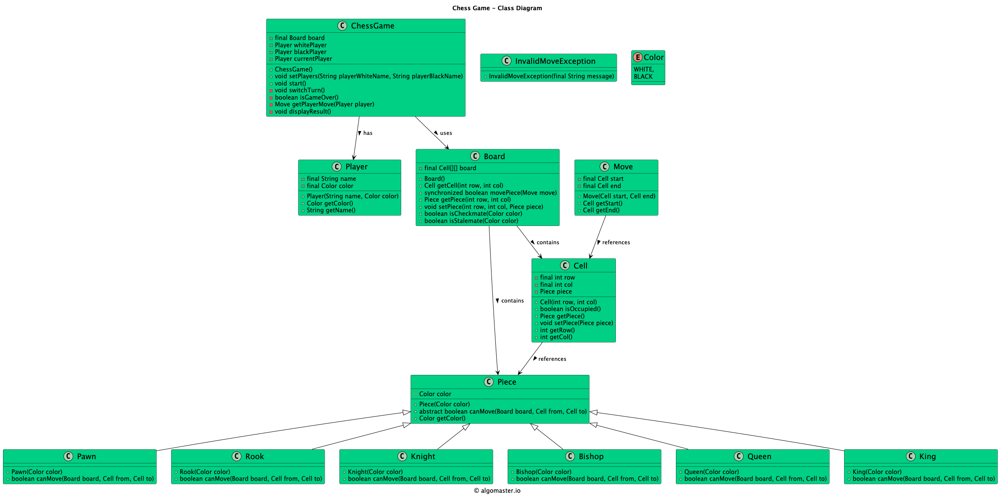

# Low-level design problem: chess game

> Copied from <https://github.com/ashishps1/awesome-low-level-design/blob/main/problems/chess-game.md> (GPL-3.0, by Ashish Pratap Singh). Questions and answers are the source's own; nothing was answered or rewritten here.


# Designing a Chess Game

## Requirements
1. The chess game should follow the standard rules of chess.
2. The game should support two players, each controlling their own set of pieces.
3. The game board should be represented as an 8x8 grid, with alternating black and white squares.
4. Each player should have 16 pieces: 1 king, 1 queen, 2 rooks, 2 bishops, 2 knights, and 8 pawns.
5. The game should validate legal moves for each piece and prevent illegal moves.
6. The game should detect checkmate and stalemate conditions.
7. The game should handle player turns and allow players to make moves alternately.
8. The game should provide a user interface for players to interact with the game.

## UML Class Diagram



## Implementations
#### [Java Implementation](https://github.com/ashishps1/awesome-low-level-design/blob/main/solutions/java/src/chessgame) 
#### [Python Implementation](https://github.com/ashishps1/awesome-low-level-design/blob/main/solutions/python/chessgame)
#### [C++ Implementation](https://github.com/ashishps1/awesome-low-level-design/blob/main/solutions/cpp/chessgame)
#### [C# Implementation](https://github.com/ashishps1/awesome-low-level-design/blob/main/solutions/csharp/chessgame)
#### [Go Implementation](https://github.com/ashishps1/awesome-low-level-design/blob/main/solutions/golang/chessgame)

## Classes, Interfaces and Enumerations
1. The **Piece** class is an abstract base class representing a chess piece. It contains common attributes such as color, row, and column, and declares an abstract method canMove to be implemented by each specific piece class.
2. The **King**, **Queen**, **Rook**, **Bishop**, **Knight**, and **Pawn** classes extend the Piece class and implement their respective movement logic in the canMove method.
3. The **Board** class represents the chess board and manages the placement of pieces. It provides methods to get and set pieces on the board, check the validity of moves, and determine checkmate and stalemate conditions.
4. The **Player** class represents a player in the game and has a method to make a move on the board.
5. The Move class represents a move made by a player, containing the piece being moved and the destination coordinates.
6. The **Game** class orchestrates the overall game flow. It initializes the board, handles player turns, and determines the game result.
7. The **ChessGame** class is the entry point of the application and starts the game.

---

## Official solutions from the repository

<details><summary><b>java</b> (16 files)</summary>


**Board.java**

```java
package chessgame;

import chessgame.pieces.*;

public class Board {
    private final Cell[][] board;

    public Board() {
        board = new Cell[8][8];

        for (int row = 0; row < 8; row++)
            for (int col = 0; col < 8; col++)
                board[row][col] = new Cell(row, col);

        setupPieces();
    }

    private void setupPieces() {
        // Add pawns and main pieces for both sides
        for (int j = 0; j < 8; j++) {
            board[1][j].setPiece(new Pawn(Color.WHITE));
            board[6][j].setPiece(new Pawn(Color.BLACK));
        }

        // Initialize white pieces
        board[0][0].setPiece(new Rook(Color.WHITE));
        board[0][1].setPiece(new Knight(Color.WHITE));
        board[0][2].setPiece(new Bishop(Color.WHITE));
        board[0][3].setPiece(new Queen(Color.WHITE));
        board[0][4].setPiece(new King(Color.WHITE));
        board[0][5].setPiece(new Bishop(Color.WHITE));
        board[0][6].setPiece(new Knight(Color.WHITE));
        board[0][7].setPiece(new Rook(Color.WHITE));

        // Initialize black pieces
        board[7][0].setPiece(new Rook(Color.BLACK));
        board[7][1].setPiece(new Knight(Color.BLACK));
        board[7][2].setPiece(new Bishop(Color.BLACK));
        board[7][3].setPiece(new Queen(Color.BLACK));
        board[7][4].setPiece(new King(Color.BLACK));
        board[7][5].setPiece(new Bishop(Color.BLACK));
        board[7][6].setPiece(new Knight(Color.BLACK));
        board[7][7].setPiece(new Rook(Color.BLACK));
    }

    public Cell getCell(int row, int col) {
        return board[row][col];
    }

    public synchronized boolean movePiece(Move move) {
        Cell from = move.getStart(), to = move.getEnd();
        Piece piece = from.getPiece();
        if (piece == null || !piece.canMove(this, from, to)) return false;

        to.setPiece(piece);
        from.setPiece(null);
        return true;
    }

    public Piece getPiece(int row, int col) {
        return board[row][col].getPiece();
    }

    public void setPiece(int row, int col, Piece piece) {
        board[row][col].setPiece(piece);
    }

    public boolean isCheckmate(Color color) {
        // TODO: Implement checkmate logic
        return false;
    }

    public boolean isStalemate(Color color) {
        // TODO: Implement stalemate logic
        return false;
    }
}
```


**Cell.java**

```java
package chessgame;

import chessgame.pieces.Piece;

public class Cell {
    private final int row, col;
    private Piece piece;

    public Cell(int row, int col) {
        this.row = row;
        this.col = col;
    }

    public boolean isOccupied() {
        return piece != null;
    }

    public Piece getPiece() { return piece; }
    public void setPiece(Piece piece) { this.piece = piece; }

    public int getRow() { return row; }
    public int getCol() { return col; }
}
```


**ChessGame.java**

```java
package chessgame;

import chessgame.pieces.Piece;

import java.util.Scanner;

public class ChessGame {
    private final Board board;
    private Player whitePlayer, blackPlayer;
    private Player currentPlayer;

    public ChessGame() {
        board = new Board();
    }

    public void setPlayers(String playerWhiteName, String playerBlackName) {
        this.whitePlayer = new Player(playerWhiteName, Color.WHITE);
        this.blackPlayer = new Player(playerBlackName, Color.BLACK);
        this.currentPlayer = whitePlayer;
    }

    public void start() {
        // Game loop
        while (!isGameOver()) {
            Player player = currentPlayer;
            System.out.println(player.getName() + "'s turn.");
            // Get move from the player
            Move move = getPlayerMove(player);
            // Make the move on the board
            try {
                board.movePiece(move);
            } catch (InvalidMoveException e) {
                System.out.println(e.getMessage());
                System.out.println("Try again!");
                continue;
            }
            // Switch to the next player
            switchTurn();
        }
        // Display game result
        displayResult();
    }

    private void switchTurn() {
        currentPlayer = currentPlayer == whitePlayer ? blackPlayer : whitePlayer;
    }

    private boolean isGameOver() {
        return board.isCheckmate(whitePlayer.getColor()) || board.isCheckmate(blackPlayer.getColor()) ||
                board.isStalemate(whitePlayer.getColor()) || board.isStalemate(blackPlayer.getColor());
    }

    private Move getPlayerMove(Player player) {
        // For simplicity, let's assume the player enters the move via console input
        Scanner scanner = new Scanner(System.in);
        System.out.print("Enter source row: ");
        int sourceRow = scanner.nextInt();
        System.out.print("Enter source column: ");
        int sourceCol = scanner.nextInt();
        System.out.print("Enter destination row: ");
        int destRow = scanner.nextInt();
        System.out.print("Enter destination column: ");
        int destCol = scanner.nextInt();

        Piece piece = board.getPiece(sourceRow, sourceCol);
        if (piece == null || piece.getColor() != player.getColor()) {
            throw new IllegalArgumentException("Invalid piece selection!");
        }

        return new Move(board.getCell(sourceRow, sourceCol), board.getCell(destRow, destCol));
    }

    private void displayResult() {
        if (board.isCheckmate(Color.WHITE)) {
            System.out.println("Black wins by checkmate!");
        } else if (board.isCheckmate(Color.BLACK)) {
            System.out.println("White wins by checkmate!");
        } else if (board.isStalemate(Color.WHITE) || board.isStalemate(Color.BLACK)) {
            System.out.println("The game ends in a stalemate!");
        }
    }
}
```


**ChessGameDemo.java**

```java
package chessgame;

public class ChessGameDemo {
    public static void run() {
        ChessGame chessGame = new ChessGame();
        chessGame.setPlayers("Alice", "Bob");
        chessGame.start();
    }
}
```


**Color.java**

```java
package chessgame;

public enum Color {
    WHITE, BLACK
}
```


**InvalidMoveException.java**

```java
package chessgame;

public class InvalidMoveException extends RuntimeException {
    public InvalidMoveException(final String message) {
        super(message);
    }
}
```


**Move.java**

```java
package chessgame;

public class Move {
    private final Cell start;
    private final Cell end;

    public Move(Cell start, Cell end) {
        this.start = start;
        this.end = end;
    }

    public Cell getStart() { return start; }

    public Cell getEnd() { return end; }
}
```


**Player.java**

```java
package chessgame;

public class Player {
    private final String name;
    private final Color color;

    public Player(String name, Color color) {
        this.name = name;
        this.color = color;
    }

    public Color getColor() {
        return color;
    }

    public String getName() {
        return name;
    }
}
```


**README.md**

```md
# Chess Game (LLD)

## Problem Statement

Design and implement a Chess Game that allows two players to play chess on a standard 8x8 board, enforces chess rules, validates moves, and determines game status (check, checkmate, stalemate).

---

## Requirements

- **Two Players:** The game is played between two players (White and Black).
- **Board:** The game uses a standard 8x8 chess board.
- **Pieces:** All standard chess pieces (King, Queen, Rook, Bishop, Knight, Pawn) with their movement rules.
- **Move Validation:** The game validates moves according to chess rules and prevents illegal moves.
- **Turn Management:** Players alternate turns.
- **Game Status:** The game detects check, checkmate, and stalemate.
- **Exception Handling:** The system throws exceptions for invalid moves.
- **Extensibility:** Easy to add features such as move history, undo, or AI opponent.

---

## Core Entities

- **ChessGame:** Main class that manages the game flow, player turns, and game status.
- **Board:** Represents the 8x8 chess board and manages piece positions.
- **Cell:** Represents a cell on the board, with row, column, and piece.
- **Player:** Represents a player with a name and color.
- **Color (enum):** WHITE, BLACK.
- **Move:** Represents a move from one cell to another.
- **Piece (abstract, in pieces/):** Base class for all chess pieces.
- **King, Queen, Rook, Bishop, Knight, Pawn (in pieces/):** Concrete piece classes with movement logic.
- **InvalidMoveException:** Exception thrown for invalid moves.

---

## Class Design

## UML Class Diagram


### 1. ChessGame
- **Fields:** Board board, Player[] players, int currentPlayerIndex, boolean isGameOver
- **Methods:** start(), makeMove(Move), switchPlayer(), isCheck(), isCheckmate(), isStalemate(), getCurrentPlayer()

### 2. Board
- **Fields:** Cell[][] grid, List<Piece> pieces
- **Methods:** getCell(int row, int col), movePiece(Move), isCellOccupied(int row, int col), isCheck(Color), isCheckmate(Color), isStalemate(Color), printBoard()

### 3. Cell
- **Fields:** int row, int col, Piece piece
- **Methods:** getPiece(), setPiece(Piece), isEmpty()

### 4. Player
- **Fields:** String name, Color color

### 5. Color (enum)
- Values: WHITE, BLACK

### 6. Move
- **Fields:** Cell from, Cell to

### 7. Piece (abstract, in pieces/)
- **Fields:** Color color, Cell position
- **Methods:** isValidMove(Board, Move), getPossibleMoves(Board)

### 8. InvalidMoveException
- **Thrown:** When a move is not valid according to chess rules

---

## Example Usage

```java
Player white = new Player("Alice", Color.WHITE);
Player black = new Player("Bob", Color.BLACK);
ChessGame game = new ChessGame(white, black);
game.start();

Move move = new Move(game.getBoard().getCell(6, 4), game.getBoard().getCell(4, 4)); // e2 to e4
game.makeMove(move);
```

---

## Demo

See `ChessGameDemo.java` for a sample usage and simulation of the chess game.

---

## Extending the Framework

- **Add move history:** Track all moves for undo/redo or replay.
- **Add AI opponent:** Implement a computer player.
- **Add GUI:** Build a graphical interface for the game.

---
```


**pieces/Bishop.java**

```java
package chessgame.pieces;

import chessgame.Board;
import chessgame.Cell;
import chessgame.Color;

public class Bishop extends Piece {
    public Bishop(Color color) {
        super(color);
    }

    @Override
    public boolean canMove(Board board, Cell from, Cell to) {
        int rowDiff = Math.abs(to.getRow() - from.getRow());
        int colDiff = Math.abs(to.getCol() - from.getCol());
        return (rowDiff == colDiff);
    }
}
```


**pieces/King.java**

```java
package chessgame.pieces;

import chessgame.Board;
import chessgame.Cell;
import chessgame.Color;

public class King extends Piece {
    public King(Color color) {
        super(color);
    }

    @Override
    public boolean canMove(Board board, Cell from, Cell to) {
        int rowDiff = Math.abs(to.getRow() - from.getRow());
        int colDiff = Math.abs(to.getCol()- from.getCol());
        return (rowDiff <= 1 && colDiff <= 1);
    }
}
```


**pieces/Knight.java**

```java
package chessgame.pieces;

import chessgame.Board;
import chessgame.Cell;
import chessgame.Color;

public class Knight extends Piece {
    public Knight(Color color) {
        super(color);
    }

    @Override
    public boolean canMove(Board board, Cell from, Cell to) {
        int rowDiff = Math.abs(to.getRow() - from.getRow());
        int colDiff = Math.abs(to.getCol() - from.getCol());
        return (rowDiff == 2 && colDiff == 1) || (rowDiff == 1 && colDiff == 2);
    }
}
```


**pieces/Pawn.java**

```java
package chessgame.pieces;

import chessgame.Board;
import chessgame.Cell;
import chessgame.Color;

public class Pawn extends Piece {
    public Pawn(Color color) {
        super(color);
    }

    @Override
    public boolean canMove(Board board, Cell from, Cell to) {
        int rowDiff = to.getRow() - from.getRow();
        int colDiff = Math.abs(to.getCol() - from.getCol());

        if (color == Color.WHITE) {
            return (rowDiff == 1 && colDiff == 0) ||
                    (from.getRow() == 1 && rowDiff == 2 && colDiff == 0) ||
                    (rowDiff == 1 && colDiff == 1 && board.getPiece(to.getRow(), to.getCol()) != null);
        } else {
            return (rowDiff == -1 && colDiff == 0) ||
                    (from.getRow() == 6 && rowDiff == -2 && colDiff == 0) ||
                    (rowDiff == -1 && colDiff == 1 && board.getPiece(to.getRow(), to.getCol()) != null);
        }
    }
}
```


**pieces/Piece.java**

```java
package chessgame.pieces;

import chessgame.Board;
import chessgame.Cell;
import chessgame.Color;

public abstract class Piece {
    protected final Color color;

    public Piece(Color color) {
        this.color = color;
    }

    public abstract boolean canMove(Board board, Cell from, Cell to);

    public Color getColor() {
        return color;
    }
}
```


**pieces/Queen.java**

```java
package chessgame.pieces;

import chessgame.Board;
import chessgame.Cell;
import chessgame.Color;

public class Queen extends Piece {
    public Queen(Color color) {
        super(color);
    }

    @Override
    public boolean canMove(Board board, Cell from, Cell to) {
        int rowDiff = Math.abs(to.getRow() - from.getRow());
        int colDiff = Math.abs(to.getCol() - from.getCol());
        return (rowDiff == colDiff) || (from.getRow() == to.getRow() || from.getCol() == to.getCol());
    }
}
```


**pieces/Rook.java**

```java
package chessgame.pieces;

import chessgame.Board;
import chessgame.Cell;
import chessgame.Color;

public class Rook extends Piece {
    public Rook(Color color) {
        super(color);
    }

    @Override
    public boolean canMove(Board board, Cell from, Cell to) {
        return (from.getRow() == to.getRow() || from.getCol() == to.getCol());
    }
}
```

</details>

<details><summary><b>python</b> (14 files)</summary>


**README.md**

```md
# Designing a Chess Game

## Requirements
1. The chess game should follow the standard rules of chess.
2. The game should support two players, each controlling their own set of pieces.
3. The game board should be represented as an 8x8 grid, with alternating black and white squares.
4. Each player should have 16 pieces: 1 king, 1 queen, 2 rooks, 2 bishops, 2 knights, and 8 pawns.
5. The game should validate legal moves for each piece and prevent illegal moves.
6. The game should detect checkmate and stalemate conditions.
7. The game should handle player turns and allow players to make moves alternately.
8. The game should provide a user interface for players to interact with the game.

## Classes, Interfaces and Enumerations
1. The **Piece** class is an abstract base class representing a chess piece. It contains common attributes such as color, row, and column, and declares an abstract method canMove to be implemented by each specific piece class.
2. The **King**, **Queen**, **Rook**, **Bishop**, **Knight**, and **Pawn** classes extend the Piece class and implement their respective movement logic in the canMove method.
3. The **Board** class represents the chess board and manages the placement of pieces. It provides methods to get and set pieces on the board, check the validity of moves, and determine checkmate and stalemate conditions.
4. The **Player** class represents a player in the game and has a method to make a move on the board.
5. The Move class represents a move made by a player, containing the piece being moved and the destination coordinates.
6. The **Game** class orchestrates the overall game flow. It initializes the board, handles player turns, and determines the game result.
7. The **ChessGame** class is the entry point of the application and starts the game.
```


**bishop.py**

```py
from piece import Piece

class Bishop(Piece):
    def can_move(self, board, dest_row, dest_col):
        row_diff = abs(dest_row - self.row)
        col_diff = abs(dest_col - self.col)
        return row_diff == col_diff
```


**board.py**

```py
from rook import Rook
from knight import Knight
from bishop import Bishop
from queen import Queen
from king import King
from pawn import Pawn
from color import Color

class Board:
    def __init__(self):
        self.board = [[None] * 8 for _ in range(8)]
        self._initialize_board()

    def _initialize_board(self):
        # Initialize white pieces
        self.board[0][0] = Rook(Color.WHITE, 0, 0)
        self.board[0][1] = Knight(Color.WHITE, 0, 1)
        self.board[0][2] = Bishop(Color.WHITE, 0, 2)
        self.board[0][3] = Queen(Color.WHITE, 0, 3)
        self.board[0][4] = King(Color.WHITE, 0, 4)
        self.board[0][5] = Bishop(Color.WHITE, 0, 5)
        self.board[0][6] = Knight(Color.WHITE, 0, 6)
        self.board[0][7] = Rook(Color.WHITE, 0, 7)
        for i in range(8):
            self.board[1][i] = Pawn(Color.WHITE, 1, i)

        # Initialize black pieces
        self.board[7][0] = Rook(Color.BLACK, 7, 0)
        self.board[7][1] = Knight(Color.BLACK, 7, 1)
        self.board[7][2] = Bishop(Color.BLACK, 7, 2)
        self.board[7][3] = Queen(Color.BLACK, 7, 3)
        self.board[7][4] = King(Color.BLACK, 7, 4)
        self.board[7][5] = Bishop(Color.BLACK, 7, 5)
        self.board[7][6] = Knight(Color.BLACK, 7, 6)
        self.board[7][7] = Rook(Color.BLACK, 7, 7)
        for i in range(8):
            self.board[6][i] = Pawn(Color.BLACK, 6, i)

    def get_piece(self, row, col):
        return self.board[row][col]

    def set_piece(self, row, col, piece):
        self.board[row][col] = piece

    def is_valid_move(self, piece, dest_row, dest_col):
        if piece is None or dest_row < 0 or dest_row > 7 or dest_col < 0 or dest_col > 7:
            return False
        dest_piece = self.board[dest_row][dest_col]
        return (dest_piece is None or dest_piece.color != piece.color) and \
               piece.can_move(self, dest_row, dest_col)

    def is_checkmate(self, color):
        # TODO: Implement checkmate logic
        return False

    def is_stalemate(self, color):
        # TODO: Implement stalemate logic
        return False
```


**chess_game_demo.py**

```py
from game import Game

class ChessGameDemo:
    @staticmethod
    def run():
        game = Game()
        game.start()

if __name__ == "__main__":
    ChessGameDemo.run()
```


**color.py**

```py
from enum import Enum

class Color(Enum):
    WHITE = 1
    BLACK = 2
```


**game.py**

```py
from board import Board
from player import Player
from color import Color
from move import Move

class Game:
    def __init__(self):
        self.board = Board()
        self.players = [Player(Color.WHITE), Player(Color.BLACK)]
        self.current_player = 0

    def start(self):
        # Game loop
        while not self._is_game_over():
            player = self.players[self.current_player]
            print(f"{player.color.name}'s turn.")

            # Get move from the player
            move = self._get_player_move(player)

            # Make the move on the board
            player.make_move(self.board, move)

            # Switch to the next player
            self.current_player = (self.current_player + 1) % 2

        # Display game result
        self._display_result()

    def _is_game_over(self):
        return self.board.is_checkmate(Color.WHITE) or self.board.is_checkmate(Color.BLACK) or \
               self.board.is_stalemate(Color.WHITE) or self.board.is_stalemate(Color.BLACK)

    def _get_player_move(self, player):
        # TODO: Implement logic to get a valid move from the player
        # For simplicity, let's assume the player enters the move via console input
        source_row = int(input("Enter source row: "))
        source_col = int(input("Enter source column: "))
        dest_row = int(input("Enter destination row: "))
        dest_col = int(input("Enter destination column: "))

        piece = self.board.get_piece(source_row, source_col)
        if piece is None or piece.color != player.color:
            raise ValueError("Invalid piece selection!")

        return Move(piece, dest_row, dest_col)

    def _display_result(self):
        if self.board.is_checkmate(Color.WHITE):
            print("Black wins by checkmate!")
        elif self.board.is_checkmate(Color.BLACK):
            print("White wins by checkmate!")
        elif self.board.is_stalemate(Color.WHITE) or self.board.is_stalemate(Color.BLACK):
            print("The game ends in a stalemate!")
```


**king.py**

```py
from piece import Piece

class King(Piece):
    def can_move(self, board, dest_row, dest_col):
        row_diff = abs(dest_row - self.row)
        col_diff = abs(dest_col - self.col)
        return row_diff <= 1 and col_diff <= 1
```


**knight.py**

```py
from piece import Piece

class Knight(Piece):
    def can_move(self, board, dest_row, dest_col):
        row_diff = abs(dest_row - self.row)
        col_diff = abs(dest_col - self.col)
        return (row_diff == 2 and col_diff == 1) or (row_diff == 1 and col_diff == 2)
```


**move.py**

```py
class Move:
    def __init__(self, piece, dest_row, dest_col):
        self.piece = piece
        self.dest_row = dest_row
        self.dest_col = dest_col
```


**pawn.py**

```py
from piece import Piece
from color import Color

class Pawn(Piece):
    def can_move(self, board, dest_row, dest_col):
        row_diff = dest_row - self.row
        col_diff = abs(dest_col - self.col)

        if self.color == Color.WHITE:
            return (row_diff == 1 and col_diff == 0) or \
                   (self.row == 1 and row_diff == 2 and col_diff == 0) or \
                   (row_diff == 1 and col_diff == 1 and board.get_piece(dest_row, dest_col) is not None)
        else:
            return (row_diff == -1 and col_diff == 0) or \
                   (self.row == 6 and row_diff == -2 and col_diff == 0) or \
                   (row_diff == -1 and col_diff == 1 and board.get_piece(dest_row, dest_col) is not None)
```


**piece.py**

```py
from abc import ABC, abstractmethod
from color import Color

class Piece(ABC):
    def __init__(self, color, row, col):
        self.color = color
        self.row = row
        self.col = col

    @abstractmethod
    def can_move(self, board, dest_row, dest_col):
        pass
```


**player.py**

```py
class Player:
    def __init__(self, color):
        self.color = color

    def make_move(self, board, move):
        piece = move.piece
        dest_row = move.dest_row
        dest_col = move.dest_col

        if board.is_valid_move(piece, dest_row, dest_col):
            source_row = piece.row
            source_col = piece.col
            board.set_piece(source_row, source_col, None)
            board.set_piece(dest_row, dest_col, piece)
            piece.row = dest_row
            piece.col = dest_col
        else:
            raise ValueError("Invalid move!")
```


**queen.py**

```py
from piece import Piece

class Queen(Piece):
    def can_move(self, board, dest_row, dest_col):
        row_diff = abs(dest_row - self.row)
        col_diff = abs(dest_col - self.col)
        return (row_diff == col_diff) or (self.row == dest_row or self.col == dest_col)
```


**rook.py**

```py
from piece import Piece

class Rook(Piece):
    def can_move(self, board, dest_row, dest_col):
        return self.row == dest_row or self.col == dest_col
```

</details>

<details><summary><b>cpp</b> (20 files)</summary>


**Board.hpp**

```hpp
#ifndef BOARD_HPP
#define BOARD_HPP

#include "Piece.hpp"
#include <vector>

class Board {
private:
    Piece* squares[8][8];
    std::vector<Piece*> capturedPieces;

public:
    Board();
    ~Board();
    
    void initialize();
    bool movePiece(Position from, Position to);
    Piece* getPiece(Position position) const;
    void displayBoard() const;
    
private:
    void placePiece(Piece* piece);
    void setupInitialPosition();
};

#endif
```


**ChessDemo.cpp**

```cpp
#include "Game.hpp"
#include <iostream>

int main() {
    Game chess;
    std::cout << "Welcome to Chess!" << std::endl;
    chess.start();
    return 0;
}
```


**Game.cpp**

```cpp
#include "Game.hpp"
#include <iostream>

Game::Game() : currentTurn(Color::WHITE), gameOver(false) {
    board.initialize();
}

void Game::start() {
    while (!gameOver) {
        displayBoard();
        
        std::cout << (currentTurn == Color::WHITE ? "White" : "Black") << "'s turn" << std::endl;
        
        int fromX, fromY, toX, toY;
        std::cout << "Enter move (fromX fromY toX toY): ";
        std::cin >> fromX >> fromY >> toX >> toY;
        
        Position from(fromX, fromY);
        Position to(toX, toY);
        
        if (makeMove(from, to)) {
            switchTurn();
        } else {
            std::cout << "Invalid move! Try again." << std::endl;
        }
    }
}

bool Game::makeMove(Position from, Position to) {
    Piece* piece = board.getPiece(from);
    if (!piece || piece->getColor() != currentTurn) return false;
    
    return board.movePiece(from, to);
}

void Game::switchTurn() {
    currentTurn = (currentTurn == Color::WHITE) ? Color::BLACK : Color::WHITE;
}

Color Game::getCurrentTurn() const {
    return currentTurn;
}

bool Game::isGameOver() const {
    return gameOver;
}

void Game::displayBoard() const {
    board.displayBoard();
}
```


**Game.hpp**

```hpp
#ifndef GAME_HPP
#define GAME_HPP

#include "Board.hpp"

class Game {
private:
    Board board;
    Color currentTurn;
    bool gameOver;

public:
    Game();
    
    void start();
    bool makeMove(Position from, Position to);
    void switchTurn();
    Color getCurrentTurn() const;
    bool isGameOver() const;
    void displayBoard() const;
};

#endif
```


**Piece.cpp**

```cpp
#include "Piece.hpp"
#include <cctype>

Piece::Piece(PieceType type, Color color, Position position)
    : type(type), color(color), position(position), captured(false) {}

PieceType Piece::getType() const { return type; }
Color Piece::getColor() const { return color; }
Position Piece::getPosition() const { return position; }
bool Piece::isCaptured() const { return captured; }

void Piece::setPosition(Position newPosition) { position = newPosition; }
void Piece::setCaptured(bool status) { captured = status; }

std::string Piece::getSymbol() const {
    char symbol;
    switch (type) {
        case PieceType::KING: symbol = 'K'; break;
        case PieceType::QUEEN: symbol = 'Q'; break;
        case PieceType::BISHOP: symbol = 'B'; break;
        case PieceType::KNIGHT: symbol = 'N'; break;
        case PieceType::ROOK: symbol = 'R'; break;
        case PieceType::PAWN: symbol = 'P'; break;
        default: symbol = '?';
    }
    return std::string(1, color == Color::WHITE ? symbol : tolower(symbol));
}
```


**Piece.hpp**

```hpp
#ifndef PIECE_HPP
#define PIECE_HPP

#include <string>
#include "Position.hpp"

enum class PieceType {
    KING, QUEEN, BISHOP, KNIGHT, ROOK, PAWN
};

enum class Color {
    WHITE, BLACK
};

class Piece {
private:
    PieceType type;
    Color color;
    Position position;
    bool captured;

public:
    Piece(PieceType type, Color color, Position position)
        : type(type), color(color), position(position), captured(false) {}
    
    virtual ~Piece() = default;
    
    PieceType getType() const { return type; }
    Color getColor() const { return color; }
    Position getPosition() const { return position; }
    bool isCaptured() const { return captured; }
    
    void setPosition(Position newPosition) { position = newPosition; }
    void setCaptured(bool status) { captured = status; }
    
    virtual bool isValidMove(Position newPosition, Piece* board[8][8]) const = 0;
    
    std::string getSymbol() const {
        char symbol;
        switch (type) {
            case PieceType::KING: symbol = 'K'; break;
            case PieceType::QUEEN: symbol = 'Q'; break;
            case PieceType::BISHOP: symbol = 'B'; break;
            case PieceType::KNIGHT: symbol = 'N'; break;
            case PieceType::ROOK: symbol = 'R'; break;
            case PieceType::PAWN: symbol = 'P'; break;
            default: symbol = '?';
        }
        return std::string(1, color == Color::WHITE ? symbol : tolower(symbol));
    }
};

#endif
```


**Position.hpp**

```hpp
#ifndef POSITION_HPP
#define POSITION_HPP

class Position {
private:
    int x;
    int y;

public:
    Position(int x, int y);
    
    int getX() const;
    int getY() const;
    bool isValid() const;
    bool operator==(const Position& other) const;
};

#endif
```


**README.md**

```md
# Designing a Chess Game

## Requirements
1. The chess game should follow the standard rules of chess.
2. The game should support two players, each controlling their own set of pieces.
3. The game board should be represented as an 8x8 grid, with alternating black and white squares.
4. Each player should have 16 pieces: 1 king, 1 queen, 2 rooks, 2 bishops, 2 knights, and 8 pawns.
5. The game should validate legal moves for each piece and prevent illegal moves.
6. The game should detect checkmate and stalemate conditions.
7. The game should handle player turns and allow players to make moves alternately.
8. The game should provide a user interface for players to interact with the game.

## Classes, Interfaces and Enumerations
1. The **Piece** class is an abstract base class representing a chess piece. It contains common attributes such as color, row, and column, and declares an abstract method canMove to be implemented by each specific piece class.
2. The **King**, **Queen**, **Rook**, **Bishop**, **Knight**, and **Pawn** classes extend the Piece class and implement their respective movement logic in the canMove method.
3. The **Board** class represents the chess board and manages the placement of pieces. It provides methods to get and set pieces on the board, check the validity of moves, and determine checkmate and stalemate conditions.
4. The **Player** class represents a player in the game and has a method to make a move on the board.
5. The Move class represents a move made by a player, containing the piece being moved and the destination coordinates.
6. The **Game** class orchestrates the overall game flow. It initializes the board, handles player turns, and determines the game result.
7. The **ChessGame** class is the entry point of the application and starts the game.
```


**pieces/Bishop.cpp**

```cpp
#include "Bishop.hpp"
#include <cstdlib>

Bishop::Bishop(Color color, Position position)
    : Piece(PieceType::BISHOP, color, position) {}

bool Bishop::isValidMove(Position newPosition, Piece* board[8][8]) const {
    if (!newPosition.isValid()) return false;
    
    Position currentPos = getPosition();
    int dx = newPosition.getX() - currentPos.getX();
    int dy = newPosition.getY() - currentPos.getY();
    
    // Bishop can only move diagonally
    if (abs(dx) == abs(dy)) {
        // Check if path is clear
        int xStep = dx / abs(dx);
        int yStep = dy / abs(dy);
        
        int x = currentPos.getX() + xStep;
        int y = currentPos.getY() + yStep;
        
        while (x != newPosition.getX()) {
            if (board[x][y] != nullptr) return false;
            x += xStep;
            y += yStep;
        }
        
        Piece* targetPiece = board[newPosition.getX()][newPosition.getY()];
        return !targetPiece || targetPiece->getColor() != getColor();
    }
    
    return false;
}
```


**pieces/Bishop.hpp**

```hpp
#ifndef BISHOP_HPP
#define BISHOP_HPP

#include "../Piece.hpp"

class Bishop : public Piece {
public:
    Bishop(Color color, Position position);
    bool isValidMove(Position newPosition, Piece* board[8][8]) const override;
};

#endif
```


**pieces/King.cpp**

```cpp
#include "King.hpp"
#include <cstdlib>

King::King(Color color, Position position)
    : Piece(PieceType::KING, color, position) {}

bool King::isValidMove(Position newPosition, Piece* board[8][8]) const {
    if (!newPosition.isValid()) return false;
    
    Position currentPos = getPosition();
    int dx = abs(newPosition.getX() - currentPos.getX());
    int dy = abs(newPosition.getY() - currentPos.getY());
    
    // King can move one square in any direction
    if (dx <= 1 && dy <= 1) {
        Piece* targetPiece = board[newPosition.getX()][newPosition.getY()];
        return !targetPiece || targetPiece->getColor() != getColor();
    }
    
    return false;
}
```


**pieces/King.hpp**

```hpp
#ifndef KING_HPP
#define KING_HPP

#include "../Piece.hpp"

class King : public Piece {
public:
    King(Color color, Position position);
    bool isValidMove(Position newPosition, Piece* board[8][8]) const override;
};

#endif
```


**pieces/Knight.cpp**

```cpp
#include "Knight.hpp"
#include <cstdlib>

Knight::Knight(Color color, Position position)
    : Piece(PieceType::KNIGHT, color, position) {}

bool Knight::isValidMove(Position newPosition, Piece* board[8][8]) const {
    if (!newPosition.isValid()) return false;
    
    Position currentPos = getPosition();
    int dx = abs(newPosition.getX() - currentPos.getX());
    int dy = abs(newPosition.getY() - currentPos.getY());
    
    // Knight moves in L-shape: 2 squares in one direction and 1 square perpendicular
    if ((dx == 2 && dy == 1) || (dx == 1 && dy == 2)) {
        Piece* targetPiece = board[newPosition.getX()][newPosition.getY()];
        return !targetPiece || targetPiece->getColor() != getColor();
    }
    
    return false;
}
```


**pieces/Knight.hpp**

```hpp
#ifndef KNIGHT_HPP
#define KNIGHT_HPP

#include "../Piece.hpp"

class Knight : public Piece {
public:
    Knight(Color color, Position position);
    bool isValidMove(Position newPosition, Piece* board[8][8]) const override;
};

#endif
```


**pieces/Pawn.cpp**

```cpp
#include "Pawn.hpp"

Pawn::Pawn(Color color, Position position)
    : Piece(PieceType::PAWN, color, position) {}

bool Pawn::isValidMove(Position newPosition, Piece* board[8][8]) const {
    if (!newPosition.isValid()) return false;
    
    Position currentPos = getPosition();
    int direction = (getColor() == Color::WHITE) ? 1 : -1;
    int dx = newPosition.getX() - currentPos.getX();
    int dy = newPosition.getY() - currentPos.getY();
    
    // Normal move forward
    if (dy == 0 && dx == direction) {
        return board[newPosition.getX()][newPosition.getY()] == nullptr;
    }
    
    // Initial two-square move
    if (dy == 0 && dx == 2 * direction && 
        ((getColor() == Color::WHITE && currentPos.getX() == 1) ||
         (getColor() == Color::BLACK && currentPos.getX() == 6))) {
        return board[currentPos.getX() + direction][currentPos.getY()] == nullptr &&
               board[newPosition.getX()][newPosition.getY()] == nullptr;
    }
    
    // Capture diagonally
    if (abs(dy) == 1 && dx == direction) {
        Piece* targetPiece = board[newPosition.getX()][newPosition.getY()];
        return targetPiece && targetPiece->getColor() != getColor();
    }
    
    return false;
}
```


**pieces/Pawn.hpp**

```hpp
#ifndef PAWN_HPP
#define PAWN_HPP

#include "../Piece.hpp"

class Pawn : public Piece {
public:
    Pawn(Color color, Position position);
    bool isValidMove(Position newPosition, Piece* board[8][8]) const override;
};

#endif
```


**pieces/Queen.cpp**

```cpp
#include "Queen.hpp"
#include <cstdlib>

Queen::Queen(Color color, Position position)
    : Piece(PieceType::QUEEN, color, position) {}

bool Queen::isValidMove(Position newPosition, Piece* board[8][8]) const {
    if (!newPosition.isValid()) return false;
    
    Position currentPos = getPosition();
    int dx = newPosition.getX() - currentPos.getX();
    int dy = newPosition.getY() - currentPos.getY();
    
    // Queen can move diagonally, horizontally, or vertically
    if (abs(dx) == abs(dy) || dx == 0 || dy == 0) {
        // Check if path is clear
        int xStep = (dx == 0) ? 0 : dx / abs(dx);
        int yStep = (dy == 0) ? 0 : dy / abs(dy);
        
        int x = currentPos.getX() + xStep;
        int y = currentPos.getY() + yStep;
        
        while (x != newPosition.getX() || y != newPosition.getY()) {
            if (board[x][y] != nullptr) return false;
            x += xStep;
            y += yStep;
        }
        
        Piece* targetPiece = board[newPosition.getX()][newPosition.getY()];
        return !targetPiece || targetPiece->getColor() != getColor();
    }
    
    return false;
}
```


**pieces/Queen.hpp**

```hpp
#ifndef QUEEN_HPP
#define QUEEN_HPP

#include "../Piece.hpp"

class Queen : public Piece {
public:
    Queen(Color color, Position position);
    bool isValidMove(Position newPosition, Piece* board[8][8]) const override;
};

#endif
```


**pieces/Rook.cpp**

```cpp
#include "Rook.hpp"
#include <cstdlib>

Rook::Rook(Color color, Position position)
    : Piece(PieceType::ROOK, color, position) {}

bool Rook::isValidMove(Position newPosition, Piece* board[8][8]) const {
    if (!newPosition.isValid()) return false;
    
    Position currentPos = getPosition();
    int dx = newPosition.getX() - currentPos.getX();
    int dy = newPosition.getY() - currentPos.getY();
    
    // Rook can only move horizontally or vertically
    if (dx == 0 || dy == 0) {
        // Check if path is clear
        int xStep = (dx == 0) ? 0 : dx / abs(dx);
        int yStep = (dy == 0) ? 0 : dy / abs(dy);
        
        int x = currentPos.getX() + xStep;
        int y = currentPos.getY() + yStep;
        
        while (x != newPosition.getX() || y != newPosition.getY()) {
            if (board[x][y] != nullptr) return false;
            x += xStep;
            y += yStep;
        }
        
        Piece* targetPiece = board[newPosition.getX()][newPosition.getY()];
        return !targetPiece || targetPiece->getColor() != getColor();
    }
    
    return false;
}
```


**pieces/Rook.hpp**

```hpp
#ifndef ROOK_HPP
#define ROOK_HPP

#include "../Piece.hpp"

class Rook : public Piece {
public:
    Rook(Color color, Position position);
    bool isValidMove(Position newPosition, Piece* board[8][8]) const override;
};

#endif
```

</details>

<details><summary><b>golang</b> (10 files)</summary>


**README.md**

```md
# Designing a Chess Game

## Requirements
1. The chess game should follow the standard rules of chess.
2. The game should support two players, each controlling their own set of pieces.
3. The game board should be represented as an 8x8 grid, with alternating black and white squares.
4. Each player should have 16 pieces: 1 king, 1 queen, 2 rooks, 2 bishops, 2 knights, and 8 pawns.
5. The game should validate legal moves for each piece and prevent illegal moves.
6. The game should detect checkmate and stalemate conditions.
7. The game should handle player turns and allow players to make moves alternately.
8. The game should provide a user interface for players to interact with the game.

## Classes, Interfaces and Enumerations
1. The **Piece** class is an abstract base class representing a chess piece. It contains common attributes such as color, row, and column, and declares an abstract method canMove to be implemented by each specific piece class.
2. The **King**, **Queen**, **Rook**, **Bishop**, **Knight**, and **Pawn** classes extend the Piece class and implement their respective movement logic in the canMove method.
3. The **Board** class represents the chess board and manages the placement of pieces. It provides methods to get and set pieces on the board, check the validity of moves, and determine checkmate and stalemate conditions.
4. The **Player** class represents a player in the game and has a method to make a move on the board.
5. The Move class represents a move made by a player, containing the piece being moved and the destination coordinates.
6. The **Game** class orchestrates the overall game flow. It initializes the board, handles player turns, and determines the game result.
7. The **ChessGame** class is the entry point of the application and starts the game.
```


**board.go**

```go
package chessgame

type Board struct {
	pieces [][]Piece
}

func NewBoard() *Board {
	board := &Board{
		pieces: make([][]Piece, 8),
	}
	for i := range board.pieces {
		board.pieces[i] = make([]Piece, 8)
	}
	board.initializeBoard()
	return board
}

func (b *Board) initializeBoard() {
	// Initialize white pieces
	b.pieces[0][0] = NewRook(White, 0, 0)
	b.pieces[0][1] = NewKnight(White, 0, 1)
	b.pieces[0][2] = NewBishop(White, 0, 2)
	b.pieces[0][3] = NewQueen(White, 0, 3)
	b.pieces[0][4] = NewKing(White, 0, 4)
	b.pieces[0][5] = NewBishop(White, 0, 5)
	b.pieces[0][6] = NewKnight(White, 0, 6)
	b.pieces[0][7] = NewRook(White, 0, 7)
	for i := 0; i < 8; i++ {
		b.pieces[1][i] = NewPawn(White, 1, i)
	}

	// Initialize black pieces
	b.pieces[7][0] = NewRook(Black, 7, 0)
	b.pieces[7][1] = NewKnight(Black, 7, 1)
	b.pieces[7][2] = NewBishop(Black, 7, 2)
	b.pieces[7][3] = NewQueen(Black, 7, 3)
	b.pieces[7][4] = NewKing(Black, 7, 4)
	b.pieces[7][5] = NewBishop(Black, 7, 5)
	b.pieces[7][6] = NewKnight(Black, 7, 6)
	b.pieces[7][7] = NewRook(Black, 7, 7)
	for i := 0; i < 8; i++ {
		b.pieces[6][i] = NewPawn(Black, 6, i)
	}
}

func (b *Board) GetPiece(row, col int) Piece {
	if row < 0 || row > 7 || col < 0 || col > 7 {
		return nil
	}
	return b.pieces[row][col]
}

func (b *Board) SetPiece(row, col int, piece Piece) {
	if row >= 0 && row < 8 && col >= 0 && col < 8 {
		b.pieces[row][col] = piece
	}
}

func (b *Board) IsValidMove(piece Piece, destRow, destCol int) bool {
	if piece == nil || destRow < 0 || destRow > 7 || destCol < 0 || destCol > 7 {
		return false
	}
	destPiece := b.GetPiece(destRow, destCol)
	return (destPiece == nil || destPiece.GetColor() != piece.GetColor()) &&
		piece.CanMove(b, destRow, destCol)
}

func (b *Board) IsCheckmate(color Color) bool {
	// TODO: Implement checkmate logic
	return false
}

func (b *Board) IsStalemate(color Color) bool {
	// TODO: Implement stalemate logic
	return false
}
```


**chess_game.go**

```go
package chessgame

import (
	"bufio"
	"fmt"
	"os"
	"strconv"
)

type ChessGame struct {
	board         *Board
	players       []*Player
	currentPlayer int
}

func NewChessGame() *ChessGame {
	return &ChessGame{
		board:         NewBoard(),
		players:       []*Player{NewPlayer(White), NewPlayer(Black)},
		currentPlayer: 0,
	}
}

func (g *ChessGame) Start() {
	reader := bufio.NewReader(os.Stdin)

	for !g.isGameOver() {
		player := g.players[g.currentPlayer]
		fmt.Printf("%s's turn.\n", player.color)

		move, err := g.getPlayerMove(player, reader)
		if err != nil {
			fmt.Printf("Error: %v\nTry again!\n", err)
			continue
		}

		err = player.MakeMove(g.board, move)
		if err != nil {
			fmt.Printf("Error: %v\nTry again!\n", err)
			continue
		}

		g.currentPlayer = (g.currentPlayer + 1) % 2
	}

	g.displayResult()
}

func (g *ChessGame) isGameOver() bool {
	return g.board.IsCheckmate(White) || g.board.IsCheckmate(Black) ||
		g.board.IsStalemate(White) || g.board.IsStalemate(Black)
}

func (g *ChessGame) getPlayerMove(player *Player, reader *bufio.Reader) (*Move, error) {
	fmt.Print("Enter source row: ")
	sourceRow, _ := strconv.Atoi(readLine(reader))
	fmt.Print("Enter source column: ")
	sourceCol, _ := strconv.Atoi(readLine(reader))
	fmt.Print("Enter destination row: ")
	destRow, _ := strconv.Atoi(readLine(reader))
	fmt.Print("Enter destination column: ")
	destCol, _ := strconv.Atoi(readLine(reader))

	piece := g.board.GetPiece(sourceRow, sourceCol)
	if piece == nil || piece.GetColor() != player.color {
		return nil, fmt.Errorf("invalid piece selection")
	}

	return NewMove(piece, destRow, destCol), nil
}

func (g *ChessGame) displayResult() {
	if g.board.IsCheckmate(White) {
		fmt.Println("Black wins by checkmate!")
	} else if g.board.IsCheckmate(Black) {
		fmt.Println("White wins by checkmate!")
	} else if g.board.IsStalemate(White) || g.board.IsStalemate(Black) {
		fmt.Println("The game ends in a stalemate!")
	}
}

func readLine(reader *bufio.Reader) string {
	text, _ := reader.ReadString('\n')
	return text[:len(text)-1]
}
```


**chess_game_demo.go**

```go
package chessgame

func Run() {
	game := NewChessGame()
	game.Start()
}
```


**color.go**

```go
package chessgame

type Color int

const (
	White Color = iota
	Black
)

func (c Color) String() string {
	if c == White {
		return "White"
	}
	return "Black"
}
```


**errors.go**

```go
package chessgame

type InvalidMoveError struct {
	message string
}

func NewInvalidMoveError(message string) *InvalidMoveError {
	return &InvalidMoveError{message: message}
}

func (e *InvalidMoveError) Error() string {
	return e.message
}
```


**move.go**

```go
package chessgame

type Move struct {
	piece   Piece
	destRow int
	destCol int
}

func NewMove(piece Piece, destRow, destCol int) *Move {
	return &Move{
		piece:   piece,
		destRow: destRow,
		destCol: destCol,
	}
}
```


**piece.go**

```go
package chessgame

type Piece interface {
	CanMove(board *Board, destRow, destCol int) bool
	GetColor() Color
	GetRow() int
	GetCol() int
	SetPosition(row, col int)
}

type BasePiece struct {
	color Color
	row   int
	col   int
}

func (p *BasePiece) GetColor() Color { return p.color }
func (p *BasePiece) GetRow() int     { return p.row }
func (p *BasePiece) GetCol() int     { return p.col }
func (p *BasePiece) SetPosition(row, col int) {
	p.row = row
	p.col = col
}
```


**pieces.go**

```go
package chessgame

import "math"

type Pawn struct {
	BasePiece
}

func NewPawn(color Color, row, col int) *Pawn {
	return &Pawn{BasePiece{color, row, col}}
}

func (p *Pawn) CanMove(board *Board, destRow, destCol int) bool {
	rowDiff := destRow - p.row
	colDiff := math.Abs(float64(destCol - p.col))

	if p.color == White {
		return (rowDiff == 1 && colDiff == 0) ||
			(p.row == 1 && rowDiff == 2 && colDiff == 0) ||
			(rowDiff == 1 && colDiff == 1 && board.GetPiece(destRow, destCol) != nil)
	}
	return (rowDiff == -1 && colDiff == 0) ||
		(p.row == 6 && rowDiff == -2 && colDiff == 0) ||
		(rowDiff == -1 && colDiff == 1 && board.GetPiece(destRow, destCol) != nil)
}

type Rook struct {
	BasePiece
}

func NewRook(color Color, row, col int) *Rook {
	return &Rook{BasePiece{color, row, col}}
}

func (r *Rook) CanMove(board *Board, destRow, destCol int) bool {
	return r.row == destRow || r.col == destCol
}

type Knight struct {
	BasePiece
}

func NewKnight(color Color, row, col int) *Knight {
	return &Knight{BasePiece{color, row, col}}
}

func (k *Knight) CanMove(board *Board, destRow, destCol int) bool {
	rowDiff := math.Abs(float64(destRow - k.row))
	colDiff := math.Abs(float64(destCol - k.col))
	return (rowDiff == 2 && colDiff == 1) || (rowDiff == 1 && colDiff == 2)
}

type Bishop struct {
	BasePiece
}

func NewBishop(color Color, row, col int) *Bishop {
	return &Bishop{BasePiece{color, row, col}}
}

func (b *Bishop) CanMove(board *Board, destRow, destCol int) bool {
	rowDiff := math.Abs(float64(destRow - b.row))
	colDiff := math.Abs(float64(destCol - b.col))
	return rowDiff == colDiff
}

type Queen struct {
	BasePiece
}

func NewQueen(color Color, row, col int) *Queen {
	return &Queen{BasePiece{color, row, col}}
}

func (q *Queen) CanMove(board *Board, destRow, destCol int) bool {
	rowDiff := math.Abs(float64(destRow - q.row))
	colDiff := math.Abs(float64(destCol - q.col))
	return (rowDiff == colDiff) || (q.row == destRow || q.col == destCol)
}

type King struct {
	BasePiece
}

func NewKing(color Color, row, col int) *King {
	return &King{BasePiece{color, row, col}}
}

func (k *King) CanMove(board *Board, destRow, destCol int) bool {
	rowDiff := math.Abs(float64(destRow - k.row))
	colDiff := math.Abs(float64(destCol - k.col))
	return rowDiff <= 1 && colDiff <= 1
}
```


**player.go**

```go
package chessgame

type Player struct {
	color Color
}

func NewPlayer(color Color) *Player {
	return &Player{color: color}
}

func (p *Player) MakeMove(board *Board, move *Move) error {
	if !board.IsValidMove(move.piece, move.destRow, move.destCol) {
		return NewInvalidMoveError("Invalid move!")
	}

	sourceRow := move.piece.GetRow()
	sourceCol := move.piece.GetCol()
	board.SetPiece(sourceRow, sourceCol, nil)
	board.SetPiece(move.destRow, move.destCol, move.piece)
	move.piece.SetPosition(move.destRow, move.destCol)
	return nil
}
```

</details>

<details><summary><b>csharp</b> (15 files)</summary>


**Bishop.cs**

```cs
namespace ChessGame
{
    public class Bishop : Piece
    {
        public Bishop(Color color, int row, int col) : base(color, row, col) { }

        public override bool CanMove(Board board, int destRow, int destCol)
        {
            int rowDiff = System.Math.Abs(destRow - Row);
            int colDiff = System.Math.Abs(destCol - Col);
            return rowDiff == colDiff;
        }
    }
}
```


**Board.cs**

```cs
using System;

namespace ChessGame
{
    public class Board
    {
        private readonly Piece[,] board;

        public Board()
        {
            board = new Piece[8, 8];
            InitializeBoard();
        }

        private void InitializeBoard()
        {
            // Initialize white pieces
            board[0, 0] = new Rook(Color.White, 0, 0);
            board[0, 1] = new Knight(Color.White, 0, 1);
            board[0, 2] = new Bishop(Color.White, 0, 2);
            board[0, 3] = new Queen(Color.White, 0, 3);
            board[0, 4] = new King(Color.White, 0, 4);
            board[0, 5] = new Bishop(Color.White, 0, 5);
            board[0, 6] = new Knight(Color.White, 0, 6);
            board[0, 7] = new Rook(Color.White, 0, 7);
            for (int i = 0; i < 8; i++)
            {
                board[1, i] = new Pawn(Color.White, 1, i);
            }

            // Initialize black pieces
            board[7, 0] = new Rook(Color.Black, 7, 0);
            board[7, 1] = new Knight(Color.Black, 7, 1);
            board[7, 2] = new Bishop(Color.Black, 7, 2);
            board[7, 3] = new Queen(Color.Black, 7, 3);
            board[7, 4] = new King(Color.Black, 7, 4);
            board[7, 5] = new Bishop(Color.Black, 7, 5);
            board[7, 6] = new Knight(Color.Black, 7, 6);
            board[7, 7] = new Rook(Color.Black, 7, 7);
            for (int i = 0; i < 8; i++)
            {
                board[6, i] = new Pawn(Color.Black, 6, i);
            }
        }

        public Piece GetPiece(int row, int col)
        {
            return board[row, col];
        }

        public void SetPiece(int row, int col, Piece piece)
        {
            board[row, col] = piece;
        }

        public bool IsValidMove(Piece piece, int destRow, int destCol)
        {
            if (piece == null || destRow < 0 || destRow > 7 || destCol < 0 || destCol > 7)
            {
                return false;
            }
            Piece destPiece = board[destRow, destCol];
            return (destPiece == null || destPiece.Color != piece.Color) && piece.CanMove(this, destRow, destCol);
        }

        public bool IsCheckmate(Color color)
        {
            // TODO: Implement checkmate logic
            return false;
        }

        public bool IsStalemate(Color color)
        {
            // TODO: Implement stalemate logic
            return false;
        }
    }
}
```


**ChessGame.cs**

```cs
using System;

namespace ChessGame
{
    public class ChessGame
    {
        private readonly Board board;
        private readonly Player[] players;
        private int currentPlayer;

        public ChessGame()
        {
            board = new Board();
            players = new Player[] { new Player(Color.White), new Player(Color.Black) };
            currentPlayer = 0;
        }

        public void Start()
        {
            // Game loop
            while (!IsGameOver())
            {
                Player player = players[currentPlayer];
                Console.WriteLine($"{player.Color}'s turn.");

                // Get move from the player
                Move move = GetPlayerMove(player);

                // Make the move on the board
                try
                {
                    player.MakeMove(board, move);
                }
                catch (InvalidMoveException e)
                {
                    Console.WriteLine(e.Message);
                    Console.WriteLine("Try again!");
                    continue;
                }

                // Switch to the next player
                currentPlayer = (currentPlayer + 1) % 2;
            }

            // Display game result
            DisplayResult();
        }

        private bool IsGameOver()
        {
            return board.IsCheckmate(players[0].Color) || board.IsCheckmate(players[1].Color) ||
                   board.IsStalemate(players[0].Color) || board.IsStalemate(players[1].Color);
        }

        private Move GetPlayerMove(Player player)
        {
            // TODO: Implement logic to get a valid move from the player
            Console.Write("Enter source row: ");
            int sourceRow = int.Parse(Console.ReadLine());
            Console.Write("Enter source column: ");
            int sourceCol = int.Parse(Console.ReadLine());
            Console.Write("Enter destination row: ");
            int destRow = int.Parse(Console.ReadLine());
            Console.Write("Enter destination column: ");
            int destCol = int.Parse(Console.ReadLine());

            Piece piece = board.GetPiece(sourceRow, sourceCol);
            if (piece == null || piece.Color != player.Color)
            {
                throw new ArgumentException("Invalid piece selection!");
            }

            return new Move(piece, destRow, destCol);
        }

        private void DisplayResult()
        {
            if (board.IsCheckmate(Color.White))
            {
                Console.WriteLine("Black wins by checkmate!");
            }
            else if (board.IsCheckmate(Color.Black))
            {
                Console.WriteLine("White wins by checkmate!");
            }
            else if (board.IsStalemate(Color.White) || board.IsStalemate(Color.Black))
            {
                Console.WriteLine("The game ends in a stalemate!");
            }
        }
    }
}
```


**ChessGameDemo.cs**

```cs
namespace ChessGame
{
    public class ChessGameDemo
    {
        public static void Run()
        {
            ChessGame chessGame = new ChessGame();
            chessGame.Start();
        }
    }
}
```


**Color.cs**

```cs
namespace ChessGame
{
    public enum Color
    {
        White,
        Black
    }
}
```


**InvalidMoveException.cs**

```cs
using System;

namespace ChessGame
{
    public class InvalidMoveException : Exception
    {
        public InvalidMoveException(string message) : base(message) { }
    }
}
```


**King.cs**

```cs
namespace ChessGame
{
    public class King : Piece
    {
        public King(Color color, int row, int col) : base(color, row, col) { }

        public override bool CanMove(Board board, int destRow, int destCol)
        {
            int rowDiff = System.Math.Abs(destRow - Row);
            int colDiff = System.Math.Abs(destCol - Col);
            return rowDiff <= 1 && colDiff <= 1;
        }
    }    
}
```


**Knight.cs**

```cs
namespace ChessGame
{
    public class Knight : Piece
    {
        public Knight(Color color, int row, int col) : base(color, row, col) { }

        public override bool CanMove(Board board, int destRow, int destCol)
        {
            int rowDiff = System.Math.Abs(destRow - Row);
            int colDiff = System.Math.Abs(destCol - Col);
            return (rowDiff == 2 && colDiff == 1) || (rowDiff == 1 && colDiff == 2);
        }
    }
}
```


**Move.cs**

```cs
namespace ChessGame
{
    public class Move
    {
        public Piece Piece { get; }
        public int DestRow { get; }
        public int DestCol { get; }

        public Move(Piece piece, int destRow, int destCol)
        {
            Piece = piece;
            DestRow = destRow;
            DestCol = destCol;
        }
    }
}
```


**Pawn.cs**

```cs
namespace ChessGame
{
    public class Pawn : Piece
    {
        public Pawn(Color color, int row, int col) : base(color, row, col) { }

        public override bool CanMove(Board board, int destRow, int destCol)
        {
            int rowDiff = destRow - Row;
            int colDiff = System.Math.Abs(destCol - Col);

            if (Color == Color.White)
            {
                return (rowDiff == 1 && colDiff == 0) ||
                       (Row == 1 && rowDiff == 2 && colDiff == 0) ||
                       (rowDiff == 1 && colDiff == 1 && board.GetPiece(destRow, destCol) != null);
            }
            else
            {
                return (rowDiff == -1 && colDiff == 0) ||
                       (Row == 6 && rowDiff == -2 && colDiff == 0) ||
                       (rowDiff == -1 && colDiff == 1 && board.GetPiece(destRow, destCol) != null);
            }
        }
    }    
}
```


**Piece.cs**

```cs
namespace ChessGame
{
    public abstract class Piece
    {
        public Color Color { get; }
        public int Row { get; set; }
        public int Col { get; set; }

        public Piece(Color color, int row, int col)
        {
            Color = color;
            Row = row;
            Col = col;
        }

        public abstract bool CanMove(Board board, int destRow, int destCol);
    }
}
```


**Player.cs**

```cs
namespace ChessGame
{
    public class Player
    {
        public Color Color { get; }

        public Player(Color color)
        {
            Color = color;
        }

        public void MakeMove(Board board, Move move)
        {
            Piece piece = move.Piece;
            int destRow = move.DestRow;
            int destCol = move.DestCol;

            if (board.IsValidMove(piece, destRow, destCol))
            {
                int sourceRow = piece.Row;
                int sourceCol = piece.Col;
                board.SetPiece(sourceRow, sourceCol, null);
                board.SetPiece(destRow, destCol, piece);
                piece.Row = destRow;
                piece.Col = destCol;
            }
            else
            {
                throw new InvalidMoveException("Invalid move!");
            }
        }
    }
}
```


**Queen.cs**

```cs
namespace ChessGame
{
    public class Queen : Piece
    {
        public Queen(Color color, int row, int col) : base(color, row, col) { }

        public override bool CanMove(Board board, int destRow, int destCol)
        {
            int rowDiff = System.Math.Abs(destRow - Row);
            int colDiff = System.Math.Abs(destCol - Col);
            return rowDiff == colDiff || Row == destRow || Col == destCol;
        }
    }    
}
```


**README.md**

```md
# Designing a Chess Game

## Requirements
1. The chess game should follow the standard rules of chess.
2. The game should support two players, each controlling their own set of pieces.
3. The game board should be represented as an 8x8 grid, with alternating black and white squares.
4. Each player should have 16 pieces: 1 king, 1 queen, 2 rooks, 2 bishops, 2 knights, and 8 pawns.
5. The game should validate legal moves for each piece and prevent illegal moves.
6. The game should detect checkmate and stalemate conditions.
7. The game should handle player turns and allow players to make moves alternately.
8. The game should provide a user interface for players to interact with the game.

## Classes, Interfaces and Enumerations
1. The **Piece** class is an abstract base class representing a chess piece. It contains common attributes such as color, row, and column, and declares an abstract method canMove to be implemented by each specific piece class.
2. The **King**, **Queen**, **Rook**, **Bishop**, **Knight**, and **Pawn** classes extend the Piece class and implement their respective movement logic in the canMove method.
3. The **Board** class represents the chess board and manages the placement of pieces. It provides methods to get and set pieces on the board, check the validity of moves, and determine checkmate and stalemate conditions.
4. The **Player** class represents a player in the game and has a method to make a move on the board.
5. The Move class represents a move made by a player, containing the piece being moved and the destination coordinates.
6. The **Game** class orchestrates the overall game flow. It initializes the board, handles player turns, and determines the game result.
7. The **ChessGame** class is the entry point of the application and starts the game.
```


**Rook.cs**

```cs
namespace ChessGame
{
    public class Rook : Piece
    {
        public Rook(Color color, int row, int col) : base(color, row, col) { }

        public override bool CanMove(Board board, int destRow, int destCol)
        {
            return Row == destRow || Col == destCol;
        }
    }    
}
```

</details>
