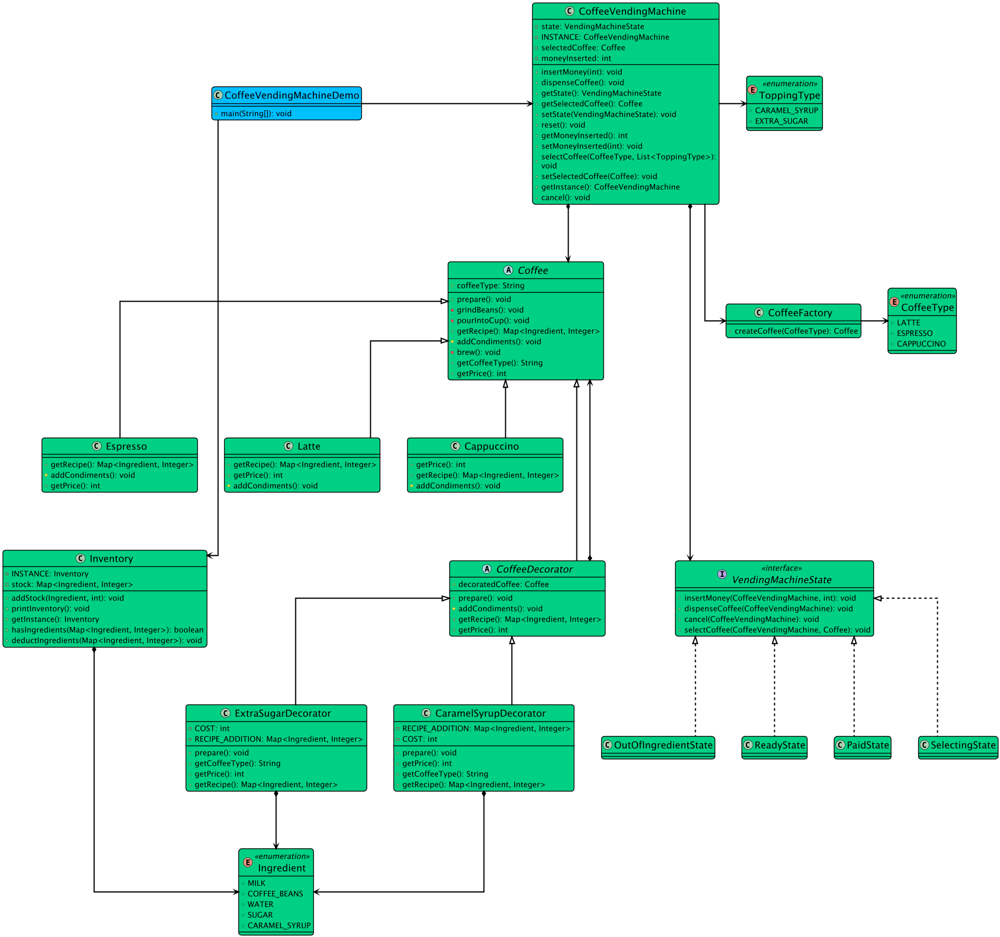

# Low-level design problem: coffee vending machine

> Copied from <https://github.com/ashishps1/awesome-low-level-design/blob/main/problems/coffee-vending-machine.md> (GPL-3.0, by Ashish Pratap Singh). Questions and answers are the source's own; nothing was answered or rewritten here.


# Designing a Coffee Vending Machine

## Requirements
1. The coffee vending machine should support different types of coffee, such as espresso, cappuccino, and latte.
2. Each type of coffee should have a specific price and recipe (ingredients and their quantities).
3. The machine should have a menu to display the available coffee options and their prices.
4. Users should be able to select a coffee type and make a payment.
5. The machine should dispense the selected coffee and provide change if necessary.
6. The machine should track the inventory of ingredients and notify when they are running low.
7. The machine should handle multiple user requests concurrently and ensure thread safety.

## UML Class Diagram



## Implementations
#### [Java Implementation](https://github.com/ashishps1/awesome-low-level-design/blob/main/solutions/java/src/coffeevendingmachine) 
#### [Python Implementation](https://github.com/ashishps1/awesome-low-level-design/blob/main/solutions/python/coffeevendingmachine)
#### [C++ Implementation](https://github.com/ashishps1/awesome-low-level-design/blob/main/solutions/cpp/coffeevendingmachine)
#### [C# Implementation](https://github.com/ashishps1/awesome-low-level-design/blob/main/solutions/csharp/coffeevendingmachine)
#### [Go Implementation](https://github.com/ashishps1/awesome-low-level-design/blob/main/solutions/golang/coffeevendingmachine)
#### [TypeScript Implementation](https://github.com/ashishps1/awesome-low-level-design/blob/main/solutions/typescript/src/CoffeeVendingMachine)

## Classes, Interfaces and Enumerations
1. The **Coffee** class represents a coffee type with its name, price, and recipe (ingredients and their quantities).
2. The **Ingredient** class represents an ingredient used in making coffee, with its name and quantity. It provides a synchronized method to update the quantity.
3. The **Payment** class represents a payment made by a user, with the amount paid.
4. The **CoffeeMachine** class is the main class that manages the coffee vending machine. It follows the Singleton pattern to ensure a single instance of the machine.
5. The **CoffeeMachine** class initializes the coffee menu and ingredients in its constructor. It provides methods to display the menu, select a coffee, dispense coffee, and update ingredient quantities.
6. The hasEnoughIngredients method checks if there are sufficient ingredients to make a selected coffee, while the updateIngredients method updates the ingredient quantities after dispensing a coffee.
7. The **CoffeeVendingMachine** class is the entry point of the application and demonstrates the usage of the coffee vending machine. It creates an instance of the machine, displays the menu, and simulates concurrent user requests using an ExecutorService.

---

## Official solutions from the repository

<details><summary><b>java</b> (20 files)</summary>


**CoffeeVendingMachine.java**

```java
package coffeevendingmachine;


import coffeevendingmachine.decorator.CaramelSyrupDecorator;
import coffeevendingmachine.decorator.ExtraSugarDecorator;
import coffeevendingmachine.enums.CoffeeType;
import coffeevendingmachine.enums.ToppingType;
import coffeevendingmachine.factory.CoffeeFactory;
import coffeevendingmachine.state.ReadyState;
import coffeevendingmachine.state.VendingMachineState;
import coffeevendingmachine.decorator.Coffee;

import java.util.List;

public class CoffeeVendingMachine {
    private static final CoffeeVendingMachine INSTANCE = new CoffeeVendingMachine();
    private VendingMachineState state;
    private Coffee selectedCoffee;
    private int moneyInserted;

    private CoffeeVendingMachine() {
        this.state = new ReadyState();
        this.moneyInserted = 0;
    }

    public static CoffeeVendingMachine getInstance() {
        return INSTANCE;
    }

    // --- Actions delegated to the current state ---
    public void selectCoffee(CoffeeType type, List<ToppingType> toppings) {
        // 1. Create the base coffee using the factory
        Coffee coffee = CoffeeFactory.createCoffee(type);

        // 2. Wrap it with decorators
        for (ToppingType topping : toppings) {
            switch (topping) {
                case EXTRA_SUGAR:
                    coffee = new ExtraSugarDecorator(coffee);
                    break;
                case CARAMEL_SYRUP:
                    coffee = new CaramelSyrupDecorator(coffee);
                    break;
            }
        }
        // Let the state handle the rest
        this.state.selectCoffee(this, coffee);
    }

    public void insertMoney(int amount) { state.insertMoney(this, amount); }
    public void dispenseCoffee() { state.dispenseCoffee(this); }
    public void cancel() { state.cancel(this); }

    // --- Getters and Setters used by State objects ---
    public void setState(VendingMachineState state) { this.state = state; }
    public VendingMachineState getState() { return state; }
    public void setSelectedCoffee(Coffee selectedCoffee) { this.selectedCoffee = selectedCoffee; }
    public Coffee getSelectedCoffee() { return selectedCoffee; }
    public void setMoneyInserted(int moneyInserted) { this.moneyInserted = moneyInserted; }
    public int getMoneyInserted() { return moneyInserted; }

    public void reset() {
        this.selectedCoffee = null;
        this.moneyInserted = 0;
    }

    public Map<String, Integer> showIngredientsMap() {
        return ingredientStore.getAllIngredients();
    }
}
```


**CoffeeVendingMachineDemo.java**

```java
package coffeevendingmachine;

import coffeevendingmachine.enums.CoffeeType;
import coffeevendingmachine.enums.Ingredient;
import coffeevendingmachine.enums.ToppingType;

import java.util.List;

public class CoffeeVendingMachineDemo {
    public static void main(String[] args) {
        CoffeeVendingMachine machine = CoffeeVendingMachine.getInstance();
        Inventory inventory = Inventory.getInstance();

        // --- Initial setup: Refill inventory ---
        System.out.println("=== Initializing Vending Machine ===");
        inventory.addStock(Ingredient.COFFEE_BEANS, 50);
        inventory.addStock(Ingredient.WATER, 500);
        inventory.addStock(Ingredient.MILK, 200);
        inventory.addStock(Ingredient.SUGAR, 100);
        inventory.addStock(Ingredient.CARAMEL_SYRUP, 50);
        inventory.printInventory();

        // --- Scenario 1: Successful Purchase of a Latte ---
        System.out.println("\n--- SCENARIO 1: Buy a Latte (Success) ---");
        machine.selectCoffee(CoffeeType.LATTE, List.of());
        machine.insertMoney(200);
        machine.insertMoney(50); // Total 250, price is 220
        machine.dispenseCoffee();
        inventory.printInventory();

        // --- Scenario 2: Purchase with Insufficient Funds & Cancellation ---
        System.out.println("\n--- SCENARIO 2: Buy Espresso (Insufficient Funds & Cancel) ---");
        machine.selectCoffee(CoffeeType.ESPRESSO, List.of());
        machine.insertMoney(100); // Price is 150
        machine.dispenseCoffee(); // Should fail
        machine.cancel(); // Should refund 100
        inventory.printInventory(); // Should be unchanged

        // --- Scenario 3: Attempt to Buy with Insufficient Ingredients ---
        System.out.println("\n--- SCENARIO 3: Buy Cappuccino (Out of Milk) ---");
        inventory.printInventory();
        machine.selectCoffee(CoffeeType.CAPPUCCINO, List.of(ToppingType.CARAMEL_SYRUP, ToppingType.EXTRA_SUGAR));
        machine.insertMoney(300);
        machine.dispenseCoffee(); // Should fail and refund
        inventory.printInventory();

        // --- Refill and final test ---
        System.out.println("\n--- REFILLING AND FINAL TEST ---");
        inventory.addStock(Ingredient.MILK, 200);
        inventory.printInventory();
        machine.selectCoffee(CoffeeType.LATTE, List.of(ToppingType.CARAMEL_SYRUP));
        machine.insertMoney(250);
        machine.dispenseCoffee();
        inventory.printInventory();
    }
}
```


**Inventory.java**

```java
package coffeevendingmachine;

import coffeevendingmachine.enums.Ingredient;

import java.util.Map;
import java.util.concurrent.ConcurrentHashMap;

public class Inventory {
    private static final Inventory INSTANCE = new Inventory();
    private final Map<Ingredient, Integer> stock = new ConcurrentHashMap<>();

    private Inventory() {
        // Private constructor to prevent instantiation
    }

    public static Inventory getInstance() {
        return INSTANCE;
    }

    public void addStock(Ingredient ingredient, int quantity) {
        stock.put(ingredient, stock.getOrDefault(ingredient, 0) + quantity);
    }

    public boolean hasIngredients(Map<Ingredient, Integer> recipe) {
        return recipe.entrySet().stream()
                .allMatch(entry -> stock.getOrDefault(entry.getKey(), 0) >= entry.getValue());
    }

    public synchronized void deductIngredients(Map<Ingredient, Integer> recipe) {
        if (!hasIngredients(recipe)) {
            System.err.println("Not enough ingredients to make coffee.");
            return;
        }
        recipe.forEach((ingredient, quantity) ->
                stock.put(ingredient, stock.get(ingredient) - quantity));
    }

    public void printInventory() {
        System.out.println("--- Current Inventory ---");
        stock.forEach((key, value) -> System.out.println(key + ": " + value));
        System.out.println("-------------------------");
    }
}
```


**README.md**

```md
# Coffee Vending Machine (LLD)

## Problem Statement

Design and implement a Coffee Vending Machine system that can serve different types of coffee, manage ingredient inventory, process payments, and handle user interactions such as selecting coffee and refilling ingredients.

---

## Requirements

- **Multiple Coffee Types:** The machine should support multiple coffee recipes (e.g., Espresso, Latte, Cappuccino).
- **Ingredient Management:** The machine should track and manage ingredient levels, and prevent dispensing if ingredients are insufficient.
- **Payment Processing:** The machine should process payments before dispensing coffee.
- **Refill Ingredients:** The machine should allow refilling of ingredients.
- **Extensibility:** Easy to add new coffee types or payment methods.

---

## Core Entities

- **CoffeeVendingMachine:** Main class that manages the overall operation, user interaction, and coordinates other components.
- **CoffeeRecipe:** Represents a coffee recipe, including required ingredients and their quantities.
- **IngredientStore:** Manages the inventory of ingredients, supports checking and refilling.
- **Dispenser:** Handles the dispensing of coffee after successful payment and ingredient check.
- **PaymentProcessor:** Handles payment logic and validation.
- **Payment:** Represents a payment transaction.

---

## Class Design

## UML Class Diagram


### 1. CoffeeVendingMachine
- **Fields:** ingredientStore, paymentProcessor, Map<String, CoffeeRecipe> recipes, Dispenser
- **Methods:** selectCoffee(String), makeCoffee(String, Payment), refillIngredient(String, int), addRecipe(CoffeeRecipe), etc.

### 2. CoffeeRecipe
- **Fields:** name, Map<String, Integer> ingredients
- **Methods:** getName(), getIngredients()

### 3. IngredientStore
- **Fields:** Map<String, Integer> ingredientLevels
- **Methods:** hasIngredients(Map<String, Integer>), useIngredients(Map<String, Integer>), refill(String, int), getLevel(String)

### 4. Dispenser
- **Methods:** dispense(String)

### 5. PaymentProcessor
- **Methods:** processPayment(Payment)

### 6. Payment
- **Fields:** amount, paymentType, etc.

---

## Design Patterns Used

- **Strategy Pattern:** (Conceptually) for supporting different payment methods or coffee recipes.
- **Separation of Concerns:** Each class has a single responsibility (inventory, payment, dispensing, etc.).

---

## Example Usage

```java
CoffeeVendingMachine machine = new CoffeeVendingMachine();
machine.addRecipe(new CoffeeRecipe("Espresso", Map.of("CoffeeBeans", 10, "Water", 30)));
machine.refillIngredient("CoffeeBeans", 100);
machine.refillIngredient("Water", 200);

Payment payment = new Payment(50, "CASH");
machine.makeCoffee("Espresso", payment);
```

---

## Demo

See `CoffeeVendingMachineDemo.java` for a sample usage and simulation of the coffee vending machine.

---

## Extending the Framework

- **Add new coffee types:** Create new `CoffeeRecipe` instances and add them to the machine.
- **Add new payment methods:** Extend `PaymentProcessor` to support new payment types.
- **Add new ingredients:** Update `IngredientStore` and recipes as needed.

---
```


**decorator/CaramelSyrupDecorator.java**

```java
package coffeevendingmachine.decorator;

import coffeevendingmachine.enums.Ingredient;

import java.util.HashMap;
import java.util.Map;

public class CaramelSyrupDecorator extends CoffeeDecorator {
    private static final int COST = 30;
    private static final Map<Ingredient, Integer> RECIPE_ADDITION = Map.of(Ingredient.CARAMEL_SYRUP, 10);

    public CaramelSyrupDecorator(Coffee coffee) {
        super(coffee);
    }

    @Override
    public String getCoffeeType() {
        return decoratedCoffee.getCoffeeType() + ", Caramel Syrup";
    }

    @Override
    public int getPrice() {
        return decoratedCoffee.getPrice() + COST;
    }

    @Override
    public Map<Ingredient, Integer> getRecipe() {
        Map<Ingredient, Integer> newRecipe = new HashMap<>(decoratedCoffee.getRecipe());
        RECIPE_ADDITION.forEach((ingredient, qty) ->
                newRecipe.merge(ingredient, qty, Integer::sum));
        return newRecipe;
    }

    @Override
    public void prepare() {
        // First, prepare the underlying coffee (e.g., the Latte with Sugar)
        super.prepare();
        // Then, add the specific step for this decorator
        System.out.println("- Drizzling Caramel Syrup on top.");
    }
}
```


**decorator/Coffee.java**

```java
package coffeevendingmachine.decorator;

import coffeevendingmachine.enums.Ingredient;

import java.util.Map;

public abstract class Coffee {
    protected String coffeeType = "Unknown Coffee";

    public String getCoffeeType() {
        return coffeeType;
    }

    // The Template Method
    public void prepare() {
        System.out.println("\nPreparing your " + this.getCoffeeType() + "...");
        grindBeans();
        brew();
        addCondiments(); // The "hook" for base coffee types
        pourIntoCup();
        System.out.println(this.getCoffeeType() + " is ready!");
    }

    // Common steps
    private void grindBeans() { System.out.println("- Grinding fresh coffee beans."); }
    private void brew() { System.out.println("- Brewing coffee with hot water."); }
    private void pourIntoCup() { System.out.println("- Pouring into a cup."); }

    // Abstract step to be implemented by subclasses
    protected abstract void addCondiments();

    public abstract int getPrice();
    public abstract Map<Ingredient, Integer> getRecipe();
}
```


**decorator/CoffeeDecorator.java**

```java
package coffeevendingmachine.decorator;

import coffeevendingmachine.enums.Ingredient;

import java.util.Map;

public abstract class CoffeeDecorator extends Coffee {
    protected Coffee decoratedCoffee;

    public CoffeeDecorator(Coffee coffee) {
        this.decoratedCoffee = coffee;
    }

    // Delegate calls to the wrapped object.
    // Concrete decorators will override these to add their own logic.
    @Override
    public int getPrice() {
        return decoratedCoffee.getPrice();
    }

    @Override
    public Map<Ingredient, Integer> getRecipe() {
        return decoratedCoffee.getRecipe();
    }

    @Override
    protected void addCondiments() {
        decoratedCoffee.addCondiments();
    }

    @Override
    public void prepare() {
        decoratedCoffee.prepare();
    }
}
```


**decorator/ExtraSugarDecorator.java**

```java
package coffeevendingmachine.decorator;

import coffeevendingmachine.enums.Ingredient;

import java.util.HashMap;
import java.util.Map;

public class ExtraSugarDecorator extends CoffeeDecorator {
    private static final int COST = 10;
    private static final Map<Ingredient, Integer> RECIPE_ADDITION = Map.of(Ingredient.SUGAR, 1);

    public ExtraSugarDecorator(Coffee coffee) {
        super(coffee);
    }

    @Override
    public String getCoffeeType() {
        return decoratedCoffee.getCoffeeType() + ", Extra Sugar";
    }

    @Override
    public int getPrice() {
        return decoratedCoffee.getPrice() + COST;
    }

    @Override
    public Map<Ingredient, Integer> getRecipe() {
        // Merge the recipes
        Map<Ingredient, Integer> newRecipe = new HashMap<>(decoratedCoffee.getRecipe());
        RECIPE_ADDITION.forEach((ingredient, qty) ->
                newRecipe.merge(ingredient, qty, Integer::sum));
        return newRecipe;
    }

    @Override
    public void prepare() {
        super.prepare();
        System.out.println("- Stirring in Extra Sugar.");
    }
}
```


**enums/CoffeeType.java**

```java
package coffeevendingmachine.enums;

public enum CoffeeType {
    ESPRESSO,
    LATTE,
    CAPPUCCINO;
}
```


**enums/Ingredient.java**

```java
package coffeevendingmachine.enums;

public enum Ingredient {
    COFFEE_BEANS,
    MILK,
    SUGAR,
    WATER,
    CARAMEL_SYRUP
}
```


**enums/ToppingType.java**

```java
package coffeevendingmachine.enums;

public enum ToppingType {
    EXTRA_SUGAR,
    CARAMEL_SYRUP
}
```


**factory/CoffeeFactory.java**

```java
package coffeevendingmachine.factory;

import coffeevendingmachine.enums.CoffeeType;
import coffeevendingmachine.templatemethod.Cappuccino;
import coffeevendingmachine.decorator.Coffee;
import coffeevendingmachine.templatemethod.Espresso;
import coffeevendingmachine.templatemethod.Latte;

public class CoffeeFactory {
    public static Coffee createCoffee(CoffeeType type) {
        switch (type) {
            case ESPRESSO:
                return new Espresso();
            case LATTE:
                return new Latte();
            case CAPPUCCINO:
                return new Cappuccino();
            default:
                throw new IllegalArgumentException("Unsupported coffee type: " + type);
        }
    }
}
```


**state/OutOfIngredientState.java**

```java
package coffeevendingmachine.state;

import coffeevendingmachine.CoffeeVendingMachine;
import coffeevendingmachine.decorator.Coffee;

public class OutOfIngredientState implements VendingMachineState {
    @Override
    public void selectCoffee(CoffeeVendingMachine m, Coffee c) {
        System.out.println("Sorry, the machine is out of ingredients.");
    }

    @Override
    public void insertMoney(CoffeeVendingMachine m, int a) {
        System.out.println("Sorry, the machine is out of ingredients. Money refunded.");
    }

    @Override
    public void dispenseCoffee(CoffeeVendingMachine m) {
        System.out.println("Sorry, the machine is out of ingredients.");
    }

    @Override
    public void cancel(CoffeeVendingMachine machine) {
        System.out.println("Refunding " + machine.getMoneyInserted());
        machine.reset();
        machine.setState(new ReadyState());
    }
}
```


**state/PaidState.java**

```java
package coffeevendingmachine.state;

import coffeevendingmachine.CoffeeVendingMachine;
import coffeevendingmachine.Inventory;
import coffeevendingmachine.decorator.Coffee;

public class PaidState implements VendingMachineState {
    @Override
    public void selectCoffee(CoffeeVendingMachine m, Coffee c) {
        System.out.println("Cannot select another coffee now.");
    }

    @Override
    public void insertMoney(CoffeeVendingMachine m, int a) {
        System.out.println("Already paid. Please wait for your coffee.");
    }

    @Override
    public void dispenseCoffee(CoffeeVendingMachine machine) {
        Inventory inventory = Inventory.getInstance();
        Coffee coffeeToDispense = machine.getSelectedCoffee();

        if (!inventory.hasIngredients(machine.getSelectedCoffee().getRecipe())) {
            System.out.println("Sorry, out of ingredients for " + machine.getSelectedCoffee().getCoffeeType());
            machine.setState(new OutOfIngredientState());
            machine.getState().cancel(machine);
            return;
        }
        inventory.deductIngredients(machine.getSelectedCoffee().getRecipe());

        coffeeToDispense.prepare();

        int change = machine.getMoneyInserted() - machine.getSelectedCoffee().getPrice();
        if (change > 0)
            System.out.println("Returning change: " + change);

        machine.reset();
        machine.setState(new ReadyState());
    }

    @Override
    public void cancel(CoffeeVendingMachine m) {
        new SelectingState().cancel(m); // Same as in SelectingState
    }
}
```


**state/ReadyState.java**

```java
package coffeevendingmachine.state;

import coffeevendingmachine.CoffeeVendingMachine;
import coffeevendingmachine.decorator.Coffee;

public class ReadyState implements VendingMachineState {
    @Override
    public void selectCoffee(CoffeeVendingMachine machine, Coffee coffee) {
        machine.setSelectedCoffee(coffee);
        machine.setState(new SelectingState());
        System.out.println(coffee.getCoffeeType() + " selected. Price: " + coffee.getPrice());
    }

    @Override
    public void insertMoney(CoffeeVendingMachine m, int a) {
        System.out.println("Please select a coffee first.");
    }

    @Override
    public void dispenseCoffee(CoffeeVendingMachine m) {
        System.out.println("Please select and pay first.");
    }

    @Override
    public void cancel(CoffeeVendingMachine m) {
        System.out.println("Nothing to cancel.");
    }
}
```


**state/SelectingState.java**

```java
package coffeevendingmachine.state;

import coffeevendingmachine.CoffeeVendingMachine;
import coffeevendingmachine.decorator.Coffee;

public class SelectingState implements VendingMachineState {
    @Override
    public void selectCoffee(CoffeeVendingMachine m, Coffee c) {
        System.out.println("Already selected. Please pay or cancel.");
    }

    @Override
    public void insertMoney(CoffeeVendingMachine machine, int amount) {
        machine.setMoneyInserted(machine.getMoneyInserted() + amount);
        System.out.println("Inserted " + amount + ". Total: " + machine.getMoneyInserted());
        if (machine.getMoneyInserted() >= machine.getSelectedCoffee().getPrice()) {
            machine.setState(new PaidState());
        }
    }

    @Override
    public void dispenseCoffee(CoffeeVendingMachine m) {
        System.out.println("Please insert enough money first.");
    }

    @Override public void cancel(CoffeeVendingMachine machine) {
        System.out.println("Transaction cancelled. Refunding " + machine.getMoneyInserted());
        machine.reset();
        machine.setState(new ReadyState());
    }
}
```


**state/VendingMachineState.java**

```java
package coffeevendingmachine.state;

import coffeevendingmachine.CoffeeVendingMachine;
import coffeevendingmachine.decorator.Coffee;

public interface VendingMachineState {
    void selectCoffee(CoffeeVendingMachine machine, Coffee coffee);
    void insertMoney(CoffeeVendingMachine machine, int amount);
    void dispenseCoffee(CoffeeVendingMachine machine);
    void cancel(CoffeeVendingMachine machine);
}
```


**templatemethod/Cappuccino.java**

```java
package coffeevendingmachine.templatemethod;

import coffeevendingmachine.decorator.Coffee;
import coffeevendingmachine.enums.Ingredient;

import java.util.Map;

public class Cappuccino extends Coffee {
    public Cappuccino() {
        this.coffeeType = "Cappuccino";
    }

    @Override
    protected void addCondiments() {
        System.out.println("- Adding steamed milk and foam.");
    }

    @Override
    public int getPrice() {
        return 250;
    }

    @Override
    public Map<Ingredient, Integer> getRecipe() {
        return Map.of(Ingredient.COFFEE_BEANS, 7, Ingredient.WATER, 30, Ingredient.MILK, 100);
    }
}
```


**templatemethod/Espresso.java**

```java
package coffeevendingmachine.templatemethod;

import coffeevendingmachine.decorator.Coffee;
import coffeevendingmachine.enums.Ingredient;

import java.util.Map;

public class Espresso extends Coffee {
    public Espresso() {
        this.coffeeType = "Espresso";
    }

    @Override
    protected void addCondiments() { /* No extra condiments for espresso */ }

    @Override
    public int getPrice() {
        return 150;
    }

    @Override
    public Map<Ingredient, Integer> getRecipe() {
        return Map.of(Ingredient.COFFEE_BEANS, 7, Ingredient.WATER, 30);
    }
}
```


**templatemethod/Latte.java**

```java
package coffeevendingmachine.templatemethod;

import coffeevendingmachine.decorator.Coffee;
import coffeevendingmachine.enums.Ingredient;

import java.util.Map;

public class Latte extends Coffee {
    public Latte() {
        this.coffeeType = "Latte";
    }

    // Latte's implementation of the template hook
    @Override
    protected void addCondiments() {
        System.out.println("- Adding steamed milk.");
    }

    @Override
    public int getPrice() {
        return 220;
    }

    @Override
    public Map<Ingredient, Integer> getRecipe() {
        return Map.of(Ingredient.COFFEE_BEANS, 7, Ingredient.WATER, 30, Ingredient.MILK, 150);
    }
}
```

</details>

<details><summary><b>python</b> (9 files)</summary>


**README.md**

```md
# Designing a Coffee Vending Machine

## Requirements
1. The coffee vending machine should support different types of coffee, such as espresso, cappuccino, and latte.
2. Each type of coffee should have a specific price and recipe (ingredients and their quantities).
3. The machine should have a menu to display the available coffee options and their prices.
4. Users should be able to select a coffee type and make a payment.
5. The machine should dispense the selected coffee and provide change if necessary.
6. The machine should track the inventory of ingredients and notify when they are running low.
7. The machine should handle multiple user requests concurrently and ensure thread safety.

## Classes, Interfaces and Enumerations
1. The **Coffee** class represents a coffee type with its name, price, and recipe (ingredients and their quantities).
2. The **Ingredient** class represents an ingredient used in making coffee, with its name and quantity. It provides a synchronized method to update the quantity.
3. The **Payment** class represents a payment made by a user, with the amount paid.
4. The **CoffeeMachine** class is the main class that manages the coffee vending machine. It follows the Singleton pattern to ensure a single instance of the machine.
5. The **CoffeeMachine** class initializes the coffee menu and ingredients in its constructor. It provides methods to display the menu, select a coffee, dispense coffee, and update ingredient quantities.
6. The hasEnoughIngredients method checks if there are sufficient ingredients to make a selected coffee, while the updateIngredients method updates the ingredient quantities after dispensing a coffee.
7. The **CoffeeVendingMachine** class is the entry point of the application and demonstrates the usage of the coffee vending machine. It creates an instance of the machine, displays the menu, and simulates concurrent user requests using an ExecutorService.
```


**coffee.py**

```py
from abc import ABC, abstractmethod
from typing import Dict
from enums import Ingredient

class Coffee(ABC):
    def __init__(self):
        self.coffee_type = "Unknown Coffee"
    
    def get_coffee_type(self) -> str:
        return self.coffee_type
    
    # The Template Method
    def prepare(self):
        print(f"\nPreparing your {self.get_coffee_type()}...")
        self._grind_beans()
        self._brew()
        self.add_condiments()  # The "hook" for base coffee types
        self._pour_into_cup()
        print(f"{self.get_coffee_type()} is ready!")
    
    # Common steps
    def _grind_beans(self):
        print("- Grinding fresh coffee beans.")
    
    def _brew(self):
        print("- Brewing coffee with hot water.")
    
    def _pour_into_cup(self):
        print("- Pouring into a cup.")
    
    # Abstract step to be implemented by subclasses
    @abstractmethod
    def add_condiments(self):
        pass
    
    @abstractmethod
    def get_price(self) -> int:
        pass
    
    @abstractmethod
    def get_recipe(self) -> Dict[Ingredient, int]:
        pass

class Espresso(Coffee):
    def __init__(self):
        super().__init__()
        self.coffee_type = "Espresso"
    
    def add_condiments(self):
        pass  # No extra condiments for espresso
    
    def get_price(self) -> int:
        return 150
    
    def get_recipe(self) -> Dict[Ingredient, int]:
        return {Ingredient.COFFEE_BEANS: 7, Ingredient.WATER: 30}

class Cappuccino(Coffee):
    def __init__(self):
        super().__init__()
        self.coffee_type = "Cappuccino"
    
    def add_condiments(self):
        print("- Adding steamed milk and foam.")
    
    def get_price(self) -> int:
        return 250
    
    def get_recipe(self) -> Dict[Ingredient, int]:
        return {Ingredient.COFFEE_BEANS: 7, Ingredient.WATER: 30, Ingredient.MILK: 100}

class Latte(Coffee):
    def __init__(self):
        super().__init__()
        self.coffee_type = "Latte"
    
    def add_condiments(self):
        print("- Adding steamed milk.")
    
    def get_price(self) -> int:
        return 220
    
    def get_recipe(self) -> Dict[Ingredient, int]:
        return {Ingredient.COFFEE_BEANS: 7, Ingredient.WATER: 30, Ingredient.MILK: 150}
```


**coffee_factory.py**

```py
from enums import CoffeeType
from coffee import Coffee, Espresso, Latte, Cappuccino

class CoffeeFactory:
    @staticmethod
    def create_coffee(coffee_type: CoffeeType) -> Coffee:
        if coffee_type == CoffeeType.ESPRESSO:
            return Espresso()
        elif coffee_type == CoffeeType.LATTE:
            return Latte()
        elif coffee_type == CoffeeType.CAPPUCCINO:
            return Cappuccino()
        else:
            raise ValueError(f"Unsupported coffee type: {coffee_type}")
```


**coffee_vending_machine.py**

```py
from typing import List
from enums import CoffeeType, ToppingType
from coffee import Coffee
from coffee_factory import CoffeeFactory
from decorators import ExtraSugarDecorator, CaramelSyrupDecorator
from states import VendingMachineState, ReadyState
import threading

class CoffeeVendingMachine:
    _instance = None
    _lock = threading.Lock()
    
    def __new__(cls):
        if cls._instance is None:
            with cls._lock:
                if cls._instance is None:
                    cls._instance = super().__new__(cls)
                    cls._instance._initialized = False
        return cls._instance
    
    def __init__(self):
        if not self._initialized:
            self._state = ReadyState()
            self._selected_coffee: Coffee = None
            self._money_inserted = 0
            self._initialized = True
    
    @classmethod
    def get_instance(cls):
        return cls()
    
    def select_coffee(self, coffee_type: CoffeeType, toppings: List[ToppingType]):
        # 1. Create the base coffee using the factory
        coffee = CoffeeFactory.create_coffee(coffee_type)
        
        # 2. Wrap it with decorators
        for topping in toppings:
            if topping == ToppingType.EXTRA_SUGAR:
                coffee = ExtraSugarDecorator(coffee)
            elif topping == ToppingType.CARAMEL_SYRUP:
                coffee = CaramelSyrupDecorator(coffee)
        
        # Let the state handle the rest
        self._state.select_coffee(self, coffee)
    
    def insert_money(self, amount: int):
        self._state.insert_money(self, amount)
    
    def dispense_coffee(self):
        self._state.dispense_coffee(self)
    
    def cancel(self):
        self._state.cancel(self)
    
    # Getters and Setters used by State objects
    def set_state(self, state: VendingMachineState):
        self._state = state
    
    def get_state(self) -> VendingMachineState:
        return self._state
    
    def set_selected_coffee(self, coffee: Coffee):
        self._selected_coffee = coffee
    
    def get_selected_coffee(self) -> Coffee:
        return self._selected_coffee
    
    def set_money_inserted(self, amount: int):
        self._money_inserted = amount
    
    def get_money_inserted(self) -> int:
        return self._money_inserted
    
    def reset(self):
        self._selected_coffee = None
        self._money_inserted = 0
```


**coffee_vending_machine_demo.py**

```py
from coffee_vending_machine import CoffeeVendingMachine
from inventory import Inventory
from enums import CoffeeType, ToppingType, Ingredient

class CoffeeVendingMachineDemo:
    @staticmethod
    def main():
        machine = CoffeeVendingMachine.get_instance()
        inventory = Inventory.get_instance()
        
        # Initial setup: Refill inventory
        print("=== Initializing Vending Machine ===")
        inventory.add_stock(Ingredient.COFFEE_BEANS, 50)
        inventory.add_stock(Ingredient.WATER, 500)
        inventory.add_stock(Ingredient.MILK, 200)
        inventory.add_stock(Ingredient.SUGAR, 100)
        inventory.add_stock(Ingredient.CARAMEL_SYRUP, 50)
        inventory.print_inventory()
        
        # Scenario 1: Successful Purchase of a Latte
        print("\n--- SCENARIO 1: Buy a Latte (Success) ---")
        machine.select_coffee(CoffeeType.LATTE, [])
        machine.insert_money(200)
        machine.insert_money(50)  # Total 250, price is 220
        machine.dispense_coffee()
        inventory.print_inventory()
        
        # Scenario 2: Purchase with Insufficient Funds & Cancellation
        print("\n--- SCENARIO 2: Buy Espresso (Insufficient Funds & Cancel) ---")
        machine.select_coffee(CoffeeType.ESPRESSO, [])
        machine.insert_money(100)  # Price is 150
        machine.dispense_coffee()  # Should fail
        machine.cancel()  # Should refund 100
        inventory.print_inventory()  # Should be unchanged
        
        # Scenario 3: Attempt to Buy with Insufficient Ingredients
        print("\n--- SCENARIO 3: Buy Cappuccino (Out of Milk) ---")
        inventory.print_inventory()
        machine.select_coffee(CoffeeType.CAPPUCCINO, [ToppingType.CARAMEL_SYRUP, ToppingType.EXTRA_SUGAR])
        machine.insert_money(300)
        machine.dispense_coffee()  # Should fail and refund
        inventory.print_inventory()
        
        # Refill and final test
        print("\n--- REFILLING AND FINAL TEST ---")
        inventory.add_stock(Ingredient.MILK, 200)
        inventory.print_inventory()
        machine.select_coffee(CoffeeType.LATTE, [ToppingType.CARAMEL_SYRUP])
        machine.insert_money(250)
        machine.dispense_coffee()
        inventory.print_inventory()

if __name__ == "__main__":
    CoffeeVendingMachineDemo.main()
```


**decorators.py**

```py
from coffee import Coffee
from typing import Dict
from enums import Ingredient

class CoffeeDecorator(Coffee):
    def __init__(self, coffee: Coffee):
        super().__init__()
        self.decorated_coffee = coffee
    
    def get_price(self) -> int:
        return self.decorated_coffee.get_price()
    
    def get_recipe(self) -> Dict[Ingredient, int]:
        return self.decorated_coffee.get_recipe()
    
    def add_condiments(self):
        self.decorated_coffee.add_condiments()
    
    def prepare(self):
        self.decorated_coffee.prepare()

class CaramelSyrupDecorator(CoffeeDecorator):
    COST = 30
    RECIPE_ADDITION = {Ingredient.CARAMEL_SYRUP: 10}
    
    def __init__(self, coffee: Coffee):
        super().__init__(coffee)
    
    def get_coffee_type(self) -> str:
        return self.decorated_coffee.get_coffee_type() + ", Caramel Syrup"
    
    def get_price(self) -> int:
        return self.decorated_coffee.get_price() + self.COST
    
    def get_recipe(self) -> Dict[Ingredient, int]:
        new_recipe = self.decorated_coffee.get_recipe().copy()
        for ingredient, qty in self.RECIPE_ADDITION.items():
            new_recipe[ingredient] = new_recipe.get(ingredient, 0) + qty
        return new_recipe
    
    def prepare(self):
        # First, prepare the underlying coffee
        super().prepare()
        # Then, add the specific step for this decorator
        print("- Drizzling Caramel Syrup on top.")

class ExtraSugarDecorator(CoffeeDecorator):
    COST = 10
    RECIPE_ADDITION = {Ingredient.SUGAR: 1}
    
    def __init__(self, coffee: Coffee):
        super().__init__(coffee)
    
    def get_coffee_type(self) -> str:
        return self.decorated_coffee.get_coffee_type() + ", Extra Sugar"
    
    def get_price(self) -> int:
        return self.decorated_coffee.get_price() + self.COST
    
    def get_recipe(self) -> Dict[Ingredient, int]:
        new_recipe = self.decorated_coffee.get_recipe().copy()
        for ingredient, qty in self.RECIPE_ADDITION.items():
            new_recipe[ingredient] = new_recipe.get(ingredient, 0) + qty
        return new_recipe
    
    def prepare(self):
        super().prepare()
        print("- Stirring in Extra Sugar.")
```


**enums.py**

```py
from enum import Enum

class CoffeeType(Enum):
    ESPRESSO = "ESPRESSO"
    LATTE = "LATTE"
    CAPPUCCINO = "CAPPUCCINO"

class Ingredient(Enum):
    COFFEE_BEANS = "COFFEE_BEANS"
    MILK = "MILK"
    SUGAR = "SUGAR"
    WATER = "WATER"
    CARAMEL_SYRUP = "CARAMEL_SYRUP"

class ToppingType(Enum):
    EXTRA_SUGAR = "EXTRA_SUGAR"
    CARAMEL_SYRUP = "CARAMEL_SYRUP"
```


**inventory.py**

```py
from typing import Dict
from enums import Ingredient
import threading

class Inventory:
    _instance = None
    _lock = threading.Lock()
    
    def __new__(cls):
        if cls._instance is None:
            with cls._lock:
                if cls._instance is None:
                    cls._instance = super().__new__(cls)
                    cls._instance._initialized = False
        return cls._instance
    
    def __init__(self):
        if not self._initialized:
            self._stock: Dict[Ingredient, int] = {}
            self._lock = threading.Lock()
            self._initialized = True
    
    @classmethod
    def get_instance(cls):
        return cls()
    
    def add_stock(self, ingredient: Ingredient, quantity: int):
        self._stock[ingredient] = self._stock.get(ingredient, 0) + quantity
    
    def has_ingredients(self, recipe: Dict[Ingredient, int]) -> bool:
        return all(self._stock.get(ingredient, 0) >= quantity 
                  for ingredient, quantity in recipe.items())
    
    def deduct_ingredients(self, recipe: Dict[Ingredient, int]):
        with self._lock:
            if not self.has_ingredients(recipe):
                print("Not enough ingredients to make coffee.")
                return
            
            for ingredient, quantity in recipe.items():
                self._stock[ingredient] -= quantity
    
    def print_inventory(self):
        print("--- Current Inventory ---")
        for ingredient, quantity in self._stock.items():
            print(f"{ingredient.value}: {quantity}")
        print("-------------------------")
```


**states.py**

```py
from abc import ABC, abstractmethod
from inventory import Inventory
from typing import TYPE_CHECKING

if TYPE_CHECKING:
    from coffee_vending_machine import CoffeeVendingMachine
    from coffee import Coffee

class VendingMachineState(ABC):
    @abstractmethod
    def select_coffee(self, machine: 'CoffeeVendingMachine', coffee: 'Coffee'):
        pass
    
    @abstractmethod
    def insert_money(self, machine: 'CoffeeVendingMachine', amount: int):
        pass
    
    @abstractmethod
    def dispense_coffee(self, machine: 'CoffeeVendingMachine'):
        pass
    
    @abstractmethod
    def cancel(self, machine: 'CoffeeVendingMachine'):
        pass

class ReadyState(VendingMachineState):
    def select_coffee(self, machine: 'CoffeeVendingMachine', coffee: 'Coffee'):
        machine.set_selected_coffee(coffee)
        machine.set_state(SelectingState())
        print(f"{coffee.get_coffee_type()} selected. Price: {coffee.get_price()}")
    
    def insert_money(self, machine: 'CoffeeVendingMachine', amount: int):
        print("Please select a coffee first.")
    
    def dispense_coffee(self, machine: 'CoffeeVendingMachine'):
        print("Please select and pay first.")
    
    def cancel(self, machine: 'CoffeeVendingMachine'):
        print("Nothing to cancel.")

class SelectingState(VendingMachineState):
    def select_coffee(self, machine: 'CoffeeVendingMachine', coffee: 'Coffee'):
        print("Already selected. Please pay or cancel.")
    
    def insert_money(self, machine: 'CoffeeVendingMachine', amount: int):
        machine.set_money_inserted(machine.get_money_inserted() + amount)
        print(f"Inserted {amount}. Total: {machine.get_money_inserted()}")
        if machine.get_money_inserted() >= machine.get_selected_coffee().get_price():
            machine.set_state(PaidState())
    
    def dispense_coffee(self, machine: 'CoffeeVendingMachine'):
        print("Please insert enough money first.")
    
    def cancel(self, machine: 'CoffeeVendingMachine'):
        print(f"Transaction cancelled. Refunding {machine.get_money_inserted()}")
        machine.reset()
        machine.set_state(ReadyState())

class PaidState(VendingMachineState):
    def select_coffee(self, machine: 'CoffeeVendingMachine', coffee: 'Coffee'):
        print("Already paid. Please dispense or cancel.")
    
    def insert_money(self, machine: 'CoffeeVendingMachine', amount: int):
        machine.set_money_inserted(machine.get_money_inserted() + amount)
        print(f"Additional {amount} inserted. Total: {machine.get_money_inserted()}")
    
    def dispense_coffee(self, machine: 'CoffeeVendingMachine'):
        inventory = Inventory.get_instance()
        coffee = machine.get_selected_coffee()
        
        if not inventory.has_ingredients(coffee.get_recipe()):
            print("Sorry, we are out of ingredients. Refunding your money.")
            print(f"Refunding {machine.get_money_inserted()}")
            machine.reset()
            machine.set_state(OutOfIngredientState())
            return
        
        # Deduct ingredients and prepare coffee
        inventory.deduct_ingredients(coffee.get_recipe())
        coffee.prepare()
        
        # Calculate change
        change = machine.get_money_inserted() - coffee.get_price()
        if change > 0:
            print(f"Here's your change: {change}")
        
        machine.reset()
        machine.set_state(ReadyState())
    
    def cancel(self, machine: 'CoffeeVendingMachine'):
        print(f"Transaction cancelled. Refunding {machine.get_money_inserted()}")
        machine.reset()
        machine.set_state(ReadyState())


class OutOfIngredientState(VendingMachineState):
    def select_coffee(self, machine: 'CoffeeVendingMachine', coffee: 'Coffee'):
        print("Sorry, we are sold out.")
    
    def insert_money(self, machine: 'CoffeeVendingMachine', amount: int):
        print("Sorry, we are sold out. Money refunded.")
    
    def dispense_coffee(self, machine: 'CoffeeVendingMachine'):
        print("Sorry, we are sold out.")
    
    def cancel(self, machine: 'CoffeeVendingMachine'):
        print(f"Refunding {machine.get_money_inserted()}")
        machine.reset()
        machine.set_state(ReadyState())
```

</details>

<details><summary><b>cpp</b> (10 files)</summary>


**Coffee.cpp**

```cpp
#include "Coffee.hpp"

Coffee::Coffee(CoffeeType type, double price, std::string description)
    : type(type), price(price), description(description) {}

CoffeeType Coffee::getType() const { return type; }
double Coffee::getPrice() const { return price; }
std::string Coffee::getDescription() const { return description; }
```


**Coffee.hpp**

```hpp
#ifndef COFFEE_HPP
#define COFFEE_HPP

#include <string>
#include "CoffeeType.hpp"

class Coffee {
private:
    CoffeeType type;
    double price;
    std::string description;

public:
    Coffee(CoffeeType type, double price, std::string description);
    
    CoffeeType getType() const;
    double getPrice() const;
    std::string getDescription() const;
};

#endif
```


**CoffeeType.hpp**

```hpp
#ifndef COFFEE_TYPE_HPP
#define COFFEE_TYPE_HPP

enum class CoffeeType {
    ESPRESSO,
    LATTE,
    CAPPUCCINO,
    AMERICANO
};

#endif
```


**CoffeeVendingMachine.cpp**

```cpp
#include "CoffeeVendingMachine.hpp"
#include <iostream>
#include <iomanip>

CoffeeVendingMachine::CoffeeVendingMachine() : moneyCollected(0.0) {
    initializeMenu();
}

void CoffeeVendingMachine::initializeMenu() {
    coffeeMenu.push_back(Coffee(CoffeeType::ESPRESSO, 2.50, "Strong black coffee"));
    coffeeMenu.push_back(Coffee(CoffeeType::LATTE, 3.50, "Coffee with steamed milk"));
    coffeeMenu.push_back(Coffee(CoffeeType::CAPPUCCINO, 3.00, "Coffee topped with foamy milk"));
    coffeeMenu.push_back(Coffee(CoffeeType::AMERICANO, 2.00, "Diluted espresso"));
}

void CoffeeVendingMachine::displayMenu() const {
    std::cout << "\nCoffee Menu:" << std::endl;
    std::cout << std::fixed << std::setprecision(2);
    
    for (const auto& coffee : coffeeMenu) {
        std::cout << "Type: ";
        switch (coffee.getType()) {
            case CoffeeType::ESPRESSO: std::cout << "Espresso"; break;
            case CoffeeType::LATTE: std::cout << "Latte"; break;
            case CoffeeType::CAPPUCCINO: std::cout << "Cappuccino"; break;
            case CoffeeType::AMERICANO: std::cout << "Americano"; break;
        }
        std::cout << " - $" << coffee.getPrice() << std::endl;
        std::cout << "Description: " << coffee.getDescription() << std::endl;
        std::cout << "Available: " << inventory.getQuantity(coffee.getType()) << std::endl;
        std::cout << "------------------------" << std::endl;
    }
}

bool CoffeeVendingMachine::selectCoffee(CoffeeType type, double payment) {
    Coffee* coffee = findCoffee(type);
    if (!coffee) {
        std::cout << "Invalid coffee selection!" << std::endl;
        return false;
    }
    
    if (!inventory.hasItem(type)) {
        std::cout << "Sorry, this coffee is out of stock!" << std::endl;
        return false;
    }
    
    if (payment < coffee->getPrice()) {
        std::cout << "Insufficient payment! Price is $" << coffee->getPrice() << std::endl;
        return false;
    }
    
    inventory.deductItem(type);
    moneyCollected += coffee->getPrice();
    double change = payment - coffee->getPrice();
    
    std::cout << "\nDispensing " << coffee->getDescription() << std::endl;
    if (change > 0) {
        std::cout << "Change: $" << std::fixed << std::setprecision(2) << change << std::endl;
    }
    
    return true;
}

void CoffeeVendingMachine::refillInventory(CoffeeType type, int quantity) {
    inventory.addItem(type, quantity);
    std::cout << "Inventory refilled successfully!" << std::endl;
}

double CoffeeVendingMachine::getMoneyCollected() const {
    return moneyCollected;
}

void CoffeeVendingMachine::displayInventory() const {
    inventory.display();
}

Coffee* CoffeeVendingMachine::findCoffee(CoffeeType type) {
    for (auto& coffee : coffeeMenu) {
        if (coffee.getType() == type) {
            return &coffee;
        }
    }
    return nullptr;
}
```


**CoffeeVendingMachine.hpp**

```hpp
#ifndef COFFEE_VENDING_MACHINE_HPP
#define COFFEE_VENDING_MACHINE_HPP

#include <vector>
#include "Coffee.hpp"
#include "Inventory.hpp"

class CoffeeVendingMachine {
private:
    std::vector<Coffee> coffeeMenu;
    Inventory inventory;
    double moneyCollected;

public:
    CoffeeVendingMachine();
    
    void initializeMenu();
    void displayMenu() const;
    bool selectCoffee(CoffeeType type, double payment);
    void refillInventory(CoffeeType type, int quantity);
    double getMoneyCollected() const;
    void displayInventory() const;
    
private:
    Coffee* findCoffee(CoffeeType type);
};

#endif
```


**CoffeeVendingMachineDemo.cpp**

```cpp
#include "CoffeeVendingMachine.hpp"
#include <iostream>

int main() {
    CoffeeVendingMachine machine;
    
    // Refill inventory
    machine.refillInventory(CoffeeType::ESPRESSO, 5);
    machine.refillInventory(CoffeeType::LATTE, 5);
    machine.refillInventory(CoffeeType::CAPPUCCINO, 5);
    machine.refillInventory(CoffeeType::AMERICANO, 5);
    
    // Display menu and inventory
    machine.displayMenu();
    machine.displayInventory();
    
    // Make some purchases
    std::cout << "\nMaking purchases:" << std::endl;
    
    if (machine.selectCoffee(CoffeeType::ESPRESSO, 3.00)) {
        std::cout << "Espresso purchased successfully!" << std::endl;
    }
    
    if (machine.selectCoffee(CoffeeType::LATTE, 3.50)) {
        std::cout << "Latte purchased successfully!" << std::endl;
    }
    
    // Try insufficient payment
    if (!machine.selectCoffee(CoffeeType::CAPPUCCINO, 2.00)) {
        std::cout << "Cappuccino purchase failed - insufficient payment" << std::endl;
    }
    
    // Display updated inventory and money collected
    machine.displayInventory();
    std::cout << "\nTotal money collected: $" << machine.getMoneyCollected() << std::endl;
    
    return 0;
}
```


**Inventory.cpp**

```cpp
#include "Inventory.hpp"
#include <iostream>

Inventory::Inventory() {
    // Initialize inventory with zero quantity for all coffee types
    items[CoffeeType::ESPRESSO] = 0;
    items[CoffeeType::LATTE] = 0;
    items[CoffeeType::CAPPUCCINO] = 0;
    items[CoffeeType::AMERICANO] = 0;
}

void Inventory::addItem(CoffeeType type, int quantity) {
    items[type] += quantity;
}

bool Inventory::hasItem(CoffeeType type) {
    return items[type] > 0;
}

void Inventory::deductItem(CoffeeType type) {
    if (items[type] > 0) {
        items[type]--;
    }
}

int Inventory::getQuantity(CoffeeType type) const {
    auto it = items.find(type);
    return it != items.end() ? it->second : 0;
}

void Inventory::display() const {
    std::cout << "\nCurrent Inventory:" << std::endl;
    std::cout << "Espresso: " << items.at(CoffeeType::ESPRESSO) << std::endl;
    std::cout << "Latte: " << items.at(CoffeeType::LATTE) << std::endl;
    std::cout << "Cappuccino: " << items.at(CoffeeType::CAPPUCCINO) << std::endl;
    std::cout << "Americano: " << items.at(CoffeeType::AMERICANO) << std::endl;
}
```


**Inventory.hpp**

```hpp
#ifndef INVENTORY_HPP
#define INVENTORY_HPP

#include <map>
#include "CoffeeType.hpp"

class Inventory {
private:
    std::map<CoffeeType, int> items;

public:
    Inventory();
    
    void addItem(CoffeeType type, int quantity);
    bool hasItem(CoffeeType type);
    void deductItem(CoffeeType type);
    int getQuantity(CoffeeType type) const;
    void display() const;
};

#endif
```


**README.md**

```md
# Designing a Coffee Vending Machine

## Requirements
1. The coffee vending machine should support different types of coffee, such as espresso, cappuccino, and latte.
2. Each type of coffee should have a specific price and recipe (ingredients and their quantities).
3. The machine should have a menu to display the available coffee options and their prices.
4. Users should be able to select a coffee type and make a payment.
5. The machine should dispense the selected coffee and provide change if necessary.
6. The machine should track the inventory of ingredients and notify when they are running low.
7. The machine should handle multiple user requests concurrently and ensure thread safety.

## Classes, Interfaces and Enumerations
1. The **Coffee** class represents a coffee type with its name, price, and recipe (ingredients and their quantities).
2. The **Ingredient** class represents an ingredient used in making coffee, with its name and quantity. It provides a synchronized method to update the quantity.
3. The **Payment** class represents a payment made by a user, with the amount paid.
4. The **CoffeeMachine** class is the main class that manages the coffee vending machine. It follows the Singleton pattern to ensure a single instance of the machine.
5. The **CoffeeMachine** class initializes the coffee menu and ingredients in its constructor. It provides methods to display the menu, select a coffee, dispense coffee, and update ingredient quantities.
6. The hasEnoughIngredients method checks if there are sufficient ingredients to make a selected coffee, while the updateIngredients method updates the ingredient quantities after dispensing a coffee.
7. The **CoffeeVendingMachine** class is the entry point of the application and demonstrates the usage of the coffee vending machine. It creates an instance of the machine, displays the menu, and simulates concurrent user requests using an ExecutorService.
```


**coffee_machine**

```
�������!H__PAGEZERO(__TEXT��__text__TEXT��k��__stubs__TEXT�q��q�__gcc_except_tab__TEXT4tX4t__cstring__TEXT�xa�x__const__TEXT�z�z__unwind_info__TEXT�z�z�__DATA_CONST�@�@__got__DATA_CONST�(�9H__LINKEDIT����4��3��p
8���0�P��4�(�~ /usr/lib/dyld���>�H8�Ū{��2 �*(��F0�@/usr/lib/libc++.1.dylib88/usr/lib/libSystem.B.dylib&���)8�������{������������C���������_����C_�	��@��A�
��@��{C����_����{��������C���������_����C_��@������@��{C����_��C����@�@��C��_��C����@�@��C��_�����{���������@���������@�A����{B�����_����{���������_�����@�a������@��/�!��@��{C����_֠���������@�����������@����_�������{��C����@������@��{A�����_�����o��{��C������^����c���!�!0"����@����R�`�����@��њ��ѿ��cѓ�����!�!�"����@��C�!�R�a�����@��Cч��CѬ���������!�!�"����@���A�Ran����@���t�������m�����!�!\#����@���a�R`[����@���a�������Z��{U��oT�����_֠���������������w��c�J�(���������������C�j���=�����������������]���0�����������������P���#��Z�������{��C����@������@��{A�����_�����{��C����@���}��@��{A�����_�����{��C����@���'����@��{A�����_�����{�����������_���@�����@�	@�	��7��7�@��@�7��@��@�0��{B�����_�����{�����������_����@����@��{B�����_�����{��C����@���r��@��{A�����_����{������@��@��#������_��+�!�!�#����!`8����#@��!�;����'�@�R�����'@��3ѨC����+@������^�������^��������ѡ���� 6�������#@���!�!�#�q��]�����q��
�藟�7�@�
�JQ6�Iy��	���#@�!�!�#�_��#@�!�!$�Z��#@�!�!0$�U��#@�!�!\$�P��#@�!�!�$�K����]������@�~��!`8�U��#@�!�!�$�?����]��#���x����@��@������@��!`8�C��#�W��#@�!�!�$�*��+@���a����]�V������@������@�Y��!`8���,��#@�!�!%���@�&���ѹ������������#�4��{K����_֠[���$8L����{�����������_����@����@���@����@�f��{B�����_�����{��C������@��@�?��{A�����_�����{��C����@����@�	@�)�^�	�A�RO
����@���@���@��{A�����_�����{��C������@�	@�)�^��@�A��	��
��@��{A�����_�����{�����������_����@�*@�J�^� 
�?��@��{B�����_�����{��C����@���R� �R}��@��{A�����_�����{��C����@��ѓ���_��{A�����_�����{��C����@�@�Y
����@��{A�����_�����{��C����@�@�M
����@��{A�����_�����{��C������@��@���R�{A�����_��C����@�@��C��_�����{�����������_����@�M����@�N
��@����@��
��{B�����_��C����@�@�����C��_�����{
����(��@�����������_��#���^��������]�����7�@�!�!d%�:�������!`8�I����R��8{�#@�a���^����7�@�!�!�%�(�������!`8�7����R��8i�^�����]�T���@`�@� a�G�h7�@�!�!\&��������]�G����@�E�����!`8�����R��8N�#@�a���^�����]�7����#@�@`@�(a��^�����]�.����@�@`�@�8a��!�!�&���������]��#���'����@��@�{������@�����!`8������#���]� `�ǟ�7�@�!�!'���������!�;������@�R-������@��#��K������]�������!`8������+����O��#���(�R��8��_8�{J�����_��+@����C��{���������_����@�H����@�Q����c��C�X�`6�c�a����@�������^�k���7�@�����c�Y���������_��{D��C��_�����{��C��������@��@��@�a��
� ��@�!�!<'�w�������!`8������{A�����_��C����@�@��C��_�����{��C����@�a�s��{A�����_�����{��C����@�@�t����@��{A�����_�����{��C����@�@�h����@��{A�����_�����{��C������@��@�f�R�{A�����_��C����@�@��C��_��C����@�@�����C��_�����{��C����@�����@��{A�����_�����{��C����@�����@��{A�����_�����{��C����@�����@��{A�����_�����{��C����@�����@��{A�����_�����{��C����@���3����@�c��@��{A�����_����{�����������_����_�����7�@��_�@������@��_�@������@� ����@����_�q�)����@��@���@��_�"��+��{C����_�#�����{��C����@�p�@��{A�����_�����{��C����@�!�"��{A�����_��C������C��_�����{��C����@�"��{A�����_��{��7�*�����{�������������_��@��@���{B�����_�����{��C����@���{A�����_��C����@��C��_��C����@��C��_�����{������������@��@�	��}	�����{B�����_���������{�������������_��@���{B�����_�����{��C������@���{A�����_�����{��C����@����{A�����_�����{��C����@�!�
���{A�����_��C����@��C��_�����{��C����@���{A�����_��C����@��C��_�����{��C����@���A�W��@��{A�����_�����{��������C�����_���@����@���@��C_��@�


(	@�
*(	��@��{B�����_��C������@��@�(	@�*
(	��C��_�����{��������C���_����C_���@��{B�����_��C������@��@���C��_�����{�����������_�����@�	����@�����{B�����_��C����@�@��C��_�����{�����������_�����@�	����@�����{B�����_��C����@�@��C��_�����{���������_������C���A��?�
��@���@��{B�����_��������{�������������_����@��@�	��@��{B�����_��C����C��_����{�������������_����_���@���@��{C����_��C������@���C��_�����{�������@�����@��{B�����_�����{��C����@�����@��{A�����_��C����@��C��_�����{���������_����C�
��C���@��{B�����_ֲ�������{�����������_����@�,��@��{B�����_�����{���������_���@�(��@�@�Z��@�@�@�����7�@�@�T��@�@�h��@���	@�)@���@�k��@����@�P��{B�����_��C������@��@���C��_�����{��C������_���l����_���h����_���L����_�	����}	���]����_���c��@����_�}	���S����_����7��@��@��@��@��@��^���^����_�)}��
�C�	�9��{E�����_��C����C��_�����{��C����@�@�L��{A�����_�����{�������������_��@��@�w��{B�����_�����{��C����@�A�~��{A�����_�����{��C����@������@�@�)@�	�	��
ɚ�{A�����_������������������_�����{��C����@�@���{A�����_��C����@�(@�)@�	�	��
ɚ�C��_��C����@��C��_����{�����������_���@����_��@�	����7�@��������@������������@�������@��_�(��{C����_���������{��C������@��@���{A�����_�����{��C������@������{A�����_�����{������������@��@�	��}	��������{B�����_֢�������{��C����@���{A�����_��C����@��C��_�����{��C����@�A���{A�����_�����{��C����@���{A�����_��C����@��C��_����{�����������_����GѢK���_����_�1��@����@�0��@�!��@��{C����_�����{�������������_����@��@���@��{B�����_�����{��C����@�;����@��{A�����_�H����C����C��_����{�������������_�����@�
��@��{C����_��C����@��C��_�����{�������@�����@��{B�����_�����{��C����@�����@��{A�����_��C����@��C��_�����{��C����@�V��{A�����_�����{��C����@�A�^��{A�����_�����{��C��������_�����"��_��@��������@�������@��_������@�����l��{E�����_���������d��@�}����{�����������_����������@�����������@������@��������@�����^����3���^����#@��������@��_����@�����#@����#�5����x��{G����_������'����p��@�G�����{��C����@���{A�����_��C����@��C��_�����{�������������_����@��@���@��{B�����_�����{�������������_��@��@����{B�����_�����{��C����@������@��{A�����_�����������@��@���@�@���@�@��@�
��)}
�	������_�����{������������@��@���{B�����_�����{�����������_����@���@��{B�����_�����{�����������_����@��= �=�@� A�A���@��{B�����_�����{�����������_����@���@��{B�����_�����{���������@����	�����@��= �=	@�(	��@���@������@���6�@��@�&���_��{B�����_��������{���������_����������=�=�@���{B�����_�����{��C����@��\@9}Sr���{A�����_��C������C��_�����{��C����@���{A�����_��C����@��C��_�����{��C����@���{A�����_��C����@��C��_��C����@�@�	@�(��C��_��C��{���������_���������^��@�	�臟�7�@����@��������@��@�J��)	ʚ	��'��7�@�����@�H��}	��C����cщ�@������_��{D��C��_����{���������������_����_��@��@�)��@��{C����_����{�����������_�������@�S����@���@����6��@�@����2��_�@����.��@��]���]��@��@��@��@�������Ѩ����.����@��_�(��_�!�-��@��_� !�A�(��@�E������_�Q����@� ��@��_�@��_�(�K������@�&��@�V��{G����_�����{��C����@������@��{A�����_����{���������_�9���C�����>����@��c�������@�@��{C����_��������{��C��� ��'�g�����{�����������_��@����{B�����_�����{�����������_��@���{B�����_�����{��C����@�5��{A�����_�����{��C����@�A�1��{A�����_��{����9��{���_�����{���������@��@���
��6�@����@����@��{B�����_�����������@�@��@�)@�	��'�����_��C�����������C��_�����{��C����@���{A�����_��C����@��C��_���_�����{���������������_���@�!�!�@�"�B$@������@����������@�2�����{�����������_����@���@��{B�����_�����{����(��@�A����������_����@�0��@��@���{B�����_�����{���������@��@��ќ����6�@����@����@��{B�����_�����{��C�����������_�������������@�a�)���^�����7�@��
�@�>���^�,��@������@�(��@�����@�@��^�
��)}
�	���@���^�)}
�	���0��@����_��{E�����_�����{�������������_����@��@�)��@��{B�����_�����{���������@��@�7����@����@��@��{B�����_�����{��C����@�a�_��{A�����_�����{��C����@�a�e��{A�����_�����{�������������_����@�����@��@�!���@��{B�����_��C������@��@���C��_�����{�����������_��@������@��臟h7	��@�	��}	�����{B�����_�����{��C�������u��@�!�!�@�"�B0@�������{��C������@���{A�����_�����{��C����@����{A�����_�����{��C����@�!���{A�����_��C����@�@��C��_�����{��C����@������{A�����_�����{�����������������ѥ���������<��Ѡ�<��[��#������@�������ѡ�ѭ��'��'@��6��[����Ѷ�����Ѽ����@��@��@�F���ѽ��Ѻ�����#����?��������������@��@���<�=���@�	@�
@��{N�����_��#@�������{�����������_����@����@��{B�����_��C����@�@��C��_���������@�@����@�@��@�(��@��@�(�����_�����{��C��������_�����������^���
�������^�����������^�	����}	����������^��������@�����^�}	��������@��@��@��@��@��^�����^��_�)}��
�C�	������{E�����_��C����C��_��C��{��������@�����������=�C���=	@���T��{D��C��_����{���������������_����_��@��@�]��@��{C����_�����{�����������_��������@��������@�����{B�����_�����{��C����@�O��{A�����_��C����@�@����@������C��_��C����@�@�����C��_��C����@�(�R(a9�C��_�����{��C����@���C��@��{A�����_�����{�������������_�����@��{B�����_��C��������@� �=�=(@��`9�C��_�������������@��@���@���@������_�����{��C����@�	����@�c����{A�����_�N�������{��C����@������{A�����_�����{�������@��������a@9�7�@����_��{B�����_�1�������{
����(�
A�@�����#��#@���	@���	@��=��=�@��@������6��@�@��=��=�@��@��#���-��@��@��@�
���_�(�
A�@�	���h7K��{J�����_����{����������������@��@� ��6�@���_���2����@����@�5�����{C����_�����{�����������@����@��@�g��@��{B�����_��C��{����������_�'����������_�!����@����C���������{D��C��_�����{��C����@���{A�����_�����{��C����@���a�2��@��{A�����_�������@���<��=�@��@�����_�����{��C����@�	����@������{A�����_֕�������{��C����@���{A�����_�����{���������_���<����=������{B�����_��C����@�@�����C��_�����������@���=��<��=��<����_��C������@��@���@���C��_����{�������_����������@�@����(7�@�K������@���@�������@��@��@������_��{C����_�?�������{��C����@�@���{A�����_�����{��C����@���5��@�@�)@�	�	��
ɚ�{A�����_�����{�����������_��@���{B�����_����{���������_����@��@�)	@�	����7�@�����@���		@� ��	�������@��
�����{C����_���������{��C����@�a���{A�����_�����{��C����@�j����{A�����_�����{	��C�����������_���Ѷ
����p��G��G@�6��_��#����_�����_�	@�)�^�	���C��C@�	�R	
�q���7�_���^�	����_����@����_���^�	�����_�	@�)�^�	�����_�	@�)�^�	����/��/@��@��@��@��@��'@�=����@��Ѩ���@6��_�	@�)�^�	���R�������������������c
��]��
���_�	@�)�^�	��
��
���_��{I�����_����Q
������������
��]�
�l����C����@�@9�C��_�����{	��C���������������8�_�����7�_����z��]���^�	���]����'��'@��\�	��ǟ�7�\��'@�	��'��'��^���^�	��#��#@���ǟ7�_���^��#@����#@�����7���_����P�'@���ǟ�7�'@����8�������@��_��������@��'@������@��'@�	����7���_����(�R��	����������-�������@�q��h7��]��^�	��#��#@���ǟ7�_��^��#@�]��#@�����7���_�����]���x��_������_��{I�����_��@�t�����{�����������_����@����@��{B�����_��C����@�	@��C��_�����{��C����@���{��@��@�u� 6�@��R���@�(���@��@��{A�����_��C����@�@�����C��_�����{��C������@��@����{A�����_��C����@�
@��C��_�����{�������������_��@��@�@�1@�?��{B�����_�����{����������?9��_����@��?�9��@��{B�����_�����{��C����@�*�$��{A�����_���������@�(
@����@�(
��@�����_�����{����������?9��_����;��7������@��@��?�9��@�����@��{B�����_��C����@��C��_�����{���������_���E����6�@�����@�����@��{B�����_�����{��C����@�R���@��{A�����_�����{��C����@�H�����{A�����_��C����@��C��_�����{�����������_����@�	@�)�^�	�
����@��@���{B�����_���������{��C����@���{A�����_��C����@�@��C��_��C������@��@�	k���C��_���_��C��{�������s8��_��c������@�����@��s�8����c����@��{D��C��_��������c����@�b�����{��C����@�!�!�@�l��{A�����_�����{��C����9�@���9@�@�?��{A�����_�����{��C������@� @��@�	*���{A�����_���������@�(	@����@�(	��@�����_�����{���������@��@��#����_��{B�����_�����{�������������_����@��@���@��{B�����_�����������@��@������_�����{���������_���p����6�@�����@�����@��{B�����_�����{��C����@�}���@��{A�����_�����{��C����@�s���\@9	�	�@��{A�����_�����{���������@��@��#����_��{B�����_�����{�������������_����@��@���@��{B�����_�����������@��@������_����{����(��@��+��R��������/������/@��[���R,�����!�R��R'�����A�R��R"�����a�R��R�����������3����+@��!�'������'��'@�����!`8��������Ra=����G��G@��6�+@��!((��������@�����!`8�����������C���L�I��!�R�a"����7��7@��6�+@��!�(�i������@�����!`8�u�����A�R`
����'��'@��7�+@��!$)�T������@�����!`8�`����������+@��!�)�E��������������@��@�t
����@�����!`8�H�����������_��{K����_֠�[�%
�����{��C����@�����@��{A�����_�����{��C����@���a�#����@�,����@��{A�����_�����{��C������_���1��@��3ѿC�[
����@��@�����(�R��R
����@��@�����H�R���I
����@��@����h�R�+�@
����@��@���{E�����_����@�������C�������^��	�����{��C����@���U��@��{A�����_�����{��C��������_����_����_�n�������u��@��@��@��B�+��� 
�����Ѩ����j�-�����{E�����_�����{��C����@��������@��{A�����_�����{����������3ѨC�����_��@����	��@�@�	��{B�����_�����{��C��������_����_����_�U�������7��@��@��@��B�+����	�����Ѩ����,�������{E�����_�����{��C����������@��	�@�q�ן�{A�����_�����{����������3ѨC���_����	�@�q�ǟ(7�@��3ѧ	�@�q��{B�����_��C��{���������3ѨC���_�������@��c������0����@�������6�c�5�@����R���@��{D��C��_�����{���������@��@�'	����@��#����_��{B�����_�����{��C������@��@�B��{A�����_�����{�������@�E����@��#�����_��{B�����_�����{��C����@���'����{A�����_�����{��C��� ��@��������_����!T*���������!`8��������@��!�*��������@����3ѿC������@�@�	��^������@��!�*��������@����C�(�R�������@�@����^������@��!�*��������@����S�H�R��������@�@����^������@��!$+��������@����c�h�R��������@�@����^������{E�����_�����{�����������_��@��#���@����@�����7�T+�H��@�q�������{B�����_�����{���������_����'�����@��@���@��{B�����_�����{�������@�����@��{B�����_�����{�����������_����@�
��@��{B�����_��C����@��C��_����{�����������_���!���@�A��Sѿ���_���@�'����@���.��@����@�(��{C����_֏�������{��C����@���$��@��{A�����_�����{�������������_����@��@�Y��@��{B�����_�����{��C����@�!�n������{A�����_��C����@��C��_�����{���������_�����@���@��{B�����_�����{�������@�����@��{B�����_�����{�������@�����@��{B�����_�����{��C����@�����@��{A�����_��C����@���C��_�����{��C����@�����@��{A�����_��C����@��C��_�����{�������������_����@���@��@���@��{B�����_��C������@��@�����C��_��C������@��C��_�����{��C����@���{A�����_��C����@��C��_�����{
�������������������^����^����������[�@��+��?9��[�@�����7�@���]��]���\���������@��\�����[�����@��@����@����@�����@��+�(�R�?9��+@�����#��@��C��?�,��_���_��{J�����_�����{��C����@��#����@��{A�����_��_�����{��C����@���p����{A�����_��C��{�����������_���q������@���4����@�����7�@���@��@�q���6�@�@����7�@����@�@����@���^�(���^�@����/%�@����@�q��@���6�@�@����(7�@�!����@�@����@���^�(��@�!�����@���^�(��@��������@�������^����^�@������_��{D��C��_�����{	��C�����������������_�������R����8�]�!����@����]��#�����@��@��@���@��]���1�p�
������@��@���^��^���]���@�.�(�R 9(�R��8��\8�7���@��#����?�X��@�U��{I�����_��#@������{���������������_����@���@���_��@�(	��@��@�(�v���@�@�����7�@�n������@�@�@���h����@���@�X���@��@�@����@���@����{C����_�����{��C����@���@��{A�����_�����{���������_���(����@�@���#���@��{B�����_�����{��C����@���%��@��{A�����_�����{�����������_����@�g��@��{B�����_�����{�������������_����@��@�`��@��{B�����_�����{��C����@������{A�����_�����{��C����@�A�*��{A�����_����{�������������_����_����@�6��@����@�%��{C����_�����{�������������_����@�$����@��@���{B�����_�����{��C����@���{A�����_��C����@��C��_�����������@�@��@�)@�	k觟����_��C����@��C��_�����{��C������@��@�I��{A�����_�����{���������(�RH
�?9��_����@��?@9^��@��{B�����_�����{�������������_����@��@�]��@��{B�����_����{�����������������_��_��@��@��@���{C����_�����{��C����@���@��{A�����_�����{��C����@����{A�����_�����{�����������_��@������@��臟h7����@�	��}	���
����{B�����_�����{��C����@���{A�����_��C�����������C��_��������(�RH
�?9�@��@���?@9 9����_�����{����������C�������_����@���@��{B�����_֏�������{�������������_����@��@���@��{B�����_�����{�������������_����@�	��@��@�!���@��{B�����_��C������@��@�@���C��_��C������@��@��=�=�C��_��C��{����������������_��@�@����@���{D��C��_����{�������CѨ����@����G���@��{C����_�:������{�����������_����@��@���@��{C����_����{�����������_����@�	����@�@����{C����_�����{��C����@���{A�����_��C����@�@��C��_�����{��C����@���{A�����_��C����@��C��_�����{��C����@�!���{A�����_��C����@��C��_�����{
����������_���_�	����_�(a9�_���_�	���	�R���h7�_������]�a@9R�����]�6�_��������\���@
6�_������\��������[�@������^����7��^�a@9�7�_����+��+@����_�(�R(a9�_����'��'@����_���_�	����_�(a9��^�(�R(a9"�_���`7�_�y��#��#@����_����_�p����@����_�(�R(a9�_�g����@����_�a9�_���PN�_�[����@�	@�@����^����7�^�a@9�7�_�J����@����_�(�R(a9�_�A����@����_���_�	����_�(a9�^�(�R(a9"�_�6�`6�_�,����@����_�m��_�#����@����_�(�R(a9�_�����@����_�a9�_�#�G���{J�����_�"�������{��C����@�A����{A�����_��C����@�	@��C��_��C����@��@�)	@�)@�	����C��_�����{���������_�@����@�@���_�(���_�@����7��_�@���_�U���_�	@��@�(	���_������6�@���_�)	@�(��@�����_������@����_��@�(���_��@�9��{B�����_���������{���������_�@����@�@���_�(���_�@�����7��_�@���_����_�	@��@�(	���_������6�@���_�)	@�(��@�����_������@����_��@�(���_��@���{B�����_��C������@��@�(	��C��_�����{��C����@���{A�����_��C����@��C��_�����{��C����@���{A�����_��C����@��C��_�����{��C����@�������@��{A�����_����{�����������_����������@�@����_��������@���@�����7�@�[����@���{C����_����{�����������_���!@9�6�@�@����_�q�7������@��@�(��_����7�@�@��_�"��3����{C����_�+����C������@��@���C��_�����������@��@�@���@�@9 9����_�����{�����������_����@���@��{B�����_�����{�����������_����@���@��{B�����_�����{���������@����@���@��{B�����_�����{���������@����@���@��{B�����_��C������@��@���C��_��C����@��C��_��C����@�@��C��_�����{
�������������������^����^����������[�@��+��?9��[�@�����7�@���]��]���\���������@��\�����[��������@��@����@����@��������@��+�(�R�?9�����+@����������@��C��?�����_���_��{J�����_�����{��C����@��#����@��{A�����_�����{	��C�����������������_�`������R����8�]�!��K����@����]��#���O����@��@��@�]����@��]���y���p�U������@��@���^��^���]�L��@�v���(�R 9(�R��8��\8�7���@��#����?������@������{I�����_��#@������{�����������������_��_��@��@��@�V��{C����_��C��{����������������_��@�@����@���{D��C��_����{�������CѨ����@����G���@��{C����_�������{�����������_����@��@���@��{C����_����{�����������_����@�	����@�@����{C����_�����{��C����@���{A�����_��C����@�@��C��_�����{�����������_����@���@��{B�����_�����{�����������_����@���@��{B�����_�����{���������@����@���@��{B�����_�����{���������@����@���@��{B�����_��C������@��@���C��_�����{����������_�����^���p������@��������@��@����@�4����@��������i����@���Ѩ��W��R�C�6�@�k�����^������p��@����@����R�C��C]��6�^�����@�J������_��{F�����_�����{����������@�����_����@��{B�����_����{�������������_����@�����7�@�3��@�q��@�����7�@����@�@����@�@�������@��#�3���_��{C����_�����{��C������@��@�<�R�{A�����_�����{��C����@�h������#���@��{A�����_�����{��C����@�A�/��{A�����_�����{��C����@�4�p��{A�����_�����{�����������_����@���@��{B�����_��C������@��@���C��_��C������@�@��@�)@�	����C��_�����{��C����@���{A�����_��C����@��C��_��C����@�@��C��_��C������@��@���C��_��C����@��C��_�����{��C����@�����p���{A�����_��C����@��C��_�����{�������������_��@��@����{B�����_�����{���������������_���@��!�@��B(@������@����������@�!�����{�����������_����@���@��{B�����_�����{������@�A����������_����@���@��@���{B�����_��@���@���
@���@���@���@���@���@���"@���.@���6@���:@���>@���B@���F@���J@���N@���R@���V@���Z@���^@���b@���f@���j@���n@���r@���v@���z@���~@����@����@����@����@����@����@����@����@����@����@����@����@����@����@����@����@����@����@����@����@����@����@����@����@����@���A���
A���A����(T<d@T��F44�H�T,�����,�����,����������������������
l���
(@��
(T��
@��
d���
(@��
0��HHpLD���� ��8��
<,���
<\��  @$@��``l��`��
4��
,L��
4��
X���
d|��1&�(���H���8������������
(P��((dD@��88���(��
l���
(@��
@��
d���
(@��1&�(���H���8�����
0���������
(P��((dD@��
(t��@��
$x��
l���
(@����(��l��
,D��
$@��X����
Pt���
<�����(��l��
$@��1&�(���H���8�����
0���������
(P��((dD@��  @$@Strong black coffeeCoffee with steamed milkCoffee topped with foamy milkDiluted espresso
Coffee Menu:Type: EspressoLatteCappuccinoAmericano - $Description: Available: ------------------------Invalid coffee selection!Sorry, this coffee is out of stock!Insufficient payment! Price is $
Dispensing Change: $Inventory refilled successfully!vector
Making purchases:Espresso purchased successfully!Latte purchased successfully!Cappuccino purchase failed - insufficient payment
Total money collected: $
Current Inventory:Espresso: Latte: Cappuccino: Americano: map::at:  key not found48T ���\�q��4t�Dt�td�t��t��t��t�tduD u�! u#0u�#@up&TuL*du`,tu�0�u�5�u�5�u�8�u�9�u�:�ut;�u|=v�B4v�CDv�FTv\I4wXPDw$Vtw�\�w�]�w\_�w�b�w�e�wi�w�j�w�p|x�|�����L��
(
t
�

,� �<H��������Ph�� \l�� 4xHh<L0X� t���<P� 0l���8����t�� $!�!�!�!�!"@"|$�$&8&P&t&�&�&�&�)�)�*�*+H,|,�,�,�-�-�./h/�/�/0,0|0�2�2�2D3d3�3�3D4�4X5�5�7�7�9 :8:�:�:�:;�;�;$<8<�<�<D=h=�=�=4>�>�>h?�?�@�@(C�ChDtJ�JK�K�KdL|L�L�LM<M`MtM�N�NTPtQPTdT�T�TlV�V�VW�W�WXXXYY<YPYxY�Y�\�\$]�]�^�^_ _D_X_`�`�`�`�ab4cTd�d e�e�e�f�f�i�ij`j�j�j�j8kT0���������	�
���
������������������� �!�"�#�$�%�&�'�(�)�*�+�,�-�.�/�0�1�2�3�4�5�6�7�8�9�:�;�<�=�>�?�@�A�B�C�D� PhE@��"�������� n��B����	�^	�	D
�
l�d�T
�
6���L�����������:�������n��������!�$@%�l%�
&�&6'�n'��'�h)�*��*�$+P+�+�+��+��+,6,\,~,�,�,�,-:-__Unwind_Resume__ZNKSt3__13mapI10CoffeeTypeiNS_4lessIS1_EENS_9allocatorINS_4pairIKS1_iEEEEE2atERS6___ZNKSt3__16__treeINS_12__value_typeI10CoffeeTypeiEENS_19__map_value_compareIS2_S3_NS_4lessIS2_EELb1EEENS_9allocatorIS3_EEE10__root_ptrEv__ZNKSt3__16__treeINS_12__value_typeI10CoffeeTypeiEENS_19__map_value_compareIS2_S3_NS_4lessIS2_EELb1EEENS_9allocatorIS3_EEE12__find_equalB7v160006IS2_EERPNS_16__tree_node_baseIPvEERPNS_15__tree_end_nodeISF_EERKT___ZNKSt3__16__treeINS_12__value_typeI10CoffeeTypeiEENS_19__map_value_compareIS2_S3_NS_4lessIS2_EELb1EEENS_9allocatorIS3_EEE13__lower_boundIS2_EENS_21__tree_const_iteratorIS3_PNS_11__tree_nodeIS3_PvEElEERKT_SG_PNS_15__tree_end_nodeIPNS_16__tree_node_baseISE_EEEE__ZNKSt3__16__treeINS_12__value_typeI10CoffeeTypeiEENS_19__map_value_compareIS2_S3_NS_4lessIS2_EELb1EEENS_9allocatorIS3_EEE4findIS2_EENS_21__tree_const_iteratorIS3_PNS_11__tree_nodeIS3_PvEElEERKT___ZNKSt3__16locale9use_facetERNS0_2idE__ZNKSt3__18ios_base6getlocEv__ZNSt11logic_errorC2EPKc__ZNSt12length_errorD1Ev__ZNSt12out_of_rangeD1Ev__ZNSt20bad_array_new_lengthC1Ev__ZNSt20bad_array_new_lengthD1Ev__ZNSt3__111char_traitsIcE11eq_int_typeEii__ZNSt3__111char_traitsIcE3eofEv__ZNSt3__111char_traitsIcE6lengthEPKc__ZNSt3__112basic_stringIcNS_11char_traitsIcEENS_9allocatorIcEEE6__initEPKcm__ZNSt3__112basic_stringIcNS_11char_traitsIcEENS_9allocatorIcEEE6__initEmc__ZNSt3__112basic_stringIcNS_11char_traitsIcEENS_9allocatorIcEEEC1ERKS5___ZNSt3__112basic_stringIcNS_11char_traitsIcEENS_9allocatorIcEEED1Ev__ZNSt3__113basic_ostreamIcNS_11char_traitsIcEEE3putEc__ZNSt3__113basic_ostreamIcNS_11char_traitsIcEEE5flushEv__ZNSt3__113basic_ostreamIcNS_11char_traitsIcEEE6sentryC1ERS3___ZNSt3__113basic_ostreamIcNS_11char_traitsIcEEE6sentryD1Ev__ZNSt3__113basic_ostreamIcNS_11char_traitsIcEEElsEd__ZNSt3__113basic_ostreamIcNS_11char_traitsIcEEElsEi__ZNSt3__116allocator_traitsINS_9allocatorI6CoffeeEEE7destroyB7v160006IS2_vEEvRS3_PT___ZNSt3__116allocator_traitsINS_9allocatorI6CoffeeEEE8max_sizeB7v160006IS3_vEEmRKS3___ZNSt3__116allocator_traitsINS_9allocatorI6CoffeeEEE9constructB7v160006IS2_JS2_EvEEvRS3_PT_DpOT0___ZNSt3__116allocator_traitsINS_9allocatorINS_11__tree_nodeINS_12__value_typeI10CoffeeTypeiEEPvEEEEE7destroyB7v160006INS_4pairIKS4_iEEvvEEvRS8_PT___ZNSt3__116allocator_traitsINS_9allocatorINS_11__tree_nodeINS_12__value_typeI10CoffeeTypeiEEPvEEEEE8max_sizeB7v160006IS8_vEEmRKS8___ZNSt3__116allocator_traitsINS_9allocatorINS_11__tree_nodeINS_12__value_typeI10CoffeeTypeiEEPvEEEEE9constructB7v160006INS_4pairIKS4_iEEJRKNS_21piecewise_construct_tENS_5tupleIJOS4_EEENSH_IJEEEEvEEvRS8_PT_DpOT0___ZNSt3__116allocator_traitsINS_9allocatorINS_11__tree_nodeINS_12__value_typeI10CoffeeTypeiEEPvEEEEE9constructB7v160006INS_4pairIKS4_iEEJRKNS_21piecewise_construct_tENS_5tupleIJRSC_EEENSH_IJEEEEvEEvRS8_PT_DpOT0___ZNSt3__13mapI10CoffeeTypeiNS_4lessIS1_EENS_9allocatorINS_4pairIKS1_iEEEEEixEOS1___ZNSt3__13mapI10CoffeeTypeiNS_4lessIS1_EENS_9allocatorINS_4pairIKS1_iEEEEEixERS6___ZNSt3__14coutE__ZNSt3__15ctypeIcE2idE__ZNSt3__16__treeINS_12__value_typeI10CoffeeTypeiEENS_19__map_value_compareIS2_S3_NS_4lessIS2_EELb1EEENS_9allocatorIS3_EEE12__find_equalIS2_EERPNS_16__tree_node_baseIPvEERPNS_15__tree_end_nodeISF_EERKT___ZNSt3__16__treeINS_12__value_typeI10CoffeeTypeiEENS_19__map_value_compareIS2_S3_NS_4lessIS2_EELb1EEENS_9allocatorIS3_EEE16__construct_nodeIJRKNS_21piecewise_construct_tENS_5tupleIJOS2_EEENSF_IJEEEEEENS_10unique_ptrINS_11__tree_nodeIS3_PvEENS_22__tree_node_destructorINS8_ISM_EEEEEEDpOT___ZNSt3__16__treeINS_12__value_typeI10CoffeeTypeiEENS_19__map_value_compareIS2_S3_NS_4lessIS2_EELb1EEENS_9allocatorIS3_EEE16__construct_nodeIJRKNS_21piecewise_construct_tENS_5tupleIJRKS2_EEENSF_IJEEEEEENS_10unique_ptrINS_11__tree_nodeIS3_PvEENS_22__tree_node_destructorINS8_ISN_EEEEEEDpOT___ZNSt3__16__treeINS_12__value_typeI10CoffeeTypeiEENS_19__map_value_compareIS2_S3_NS_4lessIS2_EELb1EEENS_9allocatorIS3_EEE16__insert_node_atEPNS_15__tree_end_nodeIPNS_16__tree_node_baseIPvEEEERSF_SF___ZNSt3__16__treeINS_12__value_typeI10CoffeeTypeiEENS_19__map_value_compareIS2_S3_NS_4lessIS2_EELb1EEENS_9allocatorIS3_EEE25__emplace_unique_key_argsIS2_JRKNS_21piecewise_construct_tENS_5tupleIJOS2_EEENSF_IJEEEEEENS_4pairINS_15__tree_iteratorIS3_PNS_11__tree_nodeIS3_PvEElEEbEERKT_DpOT0___ZNSt3__16__treeINS_12__value_typeI10CoffeeTypeiEENS_19__map_value_compareIS2_S3_NS_4lessIS2_EELb1EEENS_9allocatorIS3_EEE25__emplace_unique_key_argsIS2_JRKNS_21piecewise_construct_tENS_5tupleIJRKS2_EEENSF_IJEEEEEENS_4pairINS_15__tree_iteratorIS3_PNS_11__tree_nodeIS3_PvEElEEbEERKT_DpOT0___ZNSt3__16__treeINS_12__value_typeI10CoffeeTypeiEENS_19__map_value_compareIS2_S3_NS_4lessIS2_EELb1EEENS_9allocatorIS3_EEE7destroyEPNS_11__tree_nodeIS3_PvEE__ZNSt3__16localeD1Ev__ZNSt3__16vectorI6CoffeeNS_9allocatorIS1_EEE21__push_back_slow_pathIS1_EEvOT___ZNSt3__16vectorI6CoffeeNS_9allocatorIS1_EEE22__construct_one_at_endB7v160006IJS1_EEEvDpOT___ZNSt3__18ios_base33__set_badbit_and_consider_rethrowEv__ZNSt3__18ios_base5clearEj__ZNSt3__19allocatorI6CoffeeE9constructB7v160006IS1_JS1_EEEvPT_DpOT0___ZNSt3__19allocatorINS_11__tree_nodeINS_12__value_typeI10CoffeeTypeiEEPvEEE9constructB7v160006INS_4pairIKS3_iEEJRKNS_21piecewise_construct_tENS_5tupleIJOS3_EEENSF_IJEEEEEEvPT_DpOT0___ZNSt3__19allocatorINS_11__tree_nodeINS_12__value_typeI10CoffeeTypeiEEPvEEE9constructB7v160006INS_4pairIKS3_iEEJRKNS_21piecewise_construct_tENS_5tupleIJRSA_EEENSF_IJEEEEEEvPT_DpOT0___ZSt9terminatev__ZTISt12length_error__ZTISt12out_of_range__ZTISt20bad_array_new_length__ZTVSt12length_error__ZTVSt12out_of_range__ZdlPv__Znwm___cxa_allocate_exception___cxa_begin_catch___cxa_end_catch___cxa_free_exception___cxa_throw___gxx_personality_v0___stack_chk_fail___stack_chk_guard_strlen_��%� ��'0findCoffeeE10CoffeeType	2selectCoffeeE10CoffeeTyped4initializeMenuEv5refillInventoryE10CoffeeTypei��
1Ev�2Ev�1C���1E10CoffeeTypedNSt3__112basic_stringIcNS1_11char_traitsIcEENS1_9allocatorIcEEEE�2E10CoffeeTypedNSt3__112basic_stringIcNS1_11char_traitsIcEENS1_9allocatorIcEEEE�����ܗaddItemE10CoffeeTypei�hasItemE10CoffeeType��ܒ1Ev�2Ev�10deductItemE10CoffeeType�7�C���'�'1displayMenuEv�6displayInventoryEv�7getMoneyCollectedEv��
��
14getDescriptionEv�7getTypeEv�8getPriceEv�����11getQuantityE10CoffeeType�7displayEv���������0__root_ptrEv�2__find_equalB7v160006IS2_EERPNS_16__tree_node_baseIPvEERPNS_15__tree_end_nodeISF_EERKT_�3__lower_boundIS2_EENS_21__tree_const_iteratorIS3_PNS_11__tree_nodeIS3_PvEElEERKT_SG_PNS_15__tree_end_nodeIPNS_16__tree_node_baseISE_EEEE���1�4findIS2_EENS_21__tree_const_iteratorIS3_PNS_11__tree_nodeIS3_PvEElEERKT_�3mapI10CoffeeTypeiNS_4lessIS1_EENS_9allocatorINS_4pairIKS1_iEEEEE2atERS6_�6__treeINS_12__value_typeI10CoffeeTypeiEENS_19__map_value_compareIS2_S3_NS_4lessIS2_EELb1EEENS_9allocatorIS3_EEE�20CoffeeVendingMachine1�6Coffee�9Inventory�St3__1�І���C11eq_int_typeEii�
3eofEv�
6lengthEPKc�
�?�V�I7destroyB7v160006IS2_vEEvRS3_PT_�
8max_sizeB7v160006IS3_vEEmRKS3_�
9constructB7v160006IS2_JS2_EvEEvRS3_PT_DpOT0_�
�-������OS4_EEENSH_IJEEEEvEEvRS8_PT_DpOT0_�RSC_EEENSH_IJEEEEvEEvRS8_PT_DpOT0_�7destroyB7v160006INS_4pairIKS4_iEEvvEEvRS8_PT_�8max_sizeB7v160006IS8_vEEmRKS8_�9constructB7v160006INS_4pairIKS4_iEEJRKNS_21piecewise_construct_tENS_5tupleIJ�6CoffeeEEE�
NS_11__tree_nodeINS_12__value_typeI10CoffeeTypeiEEPvEEEEE�1char_traitsIcE�
6allocator_traitsINS_9allocatorI�
�ܖOS1_�RS6_�������OS2_EEENSF_IJEEEEEENS_10unique_ptrINS_11__tree_nodeIS3_PvEENS_22__tree_node_destructorINS8_ISM_EEEEEEDpOT_�RKS2_EEENSF_IJEEEEEENS_10unique_ptrINS_11__tree_nodeIS3_PvEENS_22__tree_node_destructorINS8_ISN_EEEEEEDpOT_�Įconstruct_nodeIJRKNS_21piecewise_construct_tENS_5tupleIJ�insert_node_atEPNS_15__tree_end_nodeIPNS_16__tree_node_baseIPvEEEERSF_SF_�2__find_equalIS2_EERPNS_16__tree_node_baseIPvEERPNS_15__tree_end_nodeISF_EERKT_�6__�Ħ��OS2_EEENSF_IJEEEEEENS_4pairINS_15__tree_iteratorIS3_PNS_11__tree_nodeIS3_PvEElEEbEERKT_DpOT0_�RKS2_EEENSF_IJEEEEEENS_4pairINS_15__tree_iteratorIS3_PNS_11__tree_nodeIS3_PvEElEEbEERKT_DpOT0_��+1�25__emplace_unique_key_argsIS2_JRKNS_21piecewise_construct_tENS_5tupleIJ�7destroyEPNS_11__tree_nodeIS3_PvEE��G�F1__push_back_slow_pathIS1_EEvOT_�2__construct_one_at_endB7v160006IJS1_EEEvDpOT_�__treeINS_12__value_typeI10CoffeeTypeiEENS_19__map_value_compareIS2_S3_NS_4lessIS2_EELb1EEENS_9allocatorIS3_EEE�vectorI6CoffeeNS_9allocatorIS1_EEE2��K����OS3_EEENSF_IJEEEEEEvPT_DpOT0_�RSA_EEENSF_IJEEEEEEvPT_DpOT0_�6CoffeeE9constructB7v160006IS1_JS1_EEEvPT_DpOT0_�NS_11__tree_nodeINS_12__value_typeI10CoffeeTypeiEEPvEEE9constructB7v160006INS_4pairIKS3_iEEJRKNS_21piecewise_construct_tENS_5tupleIJ�1�3mapI10CoffeeTypeiNS_4lessIS1_EENS_9allocatorINS_4pairIKS1_iEEEEEixE�6�9allocatorI�20CoffeeVendingMachine�6CoffeeC�9Inventory�K�	St3__1�ZN�mh_execute_header���_�main��XD<�,�,,,l4,�H,X@@0,004L ��X(004 ,,,,8�(($4$D0($,$0\(4 HHX<@,,D4� �(4(@ ((�,(D$($`<4<,,$(��$<4,L04H4�@8$$ �D�,`,,$(T4$d4LT�<@((H \4($($�4<�LDH$( ,4088$P�p<`$0$8$4 ,(�(@,�($��4d$,<<(,TT((T$(�,84,4<$T(44<$�,8�,�,L�@d�@08,�h@,4|,<,4,,,,D$$�,,���(D,4<$(PH$4,H<D($\$8H<H$$DD<H$$(�(,�� $$0x� 84444 �,�DDD<H$4444 �4�44((4 0$ ,4d4=�lx��	���	��P
��
`��
p��
���
�R�p������'� K�L��|�����7����D��$"�T_�����������
 �f �H� �t>!���!��K"���"��=#�U#��#�L�$�p%��H%���%���%�&�4V&�X�&��S'���'��o(��(��(�\�(���(��)��I)� })�8�)���)��'*���*�,�*�<R+�|�+��,��.,��u,��,�H�,�|D-��-�8�-�..�o.�D�.�x/��H/���/��/�(,0�P^0�d�0� �0�D 1�� l1�� �1�� 2�� R2�!�2� !�2��!�3��!�3�"}4�<"5�P"p5�|"�5��"�5��"6��"E6�p$�6��$�6��$-7�%7�D%�7��%�7��%�7�<&J8�p&�8��&�8�4'N9�l'�9��'+:��'�:��';��'�;��'�;�(6<��(v<�)�<� *=�L*U=��*�=��*�=��*�=�D+3>�l+`>��+�>��+�>�,�>� ,B?�D,�?�X,�?�`,@��,$@��,H@�D-�@��-�@�x.A��.�A��.�A�/3B�D/�B��/�B��/C�0CC�<0mC�d0�C��0�C��0HD��0�D��0 E�2VE�L2�E�d2F��2cF�h3�F�x3pG��3�G�43H�P4�H�t4I��48I��4�I��4bJ�5�J�85�K�h5�K��5UL��5�L��5M�L6�M�7�M�p77N��7�N�8.O�08iO�`8�O��8P��8DP��8�P�9�P�49�P�`9'Q��9cQ�:�Q�<:�Q�|:RR��:�R�(;S�P;eS�t;�S�`=T�|=�T��?�T��?U�@SU�l@�U��@�U��@V��@JV�A�V�LA�V�tAW��A_W��A�W�B�W�\BIX��B�X��B�X��BBY�C�Y�8C�Y��C�Y�D#Z�0DIZ�hDqZ��D�Z��D�Z��D[�8EO[�\E�[��E�[��E^\�F�\�@F�\�|F]��H.]�$IM]�8J�]�M^�LM�^�|M�^��M{_��O�_��O;`�P�`�DP%a�XP�a��PUb�Q�b�<Qtc�hQd�|Q�d��Q6e��Q�e�Rf�4RWf�LR�f�xR'g��R�g��R�g��R�h�S4i�0S�i�DT�i�pT2j�tT�j�X)k�8X�k�|XIl��X�l��X6m�<Y�m�dY7n��Y�n��Y*o� Z�o�4Z�o�hZ-p�|Z�p��Z&q��Zr�p[�r��[;s��[�s�<\�s�T\zt��\iu��\
v�]�v�X]+w�|]�w��]Bx�(^�x�d^�y��^�y��^;z��^�z�_K{� _�{�H_�|�\_�|��bg}��b�}��b�}��b9~��c�~��d�~��dC��d���d��e���(e��Xe����e,��df����f���fW���f���$gM��Xg���gJ���g����g���h`���jц��j|��,k'��tk����k̈��k
���kN��l��Ll����l���m���pn���n����n"��o���(o.��\o͎�|oA���oƏ��oV���oʐ��oT��p���0p��\pm���p���q���<q�4t��Dt��t��t,��t?��tR��te��tx�u��u�� u��0uœ@uٓTu�du�tu��u)��u=��uQ��ue��uy��u���u��v��4vɔDvݔTv�hv�xv��v(��v;��vN��va��vt��v��w��$w��4w��DwҕTw�dw��tw��w��w2��wF��wZ��wn��w���w��x��4x��DxҖ\x�lx��|x��z�6dm����$
��(n��L�K�K;�JN\Ia������l#�;�Le�M�<O��Y^�pp3��m9��l��PC)�xCJ��!p���� +��$~��	�\�	�,[i
�$j=�dJ��\K���T��$V�
�i��DW��DS���g������#��#C��%���]@�hj��F!Hf�����A��Q��:o����*@^t��������"5������������������������������������������������������������������������������������������������������������������������������ __ZN20CoffeeVendingMachine10findCoffeeE10CoffeeType__ZN20CoffeeVendingMachine12selectCoffeeE10CoffeeTyped__ZN20CoffeeVendingMachine14initializeMenuEv__ZN20CoffeeVendingMachine15refillInventoryE10CoffeeTypei__ZN20CoffeeVendingMachineC1Ev__ZN20CoffeeVendingMachineC2Ev__ZN6CoffeeC1E10CoffeeTypedNSt3__112basic_stringIcNS1_11char_traitsIcEENS1_9allocatorIcEEEE__ZN6CoffeeC2E10CoffeeTypedNSt3__112basic_stringIcNS1_11char_traitsIcEENS1_9allocatorIcEEEE__ZN9Inventory10deductItemE10CoffeeType__ZN9Inventory7addItemE10CoffeeTypei__ZN9Inventory7hasItemE10CoffeeType__ZN9InventoryC1Ev__ZN9InventoryC2Ev__ZNK20CoffeeVendingMachine11displayMenuEv__ZNK20CoffeeVendingMachine16displayInventoryEv__ZNK20CoffeeVendingMachine17getMoneyCollectedEv__ZNK6Coffee14getDescriptionEv__ZNK6Coffee7getTypeEv__ZNK6Coffee8getPriceEv__ZNK9Inventory11getQuantityE10CoffeeType__ZNK9Inventory7displayEv__ZNKSt3__13mapI10CoffeeTypeiNS_4lessIS1_EENS_9allocatorINS_4pairIKS1_iEEEEE2atERS6___ZNKSt3__16__treeINS_12__value_typeI10CoffeeTypeiEENS_19__map_value_compareIS2_S3_NS_4lessIS2_EELb1EEENS_9allocatorIS3_EEE10__root_ptrEv__ZNKSt3__16__treeINS_12__value_typeI10CoffeeTypeiEENS_19__map_value_compareIS2_S3_NS_4lessIS2_EELb1EEENS_9allocatorIS3_EEE12__find_equalB7v160006IS2_EERPNS_16__tree_node_baseIPvEERPNS_15__tree_end_nodeISF_EERKT___ZNKSt3__16__treeINS_12__value_typeI10CoffeeTypeiEENS_19__map_value_compareIS2_S3_NS_4lessIS2_EELb1EEENS_9allocatorIS3_EEE13__lower_boundIS2_EENS_21__tree_const_iteratorIS3_PNS_11__tree_nodeIS3_PvEElEERKT_SG_PNS_15__tree_end_nodeIPNS_16__tree_node_baseISE_EEEE__ZNKSt3__16__treeINS_12__value_typeI10CoffeeTypeiEENS_19__map_value_compareIS2_S3_NS_4lessIS2_EELb1EEENS_9allocatorIS3_EEE4findIS2_EENS_21__tree_const_iteratorIS3_PNS_11__tree_nodeIS3_PvEElEERKT___ZNSt3__111char_traitsIcE11eq_int_typeEii__ZNSt3__111char_traitsIcE3eofEv__ZNSt3__111char_traitsIcE6lengthEPKc__ZNSt3__116allocator_traitsINS_9allocatorI6CoffeeEEE7destroyB7v160006IS2_vEEvRS3_PT___ZNSt3__116allocator_traitsINS_9allocatorI6CoffeeEEE8max_sizeB7v160006IS3_vEEmRKS3___ZNSt3__116allocator_traitsINS_9allocatorI6CoffeeEEE9constructB7v160006IS2_JS2_EvEEvRS3_PT_DpOT0___ZNSt3__116allocator_traitsINS_9allocatorINS_11__tree_nodeINS_12__value_typeI10CoffeeTypeiEEPvEEEEE7destroyB7v160006INS_4pairIKS4_iEEvvEEvRS8_PT___ZNSt3__116allocator_traitsINS_9allocatorINS_11__tree_nodeINS_12__value_typeI10CoffeeTypeiEEPvEEEEE8max_sizeB7v160006IS8_vEEmRKS8___ZNSt3__116allocator_traitsINS_9allocatorINS_11__tree_nodeINS_12__value_typeI10CoffeeTypeiEEPvEEEEE9constructB7v160006INS_4pairIKS4_iEEJRKNS_21piecewise_construct_tENS_5tupleIJOS4_EEENSH_IJEEEEvEEvRS8_PT_DpOT0___ZNSt3__116allocator_traitsINS_9allocatorINS_11__tree_nodeINS_12__value_typeI10CoffeeTypeiEEPvEEEEE9constructB7v160006INS_4pairIKS4_iEEJRKNS_21piecewise_construct_tENS_5tupleIJRSC_EEENSH_IJEEEEvEEvRS8_PT_DpOT0___ZNSt3__13mapI10CoffeeTypeiNS_4lessIS1_EENS_9allocatorINS_4pairIKS1_iEEEEEixEOS1___ZNSt3__13mapI10CoffeeTypeiNS_4lessIS1_EENS_9allocatorINS_4pairIKS1_iEEEEEixERS6___ZNSt3__16__treeINS_12__value_typeI10CoffeeTypeiEENS_19__map_value_compareIS2_S3_NS_4lessIS2_EELb1EEENS_9allocatorIS3_EEE12__find_equalIS2_EERPNS_16__tree_node_baseIPvEERPNS_15__tree_end_nodeISF_EERKT___ZNSt3__16__treeINS_12__value_typeI10CoffeeTypeiEENS_19__map_value_compareIS2_S3_NS_4lessIS2_EELb1EEENS_9allocatorIS3_EEE16__construct_nodeIJRKNS_21piecewise_construct_tENS_5tupleIJOS2_EEENSF_IJEEEEEENS_10unique_ptrINS_11__tree_nodeIS3_PvEENS_22__tree_node_destructorINS8_ISM_EEEEEEDpOT___ZNSt3__16__treeINS_12__value_typeI10CoffeeTypeiEENS_19__map_value_compareIS2_S3_NS_4lessIS2_EELb1EEENS_9allocatorIS3_EEE16__construct_nodeIJRKNS_21piecewise_construct_tENS_5tupleIJRKS2_EEENSF_IJEEEEEENS_10unique_ptrINS_11__tree_nodeIS3_PvEENS_22__tree_node_destructorINS8_ISN_EEEEEEDpOT___ZNSt3__16__treeINS_12__value_typeI10CoffeeTypeiEENS_19__map_value_compareIS2_S3_NS_4lessIS2_EELb1EEENS_9allocatorIS3_EEE16__insert_node_atEPNS_15__tree_end_nodeIPNS_16__tree_node_baseIPvEEEERSF_SF___ZNSt3__16__treeINS_12__value_typeI10CoffeeTypeiEENS_19__map_value_compareIS2_S3_NS_4lessIS2_EELb1EEENS_9allocatorIS3_EEE25__emplace_unique_key_argsIS2_JRKNS_21piecewise_construct_tENS_5tupleIJOS2_EEENSF_IJEEEEEENS_4pairINS_15__tree_iteratorIS3_PNS_11__tree_nodeIS3_PvEElEEbEERKT_DpOT0___ZNSt3__16__treeINS_12__value_typeI10CoffeeTypeiEENS_19__map_value_compareIS2_S3_NS_4lessIS2_EELb1EEENS_9allocatorIS3_EEE25__emplace_unique_key_argsIS2_JRKNS_21piecewise_construct_tENS_5tupleIJRKS2_EEENSF_IJEEEEEENS_4pairINS_15__tree_iteratorIS3_PNS_11__tree_nodeIS3_PvEElEEbEERKT_DpOT0___ZNSt3__16__treeINS_12__value_typeI10CoffeeTypeiEENS_19__map_value_compareIS2_S3_NS_4lessIS2_EELb1EEENS_9allocatorIS3_EEE7destroyEPNS_11__tree_nodeIS3_PvEE__ZNSt3__16vectorI6CoffeeNS_9allocatorIS1_EEE21__push_back_slow_pathIS1_EEvOT___ZNSt3__16vectorI6CoffeeNS_9allocatorIS1_EEE22__construct_one_at_endB7v160006IJS1_EEEvDpOT___ZNSt3__19allocatorI6CoffeeE9constructB7v160006IS1_JS1_EEEvPT_DpOT0___ZNSt3__19allocatorINS_11__tree_nodeINS_12__value_typeI10CoffeeTypeiEEPvEEE9constructB7v160006INS_4pairIKS3_iEEJRKNS_21piecewise_construct_tENS_5tupleIJOS3_EEENSF_IJEEEEEEvPT_DpOT0___ZNSt3__19allocatorINS_11__tree_nodeINS_12__value_typeI10CoffeeTypeiEEPvEEE9constructB7v160006INS_4pairIKS3_iEEJRKNS_21piecewise_construct_tENS_5tupleIJRSA_EEENSF_IJEEEEEEvPT_DpOT0___mh_execute_header_main__Unwind_Resume__ZNKSt3__16locale9use_facetERNS0_2idE__ZNKSt3__18ios_base6getlocEv__ZNSt11logic_errorC2EPKc__ZNSt12length_errorD1Ev__ZNSt12out_of_rangeD1Ev__ZNSt20bad_array_new_lengthC1Ev__ZNSt20bad_array_new_lengthD1Ev__ZNSt3__112basic_stringIcNS_11char_traitsIcEENS_9allocatorIcEEE6__initEPKcm__ZNSt3__112basic_stringIcNS_11char_traitsIcEENS_9allocatorIcEEE6__initEmc__ZNSt3__112basic_stringIcNS_11char_traitsIcEENS_9allocatorIcEEEC1ERKS5___ZNSt3__112basic_stringIcNS_11char_traitsIcEENS_9allocatorIcEEED1Ev__ZNSt3__113basic_ostreamIcNS_11char_traitsIcEEE3putEc__ZNSt3__113basic_ostreamIcNS_11char_traitsIcEEE5flushEv__ZNSt3__113basic_ostreamIcNS_11char_traitsIcEEE6sentryC1ERS3___ZNSt3__113basic_ostreamIcNS_11char_traitsIcEEE6sentryD1Ev__ZNSt3__113basic_ostreamIcNS_11char_traitsIcEEElsEd__ZNSt3__113basic_ostreamIcNS_11char_traitsIcEEElsEi__ZNSt3__14coutE__ZNSt3__15ctypeIcE2idE__ZNSt3__16localeD1Ev__ZNSt3__18ios_base33__set_badbit_and_consider_rethrowEv__ZNSt3__18ios_base5clearEj__ZSt9terminatev__ZTISt12length_error__ZTISt12out_of_range__ZTISt20bad_array_new_length__ZTVSt12length_error__ZTVSt12out_of_range__ZdlPv__Znwm___cxa_allocate_exception___cxa_begin_catch___cxa_end_catch___cxa_free_exception___cxa_throw___gxx_personality_v0___stack_chk_fail___stack_chk_guard_strlen__ZNSt3__16vectorI6CoffeeNS_9allocatorIS1_EEEC1B7v160006Ev__ZN9InventoryD1Ev__ZNSt3__16vectorI6CoffeeNS_9allocatorIS1_EEED1B7v160006Ev__ZNSt3__16vectorI6CoffeeNS_9allocatorIS1_EEE9push_backB7v160006EOS1___ZNSt3__112basic_stringIcNS_11char_traitsIcEENS_9allocatorIcEEEC1B7v160006IDnEEPKc__ZN6CoffeeD1Ev__ZNSt3__1lsB7v160006INS_11char_traitsIcEEEERNS_13basic_ostreamIcT_EES6_PKc__ZNSt3__113basic_ostreamIcNS_11char_traitsIcEEElsB7v160006EPFRS3_S4_E__ZNSt3__14endlB7v160006IcNS_11char_traitsIcEEEERNS_13basic_ostreamIT_T0_EES7___ZNSt3__1lsB7v160006IcNS_11char_traitsIcEEEERNS_13basic_ostreamIT_T0_EES7_RKNS_8__iom_t5E__ZNSt3__113basic_ostreamIcNS_11char_traitsIcEEElsB7v160006EPFRNS_8ios_baseES5_E__ZNSt3__15fixedB7v160006ERNS_8ios_baseE__ZNSt3__112setprecisionB7v160006Ei__ZNKSt3__16vectorI6CoffeeNS_9allocatorIS1_EEE5beginB7v160006Ev__ZNKSt3__16vectorI6CoffeeNS_9allocatorIS1_EEE3endB7v160006Ev__ZNSt3__1neB7v160006IPK6CoffeeEEbRKNS_11__wrap_iterIT_EES8___ZNKSt3__111__wrap_iterIPK6CoffeeEdeB7v160006Ev__ZNSt3__1lsB7v160006IcNS_11char_traitsIcEENS_9allocatorIcEEEERNS_13basic_ostreamIT_T0_EES9_RKNS_12basic_stringIS6_S7_T1_EE__ZNSt3__111__wrap_iterIPK6CoffeeEppB7v160006Ev__ZNSt3__16vectorI6CoffeeNS_9allocatorIS1_EEE5beginB7v160006Ev__ZNSt3__16vectorI6CoffeeNS_9allocatorIS1_EEE3endB7v160006Ev__ZNSt3__1neB7v160006IP6CoffeeEEbRKNS_11__wrap_iterIT_EES7___ZNKSt3__111__wrap_iterIP6CoffeeEdeB7v160006Ev__ZNSt3__111__wrap_iterIP6CoffeeEppB7v160006Ev__ZN9InventoryD2Ev__ZNSt3__13mapI10CoffeeTypeiNS_4lessIS1_EENS_9allocatorINS_4pairIKS1_iEEEEED1B7v160006Ev__ZNSt3__13mapI10CoffeeTypeiNS_4lessIS1_EENS_9allocatorINS_4pairIKS1_iEEEEED2B7v160006Ev__ZNSt3__16__treeINS_12__value_typeI10CoffeeTypeiEENS_19__map_value_compareIS2_S3_NS_4lessIS2_EELb1EEENS_9allocatorIS3_EEED1Ev__ZNSt3__16__treeINS_12__value_typeI10CoffeeTypeiEENS_19__map_value_compareIS2_S3_NS_4lessIS2_EELb1EEENS_9allocatorIS3_EEED2Ev__ZNKSt3__16__treeINS_12__value_typeI10CoffeeTypeiEENS_19__map_value_compareIS2_S3_NS_4lessIS2_EELb1EEENS_9allocatorIS3_EEE6__rootB7v160006Ev__ZNSt3__16__treeINS_12__value_typeI10CoffeeTypeiEENS_19__map_value_compareIS2_S3_NS_4lessIS2_EELb1EEENS_9allocatorIS3_EEE12__node_allocB7v160006Ev__ZNSt3__122__tree_key_value_typesINS_12__value_typeI10CoffeeTypeiEEE9__get_ptrB7v160006ERS3____clang_call_terminate__ZNSt3__116allocator_traitsINS_9allocatorINS_11__tree_nodeINS_12__value_typeI10CoffeeTypeiEEPvEEEEE10deallocateB7v160006ERS8_PS7_m__ZNSt3__117__compressed_pairINS_15__tree_end_nodeIPNS_16__tree_node_baseIPvEEEENS_9allocatorINS_11__tree_nodeINS_12__value_typeI10CoffeeTypeiEES3_EEEEE6secondB7v160006Ev__ZNSt3__122__compressed_pair_elemINS_9allocatorINS_11__tree_nodeINS_12__value_typeI10CoffeeTypeiEEPvEEEELi1ELb1EE5__getB7v160006Ev__ZNSt3__112__value_typeI10CoffeeTypeiE11__get_valueB7v160006Ev__ZNSt3__19allocatorINS_11__tree_nodeINS_12__value_typeI10CoffeeTypeiEEPvEEE10deallocateB7v160006EPS6_m__ZNSt3__119__libcpp_deallocateB7v160006EPvmm__ZNSt3__127__do_deallocate_handle_sizeB7v160006IJEEEvPvmDpT___ZNSt3__124__libcpp_operator_deleteB7v160006IJPvEEEvDpT___ZNKSt3__16__treeINS_12__value_typeI10CoffeeTypeiEENS_19__map_value_compareIS2_S3_NS_4lessIS2_EELb1EEENS_9allocatorIS3_EEE10__end_nodeB7v160006Ev__ZNSt3__114pointer_traitsIPNS_15__tree_end_nodeIPNS_16__tree_node_baseIPvEEEEE10pointer_toB7v160006ERS6___ZNKSt3__117__compressed_pairINS_15__tree_end_nodeIPNS_16__tree_node_baseIPvEEEENS_9allocatorINS_11__tree_nodeINS_12__value_typeI10CoffeeTypeiEES3_EEEEE5firstB7v160006Ev__ZNKSt3__122__compressed_pair_elemINS_15__tree_end_nodeIPNS_16__tree_node_baseIPvEEEELi0ELb0EE5__getB7v160006Ev__ZN6CoffeeD2Ev__ZNSt3__18ios_base4setfB7v160006Ejj__ZNSt3__18ios_base6unsetfB7v160006Ej__ZNSt3__18__iom_t5C1B7v160006Ei__ZNSt3__18__iom_t5C2B7v160006Ei__ZNSt3__1eqB7v160006IPK6CoffeeEEbRKNS_11__wrap_iterIT_EES8___ZNKSt3__111__wrap_iterIPK6CoffeeE4baseB7v160006Ev__ZNSt3__1eqB7v160006IP6CoffeeEEbRKNS_11__wrap_iterIT_EES7___ZNKSt3__111__wrap_iterIP6CoffeeE4baseB7v160006Ev__ZNSt3__16vectorI6CoffeeNS_9allocatorIS1_EEEC2B7v160006Ev__ZNSt3__117__compressed_pairIP6CoffeeNS_9allocatorIS1_EEEC1B7v160006IDnNS_18__default_init_tagEEEOT_OT0___ZNSt3__119__debug_db_insert_cB7v160006INS_6vectorI6CoffeeNS_9allocatorIS2_EEEEEEvPT___ZNSt3__117__compressed_pairIP6CoffeeNS_9allocatorIS1_EEEC2B7v160006IDnNS_18__default_init_tagEEEOT_OT0___ZNSt3__122__compressed_pair_elemIP6CoffeeLi0ELb0EEC2B7v160006IDnvEEOT___ZNSt3__122__compressed_pair_elemINS_9allocatorI6CoffeeEELi1ELb1EEC2B7v160006ENS_18__default_init_tagE__ZNSt3__19allocatorI6CoffeeEC2B7v160006Ev__ZNSt3__116__non_trivial_ifILb1ENS_9allocatorI6CoffeeEEEC2B7v160006Ev__ZNSt3__16vectorI6CoffeeNS_9allocatorIS1_EEED2B7v160006Ev__ZNSt3__16vectorI6CoffeeNS_9allocatorIS1_EEE16__destroy_vectorC1ERS4___ZNSt3__16vectorI6CoffeeNS_9allocatorIS1_EEE16__destroy_vectorclB7v160006Ev__ZNSt3__16vectorI6CoffeeNS_9allocatorIS1_EEE16__destroy_vectorC2ERS4___ZNKSt3__16vectorI6CoffeeNS_9allocatorIS1_EEE17__annotate_deleteB7v160006Ev__ZNSt3__118__debug_db_erase_cB7v160006INS_6vectorI6CoffeeNS_9allocatorIS2_EEEEEEvPT___ZNSt3__16vectorI6CoffeeNS_9allocatorIS1_EEE7__clearB7v160006Ev__ZNSt3__116allocator_traitsINS_9allocatorI6CoffeeEEE10deallocateB7v160006ERS3_PS2_m__ZNSt3__16vectorI6CoffeeNS_9allocatorIS1_EEE7__allocB7v160006Ev__ZNKSt3__16vectorI6CoffeeNS_9allocatorIS1_EEE8capacityB7v160006Ev__ZNKSt3__16vectorI6CoffeeNS_9allocatorIS1_EEE31__annotate_contiguous_containerB7v160006EPKvS6_S6_S6___ZNKSt3__16vectorI6CoffeeNS_9allocatorIS1_EEE4dataB7v160006Ev__ZNKSt3__16vectorI6CoffeeNS_9allocatorIS1_EEE4sizeB7v160006Ev__ZNSt3__112__to_addressB7v160006I6CoffeeEEPT_S3___ZNSt3__16vectorI6CoffeeNS_9allocatorIS1_EEE22__base_destruct_at_endB7v160006EPS1___ZNSt3__19allocatorI6CoffeeE7destroyB7v160006EPS1___ZNSt3__19allocatorI6CoffeeE10deallocateB7v160006EPS1_m__ZNSt3__117__compressed_pairIP6CoffeeNS_9allocatorIS1_EEE6secondB7v160006Ev__ZNSt3__122__compressed_pair_elemINS_9allocatorI6CoffeeEELi1ELb1EE5__getB7v160006Ev__ZNKSt3__16vectorI6CoffeeNS_9allocatorIS1_EEE9__end_capB7v160006Ev__ZNKSt3__117__compressed_pairIP6CoffeeNS_9allocatorIS1_EEE5firstB7v160006Ev__ZNKSt3__122__compressed_pair_elemIP6CoffeeLi0ELb0EE5__getB7v160006Ev__ZNSt3__112basic_stringIcNS_11char_traitsIcEENS_9allocatorIcEEEC2B7v160006IDnEEPKc__ZNSt3__117__compressed_pairINS_12basic_stringIcNS_11char_traitsIcEENS_9allocatorIcEEE5__repES5_EC1B7v160006INS_18__default_init_tagESA_EEOT_OT0___ZNSt3__119__debug_db_insert_cB7v160006INS_12basic_stringIcNS_11char_traitsIcEENS_9allocatorIcEEEEEEvPT___ZNSt3__117__compressed_pairINS_12basic_stringIcNS_11char_traitsIcEENS_9allocatorIcEEE5__repES5_EC2B7v160006INS_18__default_init_tagESA_EEOT_OT0___ZNSt3__122__compressed_pair_elemINS_12basic_stringIcNS_11char_traitsIcEENS_9allocatorIcEEE5__repELi0ELb0EEC2B7v160006ENS_18__default_init_tagE__ZNSt3__122__compressed_pair_elemINS_9allocatorIcEELi1ELb1EEC2B7v160006ENS_18__default_init_tagE__ZNSt3__19allocatorIcEC2B7v160006Ev__ZNSt3__116__non_trivial_ifILb1ENS_9allocatorIcEEEC2B7v160006Ev__ZNSt3__118__constexpr_strlenB7v160006EPKc__ZNSt3__16vectorI6CoffeeNS_9allocatorIS1_EEE9__end_capB7v160006Ev__ZNSt3__117__compressed_pairIP6CoffeeNS_9allocatorIS1_EEE5firstB7v160006Ev__ZNSt3__122__compressed_pair_elemIP6CoffeeLi0ELb0EE5__getB7v160006Ev__ZNSt3__16vectorI6CoffeeNS_9allocatorIS1_EEE21_ConstructTransactionC1B7v160006ERS4_m__ZNSt3__16vectorI6CoffeeNS_9allocatorIS1_EEE21_ConstructTransactionD1B7v160006Ev__ZNSt3__16vectorI6CoffeeNS_9allocatorIS1_EEE21_ConstructTransactionC2B7v160006ERS4_m__ZN6CoffeeC1EOS___ZN6CoffeeC2EOS___ZNSt3__112basic_stringIcNS_11char_traitsIcEENS_9allocatorIcEEEC1B7v160006EOS5___ZNSt3__112basic_stringIcNS_11char_traitsIcEENS_9allocatorIcEEEC2B7v160006EOS5___ZNSt3__112basic_stringIcNS_11char_traitsIcEENS_9allocatorIcEEE14__default_initB7v160006Ev__ZNKSt3__112basic_stringIcNS_11char_traitsIcEENS_9allocatorIcEEE9__is_longB7v160006Ev__ZNSt3__115__debug_db_swapB7v160006INS_12basic_stringIcNS_11char_traitsIcEENS_9allocatorIcEEEEEEvPT_S8___ZNSt3__117__compressed_pairINS_12basic_stringIcNS_11char_traitsIcEENS_9allocatorIcEEE5__repES5_E5firstB7v160006Ev__ZNSt3__122__compressed_pair_elemINS_12basic_stringIcNS_11char_traitsIcEENS_9allocatorIcEEE5__repELi0ELb0EE5__getB7v160006Ev__ZNKSt3__117__compressed_pairINS_12basic_stringIcNS_11char_traitsIcEENS_9allocatorIcEEE5__repES5_E5firstB7v160006Ev__ZNKSt3__122__compressed_pair_elemINS_12basic_stringIcNS_11char_traitsIcEENS_9allocatorIcEEE5__repELi0ELb0EE5__getB7v160006Ev__ZNSt3__16vectorI6CoffeeNS_9allocatorIS1_EEE21_ConstructTransactionD2B7v160006Ev__ZNKSt3__16vectorI6CoffeeNS_9allocatorIS1_EEE11__recommendB7v160006Em__ZNSt3__114__split_bufferI6CoffeeRNS_9allocatorIS1_EEEC1EmmS4___ZNSt3__16vectorI6CoffeeNS_9allocatorIS1_EEE26__swap_out_circular_bufferERNS_14__split_bufferIS1_RS3_EE__ZNSt3__114__split_bufferI6CoffeeRNS_9allocatorIS1_EEED1Ev__ZNKSt3__16vectorI6CoffeeNS_9allocatorIS1_EEE8max_sizeEv__ZNKSt3__16vectorI6CoffeeNS_9allocatorIS1_EEE20__throw_length_errorB7v160006Ev__ZNSt3__13maxB7v160006ImEERKT_S3_S3___ZNSt3__13minB7v160006ImEERKT_S3_S3___ZNKSt3__16vectorI6CoffeeNS_9allocatorIS1_EEE7__allocB7v160006Ev__ZNSt3__114numeric_limitsIlE3maxB7v160006Ev__ZNSt3__13minB7v160006ImNS_6__lessImmEEEERKT_S5_S5_T0___ZNKSt3__16__lessImmEclB7v160006ERKmS3___ZNKSt3__19allocatorI6CoffeeE8max_sizeB7v160006Ev__ZNKSt3__117__compressed_pairIP6CoffeeNS_9allocatorIS1_EEE6secondB7v160006Ev__ZNKSt3__122__compressed_pair_elemINS_9allocatorI6CoffeeEELi1ELb1EE5__getB7v160006Ev__ZNSt3__123__libcpp_numeric_limitsIlLb1EE3maxB7v160006Ev__ZNSt3__120__throw_length_errorB7v160006EPKc__ZNSt12length_errorC1B7v160006EPKc__ZNSt12length_errorC2B7v160006EPKc__ZNSt3__13maxB7v160006ImNS_6__lessImmEEEERKT_S5_S5_T0___ZNSt3__114__split_bufferI6CoffeeRNS_9allocatorIS1_EEEC2EmmS4___ZNSt3__117__compressed_pairIP6CoffeeRNS_9allocatorIS1_EEEC1B7v160006IDnS5_EEOT_OT0___ZNSt3__119__allocate_at_leastB7v160006INS_9allocatorI6CoffeeEEEENS_19__allocation_resultINS_16allocator_traitsIT_E7pointerEEERS6_m__ZNSt3__114__split_bufferI6CoffeeRNS_9allocatorIS1_EEE7__allocB7v160006Ev__ZNSt3__114__split_bufferI6CoffeeRNS_9allocatorIS1_EEE9__end_capB7v160006Ev__ZNSt3__117__compressed_pairIP6CoffeeRNS_9allocatorIS1_EEEC2B7v160006IDnS5_EEOT_OT0___ZNSt3__122__compressed_pair_elemIRNS_9allocatorI6CoffeeEELi1ELb0EEC2B7v160006IS4_vEEOT___ZNSt3__19allocatorI6CoffeeE8allocateB7v160006Em__ZSt28__throw_bad_array_new_lengthB7v160006v__ZNSt3__117__libcpp_allocateB7v160006Emm__ZNSt3__121__libcpp_operator_newB7v160006IJmEEEPvDpT___ZNSt3__117__compressed_pairIP6CoffeeRNS_9allocatorIS1_EEE6secondB7v160006Ev__ZNSt3__122__compressed_pair_elemIRNS_9allocatorI6CoffeeEELi1ELb0EE5__getB7v160006Ev__ZNSt3__117__compressed_pairIP6CoffeeRNS_9allocatorIS1_EEE5firstB7v160006Ev__ZNSt3__142__uninitialized_allocator_move_if_noexceptB7v160006INS_9allocatorI6CoffeeEENS_16reverse_iteratorIPS2_EES6_S6_EET2_RT_T0_T1_S7___ZNSt3__116reverse_iteratorIP6CoffeeEC1B7v160006ES2___ZNKSt3__116reverse_iteratorIP6CoffeeE4baseB7v160006Ev__ZNSt3__14swapB7v160006IP6CoffeeEENS_9enable_ifIXaasr21is_move_constructibleIT_EE5valuesr18is_move_assignableIS4_EE5valueEvE4typeERS4_S7___ZNKSt3__16vectorI6CoffeeNS_9allocatorIS1_EEE14__annotate_newB7v160006Em__ZNSt3__125__debug_db_invalidate_allB7v160006INS_6vectorI6CoffeeNS_9allocatorIS2_EEEEEEvPT___ZNSt3__122__make_exception_guardB7v160006INS_29_AllocatorDestroyRangeReverseINS_9allocatorI6CoffeeEENS_16reverse_iteratorIPS3_EEEEEENS_28__exception_guard_exceptionsIT_EESA___ZNSt3__129_AllocatorDestroyRangeReverseINS_9allocatorI6CoffeeEENS_16reverse_iteratorIPS2_EEEC1B7v160006ERS3_RS6_S9___ZNSt3__1neB7v160006IP6CoffeeS2_EEbRKNS_16reverse_iteratorIT_EERKNS3_IT0_EE__ZNSt3__112__to_addressB7v160006INS_16reverse_iteratorIP6CoffeeEEvEENS_5decayIDTclsr19__to_address_helperIT_EE6__callclsr3stdE7declvalIRKS6_EEEEE4typeES8___ZNKSt3__116reverse_iteratorIP6CoffeeEdeB7v160006Ev__ZNSt3__116reverse_iteratorIP6CoffeeEppB7v160006Ev__ZNSt3__128__exception_guard_exceptionsINS_29_AllocatorDestroyRangeReverseINS_9allocatorI6CoffeeEENS_16reverse_iteratorIPS3_EEEEE10__completeB7v160006Ev__ZNSt3__128__exception_guard_exceptionsINS_29_AllocatorDestroyRangeReverseINS_9allocatorI6CoffeeEENS_16reverse_iteratorIPS3_EEEEED1B7v160006Ev__ZNSt3__128__exception_guard_exceptionsINS_29_AllocatorDestroyRangeReverseINS_9allocatorI6CoffeeEENS_16reverse_iteratorIPS3_EEEEEC1B7v160006ES8___ZNSt3__128__exception_guard_exceptionsINS_29_AllocatorDestroyRangeReverseINS_9allocatorI6CoffeeEENS_16reverse_iteratorIPS3_EEEEEC2B7v160006ES8___ZNSt3__129_AllocatorDestroyRangeReverseINS_9allocatorI6CoffeeEENS_16reverse_iteratorIPS2_EEEC2B7v160006ERS3_RS6_S9___ZNSt3__119__to_address_helperINS_16reverse_iteratorIP6CoffeeEEvE6__callB7v160006ERKS4___ZNKSt3__116reverse_iteratorIP6CoffeeEptB7v160006Ev__ZNSt3__128__exception_guard_exceptionsINS_29_AllocatorDestroyRangeReverseINS_9allocatorI6CoffeeEENS_16reverse_iteratorIPS3_EEEEED2B7v160006Ev__ZNKSt3__129_AllocatorDestroyRangeReverseINS_9allocatorI6CoffeeEENS_16reverse_iteratorIPS2_EEEclB7v160006Ev__ZNSt3__119__allocator_destroyB7v160006INS_9allocatorI6CoffeeEENS_16reverse_iteratorINS4_IPS2_EEEES7_EEvRT_T0_T1___ZNSt3__116reverse_iteratorINS0_IP6CoffeeEEEC1B7v160006ES3___ZNSt3__1neB7v160006INS_16reverse_iteratorIP6CoffeeEES4_EEbRKNS1_IT_EERKNS1_IT0_EE__ZNSt3__112__to_addressB7v160006INS_16reverse_iteratorINS1_IP6CoffeeEEEEvEENS_5decayIDTclsr19__to_address_helperIT_EE6__callclsr3stdE7declvalIRKS7_EEEEE4typeES9___ZNSt3__116reverse_iteratorINS0_IP6CoffeeEEEppB7v160006Ev__ZNKSt3__116reverse_iteratorINS0_IP6CoffeeEEE4baseB7v160006Ev__ZNSt3__119__to_address_helperINS_16reverse_iteratorINS1_IP6CoffeeEEEEvE6__callB7v160006ERKS5___ZNKSt3__116reverse_iteratorINS0_IP6CoffeeEEEptB7v160006Ev__ZNKSt3__116reverse_iteratorINS0_IP6CoffeeEEEdeB7v160006Ev__ZNSt3__116reverse_iteratorIP6CoffeeEmmB7v160006Ev__ZNSt3__116reverse_iteratorINS0_IP6CoffeeEEEC2B7v160006ES3___ZNSt3__116reverse_iteratorIP6CoffeeEC2B7v160006ES2___ZNSt3__114__split_bufferI6CoffeeRNS_9allocatorIS1_EEED2Ev__ZNSt3__114__split_bufferI6CoffeeRNS_9allocatorIS1_EEE5clearB7v160006Ev__ZNKSt3__114__split_bufferI6CoffeeRNS_9allocatorIS1_EEE8capacityB7v160006Ev__ZNSt3__114__split_bufferI6CoffeeRNS_9allocatorIS1_EEE17__destruct_at_endB7v160006EPS1___ZNSt3__114__split_bufferI6CoffeeRNS_9allocatorIS1_EEE17__destruct_at_endB7v160006EPS1_NS_17integral_constantIbLb0EEE__ZNKSt3__114__split_bufferI6CoffeeRNS_9allocatorIS1_EEE9__end_capB7v160006Ev__ZNKSt3__117__compressed_pairIP6CoffeeRNS_9allocatorIS1_EEE5firstB7v160006Ev__ZNSt3__124__put_character_sequenceB7v160006IcNS_11char_traitsIcEEEERNS_13basic_ostreamIT_T0_EES7_PKS4_m__ZNKSt3__113basic_ostreamIcNS_11char_traitsIcEEE6sentrycvbB7v160006Ev__ZNSt3__116__pad_and_outputB7v160006IcNS_11char_traitsIcEEEENS_19ostreambuf_iteratorIT_T0_EES6_PKS4_S8_S8_RNS_8ios_baseES4___ZNSt3__119ostreambuf_iteratorIcNS_11char_traitsIcEEEC1B7v160006ERNS_13basic_ostreamIcS2_EE__ZNKSt3__18ios_base5flagsB7v160006Ev__ZNKSt3__19basic_iosIcNS_11char_traitsIcEEE4fillB7v160006Ev__ZNKSt3__119ostreambuf_iteratorIcNS_11char_traitsIcEEE6failedB7v160006Ev__ZNSt3__19basic_iosIcNS_11char_traitsIcEEE8setstateB7v160006Ej__ZNKSt3__18ios_base5widthB7v160006Ev__ZNSt3__115basic_streambufIcNS_11char_traitsIcEEE5sputnB7v160006EPKcl__ZNSt3__112basic_stringIcNS_11char_traitsIcEENS_9allocatorIcEEEC1B7v160006Emc__ZNKSt3__112basic_stringIcNS_11char_traitsIcEENS_9allocatorIcEEE4dataB7v160006Ev__ZNSt3__18ios_base5widthB7v160006El__ZNSt3__112basic_stringIcNS_11char_traitsIcEENS_9allocatorIcEEEC2B7v160006Emc__ZNSt3__112__to_addressB7v160006IKcEEPT_S3___ZNKSt3__112basic_stringIcNS_11char_traitsIcEENS_9allocatorIcEEE13__get_pointerB7v160006Ev__ZNKSt3__112basic_stringIcNS_11char_traitsIcEENS_9allocatorIcEEE18__get_long_pointerB7v160006Ev__ZNKSt3__112basic_stringIcNS_11char_traitsIcEENS_9allocatorIcEEE19__get_short_pointerB7v160006Ev__ZNSt3__114pointer_traitsIPKcE10pointer_toB7v160006ERS1___ZNSt3__119ostreambuf_iteratorIcNS_11char_traitsIcEEEC2B7v160006ERNS_13basic_ostreamIcS2_EE__ZNKSt3__19basic_iosIcNS_11char_traitsIcEEE5rdbufB7v160006Ev__ZNKSt3__18ios_base5rdbufB7v160006Ev__ZNKSt3__19basic_iosIcNS_11char_traitsIcEEE5widenB7v160006Ec__ZNSt3__19use_facetB7v160006INS_5ctypeIcEEEERKT_RKNS_6localeE__ZNKSt3__15ctypeIcE5widenB7v160006Ec__ZNSt3__18ios_base8setstateB7v160006Ej__ZNSt3__18ios_base9precisionB7v160006El__ZNKSt3__16vectorI6CoffeeNS_9allocatorIS1_EEE11__make_iterB7v160006EPKS1___ZNSt3__111__wrap_iterIPK6CoffeeEC1B7v160006EPKvS3___ZNSt3__111__wrap_iterIPK6CoffeeEC2B7v160006EPKvS3___ZNKSt3__112basic_stringIcNS_11char_traitsIcEENS_9allocatorIcEEE4sizeB7v160006Ev__ZNKSt3__112basic_stringIcNS_11char_traitsIcEENS_9allocatorIcEEE15__get_long_sizeB7v160006Ev__ZNKSt3__112basic_stringIcNS_11char_traitsIcEENS_9allocatorIcEEE16__get_short_sizeB7v160006Ev__ZNSt3__16vectorI6CoffeeNS_9allocatorIS1_EEE11__make_iterB7v160006EPS1___ZNSt3__111__wrap_iterIP6CoffeeEC1B7v160006EPKvS2___ZNSt3__111__wrap_iterIP6CoffeeEC2B7v160006EPKvS2___ZN20CoffeeVendingMachineD1Ev__ZN20CoffeeVendingMachineD2Ev__ZNSt3__13mapI10CoffeeTypeiNS_4lessIS1_EENS_9allocatorINS_4pairIKS1_iEEEEEC1B7v160006Ev__ZNKSt3__13mapI10CoffeeTypeiNS_4lessIS1_EENS_9allocatorINS_4pairIKS1_iEEEEE4findB7v160006ERS6___ZNSt3__1neB7v160006ERKNS_20__map_const_iteratorINS_21__tree_const_iteratorINS_12__value_typeI10CoffeeTypeiEEPNS_11__tree_nodeIS4_PvEElEEEESC___ZNKSt3__13mapI10CoffeeTypeiNS_4lessIS1_EENS_9allocatorINS_4pairIKS1_iEEEEE3endB7v160006Ev__ZNKSt3__120__map_const_iteratorINS_21__tree_const_iteratorINS_12__value_typeI10CoffeeTypeiEEPNS_11__tree_nodeIS4_PvEElEEEptB7v160006Ev__ZNSt3__13mapI10CoffeeTypeiNS_4lessIS1_EENS_9allocatorINS_4pairIKS1_iEEEEEC2B7v160006Ev__ZNSt3__119__map_value_compareI10CoffeeTypeNS_12__value_typeIS1_iEENS_4lessIS1_EELb1EEC1B7v160006ES5___ZNSt3__16__treeINS_12__value_typeI10CoffeeTypeiEENS_19__map_value_compareIS2_S3_NS_4lessIS2_EELb1EEENS_9allocatorIS3_EEEC1ERKS7___ZNSt3__119__map_value_compareI10CoffeeTypeNS_12__value_typeIS1_iEENS_4lessIS1_EELb1EEC2B7v160006ES5___ZNSt3__16__treeINS_12__value_typeI10CoffeeTypeiEENS_19__map_value_compareIS2_S3_NS_4lessIS2_EELb1EEENS_9allocatorIS3_EEEC2ERKS7___ZNSt3__117__compressed_pairINS_15__tree_end_nodeIPNS_16__tree_node_baseIPvEEEENS_9allocatorINS_11__tree_nodeINS_12__value_typeI10CoffeeTypeiEES3_EEEEEC1B7v160006ILb1EvEEv__ZNSt3__117__compressed_pairImNS_19__map_value_compareI10CoffeeTypeNS_12__value_typeIS2_iEENS_4lessIS2_EELb1EEEEC1B7v160006IiRKS7_EEOT_OT0___ZNSt3__16__treeINS_12__value_typeI10CoffeeTypeiEENS_19__map_value_compareIS2_S3_NS_4lessIS2_EELb1EEENS_9allocatorIS3_EEE10__end_nodeB7v160006Ev__ZNSt3__16__treeINS_12__value_typeI10CoffeeTypeiEENS_19__map_value_compareIS2_S3_NS_4lessIS2_EELb1EEENS_9allocatorIS3_EEE12__begin_nodeB7v160006Ev__ZNSt3__117__compressed_pairINS_15__tree_end_nodeIPNS_16__tree_node_baseIPvEEEENS_9allocatorINS_11__tree_nodeINS_12__value_typeI10CoffeeTypeiEES3_EEEEEC2B7v160006ILb1EvEEv__ZNSt3__122__compressed_pair_elemINS_15__tree_end_nodeIPNS_16__tree_node_baseIPvEEEELi0ELb0EEC2B7v160006ENS_16__value_init_tagE__ZNSt3__122__compressed_pair_elemINS_9allocatorINS_11__tree_nodeINS_12__value_typeI10CoffeeTypeiEEPvEEEELi1ELb1EEC2B7v160006ENS_16__value_init_tagE__ZNSt3__115__tree_end_nodeIPNS_16__tree_node_baseIPvEEEC1B7v160006Ev__ZNSt3__115__tree_end_nodeIPNS_16__tree_node_baseIPvEEEC2B7v160006Ev__ZNSt3__19allocatorINS_11__tree_nodeINS_12__value_typeI10CoffeeTypeiEEPvEEEC2B7v160006Ev__ZNSt3__116__non_trivial_ifILb1ENS_9allocatorINS_11__tree_nodeINS_12__value_typeI10CoffeeTypeiEEPvEEEEEC2B7v160006Ev__ZNSt3__117__compressed_pairImNS_19__map_value_compareI10CoffeeTypeNS_12__value_typeIS2_iEENS_4lessIS2_EELb1EEEEC2B7v160006IiRKS7_EEOT_OT0___ZNSt3__122__compressed_pair_elemImLi0ELb0EEC2B7v160006IivEEOT___ZNSt3__122__compressed_pair_elemINS_19__map_value_compareI10CoffeeTypeNS_12__value_typeIS2_iEENS_4lessIS2_EELb1EEELi1ELb1EEC2B7v160006IRKS7_vEEOT___ZNSt3__117__compressed_pairINS_15__tree_end_nodeIPNS_16__tree_node_baseIPvEEEENS_9allocatorINS_11__tree_nodeINS_12__value_typeI10CoffeeTypeiEES3_EEEEE5firstB7v160006Ev__ZNSt3__122__compressed_pair_elemINS_15__tree_end_nodeIPNS_16__tree_node_baseIPvEEEELi0ELb0EE5__getB7v160006Ev__ZNSt3__116forward_as_tupleB7v160006IJ10CoffeeTypeEEENS_5tupleIJDpOT_EEES5___ZNSt3__116forward_as_tupleB7v160006IJEEENS_5tupleIJDpOT_EEES4___ZNKSt3__115__tree_iteratorINS_12__value_typeI10CoffeeTypeiEEPNS_11__tree_nodeIS3_PvEElEptB7v160006Ev__ZNKSt3__110unique_ptrINS_11__tree_nodeINS_12__value_typeI10CoffeeTypeiEEPvEENS_22__tree_node_destructorINS_9allocatorIS6_EEEEE3getB7v160006Ev__ZNSt3__110unique_ptrINS_11__tree_nodeINS_12__value_typeI10CoffeeTypeiEEPvEENS_22__tree_node_destructorINS_9allocatorIS6_EEEEE7releaseB7v160006Ev__ZNSt3__110unique_ptrINS_11__tree_nodeINS_12__value_typeI10CoffeeTypeiEEPvEENS_22__tree_node_destructorINS_9allocatorIS6_EEEEED1B7v160006Ev__ZNSt3__115__tree_iteratorINS_12__value_typeI10CoffeeTypeiEEPNS_11__tree_nodeIS3_PvEElEC1B7v160006ES7___ZNSt3__14pairINS_15__tree_iteratorINS_12__value_typeI10CoffeeTypeiEEPNS_11__tree_nodeIS4_PvEElEEbEC1B7v160006IS9_RbLS6_0EEEOT_OT0___ZNSt3__16__treeINS_12__value_typeI10CoffeeTypeiEENS_19__map_value_compareIS2_S3_NS_4lessIS2_EELb1EEENS_9allocatorIS3_EEE10value_compB7v160006Ev__ZNKSt3__119__map_value_compareI10CoffeeTypeNS_12__value_typeIS1_iEENS_4lessIS1_EELb1EEclB7v160006ERKS1_RKS3___ZNKSt3__119__map_value_compareI10CoffeeTypeNS_12__value_typeIS1_iEENS_4lessIS1_EELb1EEclB7v160006ERKS3_RKS1___ZNSt3__117__compressed_pairImNS_19__map_value_compareI10CoffeeTypeNS_12__value_typeIS2_iEENS_4lessIS2_EELb1EEEE6secondB7v160006Ev__ZNSt3__122__compressed_pair_elemINS_19__map_value_compareI10CoffeeTypeNS_12__value_typeIS2_iEENS_4lessIS2_EELb1EEELi1ELb1EE5__getB7v160006Ev__ZNKSt3__14lessI10CoffeeTypeEclB7v160006ERKS1_S4___ZNKSt3__112__value_typeI10CoffeeTypeiE11__get_valueB7v160006Ev__ZNSt3__116allocator_traitsINS_9allocatorINS_11__tree_nodeINS_12__value_typeI10CoffeeTypeiEEPvEEEEE8allocateB7v160006ERS8_m__ZNSt3__122__tree_node_destructorINS_9allocatorINS_11__tree_nodeINS_12__value_typeI10CoffeeTypeiEEPvEEEEEC1B7v160006ERS8_b__ZNSt3__110unique_ptrINS_11__tree_nodeINS_12__value_typeI10CoffeeTypeiEEPvEENS_22__tree_node_destructorINS_9allocatorIS6_EEEEEC1B7v160006ILb1EvEEPS6_NS_16__dependent_typeINS_27__unique_ptr_deleter_sfinaeISA_EEXT_EE20__good_rval_ref_typeE__ZNKSt3__110unique_ptrINS_11__tree_nodeINS_12__value_typeI10CoffeeTypeiEEPvEENS_22__tree_node_destructorINS_9allocatorIS6_EEEEEptB7v160006Ev__ZNSt3__110unique_ptrINS_11__tree_nodeINS_12__value_typeI10CoffeeTypeiEEPvEENS_22__tree_node_destructorINS_9allocatorIS6_EEEEE11get_deleterB7v160006Ev__ZNSt3__19allocatorINS_11__tree_nodeINS_12__value_typeI10CoffeeTypeiEEPvEEE8allocateB7v160006Em__ZNKSt3__19allocatorINS_11__tree_nodeINS_12__value_typeI10CoffeeTypeiEEPvEEE8max_sizeB7v160006Ev__ZNSt3__122__tree_node_destructorINS_9allocatorINS_11__tree_nodeINS_12__value_typeI10CoffeeTypeiEEPvEEEEEC2B7v160006ERS8_b__ZNSt3__110unique_ptrINS_11__tree_nodeINS_12__value_typeI10CoffeeTypeiEEPvEENS_22__tree_node_destructorINS_9allocatorIS6_EEEEEC2B7v160006ILb1EvEEPS6_NS_16__dependent_typeINS_27__unique_ptr_deleter_sfinaeISA_EEXT_EE20__good_rval_ref_typeE__ZNSt3__117__compressed_pairIPNS_11__tree_nodeINS_12__value_typeI10CoffeeTypeiEEPvEENS_22__tree_node_destructorINS_9allocatorIS6_EEEEEC1B7v160006IRS7_SB_EEOT_OT0___ZNSt3__117__compressed_pairIPNS_11__tree_nodeINS_12__value_typeI10CoffeeTypeiEEPvEENS_22__tree_node_destructorINS_9allocatorIS6_EEEEEC2B7v160006IRS7_SB_EEOT_OT0___ZNSt3__122__compressed_pair_elemIPNS_11__tree_nodeINS_12__value_typeI10CoffeeTypeiEEPvEELi0ELb0EEC2B7v160006IRS7_vEEOT___ZNSt3__122__compressed_pair_elemINS_22__tree_node_destructorINS_9allocatorINS_11__tree_nodeINS_12__value_typeI10CoffeeTypeiEEPvEEEEEELi1ELb0EEC2B7v160006ISA_vEEOT___ZNSt3__14pairIK10CoffeeTypeiEC1B7v160006IJOS1_EJEEENS_21piecewise_construct_tENS_5tupleIJDpT_EEENS7_IJDpT0_EEE__ZNSt3__14pairIK10CoffeeTypeiEC1B7v160006IJOS1_EJEJLm0EEJEEENS_21piecewise_construct_tERNS_5tupleIJDpT_EEERNS7_IJDpT0_EEENS_15__tuple_indicesIJXspT1_EEEENSG_IJXspT2_EEEE__ZNSt3__14pairIK10CoffeeTypeiEC2B7v160006IJOS1_EJEJLm0EEJEEENS_21piecewise_construct_tERNS_5tupleIJDpT_EEERNS7_IJDpT0_EEENS_15__tuple_indicesIJXspT1_EEEENSG_IJXspT2_EEEE__ZNSt3__13getB7v160006ILm0EJO10CoffeeTypeEEERNS_13tuple_elementIXT_ENS_5tupleIJDpT0_EEEE4typeERS7___ZNSt3__112__tuple_leafILm0EO10CoffeeTypeLb0EE3getB7v160006Ev__ZNKSt3__117__compressed_pairIPNS_11__tree_nodeINS_12__value_typeI10CoffeeTypeiEEPvEENS_22__tree_node_destructorINS_9allocatorIS6_EEEEE5firstB7v160006Ev__ZNKSt3__122__compressed_pair_elemIPNS_11__tree_nodeINS_12__value_typeI10CoffeeTypeiEEPvEELi0ELb0EE5__getB7v160006Ev__ZNSt3__117__compressed_pairIPNS_11__tree_nodeINS_12__value_typeI10CoffeeTypeiEEPvEENS_22__tree_node_destructorINS_9allocatorIS6_EEEEE6secondB7v160006Ev__ZNSt3__122__compressed_pair_elemINS_22__tree_node_destructorINS_9allocatorINS_11__tree_nodeINS_12__value_typeI10CoffeeTypeiEEPvEEEEEELi1ELb0EE5__getB7v160006Ev__ZNSt3__127__tree_balance_after_insertB7v160006IPNS_16__tree_node_baseIPvEEEEvT_S5___ZNSt3__16__treeINS_12__value_typeI10CoffeeTypeiEENS_19__map_value_compareIS2_S3_NS_4lessIS2_EELb1EEENS_9allocatorIS3_EEE4sizeB7v160006Ev__ZNKSt3__116__tree_node_baseIPvE15__parent_unsafeB7v160006Ev__ZNSt3__120__tree_is_left_childB7v160006IPNS_16__tree_node_baseIPvEEEEbT___ZNSt3__118__tree_left_rotateB7v160006IPNS_16__tree_node_baseIPvEEEEvT___ZNSt3__119__tree_right_rotateB7v160006IPNS_16__tree_node_baseIPvEEEEvT___ZNSt3__116__tree_node_baseIPvE12__set_parentB7v160006EPS2___ZNSt3__117__compressed_pairImNS_19__map_value_compareI10CoffeeTypeNS_12__value_typeIS2_iEENS_4lessIS2_EELb1EEEE5firstB7v160006Ev__ZNSt3__122__compressed_pair_elemImLi0ELb0EE5__getB7v160006Ev__ZNSt3__117__compressed_pairIPNS_11__tree_nodeINS_12__value_typeI10CoffeeTypeiEEPvEENS_22__tree_node_destructorINS_9allocatorIS6_EEEEE5firstB7v160006Ev__ZNSt3__122__compressed_pair_elemIPNS_11__tree_nodeINS_12__value_typeI10CoffeeTypeiEEPvEELi0ELb0EE5__getB7v160006Ev__ZNSt3__110unique_ptrINS_11__tree_nodeINS_12__value_typeI10CoffeeTypeiEEPvEENS_22__tree_node_destructorINS_9allocatorIS6_EEEEED2B7v160006Ev__ZNSt3__110unique_ptrINS_11__tree_nodeINS_12__value_typeI10CoffeeTypeiEEPvEENS_22__tree_node_destructorINS_9allocatorIS6_EEEEE5resetB7v160006EPS6___ZNSt3__122__tree_node_destructorINS_9allocatorINS_11__tree_nodeINS_12__value_typeI10CoffeeTypeiEEPvEEEEEclB7v160006EPS7___ZNSt3__115__tree_iteratorINS_12__value_typeI10CoffeeTypeiEEPNS_11__tree_nodeIS3_PvEElEC2B7v160006ES7___ZNSt3__14pairINS_15__tree_iteratorINS_12__value_typeI10CoffeeTypeiEEPNS_11__tree_nodeIS4_PvEElEEbEC2B7v160006IS9_RbLS6_0EEEOT_OT0___ZNSt3__15tupleIJO10CoffeeTypeEEC1B7v160006IJS1_ELi0EEEDpOT___ZNSt3__15tupleIJO10CoffeeTypeEEC2B7v160006IJS1_ELi0EEEDpOT___ZNSt3__112__tuple_implINS_15__tuple_indicesIJLm0EEEEJO10CoffeeTypeEEC1B7v160006IJLm0EEJS4_EJEJEJS3_EEENS1_IJXspT_EEEENS_13__tuple_typesIJDpT0_EEENS1_IJXspT1_EEEENS8_IJDpT2_EEEDpOT3___ZNSt3__112__tuple_implINS_15__tuple_indicesIJLm0EEEEJO10CoffeeTypeEEC2B7v160006IJLm0EEJS4_EJEJEJS3_EEENS1_IJXspT_EEEENS_13__tuple_typesIJDpT0_EEENS1_IJXspT1_EEEENS8_IJDpT2_EEEDpOT3___ZNSt3__112__tuple_leafILm0EO10CoffeeTypeLb0EEC2B7v160006IS1_vEEOT___ZNSt3__114pointer_traitsIPNS_12__value_typeI10CoffeeTypeiEEE10pointer_toB7v160006ERS3___ZNKSt3__115__tree_iteratorINS_12__value_typeI10CoffeeTypeiEEPNS_11__tree_nodeIS3_PvEElE8__get_npB7v160006Ev__ZNSt3__116forward_as_tupleB7v160006IJRK10CoffeeTypeEEENS_5tupleIJDpOT_EEES7___ZNSt3__14pairIK10CoffeeTypeiEC1B7v160006IJRS2_EJEEENS_21piecewise_construct_tENS_5tupleIJDpT_EEENS7_IJDpT0_EEE__ZNSt3__14pairIK10CoffeeTypeiEC1B7v160006IJRS2_EJEJLm0EEJEEENS_21piecewise_construct_tERNS_5tupleIJDpT_EEERNS7_IJDpT0_EEENS_15__tuple_indicesIJXspT1_EEEENSG_IJXspT2_EEEE__ZNSt3__14pairIK10CoffeeTypeiEC2B7v160006IJRS2_EJEJLm0EEJEEENS_21piecewise_construct_tERNS_5tupleIJDpT_EEERNS7_IJDpT0_EEENS_15__tuple_indicesIJXspT1_EEEENSG_IJXspT2_EEEE__ZNSt3__13getB7v160006ILm0EJRK10CoffeeTypeEEERNS_13tuple_elementIXT_ENS_5tupleIJDpT0_EEEE4typeERS8___ZNSt3__112__tuple_leafILm0ERK10CoffeeTypeLb0EE3getB7v160006Ev__ZNSt3__15tupleIJRK10CoffeeTypeEEC1B7v160006INS_4_AndELi0EEES3___ZNSt3__15tupleIJRK10CoffeeTypeEEC2B7v160006INS_4_AndELi0EEES3___ZNSt3__112__tuple_implINS_15__tuple_indicesIJLm0EEEEJRK10CoffeeTypeEEC1B7v160006IJLm0EEJS5_EJEJEJS5_EEENS1_IJXspT_EEEENS_13__tuple_typesIJDpT0_EEENS1_IJXspT1_EEEENS9_IJDpT2_EEEDpOT3___ZNSt3__112__tuple_implINS_15__tuple_indicesIJLm0EEEEJRK10CoffeeTypeEEC2B7v160006IJLm0EEJS5_EJEJEJS5_EEENS1_IJXspT_EEEENS_13__tuple_typesIJDpT0_EEENS1_IJXspT1_EEEENS9_IJDpT2_EEEDpOT3___ZNSt3__112__tuple_leafILm0ERK10CoffeeTypeLb0EEC2B7v160006IS3_vEEOT___ZNSt3__120__map_const_iteratorINS_21__tree_const_iteratorINS_12__value_typeI10CoffeeTypeiEEPNS_11__tree_nodeIS4_PvEElEEEC1B7v160006ES9___ZNSt3__1neB7v160006ERKNS_21__tree_const_iteratorINS_12__value_typeI10CoffeeTypeiEEPNS_11__tree_nodeIS3_PvEElEESA___ZNKSt3__16__treeINS_12__value_typeI10CoffeeTypeiEENS_19__map_value_compareIS2_S3_NS_4lessIS2_EELb1EEENS_9allocatorIS3_EEE3endB7v160006Ev__ZNKSt3__16__treeINS_12__value_typeI10CoffeeTypeiEENS_19__map_value_compareIS2_S3_NS_4lessIS2_EELb1EEENS_9allocatorIS3_EEE10value_compB7v160006Ev__ZNKSt3__121__tree_const_iteratorINS_12__value_typeI10CoffeeTypeiEEPNS_11__tree_nodeIS3_PvEElEdeB7v160006Ev__ZNSt3__121__tree_const_iteratorINS_12__value_typeI10CoffeeTypeiEEPNS_11__tree_nodeIS3_PvEElEC1B7v160006EPNS_15__tree_end_nodeIPNS_16__tree_node_baseIS5_EEEE__ZNSt3__121__tree_const_iteratorINS_12__value_typeI10CoffeeTypeiEEPNS_11__tree_nodeIS3_PvEElEC2B7v160006EPNS_15__tree_end_nodeIPNS_16__tree_node_baseIS5_EEEE__ZNSt3__1eqB7v160006ERKNS_21__tree_const_iteratorINS_12__value_typeI10CoffeeTypeiEEPNS_11__tree_nodeIS3_PvEElEESA___ZNKSt3__117__compressed_pairImNS_19__map_value_compareI10CoffeeTypeNS_12__value_typeIS2_iEENS_4lessIS2_EELb1EEEE6secondB7v160006Ev__ZNKSt3__122__compressed_pair_elemINS_19__map_value_compareI10CoffeeTypeNS_12__value_typeIS2_iEENS_4lessIS2_EELb1EEELi1ELb1EE5__getB7v160006Ev__ZNKSt3__121__tree_const_iteratorINS_12__value_typeI10CoffeeTypeiEEPNS_11__tree_nodeIS3_PvEElE8__get_npB7v160006Ev__ZNSt3__120__map_const_iteratorINS_21__tree_const_iteratorINS_12__value_typeI10CoffeeTypeiEEPNS_11__tree_nodeIS4_PvEElEEEC2B7v160006ES9___ZNSt3__114pointer_traitsIPKNS_4pairIK10CoffeeTypeiEEE10pointer_toB7v160006ERS5___ZNKSt3__121__tree_const_iteratorINS_12__value_typeI10CoffeeTypeiEEPNS_11__tree_nodeIS3_PvEElEptB7v160006Ev__ZNSt3__114pointer_traitsIPKNS_12__value_typeI10CoffeeTypeiEEE10pointer_toB7v160006ERS4___ZNSt3__120__throw_out_of_rangeB7v160006EPKc__ZNSt12out_of_rangeC1B7v160006EPKc__ZNSt12out_of_rangeC2B7v160006EPKcGCC_except_table0GCC_except_table2GCC_except_table9GCC_except_table23GCC_except_table38GCC_except_table48GCC_except_table65GCC_except_table73GCC_except_table87GCC_except_table90GCC_except_table98GCC_except_table107GCC_except_table108GCC_except_table119GCC_except_table132GCC_except_table145GCC_except_table163GCC_except_table180GCC_except_table182GCC_except_table190GCC_except_table196GCC_except_table200GCC_except_table203GCC_except_table205GCC_except_table222GCC_except_table227GCC_except_table0GCC_except_table13GCC_except_table23GCC_except_table31GCC_except_table45GCC_except_table50GCC_except_table56GCC_except_table57GCC_except_table59GCC_except_table86GCC_except_table91GCC_except_table0GCC_except_table23GCC_except_table45GCC_except_table54GCC_except_table66GCC_except_table94GCC_except_table100GCC_except_table109GCC_except_table113GCC_except_table122GCC_except_table134GCC_except_table137GCC_except_table164GCC_except_table165GCC_except_table167GCC_except_table194GCC_except_table199GCC_except_table205__ZNSt3__1L19piecewise_constructE�������gX�� k�coffee_machine����2������/�b������OQ��nY=ǔ�,�V�cq�3�Ӗ���a��=�y�p�&̺���K5Ȋ;h�?�-�Q�/�eM����O&�B̝�;�>�}�§�x��ŏ�l�E�*}�%���ajoj+0:�������c���qFc�f`���e0us,��ӍO�/���k� �(�Xѫ6KL�U9Ē�����,g��V�r���4㳘u�4O4?�eq���:�ٛ=��ࡩ,`��"뼉קF�t�혍z�7���:��m���Xo��f����kOX�|�|z�ڽ�H�,����Xo��f����kOX�|�|z�ڽ�H�,����Xo��f����kOX�|�|z�ڽ�H�,�[J�Y�ΙZ������V��:�����pY��6�@
x��~q����D5�LPg��fG<K�W�}D����v���{�éZ���=�����z��d��rr����_œ�-x��S����hX� ���ꐓ8�3��8:[��_�C�d0�3�ڥ2%�\R�����ws!�!��y;��z/��=v�^ʎ�3vv���gvVq�(��ы*.�5s=���]lۤ�L[�ּ�2c<.�,S�]�'h��j�:A�hu��a���ĪD���lYd�O��7
�����NI��V�2G�e�A�S��;)�bq�g���oj��QN2e�OS4sA-��Iiy()d�O�;?r���]dU
�K�
K7V$���>�	K3�\������Y4������r��y�^�����\Q�ڤ�;o��t�g����B���3N���Bf$��oT��
```

</details>

<details><summary><b>golang</b> (6 files)</summary>


**README.md**

```md
# Designing a Coffee Vending Machine

## Requirements
1. The coffee vending machine should support different types of coffee, such as espresso, cappuccino, and latte.
2. Each type of coffee should have a specific price and recipe (ingredients and their quantities).
3. The machine should have a menu to display the available coffee options and their prices.
4. Users should be able to select a coffee type and make a payment.
5. The machine should dispense the selected coffee and provide change if necessary.
6. The machine should track the inventory of ingredients and notify when they are running low.
7. The machine should handle multiple user requests concurrently and ensure thread safety.

## Classes, Interfaces and Enumerations
1. The **Coffee** class represents a coffee type with its name, price, and recipe (ingredients and their quantities).
2. The **Ingredient** class represents an ingredient used in making coffee, with its name and quantity. It provides a synchronized method to update the quantity.
3. The **Payment** class represents a payment made by a user, with the amount paid.
4. The **CoffeeMachine** class is the main class that manages the coffee vending machine. It follows the Singleton pattern to ensure a single instance of the machine.
5. The **CoffeeMachine** class initializes the coffee menu and ingredients in its constructor. It provides methods to display the menu, select a coffee, dispense coffee, and update ingredient quantities.
6. The hasEnoughIngredients method checks if there are sufficient ingredients to make a selected coffee, while the updateIngredients method updates the ingredient quantities after dispensing a coffee.
7. The **CoffeeVendingMachine** class is the entry point of the application and demonstrates the usage of the coffee vending machine. It creates an instance of the machine, displays the menu, and simulates concurrent user requests using an ExecutorService.
```


**coffee.go**

```go
package coffeevendingmachine

type Coffee struct {
	name   string
	price  float64
	recipe map[*Ingredient]int
}

func NewCoffee(name string, price float64, recipe map[*Ingredient]int) *Coffee {
	return &Coffee{
		name:   name,
		price:  price,
		recipe: recipe,
	}
}

func (c *Coffee) GetName() string {
	return c.name
}

func (c *Coffee) GetPrice() float64 {
	return c.price
}

func (c *Coffee) GetRecipe() map[*Ingredient]int {
	return c.recipe
}
```


**coffee_machine.go**

```go
package coffeevendingmachine

import (
    "fmt"
    "sync"
)

type CoffeeMachine struct {
    coffeeMenu   []*Coffee
    ingredients  map[string]*Ingredient
    mu          sync.Mutex
}

var (
    instance *CoffeeMachine
    once     sync.Once
)

func GetCoffeeMachine() *CoffeeMachine {
    once.Do(func() {
        instance = &CoffeeMachine{
            coffeeMenu:  make([]*Coffee, 0),
            ingredients: make(map[string]*Ingredient),
        }
        instance.initializeIngredients()
        instance.initializeCoffeeMenu()
    })
    return instance
}

func (cm *CoffeeMachine) initializeIngredients() {
    cm.ingredients["Coffee"] = NewIngredient("Coffee", 10)
    cm.ingredients["Water"] = NewIngredient("Water", 10)
    cm.ingredients["Milk"] = NewIngredient("Milk", 10)
}

func (cm *CoffeeMachine) initializeCoffeeMenu() {
    // Espresso Recipe
    espressoRecipe := make(map[*Ingredient]int)
    espressoRecipe[cm.ingredients["Coffee"]] = 1
    espressoRecipe[cm.ingredients["Water"]] = 1
    cm.coffeeMenu = append(cm.coffeeMenu, NewCoffee("Espresso", 2.5, espressoRecipe))

    // Cappuccino Recipe
    cappuccinoRecipe := make(map[*Ingredient]int)
    cappuccinoRecipe[cm.ingredients["Coffee"]] = 1
    cappuccinoRecipe[cm.ingredients["Water"]] = 1
    cappuccinoRecipe[cm.ingredients["Milk"]] = 1
    cm.coffeeMenu = append(cm.coffeeMenu, NewCoffee("Cappuccino", 3.5, cappuccinoRecipe))

    // Latte Recipe
    latteRecipe := make(map[*Ingredient]int)
    latteRecipe[cm.ingredients["Coffee"]] = 1
    latteRecipe[cm.ingredients["Water"]] = 1
    latteRecipe[cm.ingredients["Milk"]] = 2
    cm.coffeeMenu = append(cm.coffeeMenu, NewCoffee("Latte", 4.0, latteRecipe))
}

func (cm *CoffeeMachine) DisplayMenu() {
    fmt.Println("Coffee Menu:")
    for _, coffee := range cm.coffeeMenu {
        fmt.Printf("%s - $%.2f\n", coffee.GetName(), coffee.GetPrice())
    }
}

func (cm *CoffeeMachine) SelectCoffee(coffeeName string) *Coffee {
    cm.mu.Lock()
    defer cm.mu.Unlock()

    for _, coffee := range cm.coffeeMenu {
        if coffee.GetName() == coffeeName {
            return coffee
        }
    }
    return nil
}

func (cm *CoffeeMachine) DispenseCoffee(coffee *Coffee, payment *Payment) error {
    cm.mu.Lock()
    defer cm.mu.Unlock()

    if coffee == nil {
        return fmt.Errorf("invalid coffee selection")
    }

    if payment.amount < coffee.GetPrice() {
        return fmt.Errorf("insufficient payment for %s", coffee.GetName())
    }

    if !cm.hasEnoughIngredients(coffee) {
        return fmt.Errorf("insufficient ingredients to make %s", coffee.GetName())
    }

    cm.updateIngredients(coffee)
    fmt.Printf("Dispensing %s...\n", coffee.GetName())

    change := payment.amount - coffee.GetPrice()
    if change > 0 {
        fmt.Printf("Please collect your change: $%.2f\n", change)
    }

    return nil
}

func (cm *CoffeeMachine) hasEnoughIngredients(coffee *Coffee) bool {
    for ingredient, requiredQuantity := range coffee.GetRecipe() {
        if ingredient.GetQuantity() < requiredQuantity {
            return false
        }
    }
    return true
}

func (cm *CoffeeMachine) updateIngredients(coffee *Coffee) {
    for ingredient, requiredQuantity := range coffee.GetRecipe() {
        ingredient.UpdateQuantity(-requiredQuantity)
        if ingredient.GetQuantity() < 3 {
            fmt.Printf("Low inventory alert: %s\n", ingredient.GetName())
        }
    }
}
```


**coffee_vending_machine_demo.go**

```go
package coffeevendingmachine

import (
	"fmt"
)

func Run() {
	coffeeMachine := GetCoffeeMachine()

	// Display coffee menu
	coffeeMachine.DisplayMenu()

	// Simulate user requests
	coffeeTypes := []string{"Espresso", "Cappuccino", "Latte"}
	payments := []float64{3.0, 3.5, 4.0}

	for i, coffeeType := range coffeeTypes {
		selectedCoffee := coffeeMachine.SelectCoffee(coffeeType)
		payment := NewPayment(payments[i])

		fmt.Printf("\nOrdering %s...\n", coffeeType)
		if err := coffeeMachine.DispenseCoffee(selectedCoffee, payment); err != nil {
			fmt.Printf("Error: %v\n", err)
		}
	}
}
```


**ingredient.go**

```go
package coffeevendingmachine

import "sync"

type Ingredient struct {
	name     string
	quantity int
	mu       sync.Mutex
}

func NewIngredient(name string, quantity int) *Ingredient {
	return &Ingredient{
		name:     name,
		quantity: quantity,
	}
}

func (i *Ingredient) GetName() string {
	return i.name
}

func (i *Ingredient) GetQuantity() int {
	i.mu.Lock()
	defer i.mu.Unlock()
	return i.quantity
}

func (i *Ingredient) UpdateQuantity(amount int) {
	i.mu.Lock()
	defer i.mu.Unlock()
	i.quantity += amount
}
```


**payment.go**

```go
package coffeevendingmachine

type Payment struct {
	amount float64
}

func NewPayment(amount float64) *Payment {
	return &Payment{amount: amount}
}
```

</details>

<details><summary><b>csharp</b> (21 files)</summary>


**CoffeeVendingMachine.cs**

```cs
class CoffeeVendingMachine
{
    private static CoffeeVendingMachine instance;
    private static readonly object lockObject = new object();
    private IVendingMachineState state;
    private Coffee selectedCoffee;
    private int moneyInserted;

    private CoffeeVendingMachine()
    {
        state = new ReadyState();
        moneyInserted = 0;
    }

    public static CoffeeVendingMachine GetInstance()
    {
        if (instance == null)
        {
            lock (lockObject)
            {
                if (instance == null)
                {
                    instance = new CoffeeVendingMachine();
                }
            }
        }
        return instance;
    }

    public void SelectCoffee(CoffeeType type, List<ToppingType> toppings)
    {
        // 1. Create the base coffee using the factory
        Coffee coffee = CoffeeFactory.CreateCoffee(type);

        // 2. Wrap it with decorators
        foreach (ToppingType topping in toppings)
        {
            switch (topping)
            {
                case ToppingType.EXTRA_SUGAR:
                    coffee = new ExtraSugarDecorator(coffee);
                    break;
                case ToppingType.CARAMEL_SYRUP:
                    coffee = new CaramelSyrupDecorator(coffee);
                    break;
            }
        }
        // Let the state handle the rest
        state.SelectCoffee(this, coffee);
    }

    public void InsertMoney(int amount) { state.InsertMoney(this, amount); }
    public void DispenseCoffee() { state.DispenseCoffee(this); }
    public void Cancel() { state.Cancel(this); }

    // Getters and Setters used by State objects
    public void SetState(IVendingMachineState state) { this.state = state; }
    public IVendingMachineState GetState() { return state; }
    public void SetSelectedCoffee(Coffee selectedCoffee) { this.selectedCoffee = selectedCoffee; }
    public Coffee GetSelectedCoffee() { return selectedCoffee; }
    public void SetMoneyInserted(int moneyInserted) { this.moneyInserted = moneyInserted; }
    public int GetMoneyInserted() { return moneyInserted; }

    public void Reset()
    {
        selectedCoffee = null;
        moneyInserted = 0;
    }
}
```


**CoffeeVendingMachineDemo.cs**

```cs
using System;
using System.Collections.Generic;
using System.Linq;
using System.Threading;

public class CoffeeVendingMachineDemo
{
    public static void Main(string[] args)
    {
        CoffeeVendingMachine machine = CoffeeVendingMachine.GetInstance();
        Inventory inventory = Inventory.GetInstance();

        // Initial setup: Refill inventory
        Console.WriteLine("=== Initializing Vending Machine ===");
        inventory.AddStock(Ingredient.COFFEE_BEANS, 50);
        inventory.AddStock(Ingredient.WATER, 500);
        inventory.AddStock(Ingredient.MILK, 200);
        inventory.AddStock(Ingredient.SUGAR, 100);
        inventory.AddStock(Ingredient.CARAMEL_SYRUP, 50);
        inventory.PrintInventory();

        // Scenario 1: Successful Purchase of a Latte
        Console.WriteLine("\n--- SCENARIO 1: Buy a Latte (Success) ---");
        machine.SelectCoffee(CoffeeType.LATTE, new List<ToppingType>());
        machine.InsertMoney(200);
        machine.InsertMoney(50); // Total 250, price is 220
        machine.DispenseCoffee();
        inventory.PrintInventory();

        // Scenario 2: Purchase with Insufficient Funds & Cancellation
        Console.WriteLine("\n--- SCENARIO 2: Buy Espresso (Insufficient Funds & Cancel) ---");
        machine.SelectCoffee(CoffeeType.ESPRESSO, new List<ToppingType>());
        machine.InsertMoney(100); // Price is 150
        machine.DispenseCoffee(); // Should fail
        machine.Cancel(); // Should refund 100
        inventory.PrintInventory(); // Should be unchanged

        // Scenario 3: Attempt to Buy with Insufficient Ingredients
        Console.WriteLine("\n--- SCENARIO 3: Buy Cappuccino (Out of Milk) ---");
        inventory.PrintInventory();
        machine.SelectCoffee(CoffeeType.CAPPUCCINO, new List<ToppingType> { ToppingType.CARAMEL_SYRUP, ToppingType.EXTRA_SUGAR });
        machine.InsertMoney(300);
        machine.DispenseCoffee(); // Should fail and refund
        inventory.PrintInventory();

        // Refill and final test
        Console.WriteLine("\n--- REFILLING AND FINAL TEST ---");
        inventory.AddStock(Ingredient.MILK, 200);
        inventory.PrintInventory();
        machine.SelectCoffee(CoffeeType.LATTE, new List<ToppingType> { ToppingType.CARAMEL_SYRUP });
        machine.InsertMoney(250);
        machine.DispenseCoffee();
        inventory.PrintInventory();
    }
}
```


**Decorator/CaramelSyrupDecorator.cs**

```cs
class CaramelSyrupDecorator : CoffeeDecorator
{
    private const int COST = 30;
    private static readonly Dictionary<Ingredient, int> RECIPE_ADDITION = 
        new Dictionary<Ingredient, int> { { Ingredient.CARAMEL_SYRUP, 10 } };

    public CaramelSyrupDecorator(Coffee coffee) : base(coffee) { }

    public override string GetCoffeeType()
    {
        return decoratedCoffee.GetCoffeeType() + ", Caramel Syrup";
    }

    public override int GetPrice()
    {
        return decoratedCoffee.GetPrice() + COST;
    }

    public override Dictionary<Ingredient, int> GetRecipe()
    {
        var newRecipe = new Dictionary<Ingredient, int>(decoratedCoffee.GetRecipe());
        foreach (var pair in RECIPE_ADDITION)
        {
            if (newRecipe.ContainsKey(pair.Key))
                newRecipe[pair.Key] += pair.Value;
            else
                newRecipe[pair.Key] = pair.Value;
        }
        return newRecipe;
    }

    public override void Prepare()
    {
        base.Prepare();
        Console.WriteLine("- Drizzling Caramel Syrup on top.");
    }
}
```


**Decorator/CoffeeDecorator.cs**

```cs
abstract class CoffeeDecorator : Coffee
{
    protected Coffee decoratedCoffee;

    public CoffeeDecorator(Coffee coffee)
    {
        decoratedCoffee = coffee;
    }

    public override int GetPrice()
    {
        return decoratedCoffee.GetPrice();
    }

    public override Dictionary<Ingredient, int> GetRecipe()
    {
        return decoratedCoffee.GetRecipe();
    }

    public override void AddCondiments()
    {
        decoratedCoffee.AddCondiments();
    }

    public override void Prepare()
    {
        decoratedCoffee.Prepare();
    }
}
```


**Decorator/ExtraSugarDecorator.cs**

```cs
class ExtraSugarDecorator : CoffeeDecorator
{
    private const int COST = 10;
    private static readonly Dictionary<Ingredient, int> RECIPE_ADDITION = 
        new Dictionary<Ingredient, int> { { Ingredient.SUGAR, 1 } };

    public ExtraSugarDecorator(Coffee coffee) : base(coffee) { }

    public override string GetCoffeeType()
    {
        return decoratedCoffee.GetCoffeeType() + ", Extra Sugar";
    }

    public override int GetPrice()
    {
        return decoratedCoffee.GetPrice() + COST;
    }

    public override Dictionary<Ingredient, int> GetRecipe()
    {
        var newRecipe = new Dictionary<Ingredient, int>(decoratedCoffee.GetRecipe());
        foreach (var pair in RECIPE_ADDITION)
        {
            if (newRecipe.ContainsKey(pair.Key))
                newRecipe[pair.Key] += pair.Value;
            else
                newRecipe[pair.Key] = pair.Value;
        }
        return newRecipe;
    }

    public override void Prepare()
    {
        base.Prepare();
        Console.WriteLine("- Stirring in Extra Sugar.");
    }
}
```


**Enums/CoffeeType.cs**

```cs
enum CoffeeType
{
    ESPRESSO,
    LATTE,
    CAPPUCCINO
}
```


**Enums/Ingredient.cs**

```cs
enum Ingredient
{
    COFFEE_BEANS,
    MILK,
    SUGAR,
    WATER,
    CARAMEL_SYRUP
}
```


**Enums/ToppingType.cs**

```cs
enum ToppingType
{
    EXTRA_SUGAR,
    CARAMEL_SYRUP
}
```


**Factory/CoffeeFactory.cs**

```cs
class CoffeeFactory
{
    public static Coffee CreateCoffee(CoffeeType type)
    {
        switch (type)
        {
            case CoffeeType.ESPRESSO:
                return new Espresso();
            case CoffeeType.LATTE:
                return new Latte();
            case CoffeeType.CAPPUCCINO:
                return new Cappuccino();
            default:
                throw new ArgumentException($"Unsupported coffee type: {type}");
        }
    }
}
```


**Inventory.cs**

```cs
class Inventory
{
    private static Inventory instance;
    private static readonly object lockObject = new object();
    private readonly Dictionary<Ingredient, int> stock = new Dictionary<Ingredient, int>();
    private readonly object inventoryLock = new object();

    private Inventory() { }

    public static Inventory GetInstance()
    {
        if (instance == null)
        {
            lock (lockObject)
            {
                if (instance == null)
                {
                    instance = new Inventory();
                }
            }
        }
        return instance;
    }

    public void AddStock(Ingredient ingredient, int quantity)
    {
        if (stock.ContainsKey(ingredient))
            stock[ingredient] += quantity;
        else
            stock[ingredient] = quantity;
    }

    public bool HasIngredients(Dictionary<Ingredient, int> recipe)
    {
        return recipe.All(pair => stock.GetValueOrDefault(pair.Key, 0) >= pair.Value);
    }

    public void DeductIngredients(Dictionary<Ingredient, int> recipe)
    {
        lock (inventoryLock)
        {
            if (!HasIngredients(recipe))
            {
                Console.WriteLine("Not enough ingredients to make coffee.");
                return;
            }
            foreach (var pair in recipe)
            {
                stock[pair.Key] -= pair.Value;
            }
        }
    }

    public void PrintInventory()
    {
        Console.WriteLine("--- Current Inventory ---");
        foreach (var pair in stock)
        {
            Console.WriteLine($"{pair.Key}: {pair.Value}");
        }
        Console.WriteLine("-------------------------");
    }
}
```


**README.md**

```md
# Designing a Coffee Vending Machine

## Requirements
1. The coffee vending machine should support different types of coffee, such as espresso, cappuccino, and latte.
2. Each type of coffee should have a specific price and recipe (ingredients and their quantities).
3. The machine should have a menu to display the available coffee options and their prices.
4. Users should be able to select a coffee type and make a payment.
5. The machine should dispense the selected coffee and provide change if necessary.
6. The machine should track the inventory of ingredients and notify when they are running low.
7. The machine should handle multiple user requests concurrently and ensure thread safety.

## Classes, Interfaces and Enumerations
1. The **Coffee** class represents a coffee type with its name, price, and recipe (ingredients and their quantities).
2. The **Ingredient** class represents an ingredient used in making coffee, with its name and quantity. It provides a synchronized method to update the quantity.
3. The **Payment** class represents a payment made by a user, with the amount paid.
4. The **CoffeeMachine** class is the main class that manages the coffee vending machine. It follows the Singleton pattern to ensure a single instance of the machine.
5. The **CoffeeMachine** class initializes the coffee menu and ingredients in its constructor. It provides methods to display the menu, select a coffee, dispense coffee, and update ingredient quantities.
6. The hasEnoughIngredients method checks if there are sufficient ingredients to make a selected coffee, while the updateIngredients method updates the ingredient quantities after dispensing a coffee.
7. The **CoffeeVendingMachine** class is the entry point of the application and demonstrates the usage of the coffee vending machine. It creates an instance of the machine, displays the menu, and simulates concurrent user requests using an ExecutorService.
```


**States/IVendingMachineState.cs**

```cs
interface IVendingMachineState
{
    void SelectCoffee(CoffeeVendingMachine machine, Coffee coffee);
    void InsertMoney(CoffeeVendingMachine machine, int amount);
    void DispenseCoffee(CoffeeVendingMachine machine);
    void Cancel(CoffeeVendingMachine machine);
}
```


**States/OutOfIngredientState.cs**

```cs
class OutOfIngredientState : IVendingMachineState
{
    public void SelectCoffee(CoffeeVendingMachine machine, Coffee coffee)
    {
        Console.WriteLine("Sorry, we are sold out.");
    }

    public void InsertMoney(CoffeeVendingMachine machine, int amount)
    {
        Console.WriteLine("Sorry, we are sold out. Money refunded.");
    }

    public void DispenseCoffee(CoffeeVendingMachine machine)
    {
        Console.WriteLine("Sorry, we are sold out.");
    }

    public void Cancel(CoffeeVendingMachine machine)
    {
        Console.WriteLine($"Refunding {machine.GetMoneyInserted()}");
        machine.Reset();
        machine.SetState(new ReadyState());
    }
}
```


**States/PaidState.cs**

```cs
class PaidState : IVendingMachineState
{
    public void SelectCoffee(CoffeeVendingMachine machine, Coffee coffee)
    {
        Console.WriteLine("Already paid. Please dispense or cancel.");
    }

    public void InsertMoney(CoffeeVendingMachine machine, int amount)
    {
        machine.SetMoneyInserted(machine.GetMoneyInserted() + amount);
        Console.WriteLine($"Additional {amount} inserted. Total: {machine.GetMoneyInserted()}");
    }

    public void DispenseCoffee(CoffeeVendingMachine machine)
    {
        Inventory inventory = Inventory.GetInstance();
        Coffee coffee = machine.GetSelectedCoffee();

        if (!inventory.HasIngredients(coffee.GetRecipe()))
        {
            Console.WriteLine("Sorry, we are out of ingredients. Refunding your money.");
            Console.WriteLine($"Refunding {machine.GetMoneyInserted()}");
            machine.Reset();
            machine.SetState(new OutOfIngredientState());
            return;
        }

        // Deduct ingredients and prepare coffee
        inventory.DeductIngredients(coffee.GetRecipe());
        coffee.Prepare();

        // Calculate change
        int change = machine.GetMoneyInserted() - coffee.GetPrice();
        if (change > 0)
        {
            Console.WriteLine($"Here's your change: {change}");
        }

        machine.Reset();
        machine.SetState(new ReadyState());
    }

    public void Cancel(CoffeeVendingMachine machine)
    {
        Console.WriteLine($"Transaction cancelled. Refunding {machine.GetMoneyInserted()}");
        machine.Reset();
        machine.SetState(new ReadyState());
    }
}
```


**States/ReadyState.cs**

```cs
class ReadyState : IVendingMachineState
{
    public void SelectCoffee(CoffeeVendingMachine machine, Coffee coffee)
    {
        machine.SetSelectedCoffee(coffee);
        machine.SetState(new SelectingState());
        Console.WriteLine($"{coffee.GetCoffeeType()} selected. Price: {coffee.GetPrice()}");
    }

    public void InsertMoney(CoffeeVendingMachine machine, int amount)
    {
        Console.WriteLine("Please select a coffee first.");
    }

    public void DispenseCoffee(CoffeeVendingMachine machine)
    {
        Console.WriteLine("Please select and pay first.");
    }

    public void Cancel(CoffeeVendingMachine machine)
    {
        Console.WriteLine("Nothing to cancel.");
    }
}
```


**States/SelectingState.cs**

```cs
class SelectingState : IVendingMachineState
{
    public void SelectCoffee(CoffeeVendingMachine machine, Coffee coffee)
    {
        Console.WriteLine("Already selected. Please pay or cancel.");
    }

    public void InsertMoney(CoffeeVendingMachine machine, int amount)
    {
        machine.SetMoneyInserted(machine.GetMoneyInserted() + amount);
        Console.WriteLine($"Inserted {amount}. Total: {machine.GetMoneyInserted()}");
        if (machine.GetMoneyInserted() >= machine.GetSelectedCoffee().GetPrice())
        {
            machine.SetState(new PaidState());
        }
    }

    public void DispenseCoffee(CoffeeVendingMachine machine)
    {
        Console.WriteLine("Please insert enough money first.");
    }

    public void Cancel(CoffeeVendingMachine machine)
    {
        Console.WriteLine($"Transaction cancelled. Refunding {machine.GetMoneyInserted()}");
        machine.Reset();
        machine.SetState(new ReadyState());
    }
}
```


**TemplateMethod/Cappuccino.cs**

```cs
class Cappuccino : Coffee
{
    public Cappuccino()
    {
        coffeeType = "Cappuccino";
    }

    public override void AddCondiments()
    {
        Console.WriteLine("- Adding steamed milk and foam.");
    }

    public override int GetPrice()
    {
        return 250;
    }

    public override Dictionary<Ingredient, int> GetRecipe()
    {
        return new Dictionary<Ingredient, int>
        {
            { Ingredient.COFFEE_BEANS, 7 },
            { Ingredient.WATER, 30 },
            { Ingredient.MILK, 100 }
        };
    }
}
```


**TemplateMethod/Coffee.cs**

```cs
abstract class Coffee
{
    protected string coffeeType = "Unknown Coffee";

    public virtual string GetCoffeeType()
    {
        return coffeeType;
    }

    // The Template Method
    public virtual void Prepare()
    {
        Console.WriteLine($"\nPreparing your {GetCoffeeType()}...");
        GrindBeans();
        Brew();
        AddCondiments(); // The "hook" for base coffee types
        PourIntoCup();
        Console.WriteLine($"{GetCoffeeType()} is ready!");
    }

    // Common steps
    private void GrindBeans() { Console.WriteLine("- Grinding fresh coffee beans."); }
    private void Brew() { Console.WriteLine("- Brewing coffee with hot water."); }
    private void PourIntoCup() { Console.WriteLine("- Pouring into a cup."); }

    // Abstract step to be implemented by subclasses
    public abstract void AddCondiments();

    public abstract int GetPrice();
    public abstract Dictionary<Ingredient, int> GetRecipe();
}
```


**TemplateMethod/Espresso.cs**

```cs
class Espresso : Coffee
{
    public Espresso()
    {
        coffeeType = "Espresso";
    }

    public override void AddCondiments()
    {
        // No extra condiments for espresso
    }

    public override int GetPrice()
    {
        return 150;
    }

    public override Dictionary<Ingredient, int> GetRecipe()
    {
        return new Dictionary<Ingredient, int>
        {
            { Ingredient.COFFEE_BEANS, 7 },
            { Ingredient.WATER, 30 }
        };
    }
}
```


**TemplateMethod/Latte.cs**

```cs
class Latte : Coffee
{
    public Latte()
    {
        coffeeType = "Latte";
    }

    public override void AddCondiments()
    {
        Console.WriteLine("- Adding steamed milk.");
    }

    public override int GetPrice()
    {
        return 220;
    }

    public override Dictionary<Ingredient, int> GetRecipe()
    {
        return new Dictionary<Ingredient, int>
        {
            { Ingredient.COFFEE_BEANS, 7 },
            { Ingredient.WATER, 30 },
            { Ingredient.MILK, 150 }
        };
    }
}
```


**coffeevendingmachine.csproj**

```csproj
<Project Sdk="Microsoft.NET.Sdk">

  <PropertyGroup>
    <OutputType>Exe</OutputType>
    <TargetFramework>net8.0</TargetFramework>
    <ImplicitUsings>enable</ImplicitUsings>
    <Nullable>enable</Nullable>
  </PropertyGroup>

</Project>
```

</details>

<details><summary><b>typescript</b> (8 files)</summary>


**CoffeeRecipe.ts**

```ts
class CoffeeRecipe {
  private name: string;
  private price: number;
  private recipe: Map<string, number>;

  constructor(name: string, price: number, recipe: Map<string, number>) {
    this.name = name;
    this.price = price;
    this.recipe = recipe;
  }

  public getName(): string {
    return this.name;
  }

  public getPrice(): number {
    return this.price;
  }

  public getRecipe() {
    return this.recipe;
  }
}
export default CoffeeRecipe;
```


**CoffeeVendingMachine.ts**

```ts
import CoffeeRecipe from "./CoffeeRecipe";
import Dispenser from "./Dispenser";
import IngredientStore from "./IngredientStore";
import Payment from "./Payment";
import PaymentProcessor from "./PaymentProcessor";

class CoffeeVendingMachine {
  private static instance: CoffeeVendingMachine | null;
  private recipes: Map<string, CoffeeRecipe>;
  private ingredientStore: IngredientStore;
  private dispenser: Dispenser;
  private paymentProcessor: PaymentProcessor;

  private constructor() {
    this.ingredientStore = new IngredientStore();
    this.dispenser = new Dispenser();
    this.paymentProcessor = new PaymentProcessor();
    this.recipes = new Map();
    this.addDefaultRecipes();
  }

  private addDefaultRecipes(): void {
    this.recipes.set(
      "Latte",
      new CoffeeRecipe(
        "Latte",
        3.0,
        new Map([
          ["Water", 50],
          ["Coffee", 20],
          ["Milk", 30],
        ]),
      ),
    );
    this.recipes.set(
      "Espresso",
      new CoffeeRecipe(
        "Espresso",
        3.5,
        new Map([
          ["Water", 50],
          ["Coffee", 20],
        ]),
      ),
    );
    this.recipes.set(
      "Cappuccino",
      new CoffeeRecipe(
        "Cappuccino",
        3.5,
        new Map([
          ["Water", 50],
          ["Coffee", 20],
          ["Milk", 40],
        ]),
      ),
    );
  }

  public static getInstance(): CoffeeVendingMachine {
    if (!CoffeeVendingMachine.instance) {
      CoffeeVendingMachine.instance = new CoffeeVendingMachine();
    }
    return CoffeeVendingMachine.instance;
  }

  public displayMenu(): void {
    console.log("Coffee Menu:");
    for (const recipe of this.recipes.keys()) {
        console.log(recipe + " - $" + this.recipes.get(recipe)?.getPrice());
    }
  }

  public selectCoffee(coffeeName: string): CoffeeRecipe {
    const recipe = this.recipes.get(coffeeName);
    if (!recipe) throw new Error(`Invalid coffee recipe: ${coffeeName}`);
    console.log('Selected Coffee : ',coffeeName)
    return recipe;
  }

  public dispenseCoffee(recipe: CoffeeRecipe, payment: Payment): void {
    if (payment.getAmount() < recipe.getPrice()) {
      console.error(
        `Insufficient payment for ${recipe.getName()}. Required: ${recipe.getPrice()}`,
      );
      return;
    }

    if (!this.ingredientStore.hasEnoughIngredient(recipe.getRecipe())) {
      console.error(`Insufficient ingredients to make ${recipe.getName()}`);
      return;
    }

    this.ingredientStore.consume(recipe.getRecipe());
    this.dispenser.prepareDrink(recipe);

    const change = this.paymentProcessor.process(
      recipe.getPrice(),
      payment.getAmount(),
    );
    if (change > 0) {
      console.log(`Please collect your change: $${change}`);
    }
  }

  public refillIngredient(ingredient: string, quantity: number): void {
    this.ingredientStore.refill(ingredient, quantity);
  }

  public showIngredients(): void {
    console.log("Ingredient Levels:");
    const ingredients = this.ingredientStore.getAllIngredients();
    for (const [name, quantity] of Object.entries(ingredients)) {
      console.log(`${name}: ${quantity}`);
    }
  }
}
export default CoffeeVendingMachine;
```


**CoffeeVendingMachineDemo.ts**

```ts
import CoffeeVendingMachine from "./CoffeeVendingMachine";
import Payment from "./Payment";

export default class CoffeeVendingMachineDemo {
  static run() {
    const coffeeVendingMachine = CoffeeVendingMachine.getInstance();

    coffeeVendingMachine.refillIngredient("Water", 120);
    coffeeVendingMachine.refillIngredient("Milk", 70);
    coffeeVendingMachine.refillIngredient("Coffee", 150);

    coffeeVendingMachine.displayMenu();

    const espresso = coffeeVendingMachine.selectCoffee("Espresso");
    coffeeVendingMachine.dispenseCoffee(espresso, new Payment(3.0));

    const cappuccino = coffeeVendingMachine.selectCoffee("Cappuccino");
    coffeeVendingMachine.dispenseCoffee(cappuccino, new Payment(3.5));

    const latte = coffeeVendingMachine.selectCoffee("Latte");
    coffeeVendingMachine.dispenseCoffee(latte, new Payment(4.0));
  }
}
```


**Dispenser.ts**

```ts
import CoffeeRecipe from "./CoffeeRecipe";

class Dispenser {
  public prepareDrink(recipe: CoffeeRecipe): void {
    console.log(`Dispensing: ${recipe.getName()}`);
  }
}
export default Dispenser;
```


**IngredientStore.ts**

```ts
class IngredientStore {
  private inventory: Map<string, number>;

  constructor() {
    this.inventory = new Map();
  }

  public refill(ingredient: string, quantity: number): void {
    this.inventory.set(
      ingredient,
      (this.inventory.get(ingredient) || 0) + quantity,
    );
  }

  public hasEnoughIngredient(required: Map<string, number>): boolean {
    for (const [ingredient, quantity] of required) {
      if ((this.inventory.get(ingredient) || 0) < quantity) return false;
    }
    return true;
  }

  public consume(required: Map<string, number>): void {
    for (const [ingredient, quantity] of required) {
      const currentStock = this.inventory.get(ingredient) || 0;
      if (currentStock < quantity) {
        throw new Error(`Not enough ${ingredient} to consume`);
      }
      this.inventory.set(ingredient, currentStock - quantity);
    }
  }

  public getLevel(ingredient: string): number {
    return this.inventory.get(ingredient) || 0;
  }

  public getAllIngredients(): Map<string, number> {
    return { ...this.inventory };
  }
}
export default IngredientStore;
```


**Payment.ts**

```ts
export default class Payment {
  private amount: number;

  constructor(amount: number) {
    this.amount = amount;
  }

  public getAmount(): number {
    return this.amount;
  }
}
```


**PaymentProcessor.ts**

```ts
class PaymentProcessor {
  public process(price: number, paid: number): number {
    console.log("Processing Payment...");
    return paid - price;
  }
}
export default PaymentProcessor;
```


**README.md**

```md
# Coffee Vending Machine (LLD)

## Problem Statement

Design and implement a Coffee Vending Machine system that can serve different types of coffee, manage ingredient inventory, process payments, and handle user interactions such as selecting coffee and refilling ingredients.

---

## Requirements

- **Multiple Coffee Types:** The machine should support multiple coffee recipes (e.g., Espresso, Latte, Cappuccino).
- **Ingredient Management:** The machine should track and manage ingredient levels, and prevent dispensing if ingredients are insufficient.
- **Payment Processing:** The machine should process payments before dispensing coffee.
- **Refill Ingredients:** The machine should allow refilling of ingredients.
- **Extensibility:** Easy to add new coffee types or payment methods.

---

## Core Entities

- **CoffeeVendingMachine:** Main class that manages the overall operation, user interaction, and coordinates other components.
- **CoffeeRecipe:** Represents a coffee recipe, including required ingredients and their quantities.
- **IngredientStore:** Manages the inventory of ingredients, supports checking and refilling.
- **Dispenser:** Handles the dispensing of coffee after successful payment and ingredient check.
- **PaymentProcessor:** Handles payment logic and validation.
- **Payment:** Represents a payment transaction.

---

## Class Design

## UML Class Diagram


### 1. CoffeeVendingMachine
- **Fields:** ingredientStore, paymentProcessor, Map<String, CoffeeRecipe> recipes, Dispenser
- **Methods:** selectCoffee(String), makeCoffee(String, Payment), refillIngredient(String, int), addRecipe(CoffeeRecipe), etc.

### 2. CoffeeRecipe
- **Fields:** name, Map<String, Integer> ingredients
- **Methods:** getName(), getIngredients()

### 3. IngredientStore
- **Fields:** Map<String, Integer> ingredientLevels
- **Methods:** hasIngredients(Map<String, Integer>), useIngredients(Map<String, Integer>), refill(String, int), getLevel(String)

### 4. Dispenser
- **Methods:** dispense(String)

### 5. PaymentProcessor
- **Methods:** processPayment(Payment)

### 6. Payment
- **Fields:** amount, paymentType, etc.

---

## Design Patterns Used

- **Strategy Pattern:** (Conceptually) for supporting different payment methods or coffee recipes.
- **Separation of Concerns:** Each class has a single responsibility (inventory, payment, dispensing, etc.).

---

## Example Usage

```ts
const coffeeVendingMachine = CoffeeVendingMachine.getInstance();

coffeeVendingMachine.refillIngredient("Milk", 70);
coffeeVendingMachine.refillIngredient("Coffee", 150);

coffeeVendingMachine.displayMenu();

const espresso = coffeeVendingMachine.selectCoffee("Espresso");
coffeeVendingMachine.dispenseCoffee(espresso, new Payment(3.0));
```

---

## Demo

See `CoffeeVendingMachineDemo.ts` for a sample usage and simulation of the coffee vending machine.

---

## Extending the Framework

- **Add new coffee types:** Create new `CoffeeRecipe` instances and add them to the machine.
- **Add new payment methods:** Extend `PaymentProcessor` to support new payment types.
- **Add new ingredients:** Update `IngredientStore` and recipes as needed.

---
```

</details>
