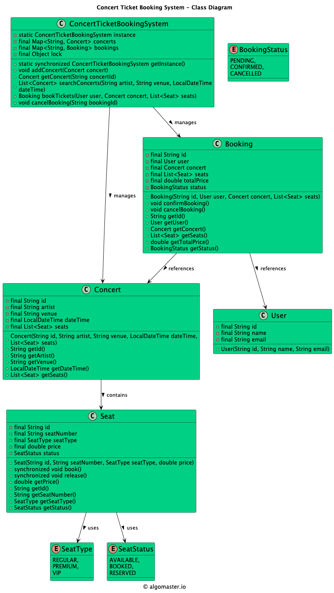

# Low-level design problem: concert ticket booking system

> Copied from <https://github.com/ashishps1/awesome-low-level-design/blob/main/problems/concert-ticket-booking-system.md> (GPL-3.0, by Ashish Pratap Singh). Questions and answers are the source's own; nothing was answered or rewritten here.


# Designing a Concert Ticket Booking System

## Requirements
1. The concert ticket booking system should allow users to view available concerts and their seating arrangements.
2. Users should be able to search for concerts based on various criteria such as artist, venue, date, and time.
3. Users should be able to select seats and purchase tickets for a specific concert.
4. The system should handle concurrent booking requests to avoid double-booking of seats.
5. The system should ensure fair booking opportunities for all users.
6. The system should handle payment processing securely.
7. The system should generate booking confirmations and send them to users via email or SMS.
8. The system should provide a waiting list functionality for sold-out concerts.

## UML Class Diagram



## Implementations
#### [Java Implementation](https://github.com/ashishps1/awesome-low-level-design/blob/main/solutions/java/src/concertticketbookingsystem) 
#### [Python Implementation](https://github.com/ashishps1/awesome-low-level-design/blob/main/solutions/python/concertticketbookingsystem)
#### [C++ Implementation](https://github.com/ashishps1/awesome-low-level-design/blob/main/solutions/cpp/concertticketbookingsystem)
#### [C# Implementation](https://github.com/ashishps1/awesome-low-level-design/blob/main/solutions/csharp/concertticketbookingsystem)
#### [Go Implementation](https://github.com/ashishps1/awesome-low-level-design/blob/main/solutions/golang/concertticketbookingsystem)

## Classes, Interfaces and Enumerations
1. The **Concert** class represents a concert event, with properties such as ID, artist, venue, date and time, and a list of seats.
2. The **Seat** class represents a seat in a concert, with properties like ID, seat number, seat type, price, and status. It provides methods to book and release a seat.
3. The **SeatType** enum represents the different types of seats available, such as regular, premium, and VIP.
4. The **SeatStatus** enum represents the status of a seat, which can be available, booked, or reserved.
5. The **Booking** class represents a booking made by a user for a specific concert and seats. It contains properties such as ID, user, concert, seats, total price, and status. It provides methods to confirm and cancel a booking.
6. The **BookingStatus** enum represents the status of a booking, which can be pending, confirmed, or cancelled.
7. The **User** class represents a user of the concert ticket booking system, with properties like ID, name, and email.
8. The **ConcertTicketBookingSystem** class is the central component of the system. It follows the Singleton pattern to ensure a single instance of the system. It manages concerts, bookings, and provides methods to add concerts, search concerts, book tickets, and cancel bookings.
9. The **SeatNotAvailableException** is a custom exception used to handle cases where a seat is not available for booking.

---

## Official solutions from the repository

<details><summary><b>java</b> (11 files)</summary>


**Booking.java**

```java
package concertticketbookingsystem;

import java.util.List;

public class Booking {
    private final String id;
    private final User user;
    private final Concert concert;
    private final List<Seat> seats;
    private final double totalPrice;
    private BookingStatus status;

    public Booking(String id, User user, Concert concert, List<Seat> seats) {
        this.id = id;
        this.user = user;
        this.concert = concert;
        this.seats = seats;
        this.totalPrice = calculateTotalPrice();
        this.status = BookingStatus.PENDING;
    }

    private double calculateTotalPrice() {
        return seats.stream().mapToDouble(Seat::getPrice).sum();
    }

    public void confirmBooking() {
        if (status == BookingStatus.PENDING) {
            status = BookingStatus.CONFIRMED;
            // Send booking confirmation to the user
            // ...
        }
    }

    public void cancelBooking() {
        if (status == BookingStatus.CONFIRMED) {
            status = BookingStatus.CANCELLED;
            seats.forEach(Seat::release);
            System.out.printf("Booking %s cancelled\n", id);
            // Send booking cancellation notification to the user
            // ...
        }
    }

    public String getId() {
        return id;
    }

    public User getUser() {
        return user;
    }

    public Concert getConcert() {
        return concert;
    }

    public List<Seat> getSeats() {
        return seats;
    }

    public double getTotalPrice() {
        return totalPrice;
    }

    public BookingStatus getStatus() {
        return status;
    }
}
```


**BookingStatus.java**

```java
package concertticketbookingsystem;

public enum BookingStatus {
    PENDING,
    CONFIRMED,
    CANCELLED
}
```


**Concert.java**

```java
package concertticketbookingsystem;

import java.time.LocalDateTime;
import java.util.List;

public class Concert {
    private final String id;
    private final String artist;
    private final String venue;
    private final LocalDateTime dateTime;
    private final List<Seat> seats;

    public Concert(String id, String artist, String venue, LocalDateTime dateTime, List<Seat> seats) {
        this.id = id;
        this.artist = artist;
        this.venue = venue;
        this.dateTime = dateTime;
        this.seats = seats;
    }

    public String getId() {
        return id;
    }

    public String getArtist() {
        return artist;
    }

    public String getVenue() {
        return venue;
    }

    public LocalDateTime getDateTime() {
        return dateTime;
    }

    public List<Seat> getSeats() {
        return seats;
    }
}
```


**ConcertTicketBookingSystem.java**

```java
package concertticketbookingsystem;

import java.time.LocalDateTime;
import java.util.List;
import java.util.Map;
import java.util.UUID;
import java.util.concurrent.ConcurrentHashMap;
import java.util.stream.Collectors;

public class ConcertTicketBookingSystem {
    private static ConcertTicketBookingSystem instance;
    private final Map<String, Concert> concerts;
    private final Map<String, Booking> bookings;
    private final Object lock = new Object();

    private ConcertTicketBookingSystem() {
        concerts = new ConcurrentHashMap<>();
        bookings = new ConcurrentHashMap<>();
    }

    public static synchronized ConcertTicketBookingSystem getInstance() {
        if (instance == null) {
            instance = new ConcertTicketBookingSystem();
        }
        return instance;
    }

    public void addConcert(Concert concert) {
        concerts.put(concert.getId(), concert);
    }

    public Concert getConcert(String concertId) {
        return concerts.get(concertId);
    }

    public List<Concert> searchConcerts(String artist, String venue, LocalDateTime dateTime) {
        return concerts.values().stream()
                .filter(concert -> concert.getArtist().equalsIgnoreCase(artist) &&
                        concert.getVenue().equalsIgnoreCase(venue) &&
                        concert.getDateTime().equals(dateTime))
                .collect(Collectors.toList());
    }

    public Booking bookTickets(User user, Concert concert, List<Seat> seats) {
        synchronized (lock) {
            // Check seat availability and book seats
            for (Seat seat : seats) {
                if (seat.getStatus() != SeatStatus.AVAILABLE) {
                    throw new SeatNotAvailableException("Seat " + seat.getSeatNumber() + " is not available.");
                }
            }
            seats.forEach(Seat::book);

            // Create booking
            String bookingId = generateBookingId();
            Booking booking = new Booking(bookingId, user, concert, seats);
            bookings.put(bookingId, booking);

            // Process payment
            processPayment(booking);

            // Confirm booking
            booking.confirmBooking();

            System.out.println("Booking " + booking.getId() + " - " + booking.getSeats().size() + " seats booked");

            return booking;
        }
    }

    public void cancelBooking(String bookingId) {
        Booking booking = bookings.get(bookingId);
        if (booking != null) {
            booking.cancelBooking();
            bookings.remove(bookingId);
        }
    }

    private void processPayment(Booking booking) {
        // Process payment for the booking
        // ...
    }

    private String generateBookingId() {
        return "BKG" + UUID.randomUUID();
    }
}
```


**ConcertTicketBookingSystemDemo.java**

```java
package concertticketbookingsystem;

import java.time.LocalDateTime;
import java.util.ArrayList;
import java.util.List;
import java.util.stream.Collectors;

public class ConcertTicketBookingSystemDemo {
    public static void run() {
        // Create concert ticket booking system instance
        ConcertTicketBookingSystem bookingSystem = ConcertTicketBookingSystem.getInstance();

        // Create concerts
        List<Seat> concert1Seats = generateSeats(100);
        Concert concert1 = new Concert("C001", "Artist 1", "Venue 1", LocalDateTime.now().plusDays(30), concert1Seats);
        bookingSystem.addConcert(concert1);

        List<Seat> concert2Seats = generateSeats(50);
        Concert concert2 = new Concert("C002", "Artist 2", "Venue 2", LocalDateTime.now().plusDays(60), concert2Seats);
        bookingSystem.addConcert(concert2);

        // Create users
        User user1 = new User("U001", "John Doe", "john@example.com");
        User user2 = new User("U002", "Jane Smith", "jane@example.com");

        // Search concerts
        List<Concert> searchResults = bookingSystem.searchConcerts("Artist 1", "Venue 1", LocalDateTime.now().plusDays(30));
        System.out.println("Search Results:");
        for (Concert concert : searchResults) {
            System.out.println("Concert: " + concert.getArtist() + " at " + concert.getVenue());
        }

        // Book tickets
        List<Seat> selectedSeats1 = selectSeats(concert1, 3);
        Booking booking1 = bookingSystem.bookTickets(user1, concert1, selectedSeats1);

        List<Seat> selectedSeats2 = selectSeats(concert2, 2);
        Booking booking2 = bookingSystem.bookTickets(user2, concert2, selectedSeats2);

        // Cancel booking
        bookingSystem.cancelBooking(booking1.getId());

        // Book tickets again
        List<Seat> selectedSeats3 = selectSeats(concert1, 2);
        Booking booking3 = bookingSystem.bookTickets(user2, concert1, selectedSeats3);
    }

    private static List<Seat> generateSeats(int numberOfSeats) {
        List<Seat> seats = new ArrayList<>();
        for (int i = 1; i <= numberOfSeats; i++) {
            String seatNumber = "S" + i;
            SeatType seatType = (i <= 10) ? SeatType.VIP : (i <= 30) ? SeatType.PREMIUM : SeatType.REGULAR;
            double price = (seatType == SeatType.VIP) ? 100.0 : (seatType == SeatType.PREMIUM) ? 75.0 : 50.0;
            seats.add(new Seat(seatNumber, seatNumber, seatType, price));
        }
        return seats;
    }

    private static List<Seat> selectSeats(Concert concert, int numberOfSeats) {
        List<Seat> selectedSeats = new ArrayList<>();
        List<Seat> availableSeats = concert.getSeats().stream()
                .filter(seat -> seat.getStatus() == SeatStatus.AVAILABLE)
                .limit(numberOfSeats)
                .toList();
        selectedSeats.addAll(availableSeats);
        return selectedSeats;
    }
}
```


**README.md**

```md
# Concert Ticket Booking System (LLD)

## Problem Statement

Design and implement a Concert Ticket Booking System that allows users to book seats for concerts. The system should manage concert details, seat availability, and handle bookings with proper validation.

---

## Requirements

- **Concert Management:** The system manages concert details including name, date, venue, and available seats.
- **Seat Management:** The system tracks different types of seats (VIP, STANDARD, ECONOMY) and their availability.
- **Booking Management:** Users can book seats, and the system handles booking status (CONFIRMED, CANCELLED).
- **User Management:** The system maintains user information for bookings.
- **Validation:** The system prevents double bookings and handles seat availability checks.

---

## Core Entities

- **ConcertTicketBookingSystem:** Main class that manages concerts, bookings, and seat allocation.
- **Concert:** Represents a concert with its details and seat management.
- **Seat:** Represents a seat with its type, status, and booking information.
- **User:** Represents a user who can book tickets.
- **Booking:** Represents a booking with its status and associated details.
- **SeatType:** Enum for different seat categories (VIP, STANDARD, ECONOMY).
- **SeatStatus:** Enum for seat states (AVAILABLE, BOOKED).
- **BookingStatus:** Enum for booking states (CONFIRMED, CANCELLED).

---

## Class Design

## UML Class Diagram


### 1. ConcertTicketBookingSystem
- **Fields:** List<Concert> concerts, List<Booking> bookings
- **Methods:** addConcert(), bookSeat(), cancelBooking(), getAvailableSeats(), etc.

### 2. Concert
- **Fields:** String name, String date, String venue, List<Seat> seats
- **Methods:** addSeat(), getAvailableSeats(), bookSeat(), etc.

### 3. Seat
- **Fields:** String seatNumber, SeatType type, SeatStatus status, Booking booking
- **Methods:** isAvailable(), book(), cancel(), etc.

### 4. User
- **Fields:** String name, String email

### 5. Booking
- **Fields:** String bookingId, User user, Concert concert, Seat seat, BookingStatus status
- **Methods:** confirm(), cancel(), etc.

### 6. Enums
- **SeatType:** VIP, STANDARD, ECONOMY
- **SeatStatus:** AVAILABLE, BOOKED
- **BookingStatus:** CONFIRMED, CANCELLED

---

## Example Usage

```java
ConcertTicketBookingSystem system = new ConcertTicketBookingSystem();

// Add a concert
Concert concert = system.addConcert("Rock Concert", "2024-12-31", "Stadium");

// Book a seat
User user = new User("John Doe", "john@example.com");
Booking booking = system.bookSeat(concert, "A1", user);

// Cancel booking
system.cancelBooking(booking);
```

---

## Demo

See `ConcertTicketBookingSystemDemo.java` for a sample usage and simulation of the booking system.

---

## Extending the Framework

- **Add payment processing:** Integrate payment gateway for parkingTicket purchases
- **Add waitlist functionality:** Handle seat waitlist when fully booked
- **Add discount management:** Support for different pricing tiers and discounts
- **Add notification system:** Send booking confirmations and updates

---

## Design Patterns Used

- **Singleton Pattern:** For managing the booking system instance
- **Factory Pattern:** For creating different types of seats
- **Observer Pattern:** For notifying users about booking status changes

---
```


**Seat.java**

```java
package concertticketbookingsystem;

public class Seat {
    private final String id;
    private final String seatNumber;
    private final SeatType seatType;
    private final double price;
    private SeatStatus status;

    public Seat(String id, String seatNumber, SeatType seatType, double price) {
        this.id = id;
        this.seatNumber = seatNumber;
        this.seatType = seatType;
        this.price = price;
        this.status = SeatStatus.AVAILABLE;
    }

    public synchronized void book() {
        if (status == SeatStatus.AVAILABLE) {
            status = SeatStatus.BOOKED;
        } else {
            throw new SeatNotAvailableException("Seat is already booked or reserved.");
        }
    }

    public synchronized void release() {
        if (status == SeatStatus.BOOKED) {
            status = SeatStatus.AVAILABLE;
        }
    }

    public double getPrice() {
        return price;
    }

    public String getId() {
        return id;
    }

    public String getSeatNumber() {
        return seatNumber;
    }

    public SeatType getSeatType() {
        return seatType;
    }

    public SeatStatus getStatus() {
        return status;
    }
}
```


**SeatNotAvailableException.java**

```java
package concertticketbookingsystem;

public class SeatNotAvailableException extends RuntimeException {
    public SeatNotAvailableException(String message) {
        super(message);
    }
}
```


**SeatStatus.java**

```java
package concertticketbookingsystem;

public enum SeatStatus {
    AVAILABLE,
    BOOKED,
    RESERVED
}
```


**SeatType.java**

```java
package concertticketbookingsystem;

public enum SeatType {
    REGULAR,
    PREMIUM,
    VIP
}
```


**User.java**

```java
package concertticketbookingsystem;

public class User {
    private final String id;
    private final String name;
    private final String email;

    public User(String id, String name, String email) {
        this.id = id;
        this.name = name;
        this.email = email;
    }
}
```

</details>

<details><summary><b>python</b> (1 files)</summary>


**README.md**

```md
# Designing a Concert Ticket Booking System

## Requirements
1. The concert ticket booking system should allow users to view available concerts and their seating arrangements.
2. Users should be able to search for concerts based on various criteria such as artist, venue, date, and time.
3. Users should be able to select seats and purchase tickets for a specific concert.
4. The system should handle concurrent booking requests to avoid double-booking of seats.
5. The system should ensure fair booking opportunities for all users.
6. The system should handle payment processing securely.
7. The system should generate booking confirmations and send them to users via email or SMS.
8. The system should provide a waiting list functionality for sold-out concerts.

## Classes, Interfaces and Enumerations
1. The **Concert** class represents a concert event, with properties such as ID, artist, venue, date and time, and a list of seats.
2. The **Seat** class represents a seat in a concert, with properties like ID, seat number, seat type, price, and status. It provides methods to book and release a seat.
3. The **SeatType** enum represents the different types of seats available, such as regular, premium, and VIP.
4. The **SeatStatus** enum represents the status of a seat, which can be available, booked, or reserved.
5. The **Booking** class represents a booking made by a user for a specific concert and seats. It contains properties such as ID, user, concert, seats, total price, and status. It provides methods to confirm and cancel a booking.
6. The **BookingStatus** enum represents the status of a booking, which can be pending, confirmed, or cancelled.
7. The **User** class represents a user of the concert ticket booking system, with properties like ID, name, and email.
8. The **ConcertTicketBookingSystem** class is the central component of the system. It follows the Singleton pattern to ensure a single instance of the system. It manages concerts, bookings, and provides methods to add concerts, search concerts, book tickets, and cancel bookings.
9. The **SeatNotAvailableException** is a custom exception used to handle cases where a seat is not available for booking.
```

</details>

<details><summary><b>cpp</b> (11 files)</summary>


**Booking.cpp**

```cpp
#include "Booking.hpp"
#include <iostream>
#include <iomanip>

Booking::Booking(std::string bookingId, std::string customerName, Concert* concert, 
                int seatNumber, double totalPrice)
    : bookingId(bookingId), customerName(customerName), concert(concert), 
      seatNumber(seatNumber), totalPrice(totalPrice) {}

std::string Booking::getBookingId() const { return bookingId; }
std::string Booking::getCustomerName() const { return customerName; }
Concert* Booking::getConcert() const { return concert; }
int Booking::getSeatNumber() const { return seatNumber; }
double Booking::getTotalPrice() const { return totalPrice; }

void Booking::displayInfo() const {
    std::cout << "\nBooking Details:" << std::endl;
    std::cout << "Booking ID: " << bookingId << std::endl;
    std::cout << "Customer Name: " << customerName << std::endl;
    std::cout << "Seat Number: " << seatNumber << std::endl;
    std::cout << "Total Price: $" << std::fixed << std::setprecision(2) << totalPrice << std::endl;
    std::cout << "\nConcert Information:" << std::endl;
    concert->displayInfo();
}
```


**Booking.hpp**

```hpp
#ifndef BOOKING_HPP
#define BOOKING_HPP

#include <string>
#include "Concert.hpp"

class Booking {
private:
    std::string bookingId;
    std::string customerName;
    Concert* concert;
    int seatNumber;
    double totalPrice;

public:
    Booking(std::string bookingId, std::string customerName, Concert* concert, 
            int seatNumber, double totalPrice);
    
    std::string getBookingId() const;
    std::string getCustomerName() const;
    Concert* getConcert() const;
    int getSeatNumber() const;
    double getTotalPrice() const;
    void displayInfo() const;
};

#endif
```


**BookingSystem.cpp**

```cpp
#include "BookingSystem.hpp"
#include <iostream>
#include <algorithm>

BookingSystem::BookingSystem() : bookingIdCounter(1) {}

BookingSystem::~BookingSystem() {
    for (auto concert : concerts) delete concert;
    for (auto booking : bookings) delete booking;
}

void BookingSystem::addConcert(Concert* concert) {
    concerts.push_back(concert);
}

std::string BookingSystem::createBooking(std::string customerName, Concert* concert, int seatNumber) {
    if (!concert->bookSeat(seatNumber)) {
        std::cout << "Failed to book seat: Seat " << seatNumber << " is not available" << std::endl;
        return "";
    }
    
    std::string bookingId = "B" + std::to_string(bookingIdCounter++);
    double totalPrice = concert->getBasePrice();  // Could add premium pricing logic here
    
    Booking* booking = new Booking(bookingId, customerName, concert, seatNumber, totalPrice);
    bookings.push_back(booking);
    return bookingId;
}

bool BookingSystem::cancelBooking(std::string bookingId) {
    Booking* booking = findBooking(bookingId);
    if (!booking) return false;
    
    booking->getConcert()->cancelSeat(booking->getSeatNumber());
    
    auto it = std::find(bookings.begin(), bookings.end(), booking);
    if (it != bookings.end()) {
        bookings.erase(it);
        delete booking;
        return true;
    }
    return false;
}

void BookingSystem::displayAllConcerts() const {
    std::cout << "\nAvailable Concerts:" << std::endl;
    for (const auto& concert : concerts) {
        concert->displayInfo();
        std::cout << "------------------------" << std::endl;
    }
}

void BookingSystem::displayAllBookings() const {
    std::cout << "\nCurrent Bookings:" << std::endl;
    for (const auto& booking : bookings) {
        booking->displayInfo();
        std::cout << "------------------------" << std::endl;
    }
}

void BookingSystem::displayAvailableSeats(Concert* concert) const {
    std::cout << "\nAvailable seats for concert " << concert->getName() << ":" << std::endl;
    for (int i = 1; i <= concert->getTotalSeats(); i++) {
        if (concert->isSeatAvailable(i)) {
            std::cout << i << " ";
        }
    }
    std::cout << std::endl;
}

Concert* BookingSystem::findConcert(std::string concertId) const {
    for (auto concert : concerts) {
        if (concert->getConcertId() == concertId) return concert;
    }
    return nullptr;
}

Booking* BookingSystem::findBooking(std::string bookingId) const {
    for (auto booking : bookings) {
        if (booking->getBookingId() == bookingId) return booking;
    }
    return nullptr;
}
```


**BookingSystem.hpp**

```hpp
#ifndef BOOKING_SYSTEM_HPP
#define BOOKING_SYSTEM_HPP

#include <vector>
#include <string>
#include "Concert.hpp"
#include "Booking.hpp"

class BookingSystem {
private:
    std::vector<Concert*> concerts;
    std::vector<Booking*> bookings;
    int bookingIdCounter;

public:
    BookingSystem();
    ~BookingSystem();
    
    void addConcert(Concert* concert);
    std::string createBooking(std::string customerName, Concert* concert, int seatNumber);
    bool cancelBooking(std::string bookingId);
    
    void displayAllConcerts() const;
    void displayAllBookings() const;
    void displayAvailableSeats(Concert* concert) const;
    
    Concert* findConcert(std::string concertId) const;
    Booking* findBooking(std::string bookingId) const;
};

#endif
```


**Concert.cpp**

```cpp
#include "Concert.hpp"
#include <iostream>
#include <iomanip>

Concert::Concert(std::string concertId, std::string name, std::string venue, 
                std::string date, double basePrice, int totalSeats)
    : concertId(concertId), name(name), venue(venue), date(date), 
      basePrice(basePrice), totalSeats(totalSeats) {
    
    // Initialize seats
    for (int i = 1; i <= totalSeats; i++) {
        seats.push_back(Seat(i));
    }
}

std::string Concert::getConcertId() const { return concertId; }
std::string Concert::getName() const { return name; }
std::string Concert::getVenue() const { return venue; }
std::string Concert::getDate() const { return date; }
double Concert::getBasePrice() const { return basePrice; }
int Concert::getTotalSeats() const { return totalSeats; }

int Concert::getAvailableSeats() const {
    int available = 0;
    for (const auto& seat : seats) {
        if (!seat.isBooked()) available++;
    }
    return available;
}

bool Concert::bookSeat(int seatNumber) {
    if (seatNumber < 1 || seatNumber > totalSeats) return false;
    if (seats[seatNumber - 1].isBooked()) return false;
    
    seats[seatNumber - 1].book();
    return true;
}

bool Concert::cancelSeat(int seatNumber) {
    if (seatNumber < 1 || seatNumber > totalSeats) return false;
    if (!seats[seatNumber - 1].isBooked()) return false;
    
    seats[seatNumber - 1].cancel();
    return true;
}

bool Concert::isSeatAvailable(int seatNumber) const {
    if (seatNumber < 1 || seatNumber > totalSeats) return false;
    return !seats[seatNumber - 1].isBooked();
}

void Concert::displayInfo() const {
    std::cout << "Concert: " << name << std::endl;
    std::cout << "ID: " << concertId << std::endl;
    std::cout << "Venue: " << venue << std::endl;
    std::cout << "Date: " << date << std::endl;
    std::cout << "Price: $" << std::fixed << std::setprecision(2) << basePrice << std::endl;
    std::cout << "Available Seats: " << getAvailableSeats() << "/" << totalSeats << std::endl;
}
```


**Concert.hpp**

```hpp
#ifndef CONCERT_HPP
#define CONCERT_HPP

#include <string>
#include <vector>
#include "Seat.hpp"

class Concert {
private:
    std::string concertId;
    std::string name;
    std::string venue;
    std::string date;
    double basePrice;
    std::vector<Seat> seats;
    int totalSeats;

public:
    Concert(std::string concertId, std::string name, std::string venue, 
            std::string date, double basePrice, int totalSeats);
    
    std::string getConcertId() const;
    std::string getName() const;
    std::string getVenue() const;
    std::string getDate() const;
    double getBasePrice() const;
    int getTotalSeats() const;
    int getAvailableSeats() const;
    
    bool bookSeat(int seatNumber);
    bool cancelSeat(int seatNumber);
    bool isSeatAvailable(int seatNumber) const;
    void displayInfo() const;
};

#endif
```


**ConcertBookingDemo.cpp**

```cpp
#include "BookingSystem.hpp"
#include <iostream>

int main() {
    BookingSystem bookingSystem;
    
    // Create some concerts
    Concert* concert1 = new Concert("C001", "Rock Festival", "Stadium A", "2024-07-15", 100.0, 50);
    Concert* concert2 = new Concert("C002", "Jazz Night", "Hall B", "2024-07-20", 75.0, 30);
    
    bookingSystem.addConcert(concert1);
    bookingSystem.addConcert(concert2);
    
    // Display all concerts
    bookingSystem.displayAllConcerts();
    
    // Make some bookings
    std::string booking1 = bookingSystem.createBooking("John Doe", concert1, 1);
    std::string booking2 = bookingSystem.createBooking("Jane Smith", concert1, 2);
    std::string booking3 = bookingSystem.createBooking("Alice Johnson", concert2, 1);
    
    if (!booking1.empty()) {
        std::cout << "\nBooking created successfully: " << booking1 << std::endl;
    }
    if (!booking2.empty()) {
        std::cout << "Booking created successfully: " << booking2 << std::endl;
    }
    if (!booking3.empty()) {
        std::cout << "Booking created successfully: " << booking3 << std::endl;
    }
    
    // Display all bookings
    bookingSystem.displayAllBookings();
    
    // Display available seats for concert1
    bookingSystem.displayAvailableSeats(concert1);
    
    // Cancel a booking
    if (bookingSystem.cancelBooking(booking1)) {
        std::cout << "\nBooking " << booking1 << " cancelled successfully" << std::endl;
    }
    
    // Display updated available seats
    bookingSystem.displayAvailableSeats(concert1);
    
    return 0;
}
```


**README.md**

```md
# Designing a Concert Ticket Booking System

## Requirements
1. The concert ticket booking system should allow users to view available concerts and their seating arrangements.
2. Users should be able to search for concerts based on various criteria such as artist, venue, date, and time.
3. Users should be able to select seats and purchase tickets for a specific concert.
4. The system should handle concurrent booking requests to avoid double-booking of seats.
5. The system should ensure fair booking opportunities for all users.
6. The system should handle payment processing securely.
7. The system should generate booking confirmations and send them to users via email or SMS.
8. The system should provide a waiting list functionality for sold-out concerts.

## Classes, Interfaces and Enumerations
1. The **Concert** class represents a concert event, with properties such as ID, artist, venue, date and time, and a list of seats.
2. The **Seat** class represents a seat in a concert, with properties like ID, seat number, seat type, price, and status. It provides methods to book and release a seat.
3. The **SeatType** enum represents the different types of seats available, such as regular, premium, and VIP.
4. The **SeatStatus** enum represents the status of a seat, which can be available, booked, or reserved.
5. The **Booking** class represents a booking made by a user for a specific concert and seats. It contains properties such as ID, user, concert, seats, total price, and status. It provides methods to confirm and cancel a booking.
6. The **BookingStatus** enum represents the status of a booking, which can be pending, confirmed, or cancelled.
7. The **User** class represents a user of the concert ticket booking system, with properties like ID, name, and email.
8. The **ConcertTicketBookingSystem** class is the central component of the system. It follows the Singleton pattern to ensure a single instance of the system. It manages concerts, bookings, and provides methods to add concerts, search concerts, book tickets, and cancel bookings.
9. The **SeatNotAvailableException** is a custom exception used to handle cases where a seat is not available for booking.
```


**Seat.cpp**

```cpp
#include "Seat.hpp"

Seat::Seat(int number) : seatNumber(number), booked(false) {}

int Seat::getSeatNumber() const { return seatNumber; }
bool Seat::isBooked() const { return booked; }
void Seat::book() { booked = true; }
void Seat::cancel() { booked = false; }
```


**Seat.hpp**

```hpp
#ifndef SEAT_HPP
#define SEAT_HPP

class Seat {
private:
    int seatNumber;
    bool booked;

public:
    Seat(int number);
    
    int getSeatNumber() const;
    bool isBooked() const;
    void book();
    void cancel();
};

#endif
```


**concert_booking**

```
�������!H__PAGEZERO(__TEXT��__text__TEXT�h���__stubs__TEXTD��D��__gcc_except_tab__TEXT���__cstring__TEXTl�l�__const__TEXTp�p�__unwind_info__TEXT������__DATA_CONST�@�@__got__DATA_CONST��8H__LINKEDIT@�4��3���f@E��P��B?'`Cx /usr/lib/dyld�-����0
������2 �*(���0�@/usr/lib/libc++.1.dylib88/usr/lib/libSystem.B.dylib&�H)��`����{��C����������������������_����$��@��@�a��$��@��^����]�8��@� ��{E�����_����@��������$��@��$��C��{�����������������������_����@��@��@������@��{D��C��_�����{���������@���������@��$��{B�����_�����{���������@���������@�a��$��{B�����_��C����@�@��C��_��C����@�9@��C��_��C����@�!@��C��_����{������@��@��������_���A�!��?��!�<���M��@�A�!��7��@�h��@�E��@�A�!,�/��@�a�_��@�<��@�A�!l�&��@�9@��$��@�3��@�A�!����! �p���@�R�����@��3ѨC�X��@�!@�s$��@���@�A�!��	��@���@�@����{C����_�����{�����������_����@����@�9$��@����@����{B�����_�����{��C������@��@�?��{A�����_�����{��C����@����@�	@�)�^�	�A�R�����@�,$��@�-$��@��{A�����_�����{�����������_����@������@�6��@����@�q��{B�����_�����{��C������@�	@�)�^��@�A��	�O��@��{A�����_�����{�����������_����@�*@�J�^� 
�?��@��{B�����_�����{��C����@���R� �R��@��{A�����_�����{��C����@���&���_��{A�����_�����{��������C�����_���@����@���@��C_��@�


(	@�
*(	��@��{B�����_��C������@��@�(	@�*
(	��C��_�����{��������C���_����C_���@��{B�����_��C������@��@���C��_�����{	��C�����������_���ѣ#����}��G��G@�6��_��#���_�����_�	@�)�^�	���C��C@�	�R	
�q���7�_���^�	����_����@����_���^�	�����_�	@�)�^�	�����_�	@�)�^�	����/��/@��@��@��@��@��'@�J����@��Ѩ��@6��_�	@�)�^�	���R������������������P#��]��#���_�	@�)�^�	��#��#���_��{I�����_����>#������������#��]��"�������{��C����@�8����@��{A�����_����C����@�@9�C��_�����{	��C���������������8�_�����7�_����z��]���^�	���]����'��'@��\�	��ǟ�7�\��'@�	��'��'��^���^�	��#��#@���ǟ7�_���^��#@����#@�����7���_����P�'@���ǟ�7�'@����8�������@��_��������@��'@������@��'@�	����7���_����(�R��	���������"�-�����"��@�q��h7��]��^�	��#��#@���ǟ7�_��^��#@�`��#@�����7���_�����]���{��_������_��{I�����_��@�T"�����{�����������_����@���@��{B�����_��C����@�	@��C��_�����{��C����@���U"��@��@�O"� 6�@��R1��@�(���@��@��{A�����_��C����@�@�����C��_�����{��C������@��@�P��{A�����_��{���"��"��C����@�
@��C��_�����{�������������_��@��@�@�1@�?��{B�����_�����{����������?9��_����@��?�9��@��{B�����_�����{��C����@�l�f��{A�����_���������@�(
@����@�(
��@�����_�����{����������?9��_����;��7���@��@��?�9�!��@���@��{B�����_�����{�������������_����@��@�	��@��{B�����_��C����C��_����{�������������_�����@�
��@��{C����_��C����@��C��_�����{�������@�����@��{B�����_�����{��C����@�����@��{A�����_��C����@��C��_��C����@��C��_�����{���������_�����6�@�����@�����@��{B�����_�����{��C����@��\@9}Sr���{A�����_�����{��C����@��@��{A�����_�����{��C����@����{A�����_�����{��C����@���{A�����_��C����@��C��_��C����@��C��_�����{�����������_����@�	@�)�^�	�
����@��@���{B�����_�
�������{��C����@���{A�����_��C����@�@��C��_��C������@��@�	k���C��_���_��C��{�������s8��_��c���!��@�����@��s�8����c�N!��@��{D��C��_��������c�D!��@�� �����{��C����@�A�!�@�� ��{A�����_�����{��C����9�@���9@�@�?��{A�����_�����{��C������@� @��@�	*6!��{A�����_�����{��C����@�Z!��{A�����_�����{���������_���E����6�@�����@�����@��{B�����_�����{��C����@�S���@��{A�����_�����{��C����@�I���\@9	�	�@��{A�����_���������@�(	@����@�(	��@�����_�����{��C����@���
��@�a���@�(�R0��{A�����_�����{��C����@������@��{A�����_�����{��C����@������@��{A�����_�����{��C����@��������@��{A�����_����{�������_�����������^�I�����^�R������ѡ��Y��6���b�@����]�������7�@�^��@�� ����c�����@�a����@�e����@�n��������u��6���~�@����@�������7�@�z��@�� ���������@�a����@�����_��{G����_�����{��C����@�@�=	����@��{A�����_�����{��C����@�@�1	����@��{A�����_�����{��C������@��@��R�{A�����_��C����@�@��C��_�����{��C����@�����@��{A�����_��C����@�@�!���C��_�����{��C����@�@�$	����@��{A�����_�����{��C����@�@�	����@��{A�����_�����{��C������@��@�f�R�{A�����_��C����@�@��C��_�����{��C����@���l��@��{A�����_��C����@�@�!���C��_�����{��C����@������@��{A�����_�����{��C����@���B��@��{A�����_�����{��C����@�������@��{A�����_�����{��C����������@���{A�����_�����{�����������_���@������@�	@�	����7�@��@����@��@����{B�����_�����{
��C��C������@�����	����������@����^���]����7@��@�A�!8�������]�Z�A�!����������!�<������@�A�!��w�q�@��R��8 1@�(1��������@��@�@���s���*��^�D����@����	������@�(�R��9�c���@�����@��^���]���Z��c���)����R��9����c���@��@���ѩ�a�U�(�R��8��]8�7#������C�����'������C�������C�������C�������C������c�����@9�6�@�0��@����@����{M�����_֠�[�������{�����������_����@��
��@��{B�����_�����{��������������@��@��Ҫ����@��
��{B�����_�����{�����������_���@����
��@�	@�	����7�@��@����@��@����{B�����_��C��{�����������_�����������@��@�a��#����}��#@����^�����7�R��8J����������l�I������^��������^��������@�%��@�a�u����@����a�}����@��3���Z��3@�i��@��C�����a�r������@��c��/�y����6�@�a����C��C��Ҟ��@��+@�r��'��^�������7�@�w����@���(�R��8�R��8��_8�{L��C��_֠\������{������������_�a����^������^�!�����ѡ��(�`6���1�@����@�����5����@��@������@������@��6�@�������!���������_��{G����_�����{�����������C��#����6�C����@��@�)@�	���h7�C�!�������@������_��{B�����_��C��{����C����������^��������@��c������@���(@��@�
����@�!@��@�!������@����@��@�!���@��@��������_��{D��C��_�����{�������������_����@��@�P��@��{B�����_����{���������_���@��@�A�!��5�������!�<�D����@����_� ����_�)����c��C�0��6�c�9����@�@���@��@�A�!L ��������!�<�(����c�0�����{C����_�����{��C����@�@�$����@��{A�����_�����{��C����@�@�����@��{A�����_�����{��C������@��@��R�{A�����_��C����@�@��C��_��C����@�@�!���C��_����{���������_���@��@�A�!� ���������!�<������@�a����_� ����_�)����c��C�0��6�c�9����@�@�n���@��@�A�!L ���������!�<������c�0�����{C����_�����{��C����@�@������@��{A�����_�����{��C����@�@������@��{A�����_�����{��C������@��@���R�{A�����_��C����@�@��C��_��C����@�@�!���C��_����{������@��@��������A�!� �k������_���������@��@��������@�A�!t!�]������@�����!�<�i�����ѩ�(�R�;��;@����_����@�k�ן(7�_��;@����6�@��;@���A�!|!�=������������ь�
�;@��;�����@�����!�<�?����{G����_֠]�M����{������������_����^��������^��������ѡ�� ���`6���)���@����@�����B��@��@�����@���Z��@��6�@������������������_��{G����_��C��{���������_�b������@�����^�]����@�����7�R��88�_��������^�������_������6�@��@��@��q����8$�@����H7�@��9�@�)�9	k���7�R��8�@�����@�����@�������(�R��8��_8�{D��C��_�����{�����������_�����@�	����@�����{B�����_��C����@�@��C��_�����{��C����@�������@�!����@������@�a����@����@��{A�����_�����{��C����@�����@��{A�����_�����{���������_����C�
��C���@��{B�����_�j�������{�����������_����@�,��@��{B�����_�����{���������_���@�(��@�@�S��@�@�@�����7�@�@�M��@�@�a��@���	@�)@���@�d��@����@�I��{B�����_��C������@��@���C��_��C��{��������_���e����_���a����_���E����_���Y����_���_����_���Q����_����5��@��@��@��@��@���^����_��

�C
�
	�9��{D��C��_��C����C��_�����{��C����@�@�L��{A�����_�����{�������������_��@��@�r��{B�����_�����{��C����@�A����{A�����_�����{��C����@������@�@�)@�	�	��
ɚ�{A�����_������������������_�����{��C����@�@���{A�����_��C����@�(@�)@�	�	��
ɚ�C��_��C����@��C��_����{�����������_���@����_��@�	����7�@��������@�!����������@�������@��_�(��{C����_և�������{��C������@��@���{A�����_��C������C��_�����{������������@��@��}ӂ����{B�����_�g�������{�������������_��@���{B�����_�����{��C������@���{A�����_�����{��C����@����{A�����_�����{��C����@���{A�����_��C����@��C��_�����{��C����@�A���{A�����_�����{��C����@���{A�����_��C����@��C��_�����{�����������_�����@�	����@�����{B�����_��C����@�@��C��_�����{��C����@���a�E��@�C��@��{A�����_�����{�����������_�����@�	����@�����{B�����_��C����@�@��C��_�����{�����������_�����@�	����@�����{B�����_��C����@�@��C��_�����{���������_������C���A��?�
��@���@��{B�����_ֶ�������{�������������_����@��@�	��@��{B�����_��C����C��_����{�������������_����_���@���@��{C����_��C������@���C��_�����{�������@�����@��{B�����_�����{��C����@�����@��{A�����_��C����@��C��_�����{���������_������C���A��?�
��@���@��{B�����_�[�������{�������������_����@��@�	��@��{B�����_��C����C��_����{�������������_����_���@���@��{C����_��C������@���C��_�����{�������@�����@��{B�����_�����{��C����@�����@��{A�����_��C����@��C��_�����{���������_����C�
��C���@��{B�����_��������{�����������_����@�,��@��{B�����_�����{���������_���@�(��@�@�S��@�@�@�����7�@�@�M��@�@�a��@���	@�)@���@�d��@����@�I��{B�����_��C������@��@���C��_��C��{��������_���e����_���a����_���E����_���Y����_���_����_���Q����_����5��@��@��@��@��@���^����_��

�C
�
	�9��{D��C��_��C����C��_�����{��C����@�@�L��{A�����_�����{�������������_��@��@�r��{B�����_�����{��C����@�A�x��{A�����_�����{��C����@���|��@�@�)@�	�	��
ɚ�{A�����_������������������_�����{��C����@�@���{A�����_��C����@�(@�)@�	�	��
ɚ�C��_��C����@��C��_����{�����������_���@����_��@�	����7�@��������@�!����������@�������@��_�(��{C����_�"�������{��C������@��@���{A�����_��C������C��_�����{������������@��@��}��ҡ����{B�����_��������{��C����@���{A�����_��C����@��C��_�����{��C����@�A���{A�����_�����{��C����@���{A�����_��C����@��C��_�����{���������_����C�
��C���@��{B�����_���������{�����������_����@�,��@��{B�����_�����{���������_���@�(��@�@�S��@�@�@�����7�@�@�M��@�@�a��@���	@�)@���@�d��@����@�I��{B�����_��C������@��@���C��_��C��{��������_���e����_���a����_���E����_���Y����_���_����_���Q����_����5��@��@��@��@��@���^����_��

�C
�
	�9��{D��C��_��C����C��_�����{��C����@�@�L��{A�����_�����{�������������_��@��@�r��{B�����_�����{��C����@�A�x��{A�����_�����{��C����@���|��@�@�)@�	�	��
ɚ�{A�����_������������������_�����{��C����@�@���{A�����_��C����@�(@�)@�	�	��
ɚ�C��_��C����@��C��_����{�����������_���@����_��@�	����7�@��������@�!����������@�R�����@��_�(��{C����_���������{��C������@��@���{A�����_��C������C��_�����{������������@��@��}���g����{B�����_���������{��C����@���{A�����_��C����@��C��_�����{��C����@�A���{A�����_�����{��C����@���{A�����_��C����@��C��_�����{���������@��@��#����_��{B�����_�����{�������������_����@��@���@��{B�����_�����������@��@������_�����{���������@��@��#����_��{B�����_�����{�������������_����@��@���@��{B�����_�����������@��@������_�����{��C����@�A�^��{A�����_�����{��C��������_�����"��_��@��������@��������@��_������@�!���l��{E�����_���������d��@�=����{�����������_����������@�����������@������@��������@�����^��������^����#@��������@��_�y��@�����#@�!��#���������{G����_������'�������@������{��C����@���{A�����_��C����@��C��_�����{�������������_����@��@���@��{B�����_�����{�������������_��@��@�a��{B�����_�����{��C����@��� ��@��{A�����_�����������@��@���@�@���@�@��@�
	������_�����������@��@�@�(�����_��C����@�@�	@�(��C��_��C��{���������_���������^��@�	�臟�7�@����@�������@��@�J��)	ʚ	��'��7�@�����@�H��}	��C����cщ�@������_��{D��C��_����{���������������_����_��@��@�(��@��{C����_����{�����������_��������@������@���@������@�@������_�@�������@��]���]��@��@��@��@�������Ѩ���������@��_�(��_�!����@��_� !�A����@��������_�M����@����@��_�@��_�(��������@����@���{G����_�����{��C����@������@��{A�����_����{���������_�9�s��C�����>����@��c�������@�@��{C����_���������{��C��� ��!�f�����{�����������_��@����{B�����_�����{�����������_��@���{B�����_�����{��C����@�5��{A�����_�����{��C����@�A�0��{A�����_��{����8��{���_�����{���������@��@���
��6�@����@����@��{B�����_�����������@�@��@�)@�	��'�����_��C������C��_�����{��C����@���{A�����_��C����@��C��_���_�����{���������&�����_���@�!�!�@�"�B@�(����@���������@�������{�����������_����@���@��{B�����_�����{����(��@�A����������_����@�{��@��@���{B�����_�����{���������@��@��ѝ����6�@����@����@��{B�����_�����{��C�����������_�������������@�a�&���^�����7�@��
�@�;���^�)��@������@�(��@�����@�@��^�
	���@���^�
	���0��@����_��{E�����_�����{�������������_����@��@�)��@��{B�����_�����{���������@��@�7����@����@��@��{B�����_�����{��C����@�a�^��{A�����_�����{��C����@�a�d��{A�����_�����{�������������_����@�7����@��@�!���@��{B�����_��C������@��@���C��_�����{�����������_��@�����@��臟h7��@��}�����{B�����_�����{��C���A������@�!�!�@�"�B$@�E�����{��C������@���{A�����_�����{��C����@�&��{A�����_�����{��C����@�!���{A�����_��C����@�@��C��_�����{��C����@������{A�����_��C��{��������������#��'�����<��=��<��=��=��=�@��@��@��@��@��@�Y�������_���_��{H��C��_�����{�����������_����@����@��{B�����_��C����@�@��C��_���������@�@����@�@��@�(��@��@�(�����_��C��{����������_������������^�����������^�����������^�����������^�����������^��������@��@��@��@��@�����^��_��

�C
�
	������{D��C��_��C����C��_�����{	��C������������������<��=��<��=��<��=�@��@��@��@��@��@�������=��<�_���_��{I�����_�����{��������������������<��=��<��=��=��=�@��@��@��@��@��@���{F�����_�����{��������������������<��=��<��=��=��=�@��@��@��@��@��@���{F�����_�����o��{�����������������������<��<��<��<�Y���Y��X���X����7���<�+�=��<�'�=��<��=�;@��?@�w��C��G��S@��W@��K@��O@��C@��G@���Ѡ�ў���<��=��<��=�+@��/@��#@��'@��������3��7���<��=��<��=�@��@��@��@����@����@����������_��{V��oU�����_����{������������������<��=�@��@�=�������������<��=�@��@�4��@����@���������=��{G����_�����{�����������������������Cѡ��m�@6�C���z�@����������@����@�(����@�������@��C������{F�����_����{����������=��=�@��@�y�������_���_��{C����_�����{���������@��������_��@�p��{B�����_�����{��C������������<��=��=��=�@��@��@��@��������_���_��{E�����_�����{���������������<��=��=��=�@��@��@��@�b������@��@�������_���_��{F�����_���������{�����������_�������@�|������@�����{B�����_�����{��C�����@���{A�����_��C����@�@����@�!����C��_��C����@�@�!���C��_��_����������=��=�@��@�����_�����{�������������_����@��@���@��{B�����_�����������@��@��=�=�@��=�=����_��������������=��=�@��@�����_��C������@��@���@���C��_����{�������_����������@�@����(7�@�d������@���@�������@��@��@�������_��{C����_�8�������{��C����@�@���{A�����_�����{��C����@���5��@�@�)@�	�	��
ɚ�{A�����_�����{�����������_��@���{B�����_����{���������_����@��@�)	@�	����7�@�����@���		@� !�	��������@�c�����{C����_���������{��C����@�a���{A�����_�����{��C����@�����{A�����_����{�����������_����GѢK�'����_����_���@����@���@�,����@��{C����_�����{�����������_����@���@��{B�����_�����{���������@����	�����@��= �=	@�(	��@���@�����@�S����6�@��@����_��{B�����_֚�������{���������_�������
���=�=�@���{B�����_��C������C��_�����{��C����@���{A�����_��C����@��C��_�����{��C����@�A�^��{A�����_�����{��C��������_�����"��_��@�������@�O������@��_������@�!���l��{E�����_���������d��@�\����{�����������_����������@����$������@������@�������@�����^��������^����#@�������@��_����@�����#@�!��#���������{G����_������'�������@�&�����{��C����@���{A�����_��C����@��C��_�����{�������������_����@��@���@��{B�����_�����{�������������_��@��@�}��{B�����_�����{��C����@��� ��@��{A�����_�����������@��@���@�@���@�@��@�
	������_�����������@��@�@�(�����_��C����@�@�	@�(��C��_��C��{���������_���������^��@�	�臟�7�@����@�m������@��@�J��)	ʚ	��'��7�@�����@�H��}	��C����cѨ���@������_��{D��C��_����{���������������_����_��@��@����@��{C����_����{�����������_��������@�.����@���@����W��@�@����S��_�@����O��@��]���]��@��@��@��@�)�����Ѩ����O����@��_�(��_�!�N��@��_� !�A�I��@��������_������@�A��@��_�@��_�(�&������@�G��@�p��{G����_�����{��C����@���
��@��{A�����_����{���������_�#����C�����]������@��c���:������@�@��{C����_��������{��C��� ��!���������{��C����@���{A�����_�����{��C����@�A�	��{A�����_��C������C��_�����{��C����@���{A�����_��C����@��C��_�����{��C�����������_�������������@�a�&���^�����7�@��
�@�;���^�)��@������@�(��@�����@�@��^�
	���@���^�
	���0��@����_��{E�����_�����{�������������_����@��@�)��@��{B�����_�����{���������@��@�7����@����@��@��{B�����_�����{��C����@�a�>��{A�����_�����{��C����@�a�D��{A�����_�����{�������������_����@�>����@��@�!���@��{B�����_��C������@��@���C��_�����{�����������_��@������@��臟h7�����@��}��ҽ����{B�����_�����{��C����@�!���{A�����_��C����@�@��C��_�����{��C����@�0����{A�����_��C��{��������������#��'�����<��=��<��=��=��=�@��@��@��@��@��@�Y�������_���_��{H��C��_�����{�����������_����@����@��{B�����_��C����@�@��C��_���������@�@����@�@��@�(��@��@�(�����_��C��{����������_������������^�����������^�����������^�����������^�����������^��������@��@��@��@��@�����^��_��

�C
�
	������{D��C��_��C����C��_�����{	��C������������������<��=��<��=��<��=�@��@��@��@��@��@�������=��<�_���_��{I�����_�����{��������������������<��=��<��=��=��=�@��@��@��@��@��@���{F�����_�����{��������������������<��=��<��=��=��=�@��@��@��@��@��@���{F�����_�����o��{�����������������������<��<��<��<�Y���Y��X���X����7���<�+�=��<�'�=��<��=�;@��?@�w��C��G��S@��W@��K@��O@��C@��G@���Ѡ��g
���<��=��<��=�+@��/@��#@��'@��������3��7���<��=��<��=�@��@��@��@����@����@����������_��{V��oU�����_����{������������������<��=�@��@�=�������������<��=�@��@�4��@����@���������=��{G����_�����{�����������������������Cѡ��m�@6�C���z�@����������@����@�(����@�������@��C������{F�����_����{����������=��=�@��@�y�������_���_��{C����_�����{���������@��������_��@�p��{B�����_�����{��C������������<��=��=��=�@��@��@��@��������_���_��{E�����_�����{���������������<��=��=��=�@��@��@��@�b������@��@�������_���_��{F�����_֐�������{�����������_�������@�|������@�����{B�����_�����{��C�����@���{A�����_��C����@�@����@�!����C��_��C����@�@�!���C��_��_����������=��=�@��@�����_�����{�������������_����@��@���@��{B�����_�����������@��@��=�=�@��=�=����_��������������=��=�@��@�����_��C������@��@���@���C��_����{�������_����������@�@����(7�@��������@���@�������@��@��@�������_��{C����_��������{��C����@�@���{A�����_�����{��C����@���5��@�@�)@�	�	��
ɚ�{A�����_�����{�����������_��@���{B�����_����{���������_����@��@�)	@�	����7�@�<����@���		@� !�	��������@�&�����{C����_ֿ�������{��C����@�a���{A�����_�����{��C����@�	����{A�����_�����{�����������_��������@��������@��	��
ɚ�{B�����_�����{��C����@��������@��{A�����_�����{�����������_����@� ��@�j������@����@�t����@��@���{B�����_�w������{�������������_��_��@�9������@��{C����_��C������C��_�����{��C��������_����7�������^���3�������^����������^���+�������^����_���%�������^���+����@��@��@��@��@��^�����^��

�C
�
	�
����{E�����_����{�����������@��@��@��������_���_��{C����_����{�����������@��@��@��������_���_��{C����_��C��{�������������^��^�%��������\����]�����]�G��@��@������0����#���^��@�T���������]��#@�Y����@�����;�������_���_��{H��C��_��C��{����������^�$��c������@�����@��C���#�������_���_��{D��C��_����{�������������@��@��@�9�������_���_��{C����_�����{��C����@�w��{A�����_�����{���������@��@��C�t��@��@��{B�����_�����{��C������@��@���{A�����_�����{�����������_��@�x����@��{B�����_֋����C��{���������������@���^�	�	��
ɚ���@���^��@��}�-��@��@��@�
	��#����������_���_��{D��C��_�����{���������@��@��C���@��@��{B�����_�����{�������������_����@��@���@��{B�����_�����������@��@�@���@�@������_�����{��C����@�+����{A�����_�����{�������������_����@��@���@��{B�����_�����������@��@�@���@�@������_�����{�����������_����@�����_�����@��@�)�
��)
ʚ
	��{B�����_�����{�������������_����@��������@���{B�����_�����{���������@��@��#����_��{B�����_�����{�������������_����@��@���@��{B�����_�����������@��@������_�����{���������@��@��#����_��{B�����_�����{�������������_����@��@���@��{B�����_�����������@��@������_����{�����������@�����7���
�_��@��@�����@������_��{C����_֒�������{�������������_��@��@�:
��{B�����_�����{
����������������������������C��_���������	��@��@�a��#��	��@��@������	��@��@�!����	��@���\�1�����A��@��C\�(��(�R�S��S@��C\�	k�ן�7�@������S@��#�4	��@��#�6��S@��S����������C�������C�������C����@�������C������@�m	���_��{J�����_��@�f	��#@�c	��@�`	���[�-	�����{��C����@������@��{A�����_�����{�����������_���@���D��@�	@�	��7��7�@��@�u	��@��@�n	��{B�����_��C��{�����������������������������_����@��@�]����@��{D��C��_�����{���������@���������@�	��{B�����_�����{���������@���������@�a�	��{B�����_�����{���������@���������@������{B�����_�����{���������@���������@�!����{B�����_��C����@�1@��C��_��C����@��@��C��_����{���������_��C������@�����@�'����C��#�.� 6�C�7����@�|��7�C_��C��C�1�����C_��{C����_�����{��C����@�@�t����@��{A�����_�����{��C����@�@�h����@��{A�����_�����{��C������@��@��R�{A�����_��C����@�@��C��_��C����@�@�!���C��_�����{���������@����@�q觟(7�@��@�)�@�	k�ǟ�7�R��8�@����@�	q�	�}@����6�R��8�@����@�	q�	�}@���(�R��8��_8�{B�����_��C������@�@��@�
	��C��_�����{���������@����@�q觟(7�@��@�)�@�	k�ǟ�7�R��8�@����@�	q�	�}@��������7�R��8�@����@�	q�	�}@�������(�R��8��_8�{B�����_�����{���������@����@�q觟(7�@��@�)�@�	k�ǟ�7�R��8�@����@�	q�	�}@�
���)�RR	
��8��_8�{B�����_��C������@�@��@�
	��C��_��C��{�������@��������_����!�!�n����@�a���������!�<����y����@��!�!�c����@�������^�q����@��!�!�[����@���������^�h����@��!�!�R����@�!�������^�_����@��!"�I�������! �������@�R�������@��3ѨC������@�1@�����^�K����@��!<"�5������@����������@����!�"�+����@��@�����^�8����{D��C��_�����{�����������_�����@�	����@�����{B�����_��C����@�@��C��_�����{���������_������C���A��?�
��@���@��{B�����_��������{�������������_����@��@�	��@��{B�����_��C����C��_����{�������������_����_���@���@��{C����_��C������@���C��_�����{�������@�����@��{B�����_�����{��C����@�����@��{A�����_��C����@��C��_�����{��C����@�A�^��{A�����_�����{��C��������_�����"��_��@��������@��������@��_�����@�!���l��{E�����_���������d��@������{�����������_����������@�����������@������@��������@�����^��������^����#@��������@��_����@�����#@�!��#���������{G����_������'�������@�q�����{��C����@���{A�����_��C����@��C��_�����{�������������_����@��@���@��{B�����_�����{�������������_��@��@����{B�����_�����{��C����@��� ��@��{A�����_�����������@��@���@�@���@�@��@�
	������_�����������@��@�@�(�����_��C����@�@�	@�(��C��_��C��{���������_���������^��@�	�臟�7�@����@�������@��@�J��)	ʚ	��'��7�@�����@�H��}	��C����c�����@������_��{D��C��_����{���������������_����_��@��@����@��{C����_����{�����������_��������@������@���@����W��@�@����S��_�@����O��@��]���]��@��@��@��@�)�����Ѩ����O����@��_�(��_�!�N��@��_� !�A�I��@��������_������@�A��@��_�@��_�(��������@�G��@�p��{G����_�����{��C����@�����@��{A�����_����{���������_�#����C������������@��c����������@�@��{C����_�_�������{��C�����!���������{��C����@���{A�����_�����{��C����@�A�	��{A�����_��C������C��_�����{��C����@���{A�����_��C����@��C��_�����{��C�����������_�������������@�a�&���^�����7�@��
�@�;���^�)��@������@�(��@�����@�@��^�
	���@���^�
	���0��@����_��{E�����_�����{�������������_����@��@�)��@��{B�����_�����{���������@��@�7����@����@��@��{B�����_�����{��C����@�a�>��{A�����_�����{��C����@�a�D��{A�����_�����{�������������_����@������@��@�!���@��{B�����_��C������@��@���C��_�����{�����������_��@�����@��臟h7�����@��}Ӂ������{B�����_�����{��C����@�!���{A�����_��C����@�@��C��_�����{��C����@�0����{A�����_��C��{��������������#��'�����<��=��<��=��=��=�@��@��@��@��@��@�Y�������_���_��{H��C��_�����{�����������_����@����@��{B�����_��C����@�@��C��_���������@�@����@�@��@�(��@��@�(�����_��C��{����������_����w�������^���s�������^���W�������^���k�������^���O�������^���c����@��@��@��@��@�����^��_��

�C
�
	�O����{D��C��_��C����C��_�����{	��C������������������<��=��<��=��<��=�@��@��@��@��@��@�������=��<�_���_��{I�����_�����{��������������������<��=��<��=��=��=�@��@��@��@��@��@���{F�����_�����{��������������������<��=��<��=��=��=�@��@��@��@��@��@���{F�����_�����o��{�����������������������<��<��<��<�Y���Y��X���X����7���<�+�=��<�'�=��<��=�;@��?@�y��C��G��S@��W@��K@��O@��C@��G@���Ѡ�ѯ���<��=��<��=�+@��/@��#@��'@��������3��7���<��=��<��=�@��@��@��@����@����@����������a��{V��oU�����_����{������������������<��=�@��@�?�������������<��=�@��@�6��@����@���������?��{G����_�����{�����������������������Cѡ��o��6�C���|�����������@����@�
@�*�@9(9���@�������@��C������{F�����_����{����������=��=�@��@�y�������_���_��{C����_�����{���������@��������_��@�p��{B�����_�����{��C������������<��=��=��=�@��@��@��@��������_���_��{E�����_�����{���������������<��=��=��=�@��@��@��@�b������@��@�������_���_��{F�����_���������{�����������_�}������@�z������@�����{B�����_�����{��C�����@���{A�����_��C����@�@����@�!����C��_��C����@�@�!���C��_��_����������=��=�@��@�����_�����{�������������_����@��@���@��{B�����_�����������@��@��=�=�@��=�=����_��������������=��=�@��@�����_��C������@��@���@���C��_����{�������_����������@�@����(7�@��������@���@�������@��@��@�b�����_��{C����_�M�������{��C����@�@���{A�����_�����{��C����@���5��@�@�)@�	�	��
ɚ�{A�����_�����{�����������_��@���{B�����_����{���������_����@��@�)	@�	����7�@�:����@���		@� !�	�c������@�f�����{C����_��������{��C����@�a���{A�����_�����{��C����@������{A�����_�����{���������@��@��#����_��{B�����_�����{�������������_����@��@���@��{B�����_�����������@��@������_��o���{��C��	���@��/�����Cх�����d��3�(�R�s8���!�"�6����c��!�"�1�������!�"�,����#��!#�'����3@��Ѣcѣ�Ѥ#���D�E�R�����R�s8�#���������c��������3@������0��+�(�R�_9����!,#�����#��!@#���������!l#������c��!�#������+@�����#�����c���D���Rz����R�_9�c���������#�����ѣ��+@������Z��C������R��C�����C��������!�#�������Z�����C���#�R(������������!�#�������Z��#��C����C�R������z����!$�������R��c��C���#�R�����l������ 7�/@��!<$�����'��'@����=����#��#@�����!�<����o��������������������������������������������#�>����;��c�8���5��sS8�6�3@����������������������������������������c�������#�������_D9�6�+@�c������������������������������������������|�����������v�������o�#�{�`7�/@��!�$��������@��#��������@�����!�<������c�f�`7�/@��!�$�w������@��c��������@�����!�<�~����Cэ�����Z��C�������������C���#����������@��6�/@��!8%�Q������@����������@��!`%�F������@�����!�<�R����������������Z��Cѿ�������c����#���������C�������^��	��{A��o¨�_��c�y��#�v����s��C������Z�=�����{��C����@���������{A�����_��C������@��@��9�C��_�����{��������C���_����C_������@��{B�����_��C����@�@��C��_��C����@�@9�C��_��C����@�(�R(9�C��_��C����@�9�C��_��@���@���
@���@���@���@���@���"@���*@���.@���2@���6@���:@���>@���B@���F@���J@���N@���R@���V@���Z@���^@���b@���f@���j@���n@���r@���v@���z@���~@����@����@����@����@����@����@����@����@����@����@����@����@����@����@����@����@����@����@����@����@����@����@����@����@����@����@����@@tHP��1&�(���H���8�����
0���������
(P��((dD@��/���� �������������
44x<���LL4�����
@��
d���
$<��
(T��
(T��
@��
d���
$<��
@��
d���
$<��HHpLD���� ��8��
<\��  @$@��
<p��
X���
d|��1&�(���H���8�����
0���������
(P��((dD@��
<,���HHpLD���� ��8��
<\��
<p��
X���
d|��
 \��
8��
@h�� \\�t���������
(T��
@��
d���
$<��HHpLD���� ��8��
<\��  @$@��
<p��
X���
d|��1&�(���H���8�����
0���������
(P��((dD@���((�H�\�p����$������������$��8�����������	���	�
����	�t��
0��1&�(���H���8������������
(P��((dD@
Booking Details:Booking ID: Customer Name: Seat Number: Total Price: $
Concert Information:Failed to book seat: Seat  is not availableB
Available Concerts:------------------------
Current Bookings:
Available seats for concert : vectorConcert: ID: Venue: Date: Price: $Available Seats: /C001Rock FestivalStadium A2024-07-15C002Jazz NightHall B2024-07-20John DoeJane SmithAlice Johnson
Booking created successfully: Booking created successfully: 
Booking  cancelled successfully�R@Y@8<T 0����`D����|!��h#(��#8��*P�@+`�x2p��5���<��A̲TDܲ E��G��8I��J��M,��N<��OL��R\��Sl��U|�TV���Z���\��xg���iг�j�ll�Hm|��m��Lr��H|��`~���д������H������4��t����� ���$���<�ȵ\�ص��d�&��`�$L�����
P
h
�
�
(@�����T
|
|��\d�T� 8d�0\|���0h� � 8"�$�$4%x%H&h& '0'�'(<(x()0)D)�)$*8*�*�*�*�*x+�+�+�+H,�,�,�,�,H-\-�-�-.@.\.�.�./�/�/�0�0�1�1�12�2�2�23<3P3�3�3�3�4�4�5�5p6�6�6�6�7�7�78$888�8�89,9�9�9�9x:P;t;�;$<�<�<�>L?t@�@�@�@�@�@`AD<D<ETE$F<FxF$G4GtH�I�KL�L�L�L�L,M`M�M�M@N�NTO4P�P�PQ0QDQlQ�Q�R�RS�ST4TpV�V8WLWpW�WlY�YZ$Z�Z[H[�[\D]p^l`�`Pa�a�a�a�a0b\b�bc�c$d�dDe�e�e�h�h�i j�j�j�k�kHlll�lm�n�p�p�q0rs8s�t�t�v�vw@wPw�w�wxx@x�x�y�y�y|z�z{D}�}~ ~D~X~@�`�����ȁ���Ȃ؂�D�H���,�t�x���؈�8�`���������x���̒�T���������	�
���
������������������� �!�"�#�$�%�&�'�(�)�*�+�,�-�.�/�0�1�2�3�4�5�6�7�8�9�:�;�<�=�>�?� PP@@��"�� n��R�����,�x�h��*�"	�	
�
�
�^����n
������J�����D�����:����d�����*���:v������<h����__Unwind_Resume__ZNKSt3__111__move_loopINS_17_ClassicAlgPolicyEEclB7v160006INS_16reverse_iteratorIP4SeatEES7_S7_EENS_4pairIT_T1_EES9_T0_SA___ZNKSt3__111__move_loopINS_17_ClassicAlgPolicyEEclB7v160006INS_16reverse_iteratorIPP7BookingEES8_S8_EENS_4pairIT_T1_EESA_T0_SB___ZNKSt3__111__move_loopINS_17_ClassicAlgPolicyEEclB7v160006INS_16reverse_iteratorIPP7ConcertEES8_S8_EENS_4pairIT_T1_EESA_T0_SB___ZNKSt3__16locale9use_facetERNS0_2idE__ZNKSt3__18ios_base6getlocEv__ZNSt11logic_errorC2EPKc__ZNSt12length_errorD1Ev__ZNSt20bad_array_new_lengthC1Ev__ZNSt20bad_array_new_lengthD1Ev__ZNSt3__111char_traitsIcE11eq_int_typeEii__ZNSt3__111char_traitsIcE3eofEv__ZNSt3__111char_traitsIcE6lengthEPKc__ZNSt3__111char_traitsIcE7compareEPKcS3_m__ZNSt3__112basic_stringIcNS_11char_traitsIcEENS_9allocatorIcEEE6__initEPKcm__ZNSt3__112basic_stringIcNS_11char_traitsIcEENS_9allocatorIcEEE6__initEmc__ZNSt3__112basic_stringIcNS_11char_traitsIcEENS_9allocatorIcEEE6insertEmPKc__ZNSt3__112basic_stringIcNS_11char_traitsIcEENS_9allocatorIcEEEC1ERKS5___ZNSt3__112basic_stringIcNS_11char_traitsIcEENS_9allocatorIcEEED1Ev__ZNSt3__113basic_ostreamIcNS_11char_traitsIcEEE3putEc__ZNSt3__113basic_ostreamIcNS_11char_traitsIcEEE5flushEv__ZNSt3__113basic_ostreamIcNS_11char_traitsIcEEE6sentryC1ERS3___ZNSt3__113basic_ostreamIcNS_11char_traitsIcEEE6sentryD1Ev__ZNSt3__113basic_ostreamIcNS_11char_traitsIcEEElsEd__ZNSt3__113basic_ostreamIcNS_11char_traitsIcEEElsEi__ZNSt3__116allocator_traitsINS_9allocatorI4SeatEEE7destroyB7v160006IS2_vEEvRS3_PT___ZNSt3__116allocator_traitsINS_9allocatorI4SeatEEE8max_sizeB7v160006IS3_vEEmRKS3___ZNSt3__116allocator_traitsINS_9allocatorI4SeatEEE9constructB7v160006IS2_JS2_EvEEvRS3_PT_DpOT0___ZNSt3__116allocator_traitsINS_9allocatorIP7BookingEEE7destroyB7v160006IS3_vEEvRS4_PT___ZNSt3__116allocator_traitsINS_9allocatorIP7BookingEEE8max_sizeB7v160006IS4_vEEmRKS4___ZNSt3__116allocator_traitsINS_9allocatorIP7BookingEEE9constructB7v160006IS3_JRKS3_EvEEvRS4_PT_DpOT0___ZNSt3__116allocator_traitsINS_9allocatorIP7ConcertEEE7destroyB7v160006IS3_vEEvRS4_PT___ZNSt3__116allocator_traitsINS_9allocatorIP7ConcertEEE8max_sizeB7v160006IS4_vEEmRKS4___ZNSt3__116allocator_traitsINS_9allocatorIP7ConcertEEE9constructB7v160006IS3_JRKS3_EvEEvRS4_PT_DpOT0___ZNSt3__14coutE__ZNSt3__15ctypeIcE2idE__ZNSt3__16localeD1Ev__ZNSt3__16vectorI4SeatNS_9allocatorIS1_EEE21__push_back_slow_pathIS1_EEvOT___ZNSt3__16vectorI4SeatNS_9allocatorIS1_EEE22__construct_one_at_endB7v160006IJS1_EEEvDpOT___ZNSt3__16vectorIP7BookingNS_9allocatorIS2_EEE21__push_back_slow_pathIRKS2_EEvOT___ZNSt3__16vectorIP7BookingNS_9allocatorIS2_EEE22__construct_one_at_endB7v160006IJRKS2_EEEvDpOT___ZNSt3__16vectorIP7ConcertNS_9allocatorIS2_EEE21__push_back_slow_pathIRKS2_EEvOT___ZNSt3__16vectorIP7ConcertNS_9allocatorIS2_EEE22__construct_one_at_endB7v160006IJRKS2_EEEvDpOT___ZNSt3__18ios_base33__set_badbit_and_consider_rethrowEv__ZNSt3__18ios_base5clearEj__ZNSt3__19allocatorI4SeatE9constructB7v160006IS1_JS1_EEEvPT_DpOT0___ZNSt3__19allocatorIP7BookingE9constructB7v160006IS2_JRKS2_EEEvPT_DpOT0___ZNSt3__19allocatorIP7ConcertE9constructB7v160006IS2_JRKS2_EEEvPT_DpOT0___ZNSt3__19to_stringEi__ZSt9terminatev__ZTISt12length_error__ZTISt20bad_array_new_length__ZTVSt12length_error__ZdlPv__Znwm___cxa_allocate_exception___cxa_begin_catch___cxa_end_catch___cxa_free_exception___cxa_throw___gxx_personality_v0_memcmp_memmove_strlen_��c�k�dancelBookingENSt3__112basic_stringIcNS0_11char_traitsIcEENS0_9allocatorIcEEEEreateBookingENSt3__112basic_stringIcNS0_11char_traitsIcEENS0_9allocatorIcEEEEP7Concerti0addConcertEP7Concert	3c�[�Z1Ev�2Ev��c�\1Ev�2Ev�1�C�D���������1Ei�2Ei�4bookEv�6cancelEv�C��8�71ENSt3__112basic_stringIcNS0_11char_traitsIcEENS0_9allocatorIcEEEES6_P7Concertid�2ENSt3__112basic_stringIcNS0_11char_traitsIcEENS0_9allocatorIcEEEES6_P7Concertid��������1ENSt3__112basic_stringIcNS0_11char_traitsIcEENS0_9allocatorIcEEEES6_S6_S6_di�2ENSt3__112basic_stringIcNS0_11char_traitsIcEENS0_9allocatorIcEEEES6_S6_S6_di�10cancelSeatEi�8bookSeatEi�C�BookingC�Concert��o�|BookingENSt3__112basic_stringIcNS0_11char_traitsIcEENS0_9allocatorIcEEEE�ConcertENSt3__112basic_stringIcNS0_11char_traitsIcEENS0_9allocatorIcEEEE��v�sBookingsEv�ConcertsEv�1find�8displayAll��y1�21displayAvailableSeatsEP7Concert�����13getSeatNumberEv�8isBookedEv��:�;�9�:�:SeatNumberEv�TotalPriceEv��:0getConcertEv�1displayInfoEv�2getBookingIdEv�3get�5getCustomerNameEv�ȡ����BasePriceEv�	ConcertIdEv�	������1displayInfoEv�	2get�	3getTotalSeatsEv�
5isSeatAvailableEi�
7getAvailableSeatsEv�
����DateEv�
NameEv�
��1�
7get�
8getVenueEv�Booking1�	Concert�������BookingEES8_S8_EENS_4pairIT_T1_EESA_T0_SB_�ConcertEES8_S8_EENS_4pairIT_T1_EESA_T0_SB_�4SeatEES7_S7_EENS_4pairIT_T1_EES9_T0_SA_�P7�13BookingSystem�4Seat�7�St3__111__move_loopINS_17_ClassicAlgPolicyEEclB7v160006INS_16reverse_iteratorIP��V�V�FȐ11eq_int_typeEii�
3eofEv�
6lengthEPKc�
7compareEPKcS3_m�
������7destroyB7v160006IS2_vEEvRS3_PT_�8max_sizeB7v160006IS3_vEEmRKS3_�9constructB7v160006IS2_JS2_EvEEvRS3_PT_DpOT0_�ܦ����7destroyB7v160006IS3_vEEvRS4_PT_�8max_sizeB7v160006IS4_vEEmRKS4_�9constructB7v160006IS3_JRKS3_EvEEvRS4_PT_DpOT0_�������7destroyB7v160006IS3_vEEvRS4_PT_�8max_sizeB7v160006IS4_vEEmRKS4_�9constructB7v160006IS3_JRKS3_EvEEvRS4_PT_DpOT0_�BookingEEE�ConcertEEE�4SeatEEE�P7�1char_traitsIcE�
6allocator_traitsINS_9allocatorI�����1__push_back_slow_pathIS1_EEvOT_�2__construct_one_at_endB7v160006IJS1_EEEvDpOT_�����1__push_back_slow_pathIRKS2_EEvOT_�2__construct_one_at_endB7v160006IJRKS2_EEEvDpOT_�Ԭī1__push_back_slow_pathIRKS2_EEvOT_�2__construct_one_at_endB7v160006IJRKS2_EEEvDpOT_�BookingNS_9allocatorIS2_EEE2�ConcertNS_9allocatorIS2_EEE2�4SeatNS_9allocatorIS1_EEE2�P7�����İBookingE9constructB7v160006IS2_JRKS2_EEEvPT_DpOT0_�ConcertE9constructB7v160006IS2_JRKS2_EEEvPT_DpOT0_�4SeatE9constructB7v160006IS1_JS1_EEEvPT_DpOT0_�P7�1�6vectorI�9allocatorI�13BookingSystem�4Seat�7�K�St3__1�ZN�mh_execute_header���_�main��7�T8<�H,XL@@0,\(4 �4�4d$,<<(,T<<,,T8(($T$(�,84$T(4,@,,,�004, 004, ,,,0l�4Dl����<�004 �004 ���H\,D4� �(4(@ ((�,@0($$($H8HHX<@,,X<@,,D4� �(4(@ ((�,@$($D4� �(4(@ ((�,@$($4<$4<$(��$<4,D( �D�,`,,$(T4$d4LT�<@((H X4($($x4<�xdd���D8\tH(( $<4,(�(@,�($`4�@$(��$<4,D( �D�,`$($�<@((H X($x4<�xdd���D8\tH(( $<4,(�(@,�($H,`@�DD�`H$8,<�8<4$<4P@4<$4<$l4�,l\8<<<�004 �$��$�HX<@,,(��$<4,D( �D�,`$($�<@((H X($x4<�xdd���D8\tH(( $<4,(�(@,�($4<$�
0$4��W����$��|i���� �H >�x b�� ��!��(!��\!��|!Y��#���#��%z�,&��D&���&'��&g��&�'��'��X';��'���'���'�<(��x(���(���("��(��)��0)��D)�X)s��)���)+�*��4* �X*� �l*� ��*!��*V!��*|!�@+�!��+�!��+"�(,G"�\,s"��,�"��,##��,�#�0-�#��-�#��-%$�h/f$��/�$��/�$��/%�0&%�@0W%�`0�%��0�%��0&��0G&�1X&�81�&�X1�&��1'�2L'��4�'�5(�`5M(�T8�(��8�(�x9j)�x:�)��:�)��:+*�;^*�$;�*�<�*�<<+�l<Q+��<�+��<�+��>,�(@O,�p@�,��@�,��@�,�A-�TAL-��A�-�$B�-�DB'.��B{.�C�.�4C
/�hCL/��C�/��C�/��C.0�Dk0�@D�0�TD�0�E1� EV1�`E�1��E�1��E�1��EG2�F�2�F�2�<F'3�`Fl3�tF�3��F�3��F�3�G/4�TGe4�lG�4��G�4��G5�$H�5�`H�5�pHH6��H�6��H�6��H*7�$Is7�8I�7��I8��Iu8��I�8�J,9�8J�9�dJ�9��J:��JI:��J�:�K�:��K*;��Ky;��L�;��L<��Lk<��L�<�$M�<�dM[=��M�=��M�=��M>��Mg>��N�>��N�>��N'?�O~?�,O�?�TO@�xO\@��O�@��O�@�P1A��PzA��P�A�xQ!B��QdB��Q�B��Q�B�RCC�LR�C�lR�C��R-D��RaD��R�D��S�D��S(E��SwE�T�E�TF�<TcF�`T�F�tT�F��T-G��TcG�U�G�<U�G�xUH��U_H�,W�H�PW�H�dWMI��W�I�X�I�lXMJ��X�J�@Y�J��YCK��Z�K��Z�K�([L�D[5L�p[[L��[�L��[�L��[M�P\-M��\bM��\�M��\
N��\DN��\rN�<]�N�p]�N��]�N�^4O��^�O� _P�`_`P��_�P��_Q��_cQ�`�Q�p`�Q��`�Q��`&R��`vR�a�R�0aS�Ta�S��a�S�bT�b�T�Tb�T�cUU�c�U��cV��c�V�Pd�W�|e�W��f�X��fY�ghY�xg�Y��g+Z�4h[�\hF[��h|[��h�[��hR\��h�\�i]�<i`]�hi�]��i�]�j!^�Djp^��j�^��jD_�0k�_�Xk�_�|k8`��k�`�l�`��l6a��l�a��lb�m�b� m�b��n$c��nlc��n�c�Xod��opd��o�d�p
e��pOe�q�e� r�e�Lr4f��r�f��r�f�s�f�(sOg�Ls�g�`s�g�4tAh�pt�h��ti��tdi�u�i�Huj�huLj��u�j��u�j�vCk�$v�k��v	l��vCl��v�l�$wm��w{m��w�m�Xx>n��x�n� y�o�Lzp�p{�p��{:q��{�q�H|r��|Qr�}5s�,}ls�T}�s�t}t�x}xt��}�t��}&u�~�u�8~�u�`~�u��~Gv��v�T�v��jw���w�(�
x�L�tx����x���y� �<y�`��y�t��y�(�Ez�l��z����{�d��{�ă+|���|�0�}�h�Z}����}�Є	~�T�{~����~�ȅ�~���@� ��\������������ �π�T�����=�����������$������-����f�������@���p�$����_��ԍ��������������/��(�j��p������Մ���=������,����l�A���������І�������V�������������8��,����X�܈�Ė,���q�������ܗ����P�� ������֊������G������� ���4�%���y��D������E�������ԛ���<��<�l�����������ԜW������p�����K����Ԑ�������w�������,�2����������� ����L��������Ȣj��$�ڕ���%������8��0�j��P�ߗ�T�8��x������ޘ��:���n��<����ȥ���:��0����\���ܦR������(���\�����M��T��������Ŝ(�؜8��P���`��p�$���7���J�̲]�ܲp��������������,�ѝ<��L���\�
�l�!�|�5���I���]���q�����г��������$�՞4��L���\��l�%�|�9���M���a���u�����д������ş�ٟ��4���D��T�$�d�7�t�J���]���p���������ȵ��ص���Ԡ��,���D��T�$�d�6��H��[�4�n�L���\��1,�5�x2��-\-.�1F .^�o,��������t��Z�u��,���C�7�>	D;4�9_�<�ܮ����<���T=l\}Ȑ�t������������98�Q��i���������z��f�+,�8+M�h#s�H����D����E	����	�\S�	��rU
�$o�
�tN��[k��W������z��m��Hm.
�TV�
��U�
���&��op�DX������)C\}��6��H���1fw����"8Vlt{�������?$%&@ABD'()*FGHIJKLMNOP+,-./0123S456789TU:;<VW[\]^_`acde?$%&@ABCDE'()*FGHIJKLMNOP+,-./0123QRS456789TU:;<VWXYZ[\]^_`abcde __ZN13BookingSystem10addConcertEP7Concert__ZN13BookingSystem13cancelBookingENSt3__112basic_stringIcNS0_11char_traitsIcEENS0_9allocatorIcEEEE__ZN13BookingSystem13createBookingENSt3__112basic_stringIcNS0_11char_traitsIcEENS0_9allocatorIcEEEEP7Concerti__ZN13BookingSystemC1Ev__ZN13BookingSystemC2Ev__ZN13BookingSystemD1Ev__ZN13BookingSystemD2Ev__ZN4Seat4bookEv__ZN4Seat6cancelEv__ZN4SeatC1Ei__ZN4SeatC2Ei__ZN7BookingC1ENSt3__112basic_stringIcNS0_11char_traitsIcEENS0_9allocatorIcEEEES6_P7Concertid__ZN7BookingC2ENSt3__112basic_stringIcNS0_11char_traitsIcEENS0_9allocatorIcEEEES6_P7Concertid__ZN7Concert10cancelSeatEi__ZN7Concert8bookSeatEi__ZN7ConcertC1ENSt3__112basic_stringIcNS0_11char_traitsIcEENS0_9allocatorIcEEEES6_S6_S6_di__ZN7ConcertC2ENSt3__112basic_stringIcNS0_11char_traitsIcEENS0_9allocatorIcEEEES6_S6_S6_di__ZNK13BookingSystem11findBookingENSt3__112basic_stringIcNS0_11char_traitsIcEENS0_9allocatorIcEEEE__ZNK13BookingSystem11findConcertENSt3__112basic_stringIcNS0_11char_traitsIcEENS0_9allocatorIcEEEE__ZNK13BookingSystem18displayAllBookingsEv__ZNK13BookingSystem18displayAllConcertsEv__ZNK13BookingSystem21displayAvailableSeatsEP7Concert__ZNK4Seat13getSeatNumberEv__ZNK4Seat8isBookedEv__ZNK7Booking10getConcertEv__ZNK7Booking11displayInfoEv__ZNK7Booking12getBookingIdEv__ZNK7Booking13getSeatNumberEv__ZNK7Booking13getTotalPriceEv__ZNK7Booking15getCustomerNameEv__ZNK7Concert11displayInfoEv__ZNK7Concert12getBasePriceEv__ZNK7Concert12getConcertIdEv__ZNK7Concert13getTotalSeatsEv__ZNK7Concert15isSeatAvailableEi__ZNK7Concert17getAvailableSeatsEv__ZNK7Concert7getDateEv__ZNK7Concert7getNameEv__ZNK7Concert8getVenueEv__ZNKSt3__111__move_loopINS_17_ClassicAlgPolicyEEclB7v160006INS_16reverse_iteratorIP4SeatEES7_S7_EENS_4pairIT_T1_EES9_T0_SA___ZNKSt3__111__move_loopINS_17_ClassicAlgPolicyEEclB7v160006INS_16reverse_iteratorIPP7BookingEES8_S8_EENS_4pairIT_T1_EESA_T0_SB___ZNKSt3__111__move_loopINS_17_ClassicAlgPolicyEEclB7v160006INS_16reverse_iteratorIPP7ConcertEES8_S8_EENS_4pairIT_T1_EESA_T0_SB___ZNSt3__111char_traitsIcE11eq_int_typeEii__ZNSt3__111char_traitsIcE3eofEv__ZNSt3__111char_traitsIcE6lengthEPKc__ZNSt3__111char_traitsIcE7compareEPKcS3_m__ZNSt3__116allocator_traitsINS_9allocatorI4SeatEEE7destroyB7v160006IS2_vEEvRS3_PT___ZNSt3__116allocator_traitsINS_9allocatorI4SeatEEE8max_sizeB7v160006IS3_vEEmRKS3___ZNSt3__116allocator_traitsINS_9allocatorI4SeatEEE9constructB7v160006IS2_JS2_EvEEvRS3_PT_DpOT0___ZNSt3__116allocator_traitsINS_9allocatorIP7BookingEEE7destroyB7v160006IS3_vEEvRS4_PT___ZNSt3__116allocator_traitsINS_9allocatorIP7BookingEEE8max_sizeB7v160006IS4_vEEmRKS4___ZNSt3__116allocator_traitsINS_9allocatorIP7BookingEEE9constructB7v160006IS3_JRKS3_EvEEvRS4_PT_DpOT0___ZNSt3__116allocator_traitsINS_9allocatorIP7ConcertEEE7destroyB7v160006IS3_vEEvRS4_PT___ZNSt3__116allocator_traitsINS_9allocatorIP7ConcertEEE8max_sizeB7v160006IS4_vEEmRKS4___ZNSt3__116allocator_traitsINS_9allocatorIP7ConcertEEE9constructB7v160006IS3_JRKS3_EvEEvRS4_PT_DpOT0___ZNSt3__16vectorI4SeatNS_9allocatorIS1_EEE21__push_back_slow_pathIS1_EEvOT___ZNSt3__16vectorI4SeatNS_9allocatorIS1_EEE22__construct_one_at_endB7v160006IJS1_EEEvDpOT___ZNSt3__16vectorIP7BookingNS_9allocatorIS2_EEE21__push_back_slow_pathIRKS2_EEvOT___ZNSt3__16vectorIP7BookingNS_9allocatorIS2_EEE22__construct_one_at_endB7v160006IJRKS2_EEEvDpOT___ZNSt3__16vectorIP7ConcertNS_9allocatorIS2_EEE21__push_back_slow_pathIRKS2_EEvOT___ZNSt3__16vectorIP7ConcertNS_9allocatorIS2_EEE22__construct_one_at_endB7v160006IJRKS2_EEEvDpOT___ZNSt3__19allocatorI4SeatE9constructB7v160006IS1_JS1_EEEvPT_DpOT0___ZNSt3__19allocatorIP7BookingE9constructB7v160006IS2_JRKS2_EEEvPT_DpOT0___ZNSt3__19allocatorIP7ConcertE9constructB7v160006IS2_JRKS2_EEEvPT_DpOT0___mh_execute_header_main__Unwind_Resume__ZNKSt3__16locale9use_facetERNS0_2idE__ZNKSt3__18ios_base6getlocEv__ZNSt11logic_errorC2EPKc__ZNSt12length_errorD1Ev__ZNSt20bad_array_new_lengthC1Ev__ZNSt20bad_array_new_lengthD1Ev__ZNSt3__112basic_stringIcNS_11char_traitsIcEENS_9allocatorIcEEE6__initEPKcm__ZNSt3__112basic_stringIcNS_11char_traitsIcEENS_9allocatorIcEEE6__initEmc__ZNSt3__112basic_stringIcNS_11char_traitsIcEENS_9allocatorIcEEE6insertEmPKc__ZNSt3__112basic_stringIcNS_11char_traitsIcEENS_9allocatorIcEEEC1ERKS5___ZNSt3__112basic_stringIcNS_11char_traitsIcEENS_9allocatorIcEEED1Ev__ZNSt3__113basic_ostreamIcNS_11char_traitsIcEEE3putEc__ZNSt3__113basic_ostreamIcNS_11char_traitsIcEEE5flushEv__ZNSt3__113basic_ostreamIcNS_11char_traitsIcEEE6sentryC1ERS3___ZNSt3__113basic_ostreamIcNS_11char_traitsIcEEE6sentryD1Ev__ZNSt3__113basic_ostreamIcNS_11char_traitsIcEEElsEd__ZNSt3__113basic_ostreamIcNS_11char_traitsIcEEElsEi__ZNSt3__14coutE__ZNSt3__15ctypeIcE2idE__ZNSt3__16localeD1Ev__ZNSt3__18ios_base33__set_badbit_and_consider_rethrowEv__ZNSt3__18ios_base5clearEj__ZNSt3__19to_stringEi__ZSt9terminatev__ZTISt12length_error__ZTISt20bad_array_new_length__ZTVSt12length_error__ZdlPv__Znwm___cxa_allocate_exception___cxa_begin_catch___cxa_end_catch___cxa_free_exception___cxa_throw___gxx_personality_v0_memcmp_memmove_strlen__ZNSt3__1lsB7v160006INS_11char_traitsIcEEEERNS_13basic_ostreamIcT_EES6_PKc__ZNSt3__113basic_ostreamIcNS_11char_traitsIcEEElsB7v160006EPFRS3_S4_E__ZNSt3__14endlB7v160006IcNS_11char_traitsIcEEEERNS_13basic_ostreamIT_T0_EES7___ZNSt3__1lsB7v160006IcNS_11char_traitsIcEENS_9allocatorIcEEEERNS_13basic_ostreamIT_T0_EES9_RKNS_12basic_stringIS6_S7_T1_EE__ZNSt3__1lsB7v160006IcNS_11char_traitsIcEEEERNS_13basic_ostreamIT_T0_EES7_RKNS_8__iom_t5E__ZNSt3__113basic_ostreamIcNS_11char_traitsIcEEElsB7v160006EPFRNS_8ios_baseES5_E__ZNSt3__15fixedB7v160006ERNS_8ios_baseE__ZNSt3__112setprecisionB7v160006Ei__ZNSt3__18ios_base4setfB7v160006Ejj__ZNSt3__18ios_base6unsetfB7v160006Ej__ZNSt3__18__iom_t5C1B7v160006Ei__ZNSt3__18__iom_t5C2B7v160006Ei__ZNSt3__124__put_character_sequenceB7v160006IcNS_11char_traitsIcEEEERNS_13basic_ostreamIT_T0_EES7_PKS4_m__ZNKSt3__113basic_ostreamIcNS_11char_traitsIcEEE6sentrycvbB7v160006Ev__ZNSt3__116__pad_and_outputB7v160006IcNS_11char_traitsIcEEEENS_19ostreambuf_iteratorIT_T0_EES6_PKS4_S8_S8_RNS_8ios_baseES4___ZNSt3__119ostreambuf_iteratorIcNS_11char_traitsIcEEEC1B7v160006ERNS_13basic_ostreamIcS2_EE__ZNKSt3__18ios_base5flagsB7v160006Ev__ZNKSt3__19basic_iosIcNS_11char_traitsIcEEE4fillB7v160006Ev__ZNKSt3__119ostreambuf_iteratorIcNS_11char_traitsIcEEE6failedB7v160006Ev__ZNSt3__19basic_iosIcNS_11char_traitsIcEEE8setstateB7v160006Ej___clang_call_terminate__ZNKSt3__18ios_base5widthB7v160006Ev__ZNSt3__115basic_streambufIcNS_11char_traitsIcEEE5sputnB7v160006EPKcl__ZNSt3__112basic_stringIcNS_11char_traitsIcEENS_9allocatorIcEEEC1B7v160006Emc__ZNKSt3__112basic_stringIcNS_11char_traitsIcEENS_9allocatorIcEEE4dataB7v160006Ev__ZNSt3__18ios_base5widthB7v160006El__ZNSt3__112basic_stringIcNS_11char_traitsIcEENS_9allocatorIcEEEC2B7v160006Emc__ZNSt3__117__compressed_pairINS_12basic_stringIcNS_11char_traitsIcEENS_9allocatorIcEEE5__repES5_EC1B7v160006INS_18__default_init_tagESA_EEOT_OT0___ZNSt3__119__debug_db_insert_cB7v160006INS_12basic_stringIcNS_11char_traitsIcEENS_9allocatorIcEEEEEEvPT___ZNSt3__117__compressed_pairINS_12basic_stringIcNS_11char_traitsIcEENS_9allocatorIcEEE5__repES5_EC2B7v160006INS_18__default_init_tagESA_EEOT_OT0___ZNSt3__122__compressed_pair_elemINS_12basic_stringIcNS_11char_traitsIcEENS_9allocatorIcEEE5__repELi0ELb0EEC2B7v160006ENS_18__default_init_tagE__ZNSt3__122__compressed_pair_elemINS_9allocatorIcEELi1ELb1EEC2B7v160006ENS_18__default_init_tagE__ZNSt3__19allocatorIcEC2B7v160006Ev__ZNSt3__116__non_trivial_ifILb1ENS_9allocatorIcEEEC2B7v160006Ev__ZNSt3__112__to_addressB7v160006IKcEEPT_S3___ZNKSt3__112basic_stringIcNS_11char_traitsIcEENS_9allocatorIcEEE13__get_pointerB7v160006Ev__ZNKSt3__112basic_stringIcNS_11char_traitsIcEENS_9allocatorIcEEE9__is_longB7v160006Ev__ZNKSt3__112basic_stringIcNS_11char_traitsIcEENS_9allocatorIcEEE18__get_long_pointerB7v160006Ev__ZNKSt3__112basic_stringIcNS_11char_traitsIcEENS_9allocatorIcEEE19__get_short_pointerB7v160006Ev__ZNKSt3__117__compressed_pairINS_12basic_stringIcNS_11char_traitsIcEENS_9allocatorIcEEE5__repES5_E5firstB7v160006Ev__ZNKSt3__122__compressed_pair_elemINS_12basic_stringIcNS_11char_traitsIcEENS_9allocatorIcEEE5__repELi0ELb0EE5__getB7v160006Ev__ZNSt3__114pointer_traitsIPKcE10pointer_toB7v160006ERS1___ZNSt3__119ostreambuf_iteratorIcNS_11char_traitsIcEEEC2B7v160006ERNS_13basic_ostreamIcS2_EE__ZNKSt3__19basic_iosIcNS_11char_traitsIcEEE5rdbufB7v160006Ev__ZNKSt3__18ios_base5rdbufB7v160006Ev__ZNKSt3__19basic_iosIcNS_11char_traitsIcEEE5widenB7v160006Ec__ZNSt3__19use_facetB7v160006INS_5ctypeIcEEEERKT_RKNS_6localeE__ZNKSt3__15ctypeIcE5widenB7v160006Ec__ZNSt3__18ios_base8setstateB7v160006Ej__ZNSt3__118__constexpr_strlenB7v160006EPKc__ZNKSt3__112basic_stringIcNS_11char_traitsIcEENS_9allocatorIcEEE4sizeB7v160006Ev__ZNKSt3__112basic_stringIcNS_11char_traitsIcEENS_9allocatorIcEEE15__get_long_sizeB7v160006Ev__ZNKSt3__112basic_stringIcNS_11char_traitsIcEENS_9allocatorIcEEE16__get_short_sizeB7v160006Ev__ZNSt3__18ios_base9precisionB7v160006El__ZNSt3__16vectorIP7ConcertNS_9allocatorIS2_EEEC1B7v160006Ev__ZNSt3__16vectorIP7BookingNS_9allocatorIS2_EEEC1B7v160006Ev__ZNSt3__16vectorIP7ConcertNS_9allocatorIS2_EEE5beginB7v160006Ev__ZNSt3__16vectorIP7ConcertNS_9allocatorIS2_EEE3endB7v160006Ev__ZNSt3__1neB7v160006IPP7ConcertEEbRKNS_11__wrap_iterIT_EES8___ZNKSt3__111__wrap_iterIPP7ConcertEdeB7v160006Ev__ZN7ConcertD1Ev__ZNSt3__111__wrap_iterIPP7ConcertEppB7v160006Ev__ZNSt3__16vectorIP7BookingNS_9allocatorIS2_EEE5beginB7v160006Ev__ZNSt3__16vectorIP7BookingNS_9allocatorIS2_EEE3endB7v160006Ev__ZNSt3__1neB7v160006IPP7BookingEEbRKNS_11__wrap_iterIT_EES8___ZNKSt3__111__wrap_iterIPP7BookingEdeB7v160006Ev__ZN7BookingD1Ev__ZNSt3__111__wrap_iterIPP7BookingEppB7v160006Ev__ZNSt3__16vectorIP7BookingNS_9allocatorIS2_EEED1B7v160006Ev__ZNSt3__16vectorIP7ConcertNS_9allocatorIS2_EEED1B7v160006Ev__ZNSt3__16vectorIP7ConcertNS_9allocatorIS2_EEE9push_backB7v160006ERKS2___ZNSt3__112basic_stringIcNS_11char_traitsIcEENS_9allocatorIcEEEC1B7v160006IDnEEPKc__ZNSt3__1plB7v160006IcNS_11char_traitsIcEENS_9allocatorIcEEEENS_12basic_stringIT_T0_T1_EEPKS6_OS9___ZNSt3__16vectorIP7BookingNS_9allocatorIS2_EEE9push_backB7v160006ERKS2___ZNSt3__14findB7v160006INS_11__wrap_iterIPP7BookingEES3_EET_S6_S6_RKT0___ZNSt3__16vectorIP7BookingNS_9allocatorIS2_EEE5eraseB7v160006ENS_11__wrap_iterIPKS2_EE__ZNSt3__111__wrap_iterIPKP7BookingEC1B7v160006IPS2_EERKNS0_IT_EEPNS_9enable_ifIXsr14is_convertibleIS8_S4_EE5valueEvE4typeE__ZNKSt3__16vectorIP7ConcertNS_9allocatorIS2_EEE5beginB7v160006Ev__ZNKSt3__16vectorIP7ConcertNS_9allocatorIS2_EEE3endB7v160006Ev__ZNSt3__1neB7v160006IPKP7ConcertEEbRKNS_11__wrap_iterIT_EES9___ZNKSt3__111__wrap_iterIPKP7ConcertEdeB7v160006Ev__ZNSt3__111__wrap_iterIPKP7ConcertEppB7v160006Ev__ZNKSt3__16vectorIP7BookingNS_9allocatorIS2_EEE5beginB7v160006Ev__ZNKSt3__16vectorIP7BookingNS_9allocatorIS2_EEE3endB7v160006Ev__ZNSt3__1neB7v160006IPKP7BookingEEbRKNS_11__wrap_iterIT_EES9___ZNKSt3__111__wrap_iterIPKP7BookingEdeB7v160006Ev__ZNSt3__111__wrap_iterIPKP7BookingEppB7v160006Ev__ZNSt3__1eqB7v160006INS_9allocatorIcEEEEbRKNS_12basic_stringIcNS_11char_traitsIcEET_EES9___ZNSt3__1eqB7v160006IPP7ConcertEEbRKNS_11__wrap_iterIT_EES8___ZNKSt3__111__wrap_iterIPP7ConcertE4baseB7v160006Ev__ZN7ConcertD2Ev__ZNSt3__16vectorI4SeatNS_9allocatorIS1_EEED1B7v160006Ev__ZNSt3__16vectorI4SeatNS_9allocatorIS1_EEED2B7v160006Ev__ZNSt3__16vectorI4SeatNS_9allocatorIS1_EEE16__destroy_vectorC1ERS4___ZNSt3__16vectorI4SeatNS_9allocatorIS1_EEE16__destroy_vectorclB7v160006Ev__ZNSt3__16vectorI4SeatNS_9allocatorIS1_EEE16__destroy_vectorC2ERS4___ZNKSt3__16vectorI4SeatNS_9allocatorIS1_EEE17__annotate_deleteB7v160006Ev__ZNSt3__118__debug_db_erase_cB7v160006INS_6vectorI4SeatNS_9allocatorIS2_EEEEEEvPT___ZNSt3__16vectorI4SeatNS_9allocatorIS1_EEE7__clearB7v160006Ev__ZNSt3__116allocator_traitsINS_9allocatorI4SeatEEE10deallocateB7v160006ERS3_PS2_m__ZNSt3__16vectorI4SeatNS_9allocatorIS1_EEE7__allocB7v160006Ev__ZNKSt3__16vectorI4SeatNS_9allocatorIS1_EEE8capacityB7v160006Ev__ZNKSt3__16vectorI4SeatNS_9allocatorIS1_EEE31__annotate_contiguous_containerB7v160006EPKvS6_S6_S6___ZNKSt3__16vectorI4SeatNS_9allocatorIS1_EEE4dataB7v160006Ev__ZNKSt3__16vectorI4SeatNS_9allocatorIS1_EEE4sizeB7v160006Ev__ZNSt3__112__to_addressB7v160006I4SeatEEPT_S3___ZNSt3__16vectorI4SeatNS_9allocatorIS1_EEE22__base_destruct_at_endB7v160006EPS1___ZNSt3__19allocatorI4SeatE7destroyB7v160006EPS1___ZNSt3__19allocatorI4SeatE10deallocateB7v160006EPS1_m__ZNSt3__119__libcpp_deallocateB7v160006EPvmm__ZNSt3__127__do_deallocate_handle_sizeB7v160006IJEEEvPvmDpT___ZNSt3__124__libcpp_operator_deleteB7v160006IJPvEEEvDpT___ZNSt3__117__compressed_pairIP4SeatNS_9allocatorIS1_EEE6secondB7v160006Ev__ZNSt3__122__compressed_pair_elemINS_9allocatorI4SeatEELi1ELb1EE5__getB7v160006Ev__ZNKSt3__16vectorI4SeatNS_9allocatorIS1_EEE9__end_capB7v160006Ev__ZNKSt3__117__compressed_pairIP4SeatNS_9allocatorIS1_EEE5firstB7v160006Ev__ZNKSt3__122__compressed_pair_elemIP4SeatLi0ELb0EE5__getB7v160006Ev__ZNSt3__1eqB7v160006IPP7BookingEEbRKNS_11__wrap_iterIT_EES8___ZNKSt3__111__wrap_iterIPP7BookingE4baseB7v160006Ev__ZN7BookingD2Ev__ZNSt3__1eqB7v160006IPKP7ConcertEEbRKNS_11__wrap_iterIT_EES9___ZNKSt3__111__wrap_iterIPKP7ConcertE4baseB7v160006Ev__ZNSt3__1eqB7v160006IPKP7BookingEEbRKNS_11__wrap_iterIT_EES9___ZNKSt3__111__wrap_iterIPKP7BookingE4baseB7v160006Ev__ZNSt3__16vectorIP7ConcertNS_9allocatorIS2_EEEC2B7v160006Ev__ZNSt3__117__compressed_pairIPP7ConcertNS_9allocatorIS2_EEEC1B7v160006IDnNS_18__default_init_tagEEEOT_OT0___ZNSt3__119__debug_db_insert_cB7v160006INS_6vectorIP7ConcertNS_9allocatorIS3_EEEEEEvPT___ZNSt3__117__compressed_pairIPP7ConcertNS_9allocatorIS2_EEEC2B7v160006IDnNS_18__default_init_tagEEEOT_OT0___ZNSt3__122__compressed_pair_elemIPP7ConcertLi0ELb0EEC2B7v160006IDnvEEOT___ZNSt3__122__compressed_pair_elemINS_9allocatorIP7ConcertEELi1ELb1EEC2B7v160006ENS_18__default_init_tagE__ZNSt3__19allocatorIP7ConcertEC2B7v160006Ev__ZNSt3__116__non_trivial_ifILb1ENS_9allocatorIP7ConcertEEEC2B7v160006Ev__ZNSt3__16vectorIP7BookingNS_9allocatorIS2_EEEC2B7v160006Ev__ZNSt3__117__compressed_pairIPP7BookingNS_9allocatorIS2_EEEC1B7v160006IDnNS_18__default_init_tagEEEOT_OT0___ZNSt3__119__debug_db_insert_cB7v160006INS_6vectorIP7BookingNS_9allocatorIS3_EEEEEEvPT___ZNSt3__117__compressed_pairIPP7BookingNS_9allocatorIS2_EEEC2B7v160006IDnNS_18__default_init_tagEEEOT_OT0___ZNSt3__122__compressed_pair_elemIPP7BookingLi0ELb0EEC2B7v160006IDnvEEOT___ZNSt3__122__compressed_pair_elemINS_9allocatorIP7BookingEELi1ELb1EEC2B7v160006ENS_18__default_init_tagE__ZNSt3__19allocatorIP7BookingEC2B7v160006Ev__ZNSt3__116__non_trivial_ifILb1ENS_9allocatorIP7BookingEEEC2B7v160006Ev__ZNSt3__16vectorIP7ConcertNS_9allocatorIS2_EEED2B7v160006Ev__ZNSt3__16vectorIP7ConcertNS_9allocatorIS2_EEE16__destroy_vectorC1ERS5___ZNSt3__16vectorIP7ConcertNS_9allocatorIS2_EEE16__destroy_vectorclB7v160006Ev__ZNSt3__16vectorIP7ConcertNS_9allocatorIS2_EEE16__destroy_vectorC2ERS5___ZNKSt3__16vectorIP7ConcertNS_9allocatorIS2_EEE17__annotate_deleteB7v160006Ev__ZNSt3__118__debug_db_erase_cB7v160006INS_6vectorIP7ConcertNS_9allocatorIS3_EEEEEEvPT___ZNSt3__16vectorIP7ConcertNS_9allocatorIS2_EEE7__clearB7v160006Ev__ZNSt3__116allocator_traitsINS_9allocatorIP7ConcertEEE10deallocateB7v160006ERS4_PS3_m__ZNSt3__16vectorIP7ConcertNS_9allocatorIS2_EEE7__allocB7v160006Ev__ZNKSt3__16vectorIP7ConcertNS_9allocatorIS2_EEE8capacityB7v160006Ev__ZNKSt3__16vectorIP7ConcertNS_9allocatorIS2_EEE31__annotate_contiguous_containerB7v160006EPKvS7_S7_S7___ZNKSt3__16vectorIP7ConcertNS_9allocatorIS2_EEE4dataB7v160006Ev__ZNKSt3__16vectorIP7ConcertNS_9allocatorIS2_EEE4sizeB7v160006Ev__ZNSt3__112__to_addressB7v160006IP7ConcertEEPT_S4___ZNSt3__16vectorIP7ConcertNS_9allocatorIS2_EEE22__base_destruct_at_endB7v160006EPS2___ZNSt3__19allocatorIP7ConcertE7destroyB7v160006EPS2___ZNSt3__19allocatorIP7ConcertE10deallocateB7v160006EPS2_m__ZNSt3__117__compressed_pairIPP7ConcertNS_9allocatorIS2_EEE6secondB7v160006Ev__ZNSt3__122__compressed_pair_elemINS_9allocatorIP7ConcertEELi1ELb1EE5__getB7v160006Ev__ZNKSt3__16vectorIP7ConcertNS_9allocatorIS2_EEE9__end_capB7v160006Ev__ZNKSt3__117__compressed_pairIPP7ConcertNS_9allocatorIS2_EEE5firstB7v160006Ev__ZNKSt3__122__compressed_pair_elemIPP7ConcertLi0ELb0EE5__getB7v160006Ev__ZNSt3__16vectorIP7BookingNS_9allocatorIS2_EEED2B7v160006Ev__ZNSt3__16vectorIP7BookingNS_9allocatorIS2_EEE16__destroy_vectorC1ERS5___ZNSt3__16vectorIP7BookingNS_9allocatorIS2_EEE16__destroy_vectorclB7v160006Ev__ZNSt3__16vectorIP7BookingNS_9allocatorIS2_EEE16__destroy_vectorC2ERS5___ZNKSt3__16vectorIP7BookingNS_9allocatorIS2_EEE17__annotate_deleteB7v160006Ev__ZNSt3__118__debug_db_erase_cB7v160006INS_6vectorIP7BookingNS_9allocatorIS3_EEEEEEvPT___ZNSt3__16vectorIP7BookingNS_9allocatorIS2_EEE7__clearB7v160006Ev__ZNSt3__116allocator_traitsINS_9allocatorIP7BookingEEE10deallocateB7v160006ERS4_PS3_m__ZNSt3__16vectorIP7BookingNS_9allocatorIS2_EEE7__allocB7v160006Ev__ZNKSt3__16vectorIP7BookingNS_9allocatorIS2_EEE8capacityB7v160006Ev__ZNKSt3__16vectorIP7BookingNS_9allocatorIS2_EEE31__annotate_contiguous_containerB7v160006EPKvS7_S7_S7___ZNKSt3__16vectorIP7BookingNS_9allocatorIS2_EEE4dataB7v160006Ev__ZNKSt3__16vectorIP7BookingNS_9allocatorIS2_EEE4sizeB7v160006Ev__ZNSt3__112__to_addressB7v160006IP7BookingEEPT_S4___ZNSt3__16vectorIP7BookingNS_9allocatorIS2_EEE22__base_destruct_at_endB7v160006EPS2___ZNSt3__19allocatorIP7BookingE7destroyB7v160006EPS2___ZNSt3__19allocatorIP7BookingE10deallocateB7v160006EPS2_m__ZNSt3__117__compressed_pairIPP7BookingNS_9allocatorIS2_EEE6secondB7v160006Ev__ZNSt3__122__compressed_pair_elemINS_9allocatorIP7BookingEELi1ELb1EE5__getB7v160006Ev__ZNKSt3__16vectorIP7BookingNS_9allocatorIS2_EEE9__end_capB7v160006Ev__ZNKSt3__117__compressed_pairIPP7BookingNS_9allocatorIS2_EEE5firstB7v160006Ev__ZNKSt3__122__compressed_pair_elemIPP7BookingLi0ELb0EE5__getB7v160006Ev__ZNSt3__16vectorIP7ConcertNS_9allocatorIS2_EEE11__make_iterB7v160006EPS2___ZNSt3__111__wrap_iterIPP7ConcertEC1B7v160006EPKvS3___ZNSt3__111__wrap_iterIPP7ConcertEC2B7v160006EPKvS3___ZNSt3__16vectorIP7BookingNS_9allocatorIS2_EEE11__make_iterB7v160006EPS2___ZNSt3__111__wrap_iterIPP7BookingEC1B7v160006EPKvS3___ZNSt3__111__wrap_iterIPP7BookingEC2B7v160006EPKvS3___ZNSt3__16vectorIP7ConcertNS_9allocatorIS2_EEE9__end_capB7v160006Ev__ZNSt3__117__compressed_pairIPP7ConcertNS_9allocatorIS2_EEE5firstB7v160006Ev__ZNSt3__122__compressed_pair_elemIPP7ConcertLi0ELb0EE5__getB7v160006Ev__ZNSt3__16vectorIP7ConcertNS_9allocatorIS2_EEE21_ConstructTransactionC1B7v160006ERS5_m__ZNSt3__16vectorIP7ConcertNS_9allocatorIS2_EEE21_ConstructTransactionD1B7v160006Ev__ZNSt3__16vectorIP7ConcertNS_9allocatorIS2_EEE21_ConstructTransactionC2B7v160006ERS5_m__ZNSt3__16vectorIP7ConcertNS_9allocatorIS2_EEE21_ConstructTransactionD2B7v160006Ev__ZNKSt3__16vectorIP7ConcertNS_9allocatorIS2_EEE11__recommendB7v160006Em__ZNSt3__114__split_bufferIP7ConcertRNS_9allocatorIS2_EEEC1EmmS5___ZNSt3__16vectorIP7ConcertNS_9allocatorIS2_EEE26__swap_out_circular_bufferERNS_14__split_bufferIS2_RS4_EE__ZNSt3__114__split_bufferIP7ConcertRNS_9allocatorIS2_EEED1Ev__ZNKSt3__16vectorIP7ConcertNS_9allocatorIS2_EEE8max_sizeEv__ZNKSt3__16vectorIP7ConcertNS_9allocatorIS2_EEE20__throw_length_errorB7v160006Ev__ZNSt3__13maxB7v160006ImEERKT_S3_S3___ZNSt3__13minB7v160006ImEERKT_S3_S3___ZNKSt3__16vectorIP7ConcertNS_9allocatorIS2_EEE7__allocB7v160006Ev__ZNSt3__114numeric_limitsIlE3maxB7v160006Ev__ZNSt3__13minB7v160006ImNS_6__lessImmEEEERKT_S5_S5_T0___ZNKSt3__16__lessImmEclB7v160006ERKmS3___ZNKSt3__19allocatorIP7ConcertE8max_sizeB7v160006Ev__ZNKSt3__117__compressed_pairIPP7ConcertNS_9allocatorIS2_EEE6secondB7v160006Ev__ZNKSt3__122__compressed_pair_elemINS_9allocatorIP7ConcertEELi1ELb1EE5__getB7v160006Ev__ZNSt3__123__libcpp_numeric_limitsIlLb1EE3maxB7v160006Ev__ZNSt3__120__throw_length_errorB7v160006EPKc__ZNSt12length_errorC1B7v160006EPKc__ZNSt12length_errorC2B7v160006EPKc__ZNSt3__13maxB7v160006ImNS_6__lessImmEEEERKT_S5_S5_T0___ZNSt3__114__split_bufferIP7ConcertRNS_9allocatorIS2_EEEC2EmmS5___ZNSt3__117__compressed_pairIPP7ConcertRNS_9allocatorIS2_EEEC1B7v160006IDnS6_EEOT_OT0___ZNSt3__119__allocate_at_leastB7v160006INS_9allocatorIP7ConcertEEEENS_19__allocation_resultINS_16allocator_traitsIT_E7pointerEEERS7_m__ZNSt3__114__split_bufferIP7ConcertRNS_9allocatorIS2_EEE7__allocB7v160006Ev__ZNSt3__114__split_bufferIP7ConcertRNS_9allocatorIS2_EEE9__end_capB7v160006Ev__ZNSt3__117__compressed_pairIPP7ConcertRNS_9allocatorIS2_EEEC2B7v160006IDnS6_EEOT_OT0___ZNSt3__122__compressed_pair_elemIRNS_9allocatorIP7ConcertEELi1ELb0EEC2B7v160006IS5_vEEOT___ZNSt3__19allocatorIP7ConcertE8allocateB7v160006Em__ZSt28__throw_bad_array_new_lengthB7v160006v__ZNSt3__117__libcpp_allocateB7v160006Emm__ZNSt3__121__libcpp_operator_newB7v160006IJmEEEPvDpT___ZNSt3__117__compressed_pairIPP7ConcertRNS_9allocatorIS2_EEE6secondB7v160006Ev__ZNSt3__122__compressed_pair_elemIRNS_9allocatorIP7ConcertEELi1ELb0EE5__getB7v160006Ev__ZNSt3__117__compressed_pairIPP7ConcertRNS_9allocatorIS2_EEE5firstB7v160006Ev__ZNSt3__142__uninitialized_allocator_move_if_noexceptB7v160006INS_9allocatorIP7ConcertEENS_16reverse_iteratorIPS3_EES7_S3_vEET1_RT_T0_SB_S8___ZNSt3__116reverse_iteratorIPP7ConcertEC1B7v160006ES3___ZNKSt3__116reverse_iteratorIPP7ConcertE4baseB7v160006Ev__ZNSt3__14swapB7v160006IPP7ConcertEENS_9enable_ifIXaasr21is_move_constructibleIT_EE5valuesr18is_move_assignableIS5_EE5valueEvE4typeERS5_S8___ZNKSt3__16vectorIP7ConcertNS_9allocatorIS2_EEE14__annotate_newB7v160006Em__ZNSt3__125__debug_db_invalidate_allB7v160006INS_6vectorIP7ConcertNS_9allocatorIS3_EEEEEEvPT___ZNSt3__14moveB7v160006INS_16reverse_iteratorIPP7ConcertEES5_EET0_T_S7_S6___ZNSt3__16__moveB7v160006INS_17_ClassicAlgPolicyENS_16reverse_iteratorIPP7ConcertEES6_S6_EENS_4pairIT0_T2_EES8_T1_S9___ZNSt3__123__dispatch_copy_or_moveB7v160006INS_17_ClassicAlgPolicyENS_11__move_loopIS1_EENS_14__move_trivialENS_16reverse_iteratorIPP7ConcertEES9_S9_EENS_4pairIT2_T4_EESB_T3_SC___ZNSt3__121__unwrap_and_dispatchB7v160006INS_10__overloadINS_11__move_loopINS_17_ClassicAlgPolicyEEENS_14__move_trivialEEENS_16reverse_iteratorIPP7ConcertEESB_SB_Li0EEENS_4pairIT0_T2_EESD_T1_SE___ZNSt3__114__unwrap_rangeB7v160006INS_16reverse_iteratorIPP7ConcertEES5_EENS_4pairIT0_S7_EET_S9___ZNSt3__113__unwrap_iterB7v160006INS_16reverse_iteratorIPP7ConcertEENS_18__unwrap_iter_implIS5_Lb0EEELi0EEEDTclsrT0_8__unwrapclsr3stdE7declvalIT_EEEES9___ZNSt3__19make_pairB7v160006INS_16reverse_iteratorIPP7ConcertEES5_EENS_4pairINS_18__unwrap_ref_decayIT_E4typeENS7_IT0_E4typeEEEOS8_OSB___ZNSt3__114__rewrap_rangeB7v160006INS_16reverse_iteratorIPP7ConcertEES5_EET_S6_T0___ZNSt3__113__rewrap_iterB7v160006INS_16reverse_iteratorIPP7ConcertEES5_NS_18__unwrap_iter_implIS5_Lb0EEEEET_S8_T0___ZNSt3__1neB7v160006IPP7ConcertS3_EEbRKNS_16reverse_iteratorIT_EERKNS4_IT0_EE__ZNSt3__18_IterOpsINS_17_ClassicAlgPolicyEE11__iter_moveB7v160006IRNS_16reverse_iteratorIPP7ConcertEEEENS_9enable_ifIXsr12is_referenceIDTdeclsr3stdE7declvalIRT_EEEEE5valueEDTclsr3stdE4movedeclsr3stdE7declvalISC_EEEEE4typeEOSB___ZNKSt3__116reverse_iteratorIPP7ConcertEdeB7v160006Ev__ZNSt3__116reverse_iteratorIPP7ConcertEppB7v160006Ev__ZNSt3__18_IterOpsINS_17_ClassicAlgPolicyEE25__validate_iter_referenceB7v160006IRNS_16reverse_iteratorIPP7ConcertEEEEvv__ZNSt3__118__unwrap_iter_implINS_16reverse_iteratorIPP7ConcertEELb0EE8__unwrapB7v160006ES5___ZNSt3__14pairINS_16reverse_iteratorIPP7ConcertEES5_EC1B7v160006IS5_S5_LPv0EEEOT_OT0___ZNSt3__14pairINS_16reverse_iteratorIPP7ConcertEES5_EC2B7v160006IS5_S5_LPv0EEEOT_OT0___ZNSt3__118__unwrap_iter_implINS_16reverse_iteratorIPP7ConcertEELb0EE8__rewrapB7v160006ES5_S5___ZNSt3__116reverse_iteratorIPP7ConcertEC2B7v160006ES3___ZNSt3__114__split_bufferIP7ConcertRNS_9allocatorIS2_EEED2Ev__ZNSt3__114__split_bufferIP7ConcertRNS_9allocatorIS2_EEE5clearB7v160006Ev__ZNKSt3__114__split_bufferIP7ConcertRNS_9allocatorIS2_EEE8capacityB7v160006Ev__ZNSt3__114__split_bufferIP7ConcertRNS_9allocatorIS2_EEE17__destruct_at_endB7v160006EPS2___ZNSt3__114__split_bufferIP7ConcertRNS_9allocatorIS2_EEE17__destruct_at_endB7v160006EPS2_NS_17integral_constantIbLb0EEE__ZNKSt3__114__split_bufferIP7ConcertRNS_9allocatorIS2_EEE9__end_capB7v160006Ev__ZNKSt3__117__compressed_pairIPP7ConcertRNS_9allocatorIS2_EEE5firstB7v160006Ev__ZNSt3__112basic_stringIcNS_11char_traitsIcEENS_9allocatorIcEEEC2B7v160006IDnEEPKc__ZNSt3__112basic_stringIcNS_11char_traitsIcEENS_9allocatorIcEEEC1B7v160006EOS5___ZNSt3__112basic_stringIcNS_11char_traitsIcEENS_9allocatorIcEEEC2B7v160006EOS5___ZNSt3__112basic_stringIcNS_11char_traitsIcEENS_9allocatorIcEEE14__default_initB7v160006Ev__ZNSt3__115__debug_db_swapB7v160006INS_12basic_stringIcNS_11char_traitsIcEENS_9allocatorIcEEEEEEvPT_S8___ZNSt3__117__compressed_pairINS_12basic_stringIcNS_11char_traitsIcEENS_9allocatorIcEEE5__repES5_E5firstB7v160006Ev__ZNSt3__122__compressed_pair_elemINS_12basic_stringIcNS_11char_traitsIcEENS_9allocatorIcEEE5__repELi0ELb0EE5__getB7v160006Ev__ZNSt3__16vectorIP7BookingNS_9allocatorIS2_EEE9__end_capB7v160006Ev__ZNSt3__117__compressed_pairIPP7BookingNS_9allocatorIS2_EEE5firstB7v160006Ev__ZNSt3__122__compressed_pair_elemIPP7BookingLi0ELb0EE5__getB7v160006Ev__ZNSt3__16vectorIP7BookingNS_9allocatorIS2_EEE21_ConstructTransactionC1B7v160006ERS5_m__ZNSt3__16vectorIP7BookingNS_9allocatorIS2_EEE21_ConstructTransactionD1B7v160006Ev__ZNSt3__16vectorIP7BookingNS_9allocatorIS2_EEE21_ConstructTransactionC2B7v160006ERS5_m__ZNSt3__16vectorIP7BookingNS_9allocatorIS2_EEE21_ConstructTransactionD2B7v160006Ev__ZNKSt3__16vectorIP7BookingNS_9allocatorIS2_EEE11__recommendB7v160006Em__ZNSt3__114__split_bufferIP7BookingRNS_9allocatorIS2_EEEC1EmmS5___ZNSt3__16vectorIP7BookingNS_9allocatorIS2_EEE26__swap_out_circular_bufferERNS_14__split_bufferIS2_RS4_EE__ZNSt3__114__split_bufferIP7BookingRNS_9allocatorIS2_EEED1Ev__ZNKSt3__16vectorIP7BookingNS_9allocatorIS2_EEE8max_sizeEv__ZNKSt3__16vectorIP7BookingNS_9allocatorIS2_EEE20__throw_length_errorB7v160006Ev__ZNKSt3__16vectorIP7BookingNS_9allocatorIS2_EEE7__allocB7v160006Ev__ZNKSt3__19allocatorIP7BookingE8max_sizeB7v160006Ev__ZNKSt3__117__compressed_pairIPP7BookingNS_9allocatorIS2_EEE6secondB7v160006Ev__ZNKSt3__122__compressed_pair_elemINS_9allocatorIP7BookingEELi1ELb1EE5__getB7v160006Ev__ZNSt3__114__split_bufferIP7BookingRNS_9allocatorIS2_EEEC2EmmS5___ZNSt3__117__compressed_pairIPP7BookingRNS_9allocatorIS2_EEEC1B7v160006IDnS6_EEOT_OT0___ZNSt3__119__allocate_at_leastB7v160006INS_9allocatorIP7BookingEEEENS_19__allocation_resultINS_16allocator_traitsIT_E7pointerEEERS7_m__ZNSt3__114__split_bufferIP7BookingRNS_9allocatorIS2_EEE7__allocB7v160006Ev__ZNSt3__114__split_bufferIP7BookingRNS_9allocatorIS2_EEE9__end_capB7v160006Ev__ZNSt3__117__compressed_pairIPP7BookingRNS_9allocatorIS2_EEEC2B7v160006IDnS6_EEOT_OT0___ZNSt3__122__compressed_pair_elemIRNS_9allocatorIP7BookingEELi1ELb0EEC2B7v160006IS5_vEEOT___ZNSt3__19allocatorIP7BookingE8allocateB7v160006Em__ZNSt3__117__compressed_pairIPP7BookingRNS_9allocatorIS2_EEE6secondB7v160006Ev__ZNSt3__122__compressed_pair_elemIRNS_9allocatorIP7BookingEELi1ELb0EE5__getB7v160006Ev__ZNSt3__117__compressed_pairIPP7BookingRNS_9allocatorIS2_EEE5firstB7v160006Ev__ZNSt3__142__uninitialized_allocator_move_if_noexceptB7v160006INS_9allocatorIP7BookingEENS_16reverse_iteratorIPS3_EES7_S3_vEET1_RT_T0_SB_S8___ZNSt3__116reverse_iteratorIPP7BookingEC1B7v160006ES3___ZNKSt3__116reverse_iteratorIPP7BookingE4baseB7v160006Ev__ZNSt3__14swapB7v160006IPP7BookingEENS_9enable_ifIXaasr21is_move_constructibleIT_EE5valuesr18is_move_assignableIS5_EE5valueEvE4typeERS5_S8___ZNKSt3__16vectorIP7BookingNS_9allocatorIS2_EEE14__annotate_newB7v160006Em__ZNSt3__125__debug_db_invalidate_allB7v160006INS_6vectorIP7BookingNS_9allocatorIS3_EEEEEEvPT___ZNSt3__14moveB7v160006INS_16reverse_iteratorIPP7BookingEES5_EET0_T_S7_S6___ZNSt3__16__moveB7v160006INS_17_ClassicAlgPolicyENS_16reverse_iteratorIPP7BookingEES6_S6_EENS_4pairIT0_T2_EES8_T1_S9___ZNSt3__123__dispatch_copy_or_moveB7v160006INS_17_ClassicAlgPolicyENS_11__move_loopIS1_EENS_14__move_trivialENS_16reverse_iteratorIPP7BookingEES9_S9_EENS_4pairIT2_T4_EESB_T3_SC___ZNSt3__121__unwrap_and_dispatchB7v160006INS_10__overloadINS_11__move_loopINS_17_ClassicAlgPolicyEEENS_14__move_trivialEEENS_16reverse_iteratorIPP7BookingEESB_SB_Li0EEENS_4pairIT0_T2_EESD_T1_SE___ZNSt3__114__unwrap_rangeB7v160006INS_16reverse_iteratorIPP7BookingEES5_EENS_4pairIT0_S7_EET_S9___ZNSt3__113__unwrap_iterB7v160006INS_16reverse_iteratorIPP7BookingEENS_18__unwrap_iter_implIS5_Lb0EEELi0EEEDTclsrT0_8__unwrapclsr3stdE7declvalIT_EEEES9___ZNSt3__19make_pairB7v160006INS_16reverse_iteratorIPP7BookingEES5_EENS_4pairINS_18__unwrap_ref_decayIT_E4typeENS7_IT0_E4typeEEEOS8_OSB___ZNSt3__114__rewrap_rangeB7v160006INS_16reverse_iteratorIPP7BookingEES5_EET_S6_T0___ZNSt3__113__rewrap_iterB7v160006INS_16reverse_iteratorIPP7BookingEES5_NS_18__unwrap_iter_implIS5_Lb0EEEEET_S8_T0___ZNSt3__1neB7v160006IPP7BookingS3_EEbRKNS_16reverse_iteratorIT_EERKNS4_IT0_EE__ZNSt3__18_IterOpsINS_17_ClassicAlgPolicyEE11__iter_moveB7v160006IRNS_16reverse_iteratorIPP7BookingEEEENS_9enable_ifIXsr12is_referenceIDTdeclsr3stdE7declvalIRT_EEEEE5valueEDTclsr3stdE4movedeclsr3stdE7declvalISC_EEEEE4typeEOSB___ZNKSt3__116reverse_iteratorIPP7BookingEdeB7v160006Ev__ZNSt3__116reverse_iteratorIPP7BookingEppB7v160006Ev__ZNSt3__18_IterOpsINS_17_ClassicAlgPolicyEE25__validate_iter_referenceB7v160006IRNS_16reverse_iteratorIPP7BookingEEEEvv__ZNSt3__118__unwrap_iter_implINS_16reverse_iteratorIPP7BookingEELb0EE8__unwrapB7v160006ES5___ZNSt3__14pairINS_16reverse_iteratorIPP7BookingEES5_EC1B7v160006IS5_S5_LPv0EEEOT_OT0___ZNSt3__14pairINS_16reverse_iteratorIPP7BookingEES5_EC2B7v160006IS5_S5_LPv0EEEOT_OT0___ZNSt3__118__unwrap_iter_implINS_16reverse_iteratorIPP7BookingEELb0EE8__rewrapB7v160006ES5_S5___ZNSt3__116reverse_iteratorIPP7BookingEC2B7v160006ES3___ZNSt3__114__split_bufferIP7BookingRNS_9allocatorIS2_EEED2Ev__ZNSt3__114__split_bufferIP7BookingRNS_9allocatorIS2_EEE5clearB7v160006Ev__ZNKSt3__114__split_bufferIP7BookingRNS_9allocatorIS2_EEE8capacityB7v160006Ev__ZNSt3__114__split_bufferIP7BookingRNS_9allocatorIS2_EEE17__destruct_at_endB7v160006EPS2___ZNSt3__114__split_bufferIP7BookingRNS_9allocatorIS2_EEE17__destruct_at_endB7v160006EPS2_NS_17integral_constantIbLb0EEE__ZNKSt3__114__split_bufferIP7BookingRNS_9allocatorIS2_EEE9__end_capB7v160006Ev__ZNKSt3__117__compressed_pairIPP7BookingRNS_9allocatorIS2_EEE5firstB7v160006Ev__ZNSt3__1miB7v160006IPKP7BookingS4_EEDTmicldtfp_4baseEcldtfp0_4baseEERKNS_11__wrap_iterIT_EERKNS6_IT0_EE__ZNKSt3__16vectorIP7BookingNS_9allocatorIS2_EEE6cbeginB7v160006Ev__ZNSt3__16vectorIP7BookingNS_9allocatorIS2_EEE17__destruct_at_endB7v160006EPS2___ZNSt3__14moveB7v160006IPP7BookingS3_EET0_T_S5_S4___ZNSt3__16vectorIP7BookingNS_9allocatorIS2_EEE27__invalidate_iterators_pastB7v160006EPS2___ZNKSt3__16vectorIP7BookingNS_9allocatorIS2_EEE17__annotate_shrinkB7v160006Em__ZNSt3__16__moveB7v160006INS_17_ClassicAlgPolicyEPP7BookingS4_S4_EENS_4pairIT0_T2_EES6_T1_S7___ZNSt3__123__dispatch_copy_or_moveB7v160006INS_17_ClassicAlgPolicyENS_11__move_loopIS1_EENS_14__move_trivialEPP7BookingS7_S7_EENS_4pairIT2_T4_EES9_T3_SA___ZNSt3__121__unwrap_and_dispatchB7v160006INS_10__overloadINS_11__move_loopINS_17_ClassicAlgPolicyEEENS_14__move_trivialEEEPP7BookingS9_S9_Li0EEENS_4pairIT0_T2_EESB_T1_SC___ZNSt3__114__unwrap_rangeB7v160006IPP7BookingS3_EENS_4pairIT0_S5_EET_S7___ZNKSt3__114__move_trivialclB7v160006IP7BookingS3_Li0EEENS_4pairIPT_PT0_EES6_S6_S8___ZNSt3__113__unwrap_iterB7v160006IPP7BookingNS_18__unwrap_iter_implIS3_Lb1EEELi0EEEDTclsrT0_8__unwrapclsr3stdE7declvalIT_EEEES7___ZNSt3__19make_pairB7v160006IPP7BookingS3_EENS_4pairINS_18__unwrap_ref_decayIT_E4typeENS5_IT0_E4typeEEEOS6_OS9___ZNSt3__114__rewrap_rangeB7v160006IPP7BookingS3_EET_S4_T0___ZNSt3__113__rewrap_iterB7v160006IPP7BookingS3_NS_18__unwrap_iter_implIS3_Lb1EEEEET_S6_T0___ZNSt3__119__copy_trivial_implB7v160006IP7BookingS2_EENS_4pairIPT_PT0_EES5_S5_S7___ZNSt3__19make_pairB7v160006IRPP7BookingS3_EENS_4pairINS_18__unwrap_ref_decayIT_E4typeENS6_IT0_E4typeEEEOS7_OSA___ZNSt3__14pairIPP7BookingS3_EC1B7v160006IRS3_S3_LPv0EEEOT_OT0___ZNSt3__14pairIPP7BookingS3_EC2B7v160006IRS3_S3_LPv0EEEOT_OT0___ZNSt3__118__unwrap_iter_implIPP7BookingLb1EE8__unwrapB7v160006ES3___ZNSt3__14pairIPP7BookingS3_EC1B7v160006IS3_S3_LPv0EEEOT_OT0___ZNSt3__14pairIPP7BookingS3_EC2B7v160006IS3_S3_LPv0EEEOT_OT0___ZNSt3__118__unwrap_iter_implIPP7BookingLb1EE8__rewrapB7v160006ES3_S3___ZNSt3__111__wrap_iterIPKP7BookingEC2B7v160006IPS2_EERKNS0_IT_EEPNS_9enable_ifIXsr14is_convertibleIS8_S4_EE5valueEvE4typeE__ZNKSt3__16vectorIP7ConcertNS_9allocatorIS2_EEE11__make_iterB7v160006EPKS2___ZNSt3__111__wrap_iterIPKP7ConcertEC1B7v160006EPKvS4___ZNSt3__111__wrap_iterIPKP7ConcertEC2B7v160006EPKvS4___ZNKSt3__16vectorIP7BookingNS_9allocatorIS2_EEE11__make_iterB7v160006EPKS2___ZNSt3__111__wrap_iterIPKP7BookingEC1B7v160006EPKvS4___ZNSt3__111__wrap_iterIPKP7BookingEC2B7v160006EPKvS4___ZNSt3__118__constexpr_memcmpB7v160006IcEEiPKT_S3_m__ZNSt3__16vectorI4SeatNS_9allocatorIS1_EEEC1B7v160006Ev__ZNSt3__16vectorI4SeatNS_9allocatorIS1_EEE9push_backB7v160006EOS1___ZNKSt3__16vectorI4SeatNS_9allocatorIS1_EEE5beginB7v160006Ev__ZNKSt3__16vectorI4SeatNS_9allocatorIS1_EEE3endB7v160006Ev__ZNSt3__1neB7v160006IPK4SeatEEbRKNS_11__wrap_iterIT_EES8___ZNKSt3__111__wrap_iterIPK4SeatEdeB7v160006Ev__ZNSt3__111__wrap_iterIPK4SeatEppB7v160006Ev__ZNSt3__16vectorI4SeatNS_9allocatorIS1_EEEixB7v160006Em__ZNKSt3__16vectorI4SeatNS_9allocatorIS1_EEEixB7v160006Em__ZNSt3__1eqB7v160006IPK4SeatEEbRKNS_11__wrap_iterIT_EES8___ZNKSt3__111__wrap_iterIPK4SeatE4baseB7v160006Ev__ZNSt3__16vectorI4SeatNS_9allocatorIS1_EEEC2B7v160006Ev__ZNSt3__117__compressed_pairIP4SeatNS_9allocatorIS1_EEEC1B7v160006IDnNS_18__default_init_tagEEEOT_OT0___ZNSt3__119__debug_db_insert_cB7v160006INS_6vectorI4SeatNS_9allocatorIS2_EEEEEEvPT___ZNSt3__117__compressed_pairIP4SeatNS_9allocatorIS1_EEEC2B7v160006IDnNS_18__default_init_tagEEEOT_OT0___ZNSt3__122__compressed_pair_elemIP4SeatLi0ELb0EEC2B7v160006IDnvEEOT___ZNSt3__122__compressed_pair_elemINS_9allocatorI4SeatEELi1ELb1EEC2B7v160006ENS_18__default_init_tagE__ZNSt3__19allocatorI4SeatEC2B7v160006Ev__ZNSt3__116__non_trivial_ifILb1ENS_9allocatorI4SeatEEEC2B7v160006Ev__ZNSt3__16vectorI4SeatNS_9allocatorIS1_EEE9__end_capB7v160006Ev__ZNSt3__117__compressed_pairIP4SeatNS_9allocatorIS1_EEE5firstB7v160006Ev__ZNSt3__122__compressed_pair_elemIP4SeatLi0ELb0EE5__getB7v160006Ev__ZNSt3__16vectorI4SeatNS_9allocatorIS1_EEE21_ConstructTransactionC1B7v160006ERS4_m__ZNSt3__16vectorI4SeatNS_9allocatorIS1_EEE21_ConstructTransactionD1B7v160006Ev__ZNSt3__16vectorI4SeatNS_9allocatorIS1_EEE21_ConstructTransactionC2B7v160006ERS4_m__ZNSt3__16vectorI4SeatNS_9allocatorIS1_EEE21_ConstructTransactionD2B7v160006Ev__ZNKSt3__16vectorI4SeatNS_9allocatorIS1_EEE11__recommendB7v160006Em__ZNSt3__114__split_bufferI4SeatRNS_9allocatorIS1_EEEC1EmmS4___ZNSt3__16vectorI4SeatNS_9allocatorIS1_EEE26__swap_out_circular_bufferERNS_14__split_bufferIS1_RS3_EE__ZNSt3__114__split_bufferI4SeatRNS_9allocatorIS1_EEED1Ev__ZNKSt3__16vectorI4SeatNS_9allocatorIS1_EEE8max_sizeEv__ZNKSt3__16vectorI4SeatNS_9allocatorIS1_EEE20__throw_length_errorB7v160006Ev__ZNKSt3__16vectorI4SeatNS_9allocatorIS1_EEE7__allocB7v160006Ev__ZNKSt3__19allocatorI4SeatE8max_sizeB7v160006Ev__ZNKSt3__117__compressed_pairIP4SeatNS_9allocatorIS1_EEE6secondB7v160006Ev__ZNKSt3__122__compressed_pair_elemINS_9allocatorI4SeatEELi1ELb1EE5__getB7v160006Ev__ZNSt3__114__split_bufferI4SeatRNS_9allocatorIS1_EEEC2EmmS4___ZNSt3__117__compressed_pairIP4SeatRNS_9allocatorIS1_EEEC1B7v160006IDnS5_EEOT_OT0___ZNSt3__119__allocate_at_leastB7v160006INS_9allocatorI4SeatEEEENS_19__allocation_resultINS_16allocator_traitsIT_E7pointerEEERS6_m__ZNSt3__114__split_bufferI4SeatRNS_9allocatorIS1_EEE7__allocB7v160006Ev__ZNSt3__114__split_bufferI4SeatRNS_9allocatorIS1_EEE9__end_capB7v160006Ev__ZNSt3__117__compressed_pairIP4SeatRNS_9allocatorIS1_EEEC2B7v160006IDnS5_EEOT_OT0___ZNSt3__122__compressed_pair_elemIRNS_9allocatorI4SeatEELi1ELb0EEC2B7v160006IS4_vEEOT___ZNSt3__19allocatorI4SeatE8allocateB7v160006Em__ZNSt3__117__compressed_pairIP4SeatRNS_9allocatorIS1_EEE6secondB7v160006Ev__ZNSt3__122__compressed_pair_elemIRNS_9allocatorI4SeatEELi1ELb0EE5__getB7v160006Ev__ZNSt3__117__compressed_pairIP4SeatRNS_9allocatorIS1_EEE5firstB7v160006Ev__ZNSt3__142__uninitialized_allocator_move_if_noexceptB7v160006INS_9allocatorI4SeatEENS_16reverse_iteratorIPS2_EES6_S2_vEET1_RT_T0_SA_S7___ZNSt3__116reverse_iteratorIP4SeatEC1B7v160006ES2___ZNKSt3__116reverse_iteratorIP4SeatE4baseB7v160006Ev__ZNSt3__14swapB7v160006IP4SeatEENS_9enable_ifIXaasr21is_move_constructibleIT_EE5valuesr18is_move_assignableIS4_EE5valueEvE4typeERS4_S7___ZNKSt3__16vectorI4SeatNS_9allocatorIS1_EEE14__annotate_newB7v160006Em__ZNSt3__125__debug_db_invalidate_allB7v160006INS_6vectorI4SeatNS_9allocatorIS2_EEEEEEvPT___ZNSt3__14moveB7v160006INS_16reverse_iteratorIP4SeatEES4_EET0_T_S6_S5___ZNSt3__16__moveB7v160006INS_17_ClassicAlgPolicyENS_16reverse_iteratorIP4SeatEES5_S5_EENS_4pairIT0_T2_EES7_T1_S8___ZNSt3__123__dispatch_copy_or_moveB7v160006INS_17_ClassicAlgPolicyENS_11__move_loopIS1_EENS_14__move_trivialENS_16reverse_iteratorIP4SeatEES8_S8_EENS_4pairIT2_T4_EESA_T3_SB___ZNSt3__121__unwrap_and_dispatchB7v160006INS_10__overloadINS_11__move_loopINS_17_ClassicAlgPolicyEEENS_14__move_trivialEEENS_16reverse_iteratorIP4SeatEESA_SA_Li0EEENS_4pairIT0_T2_EESC_T1_SD___ZNSt3__114__unwrap_rangeB7v160006INS_16reverse_iteratorIP4SeatEES4_EENS_4pairIT0_S6_EET_S8___ZNSt3__113__unwrap_iterB7v160006INS_16reverse_iteratorIP4SeatEENS_18__unwrap_iter_implIS4_Lb0EEELi0EEEDTclsrT0_8__unwrapclsr3stdE7declvalIT_EEEES8___ZNSt3__19make_pairB7v160006INS_16reverse_iteratorIP4SeatEES4_EENS_4pairINS_18__unwrap_ref_decayIT_E4typeENS6_IT0_E4typeEEEOS7_OSA___ZNSt3__114__rewrap_rangeB7v160006INS_16reverse_iteratorIP4SeatEES4_EET_S5_T0___ZNSt3__113__rewrap_iterB7v160006INS_16reverse_iteratorIP4SeatEES4_NS_18__unwrap_iter_implIS4_Lb0EEEEET_S7_T0___ZNSt3__1neB7v160006IP4SeatS2_EEbRKNS_16reverse_iteratorIT_EERKNS3_IT0_EE__ZNSt3__18_IterOpsINS_17_ClassicAlgPolicyEE11__iter_moveB7v160006IRNS_16reverse_iteratorIP4SeatEEEENS_9enable_ifIXsr12is_referenceIDTdeclsr3stdE7declvalIRT_EEEEE5valueEDTclsr3stdE4movedeclsr3stdE7declvalISB_EEEEE4typeEOSA___ZNKSt3__116reverse_iteratorIP4SeatEdeB7v160006Ev__ZNSt3__116reverse_iteratorIP4SeatEppB7v160006Ev__ZNSt3__18_IterOpsINS_17_ClassicAlgPolicyEE25__validate_iter_referenceB7v160006IRNS_16reverse_iteratorIP4SeatEEEEvv__ZNSt3__118__unwrap_iter_implINS_16reverse_iteratorIP4SeatEELb0EE8__unwrapB7v160006ES4___ZNSt3__14pairINS_16reverse_iteratorIP4SeatEES4_EC1B7v160006IS4_S4_LPv0EEEOT_OT0___ZNSt3__14pairINS_16reverse_iteratorIP4SeatEES4_EC2B7v160006IS4_S4_LPv0EEEOT_OT0___ZNSt3__118__unwrap_iter_implINS_16reverse_iteratorIP4SeatEELb0EE8__rewrapB7v160006ES4_S4___ZNSt3__116reverse_iteratorIP4SeatEC2B7v160006ES2___ZNSt3__114__split_bufferI4SeatRNS_9allocatorIS1_EEED2Ev__ZNSt3__114__split_bufferI4SeatRNS_9allocatorIS1_EEE5clearB7v160006Ev__ZNKSt3__114__split_bufferI4SeatRNS_9allocatorIS1_EEE8capacityB7v160006Ev__ZNSt3__114__split_bufferI4SeatRNS_9allocatorIS1_EEE17__destruct_at_endB7v160006EPS1___ZNSt3__114__split_bufferI4SeatRNS_9allocatorIS1_EEE17__destruct_at_endB7v160006EPS1_NS_17integral_constantIbLb0EEE__ZNKSt3__114__split_bufferI4SeatRNS_9allocatorIS1_EEE9__end_capB7v160006Ev__ZNKSt3__117__compressed_pairIP4SeatRNS_9allocatorIS1_EEE5firstB7v160006Ev__ZNKSt3__16vectorI4SeatNS_9allocatorIS1_EEE11__make_iterB7v160006EPKS1___ZNSt3__111__wrap_iterIPK4SeatEC1B7v160006EPKvS3___ZNSt3__111__wrap_iterIPK4SeatEC2B7v160006EPKvS3___ZNKSt3__112basic_stringIcNS_11char_traitsIcEENS_9allocatorIcEEE5emptyB7v160006EvGCC_except_table0GCC_except_table20GCC_except_table21GCC_except_table23GCC_except_table51GCC_except_table56GCC_except_table22GCC_except_table29GCC_except_table46GCC_except_table54GCC_except_table69GCC_except_table72GCC_except_table88GCC_except_table96GCC_except_table104GCC_except_table118GCC_except_table121GCC_except_table127GCC_except_table141GCC_except_table144GCC_except_table157GCC_except_table158GCC_except_table171GCC_except_table184GCC_except_table217GCC_except_table228GCC_except_table232GCC_except_table235GCC_except_table236GCC_except_table238GCC_except_table265GCC_except_table270GCC_except_table277GCC_except_table283GCC_except_table284GCC_except_table297GCC_except_table330GCC_except_table341GCC_except_table345GCC_except_table350GCC_except_table362GCC_except_table381GCC_except_table0GCC_except_table37GCC_except_table46GCC_except_table60GCC_except_table63GCC_except_table73GCC_except_table74GCC_except_table87GCC_except_table100GCC_except_table133GCC_except_table144GCC_except_table148GCC_except_table154GCC_except_table155GCC_except_table157GCC_except_table184GCC_except_table189GCC_except_table0GCC_except_table9GCC_except_table24GCC_except_table26GCC_except_table43GCC_except_table48���\��HhX�� �hconcert_booking��iځ:��C��Q�-��;R�'�U���p`�߳�� ��=�+� G������[���U�d�-�s�q���7$lwC����Xhv�������r��Ky罘̯���E��nI䇒v8g0M��j�_���
���`O=ay��29���*�ػb*�OtK�$(�K��ҫ����Mx��PQ
,��T[�pէ�s����4��C0���4e�����kl_S���Ғ����W��e3џO@-(��1�o����$�N�/D[��m�,-!��p���h
�aOM�'7�5��/en�ꍺ`u�d�zA�W�	�Ӎ���U���L�v��%V[�T�����WR����5f��-l��Н���T�P|��"d�B��Ⱦ�upb��v��XP�^���ʿ���Xo��f����kOX�|�|z�ڽ�H�,����Xo��f����kOX�|�|z�ڽ�H�,����Xo��f����kOX�|�|z�ڽ�H�,��Rc|.���m�
Yݦj����=:r�G q0=�SK�X��������?.E���OJ����Xi�%E�����46*X��a�ߜR�f��+b���odɪ=����	�x�5SЂ�r�f��d��|ݜ���غ�2@�}��ݤA�+N�J}�b�}�Y��w�M�����^��߈9�;��Dr��2�Nj�@"�}p0�]�u��U��Y��=��/E�mv�7�N��z�g��/�Q
`��b�>g5��:�����=a:���ҭ�7gmͅI�J��z�\�ѐ�S+>؝�b�!�=Yo,rS���,䃮��)oF���H�W���a�]����n�]�`a��WX:�Eʗ2��` �NX����v�@V���*1��U�8�^~�S���BoyA}�/iDjEB�煀��_�30���W����Yn�w%��!���>P�-6v_ē��oCX�e�`�Q*���C^���êO
```

</details>

<details><summary><b>golang</b> (10 files)</summary>


**README.md**

```md
# Designing a Concert Ticket Booking System

## Requirements
1. The concert ticket booking system should allow users to view available concerts and their seating arrangements.
2. Users should be able to search for concerts based on various criteria such as artist, venue, date, and time.
3. Users should be able to select seats and purchase tickets for a specific concert.
4. The system should handle concurrent booking requests to avoid double-booking of seats.
5. The system should ensure fair booking opportunities for all users.
6. The system should handle payment processing securely.
7. The system should generate booking confirmations and send them to users via email or SMS.
8. The system should provide a waiting list functionality for sold-out concerts.

## Classes, Interfaces and Enumerations
1. The **Concert** class represents a concert event, with properties such as ID, artist, venue, date and time, and a list of seats.
2. The **Seat** class represents a seat in a concert, with properties like ID, seat number, seat type, price, and status. It provides methods to book and release a seat.
3. The **SeatType** enum represents the different types of seats available, such as regular, premium, and VIP.
4. The **SeatStatus** enum represents the status of a seat, which can be available, booked, or reserved.
5. The **Booking** class represents a booking made by a user for a specific concert and seats. It contains properties such as ID, user, concert, seats, total price, and status. It provides methods to confirm and cancel a booking.
6. The **BookingStatus** enum represents the status of a booking, which can be pending, confirmed, or cancelled.
7. The **User** class represents a user of the concert ticket booking system, with properties like ID, name, and email.
8. The **ConcertTicketBookingSystem** class is the central component of the system. It follows the Singleton pattern to ensure a single instance of the system. It manages concerts, bookings, and provides methods to add concerts, search concerts, book tickets, and cancel bookings.
9. The **SeatNotAvailableException** is a custom exception used to handle cases where a seat is not available for booking.
```


**booking.go**

```go
package concertbookingsystem

type Booking struct {
	ID         string
	User       *User
	Concert    *Concert
	Seats      []*Seat
	TotalPrice float64
	Status     BookingStatus
}

func NewBooking(id string, user *User, concert *Concert, seats []*Seat) *Booking {
	totalPrice := calculateTotalPrice(seats)
	return &Booking{
		ID:         id,
		User:       user,
		Concert:    concert,
		Seats:      seats,
		TotalPrice: totalPrice,
		Status:     BookingStatusPending,
	}
}

func (b *Booking) ConfirmBooking() {
	if b.Status == BookingStatusPending {
		b.Status = BookingStatusConfirmed
		// TODO: Send booking confirmation to user
	}
}

func (b *Booking) CancelBooking() {
	if b.Status == BookingStatusConfirmed {
		b.Status = BookingStatusCancelled
		for _, seat := range b.Seats {
			seat.Release()
		}
		// TODO: Send cancellation notification to user
	}
}

func calculateTotalPrice(seats []*Seat) float64 {
	var total float64
	for _, seat := range seats {
		total += seat.Price
	}
	return total
}
```


**concert.go**

```go
package concertbookingsystem

import "time"

type Concert struct {
	ID       string
	Artist   string
	Venue    string
	DateTime time.Time
	Seats    []*Seat
}

func NewConcert(id, artist, venue string, dateTime time.Time, seats []*Seat) *Concert {
	return &Concert{
		ID:       id,
		Artist:   artist,
		Venue:    venue,
		DateTime: dateTime,
		Seats:    seats,
	}
}
```


**concert_booking_system.go**

```go
package concertbookingsystem

import (
	"fmt"
	"sync"
	"time"
)

type ConcertTicketBookingSystem struct {
	concerts map[string]*Concert
	bookings map[string]*Booking
	mu       sync.Mutex
}

var (
	instance *ConcertTicketBookingSystem
	once     sync.Once
)

func GetBookingSystem() *ConcertTicketBookingSystem {
	once.Do(func() {
		instance = &ConcertTicketBookingSystem{
			concerts: make(map[string]*Concert),
			bookings: make(map[string]*Booking),
		}
	})
	return instance
}

func (bs *ConcertTicketBookingSystem) AddConcert(concert *Concert) {
	bs.mu.Lock()
	defer bs.mu.Unlock()
	bs.concerts[concert.ID] = concert
}

func (bs *ConcertTicketBookingSystem) GetConcert(concertID string) *Concert {
	bs.mu.Lock()
	defer bs.mu.Unlock()
	return bs.concerts[concertID]
}

func (bs *ConcertTicketBookingSystem) SearchConcerts(artist, venue string, dateTime time.Time) []*Concert {
	bs.mu.Lock()
	defer bs.mu.Unlock()

	var results []*Concert
	for _, concert := range bs.concerts {
		if concert.Artist == artist &&
			concert.Venue == venue &&
			concert.DateTime.Equal(dateTime) {
			results = append(results, concert)
		}
	}
	return results
}

func (bs *ConcertTicketBookingSystem) BookTickets(user *User, concert *Concert, seats []*Seat) (*Booking, error) {
	bs.mu.Lock()
	defer bs.mu.Unlock()

	// Check seat availability
	for _, seat := range seats {
		if seat.GetStatus() != StatusAvailable {
			return nil, NewSeatNotAvailableError(fmt.Sprintf("Seat %s is not available", seat.SeatNumber))
		}
	}

	// Book seats
	for _, seat := range seats {
		if err := seat.Book(); err != nil {
			// Rollback previous bookings
			for _, s := range seats {
				if s == seat {
					break
				}
				s.Release()
			}
			return nil, err
		}
	}

	// Create booking
	bookingID := fmt.Sprintf("BKG-%d", time.Now().UnixNano())
	booking := NewBooking(bookingID, user, concert, seats)

	// Process payment (mock)
	bs.processPayment(booking)

	// Confirm booking
	booking.ConfirmBooking()
	bs.bookings[bookingID] = booking

	fmt.Printf("Booking %s - %d seats booked\n", booking.ID, len(booking.Seats))
	return booking, nil
}

func (bs *ConcertTicketBookingSystem) CancelBooking(bookingID string) {
	bs.mu.Lock()
	defer bs.mu.Unlock()

	if booking, exists := bs.bookings[bookingID]; exists {
		booking.CancelBooking()
		delete(bs.bookings, bookingID)
		fmt.Printf("Booking %s cancelled\n", bookingID)
	}
}

func (bs *ConcertTicketBookingSystem) processPayment(booking *Booking) {
	// Mock payment processing
}
```


**concert_booking_system_demo.go**

```go
package concertbookingsystem

import (
	"fmt"
	"time"
)

func Run() {
	bookingSystem := GetBookingSystem()

	// Create concerts
	concert1Seats := GenerateSeats(100)
	concert1 := NewConcert("C001", "Artist 1", "Venue 1",
		time.Now().Add(30*24*time.Hour), concert1Seats)
	bookingSystem.AddConcert(concert1)

	concert2Seats := GenerateSeats(50)
	concert2 := NewConcert("C002", "Artist 2", "Venue 2",
		time.Now().Add(60*24*time.Hour), concert2Seats)
	bookingSystem.AddConcert(concert2)

	// Create users
	user1 := NewUser("U001", "John Doe", "john@example.com")
	user2 := NewUser("U002", "Jane Smith", "jane@example.com")

	// Search concerts
	searchResults := bookingSystem.SearchConcerts("Artist 1", "Venue 1",
		time.Now().Add(30*24*time.Hour))

	fmt.Println("Search Results:")
	for _, concert := range searchResults {
		fmt.Printf("Concert: %s at %s\n", concert.Artist, concert.Venue)
	}

	// Book tickets
	selectedSeats1 := concert1.Seats[:3] // Select first 3 seats
	booking1, err := bookingSystem.BookTickets(user1, concert1, selectedSeats1)
	if err != nil {
		fmt.Printf("Booking error: %v\n", err)
	}

	selectedSeats2 := concert2.Seats[:2] // Select first 2 seats
	booking2, err := bookingSystem.BookTickets(user2, concert2, selectedSeats2)
	if err != nil {
		fmt.Printf("Booking error: %v\n", err)
	}

	if booking2 != nil {
		fmt.Printf("Booking Successful\n")
	}

	// Cancel booking
	if booking1 != nil {
		bookingSystem.CancelBooking(booking1.ID)
	}

	// Book tickets again
	selectedSeats3 := concert1.Seats[3:5] // Select next 2 seats
	booking3, err := bookingSystem.BookTickets(user2, concert1, selectedSeats3)
	if err != nil {
		fmt.Printf("Booking error: %v\n", err)
	}

	if booking3 != nil {
		fmt.Printf("Booking Successful\n")
	}
}
```


**errors.go**

```go
package concertbookingsystem

type SeatNotAvailableError struct {
	message string
}

func NewSeatNotAvailableError(message string) *SeatNotAvailableError {
	return &SeatNotAvailableError{message: message}
}

func (e *SeatNotAvailableError) Error() string {
	return e.message
}
```


**seat.go**

```go
package concertbookingsystem

import "sync"

type Seat struct {
	ID         string
	SeatNumber string
	Type       SeatType
	Price      float64
	status     SeatStatus
	mu         sync.Mutex
}

func NewSeat(id, seatNumber string, seatType SeatType, price float64) *Seat {
	return &Seat{
		ID:         id,
		SeatNumber: seatNumber,
		Type:       seatType,
		Price:      price,
		status:     StatusAvailable,
	}
}

func (s *Seat) Book() error {
	s.mu.Lock()
	defer s.mu.Unlock()

	if s.status != StatusAvailable {
		return NewSeatNotAvailableError("Seat is already booked or reserved")
	}
	s.status = StatusBooked
	return nil
}

func (s *Seat) Release() {
	s.mu.Lock()
	defer s.mu.Unlock()

	if s.status == StatusBooked {
		s.status = StatusAvailable
	}
}

func (s *Seat) GetStatus() SeatStatus {
	s.mu.Lock()
	defer s.mu.Unlock()
	return s.status
}
```


**types.go**

```go
package concertbookingsystem

type SeatType int
type SeatStatus int
type BookingStatus int

const (
	SeatTypeRegular SeatType = iota
	SeatTypePremium
	SeatTypeVIP
)

const (
	StatusAvailable SeatStatus = iota
	StatusBooked
	StatusReserved
)

const (
	BookingStatusPending BookingStatus = iota
	BookingStatusConfirmed
	BookingStatusCancelled
)
```


**user.go**

```go
package concertbookingsystem

type User struct {
	ID    string
	Name  string
	Email string
}

func NewUser(id, name, email string) *User {
	return &User{
		ID:    id,
		Name:  name,
		Email: email,
	}
}
```


**utils.go**

```go
package concertbookingsystem

import "fmt"

func GenerateSeats(numberOfSeats int) []*Seat {
	seats := make([]*Seat, 0, numberOfSeats)
	for i := 1; i <= numberOfSeats; i++ {
		seatNumber := fmt.Sprintf("S%d", i)
		var seatType SeatType
		var price float64

		switch {
		case i <= 10:
			seatType = SeatTypeVIP
			price = 100.0
		case i <= 30:
			seatType = SeatTypePremium
			price = 75.0
		default:
			seatType = SeatTypeRegular
			price = 50.0
		}

		seats = append(seats, NewSeat(seatNumber, seatNumber, seatType, price))
	}
	return seats
}
```

</details>

<details><summary><b>csharp</b> (11 files)</summary>


**Booking.cs**

```cs
using System;
using System.Collections.Generic;

namespace ConcertBookingSystem
{
    public class Booking
    {
        public string Id { get; }
        public User User { get; }
        public Concert Concert { get; }
        public List<Seat> Seats { get; }
        public double TotalPrice { get; }
        public BookingStatus Status { get; private set; }

        public Booking(string id, User user, Concert concert, List<Seat> seats)
        {
            Id = id;
            User = user;
            Concert = concert;
            Seats = seats;
            TotalPrice = CalculateTotalPrice();
            Status = BookingStatus.PENDING;
        }

        private double CalculateTotalPrice()
        {
            return Seats.Sum(seat => seat.Price);
        }

        public void ConfirmBooking()
        {
            if (Status == BookingStatus.PENDING)
            {
                Status = BookingStatus.CONFIRMED;
                // Send booking confirmation
            }
        }

        public void CancelBooking()
        {
            if (Status == BookingStatus.CONFIRMED)
            {
                Status = BookingStatus.CANCELLED;
                Seats.ForEach(seat => seat.Release());
                Console.WriteLine($"Booking {Id} cancelled");
            }
        }
    }
}
```


**BookingStatus.cs**

```cs
namespace ConcertBookingSystem
{
    public enum BookingStatus
    {
        PENDING,
        CONFIRMED,
        CANCELLED
    }
}
```


**Concert.cs**

```cs
using System;
using System.Collections.Generic;

namespace ConcertBookingSystem
{
    public class Concert
    {
        public string Id { get; }
        public string Artist { get; }
        public string Venue { get; }
        public DateTime DateTime { get; }
        public List<Seat> Seats { get; }

        public Concert(string id, string artist, string venue, DateTime dateTime, List<Seat> seats)
        {
            Id = id;
            Artist = artist;
            Venue = venue;
            DateTime = dateTime;
            Seats = seats;
        }
    }
}
```


**ConcertTicketBookingSystem.cs**

```cs
using System;
using System.Collections.Concurrent;
using System.Collections.Generic;
using System.Linq;

namespace ConcertBookingSystem
{
    public class ConcertTicketBookingSystem
    {
        private static ConcertTicketBookingSystem _instance;
        private readonly ConcurrentDictionary<string, Concert> concerts;
        private readonly ConcurrentDictionary<string, Booking> bookings;
        private readonly object lockObject = new object();

        private ConcertTicketBookingSystem()
        {
            concerts = new ConcurrentDictionary<string, Concert>();
            bookings = new ConcurrentDictionary<string, Booking>();
        }

        public static ConcertTicketBookingSystem Instance
        {
            get
            {
                if (_instance == null)
                {
                    _instance = new ConcertTicketBookingSystem();
                }
                return _instance;
            }
        }

        public void AddConcert(Concert concert)
        {
            concerts.TryAdd(concert.Id, concert);
        }

        public Concert GetConcert(string concertId)
        {
            concerts.TryGetValue(concertId, out var concert);
            return concert;
        }

        public List<Concert> SearchConcerts(string artist, string venue, DateTime dateTime)
        {
            return concerts.Values.Where(concert =>
                concert.Artist.Equals(artist, StringComparison.OrdinalIgnoreCase) &&
                concert.Venue.Equals(venue, StringComparison.OrdinalIgnoreCase) &&
                concert.DateTime == dateTime).ToList();
        }

        public Booking BookTickets(User user, Concert concert, List<Seat> seats)
        {
            lock (lockObject)
            {
                foreach (var seat in seats)
                {
                    if (seat.Status != SeatStatus.AVAILABLE)
                    {
                        throw new SeatNotAvailableException($"Seat {seat.SeatNumber} is not available.");
                    }
                }

                seats.ForEach(seat => seat.Book());

                string bookingId = GenerateBookingId();
                var booking = new Booking(bookingId, user, concert, seats);
                bookings.TryAdd(bookingId, booking);

                ProcessPayment(booking);
                booking.ConfirmBooking();

                Console.WriteLine($"Booking {booking.Id} - {booking.Seats.Count} seats booked");

                return booking;
            }
        }

        public void CancelBooking(string bookingId)
        {
            bookings.TryRemove(bookingId, out var booking);
            booking?.CancelBooking();
        }

        private void ProcessPayment(Booking booking)
        {
            // Simulate payment processing logic here
        }

        private string GenerateBookingId()
        {
            return "BKG" + Guid.NewGuid();
        }
    }
}
```


**ConcertTicketBookingSystemDemo.cs**

```cs
using System;
using System.Collections.Generic;
using System.Linq;

namespace ConcertBookingSystem
{
    public class ConcertTicketBookingSystemDemo
    {
        public static void Run()
        {
            // Create concert ticket booking system instance
            var bookingSystem = ConcertTicketBookingSystem.Instance;

            // Create concerts
            var concert1Seats = GenerateSeats(100);
            var concert1 = new Concert("C001", "Artist 1", "Venue 1", DateTime.Now.AddDays(30), concert1Seats);
            bookingSystem.AddConcert(concert1);

            var concert2Seats = GenerateSeats(50);
            var concert2 = new Concert("C002", "Artist 2", "Venue 2", DateTime.Now.AddDays(60), concert2Seats);
            bookingSystem.AddConcert(concert2);

            // Create users
            var user1 = new User("U001", "John Doe", "john@example.com");
            var user2 = new User("U002", "Jane Smith", "jane@example.com");

            // Search concerts
            var searchResults = bookingSystem.SearchConcerts("Artist 1", "Venue 1", DateTime.Now.AddDays(30));
            Console.WriteLine("Search Results:");
            foreach (var concert in searchResults)
            {
                Console.WriteLine($"Concert: {concert.Artist} at {concert.Venue}");
            }

            // Book tickets
            var selectedSeats1 = SelectSeats(concert1, 3);
            var booking1 = bookingSystem.BookTickets(user1, concert1, selectedSeats1);

            var selectedSeats2 = SelectSeats(concert2, 2);
            var booking2 = bookingSystem.BookTickets(user2, concert2, selectedSeats2);

            // Cancel booking
            bookingSystem.CancelBooking(booking1.Id);

            // Book tickets again
            var selectedSeats3 = SelectSeats(concert1, 2);
            var booking3 = bookingSystem.BookTickets(user2, concert1, selectedSeats3);
        }

        private static List<Seat> GenerateSeats(int numberOfSeats)
        {
            var seats = new List<Seat>();
            for (int i = 1; i <= numberOfSeats; i++)
            {
                string seatNumber = "S" + i;
                SeatType seatType = (i <= 10) ? SeatType.VIP : (i <= 30) ? SeatType.PREMIUM : SeatType.REGULAR;
                double price = seatType switch
                {
                    SeatType.VIP => 100.0,
                    SeatType.PREMIUM => 75.0,
                    _ => 50.0,
                };
                seats.Add(new Seat(seatNumber, seatNumber, seatType, price));
            }
            return seats;
        }

        private static List<Seat> SelectSeats(Concert concert, int numberOfSeats)
        {
            var availableSeats = concert.Seats
                .Where(seat => seat.Status == SeatStatus.AVAILABLE)
                .Take(numberOfSeats)
                .ToList();
            return availableSeats;
        }
    }
}
```


**README.md**

```md
# Designing a Concert Ticket Booking System

## Requirements
1. The concert ticket booking system should allow users to view available concerts and their seating arrangements.
2. Users should be able to search for concerts based on various criteria such as artist, venue, date, and time.
3. Users should be able to select seats and purchase tickets for a specific concert.
4. The system should handle concurrent booking requests to avoid double-booking of seats.
5. The system should ensure fair booking opportunities for all users.
6. The system should handle payment processing securely.
7. The system should generate booking confirmations and send them to users via email or SMS.
8. The system should provide a waiting list functionality for sold-out concerts.

## Classes, Interfaces and Enumerations
1. The **Concert** class represents a concert event, with properties such as ID, artist, venue, date and time, and a list of seats.
2. The **Seat** class represents a seat in a concert, with properties like ID, seat number, seat type, price, and status. It provides methods to book and release a seat.
3. The **SeatType** enum represents the different types of seats available, such as regular, premium, and VIP.
4. The **SeatStatus** enum represents the status of a seat, which can be available, booked, or reserved.
5. The **Booking** class represents a booking made by a user for a specific concert and seats. It contains properties such as ID, user, concert, seats, total price, and status. It provides methods to confirm and cancel a booking.
6. The **BookingStatus** enum represents the status of a booking, which can be pending, confirmed, or cancelled.
7. The **User** class represents a user of the concert ticket booking system, with properties like ID, name, and email.
8. The **ConcertTicketBookingSystem** class is the central component of the system. It follows the Singleton pattern to ensure a single instance of the system. It manages concerts, bookings, and provides methods to add concerts, search concerts, book tickets, and cancel bookings.
9. The **SeatNotAvailableException** is a custom exception used to handle cases where a seat is not available for booking.
```


**Seat.cs**

```cs
namespace ConcertBookingSystem
{
    public class Seat
    {
        public string Id { get; }
        public string SeatNumber { get; }
        public SeatType SeatType { get; }
        public double Price { get; }
        public SeatStatus Status { get; private set; }

        public Seat(string id, string seatNumber, SeatType seatType, double price)
        {
            Id = id;
            SeatNumber = seatNumber;
            SeatType = seatType;
            Price = price;
            Status = SeatStatus.AVAILABLE;
        }

        public void Book()
        {
            if (Status == SeatStatus.AVAILABLE)
            {
                Status = SeatStatus.BOOKED;
            }
            else
            {
                throw new SeatNotAvailableException("Seat is already booked or reserved.");
            }
        }

        public void Release()
        {
            if (Status == SeatStatus.BOOKED)
            {
                Status = SeatStatus.AVAILABLE;
            }
        }
    }
}
```


**SeatNotAvailableException.cs**

```cs
using System;

namespace ConcertBookingSystem
{
    public class SeatNotAvailableException : Exception
    {
        public SeatNotAvailableException(string message) : base(message)
        {
        }
    }
}
```


**SeatStatus.cs**

```cs
namespace ConcertBookingSystem
{
    public enum SeatStatus
    {
        AVAILABLE,
        BOOKED,
        RESERVED
    }
}
```


**SeatType.cs**

```cs
namespace ConcertBookingSystem
{
    public enum SeatType
    {
        REGULAR,
        PREMIUM,
        VIP
    }
}
```


**User.cs**

```cs
namespace ConcertBookingSystem
{
    public class User
    {
        public string Id { get; }
        public string Name { get; }
        public string Email { get; }

        public User(string id, string name, string email)
        {
            Id = id;
            Name = name;
            Email = email;
        }
    }
}
```

</details>
