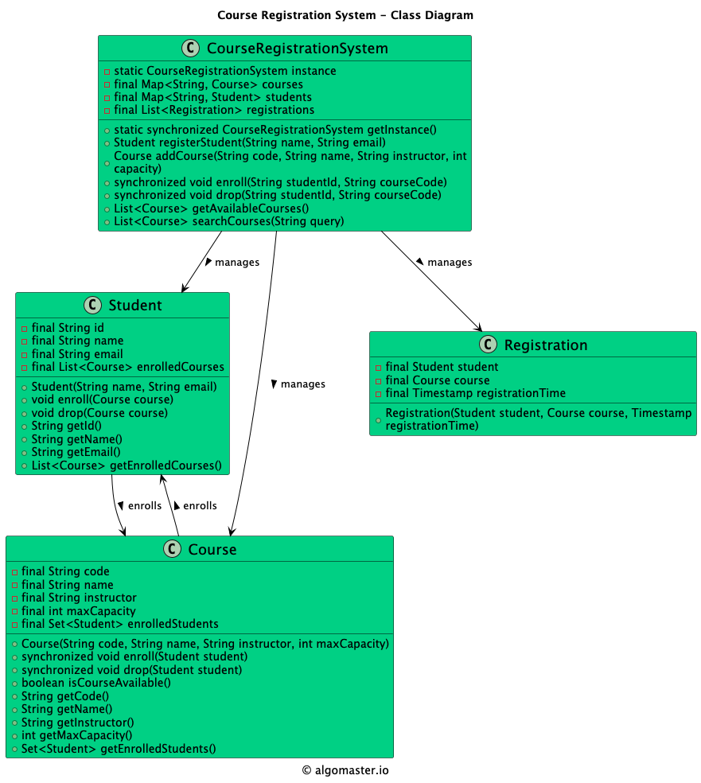

# Low-level design problem: course registration system

> Copied from <https://github.com/ashishps1/awesome-low-level-design/blob/main/problems/course-registration-system.md> (GPL-3.0, by Ashish Pratap Singh). Questions and answers are the source's own; nothing was answered or rewritten here.


# Designing a University Course Registration System

## Requirements
1. The course registration system should allow students to register for courses and view their registered courses.
2. Each course should have a course code, name, instructor, and maximum enrollment capacity.
3. Students should be able to search for courses based on course code or name.
4. The system should prevent students from registering for courses that have reached their maximum enrollment capacity.
5. The system should handle concurrent registration requests from multiple students.
6. The system should ensure data consistency and prevent race conditions.
7. The system should be extensible to accommodate future enhancements and new features.

## UML Class Diagram



## Implementations
#### [Java Implementation](https://github.com/ashishps1/awesome-low-level-design/blob/main/solutions/java/src/courseregistrationsystem) 
#### [Python Implementation](https://github.com/ashishps1/awesome-low-level-design/blob/main/solutions/python/courseregistrationsystem)
#### [C++ Implementation](https://github.com/ashishps1/awesome-low-level-design/blob/main/solutions/cpp/courseregistrationsystem)
#### [C# Implementation](https://github.com/ashishps1/awesome-low-level-design/blob/main/solutions/csharp/courseregistrationsystem)
#### [Go Implementation](https://github.com/ashishps1/awesome-low-level-design/blob/main/solutions/golang/courseregistrationsystem)

## Classes, Interfaces and Enumerations
1. The **Student** class represents a student in the course registration system, with properties such as ID, name, email, and a list of registered courses.
2. The **Course** class represents a course offered in the system, with properties such as code, name, instructor, maximum capacity, and the number of enrolled students.
3. The **Registration** class represents a registration record, associating a student with a course and capturing the registration timestamp.
4. The **CourseRegistrationSystem** class is the main class that manages the course registration system. It follows the Singleton pattern to ensure only one instance of the system exists.
5. The CourseRegistrationSystem class provides methods for adding courses and students, searching for courses, registering students for courses, and retrieving registered courses for a student.
6. Multi-threading is implemented using concurrent data structures (ConcurrentHashMap and CopyOnWriteArrayList) to handle concurrent access to shared data, such as courses and registrations.
7. The registerCourse method is synchronized to ensure thread safety when multiple students are registering for courses simultaneously.
8. The notifyObservers method is a placeholder for notifying observers (e.g., UI components) about updates to course enrollment.
9. The **CourseRegistrationDemo** class demonstrates the usage of the course registration system by creating courses and students, searching for courses, registering students for courses, and retrieving registered courses for a student.

---

## Official solutions from the repository

<details><summary><b>java</b> (19 files)</summary>


**CourseRegistrationDemo.java**

```java
package courseregistrationsystem;

import courseregistrationsystem.model.*;
import courseregistrationsystem.observer.WaitlistManager;
import courseregistrationsystem.repository.CourseRepository;
import courseregistrationsystem.repository.StudentRepository;

import java.time.DayOfWeek;
import java.time.LocalTime;

public class CourseRegistrationDemo {
    public static void main(String[] args) {
        // 1. Setup the system
        CourseRegistrationSystemFacade system = new CourseRegistrationSystemFacade();
        StudentRepository studentRepo = StudentRepository.getInstance();
        CourseRepository courseRepo = CourseRepository.getInstance();
        WaitlistManager waitlistManager = WaitlistManager.getInstance();

        // 2. Setup courses and professors
        Course cs101 = new Course("CS101", "Intro to Programming");
        Course cs201 = new Course("CS201", "Data Structures");
        cs201.addPrerequisite(cs101);
        courseRepo.saveCourse(cs101); courseRepo.saveCourse(cs201);

        Professor profA = new Professor("P1", "Dr. Smith");

        // 3. Setup course offerings using the Builder
        CourseOffering cs101Offering = new CourseOffering.Builder("CS101-F23", cs101)
                .withProfessor(profA).at(new TimeSlot(DayOfWeek.MONDAY, LocalTime.of(10, 0), LocalTime.of(11, 30)))
                .withCapacity(1).build();

        CourseOffering cs201Offering = new CourseOffering.Builder("CS201-F23", cs201)
                .withProfessor(profA).at(new TimeSlot(DayOfWeek.WEDNESDAY, LocalTime.of(14, 0), LocalTime.of(15, 30)))
                .withCapacity(2).build();

        // Register the WaitlistManager as an observer for the course offering
        cs101Offering.addObserver(waitlistManager);

        courseRepo.saveOffering(cs101Offering); courseRepo.saveOffering(cs201Offering);

        // 4. Setup students
        Student alice = new Student("S1", "Alice");
        Student bob = new Student("S2", "Bob");
        Student charlie = new Student("S3", "Charlie");
        alice.addCompletedCourse(cs101); // Alice has the prerequisite for CS201
        studentRepo.save(alice); studentRepo.save(bob); studentRepo.save(charlie);

        // 5. Run Registration Scenarios
        System.out.println("----------- SCENARIO 1: Successful Registration -----------");
        system.registerStudentForCourse(alice.getId(), cs201Offering.getId());

        System.out.println("\n----------- SCENARIO 2: Prerequisite Failure -----------");
        system.registerStudentForCourse(bob.getId(), cs201Offering.getId());

        System.out.println("\n----------- SCENARIO 3: Course Capacity and Waitlist -----------");
        system.registerStudentForCourse(bob.getId(), cs101Offering.getId()); // Bob gets the last spot
        system.registerStudentForCourse(charlie.getId(), cs101Offering.getId()); // Charlie gets waitlisted

        System.out.println("\n----------- SCENARIO 4: Dropping a course and Observer pattern triggering waitlist promotion -----------");
        system.dropStudentFromCourse(bob.getId(), cs101Offering.getId());
    }
}
```


**CourseRegistrationService.java**

```java
package courseregistrationsystem;

import courseregistrationsystem.chain.*;
import courseregistrationsystem.exception.RegistrationException;

public class CourseRegistrationService {
    private final RegistrationRuleHandler registrationChain;
    public CourseRegistrationService() {
        // Build the chain of responsibility
        RegistrationRuleHandler capacityHandler = new CapacityRuleHandler();
        RegistrationRuleHandler conflictHandler = new ScheduleConflictRuleHandler();
        conflictHandler.setNext(capacityHandler);
        RegistrationRuleHandler prereqHandler = new PrerequisiteRuleHandler();
        prereqHandler.setNext(conflictHandler);
        this.registrationChain = prereqHandler;
    }
    public void register(RegistrationRequest request) throws RegistrationException {
        registrationChain.handle(request);
    }
}
```


**CourseRegistrationSystemFacade.java**

```java
package courseregistrationsystem;

import courseregistrationsystem.chain.RegistrationRequest;
import courseregistrationsystem.exception.RegistrationException;
import courseregistrationsystem.repository.CourseRepository;
import courseregistrationsystem.repository.StudentRepository;

public class CourseRegistrationSystemFacade {
    private final CourseRegistrationService courseRegistrationService = new CourseRegistrationService();
    private final StudentRepository studentRepo = StudentRepository.getInstance();
    private final CourseRepository courseRepo = CourseRepository.getInstance();

    public void registerStudentForCourse(String studentId, String offeringId) {
        studentRepo.findById(studentId).ifPresentOrElse(student ->
                courseRepo.findOfferingById(offeringId).ifPresentOrElse(offering -> {
                            try {
                                courseRegistrationService.register(new RegistrationRequest(student, offering));
                            } catch (RegistrationException e) {
                                System.err.println("Registration Failed for " + student.getName() + ": " + e.getMessage());
                            }
                        }, () -> System.err.println("Error: Course offering " + offeringId + " not found.")
                ), () -> System.err.println("Error: Student " + studentId + " not found."));
    }

    public void dropStudentFromCourse(String studentId, String offeringId) {
        studentRepo.findById(studentId).ifPresent(student ->
                courseRepo.findOfferingById(offeringId).ifPresent(offering -> {
                    offering.dropStudent(student);
                    System.out.println(student.getName() + " dropped from " + offering.getCourse().getCourseCode());
                })
        );
    }
}
```


**README.md**

```md
# Course Registration System (LLD)

## Problem Statement

Design and implement a Course Registration System that allows students to register for courses, manages course capacity, and tracks student enrollments.

---

## Requirements

- **Student Registration:** Students can register for courses.
- **Course Management:** The system manages courses, each with a unique code, name, and capacity.
- **Capacity Enforcement:** Students cannot register for a course if it is full.
- **Duplicate Prevention:** A student cannot register for the same course more than once.
- **Enrollment Tracking:** The system tracks which students are enrolled in which courses.
- **Extensibility:** Easy to add new features such as course prerequisites, waitlists, or drop functionality.

---

## Core Entities

## UML Class Diagram


- **CourseRegistrationSystem:** Main class that manages students, courses, and registrations.
- **Student:** Represents a student with a unique ID and name.
- **Course:** Represents a course with a unique code, name, and capacity.
- **Registration:** Represents a registration record of a student in a course.

---

## Class Design

### 1. CourseRegistrationSystem
- **Fields:** Map<String, Course> courses, Map<Integer, Student> students, List<Registration> registrations
- **Methods:** registerStudent(Student), addCourse(Course), register(int studentId, String courseCode), getStudentCourses(int studentId), getCourseStudents(String courseCode), etc.

### 2. Student
- **Fields:** int id, String name

### 3. Course
- **Fields:** String code, String name, int capacity, List<Student> enrolledStudents
- **Methods:** enrollStudent(Student), isFull(), getEnrolledStudents()

### 4. Registration
- **Fields:** Student student, Course course

---

## Example Usage

```java
CourseRegistrationSystem system = new CourseRegistrationSystem();
system.registerStudent(new Student(1, "Alice"));
system.registerStudent(new Student(2, "Bob"));
system.addCourse(new Course("CS101", "Intro to CS", 2));
system.addCourse(new Course("MATH101", "Calculus I", 1));

system.register(1, "CS101"); // Alice registers for CS101
system.register(2, "CS101"); // Bob registers for CS101
system.register(1, "MATH101"); // Alice registers for MATH101

// List courses for Alice
List<Course> aliceCourses = system.getStudentCourses(1);
// List students in CS101
List<Student> cs101Students = system.getCourseStudents("CS101");
```

---

## Demo

See `CourseRegistrationSystemDemo.java` for a sample usage and simulation of the course registration system.

---

## Extending the Framework

- **Add course prerequisites:** Track and enforce prerequisites for course registration.
- **Add waitlists:** Allow students to join a waitlist if a course is full.
- **Add drop functionality:** Allow students to drop courses.

---
```


**chain/CapacityRuleHandler.java**

```java
package courseregistrationsystem.chain;

import courseregistrationsystem.exception.RegistrationException;

public class CapacityRuleHandler extends RegistrationRuleHandler {
    @Override
    public void handle(RegistrationRequest request) throws RegistrationException {
        if (request.offering().isFull()) {
            request.offering().addToWaitlist(request.student());
            System.out.println("Course " + request.offering().getCourse().getCourseCode() + " is full. " + request.student().getName() + " added to waitlist.");
        } else {
            request.offering().addStudent(request.student());
            System.out.println(request.student().getName() + " successfully registered for " + request.offering().getCourse().getCourseCode());
        }
        handleNext(request);
    }
}
```


**chain/PrerequisiteRuleHandler.java**

```java
package courseregistrationsystem.chain;

import courseregistrationsystem.exception.RegistrationException;
import courseregistrationsystem.model.Course;

import java.util.Set;

public class PrerequisiteRuleHandler extends RegistrationRuleHandler {
    @Override
    public void handle(RegistrationRequest request) throws RegistrationException {
        Set<Course> completed = request.student().getCompletedCourses();
        Set<Course> prereqs = request.offering().getCourse().getPrerequisites();
        if (!completed.containsAll(prereqs)) {
            throw new RegistrationException("Prerequisite not met for course " + request.offering().getCourse().getCourseCode());
        }
        handleNext(request);
    }
}
```


**chain/RegistrationRequest.java**

```java
package courseregistrationsystem.chain;

import courseregistrationsystem.model.CourseOffering;
import courseregistrationsystem.model.Student;

public record RegistrationRequest(Student student, CourseOffering offering) {}
```


**chain/RegistrationRuleHandler.java**

```java
package courseregistrationsystem.chain;

import courseregistrationsystem.exception.RegistrationException;

public abstract class RegistrationRuleHandler {
    private RegistrationRuleHandler next;

    public void setNext(RegistrationRuleHandler next) { this.next = next; }

    public abstract void handle(RegistrationRequest request) throws RegistrationException;

    protected void handleNext(RegistrationRequest request) throws RegistrationException {
        if (next != null) {
            next.handle(request);
        }
    }
}
```


**chain/ScheduleConflictRuleHandler.java**

```java
package courseregistrationsystem.chain;

import courseregistrationsystem.exception.RegistrationException;

public class ScheduleConflictRuleHandler extends RegistrationRuleHandler {
    @Override
    public void handle(RegistrationRequest request) throws RegistrationException {
        boolean conflict = request.student().getRegisteredOfferings().stream()
                .anyMatch(offering -> offering.getTimeSlot().overlaps(request.offering().getTimeSlot()));
        if (conflict) {
            throw new RegistrationException("Schedule conflict detected for course " + request.offering().getCourse().getCourseCode());
        }
        handleNext(request);
    }
}
```


**exception/RegistrationException.java**

```java
package courseregistrationsystem.exception;

public class RegistrationException extends Exception {
    public RegistrationException(String message) {
        super(message);
    }
}
```


**model/Course.java**

```java
package courseregistrationsystem.model;

import java.util.HashSet;
import java.util.Set;

public class Course {
    private final String courseCode;
    private final String title;
    private final Set<Course> prerequisites = new HashSet<>();

    public Course(String courseCode, String title) { this.courseCode = courseCode; this.title = title; }

    public void addPrerequisite(Course course) { prerequisites.add(course); }
    public String getCourseCode() { return courseCode; }
    public Set<Course> getPrerequisites() { return prerequisites; }
}
```


**model/CourseOffering.java**

```java
package courseregistrationsystem.model;

import courseregistrationsystem.observer.CourseOfferingObserver;

import java.util.*;

public class CourseOffering {
    private final String id;
    private final Course course;
    private final Professor professor;
    private final TimeSlot timeSlot;
    private final int capacity;
    private final List<Student> registeredStudents = new ArrayList<>();
    private final Queue<Student> waitlistedStudents = new LinkedList<>();
    private final List<CourseOfferingObserver> observers = new ArrayList<>();

    private CourseOffering(Builder builder) {
        this.id = builder.id;
        this.course = builder.course;
        this.professor = builder.professor;
        this.timeSlot = builder.timeSlot;
        this.capacity = builder.capacity;
    }

    public void addObserver(CourseOfferingObserver observer) { observers.add(observer); }
    private void notifyObservers() { observers.forEach(o -> o.onSpotAvailable(this)); }

    public boolean isFull() { return registeredStudents.size() >= capacity; }
    public void addStudent(Student student) { registeredStudents.add(student); student.enroll(this); }
    public void addToWaitlist(Student student) { waitlistedStudents.add(student); }

    public void dropStudent(Student student) {
        boolean wasFull = isFull();
        registeredStudents.remove(student);
        student.drop(this);
        if (wasFull && !isFull()) {
            notifyObservers();
        }
    }

    public Optional<Student> getNextFromWaitlist() { return Optional.ofNullable(waitlistedStudents.poll()); }
    public String getId() { return id; }
    public Course getCourse() { return course; }
    public TimeSlot getTimeSlot() { return timeSlot; }

    // Builder Pattern
    public static class Builder {
        private String id; private Course course; private Professor professor; private TimeSlot timeSlot; private int capacity;
        public Builder(String id, Course course) { this.id = id; this.course = course; }
        public Builder withProfessor(Professor professor) { this.professor = professor; return this; }
        public Builder at(TimeSlot timeSlot) { this.timeSlot = timeSlot; return this; }
        public Builder withCapacity(int capacity) { this.capacity = capacity; return this; }
        public CourseOffering build() { return new CourseOffering(this); }
    }
}
```


**model/Professor.java**

```java
package courseregistrationsystem.model;

public record Professor(String id, String name) {}
```


**model/Student.java**

```java
package courseregistrationsystem.model;

import java.util.HashSet;
import java.util.Set;

public class Student {
    private final String id;
    private final String name;
    private final Set<Course> completedCourses = new HashSet<>();
    private final Set<CourseOffering> registeredOfferings = new HashSet<>();

    public Student(String id, String name) { this.id = id; this.name = name; }

    public String getId() { return id; }
    public String getName() { return name; }
    public Set<Course> getCompletedCourses() { return completedCourses; }
    public Set<CourseOffering> getRegisteredOfferings() { return registeredOfferings; }
    public void addCompletedCourse(Course course) { completedCourses.add(course); }
    public void enroll(CourseOffering offering) { registeredOfferings.add(offering); }
    public void drop(CourseOffering offering) { registeredOfferings.remove(offering); }
}
```


**model/TimeSlot.java**

```java
package courseregistrationsystem.model;

import java.time.DayOfWeek;
import java.time.LocalTime;

public record TimeSlot(DayOfWeek day, LocalTime startTime, LocalTime endTime) {
    public boolean overlaps(TimeSlot other) {
        return this.day == other.day &&
                this.startTime.isBefore(other.endTime) &&
                this.endTime.isAfter(other.startTime);
    }
}
```


**observer/CourseOfferingObserver.java**

```java
package courseregistrationsystem.observer;

import courseregistrationsystem.model.CourseOffering;

public interface CourseOfferingObserver {
    void onSpotAvailable(CourseOffering offering);
}
```


**observer/WaitlistManager.java**

```java
package courseregistrationsystem.observer;

import courseregistrationsystem.CourseRegistrationService;
import courseregistrationsystem.chain.RegistrationRequest;
import courseregistrationsystem.exception.RegistrationException;
import courseregistrationsystem.model.CourseOffering;

public class WaitlistManager implements CourseOfferingObserver {
    private static final WaitlistManager INSTANCE = new WaitlistManager();
    private final CourseRegistrationService courseRegistrationService = new CourseRegistrationService(); // To re-register a waitlisted student
    public static WaitlistManager getInstance() { return INSTANCE; }
    private WaitlistManager() {}

    @Override
    public void onSpotAvailable(CourseOffering offering) {
        System.out.println("OBSERVER (WaitlistManager): Spot available in " + offering.getCourse().getCourseCode() + ". Processing waitlist.");
        offering.getNextFromWaitlist().ifPresent(student -> {
            System.out.println("Promoting " + student.getName() + " from waitlist for " + offering.getCourse().getCourseCode());
            try {
                // We can re-use the registration service, but a real system might have a simplified "promote" logic
                courseRegistrationService.register(new RegistrationRequest(student, offering));
            } catch (RegistrationException e) {
                System.err.println("Failed to promote " + student.getName() + ": " + e.getMessage());
                // Handle failure: try next student or notify admin
            }
        });
    }
}
```


**repository/CourseRepository.java**

```java
package courseregistrationsystem.repository;

import courseregistrationsystem.model.Course;
import courseregistrationsystem.model.CourseOffering;

import java.util.Map;
import java.util.Optional;
import java.util.concurrent.ConcurrentHashMap;

public class CourseRepository {
    private static final CourseRepository INSTANCE = new CourseRepository();
    private final Map<String, Course> courses = new ConcurrentHashMap<>();
    private final Map<String, CourseOffering> offerings = new ConcurrentHashMap<>();

    public static CourseRepository getInstance() { return INSTANCE; }
    public void saveCourse(Course c) { courses.put(c.getCourseCode(), c); }
    public void saveOffering(CourseOffering o) { offerings.put(o.getId(), o); }
    public Optional<CourseOffering> findOfferingById(String id) { return Optional.ofNullable(offerings.get(id)); }
}
```


**repository/StudentRepository.java**

```java
package courseregistrationsystem.repository;

import courseregistrationsystem.model.Student;

import java.util.Map;
import java.util.Optional;
import java.util.concurrent.ConcurrentHashMap;

public class StudentRepository {
    private static final StudentRepository INSTANCE = new StudentRepository();
    private final Map<String, Student> students = new ConcurrentHashMap<>();

    public static StudentRepository getInstance() { return INSTANCE; }
    public void save(Student s) { students.put(s.getId(), s); }
    public Optional<Student> findById(String id) { return Optional.ofNullable(students.get(id)); }
}
```

</details>

<details><summary><b>python</b> (6 files)</summary>


**README.md**

```md
# Designing a University Course Registration System

## Requirements
1. The course registration system should allow students to register for courses and view their registered courses.
2. Each course should have a course code, name, instructor, and maximum enrollment capacity.
3. Students should be able to search for courses based on course code or name.
4. The system should prevent students from registering for courses that have reached their maximum enrollment capacity.
5. The system should handle concurrent registration requests from multiple students.
6. The system should ensure data consistency and prevent race conditions.
7. The system should be extensible to accommodate future enhancements and new features.

## Classes, Interfaces and Enumerations
1. The **Student** class represents a student in the course registration system, with properties such as ID, name, email, and a list of registered courses.
2. The **Course** class represents a course offered in the system, with properties such as code, name, instructor, maximum capacity, and the number of enrolled students.
3. The **Registration** class represents a registration record, associating a student with a course and capturing the registration timestamp.
4. The **CourseRegistrationSystem** class is the main class that manages the course registration system. It follows the Singleton pattern to ensure only one instance of the system exists.
5. The CourseRegistrationSystem class provides methods for adding courses and students, searching for courses, registering students for courses, and retrieving registered courses for a student.
6. Multi-threading is implemented using concurrent data structures (ConcurrentHashMap and CopyOnWriteArrayList) to handle concurrent access to shared data, such as courses and registrations.
7. The registerCourse method is synchronized to ensure thread safety when multiple students are registering for courses simultaneously.
8. The notifyObservers method is a placeholder for notifying observers (e.g., UI components) about updates to course enrollment.
9. The **CourseRegistrationDemo** class demonstrates the usage of the course registration system by creating courses and students, searching for courses, registering students for courses, and retrieving registered courses for a student.
```


**course.py**

```py
from datetime import datetime
from typing import List, Dict

class Course:
    def __init__(self, code: str, name: str, instructor: str, max_capacity: int, enrolled_students: int):
        self.code = code
        self.name = name
        self.instructor = instructor
        self.max_capacity = max_capacity
        self.enrolled_students = enrolled_students

    def set_enrolled_students(self, enrolled_students: int):
        self.enrolled_students = enrolled_students

    def get_code(self) -> str:
        return self.code

    def get_name(self) -> str:
        return self.name

    def get_instructor(self) -> str:
        return self.instructor

    def get_max_capacity(self) -> int:
        return self.max_capacity

    def get_enrolled_students(self) -> int:
        return self.enrolled_students
```


**course_registration_demo.py**

```py
from course_registration_system import CourseRegistrationSystem
from course import Course
from student import Student

class CourseRegistrationDemo:
    @staticmethod
    def run():
        registration_system = CourseRegistrationSystem.get_instance()

        # Create courses
        course1 = Course("CS101", "Introduction to Programming", "John Doe", 50, 0)
        course2 = Course("CS201", "Data Structures and Algorithms", "Jane Smith", 30, 0)
        registration_system.add_course(course1)
        registration_system.add_course(course2)

        # Create students
        student1 = Student(1, "Alice", "alice@example.com", [])
        student2 = Student(2, "Bob", "bob@example.com", [])
        registration_system.add_student(student1)
        registration_system.add_student(student2)

        # Search for courses
        search_results = registration_system.search_courses("CS")
        print("Search Results:")
        for course in search_results:
            print(f"{course.get_code()} - {course.get_name()}")

        # Register courses for students
        registered1 = registration_system.register_course(student1, course1)
        registered2 = registration_system.register_course(student2, course1)
        registered3 = registration_system.register_course(student1, course2)

        print("Registration Results:")
        print(f"Student 1 - Course 1: {registered1}")
        print(f"Student 2 - Course 1: {registered2}")
        print(f"Student 1 - Course 2: {registered3}")

        # Get registered courses for a student
        registered_courses = registration_system.get_registered_courses(student1)
        print("Registered Courses for Student 1:")
        for course in registered_courses:
            print(f"{course.get_code()} - {course.get_name()}")

if __name__ == "__main__":
    CourseRegistrationDemo.run()
```


**course_registration_system.py**

```py
from typing import Dict, List
from course import Course
from student import Student
from registration import Registration
from datetime import datetime

class CourseRegistrationSystem:
    instance = None
    courses: Dict[str, Course] = {}
    students: Dict[int, Student] = {}
    registrations: List[Registration] = []

    @staticmethod
    def get_instance():
        if CourseRegistrationSystem.instance is None:
            CourseRegistrationSystem.instance = CourseRegistrationSystem()
        return CourseRegistrationSystem.instance

    def add_course(self, course: Course):
        self.courses[course.get_code()] = course

    def add_student(self, student: Student):
        self.students[student.get_id()] = student

    def search_courses(self, query: str) -> List[Course]:
        result = []
        for course in self.courses.values():
            if query in course.get_code() or query in course.get_name():
                result.append(course)
        return result

    def register_course(self, student: Student, course: Course) -> bool:
        if course.get_enrolled_students() < course.get_max_capacity():
            registration = Registration(student, course, datetime.now())
            self.registrations.append(registration)
            student.get_registered_courses().append(course)
            course.set_enrolled_students(course.get_enrolled_students() + 1)
            self._notify_observers(course)
            return True
        return False

    def get_registered_courses(self, student: Student) -> List[Course]:
        return student.get_registered_courses()

    def _notify_observers(self, course: Course):
        # Notify observers (e.g., UI) about the updated course enrollment
        # ...
        pass
```


**registration.py**

```py
from student import Student
from course import Course
import datetime

class Registration:
    def __init__(self, student: Student, course: Course, registration_time: datetime):
        self.student = student
        self.course = course
        self.registration_time = registration_time
```


**student.py**

```py
from typing import List
from course import Course

class Student:
    def __init__(self, student_id: int, name: str, email: str, registered_courses: List[Course]):
        self.id = student_id
        self.name = name
        self.email = email
        self.registered_courses = registered_courses

    def get_id(self) -> int:
        return self.id

    def get_name(self) -> str:
        return self.name

    def get_email(self) -> str:
        return self.email

    def get_registered_courses(self) -> List[Course]:
        return self.registered_courses
```

</details>

<details><summary><b>cpp</b> (8 files)</summary>


**Course.cpp**

```cpp
#include "Course.hpp"
#include <iostream>
#include <algorithm>

Course::Course(std::string courseId, std::string name, int maxCapacity)
    : courseId(courseId), name(name), maxCapacity(maxCapacity), available(true) {}

std::string Course::getCourseId() const { return courseId; }
std::string Course::getName() const { return name; }
int Course::getMaxCapacity() const { return maxCapacity; }
int Course::getCurrentEnrollment() const { return enrolledStudents.size(); }
bool Course::isAvailable() const { return available; }

bool Course::enrollStudent(Student* student) {
    if (!available || getCurrentEnrollment() >= maxCapacity) return false;
    if (hasStudent(student)) return false;
    
    enrolledStudents.push_back(student);
    return true;
}

bool Course::dropStudent(Student* student) {
    auto it = std::find(enrolledStudents.begin(), enrolledStudents.end(), student);
    if (it == enrolledStudents.end()) return false;
    
    enrolledStudents.erase(it);
    return true;
}

bool Course::hasStudent(Student* student) const {
    return std::find(enrolledStudents.begin(), enrolledStudents.end(), student) 
           != enrolledStudents.end();
}

void Course::displayInfo() const {
    std::cout << "Course: " << name << " (ID: " << courseId << ")" << std::endl;
    std::cout << "Enrollment: " << getCurrentEnrollment() << "/" << maxCapacity << std::endl;
    std::cout << "Status: " << (available ? "Available" : "Closed") << std::endl;
}

void Course::setAvailable(bool status) {
    available = status;
}
```


**Course.hpp**

```hpp
#ifndef COURSE_HPP
#define COURSE_HPP

#include <string>
#include <vector>
#include "Student.hpp"

class Course {
private:
    std::string courseId;
    std::string name;
    int maxCapacity;
    std::vector<Student*> enrolledStudents;
    bool available;

public:
    Course(std::string courseId, std::string name, int maxCapacity);
    
    std::string getCourseId() const;
    std::string getName() const;
    int getMaxCapacity() const;
    int getCurrentEnrollment() const;
    bool isAvailable() const;
    
    bool enrollStudent(Student* student);
    bool dropStudent(Student* student);
    bool hasStudent(Student* student) const;
    void displayInfo() const;
    void setAvailable(bool status);
};

#endif
```


**README.md**

```md
# Designing a University Course Registration System

## Requirements
1. The course registration system should allow students to register for courses and view their registered courses.
2. Each course should have a course code, name, instructor, and maximum enrollment capacity.
3. Students should be able to search for courses based on course code or name.
4. The system should prevent students from registering for courses that have reached their maximum enrollment capacity.
5. The system should handle concurrent registration requests from multiple students.
6. The system should ensure data consistency and prevent race conditions.
7. The system should be extensible to accommodate future enhancements and new features.

## Classes, Interfaces and Enumerations
1. The **Student** class represents a student in the course registration system, with properties such as ID, name, email, and a list of registered courses.
2. The **Course** class represents a course offered in the system, with properties such as code, name, instructor, maximum capacity, and the number of enrolled students.
3. The **Registration** class represents a registration record, associating a student with a course and capturing the registration timestamp.
4. The **CourseRegistrationSystem** class is the main class that manages the course registration system. It follows the Singleton pattern to ensure only one instance of the system exists.
5. The CourseRegistrationSystem class provides methods for adding courses and students, searching for courses, registering students for courses, and retrieving registered courses for a student.
6. Multi-threading is implemented using concurrent data structures (ConcurrentHashMap and CopyOnWriteArrayList) to handle concurrent access to shared data, such as courses and registrations.
7. The registerCourse method is synchronized to ensure thread safety when multiple students are registering for courses simultaneously.
8. The notifyObservers method is a placeholder for notifying observers (e.g., UI components) about updates to course enrollment.
9. The **CourseRegistrationDemo** class demonstrates the usage of the course registration system by creating courses and students, searching for courses, registering students for courses, and retrieving registered courses for a student.
```


**RegistrationSystem.cpp**

```cpp
#include "RegistrationSystem.hpp"
#include <iostream>

RegistrationSystem::RegistrationSystem() {}

RegistrationSystem::~RegistrationSystem() {
    for (auto course : courses) delete course;
    for (auto student : students) delete student;
}

void RegistrationSystem::addCourse(Course* course) {
    courses.push_back(course);
}

void RegistrationSystem::addStudent(Student* student) {
    students.push_back(student);
}

bool RegistrationSystem::enrollStudentInCourse(Student* student, Course* course) {
    if (!student || !course) return false;
    return student->enrollInCourse(course);
}

bool RegistrationSystem::dropStudentFromCourse(Student* student, Course* course) {
    if (!student || !course) return false;
    return student->dropCourse(course);
}

void RegistrationSystem::displayAllCourses() const {
    std::cout << "\nAll Courses:" << std::endl;
    for (const auto& course : courses) {
        course->displayInfo();
        std::cout << "------------------------" << std::endl;
    }
}

void RegistrationSystem::displayAllStudents() const {
    std::cout << "\nAll Students:" << std::endl;
    for (const auto& student : students) {
        student->displayInfo();
        std::cout << "------------------------" << std::endl;
    }
}

void RegistrationSystem::displayCourseEnrollments(Course* course) const {
    if (!course) return;
    
    std::cout << "\nEnrollments for " << course->getName() << ":" << std::endl;
    for (const auto& student : students) {
        if (student->isEnrolledIn(course)) {
            std::cout << "- " << student->getName() << " (ID: " << student->getStudentId() << ")" << std::endl;
        }
    }
}

void RegistrationSystem::displayStudentEnrollments(Student* student) const {
    if (!student) return;
    student->displayInfo();
}

Course* RegistrationSystem::findCourse(std::string courseId) const {
    for (auto course : courses) {
        if (course->getCourseId() == courseId) return course;
    }
    return nullptr;
}

Student* RegistrationSystem::findStudent(std::string studentId) const {
    for (auto student : students) {
        if (student->getStudentId() == studentId) return student;
    }
    return nullptr;
}
```


**RegistrationSystem.hpp**

```hpp
#ifndef REGISTRATION_SYSTEM_HPP
#define REGISTRATION_SYSTEM_HPP

#include <vector>
#include <string>
#include "Course.hpp"
#include "Student.hpp"

class RegistrationSystem {
private:
    std::vector<Course*> courses;
    std::vector<Student*> students;

public:
    RegistrationSystem();
    ~RegistrationSystem();
    
    void addCourse(Course* course);
    void addStudent(Student* student);
    bool enrollStudentInCourse(Student* student, Course* course);
    bool dropStudentFromCourse(Student* student, Course* course);
    
    void displayAllCourses() const;
    void displayAllStudents() const;
    void displayCourseEnrollments(Course* course) const;
    void displayStudentEnrollments(Student* student) const;
    
    Course* findCourse(std::string courseId) const;
    Student* findStudent(std::string studentId) const;
};

#endif
```


**RegistrationSystemDemo.cpp**

```cpp
#include "RegistrationSystem.hpp"
#include <iostream>

int main() {
    RegistrationSystem system;
    
    // Create courses
    Course* course1 = new Course("CS101", "Introduction to Programming", 3);
    Course* course2 = new Course("CS102", "Data Structures", 2);
    Course* course3 = new Course("CS103", "Algorithms", 2);
    
    system.addCourse(course1);
    system.addCourse(course2);
    system.addCourse(course3);
    
    // Create students
    Student* student1 = new Student("S001", "John Doe");
    Student* student2 = new Student("S002", "Jane Smith");
    Student* student3 = new Student("S003", "Bob Johnson");
    
    system.addStudent(student1);
    system.addStudent(student2);
    system.addStudent(student3);
    
    // Display initial state
    system.displayAllCourses();
    system.displayAllStudents();
    
    // Enroll students in courses
    if (system.enrollStudentInCourse(student1, course1)) {
        std::cout << "Enrolled " << student1->getName() << " in " << course1->getName() << std::endl;
    }
    
    if (system.enrollStudentInCourse(student2, course1)) {
        std::cout << "Enrolled " << student2->getName() << " in " << course1->getName() << std::endl;
    }
    
    if (system.enrollStudentInCourse(student1, course2)) {
        std::cout << "Enrolled " << student1->getName() << " in " << course2->getName() << std::endl;
    }
    
    // Display enrollments
    system.displayCourseEnrollments(course1);
    system.displayStudentEnrollments(student1);
    
    // Drop a course
    if (system.dropStudentFromCourse(student1, course1)) {
        std::cout << "\nDropped " << student1->getName() << " from " << course1->getName() << std::endl;
    }
    
    // Display final state
    system.displayCourseEnrollments(course1);
    system.displayStudentEnrollments(student1);
    
    return 0;
}
```


**Student.cpp**

```cpp
#include "Student.hpp"
#include "Course.hpp"
#include <iostream>
#include <algorithm>

Student::Student(std::string studentId, std::string name)
    : studentId(studentId), name(name) {}

std::string Student::getStudentId() const { return studentId; }
std::string Student::getName() const { return name; }
const std::vector<Course*>& Student::getEnrolledCourses() const { return enrolledCourses; }

bool Student::enrollInCourse(Course* course) {
    if (isEnrolledIn(course)) return false;
    if (!course->enrollStudent(this)) return false;
    
    enrolledCourses.push_back(course);
    return true;
}

bool Student::dropCourse(Course* course) {
    auto it = std::find(enrolledCourses.begin(), enrolledCourses.end(), course);
    if (it == enrolledCourses.end()) return false;
    
    if (!course->dropStudent(this)) return false;
    enrolledCourses.erase(it);
    return true;
}

bool Student::isEnrolledIn(Course* course) const {
    return std::find(enrolledCourses.begin(), enrolledCourses.end(), course) 
           != enrolledCourses.end();
}

void Student::displayInfo() const {
    std::cout << "Student: " << name << " (ID: " << studentId << ")" << std::endl;
    std::cout << "Enrolled Courses:" << std::endl;
    for (const auto& course : enrolledCourses) {
        std::cout << "- " << course->getName() << " (ID: " << course->getCourseId() << ")" << std::endl;
    }
}
```


**Student.hpp**

```hpp
#ifndef STUDENT_HPP
#define STUDENT_HPP

#include <string>
#include <vector>

class Course;  // Forward declaration

class Student {
private:
    std::string studentId;
    std::string name;
    std::vector<Course*> enrolledCourses;

public:
    Student(std::string studentId, std::string name);
    
    std::string getStudentId() const;
    std::string getName() const;
    const std::vector<Course*>& getEnrolledCourses() const;
    
    bool enrollInCourse(Course* course);
    bool dropCourse(Course* course);
    bool isEnrolledIn(Course* course) const;
    void displayInfo() const;
};

#endif
```

</details>

<details><summary><b>golang</b> (6 files)</summary>


**README.md**

```md
# Designing a University Course Registration System

## Requirements
1. The course registration system should allow students to register for courses and view their registered courses.
2. Each course should have a course code, name, instructor, and maximum enrollment capacity.
3. Students should be able to search for courses based on course code or name.
4. The system should prevent students from registering for courses that have reached their maximum enrollment capacity.
5. The system should handle concurrent registration requests from multiple students.
6. The system should ensure data consistency and prevent race conditions.
7. The system should be extensible to accommodate future enhancements and new features.

## Classes, Interfaces and Enumerations
1. The **Student** class represents a student in the course registration system, with properties such as ID, name, email, and a list of registered courses.
2. The **Course** class represents a course offered in the system, with properties such as code, name, instructor, maximum capacity, and the number of enrolled students.
3. The **Registration** class represents a registration record, associating a student with a course and capturing the registration timestamp.
4. The **CourseRegistrationSystem** class is the main class that manages the course registration system. It follows the Singleton pattern to ensure only one instance of the system exists.
5. The CourseRegistrationSystem class provides methods for adding courses and students, searching for courses, registering students for courses, and retrieving registered courses for a student.
6. Multi-threading is implemented using concurrent data structures (ConcurrentHashMap and CopyOnWriteArrayList) to handle concurrent access to shared data, such as courses and registrations.
7. The registerCourse method is synchronized to ensure thread safety when multiple students are registering for courses simultaneously.
8. The notifyObservers method is a placeholder for notifying observers (e.g., UI components) about updates to course enrollment.
9. The **CourseRegistrationDemo** class demonstrates the usage of the course registration system by creating courses and students, searching for courses, registering students for courses, and retrieving registered courses for a student.
```


**course.go**

```go
package courseregistrationsystem

import "sync"

type Course struct {
	Code             string
	Name             string
	Instructor       string
	MaxCapacity      int
	enrolledStudents int
	mu               sync.Mutex
}

func NewCourse(code, name, instructor string, maxCapacity int) *Course {
	return &Course{
		Code:        code,
		Name:        name,
		Instructor:  instructor,
		MaxCapacity: maxCapacity,
	}
}

func (c *Course) GetEnrolledStudents() int {
	c.mu.Lock()
	defer c.mu.Unlock()
	return c.enrolledStudents
}

func (c *Course) IncrementEnrolled() {
	c.mu.Lock()
	defer c.mu.Unlock()
	c.enrolledStudents++
}
```


**course_registration_system.go**

```go
package courseregistrationsystem

import (
	"fmt"
	"strings"
	"sync"
)

type CourseRegistrationSystem struct {
	courses       map[string]*Course
	students      map[int]*Student
	registrations []*Registration
	mu            sync.RWMutex
}

var (
	instance *CourseRegistrationSystem
	once     sync.Once
)

func GetRegistrationSystem() *CourseRegistrationSystem {
	once.Do(func() {
		instance = &CourseRegistrationSystem{
			courses:       make(map[string]*Course),
			students:      make(map[int]*Student),
			registrations: make([]*Registration, 0),
		}
	})
	return instance
}

func (rs *CourseRegistrationSystem) AddCourse(course *Course) {
	rs.mu.Lock()
	defer rs.mu.Unlock()
	rs.courses[course.Code] = course
}

func (rs *CourseRegistrationSystem) AddStudent(student *Student) {
	rs.mu.Lock()
	defer rs.mu.Unlock()
	rs.students[student.ID] = student
}

func (rs *CourseRegistrationSystem) SearchCourses(query string) []*Course {
	rs.mu.RLock()
	defer rs.mu.RUnlock()

	var result []*Course
	query = strings.ToLower(query)

	for _, course := range rs.courses {
		if strings.Contains(strings.ToLower(course.Code), query) ||
			strings.Contains(strings.ToLower(course.Name), query) {
			result = append(result, course)
		}
	}
	return result
}

func (rs *CourseRegistrationSystem) RegisterCourse(student *Student, course *Course) error {
	rs.mu.Lock()
	defer rs.mu.Unlock()

	// Check if course exists
	if _, exists := rs.courses[course.Code]; !exists {
		return fmt.Errorf("course %s does not exist", course.Code)
	}

	// Check if student exists
	if _, exists := rs.students[student.ID]; !exists {
		return fmt.Errorf("student with ID %d does not exist", student.ID)
	}

	// Check capacity
	if course.GetEnrolledStudents() >= course.MaxCapacity {
		return fmt.Errorf("course %s is full", course.Code)
	}

	// Check if student is already registered
	for _, c := range student.RegisteredCourses {
		if c.Code == course.Code {
			return fmt.Errorf("student is already registered for course %s", course.Code)
		}
	}

	// Create registration
	registration := NewRegistration(student, course)
	rs.registrations = append(rs.registrations, registration)

	// Update course and student
	course.IncrementEnrolled()
	student.AddCourse(course)

	rs.notifyObservers(course)
	return nil
}

func (rs *CourseRegistrationSystem) GetRegisteredCourses(student *Student) []*Course {
	rs.mu.RLock()
	defer rs.mu.RUnlock()

	if _, exists := rs.students[student.ID]; !exists {
		return nil
	}

	return student.RegisteredCourses
}

func (rs *CourseRegistrationSystem) notifyObservers(course *Course) {
	// TODO: Implement observer pattern for notifications
	fmt.Printf("Course %s updated: %d/%d students enrolled\n",
		course.Code, course.GetEnrolledStudents(), course.MaxCapacity)
}
```


**course_registration_system_demo.go**

```go
package courseregistrationsystem

import (
	"fmt"
)

func Run() {
	registrationSystem := GetRegistrationSystem()

	// Create courses
	course1 := NewCourse("CS101", "Introduction to Programming", "John Doe", 50)
	course2 := NewCourse("CS201", "Data Structures and Algorithms", "Jane Smith", 30)

	registrationSystem.AddCourse(course1)
	registrationSystem.AddCourse(course2)

	// Create students
	student1 := NewStudent(1, "Alice", "alice@example.com")
	student2 := NewStudent(2, "Bob", "bob@example.com")

	registrationSystem.AddStudent(student1)
	registrationSystem.AddStudent(student2)

	// Search for courses
	searchResults := registrationSystem.SearchCourses("CS")
	fmt.Println("Search Results:")
	for _, course := range searchResults {
		fmt.Printf("%s - %s\n", course.Code, course.Name)
	}

	// Register courses for students
	fmt.Println("\nRegistration Results:")

	err := registrationSystem.RegisterCourse(student1, course1)
	fmt.Printf("Student 1 - Course 1: %v\n", err == nil)

	err = registrationSystem.RegisterCourse(student2, course1)
	fmt.Printf("Student 2 - Course 1: %v\n", err == nil)

	err = registrationSystem.RegisterCourse(student1, course2)
	fmt.Printf("Student 1 - Course 2: %v\n", err == nil)

	// Get registered courses for a student
	registeredCourses := registrationSystem.GetRegisteredCourses(student1)
	fmt.Println("\nRegistered Courses for Student 1:")
	for _, course := range registeredCourses {
		fmt.Printf("%s - %s\n", course.Code, course.Name)
	}
}
```


**registration.go**

```go
package courseregistrationsystem

import "time"

type Registration struct {
	Student          *Student
	Course           *Course
	RegistrationTime time.Time
}

func NewRegistration(student *Student, course *Course) *Registration {
	return &Registration{
		Student:          student,
		Course:           course,
		RegistrationTime: time.Now(),
	}
}
```


**student.go**

```go
package courseregistrationsystem

import "sync"

type Student struct {
	ID                int
	Name              string
	Email             string
	RegisteredCourses []*Course
	mu                sync.Mutex
}

func NewStudent(id int, name, email string) *Student {
	return &Student{
		ID:                id,
		Name:              name,
		Email:             email,
		RegisteredCourses: make([]*Course, 0),
	}
}

func (s *Student) AddCourse(course *Course) {
	s.mu.Lock()
	defer s.mu.Unlock()
	s.RegisteredCourses = append(s.RegisteredCourses, course)
}
```

</details>

<details><summary><b>csharp</b> (6 files)</summary>


**Course.cs**

```cs
namespace CourseRegistrationSystem
{
    public class Course
    {
        private readonly string code;
        private readonly string name;
        private readonly string instructor;
        private readonly int maxCapacity;
        private int enrolledStudents;

        public Course(string code, string name, string instructor, int maxCapacity, int enrolledStudents)
        {
            this.code = code;
            this.name = name;
            this.instructor = instructor;
            this.maxCapacity = maxCapacity;
            this.enrolledStudents = enrolledStudents;
        }

        public string GetCode() => code;
        public string GetName() => name;
        public string GetInstructor() => instructor;
        public int GetMaxCapacity() => maxCapacity;
        public int GetEnrolledStudents() => enrolledStudents;

        public void SetEnrolledStudents(int enrolledStudents) => this.enrolledStudents = enrolledStudents;
    }
}
```


**CourseRegistrationDemo.cs**

```cs
using System;
using System.Collections.Generic;

namespace CourseRegistrationSystem
{
    public class CourseRegistrationDemo
    {
        public static void Run()
        {
            CourseRegistrationSystem registrationSystem = CourseRegistrationSystem.GetInstance();

            // Create courses
            Course course1 = new Course("CS101", "Introduction to Programming", "John Doe", 50, 0);
            Course course2 = new Course("CS201", "Data Structures and Algorithms", "Jane Smith", 30, 0);
            registrationSystem.AddCourse(course1);
            registrationSystem.AddCourse(course2);

            // Create students
            Student student1 = new Student(1, "Alice", "alice@example.com", new List<Course>());
            Student student2 = new Student(2, "Bob", "bob@example.com", new List<Course>());
            registrationSystem.AddStudent(student1);
            registrationSystem.AddStudent(student2);

            // Search for courses
            List<Course> searchResults = registrationSystem.SearchCourses("CS");
            Console.WriteLine("Search Results:");
            foreach (Course course in searchResults)
            {
                Console.WriteLine(course.GetCode() + " - " + course.GetName());
            }

            // Register courses for students
            bool registered1 = registrationSystem.RegisterCourse(student1, course1);
            bool registered2 = registrationSystem.RegisterCourse(student2, course1);
            bool registered3 = registrationSystem.RegisterCourse(student1, course2);

            Console.WriteLine("Registration Results:");
            Console.WriteLine("Student 1 - Course 1: " + registered1);
            Console.WriteLine("Student 2 - Course 1: " + registered2);
            Console.WriteLine("Student 1 - Course 2: " + registered3);

            // Get registered courses for a student
            List<Course> registeredCourses = registrationSystem.GetRegisteredCourses(student1);
            Console.WriteLine("Registered Courses for Student 1:");
            foreach (Course course in registeredCourses)
            {
                Console.WriteLine(course.GetCode() + " - " + course.GetName());
            }
        }
    }
}
```


**CourseRegistrationSystem.cs**

```cs
using System;
using System.Collections.Concurrent;
using System.Collections.Generic;
using System.Linq;

namespace CourseRegistrationSystem
{
    public class CourseRegistrationSystem
    {
        private static CourseRegistrationSystem instance;
        private readonly ConcurrentDictionary<string, Course> courses;
        private readonly ConcurrentDictionary<int, Student> students;
        private readonly List<Registration> registrations;

        private CourseRegistrationSystem()
        {
            courses = new ConcurrentDictionary<string, Course>();
            students = new ConcurrentDictionary<int, Student>();
            registrations = new List<Registration>();
        }

        public static CourseRegistrationSystem GetInstance()
        {
            if (instance == null)
            {
                instance = new CourseRegistrationSystem();
            }
            return instance;
        }

        public void AddCourse(Course course) => courses[course.GetCode()] = course;

        public void AddStudent(Student student) => students[student.GetId()] = student;

        public List<Course> SearchCourses(string query)
        {
            return courses.Values
                          .Where(course => course.GetCode().Contains(query) || course.GetName().Contains(query))
                          .ToList();
        }

        public bool RegisterCourse(Student student, Course course)
        {
            if (course.GetEnrolledStudents() < course.GetMaxCapacity())
            {
                Registration registration = new Registration(student, course, DateTime.Now);
                registrations.Add(registration);
                student.GetRegisteredCourses().Add(course);
                course.SetEnrolledStudents(course.GetEnrolledStudents() + 1);
                NotifyObservers(course);
                return true;
            }
            return false;
        }

        public List<Course> GetRegisteredCourses(Student student) => student.GetRegisteredCourses();

        private void NotifyObservers(Course course)
        {
            // Notify observers (e.g., UI) about the updated course enrollment
        }
    }
}
```


**README.md**

```md
# Designing a University Course Registration System

## Requirements
1. The course registration system should allow students to register for courses and view their registered courses.
2. Each course should have a course code, name, instructor, and maximum enrollment capacity.
3. Students should be able to search for courses based on course code or name.
4. The system should prevent students from registering for courses that have reached their maximum enrollment capacity.
5. The system should handle concurrent registration requests from multiple students.
6. The system should ensure data consistency and prevent race conditions.
7. The system should be extensible to accommodate future enhancements and new features.

## Classes, Interfaces and Enumerations
1. The **Student** class represents a student in the course registration system, with properties such as ID, name, email, and a list of registered courses.
2. The **Course** class represents a course offered in the system, with properties such as code, name, instructor, maximum capacity, and the number of enrolled students.
3. The **Registration** class represents a registration record, associating a student with a course and capturing the registration timestamp.
4. The **CourseRegistrationSystem** class is the main class that manages the course registration system. It follows the Singleton pattern to ensure only one instance of the system exists.
5. The CourseRegistrationSystem class provides methods for adding courses and students, searching for courses, registering students for courses, and retrieving registered courses for a student.
6. Multi-threading is implemented using concurrent data structures (ConcurrentHashMap and CopyOnWriteArrayList) to handle concurrent access to shared data, such as courses and registrations.
7. The registerCourse method is synchronized to ensure thread safety when multiple students are registering for courses simultaneously.
8. The notifyObservers method is a placeholder for notifying observers (e.g., UI components) about updates to course enrollment.
9. The **CourseRegistrationDemo** class demonstrates the usage of the course registration system by creating courses and students, searching for courses, registering students for courses, and retrieving registered courses for a student.
```


**Registration.cs**

```cs
using System;

namespace CourseRegistrationSystem
{
    public class Registration
    {
        private readonly Student student;
        private readonly Course course;
        private readonly DateTime registrationTime;

        public Registration(Student student, Course course, DateTime registrationTime)
        {
            this.student = student;
            this.course = course;
            this.registrationTime = registrationTime;
        }
    }
}
```


**Student.cs**

```cs
using System.Collections.Generic;

namespace CourseRegistrationSystem
{
    public class Student
    {
        private readonly int id;
        private readonly string name;
        private readonly string email;
        private readonly List<Course> registeredCourses;

        public Student(int id, string name, string email, List<Course> registeredCourses)
        {
            this.id = id;
            this.name = name;
            this.email = email;
            this.registeredCourses = registeredCourses;
        }

        public int GetId() => id;
        public string GetName() => name;
        public string GetEmail() => email;
        public List<Course> GetRegisteredCourses() => registeredCourses;
    }
}
```

</details>
