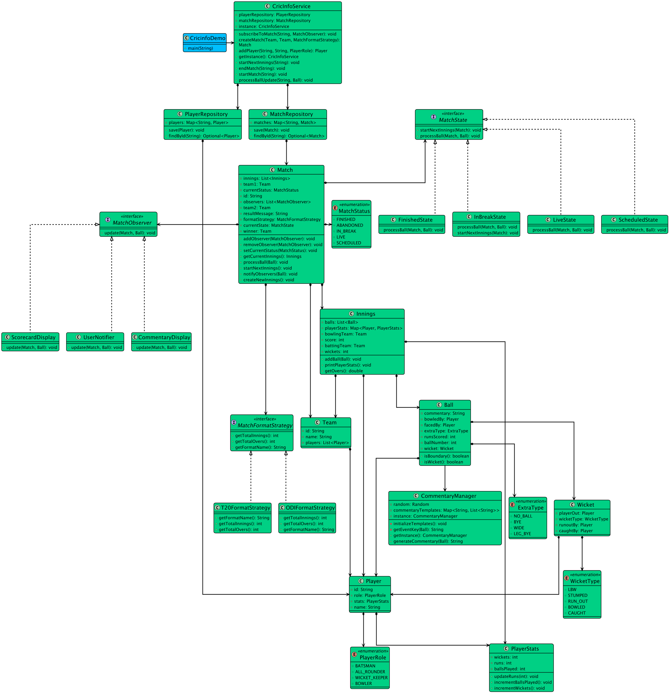

# Low-level design problem: cricinfo

> Copied from <https://github.com/ashishps1/awesome-low-level-design/blob/main/problems/cricinfo.md> (GPL-3.0, by Ashish Pratap Singh). Questions and answers are the source's own; nothing was answered or rewritten here.


# Designing a Cricket Information System like CricInfo

## Requirements
1. The Cricinfo system should provide information about cricket matches, teams, players, and live scores.
2. Users should be able to view the schedule of upcoming matches and the results of completed matches.
3. The system should allow users to search for specific matches, teams, or players.
4. Users should be able to view detailed information about a particular match, including the scorecard, commentary, and statistics.
5. The system should support real-time updates of live scores and match information.
6. The system should handle concurrent access to match data and ensure data consistency.
7. The system should be scalable and able to handle a large volume of user requests.
8. The system should be extensible to accommodate new features and enhancements in the future.

## UML Class Diagram



## Implementations
#### [Java Implementation](https://github.com/ashishps1/awesome-low-level-design/blob/main/solutions/java/src/cricinfo) 
#### [Python Implementation](https://github.com/ashishps1/awesome-low-level-design/blob/main/solutions/python/cricinfo)
#### [C++ Implementation](https://github.com/ashishps1/awesome-low-level-design/blob/main/solutions/cpp/cricinfo)
#### [C# Implementation](https://github.com/ashishps1/awesome-low-level-design/blob/main/solutions/csharp/cricinfo)
#### [Go Implementation](https://github.com/ashishps1/awesome-low-level-design/blob/main/solutions/golang/cricinfo)

## Classes, Interfaces and Enumerations
1. The **Match** class represents a cricket match, with properties such as ID, title, venue, start time, teams, status, and scorecard.
2. The **Team** class represents a cricket team, with properties like ID, name, and a list of players.
3. The **Player** class represents a cricket player, with properties such as ID, name, and role.
4. The **Scorecard** class represents the scorecard of a match, containing team scores and a list of innings.
5. The **Innings** class represents an innings in a match, with properties like ID, batting team, bowling team, and a list of overs.
6. The **Over** class represents an over in an innings, containing a list of balls.
7. The **Ball** class represents a ball bowled in an over, with properties such as ball number, bowler, batsman, and result.
8. The **MatchStatus** enum represents the different statuses of a match, such as scheduled, in progress, completed, or abandoned.
9. The **MatchService** class manages the matches in the system, providing methods to add, retrieve, and update match information. It follows the Singleton pattern to ensure a single instance of the service.
10. The **ScorecardService** class manages the scorecards of matches, allowing the creation, retrieval, and update of scorecards and their associated data, such as innings and scores. It also follows the Singleton pattern.
11. The **CricinfoSystem** class serves as the main entry point of the system, integrating the match and scorecard services and providing high-level methods for interacting with the system.

---

## Official solutions from the repository

<details><summary><b>java</b> (29 files)</summary>


**CommentaryManager.java**

```java
package cricinfo;

import cricinfo.enums.ExtraType;
import cricinfo.enums.WicketType;
import cricinfo.entity.Ball;

import java.util.List;
import java.util.Map;
import java.util.Random;
import java.util.concurrent.ConcurrentHashMap;

public class CommentaryManager {
    private static volatile CommentaryManager instance;
    private final Random random = new Random();

    private final Map<String, List<String>> commentaryTemplates = new ConcurrentHashMap<>();

    private CommentaryManager() {
        initializeTemplates();
    }

    public static CommentaryManager getInstance() {
        if (instance == null) {
            synchronized (CommentaryManager.class) {
                if (instance == null) {
                    instance = new CommentaryManager();
                }
            }
        }
        return instance;
    }

    private void initializeTemplates() {
        // Templates for runs
        commentaryTemplates.put("RUNS_0", List.of(
                "%s defends solidly.",
                "No run, good fielding by the cover fielder.",
                "A dot ball to end the over.",
                "Pushed to mid-on, but no run."
        ));
        commentaryTemplates.put("RUNS_1", List.of(
                "Tucked away to the leg side for a single.",
                "Quick single taken by %s.",
                "Pushed to long-on for one."
        ));
        commentaryTemplates.put("RUNS_2", List.of(
                "Two runs taken!",
                "Quick double taken by %s.",
                "Pushed to mid-on for two."
        ));
        commentaryTemplates.put("RUNS_4", List.of(
                "FOUR! %s smashes it through the covers!",
                "Beautiful shot! That's a boundary.",
                "Finds the gap perfectly. Four runs."
        ));
        commentaryTemplates.put("RUNS_6", List.of(
                "SIX! That's out of the park!",
                "%s sends it sailing over the ropes!",
                "Massive hit! It's a maximum."
        ));

        // Templates for wickets
        commentaryTemplates.put("WICKET_" + WicketType.BOWLED, List.of(
                "BOWLED HIM! %s misses completely and the stumps are shattered!",
                "Cleaned up! A perfect yorker from %s."
        ));
        commentaryTemplates.put("WICKET_" + WicketType.CAUGHT, List.of(
                "CAUGHT! %s skies it and the fielder takes a comfortable catch.",
                "Out! A brilliant catch in the deep by %s."
        ));
        commentaryTemplates.put("WICKET_" + WicketType.LBW, List.of(
                "LBW! That one kept low and struck %s right in front.",
                "%s completely misjudged the line and pays the price."
        ));

        commentaryTemplates.put("WICKET_" + WicketType.STUMPED, List.of(
                "STUMPED! %s misses it, and the keeper does the rest!",
                "Gone! Lightning-fast work by the keeper to stump %s."
        ));

        // Templates for extras
        commentaryTemplates.put("EXTRA_" + ExtraType.WIDE, List.of(
                "That's a wide. The umpire signals an extra run.",
                "Too far down the leg side, that'll be a wide."
        ));
        commentaryTemplates.put("EXTRA_" + ExtraType.NO_BALL, List.of(
                "No ball! %s has overstepped. It's a free hit.",
                "It's a no-ball for overstepping."
        ));
    }

    public String generateCommentary(Ball ball) {
        String key = getEventKey(ball);
        List<String> templates = commentaryTemplates.getOrDefault(key, List.of("Just a standard delivery."));

        String template = templates.get(random.nextInt(templates.size()));

        // Format the commentary with player names
        String batsmanName = ball.getFacedBy() != null ? ball.getFacedBy().getName() : "";
        String bowlerName = ball.getBowledBy() != null ? ball.getBowledBy().getName() : "";

        // This handles cases where a template might have more or fewer placeholders
        // and avoids exceptions.
        return String.format(template.replace("%s", "%1$s"), batsmanName, bowlerName);
    }

    private String getEventKey(Ball ball) {
        if (ball.isWicket()) {
            return "WICKET_" + ball.getWicket().getWicketType().toString();
        }
        if (ball.getExtraType() != null) {
            return "EXTRA_" + ball.getExtraType().toString();
        }
        if (ball.getRunsScored() >= 0 && ball.getRunsScored() <= 6) {
            switch(ball.getRunsScored()) {
                case 0: return "RUNS_0";
                case 1: return "RUNS_1";
                case 2: return "RUNS_2";
                case 3: return "RUNS_3";
                case 4: return "RUNS_4";
                case 6: return "RUNS_6";
            }
        }
        return "DEFAULT"; // Fallback key
    }
}
```


**CricInfoService.java**

```java
package cricinfo;

import cricinfo.enums.PlayerRole;
import cricinfo.entity.Ball;
import cricinfo.entity.Match;
import cricinfo.entity.Player;
import cricinfo.entity.Team;
import cricinfo.observer.MatchObserver;
import cricinfo.repository.MatchRepository;
import cricinfo.repository.PlayerRepository;
import cricinfo.state.FinishedState;
import cricinfo.state.LiveState;
import cricinfo.strategy.MatchFormatStrategy;

import java.util.UUID;

public class CricInfoService {
    private static volatile CricInfoService instance;
    private final MatchRepository matchRepository;
    private final PlayerRepository playerRepository;

    private CricInfoService() {
        this.matchRepository = new MatchRepository();
        this.playerRepository = new PlayerRepository();
    }

    public static CricInfoService getInstance() {
        if (instance == null) {
            synchronized (CricInfoService.class) {
                if (instance == null) {
                    instance = new CricInfoService();
                }
            }
        }
        return instance;
    }

    public Match createMatch(Team team1, Team team2, MatchFormatStrategy format) {
        String matchId = UUID.randomUUID().toString();
        Match match = new Match(matchId, team1, team2, format);
        matchRepository.save(match);
        System.out.printf("Match %s created between %s and %s.%n", format.getFormatName(), team1.getName(), team2.getName());
        return match;
    }

    public void startMatch(String matchId) {
        matchRepository.findById(matchId).ifPresent(match -> {
            match.setState(new LiveState());
            System.out.printf("Match %s is now LIVE.%n", matchId);
        });
    }

    public void processBallUpdate(String matchId, Ball ball) {
        matchRepository.findById(matchId).ifPresent(match -> match.processBall(ball));
    }

    public void startNextInnings(String matchId) {
        matchRepository.findById(matchId).ifPresent(Match::startNextInnings);
    }

    public void subscribeToMatch(String matchId, MatchObserver observer) {
        matchRepository.findById(matchId).ifPresent(match -> match.addObserver(observer));
    }

    public void endMatch(String matchId) {
        matchRepository.findById(matchId).ifPresent(match -> {
            match.setState(new FinishedState());
            System.out.printf("Match %s has FINISHED.%n", matchId);
        });
    }

    public Player addPlayer(String playerId, String playerName, PlayerRole playerRole) {
        Player player = new Player(playerId, playerName, playerRole);
        playerRepository.save(player);
        return player;
    }
}
```


**CricinfoDemo.java**

```java
package cricinfo;

import cricinfo.enums.PlayerRole;
import cricinfo.enums.WicketType;
import cricinfo.entity.*;
import cricinfo.observer.CommentaryDisplay;
import cricinfo.observer.ScorecardDisplay;
import cricinfo.observer.UserNotifier;
import cricinfo.strategy.T20FormatStrategy;

import java.util.List;

public class CricinfoDemo {
    public static void main(String[] args) {
        // Get the Singleton service instance
        CricInfoService service = CricInfoService.getInstance();

        // 1. Setup Players and Teams
        Player p1 = service.addPlayer("P1", "Virat", PlayerRole.BATSMAN);
        Player p2 = service.addPlayer("P2", "Rohit", PlayerRole.BATSMAN);
        Player p3 = service.addPlayer("P3", "Bumrah", PlayerRole.BOWLER);
        Player p4 = service.addPlayer("P4", "Jadeja", PlayerRole.ALL_ROUNDER);

        Player p5 = service.addPlayer("P5", "Warner", PlayerRole.BATSMAN);
        Player p6 = service.addPlayer("P6", "Smith", PlayerRole.BATSMAN);
        Player p7 = service.addPlayer("P7", "Starc", PlayerRole.BOWLER);
        Player p8 = service.addPlayer("P8", "Maxwell", PlayerRole.ALL_ROUNDER);

        Team india = new Team("T1", "India", List.of(p1, p2, p3, p4));
        Team australia = new Team("T2", "Australia", List.of(p5, p6, p7, p8));

        // 2. Create a T20 Match using the service
        Match t20Match = service.createMatch(india, australia, new T20FormatStrategy());
        String matchId = t20Match.getId();

        // 3. Create and subscribe observers
        ScorecardDisplay scorecard = new ScorecardDisplay();
        CommentaryDisplay commentary = new CommentaryDisplay();
        UserNotifier notifier = new UserNotifier();

        service.subscribeToMatch(matchId, scorecard);
        service.subscribeToMatch(matchId, commentary);
        service.subscribeToMatch(matchId, notifier);

        // 4. Start the match
        service.startMatch(matchId);

        System.out.println("\n--- SIMULATING FIRST INNINGS ---");
        service.processBallUpdate(matchId, new Ball.BallBuilder()
                .bowledBy(p7).facedBy(p1).withRuns(2).build());
        service.processBallUpdate(matchId, new Ball.BallBuilder()
                .bowledBy(p7).facedBy(p1).withRuns(1).build());
        service.processBallUpdate(matchId, new Ball.BallBuilder()
                .bowledBy(p7).facedBy(p2).withRuns(6).build());

        Wicket p2Wicket = new Wicket.Builder(WicketType.BOWLED, p2).build();
        service.processBallUpdate(matchId, new Ball.BallBuilder()
                .bowledBy(p7).facedBy(p2).withRuns(0).withWicket(p2Wicket).build());

        Wicket p3Wicket = new Wicket.Builder(WicketType.LBW, p3).build();
        service.processBallUpdate(matchId, new Ball.BallBuilder()
                .bowledBy(p7).facedBy(p3).withRuns(0).withWicket(p3Wicket).build());

        service.processBallUpdate(matchId, new Ball.BallBuilder()
                .bowledBy(p7).facedBy(p4).withRuns(4).build());

        Wicket p4Wicket = new Wicket.Builder(WicketType.CAUGHT, p4).caughtBy(p6).build();
        service.processBallUpdate(matchId, new Ball.BallBuilder()
                .bowledBy(p7).facedBy(p4).withRuns(0).withWicket(p4Wicket).build());

        // The system is now in an IN_BREAK state
        System.out.println("\n\n--- INNINGS BREAK ---");
        System.out.println("Players are off the field. Preparing for the second innings.");

        // 2. Start the second innings
        service.startNextInnings(matchId);

        System.out.println("\n--- SIMULATING SECOND INNINGS ---");
        // Simulate a few balls of the second innings to show it works
        // Now Australia is batting (p5, p6) and India is bowling (p3)
        service.processBallUpdate(matchId, new Ball.BallBuilder()
                .bowledBy(p3).facedBy(p5).withRuns(4).build());

        service.processBallUpdate(matchId, new Ball.BallBuilder()
                .bowledBy(p3).facedBy(p5).withRuns(1).build());

        Wicket p5Wicket = new Wicket.Builder(WicketType.BOWLED, p5).build();
        service.processBallUpdate(matchId, new Ball.BallBuilder()
                .bowledBy(p3).facedBy(p5).withRuns(0).withWicket(p5Wicket).build());

        Wicket p7Wicket = new Wicket.Builder(WicketType.LBW, p7).build();
        service.processBallUpdate(matchId, new Ball.BallBuilder()
                .bowledBy(p3).facedBy(p7).withRuns(0).withWicket(p7Wicket).build());

        Wicket p8Wicket = new Wicket.Builder(WicketType.STUMPED, p8).build();
        service.processBallUpdate(matchId, new Ball.BallBuilder()
                .bowledBy(p3).facedBy(p8).withRuns(0).withWicket(p8Wicket).build());

        service.endMatch(matchId);
    }
}
```


**README.md**

```md
# Cricket Information System (LLD)

## Problem Statement

Design and implement a Cricket Information System similar to CricInfo that provides comprehensive information about cricket matches, teams, players, and live scores. The system should handle real-time updates, match statistics, and user interactions.

---

## Requirements

1. **Match Information Management:**
   - Store and manage cricket match details
   - Track match schedules and results
   - Support real-time score updates
   - Handle match status transitions

2. **Team and Player Management:**
   - Maintain team rosters and player information
   - Track player roles and statistics
   - Support team composition changes

3. **Scorecard Management:**
   - Record detailed match statistics
   - Track innings, overs, and ball-by-ball information
   - Maintain batting and bowling statistics

4. **Search and Retrieval:**
   - Search for matches, teams, and players
   - View detailed match information
   - Access historical data and statistics

5. **System Requirements:**
   - Handle concurrent access
   - Ensure data consistency
   - Support scalability
   - Allow for future extensions

---

## Core Entities

### 1. Match
- **Fields:** String id, String title, String venue, Date startTime, Team team1, Team team2, MatchStatus status, Scorecard scorecard
- **Methods:** updateStatus(), getScorecard(), getMatchDetails()

### 2. Team
- **Fields:** String id, String name, List<Player> players
- **Methods:** addPlayer(), removePlayer(), getTeamStats()

### 3. Player
- **Fields:** String id, String name, String role
- **Methods:** getPlayerStats(), updateRole()

### 4. Scorecard
- **Fields:** Match match, List<Innings> innings
- **Methods:** addInnings(), updateScore(), getMatchSummary()

### 5. Innings
- **Fields:** String id, Team battingTeam, Team bowlingTeam, List<Over> overs
- **Methods:** addOver(), getInningsSummary()

### 6. Over
- **Fields:** int overNumber, List<Ball> balls
- **Methods:** addBall(), getOverSummary()

### 7. Ball
- **Fields:** int ballNumber, Player bowler, Player batsman, String result
- **Methods:** recordResult(), getBallDetails()

### 8. MatchStatus (Enum)
- **Values:** SCHEDULED, IN_PROGRESS, COMPLETED, ABANDONED

## UML Class Diagram


---

## Services

### 1. MatchService (Singleton)
- **Methods:** 
  - addMatch(Match match)
  - getMatch(String id)
  - updateMatchStatus(String id, MatchStatus status)
  - searchMatches(String query)

### 2. ScorecardService (Singleton)
- **Methods:**
  - createScorecard(Match match)
  - updateScorecard(String matchId, Scorecard scorecard)
  - getScorecard(String matchId)
  - addInnings(String matchId, Innings innings)

### 3. CricinfoSystem
- **Methods:**
  - getMatchDetails(String matchId)
  - getTeamDetails(String teamId)
  - getPlayerDetails(String playerId)
  - search(String query)

---

## Example Usage

```java
CricinfoSystem system = CricinfoSystem.getInstance();

// Create a new match
Match match = system.createMatch("IND vs AUS", "Melbourne Cricket Ground", new Date());

// Update match status
system.updateMatchStatus(match.getId(), MatchStatus.IN_PROGRESS);

// Record a ball
system.recordBall(match.getId(), 1, 1, "FOUR");

// Get match details
MatchDetails details = system.getMatchDetails(match.getId());
```

---

## Demo

See the demo class for a sample usage and simulation of the cricket information system.

---

## Extending the Framework

- **Add user authentication:** Support for user accounts and preferences
- **Add commentary system:** Real-time match commentary
- **Add statistics engine:** Advanced player and team statistics
- **Add notification system:** Match updates and alerts
- **Add social features:** User comments and discussions

---

## Design Patterns Used

- **Singleton Pattern:** For service classes (MatchService, ScorecardService)
- **Factory Pattern:** For creating matches and scorecards
- **Observer Pattern:** For real-time updates and notifications
- **Strategy Pattern:** For different types of match formats

---
```


**entity/Ball.java**

```java
package cricinfo.entity;

import cricinfo.CommentaryManager;
import cricinfo.enums.ExtraType;

public class Ball {
    private final int ballNumber;
    private final Player bowledBy;
    private final Player facedBy;
    private final int runsScored;
    private final Wicket wicket; // Null if no wicket
    private final ExtraType extraType; // Null if no extra
    private final String commentary;

    private Ball(BallBuilder builder) {
        this.ballNumber = builder.ballNumber;
        this.bowledBy = builder.bowledBy;
        this.facedBy = builder.facedBy;
        this.runsScored = builder.runsScored;
        this.wicket = builder.wicket;
        this.extraType = builder.extraType;
        this.commentary = builder.commentary;
    }

    public boolean isWicket() { return wicket != null; }
    public boolean isBoundary() { return runsScored == 4 || runsScored == 6; }
    public String getCommentary() { return commentary; }
    public int getRunsScored() { return runsScored; }
    public Player getFacedBy() { return facedBy; }
    public Player getBowledBy() { return bowledBy; }
    public Wicket getWicket() { return wicket; }

    public ExtraType getExtraType() {
        return extraType;
    }
    // Other getters

    public static class BallBuilder {
        private int ballNumber;
        private Player bowledBy;
        private Player facedBy;
        private int runsScored;
        private Wicket wicket;
        private ExtraType extraType;
        private String commentary;

        public BallBuilder withBallNumber(int ballNumber) { this.ballNumber = ballNumber; return this; }
        public BallBuilder bowledBy(Player bowler) { this.bowledBy = bowler; return this; }
        public BallBuilder facedBy(Player batsman) { this.facedBy = batsman; return this; }
        public BallBuilder withRuns(int runs) { this.runsScored = runs; return this; }
        public BallBuilder withWicket(Wicket wicket) { this.wicket = wicket; return this; }
        public BallBuilder withExtraType(ExtraType extra) { this.extraType = extra; return this; }
        public BallBuilder withCommentary(String commentary) { this.commentary = commentary; return this; }

        public Ball build() {
            // This is needed because the manager needs the ball's final state to generate commentary
            Ball tempBall = new Ball(this);

            if (this.commentary == null) {
                this.commentary = CommentaryManager.getInstance().generateCommentary(tempBall);
            }

            return new Ball(this);
        }
    }
}
```


**entity/Innings.java**

```java
package cricinfo.entity;

import cricinfo.enums.ExtraType;

import java.util.*;
import java.util.concurrent.ConcurrentHashMap;

public class Innings {
    private final Team battingTeam;
    private final Team bowlingTeam;
    private int score;
    private int wickets;
    private final List<Ball> balls;
    private final Map<Player, PlayerStats> playerStats;

    public Innings(Team battingTeam, Team bowlingTeam) {
        this.battingTeam = battingTeam;
        this.bowlingTeam = bowlingTeam;
        this.score = 0;
        this.wickets = 0;
        this.balls = new ArrayList<>();
        this.playerStats = new ConcurrentHashMap<>();
        for(Player player: battingTeam.getPlayers()) {
            playerStats.put(player, new PlayerStats());
        }
        for(Player player: bowlingTeam.getPlayers()) {
            playerStats.put(player, new PlayerStats());
        }
    }

    public void addBall(Ball ball) {
        balls.add(ball);
        int runsScored = ball.getRunsScored();
        this.score += runsScored;
        if (ball.getExtraType() == ExtraType.WIDE || ball.getExtraType() == ExtraType.NO_BALL) {
            this.score += 1;
        } else {
            ball.getFacedBy().getStats().updateRuns(runsScored);
            ball.getFacedBy().getStats().incrementBallsPlayed();
            playerStats.get(ball.getFacedBy()).updateRuns(runsScored);
            playerStats.get(ball.getFacedBy()).incrementBallsPlayed();
        }
        if (ball.isWicket()) {
            this.wickets++;
            ball.getBowledBy().getStats().incrementWickets();
            playerStats.get(ball.getBowledBy()).incrementWickets();
        }
    }

    public void printPlayerStats() {
        for (Map.Entry<Player, PlayerStats> entry : playerStats.entrySet()) {
            Player player = entry.getKey();
            PlayerStats stats = entry.getValue();

            if (stats.getBallsPlayed() > 0 || stats.getWickets() > 0) {
                System.out.println("Player: " + player.getName() + " - Stats: " + stats);
            }
        }
    }

    public int getScore() { return score; }
    public int getWickets() { return wickets; }
    public Team getBattingTeam() { return battingTeam; }

    public double getOvers() {
        int validBalls = (int) balls.stream()
                .filter(b -> b.getExtraType() != ExtraType.WIDE && b.getExtraType() != ExtraType.NO_BALL)
                .count();

        int completedOvers = validBalls / 6;
        int ballsInCurrentOver = validBalls % 6;

        return completedOvers + (ballsInCurrentOver / 10.0);
    }
}
```


**entity/Match.java**

```java
package cricinfo.entity;

import cricinfo.enums.MatchStatus;
import cricinfo.observer.MatchObserver;
import cricinfo.state.MatchState;
import cricinfo.state.ScheduledState;
import cricinfo.strategy.MatchFormatStrategy;

import java.util.ArrayList;
import java.util.List;

public class Match {
    private final String id;
    private final Team team1;
    private final Team team2;
    private final MatchFormatStrategy formatStrategy;
    private final List<Innings> innings;
    private MatchState currentState;
    private MatchStatus currentStatus;
    private final List<MatchObserver> observers = new ArrayList<>();
    private Team winner;
    private String resultMessage;

    public Match(String id, Team team1, Team team2, MatchFormatStrategy formatStrategy) {
        this.id = id;
        this.team1 = team1;
        this.team2 = team2;
        this.formatStrategy = formatStrategy;
        this.innings = new ArrayList<>();
        this.innings.add(new Innings(team1, team2)); // Start first innings
        this.currentState = new ScheduledState(); // Initial state
        this.resultMessage = "";
    }

    // State Pattern Methods
    public void processBall(Ball ball) {
        currentState.processBall(this, ball);
    }

    public void startNextInnings() {
        currentState.startNextInnings(this);
    }

    public void setState(MatchState state) { this.currentState = state; }

    public void setCurrentStatus(MatchStatus status) { this.currentStatus = status; }

    public void setWinner(Team winner) {
        this.winner = winner;
    }

    public void setResultMessage(String resultMessage) {
        this.resultMessage = resultMessage;
    }

    public void createNewInnings() {
        if (innings.size() >= formatStrategy.getTotalInnings()) {
            System.out.println("Cannot create a new innings, match has already reached its limit.");
            return;
        }
        // Swap the teams for the next innings
        Innings nextInnings = new Innings(this.team2, this.team1);
        this.innings.add(nextInnings);
    }

    // Observer Pattern Methods
    public void addObserver(MatchObserver observer) { observers.add(observer); }
    public void removeObserver(MatchObserver observer) { observers.remove(observer); }
    public void notifyObservers(Ball ball) {
        for (MatchObserver observer : observers) {
            observer.update(this, ball);
        }
    }

    public Innings getCurrentInnings() { return innings.get(innings.size() - 1); }
    public Team getTeam1() { return team1; }
    public Team getTeam2() { return team2; }
    public Team getWinner() { return winner; }
    public String getResultMessage() { return resultMessage; }
    public List<Innings> getInnings() { return innings; }
    public String getId() { return id; }
    public MatchStatus getCurrentStatus() { return currentStatus; }

    public MatchFormatStrategy getFormatStrategy() {
        return formatStrategy;
    }
}
```


**entity/Player.java**

```java
package cricinfo.entity;

import cricinfo.enums.PlayerRole;

public class Player {
    private final String id;
    private final String name;
    private final PlayerRole role;
    private PlayerStats stats;

    public Player(String id, String name, PlayerRole role) {
        this.id = id;
        this.name = name;
        this.role = role;
        this.stats = new PlayerStats();
    }

    public String getId() {
        return id;
    }

    public String getName() { return name; }

    public PlayerStats getStats() {
        return stats;
    }
}
```


**entity/PlayerStats.java**

```java
package cricinfo.entity;

public class PlayerStats {
    private int runs;
    private int ballsPlayed;
    private int wickets;

    public PlayerStats() {
        runs = 0;
        wickets = 0;
    }

    public void updateRuns(int runScored) {
        runs += runScored;
    }

    public void incrementBallsPlayed() {
        ballsPlayed += 1;
    }

    public void incrementWickets() {
        wickets += 1;
    }

    public int getRuns() { return runs; }
    public int getWickets() { return wickets; }
    public int getBallsPlayed() { return ballsPlayed; }

    @Override
    public String toString() {
        return "Runs: " + runs + ", Balls Played: " + ballsPlayed + ", Wickets: " + wickets;
    }
 }
```


**entity/Team.java**

```java
package cricinfo.entity;

import java.util.List;

public class Team {
    private final String id;
    private final String name;
    private final List<Player> players;

    public Team(String id, String name, List<Player> players) {
        this.id = id;
        this.name = name;
        this.players = players;
    }
    public String getName() { return name; }

    public List<Player> getPlayers() { return players; }
}
```


**entity/Wicket.java**

```java
package cricinfo.entity;

import cricinfo.enums.WicketType;

public class Wicket {
    private final WicketType wicketType;
    private final Player playerOut;
    private final Player caughtBy;
    private final Player runoutBy;

    private Wicket(Builder builder) {
        this.wicketType = builder.wicketType;
        this.playerOut = builder.playerOut;
        this.caughtBy = builder.caughtBy;
        this.runoutBy = builder.runoutBy;
    }

    public WicketType getWicketType() { return wicketType; }
    public Player getPlayerOut() { return playerOut; }
    public Player getCaughtBy() { return caughtBy; }
    public Player getRunoutBy() { return runoutBy; }

    public static class Builder {
        // Required parameters
        private final WicketType wicketType;
        private final Player playerOut;

        // Optional parameters
        private Player caughtBy = null;
        private Player runoutBy = null;

        public Builder(WicketType wicketType, Player playerOut) {
            this.wicketType = wicketType;
            this.playerOut = playerOut;
        }

        public Builder caughtBy(Player player) {
            this.caughtBy = player;
            return this;
        }

        public Builder runoutBy(Player player) {
            this.runoutBy = player;
            return this;
        }

        public Wicket build() {
            // We could add validation here, e.g., ensure 'caughtBy' is only set for WicketType.CAUGHT
            return new Wicket(this);
        }
    }
}
```


**enums/ExtraType.java**

```java
package cricinfo.enums;

public enum ExtraType {
    WIDE,
    NO_BALL,
    BYE,
    LEG_BYE
}
```


**enums/MatchStatus.java**

```java
package cricinfo.enums;

public enum MatchStatus {
    SCHEDULED,
    LIVE,
    IN_BREAK,
    FINISHED,
    ABANDONED
}
```


**enums/PlayerRole.java**

```java
package cricinfo.enums;

public enum PlayerRole {
    BATSMAN,
    BOWLER,
    ALL_ROUNDER,
    WICKET_KEEPER
}
```


**enums/WicketType.java**

```java
package cricinfo.enums;

public enum WicketType {
    BOWLED,
    CAUGHT,
    LBW,
    RUN_OUT,
    STUMPED,
    HIT_WICKET
}
```


**observer/CommentaryDisplay.java**

```java
package cricinfo.observer;

import cricinfo.enums.MatchStatus;
import cricinfo.entity.Match;
import cricinfo.entity.Ball;

public class CommentaryDisplay implements MatchObserver {
    @Override
    public void update(Match match, Ball lastBall) {
        if (match.getCurrentStatus() == MatchStatus.FINISHED) {
            System.out.println("[COMMENTARY]: Match has finished!");
        } else if (match.getCurrentStatus() == MatchStatus.IN_BREAK) {
            System.out.println("[COMMENTARY]: Inning has ended!");
        } else {
            System.out.printf("[COMMENTARY]: %s%n", lastBall.getCommentary());
        }
    }
}
```


**observer/MatchObserver.java**

```java
package cricinfo.observer;

import cricinfo.entity.Match;
import cricinfo.entity.Ball;

public interface MatchObserver {
    void update(Match match, Ball lastBall);
}
```


**observer/ScorecardDisplay.java**

```java
package cricinfo.observer;

import cricinfo.enums.MatchStatus;
import cricinfo.entity.Innings;
import cricinfo.entity.Match;
import cricinfo.entity.Ball;

public class ScorecardDisplay implements MatchObserver {
    @Override
    public void update(Match match, Ball lastBall) {
        // This block handles end-of-innings or end-of-match signals
        if (match.getCurrentStatus() == MatchStatus.FINISHED) {
            System.out.println("\n--- MATCH RESULT ---");
            System.out.println(match.getResultMessage().toUpperCase());
            System.out.println("--------------------");

            System.out.println("Player Stats:");
            int counter = 1;
            for (Innings inning: match.getInnings()) {
                System.out.println("Inning " + counter++);
                inning.printPlayerStats();
            }

        } else if (match.getCurrentStatus() == MatchStatus.IN_BREAK) {
            System.out.println("\n--- END OF INNINGS ---");
            Innings lastInnings = match.getInnings().get(match.getInnings().size() - 1);
            System.out.printf("Final Score: %s: %d/%d (Overs: %.1f)%n",
                    lastInnings.getBattingTeam().getName(),
                    lastInnings.getScore(),
                    lastInnings.getWickets(),
                    lastInnings.getOvers());
            System.out.println("------------------------");
        } else {
            // This block runs for every ball during a live match
            System.out.println("\n--- SCORECARD UPDATE ---");
            Innings currentInnings = match.getCurrentInnings();
            System.out.printf("%s: %d/%d (Overs: %.1f)%n",
                    currentInnings.getBattingTeam().getName(),
                    currentInnings.getScore(),
                    currentInnings.getWickets(),
                    currentInnings.getOvers());
            System.out.println("------------------------");
        }
    }
}
```


**observer/UserNotifier.java**

```java
package cricinfo.observer;

import cricinfo.enums.MatchStatus;
import cricinfo.entity.Match;
import cricinfo.entity.Ball;

public class UserNotifier implements MatchObserver {
    @Override
    public void update(Match match, Ball lastBall) {
        if (match.getCurrentStatus() == MatchStatus.FINISHED) {
            System.out.println("[NOTIFICATION]: Match has finished!");
        } else if (match.getCurrentStatus() == MatchStatus.IN_BREAK) {
            System.out.println("[NOTIFICATION]: Inning has ended!");
        } else if (lastBall.isWicket()) {
            System.out.println("[NOTIFICATION]: Wicket! A player is out.");
        } else if (lastBall.isBoundary()) {
            System.out.printf("[NOTIFICATION]: It's a boundary! %d runs.%n", lastBall.getRunsScored());
        }
    }
}
```


**repository/MatchRepository.java**

```java
package cricinfo.repository;

import cricinfo.entity.Match;

import java.util.HashMap;
import java.util.Map;
import java.util.Optional;

public class MatchRepository {
    private final Map<String, Match> matches = new HashMap<>();

    public void save(Match match) {
        matches.put(match.getId(), match);
    }

    public Optional<Match> findById(String id) {
        return Optional.ofNullable(matches.get(id));
    }
}
```


**repository/PlayerRepository.java**

```java
package cricinfo.repository;

import cricinfo.entity.Player;

import java.util.HashMap;
import java.util.Map;
import java.util.Optional;

public class PlayerRepository {
    private final Map<String, Player> players = new HashMap<>();

    public void save(Player player) { players.put(player.getId(), player); }

    public Optional<Player> findById(String id) {
        return Optional.ofNullable(players.get(id));
    }
}
```


**state/FinishedState.java**

```java
package cricinfo.state;

import cricinfo.entity.Match;
import cricinfo.entity.Ball;

public class FinishedState implements MatchState {
    @Override
    public void processBall(Match match, Ball ball) {
        System.out.println("ERROR: Cannot process a ball for a finished match.");
    }
}
```


**state/InBreakState.java**

```java
package cricinfo.state;

import cricinfo.enums.MatchStatus;
import cricinfo.entity.Ball;
import cricinfo.entity.Match;

public class InBreakState implements MatchState {
    @Override
    public void processBall(Match match, Ball ball) {
        System.out.println("ERROR: Cannot process a ball. The match is currently in a break.");
    }

    @Override
    public void startNextInnings(Match match) {
        System.out.println("Starting the next innings...");
        match.createNewInnings();
        match.setState(new LiveState());
        match.setCurrentStatus(MatchStatus.LIVE);
    }
}
```


**state/LiveState.java**

```java
package cricinfo.state;

import cricinfo.enums.MatchStatus;
import cricinfo.entity.Innings;
import cricinfo.entity.Match;
import cricinfo.entity.Ball;
import cricinfo.entity.Team;

public class LiveState implements MatchState {
    @Override
    public void processBall(Match match, Ball ball) {
        // 1. Process the ball as usual
        Innings currentInnings = match.getCurrentInnings();
        currentInnings.addBall(ball);
        match.notifyObservers(ball); // Notify observers about this specific ball
        // 2. Check for win/end conditions
        checkForMatchEnd(match);
    }

    private void checkForMatchEnd(Match match) {
        Innings currentInnings = match.getCurrentInnings();
        int inningsCount = match.getInnings().size();
        boolean isFinalInnings = (inningsCount == match.getFormatStrategy().getTotalInnings());

        // --- A. WIN CONDITION: Chasing team surpasses the target ---
        if (isFinalInnings) {
            int targetScore = match.getInnings().get(0).getScore() + 1;
            if (currentInnings.getScore() >= targetScore) {
                int wicketsRemaining = (currentInnings.getBattingTeam().getPlayers().size() - 1) - currentInnings.getWickets();
                declareWinner(match, currentInnings.getBattingTeam(), "won by " + wicketsRemaining + " wickets");
                return; // Match is over
            }
        }

        // --- B. END OF INNINGS CONDITION: All out or overs completed ---
        if (isInningsOver(match)) {
            if (isFinalInnings) {
                // The whole match is over, determine winner by runs or a tie
                int score1 = match.getInnings().get(0).getScore();
                int score2 = currentInnings.getScore();

                if (score1 > score2) {
                    declareWinner(match, match.getTeam1(), "won by " + (score1 - score2) + " runs");
                } else if (score2 > score1) {
                    // This case is technically handled above, but is a good safeguard.
                    int wicketsRemaining = (currentInnings.getBattingTeam().getPlayers().size() - 1) - currentInnings.getWickets();
                    declareWinner(match, currentInnings.getBattingTeam(), "won by " + wicketsRemaining + " wickets");
                } else {
                    declareWinner(match, null, "Match Tied"); // No winner in a tie
                }
            } else {
                // It's just an innings break, not the end of the match
                System.out.println("End of the innings!");
                match.setState(new InBreakState());
                match.setCurrentStatus(MatchStatus.IN_BREAK);
                match.notifyObservers(null); // Signal innings break to observers
            }
        }
    }

    private void declareWinner(Match match, Team winningTeam, String message) {
        System.out.println("MATCH FINISHED!");
        match.setWinner(winningTeam);
        String resultMessage = (winningTeam != null) ? winningTeam.getName() + " " + message : message;
        match.setResultMessage(resultMessage);

        match.setState(new FinishedState());
        match.setCurrentStatus(MatchStatus.FINISHED);
        match.notifyObservers(null); // Signal match end to observers
    }

    private boolean isInningsOver(Match match) {
        Innings currentInnings = match.getCurrentInnings();
        // Condition 1: A team with 11 players is all out when 10 wickets fall.
        boolean allOut = currentInnings.getWickets() >= currentInnings.getBattingTeam().getPlayers().size() - 1;
        // Condition 2: All overs have been bowled
        boolean oversFinished = (int) currentInnings.getOvers() >= match.getFormatStrategy().getTotalOvers();
        return allOut || oversFinished;
    }
}
```


**state/MatchState.java**

```java
package cricinfo.state;

import cricinfo.entity.Match;
import cricinfo.entity.Ball;

public interface MatchState {
    void processBall(Match match, Ball ball);

    default void startNextInnings(Match match) {
        System.out.println("ERROR: Cannot start the next innings from the current state.");
    }
}
```


**state/ScheduledState.java**

```java
package cricinfo.state;

import cricinfo.entity.Match;
import cricinfo.entity.Ball;

public class ScheduledState implements MatchState {
    @Override
    public void processBall(Match match, Ball ball) {
        System.out.println("ERROR: Cannot process a ball for a match that has not started.");
    }
}
```


**strategy/MatchFormatStrategy.java**

```java
package cricinfo.strategy;

public interface MatchFormatStrategy {
    int getTotalInnings();
    int getTotalOvers();
    String getFormatName();
}
```


**strategy/ODIFormatStrategy.java**

```java
package cricinfo.strategy;

public class ODIFormatStrategy implements MatchFormatStrategy {
    @Override
    public int getTotalInnings() { return 2; }

    @Override
    public int getTotalOvers() { return 50; }

    @Override
    public String getFormatName() { return "ODI"; }
}
```


**strategy/T20FormatStrategy.java**

```java
package cricinfo.strategy;

public class T20FormatStrategy implements MatchFormatStrategy {
    @Override
    public int getTotalInnings() { return 2; }

    @Override
    public int getTotalOvers() { return 20; }

    @Override
    public String getFormatName() { return "T20"; }
}
```

</details>

<details><summary><b>python</b> (16 files)</summary>


**README.md**

```md
# Designing a Cricket Information System like CricInfo

## Requirements
1. The Cricinfo system should provide information about cricket matches, teams, players, and live scores.
2. Users should be able to view the schedule of upcoming matches and the results of completed matches.
3. The system should allow users to search for specific matches, teams, or players.
4. Users should be able to view detailed information about a particular match, including the scorecard, commentary, and statistics.
5. The system should support real-time updates of live scores and match information.
6. The system should handle concurrent access to match data and ensure data consistency.
7. The system should be scalable and able to handle a large volume of user requests.
8. The system should be extensible to accommodate new features and enhancements in the future.

## Classes, Interfaces and Enumerations
1. The **Match** class represents a cricket match, with properties such as ID, title, venue, start time, teams, status, and scorecard.
2. The **Team** class represents a cricket team, with properties like ID, name, and a list of players.
3. The **Player** class represents a cricket player, with properties such as ID, name, and role.
4. The **Scorecard** class represents the scorecard of a match, containing team scores and a list of innings.
5. The **Innings** class represents an innings in a match, with properties like ID, batting team, bowling team, and a list of overs.
6. The **Over** class represents an over in an innings, containing a list of balls.
7. The **Ball** class represents a ball bowled in an over, with properties such as ball number, bowler, batsman, and result.
8. The **MatchStatus** enum represents the different statuses of a match, such as scheduled, in progress, completed, or abandoned.
9. The **MatchService** class manages the matches in the system, providing methods to add, retrieve, and update match information. It follows the Singleton pattern to ensure a single instance of the service.
10. The **ScorecardService** class manages the scorecards of matches, allowing the creation, retrieval, and update of scorecards and their associated data, such as innings and scores. It also follows the Singleton pattern.
11. The **CricinfoSystem** class serves as the main entry point of the system, integrating the match and scorecard services and providing high-level methods for interacting with the system.
```


**ball.py**

```py
from commentary_manager import CommentaryManager

class Ball:
    class BallBuilder:
        def __init__(self):
            self.ball_number = 0
            self.bowled_by = None
            self.faced_by = None
            self.runs_scored = 0
            self.wicket = None
            self.extra_type = None
            self.commentary = None

        def with_ball_number(self, ball_number):
            self.ball_number = ball_number
            return self

        def bowled_by(self, bowler):
            self.bowled_by = bowler
            return self

        def faced_by(self, batsman):
            self.faced_by = batsman
            return self

        def with_runs(self, runs):
            self.runs_scored = runs
            return self

        def with_wicket(self, wicket):
            self.wicket = wicket
            return self

        def with_extra_type(self, extra):
            self.extra_type = extra
            return self

        def with_commentary(self, commentary):
            self.commentary = commentary
            return self

        def build(self):
            temp_ball = Ball(self)
            
            if self.commentary is None:
                self.commentary = CommentaryManager.get_instance().generate_commentary(temp_ball)
            
            return Ball(self)

    def __init__(self, builder):
        self.ball_number = builder.ball_number
        self.bowled_by = builder.bowled_by
        self.faced_by = builder.faced_by
        self.runs_scored = builder.runs_scored
        self.wicket = builder.wicket
        self.extra_type = builder.extra_type
        self.commentary = builder.commentary

    def is_wicket(self):
        return self.wicket is not None

    def is_boundary(self):
        return self.runs_scored == 4 or self.runs_scored == 6

    def get_ball_number(self):
        return self.ball_number

    def get_bowled_by(self):
        return self.bowled_by

    def get_faced_by(self):
        return self.faced_by

    def get_runs_scored(self):
        return self.runs_scored

    def get_wicket(self):
        return self.wicket

    def get_extra_type(self):
        return self.extra_type

    def get_commentary(self):
        return self.commentary
```


**commentary_manager.py**

```py
import random
from enums import WicketType, ExtraType

class CommentaryManager:
    _instance = None

    def __init__(self):
        self.random = random.Random()
        self.commentary_templates = {}
        self.initialize_templates()

    @classmethod
    def get_instance(cls):
        if cls._instance is None:
            cls._instance = CommentaryManager()
        return cls._instance

    def initialize_templates(self):
        self.commentary_templates["RUNS_0"] = [
            "%s defends solidly.",
            "No run, good fielding by the cover fielder.",
            "A dot ball to end the over.",
            "Pushed to mid-on, but no run."
        ]
        self.commentary_templates["RUNS_1"] = [
            "Tucked away to the leg side for a single.",
            "Quick single taken by %s.",
            "Pushed to long-on for one."
        ]
        self.commentary_templates["RUNS_2"] = [
            "Two runs taken!",
            "Quick double taken by %s.",
            "Pushed to mid-on for two."
        ]
        self.commentary_templates["RUNS_4"] = [
            "FOUR! %s smashes it through the covers!",
            "Beautiful shot! That's a boundary.",
            "Finds the gap perfectly. Four runs."
        ]
        self.commentary_templates["RUNS_6"] = [
            "SIX! That's out of the park!",
            "%s sends it sailing over the ropes!",
            "Massive hit! It's a maximum."
        ]

        self.commentary_templates[f"WICKET_{WicketType.BOWLED.value}"] = [
            "BOWLED HIM! %s misses completely and the stumps are shattered!",
            "Cleaned up! A perfect yorker from %s."
        ]
        self.commentary_templates[f"WICKET_{WicketType.CAUGHT.value}"] = [
            "CAUGHT! %s skies it and the fielder takes a comfortable catch.",
            "Out! A brilliant catch in the deep by %s."
        ]
        self.commentary_templates[f"WICKET_{WicketType.LBW.value}"] = [
            "LBW! That one kept low and struck %s right in front.",
            "%s completely misjudged the line and pays the price."
        ]
        self.commentary_templates[f"WICKET_{WicketType.STUMPED.value}"] = [
            "STUMPED! %s misses it, and the keeper does the rest!",
            "Gone! Lightning-fast work by the keeper to stump %s."
        ]

        self.commentary_templates[f"EXTRA_{ExtraType.WIDE.value}"] = [
            "That's a wide. The umpire signals an extra run.",
            "Too far down the leg side, that'll be a wide."
        ]
        self.commentary_templates[f"EXTRA_{ExtraType.NO_BALL.value}"] = [
            "No ball! %s has overstepped. It's a free hit.",
            "It's a no-ball for overstepping."
        ]

    def generate_commentary(self, ball):
        key = self.get_event_key(ball)
        templates = self.commentary_templates.get(key, ["Just a standard delivery."])
        
        template = self.random.choice(templates)
        
        batsman_name = ball.get_faced_by().get_name() if ball.get_faced_by() else ""
        bowler_name = ball.get_bowled_by().get_name() if ball.get_bowled_by() else ""
        
        try:
            return template % batsman_name
        except:
            return template.replace("%s", batsman_name)

    def get_event_key(self, ball):
        if ball.is_wicket():
            return f"WICKET_{ball.get_wicket().get_wicket_type().value}"
        if ball.get_extra_type():
            return f"EXTRA_{ball.get_extra_type().value}"
        if 0 <= ball.get_runs_scored() <= 6:
            return f"RUNS_{ball.get_runs_scored()}"
        return "DEFAULT"
```


**cricinfo_demo.py**

```py
from cricinfo_service import CricInfoService
from enums import PlayerRole, WicketType
from match_format_strategy import T20FormatStrategy
from team import Team
from ball import Ball
from wicket import Wicket
from match_observer import CommentaryDisplay, ScorecardDisplay, UserNotifier

class CricinfoDemo:
    @staticmethod
    def main():
        service = CricInfoService.get_instance()

        # Setup Players and Teams
        p1 = service.add_player("P1", "Virat", PlayerRole.BATSMAN)
        p2 = service.add_player("P2", "Rohit", PlayerRole.BATSMAN)
        p3 = service.add_player("P3", "Bumrah", PlayerRole.BOWLER)
        p4 = service.add_player("P4", "Jadeja", PlayerRole.ALL_ROUNDER)

        p5 = service.add_player("P5", "Warner", PlayerRole.BATSMAN)
        p6 = service.add_player("P6", "Smith", PlayerRole.BATSMAN)
        p7 = service.add_player("P7", "Starc", PlayerRole.BOWLER)
        p8 = service.add_player("P8", "Maxwell", PlayerRole.ALL_ROUNDER)

        india = Team("T1", "India", [p1, p2, p3, p4])
        australia = Team("T2", "Australia", [p5, p6, p7, p8])

        # Create a T20 Match
        t20_match = service.create_match(india, australia, T20FormatStrategy())
        match_id = t20_match.get_id()

        # Create and subscribe observers
        scorecard = ScorecardDisplay()
        commentary = CommentaryDisplay()
        notifier = UserNotifier()

        service.subscribe_to_match(match_id, scorecard)
        service.subscribe_to_match(match_id, commentary)
        service.subscribe_to_match(match_id, notifier)

        # Start the match
        service.start_match(match_id)

        print("\n--- SIMULATING FIRST INNINGS ---")
        service.process_ball_update(match_id, Ball.BallBuilder()
                                   .bowled_by(p7).faced_by(p1).with_runs(2).build())
        service.process_ball_update(match_id, Ball.BallBuilder()
                                   .bowled_by(p7).faced_by(p1).with_runs(1).build())
        service.process_ball_update(match_id, Ball.BallBuilder()
                                   .bowled_by(p7).faced_by(p2).with_runs(6).build())

        p2_wicket = Wicket.Builder(WicketType.BOWLED, p2).build()
        service.process_ball_update(match_id, Ball.BallBuilder()
                                   .bowled_by(p7).faced_by(p2).with_runs(0).with_wicket(p2_wicket).build())

        p3_wicket = Wicket.Builder(WicketType.LBW, p3).build()
        service.process_ball_update(match_id, Ball.BallBuilder()
                                   .bowled_by(p7).faced_by(p3).with_runs(0).with_wicket(p3_wicket).build())

        service.process_ball_update(match_id, Ball.BallBuilder()
                                   .bowled_by(p7).faced_by(p4).with_runs(4).build())

        p4_wicket = Wicket.Builder(WicketType.CAUGHT, p4).caught_by(p6).build()
        service.process_ball_update(match_id, Ball.BallBuilder()
                                   .bowled_by(p7).faced_by(p4).with_runs(0).with_wicket(p4_wicket).build())

        print("\n\n--- INNINGS BREAK ---")
        print("Players are off the field. Preparing for the second innings.")

        # Start the second innings
        service.start_next_innings(match_id)

        print("\n--- SIMULATING SECOND INNINGS ---")
        service.process_ball_update(match_id, Ball.BallBuilder()
                                   .bowled_by(p3).faced_by(p5).with_runs(4).build())

        service.process_ball_update(match_id, Ball.BallBuilder()
                                   .bowled_by(p3).faced_by(p5).with_runs(1).build())

        p5_wicket = Wicket.Builder(WicketType.BOWLED, p5).build()
        service.process_ball_update(match_id, Ball.BallBuilder()
                                   .bowled_by(p3).faced_by(p5).with_runs(0).with_wicket(p5_wicket).build())

        p7_wicket = Wicket.Builder(WicketType.LBW, p7).build()
        service.process_ball_update(match_id, Ball.BallBuilder()
                                   .bowled_by(p3).faced_by(p7).with_runs(0).with_wicket(p7_wicket).build())

        p8_wicket = Wicket.Builder(WicketType.STUMPED, p8).build()
        service.process_ball_update(match_id, Ball.BallBuilder()
                                   .bowled_by(p3).faced_by(p8).with_runs(0).with_wicket(p8_wicket).build())

        service.end_match(match_id)

if __name__ == "__main__":
    CricinfoDemo.main()
```


**cricinfo_service.py**

```py
import uuid
from repository import PlayerRepository, MatchRepository
from match import Match
from match_states import LiveState, FinishedState
from enums import MatchStatus
from player import Player

class CricInfoService:
    _instance = None

    def __init__(self):
        self.match_repository = MatchRepository()
        self.player_repository = PlayerRepository()

    @classmethod
    def get_instance(cls):
        if cls._instance is None:
            cls._instance = CricInfoService()
        return cls._instance

    def create_match(self, team1, team2, format_strategy):
        match_id = str(uuid.uuid4())
        match = Match(match_id, team1, team2, format_strategy)
        self.match_repository.save(match)
        print(f"Match {format_strategy.get_format_name()} created between {team1.get_name()} and {team2.get_name()}.")
        return match

    def start_match(self, match_id):
        match = self.match_repository.find_by_id(match_id)
        if match:
            match.set_state(LiveState())
            print(f"Match {match_id} is now LIVE.")

    def process_ball_update(self, match_id, ball):
        match = self.match_repository.find_by_id(match_id)
        if match:
            match.process_ball(ball)

    def start_next_innings(self, match_id):
        match = self.match_repository.find_by_id(match_id)
        if match:
            match.start_next_innings()

    def subscribe_to_match(self, match_id, observer):
        match = self.match_repository.find_by_id(match_id)
        if match:
            match.add_observer(observer)

    def end_match(self, match_id):
        match = self.match_repository.find_by_id(match_id)
        if match:
            match.set_state(FinishedState())
            print(f"Match {match_id} has FINISHED.")

    def add_player(self, player_id, player_name, player_role):
        player = Player(player_id, player_name, player_role)
        self.player_repository.save(player)
        return player
```


**enums.py**

```py
from enum import Enum

class MatchType(Enum):
    T20 = "T20"
    ODI = "ODI"
    TEST = "TEST"

class MatchStatus(Enum):
    SCHEDULED = "SCHEDULED"
    LIVE = "LIVE"
    IN_BREAK = "IN_BREAK"
    FINISHED = "FINISHED"
    ABANDONED = "ABANDONED"

class PlayerRole(Enum):
    BATSMAN = "BATSMAN"
    BOWLER = "BOWLER"
    ALL_ROUNDER = "ALL_ROUNDER"
    WICKET_KEEPER = "WICKET_KEEPER"

class WicketType(Enum):
    BOWLED = "BOWLED"
    CAUGHT = "CAUGHT"
    LBW = "LBW"
    RUN_OUT = "RUN_OUT"
    STUMPED = "STUMPED"
    HIT_WICKET = "HIT_WICKET"

class ExtraType(Enum):
    WIDE = "WIDE"
    NO_BALL = "NO_BALL"
    BYE = "BYE"
    LEG_BYE = "LEG_BYE"
```


**innings.py**

```py
from enums import ExtraType
from player_stats import PlayerStats

class Innings:
    def __init__(self, batting_team, bowling_team):
        self.batting_team = batting_team
        self.bowling_team = bowling_team
        self.score = 0
        self.wickets = 0
        self.balls = []
        self.player_stats = {}
        
        for player in batting_team.get_players():
            self.player_stats[player] = PlayerStats()
        for player in bowling_team.get_players():
            self.player_stats[player] = PlayerStats()

    def add_ball(self, ball):
        self.balls.append(ball)
        runs_scored = ball.get_runs_scored()
        self.score += runs_scored
        
        if ball.get_extra_type() in [ExtraType.WIDE, ExtraType.NO_BALL]:
            self.score += 1
        else:
            ball.get_faced_by().get_stats().update_runs(runs_scored)
            ball.get_faced_by().get_stats().increment_balls_played()
            self.player_stats[ball.get_faced_by()].update_runs(runs_scored)
            self.player_stats[ball.get_faced_by()].increment_balls_played()
        
        if ball.is_wicket():
            self.wickets += 1
            ball.get_bowled_by().get_stats().increment_wickets()
            self.player_stats[ball.get_bowled_by()].increment_wickets()

    def print_player_stats(self):
        for player, stats in self.player_stats.items():
            if stats.get_balls_played() > 0 or stats.get_wickets() > 0:
                print(f"Player: {player.get_name()} - Stats: {stats}")

    def get_overs(self):
        valid_balls = sum(1 for b in self.balls 
                         if b.get_extra_type() not in [ExtraType.WIDE, ExtraType.NO_BALL])
        
        completed_overs = valid_balls // 6
        balls_in_current_over = valid_balls % 6
        
        return completed_overs + (balls_in_current_over / 10.0)

    def get_batting_team(self):
        return self.batting_team

    def get_bowling_team(self):
        return self.bowling_team

    def get_score(self):
        return self.score

    def get_wickets(self):
        return self.wickets

    def get_balls(self):
        return self.balls
```


**match.py**

```py
from innings import Innings
from enums import MatchStatus
from match_states import ScheduledState

class Match:
    def __init__(self, match_id, team1, team2, format_strategy):
        self.id = match_id
        self.team1 = team1
        self.team2 = team2
        self.format_strategy = format_strategy
        self.innings = [Innings(team1, team2)]
        self.current_state = ScheduledState()
        self.current_status = None
        self.observers = []
        self.winner = None
        self.result_message = ""

    def process_ball(self, ball):
        self.current_state.process_ball(self, ball)

    def start_next_innings(self):
        self.current_state.start_next_innings(self)

    def create_new_innings(self):
        if len(self.innings) >= self.format_strategy.get_total_innings():
            print("Cannot create a new innings, match has already reached its limit.")
            return
        
        next_innings = Innings(self.team2, self.team1)
        self.innings.append(next_innings)

    def add_observer(self, observer):
        self.observers.append(observer)

    def remove_observer(self, observer):
        self.observers.remove(observer)

    def notify_observers(self, ball):
        for observer in self.observers:
            observer.update(self, ball)

    def get_current_innings(self):
        return self.innings[-1]

    def get_id(self):
        return self.id

    def get_team1(self):
        return self.team1

    def get_team2(self):
        return self.team2

    def get_format_strategy(self):
        return self.format_strategy

    def get_innings(self):
        return self.innings

    def get_current_status(self):
        return self.current_status

    def get_winner(self):
        return self.winner

    def get_result_message(self):
        return self.result_message

    def set_state(self, state):
        self.current_state = state

    def set_current_status(self, status):
        self.current_status = status

    def set_winner(self, winner):
        self.winner = winner

    def set_result_message(self, message):
        self.result_message = message
```


**match_format_strategy.py**

```py
from abc import ABC, abstractmethod

class MatchFormatStrategy(ABC):
    @abstractmethod
    def get_total_innings(self):
        pass

    @abstractmethod
    def get_total_overs(self):
        pass

    @abstractmethod
    def get_format_name(self):
        pass

class T20FormatStrategy(MatchFormatStrategy):
    def get_total_innings(self):
        return 2

    def get_total_overs(self):
        return 20

    def get_format_name(self):
        return "T20"

class ODIFormatStrategy(MatchFormatStrategy):
    def get_total_innings(self):
        return 2

    def get_total_overs(self):
        return 50

    def get_format_name(self):
        return "ODI"
```


**match_observer.py**

```py
from abc import ABC, abstractmethod
from enums import MatchStatus

class MatchObserver(ABC):
    @abstractmethod
    def update(self, match, last_ball):
        pass

class CommentaryDisplay(MatchObserver):
    def update(self, match, last_ball):
        if match.get_current_status() == MatchStatus.FINISHED:
            print("[COMMENTARY]: Match has finished!")
        elif match.get_current_status() == MatchStatus.IN_BREAK:
            print("[COMMENTARY]: Inning has ended!")
        else:
            print(f"[COMMENTARY]: {last_ball.get_commentary()}")

class UserNotifier(MatchObserver):
    def update(self, match, last_ball):
        if match.get_current_status() == MatchStatus.FINISHED:
            print("[NOTIFICATION]: Match has finished!")
        elif match.get_current_status() == MatchStatus.IN_BREAK:
            print("[NOTIFICATION]: Inning has ended!")
        elif last_ball and last_ball.is_wicket():
            print("[NOTIFICATION]: Wicket! A player is out.")
        elif last_ball and last_ball.is_boundary():
            print(f"[NOTIFICATION]: It's a boundary! {last_ball.get_runs_scored()} runs.")

class ScorecardDisplay(MatchObserver):
    def update(self, match, last_ball):
        if match.get_current_status() == MatchStatus.FINISHED:
            print("\n--- MATCH RESULT ---")
            print(match.get_result_message().upper())
            print("--------------------")
            
            print("Player Stats:")
            counter = 1
            for inning in match.get_innings():
                print(f"Inning {counter}")
                inning.print_player_stats()
                counter += 1
        elif match.get_current_status() == MatchStatus.IN_BREAK:
            print("\n--- END OF INNINGS ---")
            last_innings = match.get_innings()[-1]
            print(f"Final Score: {last_innings.get_batting_team().get_name()}: "
                  f"{last_innings.get_score()}/{last_innings.get_wickets()} "
                  f"(Overs: {last_innings.get_overs():.1f})")
            print("------------------------")
        else:
            print("\n--- SCORECARD UPDATE ---")
            current_innings = match.get_current_innings()
            print(f"{current_innings.get_batting_team().get_name()}: "
                  f"{current_innings.get_score()}/{current_innings.get_wickets()} "
                  f"(Overs: {current_innings.get_overs():.1f})")
            print("------------------------")
```


**match_states.py**

```py
from abc import ABC, abstractmethod
from enums import MatchStatus

class MatchState(ABC):
    @abstractmethod
    def process_ball(self, match, ball):
        pass

    def start_next_innings(self, match):
        print("ERROR: Cannot start the next innings from the current state.")

class ScheduledState(MatchState):
    def process_ball(self, match, ball):
        print("ERROR: Cannot process a ball for a match that has not started.")

class InBreakState(MatchState):
    def process_ball(self, match, ball):
        print("ERROR: Cannot process a ball. The match is currently in a break.")

    def start_next_innings(self, match):
        print("Starting the next innings...")
        match.create_new_innings()
        match.set_state(LiveState())
        match.set_current_status(MatchStatus.LIVE)

class FinishedState(MatchState):
    def process_ball(self, match, ball):
        print("ERROR: Cannot process a ball for a finished match.")

class LiveState(MatchState):
    def process_ball(self, match, ball):
        current_innings = match.get_current_innings()
        current_innings.add_ball(ball)
        match.notify_observers(ball)
        self.check_for_match_end(match)

    def check_for_match_end(self, match):
        current_innings = match.get_current_innings()
        innings_count = len(match.get_innings())
        is_final_innings = (innings_count == match.get_format_strategy().get_total_innings())

        # Win condition: Chasing team surpasses the target
        if is_final_innings:
            target_score = match.get_innings()[0].get_score() + 1
            if current_innings.get_score() >= target_score:
                wickets_remaining = (len(current_innings.get_batting_team().get_players()) - 1) - current_innings.get_wickets()
                self.declare_winner(match, current_innings.get_batting_team(), f"won by {wickets_remaining} wickets")
                return

        # End of innings condition
        if self.is_innings_over(match):
            if is_final_innings:
                score1 = match.get_innings()[0].get_score()
                score2 = current_innings.get_score()

                if score1 > score2:
                    self.declare_winner(match, match.get_team1(), f"won by {score1 - score2} runs")
                elif score2 > score1:
                    wickets_remaining = (len(current_innings.get_batting_team().get_players()) - 1) - current_innings.get_wickets()
                    self.declare_winner(match, current_innings.get_batting_team(), f"won by {wickets_remaining} wickets")
                else:
                    self.declare_winner(match, None, "Match Tied")
            else:
                print("End of the innings!")
                match.set_state(InBreakState())
                match.set_current_status(MatchStatus.IN_BREAK)
                match.notify_observers(None)

    def declare_winner(self, match, winning_team, message):
        print("MATCH FINISHED!")
        match.set_winner(winning_team)
        result_message = f"{winning_team.get_name()} {message}" if winning_team else message
        match.set_result_message(result_message)

        match.set_state(FinishedState())
        match.set_current_status(MatchStatus.FINISHED)
        match.notify_observers(None)

    def is_innings_over(self, match):
        current_innings = match.get_current_innings()
        all_out = current_innings.get_wickets() >= len(current_innings.get_batting_team().get_players()) - 1
        overs_finished = int(current_innings.get_overs()) >= match.get_format_strategy().get_total_overs()
        return all_out or overs_finished
```


**player.py**

```py
from player_stats import PlayerStats

class Player:
    def __init__(self, player_id, name, role):
        self.id = player_id
        self.name = name
        self.role = role
        self.stats = PlayerStats()

    def get_id(self):
        return self.id

    def get_name(self):
        return self.name

    def get_role(self):
        return self.role

    def get_stats(self):
        return self.stats
```


**player_stats.py**

```py
class PlayerStats:
    def __init__(self):
        self.runs = 0
        self.balls_played = 0
        self.wickets = 0

    def update_runs(self, run_scored):
        self.runs += run_scored

    def increment_balls_played(self):
        self.balls_played += 1

    def increment_wickets(self):
        self.wickets += 1

    def get_runs(self):
        return self.runs

    def get_balls_played(self):
        return self.balls_played

    def get_wickets(self):
        return self.wickets

    def __str__(self):
        return f"Runs: {self.runs}, Balls Played: {self.balls_played}, Wickets: {self.wickets}"
```


**repository.py**

```py
class MatchRepository:
    def __init__(self):
        self.matches = {}

    def save(self, match):
        self.matches[match.get_id()] = match

    def find_by_id(self, match_id):
        return self.matches.get(match_id)

class PlayerRepository:
    def __init__(self):
        self.players = {}

    def save(self, player):
        self.players[player.get_id()] = player

    def find_by_id(self, player_id):
        return self.players.get(player_id)
```


**team.py**

```py
class Team:
    def __init__(self, team_id, name, players):
        self.id = team_id
        self.name = name
        self.players = players

    def get_id(self):
        return self.id

    def get_name(self):
        return self.name

    def get_players(self):
        return self.players
```


**wicket.py**

```py
class Wicket:
    class Builder:
        def __init__(self, wicket_type, player_out):
            self.wicket_type = wicket_type
            self.player_out = player_out
            self.caught_by = None
            self.runout_by = None

        def caught_by(self, player):
            self.caught_by = player
            return self

        def runout_by(self, player):
            self.runout_by = player
            return self

        def build(self):
            return Wicket(self)

    def __init__(self, builder):
        self.wicket_type = builder.wicket_type
        self.player_out = builder.player_out
        self.caught_by = builder.caught_by
        self.runout_by = builder.runout_by

    def get_wicket_type(self):
        return self.wicket_type

    def get_player_out(self):
        return self.player_out

    def get_caught_by(self):
        return self.caught_by

    def get_runout_by(self):
        return self.runout_by
```

</details>

<details><summary><b>cpp</b> (11 files)</summary>


**CricInfoDemo.cpp**

```cpp
#include "CricInfoSystem.hpp"
#include <iostream>

int main() {
    CricInfoSystem system;
    
    // Create teams
    Team* team1 = new Team("IND", "India", "India");
    Team* team2 = new Team("AUS", "Australia", "Australia");
    
    // Create players
    Player* player1 = new Player("VK18", "Virat Kohli", "India", PlayerType::BATSMAN);
    Player* player2 = new Player("RS45", "Rohit Sharma", "India", PlayerType::BATSMAN);
    Player* player3 = new Player("SPD23", "Steve Smith", "Australia", PlayerType::BATSMAN);
    Player* player4 = new Player("PCU31", "Pat Cummins", "Australia", PlayerType::BOWLER);
    
    // Add players to teams
    team1->addPlayer(player1);
    team1->addPlayer(player2);
    team2->addPlayer(player3);
    team2->addPlayer(player4);
    
    // Add teams to system
    system.addTeam(team1);
    system.addTeam(team2);
    
    // Create a match
    Match* match1 = new Match("M001", team1, team2, "MCG", "2024-01-01", "Test");
    
    // Add player performances
    PlayerStats kohliStats;
    kohliStats.runsScored = 100;
    kohliStats.ballsFaced = 150;
    match1->addPlayerPerformance("VK18", kohliStats);
    
    PlayerStats cumminsStats;
    cumminsStats.wicketsTaken = 3;
    cumminsStats.ballsBowled = 120;
    match1->addPlayerPerformance("PCU31", cumminsStats);
    
    // Set match winner
    match1->setWinner(team1);
    team1->incrementWins();
    team2->incrementLosses();
    
    // Update player stats
    match1->updateTeamStats();
    
    // Add match to system
    system.addMatch(match1);
    
    // Display information
    system.displayAllTeams();
    system.displayAllMatches();
    system.displayPlayerStats("VK18");
    
    return 0;
}
```


**CricInfoSystem.cpp**

```cpp
#include "CricInfoSystem.hpp"
#include <iostream>

CricInfoSystem::CricInfoSystem() {}

CricInfoSystem::~CricInfoSystem() {
    for (auto team : teams) delete team;
    for (auto match : matches) delete match;
}

void CricInfoSystem::addTeam(Team* team) {
    teams.push_back(team);
}

void CricInfoSystem::addMatch(Match* match) {
    matches.push_back(match);
}

Team* CricInfoSystem::findTeam(const std::string& teamId) const {
    for (auto team : teams) {
        if (team->getTeamId() == teamId) return team;
    }
    return nullptr;
}

Match* CricInfoSystem::findMatch(const std::string& matchId) const {
    for (auto match : matches) {
        if (match->getMatchId() == matchId) return match;
    }
    return nullptr;
}

void CricInfoSystem::displayAllTeams() const {
    std::cout << "\nAll Teams:" << std::endl;
    for (const auto& team : teams) {
        team->displayInfo();
        std::cout << "------------------------" << std::endl;
    }
}

void CricInfoSystem::displayAllMatches() const {
    std::cout << "\nAll Matches:" << std::endl;
    for (const auto& match : matches) {
        match->displayInfo();
        std::cout << "------------------------" << std::endl;
    }
}

void CricInfoSystem::displayTeamStats(const std::string& teamId) const {
    Team* team = findTeam(teamId);
    if (team) {
        team->displayInfo();
        team->displayPlayers();
    }
}

void CricInfoSystem::displayPlayerStats(const std::string& playerId) const {
    for (const auto& team : teams) {
        Player* player = team->findPlayer(playerId);
        if (player) {
            player->displayInfo();
            return;
        }
    }
    std::cout << "Player not found!" << std::endl;
}
```


**CricInfoSystem.hpp**

```hpp
#ifndef CRIC_INFO_SYSTEM_HPP
#define CRIC_INFO_SYSTEM_HPP

#include <vector>
#include "Team.hpp"
#include "Match.hpp"

class CricInfoSystem {
private:
    std::vector<Team*> teams;
    std::vector<Match*> matches;

public:
    CricInfoSystem();
    ~CricInfoSystem();
    
    void addTeam(Team* team);
    void addMatch(Match* match);
    
    Team* findTeam(const std::string& teamId) const;
    Match* findMatch(const std::string& matchId) const;
    
    void displayAllTeams() const;
    void displayAllMatches() const;
    void displayTeamStats(const std::string& teamId) const;
    void displayPlayerStats(const std::string& playerId) const;
};

#endif
```


**Match.cpp**

```cpp
#include "Match.hpp"
#include <iostream>

Match::Match(std::string matchId, Team* team1, Team* team2, 
             std::string venue, std::string date, std::string matchType)
    : matchId(matchId), team1(team1), team2(team2), venue(venue), 
      date(date), matchType(matchType), winner(nullptr) {}

std::string Match::getMatchId() const { return matchId; }
Team* Match::getTeam1() const { return team1; }
Team* Match::getTeam2() const { return team2; }
std::string Match::getVenue() const { return venue; }
std::string Match::getDate() const { return date; }
std::string Match::getMatchType() const { return matchType; }
Team* Match::getWinner() const { return winner; }

void Match::setWinner(Team* team) {
    winner = team;
}

void Match::addPlayerPerformance(const std::string& playerId, const PlayerStats& stats) {
    playerPerformances[playerId] = stats;
}

void Match::updateTeamStats() {
    for (const auto& performance : playerPerformances) {
        Player* player = team1->findPlayer(performance.first);
        if (!player) {
            player = team2->findPlayer(performance.first);
        }
        if (player) {
            player->updateStats(performance.second);
        }
    }
}

void Match::displayInfo() const {
    std::cout << "\nMatch Details:" << std::endl;
    std::cout << "ID: " << matchId << std::endl;
    std::cout << "Type: " << matchType << std::endl;
    std::cout << "Venue: " << venue << std::endl;
    std::cout << "Date: " << date << std::endl;
    std::cout << "Teams: " << team1->getName() << " vs " << team2->getName() << std::endl;
    if (winner) {
        std::cout << "Winner: " << winner->getName() << std::endl;
    }
}
```


**Match.hpp**

```hpp
#ifndef MATCH_HPP
#define MATCH_HPP

#include <string>
#include <vector>
#include "Team.hpp"
#include "PlayerStats.hpp"
#include <map>

class Match {
private:
    std::string matchId;
    Team* team1;
    Team* team2;
    std::string venue;
    std::string date;
    std::string matchType;
    Team* winner;
    std::map<std::string, PlayerStats> playerPerformances;

public:
    Match(std::string matchId, Team* team1, Team* team2, 
          std::string venue, std::string date, std::string matchType);
    
    std::string getMatchId() const;
    Team* getTeam1() const;
    Team* getTeam2() const;
    std::string getVenue() const;
    std::string getDate() const;
    std::string getMatchType() const;
    Team* getWinner() const;
    
    void setWinner(Team* team);
    void addPlayerPerformance(const std::string& playerId, const PlayerStats& stats);
    void updateTeamStats();
    void displayInfo() const;
};

#endif
```


**Player.cpp**

```cpp
#include "Player.hpp"
#include <iostream>
#include <iomanip>

Player::Player(std::string playerId, std::string name, std::string country, PlayerType type)
    : playerId(playerId), name(name), country(country), type(type) {}

std::string Player::getPlayerId() const { return playerId; }
std::string Player::getName() const { return name; }
std::string Player::getCountry() const { return country; }
PlayerType Player::getType() const { return type; }
PlayerStats& Player::getStats() { return stats; }

void Player::updateStats(const PlayerStats& matchStats) {
    stats.runsScored += matchStats.runsScored;
    stats.ballsFaced += matchStats.ballsFaced;
    stats.wicketsTaken += matchStats.wicketsTaken;
    stats.ballsBowled += matchStats.ballsBowled;
    stats.matchesPlayed++;
}

void Player::displayInfo() const {
    std::cout << "Player: " << name << " (ID: " << playerId << ")" << std::endl;
    std::cout << "Country: " << country << std::endl;
    std::cout << "Type: ";
    switch (type) {
        case PlayerType::BATSMAN: std::cout << "Batsman"; break;
        case PlayerType::BOWLER: std::cout << "Bowler"; break;
        case PlayerType::ALL_ROUNDER: std::cout << "All-Rounder"; break;
    }
    std::cout << std::endl;
    
    std::cout << "Stats:" << std::endl;
    std::cout << "Matches: " << stats.matchesPlayed << std::endl;
    std::cout << "Runs: " << stats.runsScored << std::endl;
    std::cout << "Balls Faced: " << stats.ballsFaced << std::endl;
    if (stats.ballsFaced > 0) {
        double strikeRate = (static_cast<double>(stats.runsScored) / stats.ballsFaced) * 100;
        std::cout << "Strike Rate: " << std::fixed << std::setprecision(2) << strikeRate << std::endl;
    }
    std::cout << "Wickets: " << stats.wicketsTaken << std::endl;
    std::cout << "Balls Bowled: " << stats.ballsBowled << std::endl;
}
```


**Player.hpp**

```hpp
#ifndef PLAYER_HPP
#define PLAYER_HPP

#include <string>
#include "PlayerStats.hpp"

enum class PlayerType {
    BATSMAN,
    BOWLER,
    ALL_ROUNDER
};

class Player {
private:
    std::string playerId;
    std::string name;
    std::string country;
    PlayerType type;
    PlayerStats stats;

public:
    Player(std::string playerId, std::string name, std::string country, PlayerType type);
    
    std::string getPlayerId() const;
    std::string getName() const;
    std::string getCountry() const;
    PlayerType getType() const;
    PlayerStats& getStats();
    
    void updateStats(const PlayerStats& matchStats);
    void displayInfo() const;
};

#endif
```


**PlayerStats.hpp**

```hpp
#ifndef PLAYER_STATS_HPP
#define PLAYER_STATS_HPP

struct PlayerStats {
    int matchesPlayed;
    int runsScored;
    int ballsFaced;
    int wicketsTaken;
    int ballsBowled;
    
    PlayerStats()
        : matchesPlayed(0), runsScored(0), ballsFaced(0), 
          wicketsTaken(0), ballsBowled(0) {}
};

#endif
```


**README.md**

```md
# Designing a Cricket Information System like CricInfo

## Requirements
1. The Cricinfo system should provide information about cricket matches, teams, players, and live scores.
2. Users should be able to view the schedule of upcoming matches and the results of completed matches.
3. The system should allow users to search for specific matches, teams, or players.
4. Users should be able to view detailed information about a particular match, including the scorecard, commentary, and statistics.
5. The system should support real-time updates of live scores and match information.
6. The system should handle concurrent access to match data and ensure data consistency.
7. The system should be scalable and able to handle a large volume of user requests.
8. The system should be extensible to accommodate new features and enhancements in the future.

## Classes, Interfaces and Enumerations
1. The **Match** class represents a cricket match, with properties such as ID, title, venue, start time, teams, status, and scorecard.
2. The **Team** class represents a cricket team, with properties like ID, name, and a list of players.
3. The **Player** class represents a cricket player, with properties such as ID, name, and role.
4. The **Scorecard** class represents the scorecard of a match, containing team scores and a list of innings.
5. The **Innings** class represents an innings in a match, with properties like ID, batting team, bowling team, and a list of overs.
6. The **Over** class represents an over in an innings, containing a list of balls.
7. The **Ball** class represents a ball bowled in an over, with properties such as ball number, bowler, batsman, and result.
8. The **MatchStatus** enum represents the different statuses of a match, such as scheduled, in progress, completed, or abandoned.
9. The **MatchService** class manages the matches in the system, providing methods to add, retrieve, and update match information. It follows the Singleton pattern to ensure a single instance of the service.
10. The **ScorecardService** class manages the scorecards of matches, allowing the creation, retrieval, and update of scorecards and their associated data, such as innings and scores. It also follows the Singleton pattern.
11. The **CricinfoSystem** class serves as the main entry point of the system, integrating the match and scorecard services and providing high-level methods for interacting with the system.
```


**Team.cpp**

```cpp
#include "Team.hpp"
#include <iostream>
#include <algorithm>

Team::Team(std::string teamId, std::string name, std::string country)
    : teamId(teamId), name(name), country(country), matchesWon(0), matchesLost(0) {}

std::string Team::getTeamId() const { return teamId; }
std::string Team::getName() const { return name; }
std::string Team::getCountry() const { return country; }
int Team::getMatchesWon() const { return matchesWon; }
int Team::getMatchesLost() const { return matchesLost; }

void Team::addPlayer(Player* player) {
    if (player && player->getCountry() == country) {
        players.push_back(player);
    }
}

void Team::removePlayer(Player* player) {
    auto it = std::find(players.begin(), players.end(), player);
    if (it != players.end()) {
        players.erase(it);
    }
}

Player* Team::findPlayer(const std::string& playerId) const {
    for (auto player : players) {
        if (player->getPlayerId() == playerId) return player;
    }
    return nullptr;
}

void Team::incrementWins() { matchesWon++; }
void Team::incrementLosses() { matchesLost++; }

void Team::displayInfo() const {
    std::cout << "\nTeam: " << name << " (ID: " << teamId << ")" << std::endl;
    std::cout << "Country: " << country << std::endl;
    std::cout << "Matches Won: " << matchesWon << std::endl;
    std::cout << "Matches Lost: " << matchesLost << std::endl;
}

void Team::displayPlayers() const {
    std::cout << "\nPlayers in " << name << ":" << std::endl;
    for (const auto& player : players) {
        player->displayInfo();
        std::cout << "------------------------" << std::endl;
    }
}
```


**Team.hpp**

```hpp
#ifndef TEAM_HPP
#define TEAM_HPP

#include <string>
#include <vector>
#include "Player.hpp"

class Team {
private:
    std::string teamId;
    std::string name;
    std::string country;
    std::vector<Player*> players;
    int matchesWon;
    int matchesLost;

public:
    Team(std::string teamId, std::string name, std::string country);
    
    std::string getTeamId() const;
    std::string getName() const;
    std::string getCountry() const;
    int getMatchesWon() const;
    int getMatchesLost() const;
    
    void addPlayer(Player* player);
    void removePlayer(Player* player);
    Player* findPlayer(const std::string& playerId) const;
    void incrementWins();
    void incrementLosses();
    void displayInfo() const;
    void displayPlayers() const;
};

#endif
```

</details>

<details><summary><b>golang</b> (13 files)</summary>


**README.md**

```md
# Designing a Cricket Information System like CricInfo

## Requirements
1. The Cricinfo system should provide information about cricket matches, teams, players, and live scores.
2. Users should be able to view the schedule of upcoming matches and the results of completed matches.
3. The system should allow users to search for specific matches, teams, or players.
4. Users should be able to view detailed information about a particular match, including the scorecard, commentary, and statistics.
5. The system should support real-time updates of live scores and match information.
6. The system should handle concurrent access to match data and ensure data consistency.
7. The system should be scalable and able to handle a large volume of user requests.
8. The system should be extensible to accommodate new features and enhancements in the future.

## Classes, Interfaces and Enumerations
1. The **Match** class represents a cricket match, with properties such as ID, title, venue, start time, teams, status, and scorecard.
2. The **Team** class represents a cricket team, with properties like ID, name, and a list of players.
3. The **Player** class represents a cricket player, with properties such as ID, name, and role.
4. The **Scorecard** class represents the scorecard of a match, containing team scores and a list of innings.
5. The **Innings** class represents an innings in a match, with properties like ID, batting team, bowling team, and a list of overs.
6. The **Over** class represents an over in an innings, containing a list of balls.
7. The **Ball** class represents a ball bowled in an over, with properties such as ball number, bowler, batsman, and result.
8. The **MatchStatus** enum represents the different statuses of a match, such as scheduled, in progress, completed, or abandoned.
9. The **MatchService** class manages the matches in the system, providing methods to add, retrieve, and update match information. It follows the Singleton pattern to ensure a single instance of the service.
10. The **ScorecardService** class manages the scorecards of matches, allowing the creation, retrieval, and update of scorecards and their associated data, such as innings and scores. It also follows the Singleton pattern.
11. The **CricinfoSystem** class serves as the main entry point of the system, integrating the match and scorecard services and providing high-level methods for interacting with the system.
```


**ball.go**

```go
package cricinfo

type Ball struct {
	BallNumber int
	Bowler     string
	Batsman    string
	Result     string
}

func NewBall(ballNumber int, bowler, batsman, result string) *Ball {
	return &Ball{
		BallNumber: ballNumber,
		Bowler:     bowler,
		Batsman:    batsman,
		Result:     result,
	}
}
```


**cricinfo.go**

```go
package cricinfo

import (
	"fmt"
	"time"
)

func Run() {
	// Create teams
	team1Players := []*Player{
		NewPlayer("P101", "Player 1", "Batsman"),
		NewPlayer("P102", "Player 2", "Bowler"),
		NewPlayer("P103", "Player 3", "All-rounder"),
	}
	team2Players := []*Player{
		NewPlayer("P201", "Player 4", "Batsman"),
		NewPlayer("P202", "Player 5", "Bowler"),
		NewPlayer("P203", "Player 6", "All-rounder"),
	}

	team1 := NewTeam("T1", "Team 1", team1Players)
	team2 := NewTeam("T2", "Team 2", team2Players)
	teams := []*Team{team1, team2}

	// Create match
	match := NewMatch("M001", "Match 1", "Venue 1", time.Now(), teams)

	// Create Cricinfo system
	cricinfoSystem := NewCricinfoSystem()

	// Add match
	cricinfoSystem.AddMatch(match)

	// Create scorecard
	scorecardID := cricinfoSystem.CreateScorecard(match)

	// Update scores
	cricinfoSystem.UpdateScore(scorecardID, "T1", 100)
	cricinfoSystem.UpdateScore(scorecardID, "T2", 75)

	// Create innings
	innings1 := NewInnings("I1", "T1", "T2")
	innings2 := NewInnings("I2", "T2", "T1")

	// Add overs
	over1 := NewOver(1)
	over1.AddBall(NewBall(1, "P202", "P101", "4"))
	over1.AddBall(NewBall(2, "P202", "P101", "6"))
	innings1.AddOver(over1)

	over2 := NewOver(2)
	over2.AddBall(NewBall(1, "P102", "P201", "1"))
	over2.AddBall(NewBall(2, "P102", "P201", "0"))
	innings1.AddOver(over2)

	// Add innings
	cricinfoSystem.AddInnings(scorecardID, innings1)
	cricinfoSystem.AddInnings(scorecardID, innings2)

	// Display scorecard
	scorecard := cricinfoSystem.GetScorecard(scorecardID)
	displayScorecard(scorecard)
}

func displayScorecard(scorecard *Scorecard) {
	fmt.Printf("Scorecard ID: %s\n", scorecard.ID)
	fmt.Printf("Match: %s\n", scorecard.Match.Title)

	fmt.Println("Team Scores:")
	for teamID, score := range scorecard.TeamScores {
		fmt.Printf("%s: %d\n", teamID, score)
	}

	fmt.Println("\nInnings:")
	for _, innings := range scorecard.Innings {
		fmt.Printf("Innings ID: %s\n", innings.ID)
		fmt.Printf("Batting Team: %s\n", innings.BattingTeamID)
		fmt.Printf("Bowling Team: %s\n", innings.BowlingTeamID)
		fmt.Println("Overs:")
		for _, over := range innings.Overs {
			fmt.Printf("Over %d\n", over.OverNumber)
			for _, ball := range over.Balls {
				fmt.Printf("Ball %d: %s to %s - %s\n",
					ball.BallNumber, ball.Bowler, ball.Batsman, ball.Result)
			}
		}
		fmt.Println()
	}
}
```


**cricinfo_system.go**

```go
package cricinfo

type CricinfoSystem struct {
	matchService     *MatchService
	scorecardService *ScorecardService
}

func NewCricinfoSystem() *CricinfoSystem {
	return &CricinfoSystem{
		matchService:     GetMatchService(),
		scorecardService: GetScorecardService(),
	}
}

func (cs *CricinfoSystem) AddMatch(match *Match) {
	cs.matchService.AddMatch(match)
}

func (cs *CricinfoSystem) GetMatch(matchID string) *Match {
	return cs.matchService.GetMatch(matchID)
}

func (cs *CricinfoSystem) GetAllMatches() []*Match {
	return cs.matchService.GetAllMatches()
}

func (cs *CricinfoSystem) UpdateMatchStatus(matchID string, status MatchStatus) {
	cs.matchService.UpdateMatchStatus(matchID, status)
}

func (cs *CricinfoSystem) CreateScorecard(match *Match) string {
	return cs.scorecardService.CreateScorecard(match)
}

func (cs *CricinfoSystem) GetScorecard(scorecardID string) *Scorecard {
	return cs.scorecardService.GetScorecard(scorecardID)
}

func (cs *CricinfoSystem) UpdateScore(scorecardID string, teamID string, score int) {
	cs.scorecardService.UpdateScore(scorecardID, teamID, score)
}

func (cs *CricinfoSystem) AddInnings(scorecardID string, innings *Innings) {
	cs.scorecardService.AddInnings(scorecardID, innings)
}
```


**innings.go**

```go
package cricinfo

type Innings struct {
	ID            string
	BattingTeamID string
	BowlingTeamID string
	Overs         []*Over
}

func NewInnings(id, battingTeamID, bowlingTeamID string) *Innings {
	return &Innings{
		ID:            id,
		BattingTeamID: battingTeamID,
		BowlingTeamID: bowlingTeamID,
		Overs:         make([]*Over, 0),
	}
}

func (i *Innings) AddOver(over *Over) {
	i.Overs = append(i.Overs, over)
}
```


**match.go**

```go
package cricinfo

import "time"

type Match struct {
	ID        string
	Title     string
	Venue     string
	StartTime time.Time
	Teams     []*Team
	Status    MatchStatus
	Scorecard *Scorecard
}

func NewMatch(id, title, venue string, startTime time.Time, teams []*Team) *Match {
	return &Match{
		ID:        id,
		Title:     title,
		Venue:     venue,
		StartTime: startTime,
		Teams:     teams,
		Status:    MatchStatusScheduled,
	}
}
```


**match_service.go**

```go
package cricinfo

import (
	"sync"
)

type MatchService struct {
	matches map[string]*Match
	mu      sync.RWMutex
}

var (
	matchServiceInstance *MatchService
	matchServiceOnce     sync.Once
)

func GetMatchService() *MatchService {
	matchServiceOnce.Do(func() {
		matchServiceInstance = &MatchService{
			matches: make(map[string]*Match),
		}
	})
	return matchServiceInstance
}

func (ms *MatchService) AddMatch(match *Match) {
	ms.mu.Lock()
	defer ms.mu.Unlock()
	ms.matches[match.ID] = match
}

func (ms *MatchService) GetMatch(matchID string) *Match {
	ms.mu.RLock()
	defer ms.mu.RUnlock()
	return ms.matches[matchID]
}

func (ms *MatchService) GetAllMatches() []*Match {
	ms.mu.RLock()
	defer ms.mu.RUnlock()

	matches := make([]*Match, 0, len(ms.matches))
	for _, match := range ms.matches {
		matches = append(matches, match)
	}
	return matches
}

func (ms *MatchService) UpdateMatchStatus(matchID string, status MatchStatus) {
	ms.mu.Lock()
	defer ms.mu.Unlock()
	if match, exists := ms.matches[matchID]; exists {
		match.Status = status
	}
}
```


**over.go**

```go
package cricinfo

type Over struct {
	OverNumber int
	Balls      []*Ball
}

func NewOver(overNumber int) *Over {
	return &Over{
		OverNumber: overNumber,
		Balls:      make([]*Ball, 0),
	}
}

func (o *Over) AddBall(ball *Ball) {
	o.Balls = append(o.Balls, ball)
}
```


**player.go**

```go
package cricinfo

type Player struct {
	ID   string
	Name string
	Role string
}

func NewPlayer(id, name, role string) *Player {
	return &Player{
		ID:   id,
		Name: name,
		Role: role,
	}
}
```


**scorecard.go**

```go
package cricinfo

import "sync"

type Scorecard struct {
	ID         string
	Match      *Match
	TeamScores map[string]int
	Innings    []*Innings
	mu         sync.RWMutex
}

func NewScorecard(id string, match *Match) *Scorecard {
	return &Scorecard{
		ID:         id,
		Match:      match,
		TeamScores: make(map[string]int),
		Innings:    make([]*Innings, 0),
	}
}

func (s *Scorecard) UpdateScore(teamID string, score int) {
	s.mu.Lock()
	defer s.mu.Unlock()
	s.TeamScores[teamID] = score
}

func (s *Scorecard) AddInnings(innings *Innings) {
	s.mu.Lock()
	defer s.mu.Unlock()
	s.Innings = append(s.Innings, innings)
}
```


**scorecard_service.go**

```go
package cricinfo

import (
	"fmt"
	"sync"
	"sync/atomic"
)

type ScorecardService struct {
	scorecards       map[string]*Scorecard
	scorecardCounter int64
	mu               sync.RWMutex
}

var (
	scorecardServiceInstance *ScorecardService
	scorecardServiceOnce     sync.Once
)

func GetScorecardService() *ScorecardService {
	scorecardServiceOnce.Do(func() {
		scorecardServiceInstance = &ScorecardService{
			scorecards: make(map[string]*Scorecard),
		}
	})
	return scorecardServiceInstance
}

func (ss *ScorecardService) CreateScorecard(match *Match) string {
	ss.mu.Lock()
	defer ss.mu.Unlock()

	scorecardID := ss.generateScorecardID(match.ID)
	scorecard := NewScorecard(scorecardID, match)
	ss.scorecards[scorecardID] = scorecard
	return scorecardID
}

func (ss *ScorecardService) GetScorecard(scorecardID string) *Scorecard {
	ss.mu.RLock()
	defer ss.mu.RUnlock()
	return ss.scorecards[scorecardID]
}

func (ss *ScorecardService) UpdateScore(scorecardID string, teamID string, score int) {
	ss.mu.RLock()
	scorecard := ss.scorecards[scorecardID]
	ss.mu.RUnlock()

	if scorecard != nil {
		scorecard.UpdateScore(teamID, score)
	}
}

func (ss *ScorecardService) AddInnings(scorecardID string, innings *Innings) {
	ss.mu.RLock()
	scorecard := ss.scorecards[scorecardID]
	ss.mu.RUnlock()

	if scorecard != nil {
		scorecard.AddInnings(innings)
	}
}

func (ss *ScorecardService) generateScorecardID(matchID string) string {
	counter := atomic.AddInt64(&ss.scorecardCounter, 1)
	return fmt.Sprintf("SC-%s-%04d", matchID, counter)
}
```


**team.go**

```go
package cricinfo

type Team struct {
	ID      string
	Name    string
	Players []*Player
}

func NewTeam(id, name string, players []*Player) *Team {
	return &Team{
		ID:      id,
		Name:    name,
		Players: players,
	}
}
```


**types.go**

```go
package cricinfo

type MatchStatus int

const (
	MatchStatusScheduled MatchStatus = iota
	MatchStatusInProgress
	MatchStatusCompleted
	MatchStatusAbandoned
)

func (s MatchStatus) String() string {
	return [...]string{"SCHEDULED", "IN_PROGRESS", "COMPLETED", "ABANDONED"}[s]
}
```

</details>

<details><summary><b>csharp</b> (31 files)</summary>


**CommentaryManager.cs**

```cs
class CommentaryManager
{
    private static volatile CommentaryManager instance;
    private static readonly object lockObject = new object();
    private readonly Dictionary<string, List<string>> commentaryTemplates;
    private readonly Random random;

    private CommentaryManager()
    {
        commentaryTemplates = new Dictionary<string, List<string>>();
        random = new Random();
        InitializeTemplates();
    }

    public static CommentaryManager GetInstance()
    {
        if (instance == null)
        {
            lock (lockObject)
            {
                if (instance == null)
                {
                    instance = new CommentaryManager();
                }
            }
        }
        return instance;
    }

    private void InitializeTemplates()
    {
        commentaryTemplates["RUNS_0"] = new List<string>
        {
            "%s defends solidly.",
            "No run, good fielding by the cover fielder.",
            "A dot ball to end the over.",
            "Pushed to mid-on, but no run."
        };

        commentaryTemplates["RUNS_1"] = new List<string>
        {
            "Tucked away to the leg side for a single.",
            "Quick single taken by %s.",
            "Pushed to long-on for one."
        };

        commentaryTemplates["RUNS_2"] = new List<string>
        {
            "Two runs taken!",
            "Quick double taken by %s.",
            "Pushed to mid-on for two."
        };

        commentaryTemplates["RUNS_4"] = new List<string>
        {
            "FOUR! %s smashes it through the covers!",
            "Beautiful shot! That's a boundary.",
            "Finds the gap perfectly. Four runs."
        };

        commentaryTemplates["RUNS_6"] = new List<string>
        {
            "SIX! That's out of the park!",
            "%s sends it sailing over the ropes!",
            "Massive hit! It's a maximum."
        };

        commentaryTemplates["WICKET_BOWLED"] = new List<string>
        {
            "BOWLED HIM! %s misses completely and the stumps are shattered!",
            "Cleaned up! A perfect yorker from %s."
        };

        commentaryTemplates["WICKET_CAUGHT"] = new List<string>
        {
            "CAUGHT! %s skies it and the fielder takes a comfortable catch.",
            "Out! A brilliant catch in the deep by %s."
        };

        commentaryTemplates["WICKET_LBW"] = new List<string>
        {
            "LBW! That one kept low and struck %s right in front.",
            "%s completely misjudged the line and pays the price."
        };

        commentaryTemplates["WICKET_STUMPED"] = new List<string>
        {
            "STUMPED! %s misses it, and the keeper does the rest!",
            "Gone! Lightning-fast work by the keeper to stump %s."
        };

        commentaryTemplates["EXTRA_WIDE"] = new List<string>
        {
            "That's a wide. The umpire signals an extra run.",
            "Too far down the leg side, that'll be a wide."
        };

        commentaryTemplates["EXTRA_NO_BALL"] = new List<string>
        {
            "No ball! %s has overstepped. It's a free hit.",
            "It's a no-ball for overstepping."
        };
    }

    public string GenerateCommentary(Ball ball)
    {
        string key = GetEventKey(ball);
        var templates = commentaryTemplates.ContainsKey(key) ? 
                       commentaryTemplates[key] : 
                       new List<string> { "Just a standard delivery." };

        string template = templates[random.Next(templates.Count)];

        string batsmanName = ball.GetFacedBy()?.GetName() ?? "";

        return template.Replace("%s", batsmanName);
    }

    private string GetEventKey(Ball ball)
    {
        if (ball.IsWicket())
        {
            return $"WICKET_{ball.GetWicket().GetWicketType()}";
        }

        if (ball.GetExtraType().HasValue)
        {
            return $"EXTRA_{ball.GetExtraType().Value}";
        }

        int runs = ball.GetRunsScored();
        if (runs >= 0 && runs <= 6)
        {
            return $"RUNS_{runs}";
        }

        return "DEFAULT";
    }
}
```


**CricinfoDemo.cs**

```cs
using System;
using System.Collections.Generic;
using System.Linq;

public class CricinfoDemo
{
    public static void Main()
    {
        var service = CricInfoService.GetInstance();

        // Setup Players and Teams
        var p1 = service.AddPlayer("P1", "Virat", PlayerRole.BATSMAN);
        var p2 = service.AddPlayer("P2", "Rohit", PlayerRole.BATSMAN);
        var p3 = service.AddPlayer("P3", "Bumrah", PlayerRole.BOWLER);
        var p4 = service.AddPlayer("P4", "Jadeja", PlayerRole.ALL_ROUNDER);

        var p5 = service.AddPlayer("P5", "Warner", PlayerRole.BATSMAN);
        var p6 = service.AddPlayer("P6", "Smith", PlayerRole.BATSMAN);
        var p7 = service.AddPlayer("P7", "Starc", PlayerRole.BOWLER);
        var p8 = service.AddPlayer("P8", "Maxwell", PlayerRole.ALL_ROUNDER);

        var india = new Team("T1", "India", new List<Player> { p1, p2, p3, p4 });
        var australia = new Team("T2", "Australia", new List<Player> { p5, p6, p7, p8 });

        // Create a T20 Match
        var t20Match = service.CreateMatch(india, australia, new T20FormatStrategy());
        string matchId = t20Match.GetId();

        // Create and subscribe observers
        var scorecard = new ScorecardDisplay();
        var commentary = new CommentaryDisplay();
        var notifier = new UserNotifier();

        service.SubscribeToMatch(matchId, scorecard);
        service.SubscribeToMatch(matchId, commentary);
        service.SubscribeToMatch(matchId, notifier);

        // Start the match
        service.StartMatch(matchId);

        Console.WriteLine("\n--- SIMULATING FIRST INNINGS ---");
        service.ProcessBallUpdate(matchId, new BallBuilder()
                                   .WithBowledBy(p7).WithFacedBy(p2).WithRuns(6).Build());

        var p2Wicket = new WicketBuilder(WicketType.BOWLED, p2).Build();
        service.ProcessBallUpdate(matchId, new BallBuilder()
                                   .WithBowledBy(p7).WithFacedBy(p2).WithRuns(0).WithWicket(p2Wicket).Build());

        var p3Wicket = new WicketBuilder(WicketType.LBW, p3).Build();
        service.ProcessBallUpdate(matchId, new BallBuilder()
                                   .WithBowledBy(p7).WithFacedBy(p3).WithRuns(0).WithWicket(p3Wicket).Build());

        service.ProcessBallUpdate(matchId, new BallBuilder()
                                   .WithBowledBy(p7).WithFacedBy(p4).WithRuns(4).Build());

        var p4Wicket = new WicketBuilder(WicketType.CAUGHT, p4).WithCaughtBy(p6).Build();
        service.ProcessBallUpdate(matchId, new BallBuilder()
                                   .WithBowledBy(p7).WithFacedBy(p4).WithRuns(0).WithWicket(p4Wicket).Build());

        Console.WriteLine("\n\n--- INNINGS BREAK ---");
        Console.WriteLine("Players are off the field. Preparing for the second innings.");

        // Start the second innings
        service.StartNextInnings(matchId);

        Console.WriteLine("\n--- SIMULATING SECOND INNINGS ---");
        service.ProcessBallUpdate(matchId, new BallBuilder()
                                   .WithBowledBy(p3).WithFacedBy(p5).WithRuns(4).Build());

        service.ProcessBallUpdate(matchId, new BallBuilder()
                                   .WithBowledBy(p3).WithFacedBy(p5).WithRuns(1).Build());

        var p5Wicket = new WicketBuilder(WicketType.BOWLED, p5).Build();
        service.ProcessBallUpdate(matchId, new BallBuilder()
                                   .WithBowledBy(p3).WithFacedBy(p5).WithRuns(0).WithWicket(p5Wicket).Build());

        var p7Wicket = new WicketBuilder(WicketType.LBW, p7).Build();
        service.ProcessBallUpdate(matchId, new BallBuilder()
                                   .WithBowledBy(p3).WithFacedBy(p7).WithRuns(0).WithWicket(p7Wicket).Build());

        var p8Wicket = new WicketBuilder(WicketType.STUMPED, p8).Build();
        service.ProcessBallUpdate(matchId, new BallBuilder()
                                   .WithBowledBy(p3).WithFacedBy(p8).WithRuns(0).WithWicket(p8Wicket).Build());

        service.EndMatch(matchId);
    }
}
```


**CricinfoService.cs**

```cs
class CricInfoService
{
    private static volatile CricInfoService instance;
    private static readonly object lockObject = new object();
    private readonly MatchRepository matchRepository;
    private readonly PlayerRepository playerRepository;

    private CricInfoService()
    {
        matchRepository = new MatchRepository();
        playerRepository = new PlayerRepository();
    }

    public static CricInfoService GetInstance()
    {
        if (instance == null)
        {
            lock (lockObject)
            {
                if (instance == null)
                {
                    instance = new CricInfoService();
                }
            }
        }
        return instance;
    }

    public Match CreateMatch(Team team1, Team team2, IMatchFormatStrategy format)
    {
        string matchId = Guid.NewGuid().ToString();
        var match = new Match(matchId, team1, team2, format);
        matchRepository.Save(match);
        Console.WriteLine($"Match {format.GetFormatName()} created between {team1.GetName()} and {team2.GetName()}.");
        return match;
    }

    public void StartMatch(string matchId)
    {
        var match = matchRepository.FindById(matchId);
        if (match != null)
        {
            match.SetState(new LiveState());
            Console.WriteLine($"Match {matchId} is now LIVE.");
        }
    }

    public void ProcessBallUpdate(string matchId, Ball ball)
    {
        var match = matchRepository.FindById(matchId);
        match?.ProcessBall(ball);
    }

    public void StartNextInnings(string matchId)
    {
        var match = matchRepository.FindById(matchId);
        match?.StartNextInnings();
    }

    public void SubscribeToMatch(string matchId, IMatchObserver observer)
    {
        var match = matchRepository.FindById(matchId);
        match?.AddObserver(observer);
    }

    public void EndMatch(string matchId)
    {
        var match = matchRepository.FindById(matchId);
        if (match != null)
        {
            match.SetState(new FinishedState());
            Console.WriteLine($"Match {matchId} has FINISHED.");
        }
    }

    public Player AddPlayer(string playerId, string playerName, PlayerRole playerRole)
    {
        var player = new Player(playerId, playerName, playerRole);
        playerRepository.Save(player);
        return player;
    }
}
```


**Enums/ExtraType.cs**

```cs
enum ExtraType
{
    WIDE,
    NO_BALL,
    BYE,
    LEG_BYE
}
```


**Enums/MatchStatus.cs**

```cs
enum MatchStatus
{
    SCHEDULED,
    LIVE,
    IN_BREAK,
    FINISHED,
    ABANDONED
}
```


**Enums/MatchType.cs**

```cs
enum MatchType
{
    T20,
    ODI,
    TEST
}
```


**Enums/PlayerRole.cs**

```cs
enum PlayerRole
{
    BATSMAN,
    BOWLER,
    ALL_ROUNDER,
    WICKET_KEEPER
}
```


**Enums/WicketType.cs**

```cs
enum WicketType
{
    BOWLED,
    CAUGHT,
    LBW,
    RUN_OUT,
    STUMPED,
    HIT_WICKET
}
```


**Models/Ball.cs**

```cs
class Ball
{
    private readonly int ballNumber;
    private readonly Player bowledBy;
    private readonly Player facedBy;
    private readonly int runsScored;
    private readonly Wicket wicket;
    private readonly ExtraType? extraType;
    private readonly string commentary;

    public Ball(BallBuilder builder)
    {
        ballNumber = builder.BallNumber;
        bowledBy = builder.BowledBy;
        facedBy = builder.FacedBy;
        runsScored = builder.RunsScored;
        wicket = builder.Wicket;
        extraType = builder.ExtraType;
        commentary = builder.Commentary;
    }

    public bool IsWicket() => wicket != null;
    public bool IsBoundary() => runsScored == 4 || runsScored == 6;

    public int GetBallNumber() => ballNumber;
    public Player GetBowledBy() => bowledBy;
    public Player GetFacedBy() => facedBy;
    public int GetRunsScored() => runsScored;
    public Wicket GetWicket() => wicket;
    public ExtraType? GetExtraType() => extraType;
    public string GetCommentary() => commentary;
}

class BallBuilder
{
    private int ballNumber;
    private Player bowledBy;
    private Player facedBy;
    private int runsScored;
    private Wicket wicket;
    private ExtraType? extraType;
    private string commentary;

    public BallBuilder WithBallNumber(int number)
    {
        ballNumber = number;
        return this;
    }

    public BallBuilder WithBowledBy(Player bowler)
    {
        bowledBy = bowler;
        return this;
    }

    public BallBuilder WithFacedBy(Player batsman)
    {
        facedBy = batsman;
        return this;
    }

    public BallBuilder WithRuns(int runs)
    {
        runsScored = runs;
        return this;
    }

    public BallBuilder WithWicket(Wicket w)
    {
        wicket = w;
        return this;
    }

    public BallBuilder WithExtraType(ExtraType extra)
    {
        extraType = extra;
        return this;
    }

    public BallBuilder WithCommentary(string comm)
    {
        commentary = comm;
        return this;
    }

    public Ball Build()
    {
        var tempBall = new Ball(this);

        if (string.IsNullOrEmpty(commentary))
        {
            commentary = CommentaryManager.GetInstance().GenerateCommentary(tempBall);
        }

        return new Ball(this);
    }

    internal int BallNumber => ballNumber;
    internal Player BowledBy => bowledBy;
    internal Player FacedBy => facedBy;
    internal int RunsScored => runsScored;
    internal Wicket Wicket => wicket;
    internal ExtraType? ExtraType => extraType;
    internal string Commentary => commentary;
}
```


**Models/Innings.cs**

```cs
class Innings
{
    private readonly Team battingTeam;
    private readonly Team bowlingTeam;
    private int score;
    private int wickets;
    private readonly List<Ball> balls;
    private readonly Dictionary<Player, PlayerStats> playerStats;

    public Innings(Team batting, Team bowling)
    {
        battingTeam = batting;
        bowlingTeam = bowling;
        score = 0;
        wickets = 0;
        balls = new List<Ball>();
        playerStats = new Dictionary<Player, PlayerStats>();

        foreach (var player in battingTeam.GetPlayers())
        {
            playerStats[player] = new PlayerStats();
        }
        foreach (var player in bowlingTeam.GetPlayers())
        {
            playerStats[player] = new PlayerStats();
        }
    }

    public void AddBall(Ball ball)
    {
        balls.Add(ball);
        int runsScored = ball.GetRunsScored();
        score += runsScored;

        if (ball.GetExtraType() == ExtraType.WIDE || ball.GetExtraType() == ExtraType.NO_BALL)
        {
            score += 1;
        }
        else
        {
            ball.GetFacedBy().GetStats().UpdateRuns(runsScored);
            ball.GetFacedBy().GetStats().IncrementBallsPlayed();
            playerStats[ball.GetFacedBy()].UpdateRuns(runsScored);
            playerStats[ball.GetFacedBy()].IncrementBallsPlayed();
        }

        if (ball.IsWicket())
        {
            wickets++;
            ball.GetBowledBy().GetStats().IncrementWickets();
            playerStats[ball.GetBowledBy()].IncrementWickets();
        }
    }

    public void PrintPlayerStats()
    {
        foreach (var entry in playerStats)
        {
            var player = entry.Key;
            var stats = entry.Value;

            if (stats.GetBallsPlayed() > 0 || stats.GetWickets() > 0)
            {
                Console.WriteLine($"Player: {player.GetName()} - Stats: {stats}");
            }
        }
    }

    public double GetOvers()
    {
        int validBalls = balls.Count(b => b.GetExtraType() != ExtraType.WIDE && b.GetExtraType() != ExtraType.NO_BALL);

        int completedOvers = validBalls / 6;
        int ballsInCurrentOver = validBalls % 6;

        return completedOvers + (ballsInCurrentOver / 10.0);
    }

    public Team GetBattingTeam() => battingTeam;
    public Team GetBowlingTeam() => bowlingTeam;
    public int GetScore() => score;
    public int GetWickets() => wickets;
    public List<Ball> GetBalls() => balls;
}
```


**Models/Match.cs**

```cs
class Match
{
    private readonly string id;
    private readonly Team team1;
    private readonly Team team2;
    private readonly IMatchFormatStrategy formatStrategy;
    private readonly List<Innings> innings;
    private IMatchState currentState;
    private MatchStatus currentStatus;
    private readonly List<IMatchObserver> observers;
    private Team winner;
    private string resultMessage;

    public Match(string matchId, Team t1, Team t2, IMatchFormatStrategy format)
    {
        id = matchId;
        team1 = t1;
        team2 = t2;
        formatStrategy = format;
        innings = new List<Innings> { new Innings(team1, team2) };
        currentState = new ScheduledState();
        observers = new List<IMatchObserver>();
        resultMessage = "";
    }

    public void ProcessBall(Ball ball)
    {
        currentState.ProcessBall(this, ball);
    }

    public void StartNextInnings()
    {
        currentState.StartNextInnings(this);
    }

    public void CreateNewInnings()
    {
        if (innings.Count >= formatStrategy.GetTotalInnings())
        {
            Console.WriteLine("Cannot create a new innings, match has already reached its limit.");
            return;
        }

        var nextInnings = new Innings(team2, team1);
        innings.Add(nextInnings);
    }

    public void AddObserver(IMatchObserver observer)
    {
        observers.Add(observer);
    }

    public void RemoveObserver(IMatchObserver observer)
    {
        observers.Remove(observer);
    }

    public void NotifyObservers(Ball ball)
    {
        foreach (var observer in observers)
        {
            observer.Update(this, ball);
        }
    }

    public Innings GetCurrentInnings()
    {
        return innings.Last();
    }

    public string GetId() => id;
    public Team GetTeam1() => team1;
    public Team GetTeam2() => team2;
    public IMatchFormatStrategy GetFormatStrategy() => formatStrategy;
    public List<Innings> GetInnings() => innings;
    public MatchStatus GetCurrentStatus() => currentStatus;
    public Team GetWinner() => winner;
    public string GetResultMessage() => resultMessage;

    public void SetState(IMatchState state) { currentState = state; }
    public void SetCurrentStatus(MatchStatus status) { currentStatus = status; }
    public void SetWinner(Team w) { winner = w; }
    public void SetResultMessage(string message) { resultMessage = message; }
}
```


**Models/Player.cs**

```cs
class Player
{
    private readonly string id;
    private readonly string name;
    private readonly PlayerRole role;
    private readonly PlayerStats stats;

    public Player(string playerId, string playerName, PlayerRole playerRole)
    {
        id = playerId;
        name = playerName;
        role = playerRole;
        stats = new PlayerStats();
    }

    public string GetId() => id;
    public string GetName() => name;
    public PlayerRole GetRole() => role;
    public PlayerStats GetStats() => stats;
}
```


**Models/PlayerStats.cs**

```cs
class PlayerStats
{
    private int runs;
    private int ballsPlayed;
    private int wickets;

    public PlayerStats()
    {
        runs = 0;
        ballsPlayed = 0;
        wickets = 0;
    }

    public void UpdateRuns(int runScored)
    {
        runs += runScored;
    }

    public void IncrementBallsPlayed()
    {
        ballsPlayed++;
    }

    public void IncrementWickets()
    {
        wickets++;
    }

    public int GetRuns() => runs;
    public int GetBallsPlayed() => ballsPlayed;
    public int GetWickets() => wickets;

    public override string ToString()
    {
        return $"Runs: {runs}, Balls Played: {ballsPlayed}, Wickets: {wickets}";
    }
}
```


**Models/Team.cs**

```cs
class Team
{
    private readonly string id;
    private readonly string name;
    private readonly List<Player> players;

    public Team(string teamId, string teamName, List<Player> teamPlayers)
    {
        id = teamId;
        name = teamName;
        players = teamPlayers;
    }

    public string GetId() => id;
    public string GetName() => name;
    public List<Player> GetPlayers() => players;
}
```


**Models/Wicket.cs**

```cs
class Wicket
{
    private readonly WicketType wicketType;
    private readonly Player playerOut;
    private readonly Player caughtBy;
    private readonly Player runoutBy;

    public Wicket(WicketBuilder builder)
    {
        wicketType = builder.WicketType;
        playerOut = builder.PlayerOut;
        caughtBy = builder.CaughtBy;
        runoutBy = builder.RunoutBy;
    }

    public WicketType GetWicketType() => wicketType;
    public Player GetPlayerOut() => playerOut;
    public Player GetCaughtBy() => caughtBy;
    public Player GetRunoutBy() => runoutBy;
}

class WicketBuilder
{
    private readonly WicketType wicketType;
    private readonly Player playerOut;
    private Player caughtBy;
    private Player runoutBy;

    public WicketBuilder(WicketType type, Player player)
    {
        wicketType = type;
        playerOut = player;
    }

    public WicketBuilder WithCaughtBy(Player player)
    {
        caughtBy = player;
        return this;
    }

    public WicketBuilder WithRunoutBy(Player player)
    {
        runoutBy = player;
        return this;
    }

    public Wicket Build()
    {
        return new Wicket(this);
    }

    internal WicketType WicketType => wicketType;
    internal Player PlayerOut => playerOut;
    internal Player CaughtBy => caughtBy;
    internal Player RunoutBy => runoutBy;
}
```


**Observers/CommentaryDisplay.cs**

```cs
class CommentaryDisplay : IMatchObserver
{
    public void Update(Match match, Ball lastBall)
    {
        if (match.GetCurrentStatus() == MatchStatus.FINISHED)
        {
            Console.WriteLine("[COMMENTARY]: Match has finished!");
        }
        else if (match.GetCurrentStatus() == MatchStatus.IN_BREAK)
        {
            Console.WriteLine("[COMMENTARY]: Inning has ended!");
        }
        else if (lastBall != null)
        {
            Console.WriteLine($"[COMMENTARY]: {lastBall.GetCommentary()}");
        }
    }
}
```


**Observers/IMatchObserver.cs**

```cs
interface IMatchObserver
{
    void Update(Match match, Ball lastBall);
}
```


**Observers/ScorecardDisplay.cs**

```cs
class ScorecardDisplay : IMatchObserver
{
    public void Update(Match match, Ball lastBall)
    {
        if (match.GetCurrentStatus() == MatchStatus.FINISHED)
        {
            Console.WriteLine("\n--- MATCH RESULT ---");
            Console.WriteLine(match.GetResultMessage().ToUpper());
            Console.WriteLine("--------------------");

            Console.WriteLine("Player Stats:");
            int counter = 1;
            foreach (var inning in match.GetInnings())
            {
                Console.WriteLine($"Inning {counter++}");
                inning.PrintPlayerStats();
            }
        }
        else if (match.GetCurrentStatus() == MatchStatus.IN_BREAK)
        {
            Console.WriteLine("\n--- END OF INNINGS ---");
            var lastInnings = match.GetInnings().Last();
            Console.WriteLine($"Final Score: {lastInnings.GetBattingTeam().GetName()}: " +
                             $"{lastInnings.GetScore()}/{lastInnings.GetWickets()} " +
                             $"(Overs: {lastInnings.GetOvers():F1})");
            Console.WriteLine("------------------------");
        }
        else
        {
            Console.WriteLine("\n--- SCORECARD UPDATE ---");
            var currentInnings = match.GetCurrentInnings();
            Console.WriteLine($"{currentInnings.GetBattingTeam().GetName()}: " +
                             $"{currentInnings.GetScore()}/{currentInnings.GetWickets()} " +
                             $"(Overs: {currentInnings.GetOvers():F1})");
            Console.WriteLine("------------------------");
        }
    }
}
```


**Observers/UserNotifier.cs**

```cs
class UserNotifier : IMatchObserver
{
    public void Update(Match match, Ball lastBall)
    {
        if (match.GetCurrentStatus() == MatchStatus.FINISHED)
        {
            Console.WriteLine("[NOTIFICATION]: Match has finished!");
        }
        else if (match.GetCurrentStatus() == MatchStatus.IN_BREAK)
        {
            Console.WriteLine("[NOTIFICATION]: Inning has ended!");
        }
        else if (lastBall != null && lastBall.IsWicket())
        {
            Console.WriteLine("[NOTIFICATION]: Wicket! A player is out.");
        }
        else if (lastBall != null && lastBall.IsBoundary())
        {
            Console.WriteLine($"[NOTIFICATION]: It's a boundary! {lastBall.GetRunsScored()} runs.");
        }
    }
}
```


**README.md**

```md
# Designing a Cricket Information System like CricInfo

## Requirements
1. The Cricinfo system should provide information about cricket matches, teams, players, and live scores.
2. Users should be able to view the schedule of upcoming matches and the results of completed matches.
3. The system should allow users to search for specific matches, teams, or players.
4. Users should be able to view detailed information about a particular match, including the scorecard, commentary, and statistics.
5. The system should support real-time updates of live scores and match information.
6. The system should handle concurrent access to match data and ensure data consistency.
7. The system should be scalable and able to handle a large volume of user requests.
8. The system should be extensible to accommodate new features and enhancements in the future.

## Classes, Interfaces and Enumerations
1. The **Match** class represents a cricket match, with properties such as ID, title, venue, start time, teams, status, and scorecard.
2. The **Team** class represents a cricket team, with properties like ID, name, and a list of players.
3. The **Player** class represents a cricket player, with properties such as ID, name, and role.
4. The **Scorecard** class represents the scorecard of a match, containing team scores and a list of innings.
5. The **Innings** class represents an innings in a match, with properties like ID, batting team, bowling team, and a list of overs.
6. The **Over** class represents an over in an innings, containing a list of balls.
7. The **Ball** class represents a ball bowled in an over, with properties such as ball number, bowler, batsman, and result.
8. The **MatchStatus** enum represents the different statuses of a match, such as scheduled, in progress, completed, or abandoned.
9. The **MatchService** class manages the matches in the system, providing methods to add, retrieve, and update match information. It follows the Singleton pattern to ensure a single instance of the service.
10. The **ScorecardService** class manages the scorecards of matches, allowing the creation, retrieval, and update of scorecards and their associated data, such as innings and scores. It also follows the Singleton pattern.
11. The **CricinfoSystem** class serves as the main entry point of the system, integrating the match and scorecard services and providing high-level methods for interacting with the system.
```


**Repositories/MatchRepository.cs**

```cs
class MatchRepository
{
    private readonly Dictionary<string, Match> matches = new Dictionary<string, Match>();

    public void Save(Match match)
    {
        matches[match.GetId()] = match;
    }

    public Match FindById(string id)
    {
        return matches.ContainsKey(id) ? matches[id] : null;
    }
}
```


**Repositories/PlayerRepository.cs**

```cs
class PlayerRepository
{
    private readonly Dictionary<string, Player> players = new Dictionary<string, Player>();

    public void Save(Player player)
    {
        players[player.GetId()] = player;
    }

    public Player FindById(string id)
    {
        return players.ContainsKey(id) ? players[id] : null;
    }
}
```


**States/FinishedState.cs**

```cs
class FinishedState : IMatchState
{
    public void ProcessBall(Match match, Ball ball)
    {
        Console.WriteLine("ERROR: Cannot process a ball for a finished match.");
    }

    public void StartNextInnings(Match match)
    {
        Console.WriteLine("ERROR: Cannot start the next innings from the current state.");
    }
}
```


**States/IMatchState.cs**

```cs
interface IMatchState
{
    void ProcessBall(Match match, Ball ball);
    void StartNextInnings(Match match);
}
```


**States/InBreakState.cs**

```cs
class InBreakState : IMatchState
{
    public void ProcessBall(Match match, Ball ball)
    {
        Console.WriteLine("ERROR: Cannot process a ball. The match is currently in a break.");
    }

    public void StartNextInnings(Match match)
    {
        Console.WriteLine("Starting the next innings...");
        match.CreateNewInnings();
        match.SetState(new LiveState());
        match.SetCurrentStatus(MatchStatus.LIVE);
    }
}
```


**States/LiveState.cs**

```cs
class LiveState : IMatchState
{
    public void ProcessBall(Match match, Ball ball)
    {
        var currentInnings = match.GetCurrentInnings();
        currentInnings.AddBall(ball);
        match.NotifyObservers(ball);
        CheckForMatchEnd(match);
    }

    public void StartNextInnings(Match match)
    {
        Console.WriteLine("ERROR: Cannot start the next innings from the current state.");
    }

    private void CheckForMatchEnd(Match match)
    {
        var currentInnings = match.GetCurrentInnings();
        int inningsCount = match.GetInnings().Count;
        bool isFinalInnings = (inningsCount == match.GetFormatStrategy().GetTotalInnings());

        if (isFinalInnings)
        {
            int targetScore = match.GetInnings()[0].GetScore() + 1;
            if (currentInnings.GetScore() >= targetScore)
            {
                int wicketsRemaining = (currentInnings.GetBattingTeam().GetPlayers().Count - 1) - currentInnings.GetWickets();
                DeclareWinner(match, currentInnings.GetBattingTeam(), $"won by {wicketsRemaining} wickets");
                return;
            }
        }

        if (IsInningsOver(match))
        {
            if (isFinalInnings)
            {
                int score1 = match.GetInnings()[0].GetScore();
                int score2 = currentInnings.GetScore();

                if (score1 > score2)
                {
                    DeclareWinner(match, match.GetTeam1(), $"won by {score1 - score2} runs");
                }
                else if (score2 > score1)
                {
                    int wicketsRemaining = (currentInnings.GetBattingTeam().GetPlayers().Count - 1) - currentInnings.GetWickets();
                    DeclareWinner(match, currentInnings.GetBattingTeam(), $"won by {wicketsRemaining} wickets");
                }
                else
                {
                    DeclareWinner(match, null, "Match Tied");
                }
            }
            else
            {
                Console.WriteLine("End of the innings!");
                match.SetState(new InBreakState());
                match.SetCurrentStatus(MatchStatus.IN_BREAK);
                match.NotifyObservers(null);
            }
        }
    }

    private void DeclareWinner(Match match, Team winningTeam, string message)
    {
        Console.WriteLine("MATCH FINISHED!");
        match.SetWinner(winningTeam);
        string resultMessage = winningTeam != null ? $"{winningTeam.GetName()} {message}" : message;
        match.SetResultMessage(resultMessage);

        match.SetState(new FinishedState());
        match.SetCurrentStatus(MatchStatus.FINISHED);
        match.NotifyObservers(null);
    }

    private bool IsInningsOver(Match match)
    {
        var currentInnings = match.GetCurrentInnings();
        bool allOut = currentInnings.GetWickets() >= currentInnings.GetBattingTeam().GetPlayers().Count - 1;
        bool oversFinished = (int)currentInnings.GetOvers() >= match.GetFormatStrategy().GetTotalOvers();
        return allOut || oversFinished;
    }
}
```


**States/ScheduledState.cs**

```cs
class ScheduledState : IMatchState
{
    public void ProcessBall(Match match, Ball ball)
    {
        Console.WriteLine("ERROR: Cannot process a ball for a match that has not started.");
    }

    public void StartNextInnings(Match match)
    {
        Console.WriteLine("ERROR: Cannot start the next innings from the current state.");
    }
}
```


**Strategy/IMatchFormatStrategy.cs**

```cs
interface IMatchFormatStrategy
{
    int GetTotalInnings();
    int GetTotalOvers();
    string GetFormatName();
}
```


**Strategy/ODIFormatStrategy.cs**

```cs
class ODIFormatStrategy : IMatchFormatStrategy
{
    public int GetTotalInnings() => 2;
    public int GetTotalOvers() => 50;
    public string GetFormatName() => "ODI";
}
```


**Strategy/T20FormatStrategy.cs**

```cs
class T20FormatStrategy : IMatchFormatStrategy
{
    public int GetTotalInnings() => 2;
    public int GetTotalOvers() => 20;
    public string GetFormatName() => "T20";
}
```


**cricinfo.csproj**

```csproj
<Project Sdk="Microsoft.NET.Sdk">

  <PropertyGroup>
    <OutputType>Exe</OutputType>
    <TargetFramework>net8.0</TargetFramework>
    <ImplicitUsings>enable</ImplicitUsings>
    <Nullable>enable</Nullable>
  </PropertyGroup>

</Project>
```

</details>
