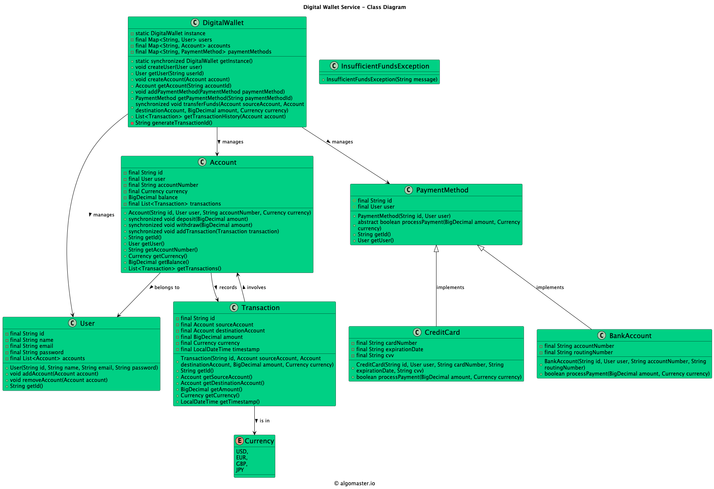

# Low-level design problem: digital wallet service

> Copied from <https://github.com/ashishps1/awesome-low-level-design/blob/main/problems/digital-wallet-service.md> (GPL-3.0, by Ashish Pratap Singh). Questions and answers are the source's own; nothing was answered or rewritten here.


# Designing a Digital Wallet Service

## Requirements
1. The digital wallet should allow users to create an account and manage their personal information.
2. Users should be able to add and remove payment methods, such as credit cards or bank accounts.
3. The digital wallet should support fund transfers between users and to external accounts.
4. The system should handle transaction history and provide a statement of transactions.
5. The digital wallet should support multiple currencies and perform currency conversions.
6. The system should ensure the security of user information and transactions.
7. The digital wallet should handle concurrent transactions and ensure data consistency.
8. The system should be scalable to handle a large number of users and transactions.

## UML Class Diagram



## Implementations
#### [Java Implementation](https://github.com/ashishps1/awesome-low-level-design/blob/main/solutions/java/src/digitalwalletservice) 
#### [Python Implementation](https://github.com/ashishps1/awesome-low-level-design/blob/main/solutions/python/digitalwalletservice)
#### [C++ Implementation](https://github.com/ashishps1/awesome-low-level-design/blob/main/solutions/cpp/digitalwalletservice)
#### [C# Implementation](https://github.com/ashishps1/awesome-low-level-design/blob/main/solutions/csharp/digitalwalletservice)
#### [Go Implementation](https://github.com/ashishps1/awesome-low-level-design/blob/main/solutions/golang/digitalwalletservice)

## Classes, Interfaces and Enumerations
1. The **User** class represents a user of the digital wallet, with properties such as ID, name, email, password, and a list of accounts.
2. The **Account** class represents a user's account within the digital wallet, with properties like ID, user, account number, currency, balance, and a list of transactions. It provides methods to deposit and withdraw funds.
3. The **Transaction** class represents a financial transaction between two accounts, containing properties such as ID, source account, destination account, amount, currency, and timestamp.
4. The **PaymentMethod** class is an abstract base class for different payment methods, such as credit cards and bank accounts. It defines the common properties and methods for processing payments.
5. The **CreditCard** and **BankAccount** classes are concrete implementations of the PaymentMethod class, representing specific payment methods.
6. The **Currency** enum represents different currencies supported by the digital wallet.
7. The **CurrencyConverter** class provides a static method to convert amounts between different currencies based on predefined exchange rates.
8. The **DigitalWallet** class is the central component of the digital wallet system. It follows the Singleton pattern to ensure only one instance of the digital wallet exists. It provides methods to create users, accounts, add payment methods, transfer funds, and retrieve transaction history. It handles concurrent access to shared resources using synchronization.
9. The **DigitalWalletDemo** class demonstrates the usage of the digital wallet system by creating users, accounts, adding payment methods, depositing funds, transferring funds, and retrieving transaction history.

---

## Official solutions from the repository

<details><summary><b>java</b> (10 files)</summary>


**Account.java**

```java
package digitalwalletservice;

import java.math.BigDecimal;
import java.util.ArrayList;
import java.util.List;

public class Account {
    private final String id;
    private final User user;
    private final String accountNumber;
    private final Currency currency;
    private BigDecimal balance;
    private final List<Transaction> transactions;

    public Account(String id, User user, String accountNumber, Currency currency) {
        this.id = id;
        this.user = user;
        this.accountNumber = accountNumber;
        this.currency = currency;
        this.balance = BigDecimal.ZERO;
        this.transactions = new ArrayList<>();
    }

    public synchronized void deposit(BigDecimal amount) {
        balance = balance.add(amount);
    }

    public synchronized void withdraw(BigDecimal amount) {
        if (balance.compareTo(amount) >= 0) {
            balance = balance.subtract(amount);
        } else {
            throw new InsufficientFundsException("Insufficient funds in the account.");
        }
    }

    public synchronized void addTransaction(Transaction transaction) {
        transactions.add(transaction);
    }

    public String getId() {
        return id;
    }

    public User getUser() {
        return user;
    }

    public String getAccountNumber() {
        return accountNumber;
    }

    public Currency getCurrency() {
        return currency;
    }

    public BigDecimal getBalance() {
        return balance;
    }

    public List<Transaction> getTransactions() {
        return transactions;
    }
}
```


**BankAccount.java**

```java
package digitalwalletservice;

import java.math.BigDecimal;

public class BankAccount extends PaymentMethod {
    private final String accountNumber;
    private final String routingNumber;

    public BankAccount(String id, User user, String accountNumber, String routingNumber) {
        super(id, user);
        this.accountNumber = accountNumber;
        this.routingNumber = routingNumber;
    }

    @Override
    public boolean processPayment(BigDecimal amount, Currency currency) {
        // Process bank account payment
        return true;
    }
}
```


**CreditCard.java**

```java
package digitalwalletservice;

import java.math.BigDecimal;

public class CreditCard extends PaymentMethod {
    private final String cardNumber;
    private final String expirationDate;
    private final String cvv;

    public CreditCard(String id, User user, String cardNumber, String expirationDate, String cvv) {
        super(id, user);
        this.cardNumber = cardNumber;
        this.expirationDate = expirationDate;
        this.cvv = cvv;
    }

    @Override
    public boolean processPayment(BigDecimal amount, Currency currency) {
        // Process credit card payment
        return true;
    }
}
```


**Currency.java**

```java
package digitalwalletservice;

public enum Currency {
    USD,
    EUR,
    GBP,
    JPY
}
```


**CurrencyConverter.java**

```java
package digitalwalletservice;

import java.math.BigDecimal;
import java.math.RoundingMode;
import java.util.HashMap;
import java.util.Map;

public class CurrencyConverter {
    private static final Map<Currency, BigDecimal> exchangeRates = new HashMap<>();

    static {
        // Initialize exchange rates
        exchangeRates.put(Currency.USD, BigDecimal.ONE);
        exchangeRates.put(Currency.EUR, new BigDecimal("0.85"));
        exchangeRates.put(Currency.GBP, new BigDecimal("0.72"));
        exchangeRates.put(Currency.JPY, new BigDecimal("110.00"));
        // Add more exchange rates as needed
    }

    public static BigDecimal convert(BigDecimal amount, Currency sourceCurrency, Currency targetCurrency) {
        BigDecimal sourceRate = exchangeRates.get(sourceCurrency);
        BigDecimal targetRate = exchangeRates.get(targetCurrency);
        return amount.multiply(sourceRate).divide(targetRate, RoundingMode.HALF_UP);
    }
}
```


**DigitalWallet.java**

```java
package digitalwalletservice;

import java.math.BigDecimal;
import java.util.List;
import java.util.Map;
import java.util.UUID;
import java.util.concurrent.ConcurrentHashMap;

public class DigitalWallet {
    private static DigitalWallet instance;
    private final Map<String, User> users;
    private final Map<String, Account> accounts;
    private final Map<String, PaymentMethod> paymentMethods;

    private DigitalWallet() {
        users = new ConcurrentHashMap<>();
        accounts = new ConcurrentHashMap<>();
        paymentMethods = new ConcurrentHashMap<>();
    }

    public static synchronized DigitalWallet getInstance() {
        if (instance == null) {
            instance = new DigitalWallet();
        }
        return instance;
    }

    public void createUser(User user) {
        users.put(user.getId(), user);
    }

    public User getUser(String userId) {
        return users.get(userId);
    }

    public void createAccount(Account account) {
        accounts.put(account.getId(), account);
        account.getUser().addAccount(account);
    }

    public Account getAccount(String accountId) {
        return accounts.get(accountId);
    }

    public void addPaymentMethod(PaymentMethod paymentMethod) {
        paymentMethods.put(paymentMethod.getId(), paymentMethod);
    }

    public PaymentMethod getPaymentMethod(String paymentMethodId) {
        return paymentMethods.get(paymentMethodId);
    }

    public synchronized void transferFunds(Account sourceAccount, Account destinationAccount, BigDecimal amount, Currency currency) {
        if (sourceAccount.getCurrency() != currency) {
            amount = CurrencyConverter.convert(amount, currency, sourceAccount.getCurrency());
        }
        sourceAccount.withdraw(amount);

        if (destinationAccount.getCurrency() != sourceAccount.getCurrency()) {
            amount = CurrencyConverter.convert(amount, sourceAccount.getCurrency(), destinationAccount.getCurrency());
        }
        destinationAccount.deposit(amount);

        String transactionId = generateTransactionId();
        Transaction transaction = new Transaction(transactionId, sourceAccount, destinationAccount, amount, destinationAccount.getCurrency());
        sourceAccount.addTransaction(transaction);
        destinationAccount.addTransaction(transaction);
    }

    public List<Transaction> getTransactionHistory(Account account) {
        return account.getTransactions();
    }

    private String generateTransactionId() {
        return "TXN" + UUID.randomUUID().toString().substring(0, 8).toUpperCase();
    }
}
```


**DigitalWalletDemo.java**

```java
package digitalwalletservice;

import java.math.BigDecimal;
import java.util.List;

public class DigitalWalletDemo {
    public static void run() {
        DigitalWallet digitalWallet = DigitalWallet.getInstance();

        // Create users
        User user1 = new User("U001", "John Doe", "john@example.com", "password123");
        User user2 = new User("U002", "Jane Smith", "jane@example.com", "password456");
        digitalWallet.createUser(user1);
        digitalWallet.createUser(user2);

        // Create accounts
        Account account1 = new Account("A001", user1, "1234567890", Currency.USD);
        Account account2 = new Account("A002", user2, "9876543210", Currency.EUR);
        digitalWallet.createAccount(account1);
        digitalWallet.createAccount(account2);

        // Add payment methods
        PaymentMethod creditCard = new CreditCard("PM001", user1, "1234567890123456", "12/25", "123");
        PaymentMethod bankAccount = new BankAccount("PM002", user2, "9876543210", "987654321");
        digitalWallet.addPaymentMethod(creditCard);
        digitalWallet.addPaymentMethod(bankAccount);

        // Deposit funds
        account1.deposit(new BigDecimal("1000.00"));
        account2.deposit(new BigDecimal("500.00"));

        // Transfer funds
        digitalWallet.transferFunds(account1, account2, new BigDecimal("100.00"), Currency.USD);

        // Get transaction history
        List<Transaction> transactionHistory1 = digitalWallet.getTransactionHistory(account1);
        List<Transaction> transactionHistory2 = digitalWallet.getTransactionHistory(account2);

        // Print transaction history
        System.out.println("Transaction History for Account 1:");
        for (Transaction transaction : transactionHistory1) {
            System.out.println("Transaction ID: " + transaction.getId());
            System.out.println("Amount: " + transaction.getAmount() + " " + transaction.getCurrency());
            System.out.println("Timestamp: " + transaction.getTimestamp());
            System.out.println();
        }

        System.out.println("Transaction History for Account 2:");
        for (Transaction transaction : transactionHistory2) {
            System.out.println("Transaction ID: " + transaction.getId());
            System.out.println("Amount: " + transaction.getAmount() + " " + transaction.getCurrency());
            System.out.println("Timestamp: " + transaction.getTimestamp());
            System.out.println();
        }
    }
}
```


**InsufficientFundsException.java**

```java
package digitalwalletservice;

public class InsufficientFundsException extends RuntimeException {
    public InsufficientFundsException(String message) {
        super(message);
    }
}
```


**PaymentMethod.java**

```java
package digitalwalletservice;

import java.math.BigDecimal;

public abstract class PaymentMethod {
    protected final String id;
    protected final User user;

    public PaymentMethod(String id, User user) {
        this.id = id;
        this.user = user;
    }

    public abstract boolean processPayment(BigDecimal amount, Currency currency);

    public String getId() {
        return id;
    }

    public User getUser() {
        return user;
    }
}
```


**README.md**

```md
# Digital Wallet Service (LLD)

## Problem Statement

Design and implement a Digital Wallet Service that allows users to manage their digital money, make transactions, and link multiple payment methods. The system should handle currency conversions, track transactions, and manage different types of accounts.

---

## Requirements

1. **Account Management:**
   - Create and manage user accounts
   - Support multiple payment methods (Bank Account, Credit Card)
   - Handle account balances and transactions

2. **Transaction Management:**
   - Process money transfers
   - Track transaction history
   - Handle transaction status and types

3. **Payment Methods:**
   - Support bank account integration
   - Support credit card integration
   - Allow adding/removing payment methods

4. **Currency Support:**
   - Handle multiple currencies
   - Provide currency conversion
   - Maintain exchange rates

5. **Security and Validation:**
   - Validate transactions
   - Handle insufficient funds
   - Ensure data consistency

---

## Core Entities

### 1. DigitalWallet
- **Fields:** String id, User user, double balance, List<PaymentMethod> paymentMethods, List<Transaction> transactions
- **Methods:** addMoney(), sendMoney(), getBalance(), addPaymentMethod(), removePaymentMethod()

### 2. User
- **Fields:** String id, String name, String email, String phoneNumber
- **Methods:** updateProfile(), getWallet()

### 3. Account
- **Fields:** String id, User user, double balance, Currency currency
- **Methods:** deposit(), withdraw(), getBalance()

### 4. PaymentMethod
- **Fields:** String id, User user, PaymentMethodType type
- **Methods:** validate(), processPayment()

### 5. BankAccount
- **Fields:** String accountNumber, String bankName, String ifscCode
- **Methods:** transfer(), validate()

### 6. CreditCard
- **Fields:** String cardNumber, String expiryDate, String cvv
- **Methods:** charge(), validate()

### 7. Transaction
- **Fields:** String id, Account from, Account to, double amount, Currency currency, TransactionStatus status
- **Methods:** process(), cancel(), getStatus()

### 8. Currency
- **Fields:** String code, String symbol
- **Methods:** getExchangeRate()

### 9. CurrencyConverter
- **Methods:** convert(double amount, Currency from, Currency to)

---

## UML Class Diagram


## Example Usage

```java
// Create a new user
User user = new User("John Doe", "john@example.com", "1234567890");

// Create a digital wallet
DigitalWallet wallet = new DigitalWallet(user);

// Add a bank account
BankAccount bankAccount = new BankAccount("1234567890", "HDFC Bank", "HDFC0001234");
wallet.addPaymentMethod(bankAccount);

// Add money to wallet
wallet.addMoney(1000.0, Currency.USD);

// Send money to another user
User recipient = new User("Jane Doe", "jane@example.com", "9876543210");
wallet.sendMoney(recipient.getWallet(), 500.0, Currency.USD);
```

---

## Demo

See `DigitalWalletDemo.java` for a sample usage and simulation of the digital wallet system.

---

## Extending the Framework

- **Add authentication:** Implement user authentication and authorization
- **Add transaction limits:** Set and enforce transaction limits
- **Add rewards system:** Implement cashback and rewards
- **Add bill payments:** Support utility bill payments
- **Add investment options:** Support investment in various instruments
- **Add notification system:** Send transaction alerts and updates

---

## Design Patterns Used

- **Factory Pattern:** For creating different types of payment methods
- **Strategy Pattern:** For different payment processing strategies
- **Observer Pattern:** For transaction notifications
- **Singleton Pattern:** For currency converter service

---

## Exception Handling

- **InsufficientFundsException:** Thrown when there are insufficient funds for a transaction
- **InvalidPaymentMethodException:** Thrown when payment method validation fails
- **TransactionFailedException:** Thrown when transaction processing fails

---
```

</details>

<details><summary><b>python</b> (12 files)</summary>


**README.md**

```md
# Designing a Digital Wallet System

## Requirements
1. The digital wallet should allow users to create an account and manage their personal information.
2. Users should be able to add and remove payment methods, such as credit cards or bank accounts.
3. The digital wallet should support fund transfers between users and to external accounts.
4. The system should handle transaction history and provide a statement of transactions.
5. The digital wallet should support multiple currencies and perform currency conversions.
6. The system should ensure the security of user information and transactions.
7. The digital wallet should handle concurrent transactions and ensure data consistency.
8. The system should be scalable to handle a large number of users and transactions.

## Classes, Interfaces and Enumerations
1. The **User** class represents a user of the digital wallet, with properties such as ID, name, email, password, and a list of accounts.
2. The **Account** class represents a user's account within the digital wallet, with properties like ID, user, account number, currency, balance, and a list of transactions. It provides methods to deposit and withdraw funds.
3. The **Transaction** class represents a financial transaction between two accounts, containing properties such as ID, source account, destination account, amount, currency, and timestamp.
4. The **PaymentMethod** class is an abstract base class for different payment methods, such as credit cards and bank accounts. It defines the common properties and methods for processing payments.
5. The **CreditCard** and **BankAccount** classes are concrete implementations of the PaymentMethod class, representing specific payment methods.
6. The **Currency** enum represents different currencies supported by the digital wallet.
7. The **CurrencyConverter** class provides a static method to convert amounts between different currencies based on predefined exchange rates.
8. The **DigitalWallet** class is the central component of the digital wallet system. It follows the Singleton pattern to ensure only one instance of the digital wallet exists. It provides methods to create users, accounts, add payment methods, transfer funds, and retrieve transaction history. It handles concurrent access to shared resources using synchronization.
9. The **DigitalWalletDemo** class demonstrates the usage of the digital wallet system by creating users, accounts, adding payment methods, depositing funds, transferring funds, and retrieving transaction history.
```


**account.py**

```py
from decimal import Decimal
from exception import InsufficientFundsException

class Account:
    def __init__(self, id, user, account_number, currency):
        self.id = id
        self.user = user
        self.account_number = account_number
        self.currency = currency
        self.balance = Decimal('0.00')
        self.transactions = []

    def deposit(self, amount):
        self.balance += amount

    def withdraw(self, amount):
        if self.balance >= amount:
            self.balance -= amount
        else:
            raise InsufficientFundsException("Insufficient funds in the account.")

    def add_transaction(self, transaction):
        self.transactions.append(transaction)
```


**bank_account.py**

```py
from payment_method import PaymentMethod

class BankAccount(PaymentMethod):
    def __init__(self, id, user, account_number, routing_number):
        super().__init__(id, user)
        self.account_number = account_number
        self.routing_number = routing_number

    def process_payment(self, amount, currency):
        # Process bank account payment
        return True
```


**credit_card.py**

```py
from payment_method import PaymentMethod

class CreditCard(PaymentMethod):
    def __init__(self, id, user, card_number, expiration_date, cvv):
        super().__init__(id, user)
        self.card_number = card_number
        self.expiration_date = expiration_date
        self.cvv = cvv

    def process_payment(self, amount, currency):
        # Process credit card payment
        return True
```


**currency.py**

```py
from enum import Enum

class Currency(Enum):
    USD = 'USD'
    EUR = 'EUR'
    GBP = 'GBP'
    JPY = 'JPY'
```


**currency_converter.py**

```py
from decimal import Decimal
from currency import Currency

class CurrencyConverter:
    exchange_rates = {
        Currency.USD: Decimal('1.00'),
        Currency.EUR: Decimal('0.85'),
        Currency.GBP: Decimal('0.72'),
        Currency.JPY: Decimal('110.00')
    }

    @staticmethod
    def convert(amount, source_currency, target_currency):
        source_rate = CurrencyConverter.exchange_rates[source_currency]
        target_rate = CurrencyConverter.exchange_rates[target_currency]
        return amount * source_rate / target_rate
```


**digital_wallet.py**

```py
import uuid
from user import User
from account import Account
from payment_method import PaymentMethod
from currency import Currency
from currency_converter import CurrencyConverter
from transaction import Transaction

class DigitalWallet:
    _instance = None

    def __init__(self):
        self.users = {}
        self.accounts = {}
        self.payment_methods = {}

    @classmethod
    def get_instance(cls):
        if cls._instance is None:
            cls._instance = cls()
        return cls._instance

    def create_user(self, user):
        self.users[user.id] = user

    def get_user(self, user_id):
        return self.users.get(user_id)

    def create_account(self, account):
        self.accounts[account.id] = account
        account.user.add_account(account)

    def get_account(self, account_id):
        return self.accounts.get(account_id)

    def add_payment_method(self, payment_method):
        self.payment_methods[payment_method.id] = payment_method

    def get_payment_method(self, payment_method_id):
        return self.payment_methods.get(payment_method_id)

    def transfer_funds(self, source_account, destination_account, amount, currency):
        if source_account.currency != currency:
            amount = CurrencyConverter.convert(amount, currency, source_account.currency)
        source_account.withdraw(amount)

        if destination_account.currency != currency:
            amount = CurrencyConverter.convert(amount, currency, destination_account.currency)
        destination_account.deposit(amount)

        transaction_id = self._generate_transaction_id()
        transaction = Transaction(transaction_id, source_account, destination_account, amount, currency)
        source_account.add_transaction(transaction)
        destination_account.add_transaction(transaction)

    def get_transaction_history(self, account):
        return account.transactions

    def _generate_transaction_id(self):
        return "TXN" + str(uuid.uuid4()).replace('-', '').upper()[:8]
```


**digital_wallet_demo.py**

```py
from decimal import Decimal
from user import User
from account import Account
from currency import Currency
from digital_wallet import DigitalWallet
from credit_card import CreditCard
from bank_account import BankAccount

class DigitalWalletDemo:
    @staticmethod
    def run():
        digital_wallet = DigitalWallet.get_instance()

        # Create users
        user1 = User("U001", "John Doe", "john@example.com", "password123")
        user2 = User("U002", "Jane Smith", "jane@example.com", "password456")
        digital_wallet.create_user(user1)
        digital_wallet.create_user(user2)

        # Create accounts
        account1 = Account("A001", user1, "1234567890", Currency.USD)
        account2 = Account("A002", user2, "9876543210", Currency.EUR)
        digital_wallet.create_account(account1)
        digital_wallet.create_account(account2)

        # Add payment methods
        credit_card = CreditCard("PM001", user1, "1234567890123456", "12/25", "123")
        bank_account = BankAccount("PM002", user2, "9876543210", "987654321")
        digital_wallet.add_payment_method(credit_card)
        digital_wallet.add_payment_method(bank_account)

        # Deposit funds
        account1.deposit(Decimal("1000.00"))
        account2.deposit(Decimal("500.00"))

        # Transfer funds
        digital_wallet.transfer_funds(account1, account2, Decimal("100.00"), Currency.USD)

        # Get transaction history
        transaction_history1 = digital_wallet.get_transaction_history(account1)
        transaction_history2 = digital_wallet.get_transaction_history(account2)

        # Print transaction history
        print("Transaction History for Account 1:")
        for transaction in transaction_history1:
            print(f"Transaction ID: {transaction.id}")
            print(f"Amount: {transaction.amount} {transaction.currency}")
            print(f"Timestamp: {transaction.timestamp}")
            print()

        print("Transaction History for Account 2:")
        for transaction in transaction_history2:
            print(f"Transaction ID: {transaction.id}")
            print(f"Amount: {transaction.amount} {transaction.currency}")
            print(f"Timestamp: {transaction.timestamp}")
            print()

if __name__ == "__main__":
    DigitalWalletDemo.run()
```


**exception.py**

```py
class InsufficientFundsException(Exception):
    pass
```


**payment_method.py**

```py
class PaymentMethod:
    def __init__(self, id, user):
        self.id = id
        self.user = user

    def process_payment(self, amount, currency):
        raise NotImplementedError
```


**transaction.py**

```py
from datetime import datetime

class Transaction:
    def __init__(self, id, source_account, destination_account, amount, currency):
        self.id = id
        self.source_account = source_account
        self.destination_account = destination_account
        self.amount = amount
        self.currency = currency
        self.timestamp = datetime.now()
```


**user.py**

```py
class User:
    def __init__(self, id, name, email, password):
        self.id = id
        self.name = name
        self.email = email
        self.password = password
        self.accounts = []

    def add_account(self, account):
        self.accounts.append(account)

    def remove_account(self, account):
        self.accounts.remove(account)
```

</details>

<details><summary><b>cpp</b> (10 files)</summary>


**README.md**

```md
# Designing a Digital Wallet System

## Requirements
1. The digital wallet should allow users to create an account and manage their personal information.
2. Users should be able to add and remove payment methods, such as credit cards or bank accounts.
3. The digital wallet should support fund transfers between users and to external accounts.
4. The system should handle transaction history and provide a statement of transactions.
5. The digital wallet should support multiple currencies and perform currency conversions.
6. The system should ensure the security of user information and transactions.
7. The digital wallet should handle concurrent transactions and ensure data consistency.
8. The system should be scalable to handle a large number of users and transactions.

## Classes, Interfaces and Enumerations
1. The **User** class represents a user of the digital wallet, with properties such as ID, name, email, password, and a list of accounts.
2. The **Account** class represents a user's account within the digital wallet, with properties like ID, user, account number, currency, balance, and a list of transactions. It provides methods to deposit and withdraw funds.
3. The **Transaction** class represents a financial transaction between two accounts, containing properties such as ID, source account, destination account, amount, currency, and timestamp.
4. The **PaymentMethod** class is an abstract base class for different payment methods, such as credit cards and bank accounts. It defines the common properties and methods for processing payments.
5. The **CreditCard** and **BankAccount** classes are concrete implementations of the PaymentMethod class, representing specific payment methods.
6. The **Currency** enum represents different currencies supported by the digital wallet.
7. The **CurrencyConverter** class provides a static method to convert amounts between different currencies based on predefined exchange rates.
8. The **DigitalWallet** class is the central component of the digital wallet system. It follows the Singleton pattern to ensure only one instance of the digital wallet exists. It provides methods to create users, accounts, add payment methods, transfer funds, and retrieve transaction history. It handles concurrent access to shared resources using synchronization.
9. The **DigitalWalletDemo** class demonstrates the usage of the digital wallet system by creating users, accounts, adding payment methods, depositing funds, transferring funds, and retrieving transaction history.
```


**Transaction.cpp**

```cpp
#include "Transaction.hpp"
#include <iostream>
#include <iomanip>

Transaction::Transaction(std::string transactionId, std::string walletId, 
                       TransactionType type, double amount, std::string timestamp,
                       std::string description)
    : transactionId(transactionId), walletId(walletId), type(type), 
      amount(amount), timestamp(timestamp), description(description), status(false) {}

std::string Transaction::getTransactionId() const { return transactionId; }
std::string Transaction::getWalletId() const { return walletId; }
TransactionType Transaction::getType() const { return type; }
double Transaction::getAmount() const { return amount; }
std::string Transaction::getTimestamp() const { return timestamp; }
std::string Transaction::getDescription() const { return description; }
bool Transaction::getStatus() const { return status; }

void Transaction::setStatus(bool status) {
    this->status = status;
}

void Transaction::displayInfo() const {
    std::cout << "Transaction ID: " << transactionId << std::endl;
    std::cout << "Type: ";
    switch (type) {
        case TransactionType::ADD_MONEY: std::cout << "Add Money"; break;
        case TransactionType::WITHDRAW: std::cout << "Withdraw"; break;
        case TransactionType::TRANSFER: std::cout << "Transfer"; break;
    }
    std::cout << std::endl;
    std::cout << "Amount: $" << std::fixed << std::setprecision(2) << amount << std::endl;
    std::cout << "Time: " << timestamp << std::endl;
    std::cout << "Description: " << description << std::endl;
    std::cout << "Status: " << (status ? "Success" : "Pending") << std::endl;
}
```


**Transaction.hpp**

```hpp
#ifndef TRANSACTION_HPP
#define TRANSACTION_HPP

#include <string>

enum class TransactionType {
    ADD_MONEY,
    WITHDRAW,
    TRANSFER
};

class Transaction {
private:
    std::string transactionId;
    std::string walletId;
    TransactionType type;
    double amount;
    std::string timestamp;
    std::string description;
    bool status;

public:
    Transaction(std::string transactionId, std::string walletId, 
               TransactionType type, double amount, std::string timestamp,
               std::string description);
    
    std::string getTransactionId() const;
    std::string getWalletId() const;
    TransactionType getType() const;
    double getAmount() const;
    std::string getTimestamp() const;
    std::string getDescription() const;
    bool getStatus() const;
    
    void setStatus(bool status);
    void displayInfo() const;
};

#endif
```


**User.cpp**

```cpp
#include "User.hpp"
#include <iostream>

User::User(std::string userId, std::string name, std::string email, std::string phoneNumber)
    : userId(userId), name(name), email(email), phoneNumber(phoneNumber) {}

std::string User::getUserId() const { return userId; }
std::string User::getName() const { return name; }
std::string User::getEmail() const { return email; }
std::string User::getPhoneNumber() const { return phoneNumber; }

void User::displayInfo() const {
    std::cout << "User: " << name << " (ID: " << userId << ")" << std::endl;
    std::cout << "Email: " << email << std::endl;
    std::cout << "Phone: " << phoneNumber << std::endl;
}
```


**User.hpp**

```hpp
#ifndef USER_HPP
#define USER_HPP

#include <string>

class User {
private:
    std::string userId;
    std::string name;
    std::string email;
    std::string phoneNumber;

public:
    User(std::string userId, std::string name, std::string email, std::string phoneNumber);
    
    std::string getUserId() const;
    std::string getName() const;
    std::string getEmail() const;
    std::string getPhoneNumber() const;
    void displayInfo() const;
};

#endif
```


**Wallet.cpp**

```cpp
#include "Wallet.hpp"
#include <iostream>
#include <iomanip>

Wallet::Wallet(std::string walletId, std::string userId)
    : walletId(walletId), userId(userId), balance(0.0) {}

Wallet::~Wallet() {
    for (auto transaction : transactions) {
        delete transaction;
    }
}

std::string Wallet::getWalletId() const { return walletId; }
std::string Wallet::getUserId() const { return userId; }
double Wallet::getBalance() const { return balance; }

bool Wallet::addMoney(double amount, std::string source) {
    if (amount <= 0) return false;
    
    balance += amount;
    return true;
}

bool Wallet::withdrawMoney(double amount, std::string destination) {
    if (amount <= 0 || amount > balance) return false;
    
    balance -= amount;
    return true;
}

void Wallet::addTransaction(Transaction* transaction) {
    transactions.push_back(transaction);
}

void Wallet::displayInfo() const {
    std::cout << "Wallet ID: " << walletId << std::endl;
    std::cout << "User ID: " << userId << std::endl;
    std::cout << "Balance: $" << std::fixed << std::setprecision(2) << balance << std::endl;
}

void Wallet::displayTransactions() const {
    std::cout << "\nTransaction History:" << std::endl;
    for (const auto& transaction : transactions) {
        transaction->displayInfo();
        std::cout << "------------------------" << std::endl;
    }
}
```


**Wallet.hpp**

```hpp
#ifndef WALLET_HPP
#define WALLET_HPP

#include <string>
#include <vector>
#include "Transaction.hpp"

class Wallet {
private:
    std::string walletId;
    std::string userId;
    double balance;
    std::vector<Transaction*> transactions;

public:
    Wallet(std::string walletId, std::string userId);
    ~Wallet();
    
    std::string getWalletId() const;
    std::string getUserId() const;
    double getBalance() const;
    
    bool addMoney(double amount, std::string source);
    bool withdrawMoney(double amount, std::string destination);
    void addTransaction(Transaction* transaction);
    void displayInfo() const;
    void displayTransactions() const;
};

#endif
```


**WalletDemo.cpp**

```cpp
#include "WalletSystem.hpp"
#include <iostream>

int main() {
    WalletSystem system;
    
    // Create users
    User* user1 = new User("U001", "John Doe", "john@example.com", "+1-555-0123");
    User* user2 = new User("U002", "Jane Smith", "jane@example.com", "+1-555-0124");
    
    system.addUser(user1);
    system.addUser(user2);
    
    // Create wallets
    Wallet* wallet1 = system.createWallet("U001");
    Wallet* wallet2 = system.createWallet("U002");
    
    // Add money to wallets
    if (system.addMoney("WU001", 1000.0, "Bank Transfer")) {
        std::cout << "Added $1000 to John's wallet" << std::endl;
    }
    
    if (system.addMoney("WU002", 500.0, "Credit Card")) {
        std::cout << "Added $500 to Jane's wallet" << std::endl;
    }
    
    // Transfer money
    if (system.transferMoney("WU001", "WU002", 300.0)) {
        std::cout << "Transferred $300 from John to Jane" << std::endl;
    }
    
    // Withdraw money
    if (system.withdrawMoney("WU002", 200.0, "Bank Account")) {
        std::cout << "Jane withdrew $200" << std::endl;
    }
    
    // Display information
    system.displayAllUsers();
    system.displayAllWallets();
    
    // Display detailed user information
    std::cout << "\nDetailed User Information:" << std::endl;
    system.displayUserInfo("U001");
    
    return 0;
}
```


**WalletSystem.cpp**

```cpp
#include "WalletSystem.hpp"
#include <iostream>
#include <ctime>
#include <sstream>
#include <iomanip>

WalletSystem::WalletSystem() : transactionIdCounter(1) {}

WalletSystem::~WalletSystem() {
    for (auto user : users) delete user;
    for (auto wallet : wallets) delete wallet;
}

void WalletSystem::addUser(User* user) {
    users.push_back(user);
}

Wallet* WalletSystem::createWallet(std::string userId) {
    if (!findUser(userId)) return nullptr;
    
    std::string walletId = "W" + userId;
    Wallet* wallet = new Wallet(walletId, userId);
    wallets.push_back(wallet);
    return wallet;
}

bool WalletSystem::addMoney(std::string walletId, double amount, std::string source) {
    Wallet* wallet = findWallet(walletId);
    if (!wallet) return false;
    
    if (wallet->addMoney(amount, source)) {
        Transaction* transaction = new Transaction(
            generateTransactionId(),
            walletId,
            TransactionType::ADD_MONEY,
            amount,
            getCurrentTimestamp(),
            "Added money from " + source
        );
        transaction->setStatus(true);
        wallet->addTransaction(transaction);
        return true;
    }
    return false;
}

bool WalletSystem::withdrawMoney(std::string walletId, double amount, std::string destination) {
    Wallet* wallet = findWallet(walletId);
    if (!wallet) return false;
    
    if (wallet->withdrawMoney(amount, destination)) {
        Transaction* transaction = new Transaction(
            generateTransactionId(),
            walletId,
            TransactionType::WITHDRAW,
            amount,
            getCurrentTimestamp(),
            "Withdrawn to " + destination
        );
        transaction->setStatus(true);
        wallet->addTransaction(transaction);
        return true;
    }
    return false;
}

bool WalletSystem::transferMoney(std::string fromWalletId, std::string toWalletId, double amount) {
    Wallet* fromWallet = findWallet(fromWalletId);
    Wallet* toWallet = findWallet(toWalletId);
    if (!fromWallet || !toWallet) return false;
    
    if (fromWallet->withdrawMoney(amount, "Transfer to " + toWalletId) &&
        toWallet->addMoney(amount, "Transfer from " + fromWalletId)) {
        
        Transaction* transaction = new Transaction(
            generateTransactionId(),
            fromWalletId,
            TransactionType::TRANSFER,
            amount,
            getCurrentTimestamp(),
            "Transfer to wallet " + toWalletId
        );
        transaction->setStatus(true);
        fromWallet->addTransaction(transaction);
        
        transaction = new Transaction(
            generateTransactionId(),
            toWalletId,
            TransactionType::TRANSFER,
            amount,
            getCurrentTimestamp(),
            "Transfer from wallet " + fromWalletId
        );
        transaction->setStatus(true);
        toWallet->addTransaction(transaction);
        
        return true;
    }
    return false;
}

void WalletSystem::displayUserInfo(std::string userId) const {
    User* user = findUser(userId);
    if (user) {
        user->displayInfo();
        for (const auto& wallet : wallets) {
            if (wallet->getUserId() == userId) {
                wallet->displayInfo();
                wallet->displayTransactions();
            }
        }
    }
}

void WalletSystem::displayWalletInfo(std::string walletId) const {
    Wallet* wallet = findWallet(walletId);
    if (wallet) {
        wallet->displayInfo();
        wallet->displayTransactions();
    }
}

void WalletSystem::displayAllUsers() const {
    std::cout << "\nAll Users:" << std::endl;
    for (const auto& user : users) {
        user->displayInfo();
        std::cout << "------------------------" << std::endl;
    }
}

void WalletSystem::displayAllWallets() const {
    std::cout << "\nAll Wallets:" << std::endl;
    for (const auto& wallet : wallets) {
        wallet->displayInfo();
        std::cout << "------------------------" << std::endl;
    }
}

User* WalletSystem::findUser(const std::string& userId) const {
    for (auto user : users) {
        if (user->getUserId() == userId) return user;
    }
    return nullptr;
}

Wallet* WalletSystem::findWallet(const std::string& walletId) const {
    for (auto wallet : wallets) {
        if (wallet->getWalletId() == walletId) return wallet;
    }
    return nullptr;
}

std::string WalletSystem::generateTransactionId() {
    return "T" + std::to_string(transactionIdCounter++);
}

std::string WalletSystem::getCurrentTimestamp() const {
    auto now = std::time(nullptr);
    auto tm = *std::localtime(&now);
    std::ostringstream oss;
    oss << std::put_time(&tm, "%Y-%m-%d %H:%M:%S");
    return oss.str();
}
```


**WalletSystem.hpp**

```hpp
#ifndef WALLET_SYSTEM_HPP
#define WALLET_SYSTEM_HPP

#include <vector>
#include <string>
#include "User.hpp"
#include "Wallet.hpp"
#include "Transaction.hpp"

class WalletSystem {
private:
    std::vector<User*> users;
    std::vector<Wallet*> wallets;
    int transactionIdCounter;

public:
    WalletSystem();
    ~WalletSystem();
    
    void addUser(User* user);
    Wallet* createWallet(std::string userId);
    
    bool addMoney(std::string walletId, double amount, std::string source);
    bool withdrawMoney(std::string walletId, double amount, std::string destination);
    bool transferMoney(std::string fromWalletId, std::string toWalletId, double amount);
    
    void displayUserInfo(std::string userId) const;
    void displayWalletInfo(std::string walletId) const;
    void displayAllUsers() const;
    void displayAllWallets() const;
    
private:
    User* findUser(const std::string& userId) const;
    Wallet* findWallet(const std::string& walletId) const;
    std::string generateTransactionId();
    std::string getCurrentTimestamp() const;
};

#endif
```

</details>

<details><summary><b>golang</b> (12 files)</summary>


**README.md**

```md
# Designing a Digital Wallet System

## Requirements
1. The digital wallet should allow users to create an account and manage their personal information.
2. Users should be able to add and remove payment methods, such as credit cards or bank accounts.
3. The digital wallet should support fund transfers between users and to external accounts.
4. The system should handle transaction history and provide a statement of transactions.
5. The digital wallet should support multiple currencies and perform currency conversions.
6. The system should ensure the security of user information and transactions.
7. The digital wallet should handle concurrent transactions and ensure data consistency.
8. The system should be scalable to handle a large number of users and transactions.

## Classes, Interfaces and Enumerations
1. The **User** class represents a user of the digital wallet, with properties such as ID, name, email, password, and a list of accounts.
2. The **Account** class represents a user's account within the digital wallet, with properties like ID, user, account number, currency, balance, and a list of transactions. It provides methods to deposit and withdraw funds.
3. The **Transaction** class represents a financial transaction between two accounts, containing properties such as ID, source account, destination account, amount, currency, and timestamp.
4. The **PaymentMethod** class is an abstract base class for different payment methods, such as credit cards and bank accounts. It defines the common properties and methods for processing payments.
5. The **CreditCard** and **BankAccount** classes are concrete implementations of the PaymentMethod class, representing specific payment methods.
6. The **Currency** enum represents different currencies supported by the digital wallet.
7. The **CurrencyConverter** class provides a static method to convert amounts between different currencies based on predefined exchange rates.
8. The **DigitalWallet** class is the central component of the digital wallet system. It follows the Singleton pattern to ensure only one instance of the digital wallet exists. It provides methods to create users, accounts, add payment methods, transfer funds, and retrieve transaction history. It handles concurrent access to shared resources using synchronization.
9. The **DigitalWalletDemo** class demonstrates the usage of the digital wallet system by creating users, accounts, adding payment methods, depositing funds, transferring funds, and retrieving transaction history.
```


**account.go**

```go
package digitalwallet

import (
	"math/big"
	"sync"
)

type Account struct {
	ID            string
	User          *User
	AccountNumber string
	Currency      Currency
	balance       *big.Float
	transactions  []*Transaction
	mu            sync.RWMutex
}

func NewAccount(id string, user *User, accountNumber string, currency Currency) *Account {
	return &Account{
		ID:            id,
		User:          user,
		AccountNumber: accountNumber,
		Currency:      currency,
		balance:       big.NewFloat(0),
		transactions:  make([]*Transaction, 0),
	}
}

func (a *Account) Deposit(amount *big.Float) {
	a.mu.Lock()
	defer a.mu.Unlock()
	a.balance.Add(a.balance, amount)
}

func (a *Account) Withdraw(amount *big.Float) error {
	a.mu.Lock()
	defer a.mu.Unlock()

	if a.balance.Cmp(amount) >= 0 {
		a.balance.Sub(a.balance, amount)
		return nil
	}
	return NewInsufficientFundsError("Insufficient funds in the account")
}

func (a *Account) AddTransaction(transaction *Transaction) {
	a.mu.Lock()
	defer a.mu.Unlock()
	a.transactions = append(a.transactions, transaction)
}

func (a *Account) GetBalance() *big.Float {
	a.mu.RLock()
	defer a.mu.RUnlock()
	return new(big.Float).Copy(a.balance)
}

func (a *Account) GetTransactions() []*Transaction {
	a.mu.RLock()
	defer a.mu.RUnlock()
	return append([]*Transaction{}, a.transactions...)
}
```


**bank_account.go**

```go
package digitalwallet

import "math/big"

type BankAccount struct {
	BasePaymentMethod
	AccountNumber string
	RoutingNumber string
}

func NewBankAccount(id string, user *User, accountNumber, routingNumber string) *BankAccount {
	return &BankAccount{
		BasePaymentMethod: BasePaymentMethod{ID: id, User: user},
		AccountNumber:     accountNumber,
		RoutingNumber:     routingNumber,
	}
}

func (b *BankAccount) ProcessPayment(amount *big.Float, currency Currency) bool {
	// Process bank account payment
	return true
}
```


**credit_card.go**

```go
package digitalwallet

import "math/big"

type CreditCard struct {
	BasePaymentMethod
	CardNumber     string
	ExpirationDate string
	CVV            string
}

func NewCreditCard(id string, user *User, cardNumber, expirationDate, cvv string) *CreditCard {
	return &CreditCard{
		BasePaymentMethod: BasePaymentMethod{ID: id, User: user},
		CardNumber:        cardNumber,
		ExpirationDate:    expirationDate,
		CVV:               cvv,
	}
}

func (c *CreditCard) ProcessPayment(amount *big.Float, currency Currency) bool {
	// Process credit card payment
	return true
}
```


**currency_converter.go**

```go
package digitalwallet

import (
	"math/big"
	"sync"
)

type CurrencyConverter struct {
	exchangeRates map[Currency]*big.Float
	mu            sync.RWMutex
}

var (
	currencyConverter *CurrencyConverter
	converterOnce     sync.Once
)

func GetCurrencyConverter() *CurrencyConverter {
	converterOnce.Do(func() {
		currencyConverter = &CurrencyConverter{
			exchangeRates: make(map[Currency]*big.Float),
		}
		currencyConverter.initializeRates()
	})
	return currencyConverter
}

func (cc *CurrencyConverter) initializeRates() {
	cc.mu.Lock()
	defer cc.mu.Unlock()

	one := big.NewFloat(1)
	cc.exchangeRates[USD] = one
	cc.exchangeRates[EUR] = big.NewFloat(0.85)
	cc.exchangeRates[GBP] = big.NewFloat(0.72)
	cc.exchangeRates[JPY] = big.NewFloat(110.00)
}

func (cc *CurrencyConverter) Convert(amount *big.Float, sourceCurrency, targetCurrency Currency) *big.Float {
	cc.mu.RLock()
	defer cc.mu.RUnlock()

	sourceRate := cc.exchangeRates[sourceCurrency]
	targetRate := cc.exchangeRates[targetCurrency]

	result := new(big.Float).Mul(amount, sourceRate)
	return new(big.Float).Quo(result, targetRate)
}
```


**digital_wallet.go**

```go
package digitalwallet

import (
	"fmt"
	"math/big"
	"sync"
	"time"
)

type DigitalWallet struct {
	users          map[string]*User
	accounts       map[string]*Account
	paymentMethods map[string]PaymentMethod
	mu             sync.RWMutex
}

var (
	instance *DigitalWallet
	once     sync.Once
)

func GetDigitalWallet() *DigitalWallet {
	once.Do(func() {
		instance = &DigitalWallet{
			users:          make(map[string]*User),
			accounts:       make(map[string]*Account),
			paymentMethods: make(map[string]PaymentMethod),
		}
	})
	return instance
}

func (dw *DigitalWallet) CreateUser(user *User) {
	dw.mu.Lock()
	defer dw.mu.Unlock()
	dw.users[user.ID] = user
}

func (dw *DigitalWallet) CreateAccount(account *Account) {
	dw.mu.Lock()
	defer dw.mu.Unlock()
	dw.accounts[account.ID] = account
	account.User.AddAccount(account)
}

func (dw *DigitalWallet) AddPaymentMethod(method PaymentMethod) {
	dw.mu.Lock()
	defer dw.mu.Unlock()
	dw.paymentMethods[method.GetID()] = method
}

func (dw *DigitalWallet) TransferFunds(sourceAccount, destinationAccount *Account, amount *big.Float, currency Currency) error {
	dw.mu.Lock()
	defer dw.mu.Unlock()

	converter := GetCurrencyConverter()

	// Convert amount to source account currency
	sourceAmount := amount
	if sourceAccount.Currency != currency {
		sourceAmount = converter.Convert(amount, currency, sourceAccount.Currency)
	}

	// Withdraw from source account
	if err := sourceAccount.Withdraw(sourceAmount); err != nil {
		return err
	}

	// Convert amount to destination account currency
	destAmount := amount
	if destinationAccount.Currency != currency {
		destAmount = converter.Convert(amount, currency, destinationAccount.Currency)
	}

	// Deposit to destination account
	destinationAccount.Deposit(destAmount)

	// Create and record transaction
	transactionID := fmt.Sprintf("TXN%d", time.Now().UnixNano())
	transaction := NewTransaction(transactionID, sourceAccount, destinationAccount, amount, currency)
	sourceAccount.AddTransaction(transaction)
	destinationAccount.AddTransaction(transaction)

	return nil
}

func (dw *DigitalWallet) GetTransactionHistory(account *Account) []*Transaction {
	return account.GetTransactions()
}
```


**digital_wallet_demo.go**

```go
package digitalwallet

import (
	"fmt"
	"math/big"
)

func Run() {
	digitalWallet := GetDigitalWallet()

	// Create users
	user1 := NewUser("U001", "John Doe", "john@example.com", "password123")
	user2 := NewUser("U002", "Jane Smith", "jane@example.com", "password456")
	digitalWallet.CreateUser(user1)
	digitalWallet.CreateUser(user2)

	// Create accounts
	account1 := NewAccount("A001", user1, "1234567890", USD)
	account2 := NewAccount("A002", user2, "9876543210", EUR)
	digitalWallet.CreateAccount(account1)
	digitalWallet.CreateAccount(account2)

	// Add payment methods
	creditCard := NewCreditCard("PM001", user1, "1234567890123456", "12/25", "123")
	bankAccount := NewBankAccount("PM002", user2, "9876543210", "987654321")
	digitalWallet.AddPaymentMethod(creditCard)
	digitalWallet.AddPaymentMethod(bankAccount)

	// Deposit funds
	account1.Deposit(big.NewFloat(1000.00))
	account2.Deposit(big.NewFloat(500.00))

	// Transfer funds
	amount := big.NewFloat(100.00)
	if err := digitalWallet.TransferFunds(account1, account2, amount, USD); err != nil {
		fmt.Printf("Transfer failed: %v\n", err)
	}

	// Print transaction history
	fmt.Println("Transaction History for Account 1:")
	for _, transaction := range digitalWallet.GetTransactionHistory(account1) {
		fmt.Printf("Transaction ID: %s\n", transaction.ID)
		fmt.Printf("Amount: %v %s\n", transaction.Amount, transaction.Currency)
		fmt.Printf("Timestamp: %v\n\n", transaction.Timestamp)
	}

	fmt.Println("Transaction History for Account 2:")
	for _, transaction := range digitalWallet.GetTransactionHistory(account2) {
		fmt.Printf("Transaction ID: %s\n", transaction.ID)
		fmt.Printf("Amount: %v %s\n", transaction.Amount, transaction.Currency)
		fmt.Printf("Timestamp: %v\n\n", transaction.Timestamp)
	}
}
```


**errors.go**

```go
package digitalwallet

type InsufficientFundsError struct {
	message string
}

func NewInsufficientFundsError(message string) *InsufficientFundsError {
	return &InsufficientFundsError{message: message}
}

func (e *InsufficientFundsError) Error() string {
	return e.message
}
```


**payment_method.go**

```go
package digitalwallet

import "math/big"

type PaymentMethod interface {
	ProcessPayment(amount *big.Float, currency Currency) bool
	GetID() string
	GetUser() *User
}

type BasePaymentMethod struct {
	ID   string
	User *User
}

func (b *BasePaymentMethod) GetID() string {
	return b.ID
}

func (b *BasePaymentMethod) GetUser() *User {
	return b.User
}
```


**transaction.go**

```go
package digitalwallet

import (
	"math/big"
	"time"
)

type Transaction struct {
	ID                 string
	SourceAccount      *Account
	DestinationAccount *Account
	Amount             *big.Float
	Currency           Currency
	Timestamp          time.Time
}

func NewTransaction(id string, sourceAccount, destinationAccount *Account, amount *big.Float, currency Currency) *Transaction {
	return &Transaction{
		ID:                 id,
		SourceAccount:      sourceAccount,
		DestinationAccount: destinationAccount,
		Amount:             amount,
		Currency:           currency,
		Timestamp:          time.Now(),
	}
}
```


**types.go**

```go
package digitalwallet

type Currency string

const (
	USD Currency = "USD"
	EUR Currency = "EUR"
	GBP Currency = "GBP"
	JPY Currency = "JPY"
)
```


**user.go**

```go
package digitalwallet

import "sync"

type User struct {
	ID       string
	Name     string
	Email    string
	Password string
	accounts []*Account
	mu       sync.RWMutex
}

func NewUser(id, name, email, password string) *User {
	return &User{
		ID:       id,
		Name:     name,
		Email:    email,
		Password: password,
		accounts: make([]*Account, 0),
	}
}

func (u *User) AddAccount(account *Account) {
	u.mu.Lock()
	defer u.mu.Unlock()
	u.accounts = append(u.accounts, account)
}

func (u *User) RemoveAccount(account *Account) {
	u.mu.Lock()
	defer u.mu.Unlock()
	for i, acc := range u.accounts {
		if acc == account {
			u.accounts = append(u.accounts[:i], u.accounts[i+1:]...)
			break
		}
	}
}
```

</details>

<details><summary><b>csharp</b> (12 files)</summary>


**Account.cs**

```cs
using System;
using System.Collections.Generic;
using System.Numerics;

namespace DigitalWallet
{
    public class Account
    {
        private readonly string id;
        private readonly User user;
        private readonly string accountNumber;
        private readonly Currency currency;
        private decimal balance;
        private readonly List<Transaction> transactions;

        public Account(string id, User user, string accountNumber, Currency currency)
        {
            this.id = id;
            this.user = user;
            this.accountNumber = accountNumber;
            this.currency = currency;
            this.balance = 0.0M;
            this.transactions = new List<Transaction>();
        }

        public void Deposit(decimal amount)
        {
            balance = balance + amount;
        }

        public void Withdraw(decimal amount)
        {
            if (balance.CompareTo(amount) >= 0)
            {
                balance = balance - amount;
            }
            else
            {
                throw new InsufficientFundsException("Insufficient funds in the account.");
            }
        }

        public void AddTransaction(Transaction transaction)
        {
            transactions.Add(transaction);
        }

        public string GetId()
        {
            return id;
        }

        public User GetUser()
        {
            return user;
        }

        public Currency GetCurrency()
        {
            return currency;
        }

        public decimal GetBalance()
        {
            return balance;
        }

        public List<Transaction> GetTransactions()
        {
            return transactions;
        }
    }
}
```


**BankAccount.cs**

```cs
using System;
using System.Numerics;

namespace DigitalWallet
{
    public class BankAccount : PaymentMethod
    {
        private readonly string accountNumber;
        private readonly string routingNumber;

        public BankAccount(string id, User user, string accountNumber, string routingNumber)
            : base(id, user)
        {
            this.accountNumber = accountNumber;
            this.routingNumber = routingNumber;
        }

        public override bool ProcessPayment(decimal amount, Currency currency)
        {
            // Process bank account payment logic
            return true;
        }
    }
}
```


**CreditCard.cs**

```cs
using System;
using System.Numerics;

namespace DigitalWallet
{
    public class CreditCard : PaymentMethod
    {
        private readonly string cardNumber;
        private readonly string expirationDate;
        private readonly string cvv;

        public CreditCard(string id, User user, string cardNumber, string expirationDate, string cvv)
            : base(id, user)
        {
            this.cardNumber = cardNumber;
            this.expirationDate = expirationDate;
            this.cvv = cvv;
        }

        public override bool ProcessPayment(decimal amount, Currency currency)
        {
            // Process credit card payment logic
            return true;
        }
    }
}
```


**Currency.cs**

```cs
namespace DigitalWallet
{
    public enum Currency
    {
        USD,
        EUR,
        GBP,
        JPY
    }
}
```


**CurrencyConverter.cs**

```cs
using System;
using System.Collections.Generic;
using System.Numerics;

namespace DigitalWallet
{
    public class CurrencyConverter
    {
        private static readonly Dictionary<Currency, decimal> exchangeRates = new Dictionary<Currency, decimal>
        {
            { Currency.USD, 1.00M },
            { Currency.EUR, 0.85M },
            { Currency.GBP, 0.72M },
            { Currency.JPY, 110.00M }
        };

        public static decimal Convert(decimal amount, Currency sourceCurrency, Currency targetCurrency)
        {
            decimal sourceRate = exchangeRates[sourceCurrency];
            decimal targetRate = exchangeRates[targetCurrency];
            return amount * sourceRate / targetRate;
        }
    }
}
```


**DigitalWallet.cs**

```cs
using System;
using System.Collections.Concurrent;
using System.Collections.Generic;
using System.Numerics;

namespace DigitalWallet
{
    public class DigitalWallet
    {
        private static DigitalWallet instance;
        private readonly ConcurrentDictionary<string, User> users;
        private readonly ConcurrentDictionary<string, Account> accounts;
        private readonly ConcurrentDictionary<string, PaymentMethod> paymentMethods;

        private DigitalWallet()
        {
            users = new ConcurrentDictionary<string, User>();
            accounts = new ConcurrentDictionary<string, Account>();
            paymentMethods = new ConcurrentDictionary<string, PaymentMethod>();
        }

        public static DigitalWallet GetInstance()
        {
            if (instance == null)
            {
                instance = new DigitalWallet();
            }
            return instance;
        }

        public void CreateUser(User user)
        {
            users[user.GetId()] = user;
        }

        public User GetUser(string userId)
        {
            return users.ContainsKey(userId) ? users[userId] : null;
        }

        public void CreateAccount(Account account)
        {
            accounts[account.GetId()] = account;
            account.GetUser().AddAccount(account);
        }

        public Account GetAccount(string accountId)
        {
            return accounts.ContainsKey(accountId) ? accounts[accountId] : null;
        }

        public void AddPaymentMethod(PaymentMethod paymentMethod)
        {
            paymentMethods[paymentMethod.GetId()] = paymentMethod;
        }

        public PaymentMethod GetPaymentMethod(string paymentMethodId)
        {
            return paymentMethods.ContainsKey(paymentMethodId) ? paymentMethods[paymentMethodId] : null;
        }

        public void TransferFunds(Account sourceAccount, Account destinationAccount, decimal amount, Currency currency)
        {
            if (sourceAccount.GetCurrency() != currency)
            {
                amount = CurrencyConverter.Convert(amount, currency, sourceAccount.GetCurrency());
            }
            sourceAccount.Withdraw(amount);

            if (destinationAccount.GetCurrency() != currency)
            {
                amount = CurrencyConverter.Convert(amount, currency, destinationAccount.GetCurrency());
            }
            destinationAccount.Deposit(amount);

            string transactionId = GenerateTransactionId();
            Transaction transaction = new Transaction(transactionId, sourceAccount, destinationAccount, amount, currency);
            sourceAccount.AddTransaction(transaction);
            destinationAccount.AddTransaction(transaction);
        }

        public List<Transaction> GetTransactionHistory(Account account)
        {
            return account.GetTransactions();
        }

        private string GenerateTransactionId()
        {
            return "TXN" + Guid.NewGuid().ToString().Substring(0, 8).ToUpper();
        }
    }
}
```


**DigitalWalletDemo.cs**

```cs
using System;
using System.Collections.Generic;
using System.Numerics;

namespace DigitalWallet
{
    public class DigitalWalletDemo
    {
        public static void Run()
        {
            DigitalWallet digitalWallet = DigitalWallet.GetInstance();

            // Create users
            User user1 = new User("U001", "John Doe", "john@example.com", "password123");
            User user2 = new User("U002", "Jane Smith", "jane@example.com", "password456");
            digitalWallet.CreateUser(user1);
            digitalWallet.CreateUser(user2);

            // Create accounts
            Account account1 = new Account("A001", user1, "1234567890", Currency.USD);
            Account account2 = new Account("A002", user2, "9876543210", Currency.EUR);
            digitalWallet.CreateAccount(account1);
            digitalWallet.CreateAccount(account2);

            // Add payment methods
            PaymentMethod creditCard = new CreditCard("PM001", user1, "1234567890123456", "12/25", "123");
            PaymentMethod bankAccount = new BankAccount("PM002", user2, "9876543210", "987654321");
            digitalWallet.AddPaymentMethod(creditCard);
            digitalWallet.AddPaymentMethod(bankAccount);

            // Deposit funds
            account1.Deposit(1000.00M);
            account2.Deposit(500.00M);

            // Transfer funds
            digitalWallet.TransferFunds(account1, account2, 100.00M, Currency.USD);

            // Get transaction history
            List<Transaction> transactionHistory1 = digitalWallet.GetTransactionHistory(account1);
            List<Transaction> transactionHistory2 = digitalWallet.GetTransactionHistory(account2);

            // Print transaction history
            Console.WriteLine("Transaction History for Account 1:");
            foreach (Transaction transaction in transactionHistory1)
            {
                Console.WriteLine("Transaction ID: " + transaction.GetId());
                Console.WriteLine("Amount: " + transaction.GetAmount() + " " + transaction.GetCurrency());
                Console.WriteLine("Timestamp: " + transaction.GetTimestamp());
                Console.WriteLine();
            }

            Console.WriteLine("Transaction History for Account 2:");
            foreach (Transaction transaction in transactionHistory2)
            {
                Console.WriteLine("Transaction ID: " + transaction.GetId());
                Console.WriteLine("Amount: " + transaction.GetAmount() + " " + transaction.GetCurrency());
                Console.WriteLine("Timestamp: " + transaction.GetTimestamp());
                Console.WriteLine();
            }
        }
    }
}
```


**InsufficientFundsException.cs**

```cs
using System;

namespace DigitalWallet
{
    public class InsufficientFundsException : Exception
    {
        public InsufficientFundsException(string message) : base(message) { }
    }
}
```


**PaymentMethod.cs**

```cs
using System;
using System.Numerics;

namespace DigitalWallet
{
    public abstract class PaymentMethod
    {
        protected readonly string id;
        protected readonly User user;

        protected PaymentMethod(string id, User user)
        {
            this.id = id;
            this.user = user;
        }

        public abstract bool ProcessPayment(decimal amount, Currency currency);

        public string GetId()
        {
            return id;
        }

        public User GetUser()
        {
            return user;
        }
    }
}
```


**README.md**

```md
# Designing a Digital Wallet System

## Requirements
1. The digital wallet should allow users to create an account and manage their personal information.
2. Users should be able to add and remove payment methods, such as credit cards or bank accounts.
3. The digital wallet should support fund transfers between users and to external accounts.
4. The system should handle transaction history and provide a statement of transactions.
5. The digital wallet should support multiple currencies and perform currency conversions.
6. The system should ensure the security of user information and transactions.
7. The digital wallet should handle concurrent transactions and ensure data consistency.
8. The system should be scalable to handle a large number of users and transactions.

## Classes, Interfaces and Enumerations
1. The **User** class represents a user of the digital wallet, with properties such as ID, name, email, password, and a list of accounts.
2. The **Account** class represents a user's account within the digital wallet, with properties like ID, user, account number, currency, balance, and a list of transactions. It provides methods to deposit and withdraw funds.
3. The **Transaction** class represents a financial transaction between two accounts, containing properties such as ID, source account, destination account, amount, currency, and timestamp.
4. The **PaymentMethod** class is an abstract base class for different payment methods, such as credit cards and bank accounts. It defines the common properties and methods for processing payments.
5. The **CreditCard** and **BankAccount** classes are concrete implementations of the PaymentMethod class, representing specific payment methods.
6. The **Currency** enum represents different currencies supported by the digital wallet.
7. The **CurrencyConverter** class provides a static method to convert amounts between different currencies based on predefined exchange rates.
8. The **DigitalWallet** class is the central component of the digital wallet system. It follows the Singleton pattern to ensure only one instance of the digital wallet exists. It provides methods to create users, accounts, add payment methods, transfer funds, and retrieve transaction history. It handles concurrent access to shared resources using synchronization.
9. The **DigitalWalletDemo** class demonstrates the usage of the digital wallet system by creating users, accounts, adding payment methods, depositing funds, transferring funds, and retrieving transaction history.
```


**Transaction.cs**

```cs
using System;
using System.Numerics;

namespace DigitalWallet
{
    public class Transaction
    {
        private readonly string id;
        private readonly Account sourceAccount;
        private readonly Account destinationAccount;
        private readonly decimal amount;
        private readonly Currency currency;
        private readonly DateTime timestamp;

        public Transaction(string id, Account sourceAccount, Account destinationAccount, decimal amount, Currency currency)
        {
            this.id = id;
            this.sourceAccount = sourceAccount;
            this.destinationAccount = destinationAccount;
            this.amount = amount;
            this.currency = currency;
            this.timestamp = DateTime.Now;
        }

        public string GetId()
        {
            return id;
        }

        public Account GetSourceAccount()
        {
            return sourceAccount;
        }

        public Account GetDestinationAccount()
        {
            return destinationAccount;
        }

        public decimal GetAmount()
        {
            return amount;
        }

        public Currency GetCurrency()
        {
            return currency;
        }

        public DateTime GetTimestamp()
        {
            return timestamp;
        }
    }
}
```


**User.cs**

```cs
using System;
using System.Collections.Generic;

namespace DigitalWallet
{
    public class User
    {
        private readonly string id;
        private readonly string name;
        private readonly string email;
        private readonly string password;
        private readonly List<Account> accounts;

        public User(string id, string name, string email, string password)
        {
            this.id = id;
            this.name = name;
            this.email = email;
            this.password = password;
            this.accounts = new List<Account>();
        }

        public void AddAccount(Account account)
        {
            accounts.Add(account);
        }

        public void RemoveAccount(Account account)
        {
            accounts.Remove(account);
        }

        public string GetId()
        {
            return id;
        }
    }
}
```

</details>
