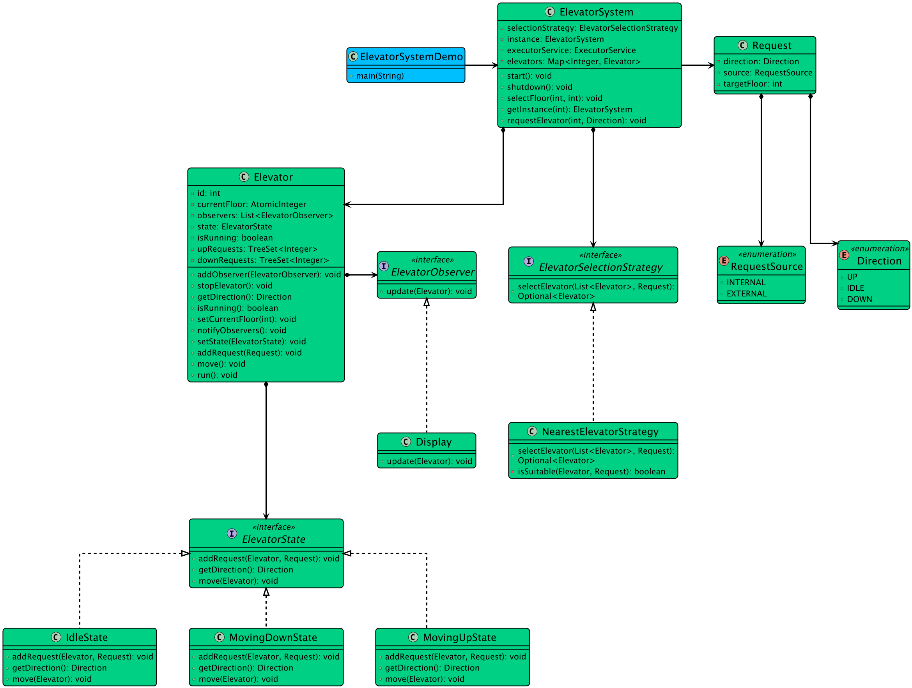

# Low-level design problem: elevator system

> Copied from <https://github.com/ashishps1/awesome-low-level-design/blob/main/problems/elevator-system.md> (GPL-3.0, by Ashish Pratap Singh). Questions and answers are the source's own; nothing was answered or rewritten here.


# Designing an Elevator System

## Requirements
1. The elevator system should consist of multiple elevators serving multiple floors.
2. Each elevator should have a capacity limit and should not exceed it.
3. Users should be able to request an elevator from any floor and select a destination floor.
4. The elevator system should efficiently handle user requests and optimize the movement of elevators to minimize waiting time.
5. The system should prioritize requests based on the direction of travel and the proximity of the elevators to the requested floor.
6. The elevators should be able to handle multiple requests concurrently and process them in an optimal order.
7. The system should ensure thread safety and prevent race conditions when multiple threads interact with the elevators.

## UML Class Diagram



## Implementations
#### [Java Implementation](https://github.com/ashishps1/awesome-low-level-design/blob/main/solutions/java/src/elevatorsystem) 
#### [Python Implementation](https://github.com/ashishps1/awesome-low-level-design/blob/main/solutions/python/elevatorsystem)
#### [C++ Implementation](https://github.com/ashishps1/awesome-low-level-design/blob/main/solutions/cpp/elevatorsystem)
#### [C# Implementation](https://github.com/ashishps1/awesome-low-level-design/blob/main/solutions/csharp/elevatorsystem)
#### [Go Implementation](https://github.com/ashishps1/awesome-low-level-design/blob/main/solutions/golang/elevatorsystem)

## Classes, Interfaces and Enumerations
1. The **Direction** enum represents the possible directions of elevator movement (UP or DOWN).
2. The **Request** class represents a user request for an elevator, containing the source floor and destination floor.
3. The **Elevator** class represents an individual elevator in the system. It has a capacity limit and maintains a list of 4. requests. The elevator processes requests concurrently and moves between floors based on the requests.
4. The **ElevatorController** class manages multiple elevators and handles user requests. It finds the optimal elevator to serve a request based on the proximity of the elevators to the requested floor.
5. The **ElevatorSystem** class is the entry point of the application and demonstrates the usage of the elevator system.

---

## Official solutions from the repository

<details><summary><b>java</b> (15 files)</summary>


**Elevator.java**

```java
package elevatorsystem;

import elevatorsystem.enums.Direction;
import elevatorsystem.models.Request;
import elevatorsystem.observer.ElevatorObserver;
import elevatorsystem.state.ElevatorState;
import elevatorsystem.state.IdleState;

import java.util.ArrayList;
import java.util.List;
import java.util.TreeSet;
import java.util.concurrent.atomic.AtomicInteger;

public class Elevator implements Runnable {
    private final int id;
    private AtomicInteger currentFloor;
    private ElevatorState state;
    private volatile boolean isRunning = true;

    private final TreeSet<Integer> upRequests;
    private final TreeSet<Integer> downRequests;

    // Observer Pattern: List of observers
    private final List<ElevatorObserver> observers = new ArrayList<>();

    public Elevator(int id) {
        this.id = id;
        this.currentFloor = new AtomicInteger(1);
        this.upRequests = new TreeSet<>();
        this.downRequests = new TreeSet<>((a, b) -> b - a);
        this.state = new IdleState();
    }

    // --- Observer Pattern Methods ---
    public void addObserver(ElevatorObserver observer) {
        observers.add(observer);
        observer.update(this); // Send initial state
    }

    public void notifyObservers() {
        for (ElevatorObserver observer : observers) {
            observer.update(this);
        }
    }

    // --- State Pattern Methods ---
    public void setState(ElevatorState state) {
        this.state = state;
        notifyObservers(); // Notify observers on direction change
    }

    public void move() {
        state.move(this);
    }

    // --- Request Handling ---
    public synchronized void addRequest(Request request) {
        System.out.println("Elevator " + id + " processing: " + request);
        state.addRequest(this, request);
    }

    // --- Getters and Setters ---
    public int getId() { return id; }
    public int getCurrentFloor() { return currentFloor.get(); }

    public void setCurrentFloor(int floor) {
        this.currentFloor.set(floor);
        notifyObservers(); // Notify observers on floor change
    }

    public Direction getDirection() { return state.getDirection(); }
    public TreeSet<Integer> getUpRequests() { return upRequests; }
    public TreeSet<Integer> getDownRequests() { return downRequests; }
    public boolean isRunning() { return isRunning; }
    public void stopElevator() { this.isRunning = false; }

    @Override
    public void run() {
        while (isRunning) {
            move();
            try {
                Thread.sleep(1000); // Simulate movement time
            } catch (InterruptedException e) {
                Thread.currentThread().interrupt();
                isRunning = false;
            }
        }
    }
}
```


**ElevatorSystem.java**

```java
package elevatorsystem;

import elevatorsystem.enums.Direction;
import elevatorsystem.enums.RequestSource;
import elevatorsystem.models.Request;
import elevatorsystem.observer.ElevatorDisplay;
import elevatorsystem.strategy.ElevatorSelectionStrategy;
import elevatorsystem.strategy.NearestElevatorStrategy;

import java.util.ArrayList;
import java.util.List;
import java.util.Map;
import java.util.Optional;
import java.util.concurrent.ExecutorService;
import java.util.concurrent.Executors;
import java.util.stream.Collectors;

public class ElevatorSystem {
    private static ElevatorSystem instance;

    private final Map<Integer, Elevator> elevators;
    private final ElevatorSelectionStrategy selectionStrategy;
    private final ExecutorService executorService;

    private ElevatorSystem(int numElevators) {
        this.selectionStrategy = new NearestElevatorStrategy();
        this.executorService = Executors.newFixedThreadPool(numElevators);

        List<Elevator> elevatorList = new ArrayList<>();
        ElevatorDisplay elevatorDisplay = new ElevatorDisplay(); // Create the observer

        for (int i = 1; i <= numElevators; i++) {
            Elevator elevator = new Elevator(i);
            elevator.addObserver(elevatorDisplay); // Attach the observer
            elevatorList.add(elevator);
        }

        this.elevators = elevatorList.stream().collect(Collectors.toMap(Elevator::getId, e -> e));
    }

    public static synchronized ElevatorSystem getInstance(int numElevators) {
        if (instance == null) {
            instance = new ElevatorSystem(numElevators);
        }
        return instance;
    }

    public void start() {
        for (Elevator elevator : elevators.values()) {
            executorService.submit(elevator);
        }
    }

    // --- Facade Methods ---

    // EXTERNAL Request (Hall Call)
    public void requestElevator(int floor, Direction direction) {
        System.out.println("\n>> EXTERNAL Request: User at floor " + floor + " wants to go " + direction);
        Request request = new Request(floor, direction, RequestSource.EXTERNAL);

        // Use strategy to find the best elevator
        Optional<Elevator> selectedElevator = selectionStrategy.selectElevator(new ArrayList<>(elevators.values()), request);

        if(selectedElevator.isPresent()) {
            selectedElevator.get().addRequest(request);
        } else {
            System.out.println("System busy, please wait.");
        }
    }

    // INTERNAL Request (Cabin Call)
    public void selectFloor(int elevatorId, int destinationFloor) {
        System.out.println("\n>> INTERNAL Request: User in Elevator " + elevatorId + " selected floor " + destinationFloor);
        Request request = new Request(destinationFloor, Direction.IDLE, RequestSource.INTERNAL);

        Elevator elevator = elevators.get(elevatorId);
        if (elevator != null) {
            elevator.addRequest(request);
        } else {
            System.err.println("Invalid elevator ID.");
        }
    }

    public void shutdown() {
        System.out.println("Shutting down elevator system...");
        for (Elevator elevator : elevators.values()) {
            elevator.stopElevator();
        }
        executorService.shutdown();
    }
}
```


**ElevatorSystemDemo.java**

```java
package elevatorsystem;

import elevatorsystem.enums.Direction;

public class ElevatorSystemDemo {
    public static void main(String[] args) throws InterruptedException {
        // Setup: A building with 2 elevators
        int numElevators = 2;
        // The getInstance method now initializes the elevators and attaches the Display (Observer).
        ElevatorSystem elevatorSystem = ElevatorSystem.getInstance(numElevators);

        // Start the elevator system
        elevatorSystem.start();
        System.out.println("Elevator system started. ConsoleDisplay is observing.\n");

        // --- SIMULATION START ---

        // 1. External Request: User at floor 5 wants to go UP.
        // The system will dispatch this to the nearest elevator (likely E1 or E2, both at floor 1).
        elevatorSystem.requestElevator(5, Direction.UP);
        Thread.sleep(100); // Wait for the elevator to start moving

        // 2. Internal Request: Assume E1 took the previous request.
        // The user gets in at floor 5 and presses 10.
        // We send this request directly to E1.

        // Note: In a real simulation, we'd wait until E1 reaches floor 5, but for this demo,
        // we simulate the internal button press shortly after the external one.
        elevatorSystem.selectFloor(1, 10);
        Thread.sleep(200);

        // 3. External Request: User at floor 3 wants to go DOWN.
        // E2 (likely still idle at floor 1) might take this, or E1 if it's convenient.
        elevatorSystem.requestElevator(3, Direction.DOWN);
        Thread.sleep(300);

        // 4. Internal Request: User in E2 presses 1.
        elevatorSystem.selectFloor(2, 1);

        // Let the simulation run for a while to observe the display updates
        System.out.println("\n--- Letting simulation run for 1 second ---");
        Thread.sleep(1000);

        // Shutdown the system
        elevatorSystem.shutdown();
        System.out.println("\n--- SIMULATION END ---");
    }
}
```


**README.md**

```md
# Elevator System (LLD)

## Problem Statement

Design and implement an Elevator System that can handle multiple requests, move between floors, and manage direction and vendingMachineState efficiently.

---

## Requirements

- **Multiple Elevator:** The system manages multiple elevators.
- **Request Handling:** The system can handle requests to move to specific floors in a given direction (UP/DOWN).
- **Direction Management:** The elevator maintains and updates its current direction (UP, DOWN, IDLE).
- **State Management:** The elevator tracks its current floor, direction, and pending requests.
- **Efficient Movement:** The elevator processes requests in an efficient order (e.g., all UP requests, then all DOWN requests).
- **Extensibility:** Easy to add more elevators or advanced scheduling algorithms.

---

## Core Entities

- **Elevator:** Represents the elevator, manages its vendingMachineState, direction, and request queue.
- **ElevatorController:** Handles incoming requests and delegates them to the elevator.
- **Request:** Represents a request to move to a specific floor in a given direction.
- **Direction (enum):** UP, DOWN, IDLE.

---

## Class Design

### 1. Elevator
- **Fields:** currentFloor, direction, List<Request> requests, isMoving, etc.
- **Methods:** addRequest(Request), move(), openDoor(), closeDoor(), processNextRequest(), getCurrentFloor(), getDirection(), etc.

### 2. ElevatorController
- **Fields:** Elevator elevator
- **Methods:** requestElevator(int floor, Direction direction), step(), etc.

### 3. Request
- **Fields:** int floor, Direction direction

### 4. Direction (enum)
- Values: UP, DOWN, IDLE

## UML Class Diagram


---

## Example Usage

```java
ElevatorController controller = new ElevatorController();
controller.requestElevator(5, Direction.UP);
controller.requestElevator(2, Direction.DOWN);

// Simulate elevator steps
for (int i = 0; i < 10; i++) {
    controller.step();
}
```

---

## Demo

See `ElevatorSystemDemo.java` for a sample usage and simulation of the elevator system.

---

## Extending the Framework

- **Add multiple elevators:** Create a list of `Elevator` objects and update the controller logic.
- **Advanced scheduling:** Implement algorithms for optimal elevator assignment.
- **Add features:** Such as maintenance mode, emergency stop, or floor elevatorDisplay.

---
```


**enums/Direction.java**

```java
package elevatorsystem.enums;

public enum Direction {
    UP, DOWN, IDLE
}
```


**enums/RequestSource.java**

```java
package elevatorsystem.enums;

public enum RequestSource {
    INTERNAL, // From inside the cabin
    EXTERNAL  // From the hall/floor
}
```


**models/Request.java**

```java
package elevatorsystem.models;

import elevatorsystem.enums.Direction;
import elevatorsystem.enums.RequestSource;

public class Request {
    private final int targetFloor;
    private final Direction direction; // Primarily for External requests
    private final RequestSource source;

    public Request(int targetFloor, Direction direction, RequestSource source) {
        this.targetFloor = targetFloor;
        this.direction = direction;
        this.source = source;
    }

    public int getTargetFloor() {
        return targetFloor;
    }

    public Direction getDirection() {
        return direction;
    }

    public RequestSource getSource() {
        return source;
    }

    @Override
    public String toString() {
        return source + " Request to floor " + targetFloor +
                (source == RequestSource.EXTERNAL ? " going " + direction : "");
    }
}
```


**observer/ElevatorDisplay.java**

```java
package elevatorsystem.observer;

import elevatorsystem.Elevator;

public class ElevatorDisplay implements ElevatorObserver {
    @Override
    public void update(Elevator elevator) {
        System.out.println("[DISPLAY] Elevator " + elevator.getId() +
                " | Current Floor: " + elevator.getCurrentFloor() +
                " | Direction: " + elevator.getDirection());
    }
}
```


**observer/ElevatorObserver.java**

```java
package elevatorsystem.observer;

import elevatorsystem.Elevator;

public interface ElevatorObserver {
    void update(Elevator elevator);
}
```


**state/ElevatorState.java**

```java
package elevatorsystem.state;

import elevatorsystem.Elevator;
import elevatorsystem.enums.Direction;
import elevatorsystem.models.Request;

public interface ElevatorState {
    void move(Elevator elevator);
    void addRequest(Elevator elevator, Request request);
    Direction getDirection();
}
```


**state/IdleState.java**

```java
package elevatorsystem.state;

import elevatorsystem.Elevator;
import elevatorsystem.enums.Direction;
import elevatorsystem.models.Request;

public class IdleState implements ElevatorState {
    @Override
    public void move(Elevator elevator) {
        if (!elevator.getUpRequests().isEmpty()) {
            elevator.setState(new MovingUpState());
        } else if (!elevator.getDownRequests().isEmpty()) {
            elevator.setState(new MovingDownState());
        }
        // Else stay idle
    }

    @Override
    public void addRequest(Elevator elevator, Request request) {
        if (request.getTargetFloor() > elevator.getCurrentFloor()) {
            elevator.getUpRequests().add(request.getTargetFloor());
        } else if (request.getTargetFloor() < elevator.getCurrentFloor()) {
            elevator.getDownRequests().add(request.getTargetFloor());
        }
        // If request is for current floor, doors would open (handled implicitly by moving to that floor)
    }

    @Override
    public Direction getDirection() { return Direction.IDLE; }
}
```


**state/MovingDownState.java**

```java
package elevatorsystem.state;

import elevatorsystem.Elevator;
import elevatorsystem.enums.Direction;
import elevatorsystem.enums.RequestSource;
import elevatorsystem.models.Request;

public class MovingDownState implements ElevatorState {
    @Override
    public void move(Elevator elevator) {
        if (elevator.getDownRequests().isEmpty()) {
            elevator.setState(new IdleState());
            return;
        }

        Integer nextFloor = elevator.getDownRequests().first();
        elevator.setCurrentFloor(elevator.getCurrentFloor() - 1);

        if (elevator.getCurrentFloor() == nextFloor) {
            System.out.println("Elevator " + elevator.getId() + " stopped at floor " + nextFloor);
            elevator.getDownRequests().pollFirst();
        }

        if (elevator.getDownRequests().isEmpty()) {
            elevator.setState(new IdleState());
        }
    }

    @Override
    public void addRequest(Elevator elevator, Request request) {
        // Internal requests always get added to the appropriate queue
        if (request.getSource() == RequestSource.INTERNAL) {
            if (request.getTargetFloor() > elevator.getCurrentFloor()) {
                elevator.getUpRequests().add(request.getTargetFloor());
            } else {
                elevator.getDownRequests().add(request.getTargetFloor());
            }
            return;
        }

        // External requests
        if (request.getDirection() == Direction.DOWN && request.getTargetFloor() <= elevator.getCurrentFloor()) {
            elevator.getDownRequests().add(request.getTargetFloor());
        } else if (request.getDirection() == Direction.UP) {
            elevator.getUpRequests().add(request.getTargetFloor());
        }
    }

    @Override
    public Direction getDirection() { return Direction.DOWN; }
}
```


**state/MovingUpState.java**

```java
package elevatorsystem.state;

import elevatorsystem.Elevator;
import elevatorsystem.enums.Direction;
import elevatorsystem.enums.RequestSource;
import elevatorsystem.models.Request;

public class MovingUpState implements ElevatorState {
    @Override
    public void move(Elevator elevator) {
        if (elevator.getUpRequests().isEmpty()) {
            elevator.setState(new IdleState());
            return;
        }

        Integer nextFloor = elevator.getUpRequests().first();
        elevator.setCurrentFloor(elevator.getCurrentFloor() + 1);

        if (elevator.getCurrentFloor() == nextFloor) {
            System.out.println("Elevator " + elevator.getId() + " stopped at floor " + nextFloor);
            elevator.getUpRequests().pollFirst();
        }

        if (elevator.getUpRequests().isEmpty()) {
            elevator.setState(new IdleState());
        }
    }

    @Override
    public void addRequest(Elevator elevator, Request request) {
        // Internal requests always get added to the appropriate queue
        if (request.getSource() == RequestSource.INTERNAL) {
            if (request.getTargetFloor() > elevator.getCurrentFloor()) {
                elevator.getUpRequests().add(request.getTargetFloor());
            } else {
                elevator.getDownRequests().add(request.getTargetFloor());
            }
            return;
        }

        // External requests
        if (request.getDirection() == Direction.UP && request.getTargetFloor() >= elevator.getCurrentFloor()) {
            elevator.getUpRequests().add(request.getTargetFloor());
        } else if (request.getDirection() == Direction.DOWN) {
            elevator.getDownRequests().add(request.getTargetFloor());
        }
    }

    @Override
    public Direction getDirection() { return Direction.UP; }
}
```


**strategy/ElevatorSelectionStrategy.java**

```java
package elevatorsystem.strategy;

import elevatorsystem.Elevator;
import elevatorsystem.models.Request;

import java.util.List;
import java.util.Optional;

public interface ElevatorSelectionStrategy {
    Optional<Elevator> selectElevator(List<Elevator> elevators, Request request);
}
```


**strategy/NearestElevatorStrategy.java**

```java
package elevatorsystem.strategy;

import elevatorsystem.Elevator;
import elevatorsystem.enums.Direction;
import elevatorsystem.models.Request;

import java.util.List;
import java.util.Optional;

public class NearestElevatorStrategy implements ElevatorSelectionStrategy {
    @Override
    public Optional<Elevator> selectElevator(List<Elevator> elevators, Request request) {
        Elevator bestElevator = null;
        int minDistance = Integer.MAX_VALUE;

        for (Elevator elevator : elevators) {
            if (isSuitable(elevator, request)) {
                int distance = Math.abs(elevator.getCurrentFloor() - request.getTargetFloor());
                if (distance < minDistance) {
                    minDistance = distance;
                    bestElevator = elevator;
                }
            }
        }
        return Optional.ofNullable(bestElevator);
    }

    private boolean isSuitable(Elevator elevator, Request request) {
        if (elevator.getDirection() == Direction.IDLE)
            return true;
        if (elevator.getDirection() == request.getDirection()) {
            if (request.getDirection() == Direction.UP && elevator.getCurrentFloor() <= request.getTargetFloor())
                return true;
            if (request.getDirection() == Direction.DOWN && elevator.getCurrentFloor() >= request.getTargetFloor())
                return true;
        }
        return false;
    }
}
```

</details>

<details><summary><b>python</b> (10 files)</summary>


**README.md**

```md
# Designing an Elevator System

## Requirements
1. The elevator system should consist of multiple elevators serving multiple floors.
2. Each elevator should have a capacity limit and should not exceed it.
3. Users should be able to request an elevator from any floor and select a destination floor.
4. The elevator system should efficiently handle user requests and optimize the movement of elevators to minimize waiting time.
5. The system should prioritize requests based on the direction of travel and the proximity of the elevators to the requested floor.
6. The elevators should be able to handle multiple requests concurrently and process them in an optimal order.
7. The system should ensure thread safety and prevent race conditions when multiple threads interact with the elevators.

## Classes, Interfaces and Enumerations
1. The **Direction** enum represents the possible directions of elevator movement (UP or DOWN).
2. The **Request** class represents a user request for an elevator, containing the source floor and destination floor.
3. The **Elevator** class represents an individual elevator in the system. It has a capacity limit and maintains a list of 4. requests. The elevator processes requests concurrently and moves between floors based on the requests.
4. The **ElevatorController** class manages multiple elevators and handles user requests. It finds the optimal elevator to serve a request based on the proximity of the elevators to the requested floor.
5. The **ElevatorSystem** class is the entry point of the application and demonstrates the usage of the elevator system.
```


**direction.py**

```py
from enum import Enum

class Direction(Enum):
    UP = "UP"
    DOWN = "DOWN"
    IDLE = "IDLE"
```


**elevator.py**

```py
import threading
from typing import Set
from direction import Direction
from request import Request
from elevator_state import ElevatorState, IdleState
from elevator_observer import ElevatorObserver
import time

class Elevator:
    def __init__(self, elevator_id: int):
        self.id = elevator_id
        self.current_floor = 1
        self.current_floor_lock = threading.Lock()
        self.state = IdleState()
        self.is_running = True
        
        self.up_requests = set()
        self.down_requests = set()
        
        # Observer Pattern: List of observers
        self.observers = []

    # --- Observer Pattern Methods ---
    def add_observer(self, observer: ElevatorObserver):
        self.observers.append(observer)
        observer.update(self)  # Send initial state

    def notify_observers(self):
        for observer in self.observers:
            observer.update(self)

    # --- State Pattern Methods ---
    def set_state(self, state: ElevatorState):
        self.state = state
        self.notify_observers()  # Notify observers on direction change

    def move(self):
        self.state.move(self)

    # --- Request Handling ---
    def add_request(self, request: Request):
        print(f"Elevator {self.id} processing: {request}")
        self.state.add_request(self, request)

    # --- Getters and Setters ---
    def get_id(self) -> int:
        return self.id

    def get_current_floor(self) -> int:
        with self.current_floor_lock:
            return self.current_floor

    def set_current_floor(self, floor: int):
        with self.current_floor_lock:
            self.current_floor = floor
        self.notify_observers()  # Notify observers on floor change

    def get_direction(self) -> Direction:
        return self.state.get_direction()

    def get_up_requests(self) -> Set[int]:
        return self.up_requests

    def get_down_requests(self) -> Set[int]:
        return self.down_requests

    def is_elevator_running(self) -> bool:
        return self.is_running

    def stop_elevator(self):
        self.is_running = False

    def run(self):
        while self.is_running:
            self.move()
            try:
                time.sleep(1)  # Simulate movement time
            except KeyboardInterrupt:
                self.is_running = False
                break
```


**elevator_observer.py**

```py
from abc import ABC, abstractmethod

class ElevatorObserver(ABC):
    @abstractmethod
    def update(self, elevator):
        pass

class Display(ElevatorObserver):
    def update(self, elevator):
        print(f"[DISPLAY] Elevator {elevator.get_id()} | Current Floor: {elevator.get_current_floor()} | Direction: {elevator.get_direction().value}")
```


**elevator_selection_strategy.py**

```py
from abc import ABC, abstractmethod
from typing import List, Optional
from request import Request
from direction import Direction

class ElevatorSelectionStrategy(ABC):
    @abstractmethod
    def select_elevator(self, elevators: List, request: Request) -> Optional:
        pass

class NearestElevatorStrategy(ElevatorSelectionStrategy):
    def select_elevator(self, elevators: List, request: Request) -> Optional:
        best_elevator = None
        min_distance = float('inf')

        for elevator in elevators:
            if self._is_suitable(elevator, request):
                distance = abs(elevator.get_current_floor() - request.target_floor)
                if distance < min_distance:
                    min_distance = distance
                    best_elevator = elevator

        return best_elevator

    def _is_suitable(self, elevator, request: Request) -> bool:
        if elevator.get_direction() == Direction.IDLE:
            return True
        if elevator.get_direction() == request.direction:
            if request.direction == Direction.UP and elevator.get_current_floor() <= request.target_floor:
                return True
            if request.direction == Direction.DOWN and elevator.get_current_floor() >= request.target_floor:
                return True
        return False
```


**elevator_state.py**

```py
from abc import ABC, abstractmethod
from direction import Direction
from request import Request
from request_source import RequestSource

class ElevatorState(ABC):
    @abstractmethod
    def move(self, elevator):
        pass

    @abstractmethod
    def add_request(self, elevator, request: Request):
        pass

    @abstractmethod
    def get_direction(self) -> Direction:
        pass

class IdleState(ElevatorState):
    def move(self, elevator):
        if elevator.get_up_requests():
            elevator.set_state(MovingUpState())
        elif elevator.get_down_requests():
            elevator.set_state(MovingDownState())
        # Else stay idle

    def add_request(self, elevator, request: Request):
        if request.target_floor > elevator.get_current_floor():
            elevator.get_up_requests().add(request.target_floor)
        elif request.target_floor < elevator.get_current_floor():
            elevator.get_down_requests().add(request.target_floor)
        # If request is for current floor, doors would open (handled implicitly by moving to that floor)

    def get_direction(self) -> Direction:
        return Direction.IDLE
    
class MovingUpState(ElevatorState):
    def move(self, elevator):
        if not elevator.get_up_requests():
            elevator.set_state(IdleState())
            return

        next_floor = min(elevator.get_up_requests())
        elevator.set_current_floor(elevator.get_current_floor() + 1)

        if elevator.get_current_floor() == next_floor:
            print(f"Elevator {elevator.get_id()} stopped at floor {next_floor}")
            elevator.get_up_requests().remove(next_floor)

        if not elevator.get_up_requests():
            elevator.set_state(IdleState())

    def add_request(self, elevator, request: Request):
        # Internal requests always get added to the appropriate queue
        if request.source == RequestSource.INTERNAL:
            if request.target_floor > elevator.get_current_floor():
                elevator.get_up_requests().add(request.target_floor)
            else:
                elevator.get_down_requests().add(request.target_floor)
            return

        # External requests
        if request.direction == Direction.UP and request.target_floor >= elevator.get_current_floor():
            elevator.get_up_requests().add(request.target_floor)
        elif request.direction == Direction.DOWN:
            elevator.get_down_requests().add(request.target_floor)

    def get_direction(self) -> Direction:
        return Direction.UP
    
class MovingDownState(ElevatorState):
    def move(self, elevator):
        if not elevator.get_down_requests():
            elevator.set_state(IdleState())
            return

        next_floor = max(elevator.get_down_requests())
        elevator.set_current_floor(elevator.get_current_floor() - 1)

        if elevator.get_current_floor() == next_floor:
            print(f"Elevator {elevator.get_id()} stopped at floor {next_floor}")
            elevator.get_down_requests().remove(next_floor)

        if not elevator.get_down_requests():
            elevator.set_state(IdleState())

    def add_request(self, elevator, request: Request):
        # Internal requests always get added to the appropriate queue
        if request.source == RequestSource.INTERNAL:
            if request.target_floor > elevator.get_current_floor():
                elevator.get_up_requests().add(request.target_floor)
            else:
                elevator.get_down_requests().add(request.target_floor)
            return

        # External requests
        if request.direction == Direction.DOWN and request.target_floor <= elevator.get_current_floor():
            elevator.get_down_requests().add(request.target_floor)
        elif request.direction == Direction.UP:
            elevator.get_up_requests().add(request.target_floor)

    def get_direction(self) -> Direction:
        return Direction.DOWN
```


**elevator_system.py**

```py
import threading
from concurrent.futures import ThreadPoolExecutor
from direction import Direction
from request import Request
from request_source import RequestSource
from elevator_selection_strategy import NearestElevatorStrategy
from elevator_observer import Display
from elevator import Elevator

class ElevatorSystem:
    _instance = None
    _lock = threading.Lock()

    def __new__(cls, num_elevators: int):
        if cls._instance is None:
            with cls._lock:
                if cls._instance is None:
                    cls._instance = super().__new__(cls)
                    cls._instance._initialized = False
        return cls._instance

    def __init__(self, num_elevators: int):
        if self._initialized:
            return
        
        self.selection_strategy = NearestElevatorStrategy()
        self.executor_service = ThreadPoolExecutor(max_workers=num_elevators)
        
        elevator_list = []
        display = Display()  # Create the observer

        for i in range(1, num_elevators + 1):
            elevator = Elevator(i)
            elevator.add_observer(display)  # Attach the observer
            elevator_list.append(elevator)

        self.elevators = {elevator.get_id(): elevator for elevator in elevator_list}
        self._initialized = True

    @classmethod
    def get_instance(cls, num_elevators: int):
        return cls(num_elevators)

    def start(self):
        for elevator in self.elevators.values():
            self.executor_service.submit(elevator.run)

    # --- Facade Methods ---

    # EXTERNAL Request (Hall Call)
    def request_elevator(self, floor: int, direction: Direction):
        print(f"\n>> EXTERNAL Request: User at floor {floor} wants to go {direction.value}")
        request = Request(floor, direction, RequestSource.EXTERNAL)

        # Use strategy to find the best elevator
        selected_elevator = self.selection_strategy.select_elevator(list(self.elevators.values()), request)

        if selected_elevator:
            selected_elevator.add_request(request)
        else:
            print("System busy, please wait.")

    # INTERNAL Request (Cabin Call)
    def select_floor(self, elevator_id: int, destination_floor: int):
        print(f"\n>> INTERNAL Request: User in Elevator {elevator_id} selected floor {destination_floor}")
        request = Request(destination_floor, Direction.IDLE, RequestSource.INTERNAL)

        elevator = self.elevators.get(elevator_id)
        if elevator:
            elevator.add_request(request)
        else:
            print("Invalid elevator ID.", file=sys.stderr)

    def shutdown(self):
        print("Shutting down elevator system...")
        for elevator in self.elevators.values():
            elevator.stop_elevator()
        self.executor_service.shutdown()
```


**elevator_system_demo.py**

```py
from elevator_system import ElevatorSystem
from direction import Direction
import time

class ElevatorSystemDemo:
    @staticmethod
    def main():
        import sys
        
        # Setup: A building with 2 elevators
        num_elevators = 2
        # The get_instance method now initializes the elevators and attaches the Display (Observer).
        elevator_system = ElevatorSystem.get_instance(num_elevators)

        # Start the elevator system
        elevator_system.start()
        print("Elevator system started. ConsoleDisplay is observing.\n")

        # --- SIMULATION START ---

        # 1. External Request: User at floor 5 wants to go UP.
        # The system will dispatch this to the nearest elevator (likely E1 or E2, both at floor 1).
        elevator_system.request_elevator(5, Direction.UP)
        time.sleep(0.1)  # Wait for the elevator to start moving

        # 2. Internal Request: Assume E1 took the previous request.
        # The user gets in at floor 5 and presses 10.
        # We send this request directly to E1.

        # Note: In a real simulation, we'd wait until E1 reaches floor 5, but for this demo,
        # we simulate the internal button press shortly after the external one.
        elevator_system.select_floor(1, 10)
        time.sleep(0.2)

        # 3. External Request: User at floor 3 wants to go DOWN.
        # E2 (likely still idle at floor 1) might take this, or E1 if it's convenient.
        elevator_system.request_elevator(3, Direction.DOWN)
        time.sleep(0.3)

        # 4. Internal Request: User in E2 presses 1.
        elevator_system.select_floor(2, 1)

        # Let the simulation run for a while to observe the display updates
        print("\n--- Letting simulation run for 1 second ---")
        time.sleep(1)

        # Shutdown the system
        elevator_system.shutdown()
        print("\n--- SIMULATION END ---")

if __name__ == "__main__":
    ElevatorSystemDemo.main()
```


**request.py**

```py
from dataclasses import dataclass
from direction import Direction
from request_source import RequestSource

@dataclass
class Request:
    target_floor: int
    direction: Direction  # Primarily for External requests
    source: RequestSource

    def __str__(self):
        if self.source == RequestSource.EXTERNAL:
            return f"{self.source.value} Request to floor {self.target_floor} going {self.direction.value}"
        else:
            return f"{self.source.value} Request to floor {self.target_floor}"
```


**request_source.py**

```py
from enum import Enum

class RequestSource(Enum):
    INTERNAL = "INTERNAL"  # From inside the cabin
    EXTERNAL = "EXTERNAL"  # From the hall/floor
```

</details>

<details><summary><b>cpp</b> (8 files)</summary>


**Elevator.cpp**

```cpp
#include "Elevator.hpp"
#include <iostream>

Elevator::Elevator(int id, int maxFloor, int minFloor)
    : id(id), currentFloor(minFloor), direction(Direction::IDLE),
      status(Status::STOPPED), maxFloor(maxFloor), minFloor(minFloor) {
    floorsToVisit.resize(maxFloor + 1, false);
}

int Elevator::getId() const { return id; }
int Elevator::getCurrentFloor() const { return currentFloor; }
Direction Elevator::getDirection() const { return direction; }
Status Elevator::getStatus() const { return status; }

void Elevator::setDirection(Direction direction) {
    this->direction = direction;
}

void Elevator::setStatus(Status status) {
    this->status = status;
}

void Elevator::addRequest(const Request& request) {
    requests.push(request);
    floorsToVisit[request.getDestinationFloor()] = true;
    
    if (direction == Direction::IDLE) {
        if (request.getDestinationFloor() > currentFloor) {
            direction = Direction::UP;
        } else if (request.getDestinationFloor() < currentFloor) {
            direction = Direction::DOWN;
        }
    }
}

void Elevator::moveToNextFloor() {
    if (status != Status::MOVING) return;
    
    if (direction == Direction::UP && currentFloor < maxFloor) {
        currentFloor++;
    } else if (direction == Direction::DOWN && currentFloor > minFloor) {
        currentFloor--;
    }
    
    updateDirection();
}

bool Elevator::hasStopRequest() const {
    return floorsToVisit[currentFloor];
}

void Elevator::processFloor() {
    if (floorsToVisit[currentFloor]) {
        floorsToVisit[currentFloor] = false;
        status = Status::STOPPED;
        std::cout << "Elevator " << id << " stopped at floor " << currentFloor << std::endl;
        
        // Remove processed requests
        while (!requests.empty() && requests.front().getDestinationFloor() == currentFloor) {
            requests.pop();
        }
    }
}

void Elevator::updateDirection() {
    if (direction == Direction::UP) {
        bool hasHigherFloorRequest = false;
        for (int i = currentFloor + 1; i <= maxFloor; i++) {
            if (floorsToVisit[i]) {
                hasHigherFloorRequest = true;
                break;
            }
        }
        if (!hasHigherFloorRequest) {
            direction = Direction::DOWN;
        }
    } else if (direction == Direction::DOWN) {
        bool hasLowerFloorRequest = false;
        for (int i = currentFloor - 1; i >= minFloor; i--) {
            if (floorsToVisit[i]) {
                hasLowerFloorRequest = true;
                break;
            }
        }
        if (!hasLowerFloorRequest) {
            direction = Direction::UP;
        }
    }
    
    if (!requests.empty()) {
        status = Status::MOVING;
    } else {
        direction = Direction::IDLE;
        status = Status::STOPPED;
    }
}

void Elevator::displayInfo() const {
    std::cout << "Elevator " << id << " - Floor: " << currentFloor;
    std::cout << " - Direction: ";
    switch (direction) {
        case Direction::UP: std::cout << "UP"; break;
        case Direction::DOWN: std::cout << "DOWN"; break;
        case Direction::IDLE: std::cout << "IDLE"; break;
    }
    std::cout << " - Status: ";
    switch (status) {
        case Status::MOVING: std::cout << "MOVING"; break;
        case Status::STOPPED: std::cout << "STOPPED"; break;
        case Status::MAINTENANCE: std::cout << "MAINTENANCE"; break;
    }
    std::cout << std::endl;
}
```


**Elevator.hpp**

```hpp
#ifndef ELEVATOR_HPP
#define ELEVATOR_HPP

#include <vector>
#include <queue>
#include <string>
#include "Request.hpp"

enum class Direction {
    UP,
    DOWN,
    IDLE
};

enum class Status {
    MOVING,
    STOPPED,
    MAINTENANCE
};

class Elevator {
private:
    int id;
    int currentFloor;
    Direction direction;
    Status status;
    int maxFloor;
    int minFloor;
    std::vector<bool> floorsToVisit;
    std::queue<Request> requests;

public:
    Elevator(int id, int maxFloor, int minFloor = 0);
    
    int getId() const;
    int getCurrentFloor() const;
    Direction getDirection() const;
    Status getStatus() const;
    
    void setDirection(Direction direction);
    void setStatus(Status status);
    
    void addRequest(const Request& request);
    void moveToNextFloor();
    bool hasStopRequest() const;
    void processFloor();
    void displayInfo() const;
    
private:
    void updateDirection();
};

#endif
```


**ElevatorDemo.cpp**

```cpp
#include "ElevatorSystem.hpp"
#include <iostream>
#include <thread>
#include <chrono>

int main() {
    ElevatorSystem system(2, 10); // 2 elevators, 10 floors
    
    // Add some requests
    system.addRequest(0, Request(0, 5));  // Elevator 0: Ground floor to 5th floor
    system.addRequest(1, Request(2, 7));  // Elevator 1: 2nd floor to 7th floor
    system.addRequest(0, Request(5, 3));  // Elevator 0: 5th floor to 3rd floor
    
    // Simulate elevator movement
    for (int i = 0; i < 15; i++) {
        system.displayStatus();
        system.step();
        
        // Wait for a second before next step
        std::this_thread::sleep_for(std::chrono::seconds(1));
    }
    
    return 0;
}
```


**ElevatorSystem.cpp**

```cpp
#include "ElevatorSystem.hpp"
#include <iostream>

ElevatorSystem::ElevatorSystem(int numElevators, int maxFloor, int minFloor)
    : maxFloor(maxFloor), minFloor(minFloor) {
    for (int i = 0; i < numElevators; i++) {
        elevators.push_back(new Elevator(i, maxFloor, minFloor));
    }
}

ElevatorSystem::~ElevatorSystem() {
    for (auto elevator : elevators) {
        delete elevator;
    }
}

void ElevatorSystem::addRequest(int elevatorId, const Request& request) {
    Elevator* elevator = findElevator(elevatorId);
    if (elevator) {
        elevator->addRequest(request);
        std::cout << "Added request to elevator " << elevatorId 
                  << " from floor " << request.getSourceFloor() 
                  << " to floor " << request.getDestinationFloor() << std::endl;
    }
}

void ElevatorSystem::step() {
    for (auto elevator : elevators) {
        if (elevator->getStatus() == Status::MOVING) {
            elevator->moveToNextFloor();
        }
        if (elevator->hasStopRequest()) {
            elevator->processFloor();
        }
    }
}

void ElevatorSystem::displayStatus() const {
    std::cout << "\nElevator System Status:" << std::endl;
    for (const auto& elevator : elevators) {
        elevator->displayInfo();
    }
    std::cout << std::endl;
}

Elevator* ElevatorSystem::findElevator(int elevatorId) const {
    if (elevatorId >= 0 && elevatorId < elevators.size()) {
        return elevators[elevatorId];
    }
    return nullptr;
}
```


**ElevatorSystem.hpp**

```hpp
#ifndef ELEVATOR_SYSTEM_HPP
#define ELEVATOR_SYSTEM_HPP

#include <vector>
#include "Elevator.hpp"

class ElevatorSystem {
private:
    std::vector<Elevator*> elevators;
    int maxFloor;
    int minFloor;

public:
    ElevatorSystem(int numElevators, int maxFloor, int minFloor = 0);
    ~ElevatorSystem();
    
    void addRequest(int elevatorId, const Request& request);
    void step();
    void displayStatus() const;
    
private:
    Elevator* findElevator(int elevatorId) const;
};

#endif
```


**README.md**

```md
# Designing an Elevator System

## Requirements
1. The elevator system should consist of multiple elevators serving multiple floors.
2. Each elevator should have a capacity limit and should not exceed it.
3. Users should be able to request an elevator from any floor and select a destination floor.
4. The elevator system should efficiently handle user requests and optimize the movement of elevators to minimize waiting time.
5. The system should prioritize requests based on the direction of travel and the proximity of the elevators to the requested floor.
6. The elevators should be able to handle multiple requests concurrently and process them in an optimal order.
7. The system should ensure thread safety and prevent race conditions when multiple threads interact with the elevators.

## Classes, Interfaces and Enumerations
1. The **Direction** enum represents the possible directions of elevator movement (UP or DOWN).
2. The **Request** class represents a user request for an elevator, containing the source floor and destination floor.
3. The **Elevator** class represents an individual elevator in the system. It has a capacity limit and maintains a list of 4. requests. The elevator processes requests concurrently and moves between floors based on the requests.
4. The **ElevatorController** class manages multiple elevators and handles user requests. It finds the optimal elevator to serve a request based on the proximity of the elevators to the requested floor.
5. The **ElevatorSystem** class is the entry point of the application and demonstrates the usage of the elevator system.
```


**Request.cpp**

```cpp
#include "Request.hpp"

Request::Request(int sourceFloor, int destinationFloor)
    : sourceFloor(sourceFloor), destinationFloor(destinationFloor) {
    isUp = destinationFloor > sourceFloor;
}

int Request::getSourceFloor() const { return sourceFloor; }
int Request::getDestinationFloor() const { return destinationFloor; }
bool Request::getIsUp() const { return isUp; }
```


**Request.hpp**

```hpp
#ifndef REQUEST_HPP
#define REQUEST_HPP

class Request {
private:
    int sourceFloor;
    int destinationFloor;
    bool isUp;

public:
    Request(int sourceFloor, int destinationFloor);
    
    int getSourceFloor() const;
    int getDestinationFloor() const;
    bool getIsUp() const;
};

#endif
```

</details>

<details><summary><b>golang</b> (6 files)</summary>


**README.md**

```md
# Designing an Elevator System

## Requirements
1. The elevator system should consist of multiple elevators serving multiple floors.
2. Each elevator should have a capacity limit and should not exceed it.
3. Users should be able to request an elevator from any floor and select a destination floor.
4. The elevator system should efficiently handle user requests and optimize the movement of elevators to minimize waiting time.
5. The system should prioritize requests based on the direction of travel and the proximity of the elevators to the requested floor.
6. The elevators should be able to handle multiple requests concurrently and process them in an optimal order.
7. The system should ensure thread safety and prevent race conditions when multiple threads interact with the elevators.

## Classes, Interfaces and Enumerations
1. The **Direction** enum represents the possible directions of elevator movement (UP or DOWN).
2. The **Request** class represents a user request for an elevator, containing the source floor and destination floor.
3. The **Elevator** class represents an individual elevator in the system. It has a capacity limit and maintains a list of 4. requests. The elevator processes requests concurrently and moves between floors based on the requests.
4. The **ElevatorController** class manages multiple elevators and handles user requests. It finds the optimal elevator to serve a request based on the proximity of the elevators to the requested floor.
5. The **ElevatorSystem** class is the entry point of the application and demonstrates the usage of the elevator system.
```


**direction.go**

```go
package elevatorsystem

type Direction int

const (
	DirectionUp Direction = iota
	DirectionDown
)

func (d Direction) String() string {
	return [...]string{"UP", "DOWN"}[d]
}
```


**elevator.go**

```go
package elevatorsystem

import (
	"fmt"
	"sync"
	"time"
)

type Elevator struct {
	id               int
	capacity         int
	currentFloor     int
	currentDirection Direction
	requests         chan *Request
	stopChan         chan struct{}
	mu               sync.RWMutex
}

func NewElevator(id, capacity int) *Elevator {
	return &Elevator{
		id:               id,
		capacity:         capacity,
		currentFloor:     1,
		currentDirection: DirectionUp,
		requests:         make(chan *Request, capacity),
		stopChan:         make(chan struct{}),
	}
}

func (e *Elevator) AddRequest(request *Request) bool {
	select {
	case e.requests <- request:
		fmt.Printf("Elevator %d added request: Floor %d to %d\n",
			e.id, request.SourceFloor, request.DestinationFloor)
		return true
	default:
		return false
	}
}

func (e *Elevator) getCurrentFloor() int {
	e.mu.RLock()
	defer e.mu.RUnlock()
	return e.currentFloor
}

func (e *Elevator) setCurrentFloor(floor int) {
	e.mu.Lock()
	defer e.mu.Unlock()
	e.currentFloor = floor
}

func (e *Elevator) Run() {
	go func() {
		for {
			select {
			case request := <-e.requests:
				e.processRequest(request)
			case <-e.stopChan:
				return
			}
		}
	}()
}

func (e *Elevator) Stop() {
	close(e.stopChan)
}

func (e *Elevator) processRequest(request *Request) {
	startFloor := e.getCurrentFloor()
	endFloor := request.DestinationFloor

	if startFloor < endFloor {
		e.currentDirection = DirectionUp
		for i := startFloor; i <= endFloor; i++ {
			e.setCurrentFloor(i)
			fmt.Printf("Elevator %d reached floor %d\n", e.id, i)
			time.Sleep(time.Second) // Simulating elevator movement
		}
	} else if startFloor > endFloor {
		e.currentDirection = DirectionDown
		for i := startFloor; i >= endFloor; i-- {
			e.setCurrentFloor(i)
			fmt.Printf("Elevator %d reached floor %d\n", e.id, i)
			time.Sleep(time.Second) // Simulating elevator movement
		}
	}
}
```


**elevator_controller.go**

```go
package elevatorsystem

import (
	"math"
	"sync"
)

type ElevatorController struct {
	elevators []*Elevator
	mu        sync.RWMutex
}

func NewElevatorController(numElevators, capacity int) *ElevatorController {
	controller := &ElevatorController{
		elevators: make([]*Elevator, numElevators),
	}

	for i := 0; i < numElevators; i++ {
		elevator := NewElevator(i+1, capacity)
		controller.elevators[i] = elevator
		elevator.Run()
	}

	return controller
}

func (ec *ElevatorController) RequestElevator(sourceFloor, destinationFloor int) {
	elevator := ec.findOptimalElevator(sourceFloor, destinationFloor)
	request := NewRequest(sourceFloor, destinationFloor)
	elevator.AddRequest(request)
}

func (ec *ElevatorController) findOptimalElevator(sourceFloor, destinationFloor int) *Elevator {
	ec.mu.RLock()
	defer ec.mu.RUnlock()

	var optimalElevator *Elevator
	minDistance := math.MaxInt32

	for _, elevator := range ec.elevators {
		distance := int(math.Abs(float64(sourceFloor - elevator.getCurrentFloor())))
		if distance < minDistance {
			minDistance = distance
			optimalElevator = elevator
		}
	}

	return optimalElevator
}

func (ec *ElevatorController) Stop() {
	ec.mu.Lock()
	defer ec.mu.Unlock()

	for _, elevator := range ec.elevators {
		elevator.Stop()
	}
}
```


**elevator_controller_demo.go**

```go
package elevatorsystem

import (
	"time"
)

func Run() {
	controller := NewElevatorController(3, 5)
	defer controller.Stop()

	// Simulate elevator requests
	controller.RequestElevator(5, 10)
	controller.RequestElevator(3, 7)
	controller.RequestElevator(8, 2)
	controller.RequestElevator(1, 9)

	// Wait for elevators to process requests
	time.Sleep(30 * time.Second)
}
```


**request.go**

```go
package elevatorsystem

type Request struct {
	SourceFloor      int
	DestinationFloor int
}

func NewRequest(sourceFloor, destinationFloor int) *Request {
	return &Request{
		SourceFloor:      sourceFloor,
		DestinationFloor: destinationFloor,
	}
}
```

</details>

<details><summary><b>csharp</b> (15 files)</summary>


**ElevatorSystem.cs**

```cs
class ElevatorSystem
{
    private static ElevatorSystem instance;
    private static readonly object lockObject = new object();

    private readonly Dictionary<int, Elevator> elevators;
    private readonly IElevatorSelectionStrategy selectionStrategy;
    private readonly List<Task> elevatorTasks;

    private ElevatorSystem(int numElevators)
    {
        this.selectionStrategy = new NearestElevatorStrategy();
        this.elevatorTasks = new List<Task>();

        List<Elevator> elevatorList = new List<Elevator>();
        Display display = new Display(); // Create the observer

        for (int i = 1; i <= numElevators; i++)
        {
            Elevator elevator = new Elevator(i);
            elevator.AddObserver(display); // Attach the observer
            elevatorList.Add(elevator);
        }

        this.elevators = elevatorList.ToDictionary(e => e.GetId(), e => e);
    }

    public static ElevatorSystem GetInstance(int numElevators)
    {
        if (instance == null)
        {
            lock (lockObject)
            {
                if (instance == null)
                {
                    instance = new ElevatorSystem(numElevators);
                }
            }
        }
        return instance;
    }

    public void Start()
    {
        foreach (Elevator elevator in elevators.Values)
        {
            elevatorTasks.Add(Task.Run(() => elevator.Run()));
        }
    }

    // --- Facade Methods ---

    // EXTERNAL Request (Hall Call)
    public void RequestElevator(int floor, Direction direction)
    {
        Console.WriteLine($"\n>> EXTERNAL Request: User at floor {floor} wants to go {direction}");
        Request request = new Request(floor, direction, RequestSource.EXTERNAL);

        // Use strategy to find the best elevator
        Elevator selectedElevator = selectionStrategy.SelectElevator(elevators.Values.ToList(), request);

        if (selectedElevator != null)
        {
            selectedElevator.AddRequest(request);
        }
        else
        {
            Console.WriteLine("System busy, please wait.");
        }
    }

    // INTERNAL Request (Cabin Call)
    public void SelectFloor(int elevatorId, int destinationFloor)
    {
        Console.WriteLine($"\n>> INTERNAL Request: User in Elevator {elevatorId} selected floor {destinationFloor}");
        Request request = new Request(destinationFloor, Direction.IDLE, RequestSource.INTERNAL);

        if (elevators.TryGetValue(elevatorId, out Elevator elevator))
        {
            elevator.AddRequest(request);
        }
        else
        {
            Console.Error.WriteLine("Invalid elevator ID.");
        }
    }

    public void Shutdown()
    {
        Console.WriteLine("Shutting down elevator system...");
        foreach (Elevator elevator in elevators.Values)
        {
            elevator.StopElevator();
        }
        Task.WaitAll(elevatorTasks.ToArray());
    }
}
```


**ElevatorSystemDemo.cs**

```cs
using System;
using System.Collections.Generic;
using System.Threading;
using System.Threading.Tasks;
using System.Linq;

public class ElevatorSystemDemo
{
    public static void Main(string[] args)
    {
        // Setup: A building with 2 elevators
        int numElevators = 2;
        // The GetInstance method now initializes the elevators and attaches the Display (Observer).
        ElevatorSystem elevatorSystem = ElevatorSystem.GetInstance(numElevators);

        // Start the elevator system
        elevatorSystem.Start();
        Console.WriteLine("Elevator system started. ConsoleDisplay is observing.\n");

        // --- SIMULATION START ---

        // 1. External Request: User at floor 5 wants to go UP.
        // The system will dispatch this to the nearest elevator (likely E1 or E2, both at floor 1).
        elevatorSystem.RequestElevator(5, Direction.UP);
        Thread.Sleep(100); // Wait for the elevator to start moving

        // 2. Internal Request: Assume E1 took the previous request.
        // The user gets in at floor 5 and presses 10.
        // We send this request directly to E1.

        // Note: In a real simulation, we'd wait until E1 reaches floor 5, but for this demo,
        // we simulate the internal button press shortly after the external one.
        elevatorSystem.SelectFloor(1, 10);
        Thread.Sleep(200);

        // 3. External Request: User at floor 3 wants to go DOWN.
        // E2 (likely still idle at floor 1) might take this, or E1 if it's convenient.
        elevatorSystem.RequestElevator(3, Direction.DOWN);
        Thread.Sleep(300);

        // 4. Internal Request: User in E2 presses 1.
        elevatorSystem.SelectFloor(2, 1);

        // Let the simulation run for a while to observe the display updates
        Console.WriteLine("\n--- Letting simulation run for 1 second ---");
        Thread.Sleep(1000);

        // Shutdown the system
        elevatorSystem.Shutdown();
        Console.WriteLine("\n--- SIMULATION END ---");
    }
}
```


**Enums/Direction.cs**

```cs
enum Direction
{
    UP,
    DOWN,
    IDLE
}
```


**Enums/RequestSource.cs**

```cs
enum RequestSource
{
    INTERNAL, // From inside the cabin
    EXTERNAL  // From the hall/floor
}
```


**Models/Elevator.cs**

```cs
class Elevator
{
    private readonly int id;
    private int currentFloor;
    private IElevatorState state;
    private volatile bool isRunning = true;

    private readonly SortedSet<int> upRequests;
    private readonly SortedSet<int> downRequests;
    private readonly object lockObject = new object();

    // Observer Pattern: List of observers
    private readonly List<IElevatorObserver> observers = new List<IElevatorObserver>();

    public Elevator(int id)
    {
        this.id = id;
        this.currentFloor = 1;
        this.upRequests = new SortedSet<int>();
        this.downRequests = new SortedSet<int>(Comparer<int>.Create((a, b) => b.CompareTo(a)));
        this.state = new IdleState();
    }

    // --- Observer Pattern Methods ---
    public void AddObserver(IElevatorObserver observer)
    {
        observers.Add(observer);
        observer.Update(this); // Send initial state
    }

    public void NotifyObservers()
    {
        foreach (IElevatorObserver observer in observers)
        {
            observer.Update(this);
        }
    }

    // --- State Pattern Methods ---
    public void SetState(IElevatorState state)
    {
        this.state = state;
        NotifyObservers(); // Notify observers on direction change
    }

    public void Move()
    {
        state.Move(this);
    }

    // --- Request Handling ---
    public void AddRequest(Request request)
    {
        lock (lockObject)
        {
            Console.WriteLine($"Elevator {id} processing: {request}");
            state.AddRequest(this, request);
        }
    }

    // --- Getters and Setters ---
    public int GetId() => id;
    
    public int GetCurrentFloor()
    {
        lock (lockObject)
        {
            return currentFloor;
        }
    }

    public void SetCurrentFloor(int floor)
    {
        lock (lockObject)
        {
            this.currentFloor = floor;
        }
        NotifyObservers(); // Notify observers on floor change
    }

    public Direction GetDirection() => state.GetDirection();
    public SortedSet<int> GetUpRequests() => upRequests;
    public SortedSet<int> GetDownRequests() => downRequests;
    public bool IsRunning() => isRunning;
    public void StopElevator() => isRunning = false;

    public void Run()
    {
        while (isRunning)
        {
            Move();
            try
            {
                Thread.Sleep(1000); // Simulate movement time
            }
            catch (ThreadInterruptedException)
            {
                isRunning = false;
            }
        }
    }
}
```


**Models/Request.cs**

```cs
class Request
{
    private readonly int targetFloor;
    private readonly Direction direction;
    private readonly RequestSource source;

    public Request(int targetFloor, Direction direction, RequestSource source)
    {
        this.targetFloor = targetFloor;
        this.direction = direction;
        this.source = source;
    }

    public int GetTargetFloor() => targetFloor;
    public Direction GetDirection() => direction;
    public RequestSource GetSource() => source;

    public override string ToString()
    {
        if (source == RequestSource.EXTERNAL)
        {
            return $"{source} Request to floor {targetFloor} going {direction}";
        }
        else
        {
            return $"{source} Request to floor {targetFloor}";
        }
    }
}
```


**Observer/Display.cs**

```cs
class Display : IElevatorObserver
{
    public void Update(Elevator elevator)
    {
        Console.WriteLine($"[DISPLAY] Elevator {elevator.GetId()} | Current Floor: {elevator.GetCurrentFloor()} | Direction: {elevator.GetDirection()}");
    }
}
```


**Observer/IElevatorObserver.cs**

```cs
interface IElevatorObserver
{
    void Update(Elevator elevator);
}
```


**README.md**

```md
# Designing an Elevator System

## Requirements
1. The elevator system should consist of multiple elevators serving multiple floors.
2. Each elevator should have a capacity limit and should not exceed it.
3. Users should be able to request an elevator from any floor and select a destination floor.
4. The elevator system should efficiently handle user requests and optimize the movement of elevators to minimize waiting time.
5. The system should prioritize requests based on the direction of travel and the proximity of the elevators to the requested floor.
6. The elevators should be able to handle multiple requests concurrently and process them in an optimal order.
7. The system should ensure thread safety and prevent race conditions when multiple threads interact with the elevators.

## Classes, Interfaces and Enumerations
1. The **Direction** enum represents the possible directions of elevator movement (UP or DOWN).
2. The **Request** class represents a user request for an elevator, containing the source floor and destination floor.
3. The **Elevator** class represents an individual elevator in the system. It has a capacity limit and maintains a list of 4. requests. The elevator processes requests concurrently and moves between floors based on the requests.
4. The **ElevatorController** class manages multiple elevators and handles user requests. It finds the optimal elevator to serve a request based on the proximity of the elevators to the requested floor.
5. The **ElevatorSystem** class is the entry point of the application and demonstrates the usage of the elevator system.
```


**States/IElevatorState.cs**

```cs
interface IElevatorState
{
    void Move(Elevator elevator);
    void AddRequest(Elevator elevator, Request request);
    Direction GetDirection();
}
```


**States/IdleState.cs**

```cs
class IdleState : IElevatorState
{
    public void Move(Elevator elevator)
    {
        if (elevator.GetUpRequests().Count > 0)
        {
            elevator.SetState(new MovingUpState());
        }
        else if (elevator.GetDownRequests().Count > 0)
        {
            elevator.SetState(new MovingDownState());
        }
        // Else stay idle
    }

    public void AddRequest(Elevator elevator, Request request)
    {
        if (request.GetTargetFloor() > elevator.GetCurrentFloor())
        {
            elevator.GetUpRequests().Add(request.GetTargetFloor());
        }
        else if (request.GetTargetFloor() < elevator.GetCurrentFloor())
        {
            elevator.GetDownRequests().Add(request.GetTargetFloor());
        }
        // If request is for current floor, doors would open (handled implicitly by moving to that floor)
    }

    public Direction GetDirection() => Direction.IDLE;
}
```


**States/MovingDownState.cs**

```cs
class MovingDownState : IElevatorState
{
    public void Move(Elevator elevator)
    {
        if (elevator.GetDownRequests().Count == 0)
        {
            elevator.SetState(new IdleState());
            return;
        }

        int nextFloor = elevator.GetDownRequests().Max();
        elevator.SetCurrentFloor(elevator.GetCurrentFloor() - 1);

        if (elevator.GetCurrentFloor() == nextFloor)
        {
            Console.WriteLine($"Elevator {elevator.GetId()} stopped at floor {nextFloor}");
            elevator.GetDownRequests().Remove(nextFloor);
        }

        if (elevator.GetDownRequests().Count == 0)
        {
            elevator.SetState(new IdleState());
        }
    }

    public void AddRequest(Elevator elevator, Request request)
    {
        // Internal requests always get added to the appropriate queue
        if (request.GetSource() == RequestSource.INTERNAL)
        {
            if (request.GetTargetFloor() > elevator.GetCurrentFloor())
            {
                elevator.GetUpRequests().Add(request.GetTargetFloor());
            }
            else
            {
                elevator.GetDownRequests().Add(request.GetTargetFloor());
            }
            return;
        }

        // External requests
        if (request.GetDirection() == Direction.DOWN && request.GetTargetFloor() <= elevator.GetCurrentFloor())
        {
            elevator.GetDownRequests().Add(request.GetTargetFloor());
        }
        else if (request.GetDirection() == Direction.UP)
        {
            elevator.GetUpRequests().Add(request.GetTargetFloor());
        }
    }

    public Direction GetDirection() => Direction.DOWN;
}
```


**States/MovingUpState.cs**

```cs
class MovingUpState : IElevatorState
{
    public void Move(Elevator elevator)
    {
        if (elevator.GetUpRequests().Count == 0)
        {
            elevator.SetState(new IdleState());
            return;
        }

        int nextFloor = elevator.GetUpRequests().Min();
        elevator.SetCurrentFloor(elevator.GetCurrentFloor() + 1);

        if (elevator.GetCurrentFloor() == nextFloor)
        {
            Console.WriteLine($"Elevator {elevator.GetId()} stopped at floor {nextFloor}");
            elevator.GetUpRequests().Remove(nextFloor);
        }

        if (elevator.GetUpRequests().Count == 0)
        {
            elevator.SetState(new IdleState());
        }
    }

    public void AddRequest(Elevator elevator, Request request)
    {
        // Internal requests always get added to the appropriate queue
        if (request.GetSource() == RequestSource.INTERNAL)
        {
            if (request.GetTargetFloor() > elevator.GetCurrentFloor())
            {
                elevator.GetUpRequests().Add(request.GetTargetFloor());
            }
            else
            {
                elevator.GetDownRequests().Add(request.GetTargetFloor());
            }
            return;
        }

        // External requests
        if (request.GetDirection() == Direction.UP && request.GetTargetFloor() >= elevator.GetCurrentFloor())
        {
            elevator.GetUpRequests().Add(request.GetTargetFloor());
        }
        else if (request.GetDirection() == Direction.DOWN)
        {
            elevator.GetDownRequests().Add(request.GetTargetFloor());
        }
    }

    public Direction GetDirection() => Direction.UP;
}
```


**Strategy/IElevatorSelectionStrategy.cs**

```cs
interface IElevatorSelectionStrategy
{
    Elevator SelectElevator(List<Elevator> elevators, Request request);
}
```


**Strategy/NearestElevatorStrategy.cs**

```cs
class NearestElevatorStrategy : IElevatorSelectionStrategy
{
    public Elevator SelectElevator(List<Elevator> elevators, Request request)
    {
        Elevator bestElevator = null;
        int minDistance = int.MaxValue;

        foreach (Elevator elevator in elevators)
        {
            if (IsSuitable(elevator, request))
            {
                int distance = Math.Abs(elevator.GetCurrentFloor() - request.GetTargetFloor());
                if (distance < minDistance)
                {
                    minDistance = distance;
                    bestElevator = elevator;
                }
            }
        }
        return bestElevator;
    }

    private bool IsSuitable(Elevator elevator, Request request)
    {
        if (elevator.GetDirection() == Direction.IDLE)
            return true;
        if (elevator.GetDirection() == request.GetDirection())
        {
            if (request.GetDirection() == Direction.UP && elevator.GetCurrentFloor() <= request.GetTargetFloor())
                return true;
            if (request.GetDirection() == Direction.DOWN && elevator.GetCurrentFloor() >= request.GetTargetFloor())
                return true;
        }
        return false;
    }
}
```

</details>
