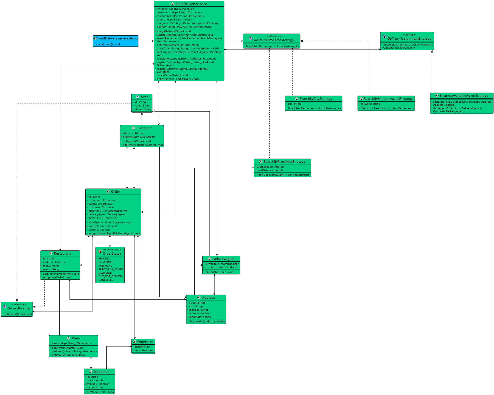

# Low-level design problem: food delivery service

> Copied from <https://github.com/ashishps1/awesome-low-level-design/blob/main/problems/food-delivery-service.md> (GPL-3.0, by Ashish Pratap Singh). Questions and answers are the source's own; nothing was answered or rewritten here.


# Designing an Online Food Delivery Service Like Swiggy

## Requirements
1. The food delivery service should allow customers to browse restaurants, view menus, and place orders.
2. Restaurants should be able to manage their menus, prices, and availability.
3. Delivery agents should be able to accept and fulfill orders.
4. The system should handle order tracking and status updates.
5. The system should support multiple payment methods.
6. The system should handle concurrent orders and ensure data consistency.
7. The system should be scalable and handle a high volume of orders.
8. The system should provide real-time notifications to customers, restaurants, and delivery agents.

## UML Class Diagram



## Implementations
#### [Java Implementation](https://github.com/ashishps1/awesome-low-level-design/blob/main/solutions/java/src/fooddeliveryservice) 
#### [Python Implementation](https://github.com/ashishps1/awesome-low-level-design/blob/main/solutions/python/fooddeliveryservice)
#### [C++ Implementation](https://github.com/ashishps1/awesome-low-level-design/blob/main/solutions/cpp/fooddeliveryservice)
#### [C# Implementation](https://github.com/ashishps1/awesome-low-level-design/blob/main/solutions/csharp/fooddeliveryservice)
#### [Go Implementation](https://github.com/ashishps1/awesome-low-level-design/blob/main/solutions/golang/fooddeliveryservice)

## Classes, Interfaces and Enumerations
1. The **Customer** class represents a customer who can place orders. It contains customer details such as ID, name, email, and phone number.
2. The **Restaurant** class represents a restaurant that offers menu items. It contains restaurant details such as ID, name, address, and a list of menu items. It provides methods to add and remove menu items.
3. The **MenuItem** class represents an item on a restaurant's menu. It contains details such as ID, name, description, price, and availability status.
4. The **Order** class represents an order placed by a customer. It contains order details such as ID, customer, restaurant, list of order items, status, and assigned delivery agent. It provides methods to add and remove order items, update order status, and assign a delivery agent.
5. The **OrderItem** class represents an item within an order. It contains the selected menu item and the quantity ordered.
6. The **OrderStatus** enum represents the different statuses an order can have, such as PENDING, CONFIRMED, PREPARING, OUT_FOR_DELIVERY, DELIVERED, and CANCELLED.
7. The **DeliveryAgent** class represents a delivery agent who fulfills orders. It contains details such as ID, name, phone number, and availability status.
8. The **FoodDeliveryService** class is the main class that manages the food delivery service. It follows the Singleton pattern to ensure only one instance of the service exists. It provides methods to register customers, restaurants, and delivery agents, retrieve available restaurants and menus, place orders, update order status, cancel orders, and assign delivery agents to orders. It also handles notifications to customers, restaurants, and delivery agents.

---

## Official solutions from the repository

<details><summary><b>java</b> (20 files)</summary>


**FoodDeliveryService.java**

```java
package fooddeliveryservice;

import fooddeliveryservice.entity.*;
import fooddeliveryservice.order.Order;
import fooddeliveryservice.order.OrderItem;
import fooddeliveryservice.order.OrderStatus;
import fooddeliveryservice.search.RestaurantSearchStrategy;
import fooddeliveryservice.strategy.DeliveryAssignmentStrategy;

import java.util.ArrayList;
import java.util.List;
import java.util.Map;
import java.util.NoSuchElementException;
import java.util.concurrent.ConcurrentHashMap;

public class FoodDeliveryService {
    private static volatile FoodDeliveryService instance;
    private final Map<String, Customer> customers = new ConcurrentHashMap<>();
    private final Map<String, Restaurant> restaurants = new ConcurrentHashMap<>();
    private final Map<String, DeliveryAgent> deliveryAgents = new ConcurrentHashMap<>();
    private final Map<String, Order> orders = new ConcurrentHashMap<>();
    private DeliveryAssignmentStrategy assignmentStrategy;

    private FoodDeliveryService() {}

    public static FoodDeliveryService getInstance() {
        if (instance == null) {
            synchronized (FoodDeliveryService.class) {
                if (instance == null) instance = new FoodDeliveryService();
            }
        }
        return instance;
    }

    public void setAssignmentStrategy(DeliveryAssignmentStrategy assignmentStrategy) {
        this.assignmentStrategy = assignmentStrategy;
    }

    // --- Registration ---
    public Customer registerCustomer(String name, String phone, Address address) {
        Customer customer = new Customer(name, phone, address);
        customers.put(customer.getId(), customer);
        return customer;
    }

    public Restaurant registerRestaurant(String name, Address address) {
        Restaurant restaurant = new Restaurant(name, address);
        restaurants.put(restaurant.getId(), restaurant);
        return restaurant;
    }

    public DeliveryAgent registerDeliveryAgent(String name, String phone, Address initialLocation) {
        DeliveryAgent deliveryAgent = new DeliveryAgent(name, phone, initialLocation);
        deliveryAgents.put(deliveryAgent.getId(), deliveryAgent);
        return deliveryAgent;
    }

    public Order placeOrder(String customerId, String restaurantId, List<OrderItem> items) {
        Customer customer = customers.get(customerId);
        Restaurant restaurant = restaurants.get(restaurantId);
        if (customer == null || restaurant == null) throw new NoSuchElementException("Customer or Restaurant not found.");

        Order order = new Order(customer, restaurant, items);
        orders.put(order.getId(), order);
        customer.addOrderToHistory(order);
        System.out.printf("Order %s placed by %s at %s.\n", order.getId(), customer.getName(), restaurant.getName());
        // Initial PENDING status is set in constructor and observers are notified.
        order.setStatus(OrderStatus.PENDING);
        return order;
    }

    public void updateOrderStatus(String orderId, OrderStatus newStatus) {
        Order order = orders.get(orderId);
        if (order == null)
            throw new NoSuchElementException("Order not found.");

        order.setStatus(newStatus);

        // If order is ready, find a delivery agent.
        if (newStatus == OrderStatus.READY_FOR_PICKUP) {
            assignDelivery(order);
        }
    }

    public void cancelOrder(String orderId) {
        Order order = orders.get(orderId);
        if (order == null) {
            System.out.println("ERROR: Order with ID " + orderId + " not found.");
            return;
        }

        // Delegate the cancellation logic to the Order object itself.
        if (order.cancel()) {
            System.out.println("SUCCESS: Order " + orderId + " has been successfully canceled.");
        } else {
            System.out.println("FAILED: Order " + orderId + " could not be canceled. Its status is: " + order.getStatus());
        }
    }

    private void assignDelivery(Order order) {
        List<DeliveryAgent> availableAgents = new ArrayList<>(deliveryAgents.values());

        assignmentStrategy.findAgent(order, availableAgents).ifPresentOrElse(
                agent -> {
                    order.assignDeliveryAgent(agent);
                    System.out.printf("Agent %s (dist: %.2f) assigned to order %s.\n",
                            agent.getName(),
                            agent.getCurrentLocation().distanceTo(order.getRestaurant().getAddress()),
                            order.getId());
                    order.setStatus(OrderStatus.OUT_FOR_DELIVERY);
                },
                () -> System.out.println("No available delivery agents found for order " + order.getId())
        );
    }

    public List<Restaurant> searchRestaurants(List<RestaurantSearchStrategy> strategies) {
        // Start with the full list of restaurants
        List<Restaurant> results = new ArrayList<>(restaurants.values());

        // Sequentially apply each filter strategy
        // We can also use chain of responsibility design pattern here
        for (RestaurantSearchStrategy strategy : strategies) {
            results = strategy.filter(results);
        }

        return results;
    }

    public Menu getRestaurantMenu(String restaurantId) {
        Restaurant restaurant = restaurants.get(restaurantId);
        if (restaurant == null) {
            throw new NoSuchElementException("Restaurant with ID " + restaurantId + " not found.");
        }
        return restaurant.getMenu();
    }
}
```


**FoodDeliveryServiceDemo.java**

```java
package fooddeliveryservice;

import fooddeliveryservice.entity.*;
import fooddeliveryservice.order.OrderItem;
import fooddeliveryservice.order.OrderStatus;
import fooddeliveryservice.search.RestaurantSearchStrategy;
import fooddeliveryservice.search.SearchByCityStrategy;
import fooddeliveryservice.search.SearchByMenuKeywordStrategy;
import fooddeliveryservice.search.SearchByProximityStrategy;
import fooddeliveryservice.strategy.NearestAvailableAgentStrategy;

import java.util.List;

public class FoodDeliveryServiceDemo {
    public static void main(String[] args) {
        // 1. Setup the system
        FoodDeliveryService service = FoodDeliveryService.getInstance();
        service.setAssignmentStrategy(new NearestAvailableAgentStrategy());

        // 2. Define Addresses
        Address aliceAddress = new Address("123 Maple St", "Springfield", "12345", 40.7128, -74.0060);
        Address pizzaAddress = new Address("456 Oak Ave", "Springfield", "12345", 40.7138, -74.0070);
        Address burgerAddress = new Address("789 Pine Ln", "Springfield", "12345", 40.7108, -74.0050);
        Address tacoAddress = new Address("101 Elm Ct", "Shelbyville", "54321", 41.7528, -75.0160);

        // 3. Register entities
        Customer alice = service.registerCustomer("Alice", "123-4567-890", aliceAddress);
        Restaurant pizzaPalace = service.registerRestaurant("Pizza Palace", pizzaAddress);
        Restaurant burgerBarn = service.registerRestaurant("Burger Barn", burgerAddress);
        Restaurant tacoTown = service.registerRestaurant("Taco Town", tacoAddress);
        service.registerDeliveryAgent("Bob", "321-4567-880", new Address("1 B", "Springfield", "12345", 40.71, -74.00));

        // 4. Setup menus
        pizzaPalace.addToMenu(new MenuItem("P001", "Margherita Pizza", 12.99));
        pizzaPalace.addToMenu(new MenuItem("P002", "Veggie Pizza", 11.99));
        burgerBarn.addToMenu(new MenuItem("B001", "Classic Burger", 8.99));
        tacoTown.addToMenu(new MenuItem("T001", "Crunchy Taco", 3.50));

        // 5. Demonstrate Search Functionality
        System.out.println("\n--- 1. Searching for Restaurants ---");

        // (A) Search by City
        System.out.println("\n(A) Restaurants in 'Springfield':");
        List<RestaurantSearchStrategy> citySearch = List.of(new SearchByCityStrategy("Springfield"));
        List<Restaurant> springfieldRestaurants = service.searchRestaurants(citySearch);
        springfieldRestaurants.forEach(r -> System.out.println("  - " + r.getName()));

        // (B) Search for restaurants near Alice
        System.out.println("\n(B) Restaurants near Alice (within 0.01 distance units):");
        List<RestaurantSearchStrategy> proximitySearch = List.of(new SearchByProximityStrategy(aliceAddress, 0.01));
        List<Restaurant> nearbyRestaurants = service.searchRestaurants(proximitySearch);
        nearbyRestaurants.forEach(r -> System.out.printf("  - %s (Distance: %.4f)\n", r.getName(), aliceAddress.distanceTo(r.getAddress())));

        // (C) Search for restaurants that serve 'Pizza'
        System.out.println("\n(C) Restaurants that serve 'Pizza':");
        List<RestaurantSearchStrategy> menuSearch = List.of(new SearchByMenuKeywordStrategy("Pizza"));
        List<Restaurant> pizzaRestaurants = service.searchRestaurants(menuSearch);
        pizzaRestaurants.forEach(r -> System.out.println("  - " + r.getName()));

        // (D) Combined Search: Find restaurants near Alice that serve 'Burger'
        System.out.println("\n(D) Burger joints near Alice:");
        List<RestaurantSearchStrategy> combinedSearch = List.of(
                new SearchByProximityStrategy(aliceAddress, 0.01),
                new SearchByMenuKeywordStrategy("Burger")
        );
        List<Restaurant> burgerJointsNearAlice = service.searchRestaurants(combinedSearch);
        burgerJointsNearAlice.forEach(r -> System.out.println("  - " + r.getName()));

        // 6. Demonstrate Browsing a Menu
        System.out.println("\n--- 2. Browsing a Menu ---");
        System.out.println("\nMenu for 'Pizza Palace':");
        Menu pizzaMenu = service.getRestaurantMenu(pizzaPalace.getId());
        pizzaMenu.getItems().values().forEach(item ->
                System.out.printf("  - %s: $%.2f\n", item.getName(), item.getPrice())
        );

        // 7. Alice places an order from a searched restaurant
        System.out.println("\n--- 3. Placing an Order ---");
        if (!pizzaRestaurants.isEmpty()) {
            Restaurant chosenRestaurant = pizzaRestaurants.get(0);
            MenuItem chosenItem = chosenRestaurant.getMenu().getItem("P001");

            System.out.printf("\nAlice is ordering '%s' from '%s'.\n", chosenItem.getName(), chosenRestaurant.getName());
            var order = service.placeOrder(alice.getId(), chosenRestaurant.getId(), List.of(new OrderItem(chosenItem, 1)));

            System.out.println("\n--- Restaurant starts preparing the order ---");
            service.updateOrderStatus(order.getId(), OrderStatus.PREPARING);

            System.out.println("\n--- Order is ready for pickup ---");
            System.out.println("System will now find the nearest available delivery agent...");
            service.updateOrderStatus(order.getId(), OrderStatus.READY_FOR_PICKUP);

            System.out.println("\n--- Agent delivers the order ---");
            service.updateOrderStatus(order.getId(), OrderStatus.DELIVERED);
        }
    }
}
```


**README.md**

```md
# Food Delivery Service (LLD)

## Problem Statement

Design and implement a Food Delivery Service system that allows customers to place orders from restaurants, manages menu items, assigns delivery agents, and tracks order status from placement to delivery.

---

## Requirements

- **Customer Registration:** Customers can register and place orders.
- **Restaurant Management:** The system manages multiple restaurants, each with its own menu.
- **Menu Management:** Restaurants can add and update menu items.
- **Order Placement:** Customers can place orders for menu items from a restaurantManagementSystem.
- **Order Tracking:** The system tracks the status of each order (e.g., PLACED, PREPARING, OUT_FOR_DELIVERY, DELIVERED).
- **Delivery Assignment:** Orders are assigned to available delivery agents.
- **Delivery Agent Management:** The system manages delivery agents and their availability.
- **Extensibility:** Easy to add new features such as ratings, reviews, or payment integration.

---

## Core Entities

- **FoodDeliveryService:** Main class that manages customers, restaurants, orders, and delivery agents.
- **Customer:** Represents a customer who can place orders.
- **Restaurant:** Represents a restaurantManagementSystem with a menu of items.
- **MenuItem:** Represents an item on a restaurantManagementSystem's menu.
- **Order:** Represents a customer's order, including items, status, and assigned delivery agent.
- **DeliveryAgent:** Represents a delivery agent who delivers orders.

---

## Class Design

## UML Class Diagram


### 1. FoodDeliveryService
- **Fields:** List<Customer> customers, List<Restaurant> restaurants, List<DeliveryAgent> agents, List<Order> orders
- **Methods:** registerCustomer(Customer), addRestaurant(Restaurant), addMenuItem(Restaurant, MenuItem), placeOrder(Customer, Restaurant, List<MenuItem>), assignDeliveryAgent(Order), updateOrderStatus(Order, Status), etc.

### 2. Customer
- **Fields:** int id, String name, List<Order> orders

### 3. Restaurant
- **Fields:** int id, String name, List<MenuItem> menu

### 4. MenuItem
- **Fields:** int id, String name, double price

### 5. Order
- **Fields:** int id, Customer customer, Restaurant restaurantManagementSystem, List<MenuItem> items, OrderStatus status, DeliveryAgent agent

### 6. DeliveryAgent
- **Fields:** int id, String name, boolean available, List<Order> assignedOrders

---

## Example Usage

```java
FoodDeliveryService service = new FoodDeliveryService();
Customer alice = new Customer(1, "Alice");
Restaurant pizzaPlace = new Restaurant(1, "Pizza Place");
MenuItem pizza = new MenuItem(1, "Margherita Pizza", 10.0);

service.registerCustomer(alice);
service.addRestaurant(pizzaPlace);
service.addMenuItem(pizzaPlace, pizza);

service.placeOrder(alice, pizzaPlace, List.of(pizza));
```

---

## Demo

See `FoodDeliveryServiceDemo.java` for a sample usage and simulation of the food delivery service.

---

## Extending the Framework

- **Add ratings and reviews:** Allow customers to rate restaurants and delivery agents.
- **Add payment integration:** Support online payments.
- **Add order cancellation or modification:** Allow customers to cancel or modify orders before delivery.

---
```


**entity/Address.java**

```java
package fooddeliveryservice.entity;

public class Address {
    private String street;
    private String city;
    private String zipCode;
    private double latitude;
    private double longitude;

    public Address(String street, String city, String zipCode, double latitude, double longitude) {
        this.street = street;
        this.city = city;
        this.zipCode = zipCode;
        this.latitude = latitude;
        this.longitude = longitude;
    }

    public String getCity() {
        return city;
    }

    public double distanceTo(Address other) {
        double latDiff = this.latitude - other.latitude;
        double lonDiff = this.longitude - other.longitude;
        return Math.sqrt(latDiff * latDiff + lonDiff * lonDiff);
    }

    @Override
    public String toString() {
        return street + ", " + city + ", " + zipCode + " @(" + latitude + ", " + longitude + ")";
    }
}
```


**entity/Customer.java**

```java
package fooddeliveryservice.entity;

import fooddeliveryservice.order.Order;

import java.util.ArrayList;
import java.util.List;

public class Customer extends User {
    private Address address;
    private final List<Order> orderHistory = new ArrayList<>();

    public Customer(String name, String phone, Address address) {
        super(name, phone);
        this.address = address;
    }

    public void addOrderToHistory(Order order) { this.orderHistory.add(order); }

    public Address getAddress() {
        return address;
    }

    @Override public void onUpdate(Order order) {
        System.out.printf("--- Notification for Customer %s ---\n", getName());
        System.out.printf("  Order %s is now %s.\n", order.getId(), order.getStatus());
        System.out.println("-------------------------------------\n");
    }
}
```


**entity/DeliveryAgent.java**

```java
package fooddeliveryservice.entity;

import fooddeliveryservice.order.Order;

import java.util.concurrent.atomic.AtomicBoolean;

public class DeliveryAgent extends User {
    private final AtomicBoolean isAvailable = new AtomicBoolean(true);
    private Address currentLocation;

    public DeliveryAgent(String name, String phone, Address currentLocation) {
        super(name, phone);
        this.currentLocation = currentLocation;
    }

    public void setAvailable(boolean available) {
        this.isAvailable.set(available);
    }

    public synchronized boolean isAvailable() {
        return isAvailable.get();
    }

    public void setCurrentLocation(Address currentLocation) { this.currentLocation = currentLocation; }

    public Address getCurrentLocation() { return currentLocation; }

    @Override public void onUpdate(Order order) {
        System.out.printf("--- Notification for Delivery Agent %s ---\n", getName());
        System.out.printf("  Order %s update: Status is %s.\n", order.getId(), order.getStatus());
        System.out.println("-------------------------------------------\n");
    }
}
```


**entity/Menu.java**

```java
package fooddeliveryservice.entity;

import java.util.HashMap;
import java.util.Map;

public class Menu {
    private final Map<String, MenuItem> items = new HashMap<>();

    public void addItem(MenuItem item) {
        items.put(item.getId(), item);
    }

    public MenuItem getItem(String id) { return items.get(id); }

    public Map<String, MenuItem> getItems() { return items; }
}
```


**entity/MenuItem.java**

```java
package fooddeliveryservice.entity;

public class MenuItem {
    private final String id;
    private final String name;
    private final double price;
    private boolean available;

    public MenuItem(String id, String name, double price) {
        this.id = id;
        this.name = name;
        this.price = price;
        this.available = true;
    }

    public String getId() {
        return id;
    }

    public void setAvailable(boolean available) {
        this.available = available;
    }

    public String getName() {
        return name;
    }

    public double getPrice() {
        return price;
    }

    public String getMenuItem() {
        return "Name: " + name + ", Price: " + price;
    }
}
```


**entity/Restaurant.java**

```java
package fooddeliveryservice.entity;

import fooddeliveryservice.observer.OrderObserver;
import fooddeliveryservice.order.Order;

import java.util.UUID;

public class Restaurant implements OrderObserver {
    private final String id;
    private final String name;
    private final Address address;
    private final Menu menu;

    public Restaurant(String name, Address address) {
        this.id = UUID.randomUUID().toString();
        this.name = name;
        this.address = address;
        this.menu = new Menu();
    }
    public void addToMenu(MenuItem item) { this.menu.addItem(item); }

    public String getId() { return id; }
    public String getName() { return name; }
    public Address getAddress() { return address; }
    public Menu getMenu() { return menu; }

    @Override public void onUpdate(Order order) {
        System.out.printf("--- Notification for Restaurant %s ---\n", getName());
        System.out.printf("  Order %s has been updated to %s.\n", order.getId(), order.getStatus());
        System.out.println("---------------------------------------\n");
    }
}
```


**entity/User.java**

```java
package fooddeliveryservice.entity;

import fooddeliveryservice.observer.OrderObserver;

import java.util.UUID;

public abstract class User implements OrderObserver {
    private final String id;
    private String name;
    private String phone;

    public User(String name, String phone) {
        this.id = UUID.randomUUID().toString();
        this.name = name;
        this.phone = phone;
    }

    public String getId() { return id; }
    public String getName() { return name; }
}
```


**observer/OrderObserver.java**

```java
package fooddeliveryservice.observer;

import fooddeliveryservice.order.Order;

public interface OrderObserver {
    void onUpdate(Order order);
}
```


**order/Order.java**

```java
package fooddeliveryservice.order;

import fooddeliveryservice.entity.Customer;
import fooddeliveryservice.entity.DeliveryAgent;
import fooddeliveryservice.entity.Restaurant;
import fooddeliveryservice.observer.OrderObserver;

import java.util.ArrayList;
import java.util.List;
import java.util.UUID;

public class Order {
    private final String id;
    private final Customer customer;
    private final Restaurant restaurant;
    private final List<OrderItem> items;
    private OrderStatus status;
    private DeliveryAgent deliveryAgent;
    private final List<OrderObserver> observers = new ArrayList<>();

    public Order(Customer customer, Restaurant restaurant, List<OrderItem> items) {
        this.id = UUID.randomUUID().toString();
        this.customer = customer;
        this.restaurant = restaurant;
        this.items = items;
        this.status = OrderStatus.PENDING;
        addObserver(customer);
        addObserver(restaurant);
    }

    public void addObserver(OrderObserver observer) { observers.add(observer); }
    private void notifyObservers() { observers.forEach(o -> o.onUpdate(this)); }

    public void setStatus(OrderStatus newStatus) {
        if (this.status != newStatus) {
            this.status = newStatus;
            notifyObservers();
        }
    }

    public boolean cancel() {
        // Only allow cancellation if the order is still in the PENDING state.
        if (this.status == OrderStatus.PENDING) {
            setStatus(OrderStatus.CANCELLED);
            return true;
        }
        return false;
    }

    public void assignDeliveryAgent(DeliveryAgent agent) {
        this.deliveryAgent = agent;
        addObserver(agent);
        agent.setAvailable(false); // Mark agent as busy
    }

    // Getters
    public String getId() { return id; }
    public OrderStatus getStatus() { return status; }
    public Customer getCustomer() { return customer; }
    public Restaurant getRestaurant() { return restaurant; }
    public DeliveryAgent getDeliveryAgent() { return deliveryAgent; }
}
```


**order/OrderItem.java**

```java
package fooddeliveryservice.order;

import fooddeliveryservice.entity.MenuItem;

public class OrderItem {
    private final MenuItem item;
    private final int quantity;

    public OrderItem(MenuItem item, int quantity) {
        this.item = item;
        this.quantity = quantity;
    }

    public MenuItem getItem() { return item; }
    public int getQuantity() { return quantity; }
}
```


**order/OrderStatus.java**

```java
package fooddeliveryservice.order;

public enum OrderStatus {
    PENDING,
    CONFIRMED,
    PREPARING,
    READY_FOR_PICKUP,
    OUT_FOR_DELIVERY,
    DELIVERED,
    CANCELLED
}
```


**search/RestaurantSearchStrategy.java**

```java
package fooddeliveryservice.search;

import fooddeliveryservice.entity.Restaurant;

import java.util.List;

public interface RestaurantSearchStrategy {
    List<Restaurant> filter(List<Restaurant> allRestaurants);
}
```


**search/SearchByCityStrategy.java**

```java
package fooddeliveryservice.search;

import fooddeliveryservice.entity.Restaurant;

import java.util.List;
import java.util.stream.Collectors;

public class SearchByCityStrategy implements RestaurantSearchStrategy {
    private final String city;

    public SearchByCityStrategy(String city) {
        this.city = city;
    }

    @Override
    public List<Restaurant> filter(List<Restaurant> allRestaurants) {
        return allRestaurants.stream()
                .filter(r -> r.getAddress().getCity().equalsIgnoreCase(city))
                .collect(Collectors.toList());
    }
}
```


**search/SearchByMenuKeywordStrategy.java**

```java
package fooddeliveryservice.search;

import fooddeliveryservice.entity.Restaurant;

import java.util.List;
import java.util.stream.Collectors;

public class SearchByMenuKeywordStrategy implements RestaurantSearchStrategy {
    private final String keyword;

    public SearchByMenuKeywordStrategy(String keyword) {
        this.keyword = keyword.toLowerCase();
    }

    @Override
    public List<Restaurant> filter(List<Restaurant> allRestaurants) {
        return allRestaurants.stream()
                .filter(r -> r.getMenu().getItems().values().stream()
                        .anyMatch(item -> item.getName().toLowerCase().contains(keyword)))
                .collect(Collectors.toList());
    }
}
```


**search/SearchByProximityStrategy.java**

```java
package fooddeliveryservice.search;

import fooddeliveryservice.entity.Address;
import fooddeliveryservice.entity.Restaurant;

import java.util.Comparator;
import java.util.List;
import java.util.stream.Collectors;

public class SearchByProximityStrategy implements RestaurantSearchStrategy {
    private final Address userLocation;
    private final double maxDistance;

    public SearchByProximityStrategy(Address userLocation, double maxDistance) {
        this.userLocation = userLocation;
        this.maxDistance = maxDistance;
    }

    @Override
    public List<Restaurant> filter(List<Restaurant> allRestaurants) {
        return allRestaurants.stream()
                // Filter restaurants within the max distance
                .filter(r -> userLocation.distanceTo(r.getAddress()) <= maxDistance)
                // Sort the filtered list by distance (nearest first)
                .sorted(Comparator.comparingDouble(r -> userLocation.distanceTo(r.getAddress())))
                .collect(Collectors.toList());
    }
}
```


**strategy/DeliveryAssignmentStrategy.java**

```java
package fooddeliveryservice.strategy;

import fooddeliveryservice.entity.DeliveryAgent;
import fooddeliveryservice.order.Order;

import java.util.List;
import java.util.Optional;

public interface DeliveryAssignmentStrategy {
    Optional<DeliveryAgent> findAgent(Order order, List<DeliveryAgent> agents);
}
```


**strategy/NearestAvailableAgentStrategy.java**

```java
package fooddeliveryservice.strategy;

import fooddeliveryservice.entity.Address;
import fooddeliveryservice.entity.DeliveryAgent;
import fooddeliveryservice.order.Order;

import java.util.Comparator;
import java.util.List;
import java.util.Optional;

public class NearestAvailableAgentStrategy implements DeliveryAssignmentStrategy {
    @Override
    public Optional<DeliveryAgent> findAgent(Order order, List<DeliveryAgent> availableAgents) {
        Address restaurantAddress = order.getRestaurant().getAddress();
        Address customerAddress = order.getCustomer().getAddress();

        // Find the agent with the minimum total travel distance (Agent -> Restaurant -> Customer)
        return availableAgents.stream()
                .filter(DeliveryAgent::isAvailable)
                .min(Comparator.comparingDouble(agent -> calculateTotalDistance(agent, restaurantAddress, customerAddress)));
    }

    private double calculateTotalDistance(DeliveryAgent agent, Address restaurantAddress, Address customerAddress) {
        double agentToRestaurantDist = agent.getCurrentLocation().distanceTo(restaurantAddress);
        double restaurantToCustomerDist = restaurantAddress.distanceTo(customerAddress);
        return agentToRestaurantDist + restaurantToCustomerDist;
    }
}
```

</details>

<details><summary><b>python</b> (16 files)</summary>


**README.md**

```md
# Designing an Online Food Delivery Service Like Swiggy

## Requirements
1. The food delivery service should allow customers to browse restaurants, view menus, and place orders.
2. Restaurants should be able to manage their menus, prices, and availability.
3. Delivery agents should be able to accept and fulfill orders.
4. The system should handle order tracking and status updates.
5. The system should support multiple payment methods.
6. The system should handle concurrent orders and ensure data consistency.
7. The system should be scalable and handle a high volume of orders.
8. The system should provide real-time notifications to customers, restaurants, and delivery agents.

## Classes, Interfaces and Enumerations
1. The **Customer** class represents a customer who can place orders. It contains customer details such as ID, name, email, and phone number.
2. The **Restaurant** class represents a restaurant that offers menu items. It contains restaurant details such as ID, name, address, and a list of menu items. It provides methods to add and remove menu items.
3. The **MenuItem** class represents an item on a restaurant's menu. It contains details such as ID, name, description, price, and availability status.
4. The **Order** class represents an order placed by a customer. It contains order details such as ID, customer, restaurant, list of order items, status, and assigned delivery agent. It provides methods to add and remove order items, update order status, and assign a delivery agent.
5. The **OrderItem** class represents an item within an order. It contains the selected menu item and the quantity ordered.
6. The **OrderStatus** enum represents the different statuses an order can have, such as PENDING, CONFIRMED, PREPARING, OUT_FOR_DELIVERY, DELIVERED, and CANCELLED.
7. The **DeliveryAgent** class represents a delivery agent who fulfills orders. It contains details such as ID, name, phone number, and availability status.
8. The **FoodDeliveryService** class is the main class that manages the food delivery service. It follows the Singleton pattern to ensure only one instance of the service exists. It provides methods to register customers, restaurants, and delivery agents, retrieve available restaurants and menus, place orders, update order status, cancel orders, and assign delivery agents to orders. It also handles notifications to customers, restaurants, and delivery agents.
```


**address.py**

```py
import math

class Address:
    def __init__(self, street: str, city: str, zip_code: str, latitude: float, longitude: float):
        self.street = street
        self.city = city
        self.zip_code = zip_code
        self.latitude = latitude
        self.longitude = longitude

    def get_city(self) -> str:
        return self.city

    def distance_to(self, other: 'Address') -> float:
        lat_diff = self.latitude - other.latitude
        lon_diff = self.longitude - other.longitude
        return math.sqrt(lat_diff * lat_diff + lon_diff * lon_diff)

    def __str__(self) -> str:
        return f"{self.street}, {self.city}, {self.zip_code} @({self.latitude}, {self.longitude})"
```


**customer.py**

```py
from user import User
from address import Address
from typing import List
from typing import TYPE_CHECKING

if TYPE_CHECKING:
    from order import Order

class Customer(User):
    def __init__(self, name: str, phone: str, address: Address):
        super().__init__(name, phone)
        self.address = address
        self.order_history: List['Order'] = []

    def add_order_to_history(self, order: 'Order'):
        self.order_history.append(order)

    def get_address(self) -> Address:
        return self.address

    def on_update(self, order: 'Order'):
        print(f"--- Notification for Customer {self.get_name()} ---")
        print(f"  Order {order.get_id()} is now {order.get_status().value}.")
        print("-------------------------------------\n")
```


**delivery_agent.py**

```py
import threading
from user import User
from address import Address
from typing import TYPE_CHECKING

if TYPE_CHECKING:
    from order import Order

class DeliveryAgent(User):
    def __init__(self, name: str, phone: str, current_location: Address):
        super().__init__(name, phone)
        self.is_available = True
        self.current_location = current_location
        self._lock = threading.Lock()

    def set_available(self, available: bool):
        with self._lock:
            self.is_available = available

    def is_available_agent(self) -> bool:
        with self._lock:
            return self.is_available

    def set_current_location(self, current_location: Address):
        self.current_location = current_location

    def get_current_location(self) -> Address:
        return self.current_location

    def on_update(self, order: 'Order'):
        print(f"--- Notification for Delivery Agent {self.get_name()} ---")
        print(f"  Order {order.get_id()} update: Status is {order.get_status().value}.")
        print("-------------------------------------------\n")
```


**delivery_assignment_strategy.py**

```py
from abc import ABC, abstractmethod
from typing import List, Optional
from order import Order
from delivery_agent import DeliveryAgent
from address import Address

class DeliveryAssignmentStrategy(ABC):
    @abstractmethod
    def find_agent(self, order: Order, agents: List[DeliveryAgent]) -> Optional[DeliveryAgent]:
        pass

class NearestAvailableAgentStrategy(DeliveryAssignmentStrategy):
    def find_agent(self, order: Order, available_agents: List[DeliveryAgent]) -> Optional[DeliveryAgent]:
        restaurant_address = order.get_restaurant().get_address()
        customer_address = order.get_customer().get_address()

        available_agents_filtered = [agent for agent in available_agents if agent.is_available_agent()]
        
        if not available_agents_filtered:
            return None

        min_distance = float('inf')
        best_agent = None

        for agent in available_agents_filtered:
            total_distance = self.calculate_total_distance(agent, restaurant_address, customer_address)
            if total_distance < min_distance:
                min_distance = total_distance
                best_agent = agent

        return best_agent

    def calculate_total_distance(self, agent: DeliveryAgent, restaurant_address: Address, customer_address: Address) -> float:
        agent_to_restaurant_dist = agent.get_current_location().distance_to(restaurant_address)
        restaurant_to_customer_dist = restaurant_address.distance_to(customer_address)
        return agent_to_restaurant_dist + restaurant_to_customer_dist
```


**food_delivery_service.py**

```py
import threading
from typing import Dict, List, Optional
from customer import Customer
from delivery_agent import DeliveryAgent
from delivery_assignment_strategy import DeliveryAssignmentStrategy
from order import Order
from restaurant import Restaurant
from restaurant_search_strategy import RestaurantSearchStrategy
from order_status import OrderStatus
from address import Address
from order_item import OrderItem
from menu import Menu

class FoodDeliveryService:
    _instance = None
    _lock = threading.Lock()

    def __init__(self):
        if FoodDeliveryService._instance is not None:
            raise Exception("This class is a singleton!")
        self.customers: Dict[str, Customer] = {}
        self.restaurants: Dict[str, Restaurant] = {}
        self.delivery_agents: Dict[str, DeliveryAgent] = {}
        self.orders: Dict[str, Order] = {}
        self.assignment_strategy: Optional[DeliveryAssignmentStrategy] = None

    @staticmethod
    def get_instance():
        if FoodDeliveryService._instance is None:
            with FoodDeliveryService._lock:
                if FoodDeliveryService._instance is None:
                    FoodDeliveryService._instance = FoodDeliveryService()
        return FoodDeliveryService._instance

    def set_assignment_strategy(self, assignment_strategy: DeliveryAssignmentStrategy):
        self.assignment_strategy = assignment_strategy

    def register_customer(self, name: str, phone: str, address: Address) -> Customer:
        customer = Customer(name, phone, address)
        self.customers[customer.get_id()] = customer
        return customer

    def register_restaurant(self, name: str, address: Address) -> Restaurant:
        restaurant = Restaurant(name, address)
        self.restaurants[restaurant.get_id()] = restaurant
        return restaurant

    def register_delivery_agent(self, name: str, phone: str, initial_location: Address) -> DeliveryAgent:
        delivery_agent = DeliveryAgent(name, phone, initial_location)
        self.delivery_agents[delivery_agent.get_id()] = delivery_agent
        return delivery_agent

    def place_order(self, customer_id: str, restaurant_id: str, items: List[OrderItem]) -> Order:
        customer = self.customers.get(customer_id)
        restaurant = self.restaurants.get(restaurant_id)
        if customer is None or restaurant is None:
            raise KeyError("Customer or Restaurant not found.")

        order = Order(customer, restaurant, items)
        self.orders[order.get_id()] = order
        customer.add_order_to_history(order)
        print(f"Order {order.get_id()} placed by {customer.get_name()} at {restaurant.get_name()}.")
        order.set_status(OrderStatus.PENDING)
        return order

    def update_order_status(self, order_id: str, new_status: OrderStatus):
        order = self.orders.get(order_id)
        if order is None:
            raise KeyError("Order not found.")

        order.set_status(new_status)

        if new_status == OrderStatus.READY_FOR_PICKUP:
            self.assign_delivery(order)

    def cancel_order(self, order_id: str):
        order = self.orders.get(order_id)
        if order is None:
            print(f"ERROR: Order with ID {order_id} not found.")
            return

        if order.cancel():
            print(f"SUCCESS: Order {order_id} has been successfully canceled.")
        else:
            print(f"FAILED: Order {order_id} could not be canceled. Its status is: {order.get_status().value}")

    def assign_delivery(self, order: Order):
        available_agents = list(self.delivery_agents.values())

        best_agent = self.assignment_strategy.find_agent(order, available_agents)
        if best_agent:
            order.assign_delivery_agent(best_agent)
            distance = best_agent.get_current_location().distance_to(order.get_restaurant().get_address())
            print(f"Agent {best_agent.get_name()} (dist: {distance:.2f}) assigned to order {order.get_id()}.")
            order.set_status(OrderStatus.OUT_FOR_DELIVERY)
        else:
            print(f"No available delivery agents found for order {order.get_id()}")

    def search_restaurants(self, strategies: List[RestaurantSearchStrategy]) -> List[Restaurant]:
        results = list(self.restaurants.values())

        for strategy in strategies:
            results = strategy.filter(results)

        return results

    def get_restaurant_menu(self, restaurant_id: str) -> Menu:
        restaurant = self.restaurants.get(restaurant_id)
        if restaurant is None:
            raise KeyError(f"Restaurant with ID {restaurant_id} not found.")
        return restaurant.get_menu()
```


**food_delivery_service_demo.py**

```py
from food_delivery_service import FoodDeliveryService
from delivery_assignment_strategy import NearestAvailableAgentStrategy
from restaurant_search_strategy import SearchByCityStrategy, SearchByProximityStrategy, SearchByMenuKeywordStrategy
from order_status import OrderStatus
from order_item import OrderItem
from menu_item import MenuItem
from address import Address

class FoodDeliveryServiceDemo:
    @staticmethod
    def main():
        # 1. Setup the system
        service = FoodDeliveryService.get_instance()
        service.set_assignment_strategy(NearestAvailableAgentStrategy())

        # 2. Define Addresses
        alice_address = Address("123 Maple St", "Springfield", "12345", 40.7128, -74.0060)
        pizza_address = Address("456 Oak Ave", "Springfield", "12345", 40.7138, -74.0070)
        burger_address = Address("789 Pine Ln", "Springfield", "12345", 40.7108, -74.0050)
        taco_address = Address("101 Elm Ct", "Shelbyville", "54321", 41.7528, -75.0160)

        # 3. Register entities
        alice = service.register_customer("Alice", "123-4567-890", alice_address)
        pizza_palace = service.register_restaurant("Pizza Palace", pizza_address)
        burger_barn = service.register_restaurant("Burger Barn", burger_address)
        taco_town = service.register_restaurant("Taco Town", taco_address)
        service.register_delivery_agent("Bob", "321-4567-880", Address("1 B", "Springfield", "12345", 40.71, -74.00))

        # 4. Setup menus
        pizza_palace.add_to_menu(MenuItem("P001", "Margherita Pizza", 12.99))
        pizza_palace.add_to_menu(MenuItem("P002", "Veggie Pizza", 11.99))
        burger_barn.add_to_menu(MenuItem("B001", "Classic Burger", 8.99))
        taco_town.add_to_menu(MenuItem("T001", "Crunchy Taco", 3.50))

        # 5. Demonstrate Search Functionality
        print("\n--- 1. Searching for Restaurants ---")

        # (A) Search by City
        print("\n(A) Restaurants in 'Springfield':")
        city_search = [SearchByCityStrategy("Springfield")]
        springfield_restaurants = service.search_restaurants(city_search)
        for r in springfield_restaurants:
            print(f"  - {r.get_name()}")

        # (B) Search for restaurants near Alice
        print("\n(B) Restaurants near Alice (within 0.01 distance units):")
        proximity_search = [SearchByProximityStrategy(alice_address, 0.01)]
        nearby_restaurants = service.search_restaurants(proximity_search)
        for r in nearby_restaurants:
            distance = alice_address.distance_to(r.get_address())
            print(f"  - {r.get_name()} (Distance: {distance:.4f})")

        # (C) Search for restaurants that serve 'Pizza'
        print("\n(C) Restaurants that serve 'Pizza':")
        menu_search = [SearchByMenuKeywordStrategy("Pizza")]
        pizza_restaurants = service.search_restaurants(menu_search)
        for r in pizza_restaurants:
            print(f"  - {r.get_name()}")

        # (D) Combined Search: Find restaurants near Alice that serve 'Burger'
        print("\n(D) Burger joints near Alice:")
        combined_search = [
            SearchByProximityStrategy(alice_address, 0.01),
            SearchByMenuKeywordStrategy("Burger")
        ]
        burger_joints_near_alice = service.search_restaurants(combined_search)
        for r in burger_joints_near_alice:
            print(f"  - {r.get_name()}")

        # 6. Demonstrate Browsing a Menu
        print("\n--- 2. Browsing a Menu ---")
        print("\nMenu for 'Pizza Palace':")
        pizza_menu = service.get_restaurant_menu(pizza_palace.get_id())
        for item in pizza_menu.get_items().values():
            print(f"  - {item.get_name()}: ${item.get_price():.2f}")

        # 7. Alice places an order from a searched restaurant
        print("\n--- 3. Placing an Order ---")
        if pizza_restaurants:
            chosen_restaurant = pizza_restaurants[0]
            chosen_item = chosen_restaurant.get_menu().get_item("P001")

            print(f"\nAlice is ordering '{chosen_item.get_name()}' from '{chosen_restaurant.get_name()}'.")
            order = service.place_order(alice.get_id(), chosen_restaurant.get_id(), [OrderItem(chosen_item, 1)])

            print("\n--- Restaurant starts preparing the order ---")
            service.update_order_status(order.get_id(), OrderStatus.PREPARING)

            print("\n--- Order is ready for pickup ---")
            print("System will now find the nearest available delivery agent...")
            service.update_order_status(order.get_id(), OrderStatus.READY_FOR_PICKUP)

            print("\n--- Agent delivers the order ---")
            service.update_order_status(order.get_id(), OrderStatus.DELIVERED)


if __name__ == "__main__":
    FoodDeliveryServiceDemo.main()
```


**menu.py**

```py
from typing import Dict
from menu_item import MenuItem

class Menu:
    def __init__(self):
        self.items: Dict[str, MenuItem] = {}

    def add_item(self, item: MenuItem):
        self.items[item.get_id()] = item

    def get_item(self, item_id: str) -> MenuItem:
        return self.items.get(item_id)

    def get_items(self) -> Dict[str, MenuItem]:
        return self.items
```


**menu_item.py**

```py
class MenuItem:
    def __init__(self, item_id: str, name: str, price: float):
        self.id = item_id
        self.name = name
        self.price = price
        self.available = True

    def get_id(self) -> str:
        return self.id

    def set_available(self, available: bool):
        self.available = available

    def get_name(self) -> str:
        return self.name

    def get_price(self) -> float:
        return self.price

    def get_menu_item(self) -> str:
        return f"Name: {self.name}, Price: {self.price}"
```


**order.py**

```py
import uuid
from order_item import OrderItem
from order_status import OrderStatus
from customer import Customer
from restaurant import Restaurant
from delivery_agent import DeliveryAgent
from typing import List, Optional
from typing import TYPE_CHECKING
from order_observer import OrderObserver    

class Order:
    def __init__(self, customer: Customer, restaurant: Restaurant, items: List[OrderItem]):
        self.id = str(uuid.uuid4())
        self.customer = customer
        self.restaurant = restaurant
        self.items = items
        self.status = OrderStatus.PENDING
        self.delivery_agent: Optional[DeliveryAgent] = None
        self.observers: List[OrderObserver] = []
        self.add_observer(customer)
        self.add_observer(restaurant)

    def add_observer(self, observer: OrderObserver):
        self.observers.append(observer)

    def notify_observers(self):
        for observer in self.observers:
            observer.on_update(self)

    def set_status(self, new_status: OrderStatus):
        if self.status != new_status:
            self.status = new_status
            self.notify_observers()

    def cancel(self) -> bool:
        if self.status == OrderStatus.PENDING:
            self.set_status(OrderStatus.CANCELLED)
            return True
        return False

    def assign_delivery_agent(self, agent: DeliveryAgent):
        self.delivery_agent = agent
        self.add_observer(agent)
        agent.set_available(False)

    def get_id(self) -> str:
        return self.id

    def get_status(self) -> OrderStatus:
        return self.status

    def get_customer(self) -> Customer:
        return self.customer

    def get_restaurant(self) -> Restaurant:
        return self.restaurant

    def get_delivery_agent(self) -> Optional[DeliveryAgent]:
        return self.delivery_agent
```


**order_item.py**

```py
from menu_item import MenuItem

class OrderItem:
    def __init__(self, item: MenuItem, quantity: int):
        self.item = item
        self.quantity = quantity

    def get_item(self) -> MenuItem:
        return self.item

    def get_quantity(self) -> int:
        return self.quantity
```


**order_observer.py**

```py
from abc import ABC, abstractmethod
from typing import TYPE_CHECKING

if TYPE_CHECKING:
    from order import Order

class OrderObserver(ABC):
    @abstractmethod
    def on_update(self, order: 'Order'):
        pass
```


**order_status.py**

```py
from enum import Enum

class OrderStatus(Enum):
    PENDING = "PENDING"
    CONFIRMED = "CONFIRMED"
    PREPARING = "PREPARING"
    READY_FOR_PICKUP = "READY_FOR_PICKUP"
    OUT_FOR_DELIVERY = "OUT_FOR_DELIVERY"
    DELIVERED = "DELIVERED"
    CANCELLED = "CANCELLED"
```


**restaurant.py**

```py
import uuid
from order_observer import OrderObserver
from address import Address
from menu import Menu
from menu_item import MenuItem
from typing import TYPE_CHECKING

if TYPE_CHECKING:
    from order import Order

class Restaurant(OrderObserver):
    def __init__(self, name: str, address: Address):
        self.id = str(uuid.uuid4())
        self.name = name
        self.address = address
        self.menu = Menu()

    def get_id(self) -> str:
        return self.id

    def get_name(self) -> str:
        return self.name

    def get_address(self) -> Address:
        return self.address

    def get_menu(self) -> Menu:
        return self.menu

    def add_to_menu(self, item: MenuItem):
        self.menu.add_item(item)

    def on_update(self, order: 'Order'):
        print(f"--- Notification for Restaurant {self.name} ---")
        print(f"  Order {order.get_id()} has been updated to {order.get_status().value}.")
        print("----------------------------------------\n")
```


**restaurant_search_strategy.py**

```py
from abc import ABC, abstractmethod
from typing import List
from restaurant import Restaurant
from address import Address

class RestaurantSearchStrategy(ABC):
    @abstractmethod
    def filter(self, all_restaurants: List[Restaurant]) -> List[Restaurant]:
        pass

class SearchByCityStrategy(RestaurantSearchStrategy):
    def __init__(self, city: str):
        self.city = city

    def filter(self, all_restaurants: List[Restaurant]) -> List[Restaurant]:
        return [r for r in all_restaurants if r.get_address().get_city().lower() == self.city.lower()]

class SearchByMenuKeywordStrategy(RestaurantSearchStrategy):
    def __init__(self, keyword: str):
        self.keyword = keyword.lower()

    def filter(self, all_restaurants: List[Restaurant]) -> List[Restaurant]:
        result = []
        for r in all_restaurants:
            for item in r.get_menu().get_items().values():
                if self.keyword in item.get_name().lower():
                    result.append(r)
                    break
        return result

class SearchByProximityStrategy(RestaurantSearchStrategy):
    def __init__(self, user_location: Address, max_distance: float):
        self.user_location = user_location
        self.max_distance = max_distance

    def filter(self, all_restaurants: List[Restaurant]) -> List[Restaurant]:
        filtered = [r for r in all_restaurants if self.user_location.distance_to(r.get_address()) <= self.max_distance]
        filtered.sort(key=lambda r: self.user_location.distance_to(r.get_address()))
        return filtered
```


**user.py**

```py
from order_observer import OrderObserver
import uuid
from typing import TYPE_CHECKING

if TYPE_CHECKING:
    from order import Order

class User(OrderObserver):
    def __init__(self, name: str, phone: str):
        self.id = str(uuid.uuid4())
        self.name = name
        self.phone = phone

    def get_id(self) -> str:
        return self.id

    def get_name(self) -> str:
        return self.name
```

</details>

<details><summary><b>cpp</b> (12 files)</summary>


**DeliveryDemo.cpp**

```cpp
#include "DeliveryService.hpp"
#include <iostream>

int main() {
    DeliveryService service;
    
    // Create users
    User* user1 = new User("U001", "John Doe", "john@example.com", 
                          "+1-555-0123", "123 Main St");
    service.addUser(user1);
    
    // Create restaurants
    Restaurant* restaurant1 = new Restaurant("R001", "Pizza Palace", 
                                           "Italian", "456 Oak Ave");
    
    // Add menu items
    MenuItem* item1 = new MenuItem("I001", "Margherita Pizza", 
                                 "Classic tomato and mozzarella", 12.99);
    MenuItem* item2 = new MenuItem("I002", "Pepperoni Pizza", 
                                 "Spicy pepperoni with cheese", 14.99);
    restaurant1->addMenuItem(item1);
    restaurant1->addMenuItem(item2);
    
    service.addRestaurant(restaurant1);
    
    // Display available restaurants
    service.displayAllRestaurants();
    
    // Create an order
    Order* order = service.createOrder("U001", "R001");
    if (order) {
        service.addItemToOrder(order->getOrderId(), "I001", 2);  // 2 Margherita pizzas
        service.addItemToOrder(order->getOrderId(), "I002", 1);  // 1 Pepperoni pizza
        
        // Display order details
        service.displayOrderDetails(order->getOrderId());
        
        // Update order status
        service.updateOrderStatus(order->getOrderId(), OrderStatus::PREPARING);
        service.updateOrderStatus(order->getOrderId(), OrderStatus::OUT_FOR_DELIVERY);
        service.updateOrderStatus(order->getOrderId(), OrderStatus::DELIVERED);
        
        // Display order history
        std::cout << "\nOrder History for John Doe:" << std::endl;
        service.displayOrderHistory("U001");
    }
    
    return 0;
}
```


**DeliveryService.cpp**

```cpp
#include "DeliveryService.hpp"
#include <iostream>

DeliveryService::DeliveryService() : orderIdCounter(1) {}

DeliveryService::~DeliveryService() {
    for (auto user : users) delete user;
    for (auto restaurant : restaurants) delete restaurant;
    for (auto order : orders) delete order;
}

void DeliveryService::addUser(User* user) {
    users.push_back(user);
}

void DeliveryService::addRestaurant(Restaurant* restaurant) {
    restaurants.push_back(restaurant);
}

Order* DeliveryService::createOrder(std::string userId, std::string restaurantId) {
    User* user = findUser(userId);
    Restaurant* restaurant = findRestaurant(restaurantId);
    
    if (!user || !restaurant || !restaurant->getIsOpen()) return nullptr;
    
    Order* order = new Order(generateOrderId(), user, restaurant);
    orders.push_back(order);
    return order;
}

bool DeliveryService::addItemToOrder(std::string orderId, std::string itemId, int quantity) {
    Order* order = findOrder(orderId);
    if (!order || order->getStatus() != OrderStatus::PLACED) return false;
    
    MenuItem* item = order->getRestaurant()->findMenuItem(itemId);
    if (!item || !item->isAvailable()) return false;
    
    order->addItem(item, quantity);
    return true;
}

bool DeliveryService::updateOrderStatus(std::string orderId, OrderStatus status) {
    Order* order = findOrder(orderId);
    if (!order) return false;
    
    order->setStatus(status);
    return true;
}

void DeliveryService::displayAllRestaurants() const {
    std::cout << "\nAvailable Restaurants:" << std::endl;
    for (const auto& restaurant : restaurants) {
        restaurant->displayInfo();
        std::cout << "------------------------" << std::endl;
    }
}

void DeliveryService::displayRestaurantMenu(std::string restaurantId) const {
    Restaurant* restaurant = findRestaurant(restaurantId);
    if (restaurant) {
        restaurant->displayInfo();
        restaurant->displayMenu();
    }
}

void DeliveryService::displayOrderHistory(std::string userId) const {
    for (const auto& order : orders) {
        if (order->getUser()->getUserId() == userId) {
            order->displayInfo();
            std::cout << "------------------------" << std::endl;
        }
    }
}

void DeliveryService::displayOrderDetails(std::string orderId) const {
    Order* order = findOrder(orderId);
    if (order) {
        order->displayInfo();
    }
}

User* DeliveryService::findUser(const std::string& userId) const {
    for (auto user : users) {
        if (user->getUserId() == userId) return user;
    }
    return nullptr;
}

Restaurant* DeliveryService::findRestaurant(const std::string& restaurantId) const {
    for (auto restaurant : restaurants) {
        if (restaurant->getRestaurantId() == restaurantId) return restaurant;
    }
    return nullptr;
}

Order* DeliveryService::findOrder(const std::string& orderId) const {
    for (auto order : orders) {
        if (order->getOrderId() == orderId) return order;
    }
    return nullptr;
}

std::string DeliveryService::generateOrderId() {
    return "ORD" + std::to_string(orderIdCounter++);
}
```


**DeliveryService.hpp**

```hpp
#ifndef DELIVERY_SERVICE_HPP
#define DELIVERY_SERVICE_HPP

#include <vector>
#include <string>
#include "User.hpp"
#include "Restaurant.hpp"
#include "Order.hpp"

class DeliveryService {
private:
    std::vector<User*> users;
    std::vector<Restaurant*> restaurants;
    std::vector<Order*> orders;
    int orderIdCounter;

public:
    DeliveryService();
    ~DeliveryService();
    
    void addUser(User* user);
    void addRestaurant(Restaurant* restaurant);
    
    Order* createOrder(std::string userId, std::string restaurantId);
    bool addItemToOrder(std::string orderId, std::string itemId, int quantity);
    bool updateOrderStatus(std::string orderId, OrderStatus status);
    
    void displayAllRestaurants() const;
    void displayRestaurantMenu(std::string restaurantId) const;
    void displayOrderHistory(std::string userId) const;
    void displayOrderDetails(std::string orderId) const;
    
private:
    User* findUser(const std::string& userId) const;
    Restaurant* findRestaurant(const std::string& restaurantId) const;
    Order* findOrder(const std::string& orderId) const;
    std::string generateOrderId();
};

#endif
```


**MenuItem.cpp**

```cpp
#include "MenuItem.hpp"
#include <iostream>
#include <iomanip>

MenuItem::MenuItem(std::string itemId, std::string name, 
                  std::string description, double price)
    : itemId(itemId), name(name), description(description), 
      price(price), available(true) {}

std::string MenuItem::getItemId() const { return itemId; }
std::string MenuItem::getName() const { return name; }
std::string MenuItem::getDescription() const { return description; }
double MenuItem::getPrice() const { return price; }
bool MenuItem::isAvailable() const { return available; }

void MenuItem::setAvailable(bool status) {
    available = status;
}

void MenuItem::displayInfo() const {
    std::cout << "Item: " << name << " (ID: " << itemId << ")" << std::endl;
    std::cout << "Description: " << description << std::endl;
    std::cout << "Price: $" << std::fixed << std::setprecision(2) << price << std::endl;
    std::cout << "Status: " << (available ? "Available" : "Not Available") << std::endl;
}
```


**MenuItem.hpp**

```hpp
#ifndef MENU_ITEM_HPP
#define MENU_ITEM_HPP

#include <string>

class MenuItem {
private:
    std::string itemId;
    std::string name;
    std::string description;
    double price;
    bool available;

public:
    MenuItem(std::string itemId, std::string name, std::string description, double price);
    
    std::string getItemId() const;
    std::string getName() const;
    std::string getDescription() const;
    double getPrice() const;
    bool isAvailable() const;
    
    void setAvailable(bool status);
    void displayInfo() const;
};

#endif
```


**Order.cpp**

```cpp
#include "Order.hpp"
#include <iostream>
#include <iomanip>

Order::Order(std::string orderId, User* user, Restaurant* restaurant)
    : orderId(orderId), user(user), restaurant(restaurant), 
      status(OrderStatus::PLACED), totalAmount(0.0) {
    // Get current timestamp
    auto now = std::time(nullptr);
    timestamp = std::ctime(&now);
}

std::string Order::getOrderId() const { return orderId; }
User* Order::getUser() const { return user; }
Restaurant* Order::getRestaurant() const { return restaurant; }
OrderStatus Order::getStatus() const { return status; }
double Order::getTotalAmount() const { return totalAmount; }
std::string Order::getTimestamp() const { return timestamp; }

void Order::addItem(MenuItem* item, int quantity) {
    if (item && quantity > 0) {
        items[item] = quantity;
        calculateTotal();
    }
}

void Order::setStatus(OrderStatus status) {
    this->status = status;
}

void Order::calculateTotal() {
    totalAmount = 0.0;
    for (const auto& pair : items) {
        totalAmount += pair.first->getPrice() * pair.second;
    }
}

void Order::displayInfo() const {
    std::cout << "\nOrder Details:" << std::endl;
    std::cout << "Order ID: " << orderId << std::endl;
    std::cout << "Customer: " << user->getName() << std::endl;
    std::cout << "Restaurant: " << restaurant->getName() << std::endl;
    std::cout << "Status: ";
    switch (status) {
        case OrderStatus::PLACED: std::cout << "Placed"; break;
        case OrderStatus::PREPARING: std::cout << "Preparing"; break;
        case OrderStatus::OUT_FOR_DELIVERY: std::cout << "Out for Delivery"; break;
        case OrderStatus::DELIVERED: std::cout << "Delivered"; break;
        case OrderStatus::CANCELLED: std::cout << "Cancelled"; break;
    }
    std::cout << std::endl;
    
    std::cout << "\nOrdered Items:" << std::endl;
    for (const auto& pair : items) {
        std::cout << pair.first->getName() << " x " << pair.second 
                  << " = $" << std::fixed << std::setprecision(2)
                  << pair.first->getPrice() * pair.second << std::endl;
    }
    
    std::cout << "\nTotal Amount: $" << std::fixed << std::setprecision(2) 
              << totalAmount << std::endl;
    std::cout << "Order Time: " << timestamp;
}
```


**Order.hpp**

```hpp
#ifndef ORDER_HPP
#define ORDER_HPP

#include <string>
#include <vector>
#include <map>
#include "User.hpp"
#include "Restaurant.hpp"
#include "MenuItem.hpp"

enum class OrderStatus {
    PLACED,
    PREPARING,
    OUT_FOR_DELIVERY,
    DELIVERED,
    CANCELLED
};

class Order {
private:
    std::string orderId;
    User* user;
    Restaurant* restaurant;
    std::map<MenuItem*, int> items;  // item and quantity
    OrderStatus status;
    double totalAmount;
    std::string timestamp;

public:
    Order(std::string orderId, User* user, Restaurant* restaurant);
    
    std::string getOrderId() const;
    User* getUser() const;
    Restaurant* getRestaurant() const;
    OrderStatus getStatus() const;
    double getTotalAmount() const;
    std::string getTimestamp() const;
    
    void addItem(MenuItem* item, int quantity);
    void setStatus(OrderStatus status);
    void calculateTotal();
    void displayInfo() const;
};

#endif
```


**README.md**

```md
# Designing an Online Food Delivery Service Like Swiggy

## Requirements
1. The food delivery service should allow customers to browse restaurants, view menus, and place orders.
2. Restaurants should be able to manage their menus, prices, and availability.
3. Delivery agents should be able to accept and fulfill orders.
4. The system should handle order tracking and status updates.
5. The system should support multiple payment methods.
6. The system should handle concurrent orders and ensure data consistency.
7. The system should be scalable and handle a high volume of orders.
8. The system should provide real-time notifications to customers, restaurants, and delivery agents.

## Classes, Interfaces and Enumerations
1. The **Customer** class represents a customer who can place orders. It contains customer details such as ID, name, email, and phone number.
2. The **Restaurant** class represents a restaurant that offers menu items. It contains restaurant details such as ID, name, address, and a list of menu items. It provides methods to add and remove menu items.
3. The **MenuItem** class represents an item on a restaurant's menu. It contains details such as ID, name, description, price, and availability status.
4. The **Order** class represents an order placed by a customer. It contains order details such as ID, customer, restaurant, list of order items, status, and assigned delivery agent. It provides methods to add and remove order items, update order status, and assign a delivery agent.
5. The **OrderItem** class represents an item within an order. It contains the selected menu item and the quantity ordered.
6. The **OrderStatus** enum represents the different statuses an order can have, such as PENDING, CONFIRMED, PREPARING, OUT_FOR_DELIVERY, DELIVERED, and CANCELLED.
7. The **DeliveryAgent** class represents a delivery agent who fulfills orders. It contains details such as ID, name, phone number, and availability status.
8. The **FoodDeliveryService** class is the main class that manages the food delivery service. It follows the Singleton pattern to ensure only one instance of the service exists. It provides methods to register customers, restaurants, and delivery agents, retrieve available restaurants and menus, place orders, update order status, cancel orders, and assign delivery agents to orders. It also handles notifications to customers, restaurants, and delivery agents.
```


**Restaurant.cpp**

```cpp
#include "Restaurant.hpp"
#include <iostream>
#include <algorithm>

Restaurant::Restaurant(std::string restaurantId, std::string name, 
                      std::string cuisine, std::string address)
    : restaurantId(restaurantId), name(name), cuisine(cuisine), 
      address(address), isOpen(true) {}

Restaurant::~Restaurant() {
    for (auto item : menu) {
        delete item;
    }
}

std::string Restaurant::getRestaurantId() const { return restaurantId; }
std::string Restaurant::getName() const { return name; }
std::string Restaurant::getCuisine() const { return cuisine; }
std::string Restaurant::getAddress() const { return address; }
bool Restaurant::getIsOpen() const { return isOpen; }

void Restaurant::addMenuItem(MenuItem* item) {
    menu.push_back(item);
}

void Restaurant::removeMenuItem(MenuItem* item) {
    auto it = std::find(menu.begin(), menu.end(), item);
    if (it != menu.end()) {
        menu.erase(it);
    }
}

MenuItem* Restaurant::findMenuItem(const std::string& itemId) const {
    for (auto item : menu) {
        if (item->getItemId() == itemId) return item;
    }
    return nullptr;
}

void Restaurant::setOpen(bool status) {
    isOpen = status;
}

void Restaurant::displayInfo() const {
    std::cout << "Restaurant: " << name << " (ID: " << restaurantId << ")" << std::endl;
    std::cout << "Cuisine: " << cuisine << std::endl;
    std::cout << "Address: " << address << std::endl;
    std::cout << "Status: " << (isOpen ? "Open" : "Closed") << std::endl;
}

void Restaurant::displayMenu() const {
    std::cout << "\nMenu Items:" << std::endl;
    for (const auto& item : menu) {
        item->displayInfo();
        std::cout << "------------------------" << std::endl;
    }
}
```


**Restaurant.hpp**

```hpp
#ifndef RESTAURANT_HPP
#define RESTAURANT_HPP

#include <string>
#include <vector>
#include "MenuItem.hpp"

class Restaurant {
private:
    std::string restaurantId;
    std::string name;
    std::string cuisine;
    std::string address;
    std::vector<MenuItem*> menu;
    bool isOpen;

public:
    Restaurant(std::string restaurantId, std::string name, 
              std::string cuisine, std::string address);
    ~Restaurant();
    
    std::string getRestaurantId() const;
    std::string getName() const;
    std::string getCuisine() const;
    std::string getAddress() const;
    bool getIsOpen() const;
    
    void addMenuItem(MenuItem* item);
    void removeMenuItem(MenuItem* item);
    MenuItem* findMenuItem(const std::string& itemId) const;
    void setOpen(bool status);
    void displayInfo() const;
    void displayMenu() const;
};

#endif
```


**User.cpp**

```cpp
#include "User.hpp"
#include <iostream>

User::User(std::string userId, std::string name, std::string email, 
           std::string phone, std::string address)
    : userId(userId), name(name), email(email), phone(phone), address(address) {}

std::string User::getUserId() const { return userId; }
std::string User::getName() const { return name; }
std::string User::getEmail() const { return email; }
std::string User::getPhone() const { return phone; }
std::string User::getAddress() const { return address; }

void User::displayInfo() const {
    std::cout << "User: " << name << " (ID: " << userId << ")" << std::endl;
    std::cout << "Email: " << email << std::endl;
    std::cout << "Phone: " << phone << std::endl;
    std::cout << "Address: " << address << std::endl;
}
```


**User.hpp**

```hpp
#ifndef USER_HPP
#define USER_HPP

#include <string>

class User {
private:
    std::string userId;
    std::string name;
    std::string email;
    std::string phone;
    std::string address;

public:
    User(std::string userId, std::string name, std::string email, 
         std::string phone, std::string address);
    
    std::string getUserId() const;
    std::string getName() const;
    std::string getEmail() const;
    std::string getPhone() const;
    std::string getAddress() const;
    void displayInfo() const;
};

#endif
```

</details>

<details><summary><b>golang</b> (9 files)</summary>


**README.md**

```md
# Designing an Online Food Delivery Service Like Swiggy

## Requirements
1. The food delivery service should allow customers to browse restaurants, view menus, and place orders.
2. Restaurants should be able to manage their menus, prices, and availability.
3. Delivery agents should be able to accept and fulfill orders.
4. The system should handle order tracking and status updates.
5. The system should support multiple payment methods.
6. The system should handle concurrent orders and ensure data consistency.
7. The system should be scalable and handle a high volume of orders.
8. The system should provide real-time notifications to customers, restaurants, and delivery agents.

## Classes, Interfaces and Enumerations
1. The **Customer** class represents a customer who can place orders. It contains customer details such as ID, name, email, and phone number.
2. The **Restaurant** class represents a restaurant that offers menu items. It contains restaurant details such as ID, name, address, and a list of menu items. It provides methods to add and remove menu items.
3. The **MenuItem** class represents an item on a restaurant's menu. It contains details such as ID, name, description, price, and availability status.
4. The **Order** class represents an order placed by a customer. It contains order details such as ID, customer, restaurant, list of order items, status, and assigned delivery agent. It provides methods to add and remove order items, update order status, and assign a delivery agent.
5. The **OrderItem** class represents an item within an order. It contains the selected menu item and the quantity ordered.
6. The **OrderStatus** enum represents the different statuses an order can have, such as PENDING, CONFIRMED, PREPARING, OUT_FOR_DELIVERY, DELIVERED, and CANCELLED.
7. The **DeliveryAgent** class represents a delivery agent who fulfills orders. It contains details such as ID, name, phone number, and availability status.
8. The **FoodDeliveryService** class is the main class that manages the food delivery service. It follows the Singleton pattern to ensure only one instance of the service exists. It provides methods to register customers, restaurants, and delivery agents, retrieve available restaurants and menus, place orders, update order status, cancel orders, and assign delivery agents to orders. It also handles notifications to customers, restaurants, and delivery agents.
```


**customer.go**

```go
package fooddeliveryservice

type Customer struct {
	ID    string
	Name  string
	Email string
	Phone string
}

func NewCustomer(id, name, email, phone string) *Customer {
	return &Customer{
		ID:    id,
		Name:  name,
		Email: email,
		Phone: phone,
	}
}
```


**delivery_agent.go**

```go
package fooddeliveryservice

import "sync"

type DeliveryAgent struct {
	ID        string
	Name      string
	Phone     string
	available bool
	mu        sync.RWMutex
}

func NewDeliveryAgent(id, name, phone string) *DeliveryAgent {
	return &DeliveryAgent{
		ID:        id,
		Name:      name,
		Phone:     phone,
		available: true,
	}
}

func (d *DeliveryAgent) SetAvailable(available bool) {
	d.mu.Lock()
	defer d.mu.Unlock()
	d.available = available
}

func (d *DeliveryAgent) IsAvailable() bool {
	d.mu.RLock()
	defer d.mu.RUnlock()
	return d.available
}
```


**food_delivery_service.go**

```go
package fooddeliveryservice

import (
	"fmt"
	"sync"
	"time"
)

type FoodDeliveryService struct {
	customers      map[string]*Customer
	restaurants    map[string]*Restaurant
	orders         map[string]*Order
	deliveryAgents map[string]*DeliveryAgent
	mu             sync.RWMutex
}

var (
	instance *FoodDeliveryService
	once     sync.Once
)

func GetFoodDeliveryService() *FoodDeliveryService {
	once.Do(func() {
		instance = &FoodDeliveryService{
			customers:      make(map[string]*Customer),
			restaurants:    make(map[string]*Restaurant),
			orders:         make(map[string]*Order),
			deliveryAgents: make(map[string]*DeliveryAgent),
		}
	})
	return instance
}

func (s *FoodDeliveryService) RegisterCustomer(customer *Customer) {
	s.mu.Lock()
	defer s.mu.Unlock()
	s.customers[customer.ID] = customer
}

func (s *FoodDeliveryService) RegisterRestaurant(restaurant *Restaurant) {
	s.mu.Lock()
	defer s.mu.Unlock()
	s.restaurants[restaurant.ID] = restaurant
}

func (s *FoodDeliveryService) RegisterDeliveryAgent(agent *DeliveryAgent) {
	s.mu.Lock()
	defer s.mu.Unlock()
	s.deliveryAgents[agent.ID] = agent
}

func (s *FoodDeliveryService) GetAvailableRestaurants() []*Restaurant {
	s.mu.RLock()
	defer s.mu.RUnlock()
	restaurants := make([]*Restaurant, 0, len(s.restaurants))
	for _, restaurant := range s.restaurants {
		restaurants = append(restaurants, restaurant)
	}
	return restaurants
}

func (s *FoodDeliveryService) GetRestaurantMenu(restaurantID string) []*MenuItem {
	s.mu.RLock()
	restaurant := s.restaurants[restaurantID]
	s.mu.RUnlock()

	if restaurant != nil {
		return restaurant.GetMenu()
	}
	return nil
}

func (s *FoodDeliveryService) PlaceOrder(customerID, restaurantID string, items []*OrderItem) (*Order, error) {
	s.mu.Lock()
	defer s.mu.Unlock()

	customer := s.customers[customerID]
	restaurant := s.restaurants[restaurantID]

	if customer == nil {
		return nil, fmt.Errorf("customer not found")
	}
	if restaurant == nil {
		return nil, fmt.Errorf("restaurant not found")
	}

	orderID := fmt.Sprintf("ORD%d", time.Now().UnixNano())
	order := NewOrder(orderID, customer, restaurant)

	for _, item := range items {
		order.AddItem(item)
	}

	s.orders[order.ID] = order
	s.notifyRestaurant(order)
	fmt.Printf("Order placed: %s\n", order.ID)
	return order, nil
}

func (s *FoodDeliveryService) UpdateOrderStatus(orderID string, status OrderStatus) error {
	s.mu.Lock()
	defer s.mu.Unlock()

	order := s.orders[orderID]
	if order == nil {
		return fmt.Errorf("order not found")
	}

	order.SetStatus(status)
	s.notifyCustomer(order)

	if status == OrderStatusConfirmed {
		s.assignDeliveryAgent(order)
	}
	return nil
}

func (s *FoodDeliveryService) CancelOrder(orderID string) error {
	s.mu.Lock()
	defer s.mu.Unlock()

	order := s.orders[orderID]
	if order == nil {
		return fmt.Errorf("order not found")
	}

	if order.GetStatus() != OrderStatusPending {
		return fmt.Errorf("cannot cancel order in current status")
	}

	order.SetStatus(OrderStatusCancelled)
	s.notifyCustomer(order)
	s.notifyRestaurant(order)
	fmt.Printf("Order cancelled: %s\n", order.ID)
	return nil
}

func (s *FoodDeliveryService) notifyCustomer(order *Order) {
	// TODO: Implement customer notification
	fmt.Printf("Notifying customer about order %s status: %s\n",
		order.ID, order.GetStatus())
}

func (s *FoodDeliveryService) notifyRestaurant(order *Order) {
	// TODO: Implement restaurant notification
	fmt.Printf("Notifying restaurant about order %s\n", order.ID)
}

func (s *FoodDeliveryService) notifyDeliveryAgent(order *Order) {
	// TODO: Implement delivery agent notification
	fmt.Printf("Notifying delivery agent about order %s\n", order.ID)
}

func (s *FoodDeliveryService) assignDeliveryAgent(order *Order) {
	for _, agent := range s.deliveryAgents {
		if agent.IsAvailable() {
			agent.SetAvailable(false)
			order.AssignDeliveryAgent(agent)
			s.notifyDeliveryAgent(order)
			break
		}
	}
}
```


**food_delivery_service_demo.go**

```go
package fooddeliveryservice

import (
	"fmt"
)

func Run() {
	service := GetFoodDeliveryService()

	// Register customers
	customer1 := NewCustomer("C001", "John Doe", "john@example.com", "1234567890")
	customer2 := NewCustomer("C002", "Jane Smith", "jane@example.com", "9876543210")
	service.RegisterCustomer(customer1)
	service.RegisterCustomer(customer2)

	// Create restaurant menus
	restaurant1Menu := []*MenuItem{
		NewMenuItem("M001", "Burger", "Delicious burger", 9.99),
		NewMenuItem("M002", "Pizza", "Cheesy pizza", 12.99),
	}
	restaurant2Menu := []*MenuItem{
		NewMenuItem("M003", "Sushi", "Fresh sushi", 15.99),
		NewMenuItem("M004", "Ramen", "Delicious ramen", 10.99),
	}

	// Register restaurants
	restaurant1 := NewRestaurant("R001", "Restaurant 1", "Address 1", restaurant1Menu)
	restaurant2 := NewRestaurant("R002", "Restaurant 2", "Address 2", restaurant2Menu)
	service.RegisterRestaurant(restaurant1)
	service.RegisterRestaurant(restaurant2)

	// Register delivery agents
	agent1 := NewDeliveryAgent("D001", "Agent 1", "9999999999")
	agent2 := NewDeliveryAgent("D002", "Agent 2", "8888888888")
	service.RegisterDeliveryAgent(agent1)
	service.RegisterDeliveryAgent(agent2)

	// Place orders
	orderItems := []*OrderItem{
		NewOrderItem(restaurant1Menu[0], 2),
		NewOrderItem(restaurant1Menu[1], 1),
	}

	order1, err := service.PlaceOrder(customer1.ID, restaurant1.ID, orderItems)
	if err != nil {
		fmt.Printf("Error placing order: %v\n", err)
		return
	}

	// Update order status
	err = service.UpdateOrderStatus(order1.ID, OrderStatusConfirmed)
	if err != nil {
		fmt.Printf("Error updating order status: %v\n", err)
		return
	}
	fmt.Printf("Order status updated: %s\n", order1.GetStatus())

	// Place and cancel another order
	order2Items := []*OrderItem{
		NewOrderItem(restaurant2Menu[0], 1),
	}
	order2, err := service.PlaceOrder(customer2.ID, restaurant2.ID, order2Items)
	if err != nil {
		fmt.Printf("Error placing order: %v\n", err)
		return
	}

	err = service.CancelOrder(order2.ID)
	if err != nil {
		fmt.Printf("Error cancelling order: %v\n", err)
	}
}
```


**menu_item.go**

```go
package fooddeliveryservice

import "sync"

type MenuItem struct {
	ID          string
	Name        string
	Description string
	Price       float64
	available   bool
	mu          sync.RWMutex
}

func NewMenuItem(id, name, description string, price float64) *MenuItem {
	return &MenuItem{
		ID:          id,
		Name:        name,
		Description: description,
		Price:       price,
		available:   true,
	}
}

func (m *MenuItem) SetAvailable(available bool) {
	m.mu.Lock()
	defer m.mu.Unlock()
	m.available = available
}

func (m *MenuItem) IsAvailable() bool {
	m.mu.RLock()
	defer m.mu.RUnlock()
	return m.available
}
```


**order.go**

```go
package fooddeliveryservice

import "sync"

type OrderItem struct {
	MenuItem *MenuItem
	Quantity int
}

func NewOrderItem(menuItem *MenuItem, quantity int) *OrderItem {
	return &OrderItem{
		MenuItem: menuItem,
		Quantity: quantity,
	}
}

type Order struct {
	ID            string
	Customer      *Customer
	Restaurant    *Restaurant
	Items         []*OrderItem
	Status        OrderStatus
	DeliveryAgent *DeliveryAgent
	mu            sync.RWMutex
}

func NewOrder(id string, customer *Customer, restaurant *Restaurant) *Order {
	return &Order{
		ID:         id,
		Customer:   customer,
		Restaurant: restaurant,
		Items:      make([]*OrderItem, 0),
		Status:     OrderStatusPending,
	}
}

func (o *Order) AddItem(item *OrderItem) {
	o.mu.Lock()
	defer o.mu.Unlock()
	o.Items = append(o.Items, item)
}

func (o *Order) RemoveItem(item *OrderItem) {
	o.mu.Lock()
	defer o.mu.Unlock()
	for i, orderItem := range o.Items {
		if orderItem == item {
			o.Items = append(o.Items[:i], o.Items[i+1:]...)
			break
		}
	}
}

func (o *Order) SetStatus(status OrderStatus) {
	o.mu.Lock()
	defer o.mu.Unlock()
	o.Status = status
}

func (o *Order) GetStatus() OrderStatus {
	o.mu.RLock()
	defer o.mu.RUnlock()
	return o.Status
}

func (o *Order) AssignDeliveryAgent(agent *DeliveryAgent) {
	o.mu.Lock()
	defer o.mu.Unlock()
	o.DeliveryAgent = agent
}
```


**restaurant.go**

```go
package fooddeliveryservice

import "sync"

type Restaurant struct {
	ID      string
	Name    string
	Address string
	Menu    []*MenuItem
	mu      sync.RWMutex
}

func NewRestaurant(id, name, address string, menu []*MenuItem) *Restaurant {
	return &Restaurant{
		ID:      id,
		Name:    name,
		Address: address,
		Menu:    menu,
	}
}

func (r *Restaurant) AddMenuItem(item *MenuItem) {
	r.mu.Lock()
	defer r.mu.Unlock()
	r.Menu = append(r.Menu, item)
}

func (r *Restaurant) RemoveMenuItem(item *MenuItem) {
	r.mu.Lock()
	defer r.mu.Unlock()
	for i, menuItem := range r.Menu {
		if menuItem == item {
			r.Menu = append(r.Menu[:i], r.Menu[i+1:]...)
			break
		}
	}
}

func (r *Restaurant) GetMenu() []*MenuItem {
	r.mu.RLock()
	defer r.mu.RUnlock()
	menuCopy := make([]*MenuItem, len(r.Menu))
	copy(menuCopy, r.Menu)
	return menuCopy
}
```


**types.go**

```go
package fooddeliveryservice

type OrderStatus int

const (
	OrderStatusPending OrderStatus = iota
	OrderStatusConfirmed
	OrderStatusPreparing
	OrderStatusOutForDelivery
	OrderStatusDelivered
	OrderStatusCancelled
)

func (s OrderStatus) String() string {
	return [...]string{
		"PENDING",
		"CONFIRMED",
		"PREPARING",
		"OUT_FOR_DELIVERY",
		"DELIVERED",
		"CANCELLED",
	}[s]
}
```

</details>

<details><summary><b>csharp</b> (21 files)</summary>


**Enums/OrderStatus.cs**

```cs
enum OrderStatus
{
    PENDING,
    CONFIRMED,
    PREPARING,
    READY_FOR_PICKUP,
    OUT_FOR_DELIVERY,
    DELIVERED,
    CANCELLED
}
```


**FoodDeliveryService.cs**

```cs
using System.Collections.Concurrent;

class FoodDeliveryService
{
    private static volatile FoodDeliveryService instance;
    private static readonly object lockObject = new object();
    private readonly ConcurrentDictionary<string, Customer> customers = new ConcurrentDictionary<string, Customer>();
    private readonly ConcurrentDictionary<string, Restaurant> restaurants = new ConcurrentDictionary<string, Restaurant>();
    private readonly ConcurrentDictionary<string, DeliveryAgent> deliveryAgents = new ConcurrentDictionary<string, DeliveryAgent>();
    private readonly ConcurrentDictionary<string, Order> orders = new ConcurrentDictionary<string, Order>();
    private IDeliveryAssignmentStrategy assignmentStrategy;

    private FoodDeliveryService() { }

    public static FoodDeliveryService GetInstance()
    {
        if (instance == null)
        {
            lock (lockObject)
            {
                if (instance == null)
                    instance = new FoodDeliveryService();
            }
        }
        return instance;
    }

    public void SetAssignmentStrategy(IDeliveryAssignmentStrategy assignmentStrategy)
    {
        this.assignmentStrategy = assignmentStrategy;
    }

    public Customer RegisterCustomer(string name, string phone, Address address)
    {
        Customer customer = new Customer(name, phone, address);
        customers.TryAdd(customer.GetId(), customer);
        return customer;
    }

    public Restaurant RegisterRestaurant(string name, Address address)
    {
        Restaurant restaurant = new Restaurant(name, address);
        restaurants.TryAdd(restaurant.GetId(), restaurant);
        return restaurant;
    }

    public DeliveryAgent RegisterDeliveryAgent(string name, string phone, Address initialLocation)
    {
        DeliveryAgent deliveryAgent = new DeliveryAgent(name, phone, initialLocation);
        deliveryAgents.TryAdd(deliveryAgent.GetId(), deliveryAgent);
        return deliveryAgent;
    }

    public Order PlaceOrder(string customerId, string restaurantId, List<OrderItem> items)
    {
        if (!customers.TryGetValue(customerId, out Customer customer) ||
            !restaurants.TryGetValue(restaurantId, out Restaurant restaurant))
        {
            throw new KeyNotFoundException("Customer or Restaurant not found.");
        }

        Order order = new Order(customer, restaurant, items);
        orders.TryAdd(order.GetId(), order);
        customer.AddOrderToHistory(order);
        Console.WriteLine($"Order {order.GetId()} placed by {customer.GetName()} at {restaurant.GetName()}.");
        order.SetStatus(OrderStatus.PENDING);
        return order;
    }

    public void UpdateOrderStatus(string orderId, OrderStatus newStatus)
    {
        if (!orders.TryGetValue(orderId, out Order order))
        {
            throw new KeyNotFoundException("Order not found.");
        }

        order.SetStatus(newStatus);

        if (newStatus == OrderStatus.READY_FOR_PICKUP)
        {
            AssignDelivery(order);
        }
    }

    public void CancelOrder(string orderId)
    {
        if (!orders.TryGetValue(orderId, out Order order))
        {
            Console.WriteLine($"ERROR: Order with ID {orderId} not found.");
            return;
        }

        if (order.Cancel())
        {
            Console.WriteLine($"SUCCESS: Order {orderId} has been successfully canceled.");
        }
        else
        {
            Console.WriteLine($"FAILED: Order {orderId} could not be canceled. Its status is: {order.GetStatus()}");
        }
    }

    private void AssignDelivery(Order order)
    {
        List<DeliveryAgent> availableAgents = deliveryAgents.Values.ToList();

        DeliveryAgent agent = assignmentStrategy.FindAgent(order, availableAgents);
        if (agent != null)
        {
            order.AssignDeliveryAgent(agent);
            double distance = agent.GetCurrentLocation().DistanceTo(order.GetRestaurant().GetAddress());
            Console.WriteLine($"Agent {agent.GetName()} (dist: {distance:F2}) assigned to order {order.GetId()}.");
            order.SetStatus(OrderStatus.OUT_FOR_DELIVERY);
        }
        else
        {
            Console.WriteLine($"No available delivery agents found for order {order.GetId()}");
        }
    }

    public List<Restaurant> SearchRestaurants(List<IRestaurantSearchStrategy> strategies)
    {
        List<Restaurant> results = restaurants.Values.ToList();

        foreach (var strategy in strategies)
        {
            results = strategy.Filter(results);
        }

        return results;
    }

    public Menu GetRestaurantMenu(string restaurantId)
    {
        if (!restaurants.TryGetValue(restaurantId, out Restaurant restaurant))
        {
            throw new KeyNotFoundException($"Restaurant with ID {restaurantId} not found.");
        }
        return restaurant.GetMenu();
    }
}
```


**FoodDeliveryServiceDemo.cs**

```cs
using System;
using System.Collections.Generic;
using System.Linq;
using System.Threading;

public class FoodDeliveryServiceDemo
{
    public static void Main(string[] args)
    {
        // 1. Setup the system
        FoodDeliveryService service = FoodDeliveryService.GetInstance();
        service.SetAssignmentStrategy(new NearestAvailableAgentStrategy());

        // 2. Define Addresses
        Address aliceAddress = new Address("123 Maple St", "Springfield", "12345", 40.7128, -74.0060);
        Address pizzaAddress = new Address("456 Oak Ave", "Springfield", "12345", 40.7138, -74.0070);
        Address burgerAddress = new Address("789 Pine Ln", "Springfield", "12345", 40.7108, -74.0050);
        Address tacoAddress = new Address("101 Elm Ct", "Shelbyville", "54321", 41.7528, -75.0160);

        // 3. Register entities
        Customer alice = service.RegisterCustomer("Alice", "123-4567-890", aliceAddress);
        Restaurant pizzaPalace = service.RegisterRestaurant("Pizza Palace", pizzaAddress);
        Restaurant burgerBarn = service.RegisterRestaurant("Burger Barn", burgerAddress);
        Restaurant tacoTown = service.RegisterRestaurant("Taco Town", tacoAddress);
        service.RegisterDeliveryAgent("Bob", "321-4567-880", new Address("1 B", "Springfield", "12345", 40.71, -74.00));

        // 4. Setup menus
        pizzaPalace.AddToMenu(new MenuItem("P001", "Margherita Pizza", 12.99));
        pizzaPalace.AddToMenu(new MenuItem("P002", "Veggie Pizza", 11.99));
        burgerBarn.AddToMenu(new MenuItem("B001", "Classic Burger", 8.99));
        tacoTown.AddToMenu(new MenuItem("T001", "Crunchy Taco", 3.50));

        // 5. Demonstrate Search Functionality
        Console.WriteLine("\n--- 1. Searching for Restaurants ---");

        // (A) Search by City
        Console.WriteLine("\n(A) Restaurants in 'Springfield':");
        List<IRestaurantSearchStrategy> citySearch = new List<IRestaurantSearchStrategy> { new SearchByCityStrategy("Springfield") };
        List<Restaurant> springfieldRestaurants = service.SearchRestaurants(citySearch);
        foreach (var r in springfieldRestaurants)
        {
            Console.WriteLine($"  - {r.GetName()}");
        }

        // (B) Search for restaurants near Alice
        Console.WriteLine("\n(B) Restaurants near Alice (within 0.01 distance units):");
        List<IRestaurantSearchStrategy> proximitySearch = new List<IRestaurantSearchStrategy> { new SearchByProximityStrategy(aliceAddress, 0.01) };
        List<Restaurant> nearbyRestaurants = service.SearchRestaurants(proximitySearch);
        foreach (var r in nearbyRestaurants)
        {
            Console.WriteLine($"  - {r.GetName()} (Distance: {aliceAddress.DistanceTo(r.GetAddress()):F4})");
        }

        // (C) Search for restaurants that serve 'Pizza'
        Console.WriteLine("\n(C) Restaurants that serve 'Pizza':");
        List<IRestaurantSearchStrategy> menuSearch = new List<IRestaurantSearchStrategy> { new SearchByMenuKeywordStrategy("Pizza") };
        List<Restaurant> pizzaRestaurants = service.SearchRestaurants(menuSearch);
        foreach (var r in pizzaRestaurants)
        {
            Console.WriteLine($"  - {r.GetName()}");
        }

        // (D) Combined Search: Find restaurants near Alice that serve 'Burger'
        Console.WriteLine("\n(D) Burger joints near Alice:");
        List<IRestaurantSearchStrategy> combinedSearch = new List<IRestaurantSearchStrategy>
        {
            new SearchByProximityStrategy(aliceAddress, 0.01),
            new SearchByMenuKeywordStrategy("Burger")
        };
        List<Restaurant> burgerJointsNearAlice = service.SearchRestaurants(combinedSearch);
        foreach (var r in burgerJointsNearAlice)
        {
            Console.WriteLine($"  - {r.GetName()}");
        }

        // 6. Demonstrate Browsing a Menu
        Console.WriteLine("\n--- 2. Browsing a Menu ---");
        Console.WriteLine("\nMenu for 'Pizza Palace':");
        Menu pizzaMenu = service.GetRestaurantMenu(pizzaPalace.GetId());
        foreach (var item in pizzaMenu.GetItems().Values)
        {
            Console.WriteLine($"  - {item.GetName()}: ${item.GetPrice():F2}");
        }

        // 7. Alice places an order from a searched restaurant
        Console.WriteLine("\n--- 3. Placing an Order ---");
        if (pizzaRestaurants.Count > 0)
        {
            Restaurant chosenRestaurant = pizzaRestaurants[0];
            MenuItem chosenItem = chosenRestaurant.GetMenu().GetItem("P001");

            Console.WriteLine($"\nAlice is ordering '{chosenItem.GetName()}' from '{chosenRestaurant.GetName()}'.");
            var order = service.PlaceOrder(alice.GetId(), chosenRestaurant.GetId(), new List<OrderItem> { new OrderItem(chosenItem, 1) });

            Console.WriteLine("\n--- Restaurant starts preparing the order ---");
            service.UpdateOrderStatus(order.GetId(), OrderStatus.PREPARING);

            Console.WriteLine("\n--- Order is ready for pickup ---");
            Console.WriteLine("System will now find the nearest available delivery agent...");
            service.UpdateOrderStatus(order.GetId(), OrderStatus.READY_FOR_PICKUP);

            Console.WriteLine("\n--- Agent delivers the order ---");
            service.UpdateOrderStatus(order.GetId(), OrderStatus.DELIVERED);
        }
    }
}
```


**Models/Address.cs**

```cs
class Address
{
    private readonly string street;
    private readonly string city;
    private readonly string zipCode;
    private readonly double latitude;
    private readonly double longitude;

    public Address(string street, string city, string zipCode, double latitude, double longitude)
    {
        this.street = street;
        this.city = city;
        this.zipCode = zipCode;
        this.latitude = latitude;
        this.longitude = longitude;
    }

    public string GetCity()
    {
        return city;
    }

    public double DistanceTo(Address other)
    {
        double latDiff = latitude - other.latitude;
        double lonDiff = longitude - other.longitude;
        return Math.Sqrt(latDiff * latDiff + lonDiff * lonDiff);
    }

    public override string ToString()
    {
        return $"{street}, {city}, {zipCode} @({latitude}, {longitude})";
    }
}
```


**Models/Customer.cs**

```cs
class Customer : User
{
    private readonly Address address;
    private readonly List<Order> orderHistory = new List<Order>();

    public Customer(string name, string phone, Address address) : base(name, phone)
    {
        this.address = address;
    }

    public void AddOrderToHistory(Order order)
    {
        orderHistory.Add(order);
    }

    public Address GetAddress()
    {
        return address;
    }

    public override void OnUpdate(Order order)
    {
        Console.WriteLine($"--- Notification for Customer {GetName()} ---");
        Console.WriteLine($"  Order {order.GetId()} is now {order.GetStatus()}.");
        Console.WriteLine("-------------------------------------\n");
    }
}
```


**Models/DeliveryAgent.cs**

```cs
class DeliveryAgent : User
{
    private volatile bool isAvailable = true;
    private Address currentLocation;
    private readonly object locationLock = new object();

    public DeliveryAgent(string name, string phone, Address currentLocation) : base(name, phone)
    {
        this.currentLocation = currentLocation;
    }

    public void SetAvailable(bool available)
    {
        isAvailable = available;
    }

    public bool IsAvailableAgent()
    {
        return isAvailable;
    }

    public void SetCurrentLocation(Address currentLocation)
    {
        lock (locationLock)
        {
            this.currentLocation = currentLocation;
        }
    }

    public Address GetCurrentLocation()
    {
        lock (locationLock)
        {
            return currentLocation;
        }
    }

    public override void OnUpdate(Order order)
    {
        Console.WriteLine($"--- Notification for Delivery Agent {GetName()} ---");
        Console.WriteLine($"  Order {order.GetId()} update: Status is {order.GetStatus()}.");
        Console.WriteLine("-------------------------------------------\n");
    }
}
```


**Models/Menu.cs**

```cs
class Menu
{
    private readonly Dictionary<string, MenuItem> items = new Dictionary<string, MenuItem>();

    public void AddItem(MenuItem item)
    {
        items[item.GetId()] = item;
    }

    public MenuItem GetItem(string id)
    {
        return items.ContainsKey(id) ? items[id] : null;
    }

    public Dictionary<string, MenuItem> GetItems()
    {
        return new Dictionary<string, MenuItem>(items);
    }
}
```


**Models/MenuItem.cs**

```cs
class MenuItem
{
    private readonly string id;
    private readonly string name;
    private readonly double price;
    private bool available;

    public MenuItem(string id, string name, double price)
    {
        this.id = id;
        this.name = name;
        this.price = price;
        this.available = true;
    }

    public string GetId() { return id; }
    public void SetAvailable(bool available) { this.available = available; }
    public string GetName() { return name; }
    public double GetPrice() { return price; }

    public string GetMenuItem()
    {
        return $"Name: {name}, Price: {price}";
    }
}
```


**Models/Order.cs**

```cs
class Order
{
    private readonly string id;
    private readonly Customer customer;
    private readonly Restaurant restaurant;
    private readonly List<OrderItem> items;
    private OrderStatus status;
    private DeliveryAgent deliveryAgent;
    private readonly List<IOrderObserver> observers = new List<IOrderObserver>();

    public Order(Customer customer, Restaurant restaurant, List<OrderItem> items)
    {
        this.id = Guid.NewGuid().ToString();
        this.customer = customer;
        this.restaurant = restaurant;
        this.items = items;
        this.status = OrderStatus.PENDING;
        AddObserver(customer);
        AddObserver(restaurant);
    }

    public void AddObserver(IOrderObserver observer)
    {
        observers.Add(observer);
    }

    private void NotifyObservers()
    {
        foreach (var observer in observers)
        {
            observer.OnUpdate(this);
        }
    }

    public void SetStatus(OrderStatus newStatus)
    {
        if (status != newStatus)
        {
            status = newStatus;
            NotifyObservers();
        }
    }

    public bool Cancel()
    {
        if (status == OrderStatus.PENDING)
        {
            SetStatus(OrderStatus.CANCELLED);
            return true;
        }
        return false;
    }

    public void AssignDeliveryAgent(DeliveryAgent agent)
    {
        deliveryAgent = agent;
        AddObserver(agent);
        agent.SetAvailable(false);
    }

    public string GetId() { return id; }
    public OrderStatus GetStatus() { return status; }
    public Customer GetCustomer() { return customer; }
    public Restaurant GetRestaurant() { return restaurant; }
    public DeliveryAgent GetDeliveryAgent() { return deliveryAgent; }
}
```


**Models/OrderItem.cs**

```cs
class OrderItem
{
    private readonly MenuItem item;
    private readonly int quantity;

    public OrderItem(MenuItem item, int quantity)
    {
        this.item = item;
        this.quantity = quantity;
    }

    public MenuItem GetItem() { return item; }
    public int GetQuantity() { return quantity; }
}
```


**Models/Restaurant.cs**

```cs
class Restaurant : IOrderObserver
{
    private readonly string id;
    private readonly string name;
    private readonly Address address;
    private readonly Menu menu;

    public Restaurant(string name, Address address)
    {
        this.id = Guid.NewGuid().ToString();
        this.name = name;
        this.address = address;
        this.menu = new Menu();
    }

    public void AddToMenu(MenuItem item)
    {
        menu.AddItem(item);
    }

    public string GetId() { return id; }
    public string GetName() { return name; }
    public Address GetAddress() { return address; }
    public Menu GetMenu() { return menu; }

    public void OnUpdate(Order order)
    {
        Console.WriteLine($"--- Notification for Restaurant {GetName()} ---");
        Console.WriteLine($"  Order {order.GetId()} has been updated to {order.GetStatus()}.");
        Console.WriteLine("---------------------------------------\n");
    }
}
```


**Models/User.cs**

```cs
abstract class User : IOrderObserver
{
    protected readonly string id;
    protected readonly string name;
    protected readonly string phone;

    public User(string name, string phone)
    {
        this.id = Guid.NewGuid().ToString();
        this.name = name;
        this.phone = phone;
    }

    public string GetId() { return id; }
    public string GetName() { return name; }

    public abstract void OnUpdate(Order order);
}
```


**Observer/IOrderObserver.cs**

```cs
interface IOrderObserver
{
    void OnUpdate(Order order);
}
```


**README.md**

```md
# Designing an Online Food Delivery Service Like Swiggy

## Requirements
1. The food delivery service should allow customers to browse restaurants, view menus, and place orders.
2. Restaurants should be able to manage their menus, prices, and availability.
3. Delivery agents should be able to accept and fulfill orders.
4. The system should handle order tracking and status updates.
5. The system should support multiple payment methods.
6. The system should handle concurrent orders and ensure data consistency.
7. The system should be scalable and handle a high volume of orders.
8. The system should provide real-time notifications to customers, restaurants, and delivery agents.

## Classes, Interfaces and Enumerations
1. The **Customer** class represents a customer who can place orders. It contains customer details such as ID, name, email, and phone number.
2. The **Restaurant** class represents a restaurant that offers menu items. It contains restaurant details such as ID, name, address, and a list of menu items. It provides methods to add and remove menu items.
3. The **MenuItem** class represents an item on a restaurant's menu. It contains details such as ID, name, description, price, and availability status.
4. The **Order** class represents an order placed by a customer. It contains order details such as ID, customer, restaurant, list of order items, status, and assigned delivery agent. It provides methods to add and remove order items, update order status, and assign a delivery agent.
5. The **OrderItem** class represents an item within an order. It contains the selected menu item and the quantity ordered.
6. The **OrderStatus** enum represents the different statuses an order can have, such as PENDING, CONFIRMED, PREPARING, OUT_FOR_DELIVERY, DELIVERED, and CANCELLED.
7. The **DeliveryAgent** class represents a delivery agent who fulfills orders. It contains details such as ID, name, phone number, and availability status.
8. The **FoodDeliveryService** class is the main class that manages the food delivery service. It follows the Singleton pattern to ensure only one instance of the service exists. It provides methods to register customers, restaurants, and delivery agents, retrieve available restaurants and menus, place orders, update order status, cancel orders, and assign delivery agents to orders. It also handles notifications to customers, restaurants, and delivery agents.
```


**Strategies/assignment/IDeliveryAssignmentStrategy.cs**

```cs
interface IDeliveryAssignmentStrategy
{
    DeliveryAgent FindAgent(Order order, List<DeliveryAgent> agents);
}
```


**Strategies/assignment/NearestAvailableAgentStrategy.cs**

```cs
class NearestAvailableAgentStrategy : IDeliveryAssignmentStrategy
{
    public DeliveryAgent FindAgent(Order order, List<DeliveryAgent> availableAgents)
    {
        Address restaurantAddress = order.GetRestaurant().GetAddress();
        Address customerAddress = order.GetCustomer().GetAddress();

        return availableAgents
            .Where(agent => agent.IsAvailableAgent())
            .OrderBy(agent => CalculateTotalDistance(agent, restaurantAddress, customerAddress))
            .FirstOrDefault();
    }

    private double CalculateTotalDistance(DeliveryAgent agent, Address restaurantAddress, Address customerAddress)
    {
        double agentToRestaurantDist = agent.GetCurrentLocation().DistanceTo(restaurantAddress);
        double restaurantToCustomerDist = restaurantAddress.DistanceTo(customerAddress);
        return agentToRestaurantDist + restaurantToCustomerDist;
    }
}
```


**Strategies/search/IRestaurantSearchStrategy.cs**

```cs
interface IRestaurantSearchStrategy
{
    List<Restaurant> Filter(List<Restaurant> allRestaurants);
}
```


**Strategies/search/SearchByCityStrategy.cs**

```cs
class SearchByCityStrategy : IRestaurantSearchStrategy
{
    private readonly string city;

    public SearchByCityStrategy(string city)
    {
        this.city = city;
    }

    public List<Restaurant> Filter(List<Restaurant> allRestaurants)
    {
        return allRestaurants
            .Where(r => r.GetAddress().GetCity().Equals(city, StringComparison.OrdinalIgnoreCase))
            .ToList();
    }
}
```


**Strategies/search/SearchByMenuKeywordStrategy.cs**

```cs
class SearchByMenuKeywordStrategy : IRestaurantSearchStrategy
{
    private readonly string keyword;

    public SearchByMenuKeywordStrategy(string keyword)
    {
        this.keyword = keyword.ToLower();
    }

    public List<Restaurant> Filter(List<Restaurant> allRestaurants)
    {
        return allRestaurants
            .Where(r => r.GetMenu().GetItems().Values
                .Any(item => item.GetName().ToLower().Contains(keyword)))
            .ToList();
    }
}
```


**Strategies/search/SearchByProximityStrategy.cs**

```cs
class SearchByProximityStrategy : IRestaurantSearchStrategy
{
    private readonly Address userLocation;
    private readonly double maxDistance;

    public SearchByProximityStrategy(Address userLocation, double maxDistance)
    {
        this.userLocation = userLocation;
        this.maxDistance = maxDistance;
    }

    public List<Restaurant> Filter(List<Restaurant> allRestaurants)
    {
        return allRestaurants
            .Where(r => userLocation.DistanceTo(r.GetAddress()) <= maxDistance)
            .OrderBy(r => userLocation.DistanceTo(r.GetAddress()))
            .ToList();
    }
}
```


**fooddeliveryservice.csproj**

```csproj
<Project Sdk="Microsoft.NET.Sdk">

  <PropertyGroup>
    <OutputType>Exe</OutputType>
    <TargetFramework>net8.0</TargetFramework>
    <ImplicitUsings>enable</ImplicitUsings>
    <Nullable>enable</Nullable>
  </PropertyGroup>

</Project>
```

</details>
