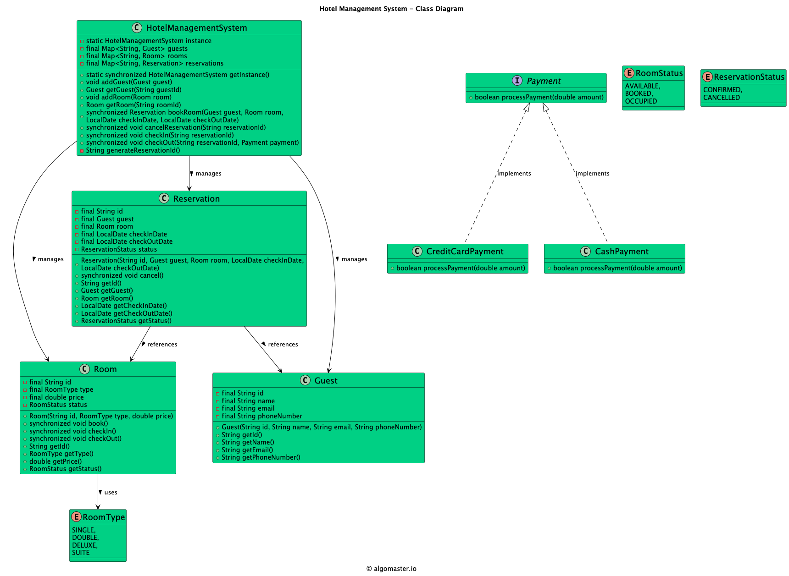

# Low-level design problem: hotel management system

> Copied from <https://github.com/ashishps1/awesome-low-level-design/blob/main/problems/hotel-management-system.md> (GPL-3.0, by Ashish Pratap Singh). Questions and answers are the source's own; nothing was answered or rewritten here.


# Designing a Hotel Management System

## Requirements
1. The hotel management system should allow guests to book rooms, check-in, and check-out.
2. The system should manage different types of rooms, such as single, double, deluxe, and suite.
3. The system should handle room availability and reservation status.
4. The system should allow the hotel staff to manage guest information, room assignments, and billing.
5. The system should support multiple payment methods, such as cash, credit card, and online payment.
6. The system should handle concurrent bookings and ensure data consistency.
7. The system should provide reporting and analytics features for hotel management.
8. The system should be scalable and handle a large number of rooms and guests.

## UML Class Diagram



## Implementations
#### [Java Implementation](https://github.com/ashishps1/awesome-low-level-design/blob/main/solutions/java/src/hotelmanagementsystem) 
#### [Python Implementation](https://github.com/ashishps1/awesome-low-level-design/blob/main/solutions/python/hotelmanagementsystem)
#### [C++ Implementation](https://github.com/ashishps1/awesome-low-level-design/blob/main/solutions/cpp/hotelmanagementsystem)
#### [C# Implementation](https://github.com/ashishps1/awesome-low-level-design/blob/main/solutions/csharp/hotelmanagementsystem)
#### [Go Implementation](https://github.com/ashishps1/awesome-low-level-design/blob/main/solutions/golang/hotelmanagementsystem)

## Classes, Interfaces and Enumerations
1. The **Guest** class represents a guest of the hotel, with properties such as ID, name, email, and phone number.
2. The **Room** class represents a room in the hotel, with properties like ID, room type, price, and status. It provides methods to book, check-in, and check-out a room.
3. The **RoomType** enum represents the different types of rooms available in the hotel.
4. The **RoomStatus** enum represents the status of a room, which can be available, booked, or occupied.
5. The **Reservation** class represents a reservation made by a guest for a specific room and date range. It contains properties such as ID, guest, room, check-in date, check-out date, and status. It provides a method to cancel a reservation.
6. The **ReservationStatus** enum represents the status of a reservation, which can be confirmed or cancelled.
7. The **Payment** interface defines the contract for processing payments. It is implemented by concrete payment classes like CashPayment and CreditCardPayment.
8. The **HotelManagementSystem** class is the central component of the hotel management system. It follows the Singleton pattern to ensure only one instance of the system exists. It provides methods to add guests and rooms, book rooms, cancel reservations, check-in, check-out, and process payments. It also handles concurrent access to shared resources using synchronization.
9. The **HotelManagementSystemDemo** class demonstrates the usage of the hotel management system by creating guests, rooms, booking a room, checking in, checking out, and cancelling a reservation.

---

## Official solutions from the repository

<details><summary><b>java</b> (34 files)</summary>


**BookingService.java**

```java
package hotelmanagementsystem;

import hotelmanagementsystem.model.Booking;
import hotelmanagementsystem.model.Guest;
import hotelmanagementsystem.model.Room;
import hotelmanagementsystem.observer.BookingObserver;

import java.time.LocalDate;
import java.util.ArrayList;
import java.util.List;
import java.util.UUID;

public class BookingService {
    private final List<Booking> bookings = new ArrayList<>();
    private final List<BookingObserver> observers = new ArrayList<>();

    public void addObserver(BookingObserver observer) {
        observers.add(observer);
    }

    public void removeObserver(BookingObserver observer) {
        observers.remove(observer);
    }

    public Booking createBooking(Guest guest, Room room, LocalDate startDate, LocalDate endDate) {
        String bookingId = UUID.randomUUID().toString();
        Booking booking = new Booking(bookingId, guest, room, startDate, endDate);

        // Use the State pattern to book the room
        room.book();

        bookings.add(booking);
        notifyObservers(booking);
        return booking;
    }

    private void notifyObservers(Booking booking) {
        for (BookingObserver observer : observers) {
            observer.update(booking);
        }
    }
}
```


**HotelManagementDemo.java**

```java
package hotelmanagementsystem;

import hotelmanagementsystem.enums.RoomStyle;
import hotelmanagementsystem.enums.RoomType;
import hotelmanagementsystem.factory.RoomFactory;
import hotelmanagementsystem.model.Guest;
import hotelmanagementsystem.observer.EmailNotifier;
import hotelmanagementsystem.observer.SmsNotifier;

import java.time.LocalDate;
import java.util.List;

public class HotelManagementDemo {
    public static void main(String[] args) {
        // 1. Setup Services and Facade
        RoomService roomService = new RoomService();
        BookingService bookingService = new BookingService();
        PaymentService paymentService = new PaymentService();

        // Register observers for the booking service
        bookingService.addObserver(new EmailNotifier());
        bookingService.addObserver(new SmsNotifier());

        HotelManagerFacade hotelManager = new HotelManagerFacade(roomService, bookingService, paymentService);

        // 2. Populate hotel with rooms using the Factory
        roomService.addRoom(RoomFactory.createRoom("101", "SINGLE", "STANDARD", 100));
        roomService.addRoom(RoomFactory.createRoom("102", "SINGLE", "DELUXE", 120));
        roomService.addRoom(RoomFactory.createRoom("201", "DOUBLE", "STANDARD", 150));
        roomService.addRoom(RoomFactory.createRoom("202", "DOUBLE", "DELUXE", 180));
        roomService.addRoom(RoomFactory.createRoom("301", "SUITE", "OCEAN_VIEW", 300));

        System.out.println("----------- SCENARIO 1: Successful Booking with Amenities -----------");
        Guest guest1 = new Guest("G123", "John Doe", "john.doe@example.com");
        hotelManager.bookRoom(
                guest1,
                RoomType.DOUBLE,
                RoomStyle.DELUXE,
                LocalDate.now(),
                LocalDate.now().plusDays(3),
                List.of("Breakfast", "Spa")
        );

        System.out.println("\n----------- SCENARIO 2: Attempt to book the same room (State Pattern) -----------");
        Guest guest2 = new Guest("G456", "Jane Smith", "jane.smith@example.com");
        hotelManager.bookRoom(
                guest2,
                RoomType.DOUBLE,
                RoomStyle.DELUXE,
                LocalDate.now(),
                LocalDate.now().plusDays(2),
                List.of()
        );

        System.out.println("\n----------- SCENARIO 3: Check-out and make room available again (State Pattern) -----------");
        // Room 202 was booked by John Doe
        System.out.println("Initial state of Room 202: " + roomService.findRoomByNumber("202"));
        hotelManager.checkOut("202");
        System.out.println("State of Room 202 after checkout: " + roomService.findRoomByNumber("202"));

        System.out.println("\n----------- SCENARIO 4: Book the now available room -----------");
        hotelManager.bookRoom(
                guest2,
                RoomType.DOUBLE,
                RoomStyle.DELUXE,
                LocalDate.now(),
                LocalDate.now().plusDays(2),
                List.of()
        );

        System.out.println("\n----------- SCENARIO 5: Room under maintenance (State Pattern) -----------");
        System.out.println("State of Room 101: " + roomService.findRoomByNumber("101"));
        roomService.findRoomByNumber("101").markForMaintenance();
        System.out.println("State of Room 101 after marking for maintenance: " + roomService.findRoomByNumber("101"));
        Guest guest3 = new Guest("G789", "Peter Jones", "peter.jones@example.com");
        hotelManager.bookRoom(guest3, RoomType.SINGLE, RoomStyle.STANDARD, LocalDate.now(), LocalDate.now().plusDays(1), List.of());
    }
}
```


**HotelManagerFacade.java**

```java
package hotelmanagementsystem;

import hotelmanagementsystem.decorator.Bookable;
import hotelmanagementsystem.decorator.BreakfastDecorator;
import hotelmanagementsystem.decorator.RoomBooking;
import hotelmanagementsystem.decorator.SpaDecorator;
import hotelmanagementsystem.enums.RoomStyle;
import hotelmanagementsystem.enums.RoomType;
import hotelmanagementsystem.model.Booking;
import hotelmanagementsystem.model.Guest;
import hotelmanagementsystem.model.Room;
import hotelmanagementsystem.specification.RoomAvailableSpecification;
import hotelmanagementsystem.specification.RoomStyleSpecification;
import hotelmanagementsystem.specification.RoomTypeSpecification;
import hotelmanagementsystem.specification.Specification;

import java.time.LocalDate;
import java.util.List;
import java.util.Optional;

public class HotelManagerFacade {
    private final RoomService roomService;
    private final BookingService bookingService;
    private final PaymentService paymentService;

    public HotelManagerFacade(RoomService roomService, BookingService bookingService, PaymentService paymentService) {
        this.roomService = roomService;
        this.bookingService = bookingService;
        this.paymentService = paymentService;
    }

    public Booking bookRoom(Guest guest, RoomType type, RoomStyle style, LocalDate start, LocalDate end, List<String> amenities) {
        // 1. Find an available room using the Specification pattern
        Specification<Room> searchSpec = new RoomAvailableSpecification()
                .and(new RoomTypeSpecification(type))
                .and(new RoomStyleSpecification(style));

        Optional<Room> availableRoom = roomService.findRooms(searchSpec).stream().findFirst();

        if (availableRoom.isPresent()) {
            Room room = availableRoom.get();

            // 2. Create a booking
            Booking booking = bookingService.createBooking(guest, room, start, end);

            // 3. Use Decorator pattern to calculate total cost with amenities
            Bookable bookable = new RoomBooking(room);
            for (String amenity : amenities) {
                if ("breakfast".equalsIgnoreCase(amenity)) {
                    bookable = new BreakfastDecorator(bookable);
                } else if ("spa".equalsIgnoreCase(amenity)) {
                    bookable = new SpaDecorator(bookable);
                }
            }

            System.out.println("Total Cost: " + bookable.getDescription() + " = $" + String.format("%.2f", bookable.getCost()));

            // 4. Process payment
            paymentService.processPayment(bookable.getCost());

            return booking;
        } else {
            System.out.println("Sorry, no rooms available matching your criteria.");
            return null;
        }
    }

    public void checkIn(String bookingId) {
        // In a real system, you'd fetch the booking by ID
        // For this demo, we'll find a room and check it in
        System.out.println("Check-in process for booking ID (not implemented for demo): " + bookingId);
    }

    public void checkOut(String roomNumber) {
        Room room = roomService.findRoomByNumber(roomNumber);
        if(room != null) {
            room.checkOut();
        } else {
            System.out.println("Room " + roomNumber + " not found.");
        }
    }
}
```


**PaymentService.java**

```java
package hotelmanagementsystem;

public class PaymentService {
    public boolean processPayment(double amount) {
        System.out.println("Processing payment of $" + String.format("%.2f", amount) + "...");
        // In a real system, this would interact with a payment gateway
        System.out.println("Payment successful.");
        return true;
    }
}
```


**README.md**

```md
# Hotel Management System (LLD)

## Problem Statement

Design and implement a Hotel Management System that manages hotel rooms, reservations, and guest information. The system should handle room bookings, check-ins, check-outs, and maintain room status.

---

## Requirements

1. **Room Management:**
   - Track different types of rooms (STANDARD, DELUXE, SUITE)
   - Manage room availability and status
   - Handle room pricing and features

2. **Reservation Management:**
   - Create and manage reservations
   - Handle check-in and check-out processes
   - Track reservation status (CONFIRMED, CANCELLED, CHECKED_IN, CHECKED_OUT)

3. **Guest Management:**
   - Store guest information
   - Track guest history
   - Handle guest preferences

4. **Room Status Tracking:**
   - Monitor room availability (AVAILABLE, OCCUPIED, MAINTENANCE)
   - Update room status based on reservations
   - Handle room maintenance requests

5. **Payment Integration:**
   - Process room payments
   - Handle different payment methods
   - Generate invoices

---

## Core Entities

### 1. HotelManagementSystem
- **Fields:** List<Room> rooms, List<Reservation> reservations, List<Guest> guests
- **Methods:** 
  - addRoom()
  - makeReservation()
  - checkIn()
  - checkOut()
  - getAvailableRooms()
  - cancelReservation()

### 2. Room
- **Fields:** String roomNumber, RoomType type, double price, RoomStatus status
- **Methods:** 
  - isAvailable()
  - updateStatus()
  - getPrice()

### 3. Guest
- **Fields:** String id, String name, String email, String phoneNumber
- **Methods:** 
  - updateProfile()
  - getReservations()

### 4. Reservation
- **Fields:** String id, Guest guest, Room room, Date checkInDate, Date checkOutDate, ReservationStatus status
- **Methods:** 
  - confirm()
  - cancel()
  - checkIn()
  - checkOut()

### 5. RoomType (Enum)
- **Values:** STANDARD, DELUXE, SUITE

### 6. RoomStatus (Enum)
- **Values:** AVAILABLE, OCCUPIED, MAINTENANCE

### 7. ReservationStatus (Enum)
- **Values:** CONFIRMED, CANCELLED, CHECKED_IN, CHECKED_OUT

## UML Class Diagram


---

## Example Usage

```java
HotelManagementSystem system = new HotelManagementSystem();

// Add a room
Room room = system.addRoom("101", RoomType.DELUXE, 150.0);

// Create a guest
Guest guest = new Guest("John Doe", "john@example.com", "1234567890");

// Make a reservation
Reservation reservation = system.makeReservation(guest, room, checkInDate, checkOutDate);

// Check in
system.checkIn(reservation);

// Check out
system.checkOut(reservation);
```

---

## Demo

See `HotelManagementSystemDemo.java` for a sample usage and simulation of the hotel management system.

---

## Extending the Framework

- **Add room service:** Track room service requests and delivery
- **Add housekeeping:** Manage housekeeping schedules and tasks
- **Add loyalty program:** Implement guest loyalty points and rewards
- **Add inventory management:** Track hotel supplies and amenities
- **Add reporting system:** Generate occupancy and revenue reports
- **Add notification system:** Send booking confirmations and reminders

---

## Design Patterns Used

- **Singleton Pattern:** For the hotel management system instance
- **Factory Pattern:** For creating different types of rooms
- **Observer Pattern:** For room status updates and notifications
- **Strategy Pattern:** For different pricing strategies

---

## Exception Handling

- **RoomNotAvailableException:** Thrown when trying to book an unavailable room
- **InvalidReservationException:** Thrown when reservation details are invalid
- **CheckInException:** Thrown when check-in process fails
- **CheckOutException:** Thrown when check-out process fails

---
```


**RoomService.java**

```java
package hotelmanagementsystem;

import hotelmanagementsystem.model.Room;
import hotelmanagementsystem.specification.Specification;

import java.util.ArrayList;
import java.util.List;
import java.util.stream.Collectors;

public class RoomService {
    private final List<Room> rooms = new ArrayList<>();

    public void addRoom(Room room) {
        rooms.add(room);
    }

    public List<Room> findRooms(Specification<Room> spec) {
        return rooms.stream()
                .filter(spec::isSatisfiedBy)
                .collect(Collectors.toList());
    }

    public Room findRoomByNumber(String roomNumber) {
        return rooms.stream()
                .filter(r -> r.getRoomNumber().equals(roomNumber))
                .findFirst()
                .orElse(null);
    }
}
```


**decorator/AmenityDecorator.java**

```java
package hotelmanagementsystem.decorator;

public abstract class AmenityDecorator implements Bookable {
    protected Bookable bookable;

    public AmenityDecorator(Bookable bookable) {
        this.bookable = bookable;
    }

    @Override
    public double getCost() {
        return bookable.getCost();
    }

    @Override
    public String getDescription() {
        return bookable.getDescription();
    }
}
```


**decorator/Bookable.java**

```java
package hotelmanagementsystem.decorator;

public interface Bookable {
    double getCost();
    String getDescription();
}
```


**decorator/BreakfastDecorator.java**

```java
package hotelmanagementsystem.decorator;

public class BreakfastDecorator extends AmenityDecorator {
    private static final double BREAKFAST_COST = 25.0;

    public BreakfastDecorator(Bookable bookable) {
        super(bookable);
    }

    @Override
    public double getCost() {
        return super.getCost() + BREAKFAST_COST;
    }

    @Override
    public String getDescription() {
        return super.getDescription() + " with Breakfast";
    }
}
```


**decorator/RoomBooking.java**

```java
package hotelmanagementsystem.decorator;

import hotelmanagementsystem.model.Room;

public class RoomBooking implements Bookable {
    private final Room room;

    public RoomBooking(Room room) {
        this.room = room;
    }

    @Override
    public double getCost() {
        return room.getPrice();
    }

    @Override
    public String getDescription() {
        return room.getStyle() + " " + room.getType() + " Room";
    }
}
```


**decorator/SpaDecorator.java**

```java
package hotelmanagementsystem.decorator;

public class SpaDecorator extends AmenityDecorator {
    private static final double SPA_COST = 50.0;

    public SpaDecorator(Bookable bookable) {
        super(bookable);
    }

    @Override
    public double getCost() {
        return super.getCost() + SPA_COST;
    }


    @Override
    public String getDescription() {
        return super.getDescription() + " with Spa Access";
    }
}
```


**enums/BookingStatus.java**

```java
package hotelmanagementsystem.enums;

public enum BookingStatus {
    REQUESTED, CONFIRMED, CHECKED_IN, CHECKED_OUT, CANCELLED
}
```


**enums/RoomStyle.java**

```java
package hotelmanagementsystem.enums;

public enum RoomStyle {
    STANDARD,
    DELUXE,
    OCEAN_VIEW
}
```


**enums/RoomType.java**

```java
package hotelmanagementsystem.enums;

public enum RoomType {
    SINGLE,
    DOUBLE,
    SUITE
}
```


**factory/RoomFactory.java**

```java
package hotelmanagementsystem.factory;

import hotelmanagementsystem.enums.RoomStyle;
import hotelmanagementsystem.enums.RoomType;
import hotelmanagementsystem.model.Room;

public class RoomFactory {
    public static Room createRoom(String roomNumber, String type, String style, double price) {
        RoomType roomType = RoomType.valueOf(type.toUpperCase());
        RoomStyle roomStyle = RoomStyle.valueOf(style.toUpperCase());
        return new Room(roomNumber, roomType, roomStyle, price);
    }
}
```


**model/Booking.java**

```java
package hotelmanagementsystem.model;

import hotelmanagementsystem.enums.BookingStatus;

import java.time.LocalDate;

public class Booking {
    private final String bookingId;
    private final Guest guest;
    private final Room room;
    private final LocalDate startDate;
    private final LocalDate endDate;
    private BookingStatus status;

    public Booking(String bookingId, Guest guest, Room room, LocalDate startDate, LocalDate endDate) {
        this.bookingId = bookingId;
        this.guest = guest;
        this.room = room;
        this.startDate = startDate;
        this.endDate = endDate;
        this.status = BookingStatus.CONFIRMED;
    }

    public void checkIn() { this.status = BookingStatus.CHECKED_IN; }
    public void checkOut() { this.status = BookingStatus.CHECKED_OUT; }
    public void cancel() { this.status = BookingStatus.CANCELLED; }

    public String getBookingId() { return bookingId; }
    public Guest getGuest() { return guest; }
    public Room getRoom() { return room; }
    public LocalDate getStartDate() { return startDate; }
    public LocalDate getEndDate() { return endDate; }
    public BookingStatus getStatus() { return status; }
}
```


**model/Guest.java**

```java
package hotelmanagementsystem.model;

public class Guest {
    private final String id;
    private final String name;
    private final String email;

    public Guest(String id, String name, String email) {
        this.id = id;
        this.name = name;
        this.email = email;
    }

    public String getId() { return id; }
    public String getName() { return name; }
    public String getEmail() { return email; }
}
```


**model/Room.java**

```java
package hotelmanagementsystem.model;

import hotelmanagementsystem.enums.RoomStyle;
import hotelmanagementsystem.enums.RoomType;
import hotelmanagementsystem.state.AvailableState;
import hotelmanagementsystem.state.RoomState;

public class Room {
    private final String roomNumber;
    private final RoomType type;
    private final RoomStyle style;
    private final double price;
    private RoomState state;

    public Room(String roomNumber, RoomType type, RoomStyle style, double price) {
        this.roomNumber = roomNumber;
        this.type = type;
        this.style = style;
        this.price = price;
        this.state = new AvailableState(); // Initial state
    }

    public void setState(RoomState state) {
        this.state = state;
    }

    public void book() {
        state.book(this);
    }

    public void checkIn() {
        state.checkIn(this);
    }

    public void checkOut() {
        state.checkOut(this);
    }

    public void markForMaintenance() {
        state.markForMaintenance(this);
    }

    public String getRoomNumber() { return roomNumber; }
    public RoomType getType() { return type; }
    public RoomStyle getStyle() { return style; }
    public double getPrice() { return price; }
    public RoomState getState() { return state; }

    @Override
    public String toString() {
        return "Room [Number=" + roomNumber + ", Type=" + type + ", Style=" + style + ", Price=$" + price + ", State=" + state.getClass().getSimpleName() + "]";
    }
}
```


**observer/BookingObserver.java**

```java
package hotelmanagementsystem.observer;

import hotelmanagementsystem.model.Booking;

public interface BookingObserver {
    void update(Booking booking);
}
```


**observer/EmailNotifier.java**

```java
package hotelmanagementsystem.observer;

import hotelmanagementsystem.model.Booking;

public class EmailNotifier implements BookingObserver {
    @Override
    public void update(Booking booking) {
        System.out.println("--- Email Notification ---");
        System.out.println("To: " + booking.getGuest().getEmail());
        System.out.println("Subject: Booking Confirmation " + booking.getBookingId());
        System.out.println("Dear " + booking.getGuest().getName() + ",");
        System.out.println("Your booking for Room " + booking.getRoom().getRoomNumber() + " is confirmed.");
        System.out.println("--------------------------");
    }
}
```


**observer/SmsNotifier.java**

```java
package hotelmanagementsystem.observer;

import hotelmanagementsystem.model.Booking;

public class SmsNotifier implements BookingObserver {
    @Override
    public void update(Booking booking) {
        System.out.println("--- SMS Notification ---");
        System.out.println("To: [Guest's Phone Number]"); // Assuming guest has a phone number
        System.out.println("Message: Booking " + booking.getBookingId() + " for Room " + booking.getRoom().getRoomNumber() + " confirmed!");
        System.out.println("------------------------");
    }
}
```


**payment/CashPayment.java**

```java
package hotelmanagementsystem.payment;

public class CashPayment implements Payment {
    @Override
    public boolean processPayment(double amount) {
        // Process cash payment
        return true;
    }
}
```


**payment/CreditCardPayment.java**

```java
package hotelmanagementsystem.payment;

public class CreditCardPayment implements Payment {
    @Override
    public boolean processPayment(double amount) {
        // Process credit card payment
        return true;
    }
}
```


**payment/Payment.java**

```java
package hotelmanagementsystem.payment;

public interface Payment {
    boolean processPayment(double amount);
}
```


**specification/AbstractSpecification.java**

```java
package hotelmanagementsystem.specification;

public abstract class AbstractSpecification<T> implements Specification<T> {
    public Specification<T> and(Specification<T> other) {
        return new AndSpecification<>(this, other);
    }
}
```


**specification/AndSpecification.java**

```java
package hotelmanagementsystem.specification;

public class AndSpecification<T> extends AbstractSpecification<T> {
    private final Specification<T> spec1;
    private final Specification<T> spec2;

    public AndSpecification(Specification<T> spec1, Specification<T> spec2) {
        this.spec1 = spec1;
        this.spec2 = spec2;
    }

    @Override
    public boolean isSatisfiedBy(T item) {
        return spec1.isSatisfiedBy(item) && spec2.isSatisfiedBy(item);
    }
}
```


**specification/RoomAvailableSpecification.java**

```java
package hotelmanagementsystem.specification;

import hotelmanagementsystem.model.Room;
import hotelmanagementsystem.state.AvailableState;

public class RoomAvailableSpecification extends AbstractSpecification<Room> {
    @Override
    public boolean isSatisfiedBy(Room item) {
        return item.getState() instanceof AvailableState;
    }
}
```


**specification/RoomStyleSpecification.java**

```java
package hotelmanagementsystem.specification;

import hotelmanagementsystem.enums.RoomStyle;
import hotelmanagementsystem.model.Room;

public class RoomStyleSpecification extends AbstractSpecification<Room> {
    private final RoomStyle style;

    public RoomStyleSpecification(RoomStyle style) {
        this.style = style;
    }

    @Override
    public boolean isSatisfiedBy(Room item) {
        return item.getStyle() == style;
    }
}
```


**specification/RoomTypeSpecification.java**

```java
package hotelmanagementsystem.specification;

import hotelmanagementsystem.enums.RoomType;
import hotelmanagementsystem.model.Room;

public class RoomTypeSpecification extends AbstractSpecification<Room> {
    private final RoomType type;

    public RoomTypeSpecification(RoomType type) {
        this.type = type;
    }

    @Override
    public boolean isSatisfiedBy(Room item) {
        return item.getType() == type;
    }
}
```


**specification/Specification.java**

```java
package hotelmanagementsystem.specification;

public interface Specification<T> {
    boolean isSatisfiedBy(T item);
    Specification<T> and(Specification<T> other);
}
```


**state/AvailableState.java**

```java
package hotelmanagementsystem.state;

import hotelmanagementsystem.model.Room;

public class AvailableState implements RoomState {
    @Override
    public void book(Room room) {
        System.out.println("Booking room " + room.getRoomNumber() + ".");
        room.setState(new OccupiedState());
    }

    @Override
    public void checkIn(Room room) {
        System.out.println("Checking into room " + room.getRoomNumber() + ".");
        room.setState(new OccupiedState());
    }

    @Override
    public void checkOut(Room room) {
        System.out.println("Error: Room " + room.getRoomNumber() + " is not occupied.");
    }

    @Override
    public void markForMaintenance(Room room) {
        System.out.println("Marking room " + room.getRoomNumber() + " for maintenance.");
        room.setState(new MaintenanceState());
    }
}
```


**state/MaintenanceState.java**

```java
package hotelmanagementsystem.state;

import hotelmanagementsystem.model.Room;

public class MaintenanceState implements RoomState {
    @Override
    public void book(Room room) {
        System.out.println("Error: Room " + room.getRoomNumber() + " is under maintenance.");
    }

    @Override
    public void checkIn(Room room) {
        System.out.println("Error: Room " + room.getRoomNumber() + " is under maintenance.");
    }

    @Override
    public void checkOut(Room room) {
        System.out.println("Error: Room " + room.getRoomNumber() + " is under maintenance.");
    }

    @Override
    public void markForMaintenance(Room room) {
        System.out.println("Room " + room.getRoomNumber() + " is already under maintenance. Marking it as available now.");
        room.setState(new AvailableState());
    }
}
```


**state/OccupiedState.java**

```java
package hotelmanagementsystem.state;

import hotelmanagementsystem.model.Room;

public class OccupiedState implements RoomState {
    @Override
    public void book(Room room) {
        System.out.println("Error: Room " + room.getRoomNumber() + " is already occupied.");
    }

    @Override
    public void checkIn(Room room) {
        System.out.println("Error: Room " + room.getRoomNumber() + " is already checked in.");
    }

    @Override
    public void checkOut(Room room) {
        System.out.println("Checking out of room " + room.getRoomNumber() + ".");
        room.setState(new AvailableState());
    }

    @Override
    public void markForMaintenance(Room room) {
        System.out.println("Error: Cannot mark an occupied room for maintenance. Please check out first.");
    }
}
```


**state/RoomState.java**

```java
package hotelmanagementsystem.state;

import hotelmanagementsystem.model.Room;

public interface RoomState {
    void book(Room room);
    void checkIn(Room room);
    void checkOut(Room room);
    void markForMaintenance(Room room);
}
```

</details>

<details><summary><b>python</b> (1 files)</summary>


**README.md**

```md
# Designing a Hotel Management System

## Requirements
1. The hotel management system should allow guests to book rooms, check-in, and check-out.
2. The system should manage different types of rooms, such as single, double, deluxe, and suite.
3. The system should handle room availability and reservation status.
4. The system should allow the hotel staff to manage guest information, room assignments, and billing.
5. The system should support multiple payment methods, such as cash, credit card, and online payment.
6. The system should handle concurrent bookings and ensure data consistency.
7. The system should provide reporting and analytics features for hotel management.
8. The system should be scalable and handle a large number of rooms and guests.

## Classes, Interfaces and Enumerations
1. The **Guest** class represents a guest of the hotel, with properties such as ID, name, email, and phone number.
2. The **Room** class represents a room in the hotel, with properties like ID, room type, price, and status. It provides methods to book, check-in, and check-out a room.
3. The **RoomType** enum represents the different types of rooms available in the hotel.
4. The **RoomStatus** enum represents the status of a room, which can be available, booked, or occupied.
5. The **Reservation** class represents a reservation made by a guest for a specific room and date range. It contains properties such as ID, guest, room, check-in date, check-out date, and status. It provides a method to cancel a reservation.
6. The **ReservationStatus** enum represents the status of a reservation, which can be confirmed or cancelled.
7. The **Payment** interface defines the contract for processing payments. It is implemented by concrete payment classes like CashPayment and CreditCardPayment.
8. The **HotelManagementSystem** class is the central component of the hotel management system. It follows the Singleton pattern to ensure only one instance of the system exists. It provides methods to add guests and rooms, book rooms, cancel reservations, check-in, check-out, and process payments. It also handles concurrent access to shared resources using synchronization.
9. The **HotelManagementSystemDemo** class demonstrates the usage of the hotel management system by creating guests, rooms, booking a room, checking in, checking out, and cancelling a reservation.
```

</details>

<details><summary><b>cpp</b> (10 files)</summary>


**Booking.cpp**

```cpp
#include "Booking.hpp"
#include <iostream>
#include <iomanip>

Booking::Booking(std::string bookingId, Guest* guest, Room* room,
                std::string checkInDate, std::string checkOutDate, int numberOfNights)
    : bookingId(bookingId), guest(guest), room(room),
      checkInDate(checkInDate), checkOutDate(checkOutDate),
      numberOfNights(numberOfNights), status(BookingStatus::CONFIRMED) {
    calculateTotalAmount();
}

std::string Booking::getBookingId() const { return bookingId; }
Guest* Booking::getGuest() const { return guest; }
Room* Booking::getRoom() const { return room; }
std::string Booking::getCheckInDate() const { return checkInDate; }
std::string Booking::getCheckOutDate() const { return checkOutDate; }
int Booking::getNumberOfNights() const { return numberOfNights; }
double Booking::getTotalAmount() const { return totalAmount; }
BookingStatus Booking::getStatus() const { return status; }

void Booking::calculateTotalAmount() {
    totalAmount = room->getPricePerNight() * numberOfNights;
}

void Booking::setStatus(BookingStatus status) {
    this->status = status;
}

void Booking::displayInfo() const {
    std::cout << "\nBooking Details:" << std::endl;
    std::cout << "Booking ID: " << bookingId << std::endl;
    std::cout << "Guest: " << guest->getName() << std::endl;
    std::cout << "Room: " << room->getRoomNumber() << std::endl;
    std::cout << "Check-in Date: " << checkInDate << std::endl;
    std::cout << "Check-out Date: " << checkOutDate << std::endl;
    std::cout << "Number of Nights: " << numberOfNights << std::endl;
    std::cout << "Total Amount: $" << std::fixed << std::setprecision(2) 
              << totalAmount << std::endl;
    std::cout << "Status: ";
    switch (status) {
        case BookingStatus::CONFIRMED: std::cout << "Confirmed"; break;
        case BookingStatus::CHECKED_IN: std::cout << "Checked In"; break;
        case BookingStatus::CHECKED_OUT: std::cout << "Checked Out"; break;
        case BookingStatus::CANCELLED: std::cout << "Cancelled"; break;
    }
    std::cout << std::endl;
}
```


**Booking.hpp**

```hpp
#ifndef BOOKING_HPP
#define BOOKING_HPP

#include <string>
#include "Guest.hpp"
#include "Room.hpp"

enum class BookingStatus {
    CONFIRMED,
    CHECKED_IN,
    CHECKED_OUT,
    CANCELLED
};

class Booking {
private:
    std::string bookingId;
    Guest* guest;
    Room* room;
    std::string checkInDate;
    std::string checkOutDate;
    int numberOfNights;
    double totalAmount;
    BookingStatus status;

public:
    Booking(std::string bookingId, Guest* guest, Room* room,
           std::string checkInDate, std::string checkOutDate, int numberOfNights);
    
    std::string getBookingId() const;
    Guest* getGuest() const;
    Room* getRoom() const;
    std::string getCheckInDate() const;
    std::string getCheckOutDate() const;
    int getNumberOfNights() const;
    double getTotalAmount() const;
    BookingStatus getStatus() const;
    
    void calculateTotalAmount();
    void setStatus(BookingStatus status);
    void displayInfo() const;
};

#endif
```


**Guest.cpp**

```cpp
#include "Guest.hpp"
#include <iostream>

Guest::Guest(std::string guestId, std::string name, std::string email,
            std::string phone, std::string address)
    : guestId(guestId), name(name), email(email), phone(phone), address(address) {}

std::string Guest::getGuestId() const { return guestId; }
std::string Guest::getName() const { return name; }
std::string Guest::getEmail() const { return email; }
std::string Guest::getPhone() const { return phone; }
std::string Guest::getAddress() const { return address; }

void Guest::displayInfo() const {
    std::cout << "Guest: " << name << " (ID: " << guestId << ")" << std::endl;
    std::cout << "Email: " << email << std::endl;
    std::cout << "Phone: " << phone << std::endl;
    std::cout << "Address: " << address << std::endl;
}
```


**Guest.hpp**

```hpp
#ifndef GUEST_HPP
#define GUEST_HPP

#include <string>

class Guest {
private:
    std::string guestId;
    std::string name;
    std::string email;
    std::string phone;
    std::string address;

public:
    Guest(std::string guestId, std::string name, std::string email,
          std::string phone, std::string address);
    
    std::string getGuestId() const;
    std::string getName() const;
    std::string getEmail() const;
    std::string getPhone() const;
    std::string getAddress() const;
    void displayInfo() const;
};

#endif
```


**HotelDemo.cpp**

```cpp
#include "HotelManager.hpp"
#include <iostream>

int main() {
    HotelManager hotel;
    
    // Add rooms
    Room* room1 = new Room("101", RoomType::STANDARD, 100.0, 2);
    Room* room2 = new Room("201", RoomType::DELUXE, 150.0, 3);
    Room* room3 = new Room("301", RoomType::SUITE, 250.0, 4);
    
    hotel.addRoom(room1);
    hotel.addRoom(room2);
    hotel.addRoom(room3);
    
    // Add guests
    Guest* guest1 = new Guest("G001", "John Doe", "john@example.com",
                            "+1-555-0123", "123 Main St");
    hotel.addGuest(guest1);
    
    // Display available rooms
    hotel.displayAvailableRooms();
    
    // Create a booking
    Booking* booking = hotel.createBooking("G001", "101", "2024-01-01",
                                         "2024-01-03", 2);
    if (booking) {
        std::cout << "\nBooking created successfully!" << std::endl;
        booking->displayInfo();
        
        // Check in
        if (hotel.checkIn(booking->getBookingId())) {
            std::cout << "\nChecked in successfully!" << std::endl;
        }
        
        // Display available rooms after check-in
        hotel.displayAvailableRooms();
        
        // Check out
        if (hotel.checkOut(booking->getBookingId())) {
            std::cout << "\nChecked out successfully!" << std::endl;
        }
        
        // Display booking history
        hotel.displayBookingHistory("G001");
    }
    
    return 0;
}
```


**HotelManager.cpp**

```cpp
#include "HotelManager.hpp"
#include <iostream>

HotelManager::HotelManager() : bookingIdCounter(1) {}

HotelManager::~HotelManager() {
    for (auto room : rooms) delete room;
    for (auto guest : guests) delete guest;
    for (auto booking : bookings) delete booking;
}

void HotelManager::addRoom(Room* room) {
    rooms.push_back(room);
}

void HotelManager::addGuest(Guest* guest) {
    guests.push_back(guest);
}

Booking* HotelManager::createBooking(std::string guestId, std::string roomNumber,
                                   std::string checkInDate, std::string checkOutDate,
                                   int numberOfNights) {
    Guest* guest = findGuest(guestId);
    Room* room = findRoom(roomNumber);
    
    if (!guest || !room || room->getStatus() != RoomStatus::AVAILABLE) {
        return nullptr;
    }
    
    Booking* booking = new Booking(generateBookingId(), guest, room,
                                 checkInDate, checkOutDate, numberOfNights);
    bookings.push_back(booking);
    return booking;
}

bool HotelManager::checkIn(std::string bookingId) {
    Booking* booking = findBooking(bookingId);
    if (!booking || booking->getStatus() != BookingStatus::CONFIRMED) {
        return false;
    }
    
    booking->setStatus(BookingStatus::CHECKED_IN);
    booking->getRoom()->setStatus(RoomStatus::OCCUPIED);
    return true;
}

bool HotelManager::checkOut(std::string bookingId) {
    Booking* booking = findBooking(bookingId);
    if (!booking || booking->getStatus() != BookingStatus::CHECKED_IN) {
        return false;
    }
    
    booking->setStatus(BookingStatus::CHECKED_OUT);
    booking->getRoom()->setStatus(RoomStatus::AVAILABLE);
    return true;
}

bool HotelManager::cancelBooking(std::string bookingId) {
    Booking* booking = findBooking(bookingId);
    if (!booking || booking->getStatus() != BookingStatus::CONFIRMED) {
        return false;
    }
    
    booking->setStatus(BookingStatus::CANCELLED);
    booking->getRoom()->setStatus(RoomStatus::AVAILABLE);
    return true;
}

void HotelManager::displayAvailableRooms() const {
    std::cout << "\nAvailable Rooms:" << std::endl;
    for (const auto& room : rooms) {
        if (room->getStatus() == RoomStatus::AVAILABLE) {
            room->displayInfo();
            std::cout << "------------------------" << std::endl;
        }
    }
}

void HotelManager::displayBookingHistory(std::string guestId) const {
    std::cout << "\nBooking History:" << std::endl;
    for (const auto& booking : bookings) {
        if (booking->getGuest()->getGuestId() == guestId) {
            booking->displayInfo();
            std::cout << "------------------------" << std::endl;
        }
    }
}

void HotelManager::displayAllGuests() const {
    std::cout << "\nAll Guests:" << std::endl;
    for (const auto& guest : guests) {
        guest->displayInfo();
        std::cout << "------------------------" << std::endl;
    }
}

void HotelManager::displayAllBookings() const {
    std::cout << "\nAll Bookings:" << std::endl;
    for (const auto& booking : bookings) {
        booking->displayInfo();
        std::cout << "------------------------" << std::endl;
    }
}

Room* HotelManager::findRoom(const std::string& roomNumber) const {
    for (auto room : rooms) {
        if (room->getRoomNumber() == roomNumber) return room;
    }
    return nullptr;
}

Guest* HotelManager::findGuest(const std::string& guestId) const {
    for (auto guest : guests) {
        if (guest->getGuestId() == guestId) return guest;
    }
    return nullptr;
}

Booking* HotelManager::findBooking(const std::string& bookingId) const {
    for (auto booking : bookings) {
        if (booking->getBookingId() == bookingId) return booking;
    }
    return nullptr;
}

std::string HotelManager::generateBookingId() {
    return "BK" + std::to_string(bookingIdCounter++);
}
```


**HotelManager.hpp**

```hpp
#ifndef HOTEL_MANAGER_HPP
#define HOTEL_MANAGER_HPP

#include <vector>
#include <string>
#include "Room.hpp"
#include "Guest.hpp"
#include "Booking.hpp"

class HotelManager {
private:
    std::vector<Room*> rooms;
    std::vector<Guest*> guests;
    std::vector<Booking*> bookings;
    int bookingIdCounter;

public:
    HotelManager();
    ~HotelManager();
    
    void addRoom(Room* room);
    void addGuest(Guest* guest);
    
    Booking* createBooking(std::string guestId, std::string roomNumber,
                          std::string checkInDate, std::string checkOutDate,
                          int numberOfNights);
    
    bool checkIn(std::string bookingId);
    bool checkOut(std::string bookingId);
    bool cancelBooking(std::string bookingId);
    
    void displayAvailableRooms() const;
    void displayBookingHistory(std::string guestId) const;
    void displayAllGuests() const;
    void displayAllBookings() const;
    
private:
    Room* findRoom(const std::string& roomNumber) const;
    Guest* findGuest(const std::string& guestId) const;
    Booking* findBooking(const std::string& bookingId) const;
    std::string generateBookingId();
};

#endif
```


**README.md**

```md
# Designing a Hotel Management System

## Requirements
1. The hotel management system should allow guests to book rooms, check-in, and check-out.
2. The system should manage different types of rooms, such as single, double, deluxe, and suite.
3. The system should handle room availability and reservation status.
4. The system should allow the hotel staff to manage guest information, room assignments, and billing.
5. The system should support multiple payment methods, such as cash, credit card, and online payment.
6. The system should handle concurrent bookings and ensure data consistency.
7. The system should provide reporting and analytics features for hotel management.
8. The system should be scalable and handle a large number of rooms and guests.

## Classes, Interfaces and Enumerations
1. The **Guest** class represents a guest of the hotel, with properties such as ID, name, email, and phone number.
2. The **Room** class represents a room in the hotel, with properties like ID, room type, price, and status. It provides methods to book, check-in, and check-out a room.
3. The **RoomType** enum represents the different types of rooms available in the hotel.
4. The **RoomStatus** enum represents the status of a room, which can be available, booked, or occupied.
5. The **Reservation** class represents a reservation made by a guest for a specific room and date range. It contains properties such as ID, guest, room, check-in date, check-out date, and status. It provides a method to cancel a reservation.
6. The **ReservationStatus** enum represents the status of a reservation, which can be confirmed or cancelled.
7. The **Payment** interface defines the contract for processing payments. It is implemented by concrete payment classes like CashPayment and CreditCardPayment.
8. The **HotelManagementSystem** class is the central component of the hotel management system. It follows the Singleton pattern to ensure only one instance of the system exists. It provides methods to add guests and rooms, book rooms, cancel reservations, check-in, check-out, and process payments. It also handles concurrent access to shared resources using synchronization.
9. The **HotelManagementSystemDemo** class demonstrates the usage of the hotel management system by creating guests, rooms, booking a room, checking in, checking out, and cancelling a reservation.
```


**Room.cpp**

```cpp
#include "Room.hpp"
#include <iostream>
#include <iomanip>

Room::Room(std::string roomNumber, RoomType type, double pricePerNight, int capacity)
    : roomNumber(roomNumber), type(type), status(RoomStatus::AVAILABLE),
      pricePerNight(pricePerNight), capacity(capacity) {}

std::string Room::getRoomNumber() const { return roomNumber; }
RoomType Room::getType() const { return type; }
RoomStatus Room::getStatus() const { return status; }
double Room::getPricePerNight() const { return pricePerNight; }
int Room::getCapacity() const { return capacity; }

void Room::setStatus(RoomStatus status) {
    this->status = status;
}

void Room::displayInfo() const {
    std::cout << "Room " << roomNumber << std::endl;
    std::cout << "Type: ";
    switch (type) {
        case RoomType::STANDARD: std::cout << "Standard"; break;
        case RoomType::DELUXE: std::cout << "Deluxe"; break;
        case RoomType::SUITE: std::cout << "Suite"; break;
    }
    std::cout << std::endl;
    
    std::cout << "Status: ";
    switch (status) {
        case RoomStatus::AVAILABLE: std::cout << "Available"; break;
        case RoomStatus::OCCUPIED: std::cout << "Occupied"; break;
        case RoomStatus::UNDER_MAINTENANCE: std::cout << "Under Maintenance"; break;
    }
    std::cout << std::endl;
    
    std::cout << "Price per night: $" << std::fixed << std::setprecision(2) 
              << pricePerNight << std::endl;
    std::cout << "Capacity: " << capacity << " persons" << std::endl;
}
```


**Room.hpp**

```hpp
#ifndef ROOM_HPP
#define ROOM_HPP

#include <string>

enum class RoomType {
    STANDARD,
    DELUXE,
    SUITE
};

enum class RoomStatus {
    AVAILABLE,
    OCCUPIED,
    UNDER_MAINTENANCE
};

class Room {
private:
    std::string roomNumber;
    RoomType type;
    RoomStatus status;
    double pricePerNight;
    int capacity;

public:
    Room(std::string roomNumber, RoomType type, double pricePerNight, int capacity);
    
    std::string getRoomNumber() const;
    RoomType getType() const;
    RoomStatus getStatus() const;
    double getPricePerNight() const;
    int getCapacity() const;
    
    void setStatus(RoomStatus status);
    void displayInfo() const;
};

#endif
```

</details>

<details><summary><b>golang</b> (8 files)</summary>


**README.md**

```md
# Designing a Hotel Management System

## Requirements
1. The hotel management system should allow guests to book rooms, check-in, and check-out.
2. The system should manage different types of rooms, such as single, double, deluxe, and suite.
3. The system should handle room availability and reservation status.
4. The system should allow the hotel staff to manage guest information, room assignments, and billing.
5. The system should support multiple payment methods, such as cash, credit card, and online payment.
6. The system should handle concurrent bookings and ensure data consistency.
7. The system should provide reporting and analytics features for hotel management.
8. The system should be scalable and handle a large number of rooms and guests.

## Classes, Interfaces and Enumerations
1. The **Guest** class represents a guest of the hotel, with properties such as ID, name, email, and phone number.
2. The **Room** class represents a room in the hotel, with properties like ID, room type, price, and status. It provides methods to book, check-in, and check-out a room.
3. The **RoomType** enum represents the different types of rooms available in the hotel.
4. The **RoomStatus** enum represents the status of a room, which can be available, booked, or occupied.
5. The **Reservation** class represents a reservation made by a guest for a specific room and date range. It contains properties such as ID, guest, room, check-in date, check-out date, and status. It provides a method to cancel a reservation.
6. The **ReservationStatus** enum represents the status of a reservation, which can be confirmed or cancelled.
7. The **Payment** interface defines the contract for processing payments. It is implemented by concrete payment classes like CashPayment and CreditCardPayment.
8. The **HotelManagementSystem** class is the central component of the hotel management system. It follows the Singleton pattern to ensure only one instance of the system exists. It provides methods to add guests and rooms, book rooms, cancel reservations, check-in, check-out, and process payments. It also handles concurrent access to shared resources using synchronization.
9. The **HotelManagementSystemDemo** class demonstrates the usage of the hotel management system by creating guests, rooms, booking a room, checking in, checking out, and cancelling a reservation.
```


**guest.go**

```go
package hotelmanagement

type Guest struct {
	ID          string
	Name        string
	Email       string
	PhoneNumber string
}

func NewGuest(id, name, email, phoneNumber string) *Guest {
	return &Guest{
		ID:          id,
		Name:        name,
		Email:       email,
		PhoneNumber: phoneNumber,
	}
}
```


**hotel_management.go**

```go
package hotelmanagement

import (
	"fmt"
	"sync"
	"time"
)

type HotelManagementSystem struct {
	guests       map[string]*Guest
	rooms        map[string]*Room
	reservations map[string]*Reservation
	mu           sync.RWMutex
}

var (
	instance *HotelManagementSystem
	once     sync.Once
)

func GetHotelManagementSystem() *HotelManagementSystem {
	once.Do(func() {
		instance = &HotelManagementSystem{
			guests:       make(map[string]*Guest),
			rooms:        make(map[string]*Room),
			reservations: make(map[string]*Reservation),
		}
	})
	return instance
}

func (h *HotelManagementSystem) AddGuest(guest *Guest) {
	h.mu.Lock()
	defer h.mu.Unlock()
	h.guests[guest.ID] = guest
}

func (h *HotelManagementSystem) GetGuest(guestID string) *Guest {
	h.mu.RLock()
	defer h.mu.RUnlock()
	return h.guests[guestID]
}

func (h *HotelManagementSystem) AddRoom(room *Room) {
	h.mu.Lock()
	defer h.mu.Unlock()
	h.rooms[room.ID] = room
}

func (h *HotelManagementSystem) GetRoom(roomID string) *Room {
	h.mu.RLock()
	defer h.mu.RUnlock()
	return h.rooms[roomID]
}

func (h *HotelManagementSystem) BookRoom(guest *Guest, room *Room, checkInDate, checkOutDate time.Time) (*Reservation, error) {
	h.mu.Lock()
	defer h.mu.Unlock()

	if room.GetStatus() != RoomStatusAvailable {
		return nil, fmt.Errorf("room is not available")
	}

	if err := room.Book(); err != nil {
		return nil, err
	}

	reservationID := fmt.Sprintf("RES%d", time.Now().UnixNano())
	reservation := NewReservation(reservationID, guest, room, checkInDate, checkOutDate)
	h.reservations[reservationID] = reservation

	return reservation, nil
}

func (h *HotelManagementSystem) CancelReservation(reservationID string) error {
	h.mu.Lock()
	defer h.mu.Unlock()

	reservation, exists := h.reservations[reservationID]
	if !exists {
		return fmt.Errorf("reservation not found")
	}

	if err := reservation.Cancel(); err != nil {
		return err
	}

	delete(h.reservations, reservationID)
	return nil
}

func (h *HotelManagementSystem) CheckIn(reservationID string) error {
	h.mu.Lock()
	defer h.mu.Unlock()

	reservation, exists := h.reservations[reservationID]
	if !exists {
		return fmt.Errorf("reservation not found")
	}

	if reservation.Status != ReservationStatusConfirmed {
		return fmt.Errorf("invalid reservation status")
	}

	return reservation.Room.CheckIn()
}

func (h *HotelManagementSystem) CheckOut(reservationID string, payment Payment) error {
	h.mu.Lock()
	defer h.mu.Unlock()

	reservation, exists := h.reservations[reservationID]
	if !exists {
		return fmt.Errorf("reservation not found")
	}

	if reservation.Status != ReservationStatusConfirmed {
		return fmt.Errorf("invalid reservation status")
	}

	days := reservation.CheckOutDate.Sub(reservation.CheckInDate).Hours() / 24
	amount := reservation.Room.Price * days

	if !payment.ProcessPayment(amount) {
		return fmt.Errorf("payment failed")
	}

	if err := reservation.Room.CheckOut(); err != nil {
		return err
	}

	delete(h.reservations, reservationID)
	return nil
}
```


**hotel_management_demo.go**

```go
package hotelmanagement

import (
	"fmt"
	"time"
)

func Run() {
	hotelSystem := GetHotelManagementSystem()

	// Create guests
	guest1 := NewGuest("G001", "John Doe", "john@example.com", "1234567890")
	guest2 := NewGuest("G002", "Jane Smith", "jane@example.com", "9876543210")
	hotelSystem.AddGuest(guest1)
	hotelSystem.AddGuest(guest2)

	// Create rooms
	room1 := NewRoom("R001", RoomTypeSingle, 100.0)
	room2 := NewRoom("R002", RoomTypeDouble, 200.0)
	hotelSystem.AddRoom(room1)
	hotelSystem.AddRoom(room2)

	// Book a room
	checkInDate := time.Now()
	checkOutDate := checkInDate.AddDate(0, 0, 3)

	reservation1, err := hotelSystem.BookRoom(guest1, room1, checkInDate, checkOutDate)
	if err != nil {
		fmt.Printf("Failed to book room: %v\n", err)
		return
	}
	fmt.Printf("Reservation created: %s\n", reservation1.ID)

	// Check-in
	if err := hotelSystem.CheckIn(reservation1.ID); err != nil {
		fmt.Printf("Failed to check in: %v\n", err)
		return
	}
	fmt.Printf("Checked in: %s\n", reservation1.ID)

	// Check-out and process payment
	payment := NewCreditCardPayment()
	if err := hotelSystem.CheckOut(reservation1.ID, payment); err != nil {
		fmt.Printf("Failed to check out: %v\n", err)
		return
	}
	fmt.Printf("Checked out: %s\n", reservation1.ID)

	// Cancel a reservation
	if err := hotelSystem.CancelReservation(reservation1.ID); err != nil {
		fmt.Printf("Failed to cancel reservation: %v\n", err)
		return
	}
	fmt.Printf("Reservation cancelled: %s\n", reservation1.ID)
}
```


**payment.go**

```go
package hotelmanagement

type Payment interface {
	ProcessPayment(amount float64) bool
}

type CreditCardPayment struct{}

func NewCreditCardPayment() *CreditCardPayment {
	return &CreditCardPayment{}
}

func (p *CreditCardPayment) ProcessPayment(amount float64) bool {
	// Process credit card payment
	return true
}

type CashPayment struct{}

func NewCashPayment() *CashPayment {
	return &CashPayment{}
}

func (p *CashPayment) ProcessPayment(amount float64) bool {
	// Process cash payment
	return true
}
```


**reservation.go**

```go
package hotelmanagement

import (
	"fmt"
	"sync"
	"time"
)

type Reservation struct {
	ID           string
	Guest        *Guest
	Room         *Room
	CheckInDate  time.Time
	CheckOutDate time.Time
	Status       ReservationStatus
	mu           sync.RWMutex
}

func NewReservation(id string, guest *Guest, room *Room, checkInDate, checkOutDate time.Time) *Reservation {
	return &Reservation{
		ID:           id,
		Guest:        guest,
		Room:         room,
		CheckInDate:  checkInDate,
		CheckOutDate: checkOutDate,
		Status:       ReservationStatusConfirmed,
	}
}

func (r *Reservation) Cancel() error {
	r.mu.Lock()
	defer r.mu.Unlock()

	if r.Status != ReservationStatusConfirmed {
		return fmt.Errorf("reservation is not confirmed")
	}

	r.Status = ReservationStatusCancelled
	return r.Room.CheckOut()
}
```


**room.go**

```go
package hotelmanagement

import (
	"fmt"
	"sync"
)

type Room struct {
	ID     string
	Type   RoomType
	Price  float64
	status RoomStatus
	mu     sync.RWMutex
}

func NewRoom(id string, roomType RoomType, price float64) *Room {
	return &Room{
		ID:     id,
		Type:   roomType,
		Price:  price,
		status: RoomStatusAvailable,
	}
}

func (r *Room) Book() error {
	r.mu.Lock()
	defer r.mu.Unlock()

	if r.status != RoomStatusAvailable {
		return fmt.Errorf("room is not available for booking")
	}
	r.status = RoomStatusBooked
	return nil
}

func (r *Room) CheckIn() error {
	r.mu.Lock()
	defer r.mu.Unlock()

	if r.status != RoomStatusBooked {
		return fmt.Errorf("room is not booked")
	}
	r.status = RoomStatusOccupied
	return nil
}

func (r *Room) CheckOut() error {
	r.mu.Lock()
	defer r.mu.Unlock()

	if r.status != RoomStatusOccupied {
		return fmt.Errorf("room is not occupied")
	}
	r.status = RoomStatusAvailable
	return nil
}

func (r *Room) GetStatus() RoomStatus {
	r.mu.RLock()
	defer r.mu.RUnlock()
	return r.status
}
```


**types.go**

```go
package hotelmanagement

type RoomType int
type RoomStatus int
type ReservationStatus int

const (
	RoomTypeSingle RoomType = iota
	RoomTypeDouble
	RoomTypeDeluxe
	RoomTypeSuite
)

const (
	RoomStatusAvailable RoomStatus = iota
	RoomStatusBooked
	RoomStatusOccupied
)

const (
	ReservationStatusConfirmed ReservationStatus = iota
	ReservationStatusCancelled
)
```

</details>

<details><summary><b>csharp</b> (12 files)</summary>


**CashPayment.cs**

```cs
namespace HotelManagement
{
    public class CashPayment : Payment
    {
        public bool ProcessPayment(double amount)
        {
            // Process cash payment
            return true;
        }
    }
}
```


**CreditCardPayment.cs**

```cs
namespace HotelManagement
{
    public class CreditCardPayment : Payment
    {
        public bool ProcessPayment(double amount)
        {
            // Process credit card payment
            return true;
        }
    }
}
```


**Guest.cs**

```cs
namespace HotelManagement
{
    public class Guest
    {
        public string Id { get; }
        public string Name { get; }
        public string Email { get; }
        public string PhoneNumber { get; }

        public Guest(string id, string name, string email, string phoneNumber)
        {
            Id = id;
            Name = name;
            Email = email;
            PhoneNumber = phoneNumber;
        }
    }
}
```


**HotelManagementSystem.cs**

```cs
using System;
using System.Collections.Concurrent;
using System.Collections.Generic;
using System.Linq;

namespace HotelManagement
{
    public class HotelManagementSystem
    {
        private static HotelManagementSystem _instance;
        private readonly ConcurrentDictionary<string, Guest> _guests;
        private readonly ConcurrentDictionary<string, Room> _rooms;
        private readonly ConcurrentDictionary<string, Reservation> _reservations;

        private HotelManagementSystem()
        {
            _guests = new ConcurrentDictionary<string, Guest>();
            _rooms = new ConcurrentDictionary<string, Room>();
            _reservations = new ConcurrentDictionary<string, Reservation>();
        }

        public static HotelManagementSystem Instance
        {
            get
            {
                if (_instance == null)
                {
                    _instance = new HotelManagementSystem();
                }
                return _instance;
            }
        }

        public void AddGuest(Guest guest)
        {
            _guests[guest.Id] = guest;
        }

        public Guest GetGuest(string guestId)
        {
            _guests.TryGetValue(guestId, out var guest);
            return guest;
        }

        public void AddRoom(Room room)
        {
            _rooms[room.Id] = room;
        }

        public Room GetRoom(string roomId)
        {
            _rooms.TryGetValue(roomId, out var room);
            return room;
        }

        public Reservation BookRoom(Guest guest, Room room, DateTime checkInDate, DateTime checkOutDate)
        {
            lock (room)
            {
                if (room.Status == RoomStatus.AVAILABLE)
                {
                    room.Book();
                    var reservationId = GenerateReservationId();
                    var reservation = new Reservation(reservationId, guest, room, checkInDate, checkOutDate);
                    _reservations[reservationId] = reservation;
                    return reservation;
                }
                return null;
            }
        }

        public void CancelReservation(string reservationId)
        {
            lock (this)
            {
                if (_reservations.TryGetValue(reservationId, out var reservation))
                {
                    reservation.Cancel();
                    _reservations.TryRemove(reservationId, out _);
                }
            }
        }

        public void CheckIn(string reservationId)
        {
            lock (this)
            {
                if (_reservations.TryGetValue(reservationId, out var reservation) && reservation.Status == ReservationStatus.CONFIRMED)
                {
                    reservation.Room.CheckIn();
                }
                else
                {
                    throw new InvalidOperationException("Invalid reservation or reservation not confirmed.");
                }
            }
        }

        public void CheckOut(string reservationId, Payment payment)
        {
            lock (this)
            {
                if (_reservations.TryGetValue(reservationId, out var reservation) && reservation.Status == ReservationStatus.CONFIRMED)
                {
                    var room = reservation.Room;
                    var amount = room.Price * (reservation.CheckOutDate - reservation.CheckInDate).TotalDays;
                    if (payment.ProcessPayment(amount))
                    {
                        room.CheckOut();
                        _reservations.TryRemove(reservationId, out _);
                    }
                    else
                    {
                        throw new InvalidOperationException("Payment failed.");
                    }
                }
                else
                {
                    throw new InvalidOperationException("Invalid reservation or reservation not confirmed.");
                }
            }
        }

        private string GenerateReservationId()
        {
            return "RES" + Guid.NewGuid().ToString("N").Substring(0, 8).ToUpper();
        }
    }
}
```


**HotelManagementSystemDemo.cs**

```cs
using System;

namespace HotelManagement
{
    public class HotelManagementSystemDemo
    {
        public static void Run()
        {
            var hotelManagementSystem = HotelManagementSystem.Instance;

            // Create guests
            var guest1 = new Guest("G001", "John Doe", "john@example.com", "1234567890");
            var guest2 = new Guest("G002", "Jane Smith", "jane@example.com", "9876543210");
            hotelManagementSystem.AddGuest(guest1);
            hotelManagementSystem.AddGuest(guest2);

            // Create rooms
            var room1 = new Room("R001", RoomType.SINGLE, 100.0);
            var room2 = new Room("R002", RoomType.DOUBLE, 200.0);
            hotelManagementSystem.AddRoom(room1);
            hotelManagementSystem.AddRoom(room2);

            // Book a room
            var checkInDate = DateTime.Now;
            var checkOutDate = checkInDate.AddDays(3);
            var reservation1 = hotelManagementSystem.BookRoom(guest1, room1, checkInDate, checkOutDate);
            if (reservation1 != null)
            {
                Console.WriteLine("Reservation created: " + reservation1.Id);
            }
            else
            {
                Console.WriteLine("Room not available for booking.");
            }

            // Check-in
            hotelManagementSystem.CheckIn(reservation1.Id);
            Console.WriteLine("Checked in: " + reservation1.Id);

            // Check-out and process payment
            var payment = new CreditCardPayment();
            hotelManagementSystem.CheckOut(reservation1.Id, payment);
            Console.WriteLine("Checked out: " + reservation1.Id);

            // Cancel a reservation
            hotelManagementSystem.CancelReservation(reservation1.Id);
            Console.WriteLine("Reservation cancelled: " + reservation1.Id);
        }
    }
}
```


**Payment.cs**

```cs
namespace HotelManagement
{
    public interface Payment
    {
        bool ProcessPayment(double amount);
    }
}
```


**README.md**

```md
# Designing a Hotel Management System

## Requirements
1. The hotel management system should allow guests to book rooms, check-in, and check-out.
2. The system should manage different types of rooms, such as single, double, deluxe, and suite.
3. The system should handle room availability and reservation status.
4. The system should allow the hotel staff to manage guest information, room assignments, and billing.
5. The system should support multiple payment methods, such as cash, credit card, and online payment.
6. The system should handle concurrent bookings and ensure data consistency.
7. The system should provide reporting and analytics features for hotel management.
8. The system should be scalable and handle a large number of rooms and guests.

## Classes, Interfaces and Enumerations
1. The **Guest** class represents a guest of the hotel, with properties such as ID, name, email, and phone number.
2. The **Room** class represents a room in the hotel, with properties like ID, room type, price, and status. It provides methods to book, check-in, and check-out a room.
3. The **RoomType** enum represents the different types of rooms available in the hotel.
4. The **RoomStatus** enum represents the status of a room, which can be available, booked, or occupied.
5. The **Reservation** class represents a reservation made by a guest for a specific room and date range. It contains properties such as ID, guest, room, check-in date, check-out date, and status. It provides a method to cancel a reservation.
6. The **ReservationStatus** enum represents the status of a reservation, which can be confirmed or cancelled.
7. The **Payment** interface defines the contract for processing payments. It is implemented by concrete payment classes like CashPayment and CreditCardPayment.
8. The **HotelManagementSystem** class is the central component of the hotel management system. It follows the Singleton pattern to ensure only one instance of the system exists. It provides methods to add guests and rooms, book rooms, cancel reservations, check-in, check-out, and process payments. It also handles concurrent access to shared resources using synchronization.
9. The **HotelManagementSystemDemo** class demonstrates the usage of the hotel management system by creating guests, rooms, booking a room, checking in, checking out, and cancelling a reservation.
```


**Reservation.cs**

```cs
using System;

namespace HotelManagement
{
    public class Reservation
    {
        public string Id { get; }
        public Guest Guest { get; }
        public Room Room { get; }
        public DateTime CheckInDate { get; }
        public DateTime CheckOutDate { get; }
        public ReservationStatus Status { get; private set; }

        public Reservation(string id, Guest guest, Room room, DateTime checkInDate, DateTime checkOutDate)
        {
            Id = id;
            Guest = guest;
            Room = room;
            CheckInDate = checkInDate;
            CheckOutDate = checkOutDate;
            Status = ReservationStatus.CONFIRMED;
        }

        public void Cancel()
        {
            if (Status == ReservationStatus.CONFIRMED)
            {
                Status = ReservationStatus.CANCELLED;
                Room.CheckOut();
            }
            else
            {
                throw new InvalidOperationException("Reservation is not confirmed.");
            }
        }
    }
}
```


**ReservationStatus.cs**

```cs
namespace HotelManagement
{
    public enum ReservationStatus
    {
        CONFIRMED,
        CANCELLED
    }
}
```


**Room.cs**

```cs
namespace HotelManagement
{
    public class Room
    {
        public string Id { get; }
        public RoomType Type { get; }
        public double Price { get; }
        public RoomStatus Status { get; private set; }

        public Room(string id, RoomType type, double price)
        {
            Id = id;
            Type = type;
            Price = price;
            Status = RoomStatus.AVAILABLE;
        }

        public void Book()
        {
            if (Status == RoomStatus.AVAILABLE)
            {
                Status = RoomStatus.BOOKED;
            }
            else
            {
                throw new InvalidOperationException("Room is not available for booking.");
            }
        }

        public void CheckIn()
        {
            if (Status == RoomStatus.BOOKED)
            {
                Status = RoomStatus.OCCUPIED;
            }
            else
            {
                throw new InvalidOperationException("Room is not booked.");
            }
        }

        public void CheckOut()
        {
            if (Status == RoomStatus.OCCUPIED)
            {
                Status = RoomStatus.AVAILABLE;
            }
            else
            {
                throw new InvalidOperationException("Room is not occupied.");
            }
        }
    }
}
```


**RoomStatus.cs**

```cs
namespace HotelManagement
{
    public enum RoomStatus
    {
        AVAILABLE,
        BOOKED,
        OCCUPIED
    }
}
```


**RoomType.cs**

```cs
namespace HotelManagement
{
    public enum RoomType
    {
        SINGLE,
        DOUBLE,
        DELUXE,
        SUITE
    }
}
```

</details>
