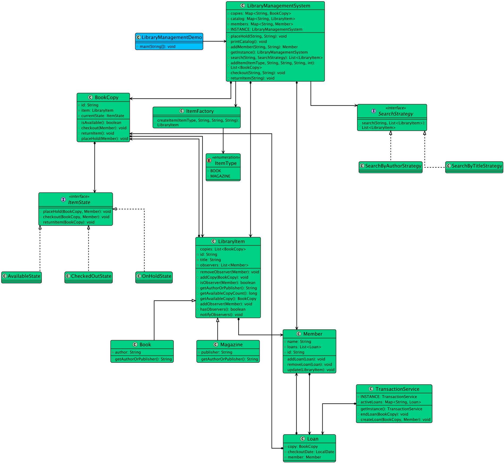

# Low-level design problem: library management system

> Copied from <https://github.com/ashishps1/awesome-low-level-design/blob/main/problems/library-management-system.md> (GPL-3.0, by Ashish Pratap Singh). Questions and answers are the source's own; nothing was answered or rewritten here.


# Designing a Library Management System

## Requirements
1. The library management system should allow librarians to manage books, members, and borrowing activities.
2. The system should support adding, updating, and removing books from the library catalog.
3. Each book should have details such as title, author, ISBN, publication year, and availability status.
4. The system should allow members to borrow and return books.
5. Each member should have details such as name, member ID, contact information, and borrowing history.
6. The system should enforce borrowing rules, such as a maximum number of books that can be borrowed at a time and loan duration.
7. The system should handle concurrent access to the library catalog and member records.
8. The system should be extensible to accommodate future enhancements and new features.

## UML Class Diagram



## Implementations
#### [Java Implementation](https://github.com/ashishps1/awesome-low-level-design/blob/main/solutions/java/src/librarymanagementsystem) 
#### [Python Implementation](https://github.com/ashishps1/awesome-low-level-design/blob/main/solutions/python/librarymanagementsystem)
#### [C++ Implementation](https://github.com/ashishps1/awesome-low-level-design/blob/main/solutions/cpp/librarymanagementsystem)
#### [C# Implementation](https://github.com/ashishps1/awesome-low-level-design/blob/main/solutions/csharp/librarymanagementsystem)
#### [Go Implementation](https://github.com/ashishps1/awesome-low-level-design/blob/main/solutions/golang/librarymanagementsystem)

## Classes, Interfaces and Enumerations
1. The **Book** class represents a book in the library catalog, with properties such as ISBN, title, author, publication year, and availability status.
2. The **Member** class represents a library member, with properties like member ID, name, contact information, and a list of borrowed books.
3. The **LibraryManager** class is the core of the library management system and follows the Singleton pattern to ensure a single instance of the library manager.
4. The LibraryManager class uses concurrent data structures (ConcurrentHashMap) to handle concurrent access to the library catalog and member records.
5. The LibraryManager class provides methods for adding and removing books, registering and unregistering members, borrowing and returning books, and searching for books based on keywords.
6. The **LibraryManagementSystemDemo** class serves as the entry point of the application and demonstrates the usage of the library management system.

---

## Official solutions from the repository

<details><summary><b>java</b> (19 files)</summary>


**LibraryManagementDemo.java**

```java
package librarymanagementsystem;

import librarymanagementsystem.enums.ItemType;
import librarymanagementsystem.models.BookCopy;
import librarymanagementsystem.models.Member;
import librarymanagementsystem.strategy.SearchByAuthorStrategy;
import librarymanagementsystem.strategy.SearchByTitleStrategy;

import java.util.List;

public class LibraryManagementDemo {
    public static void main(String[] args) {
        LibraryManagementSystem library = LibraryManagementSystem.getInstance();

        // --- Setup: Add items and members using the Facade ---
        System.out.println("=== Setting up the Library ===");

        List<BookCopy> hobbitCopies = library.addItem(ItemType.BOOK, "B001", "The Hobbit", "J.R.R. Tolkien", 2);
        List<BookCopy> duneCopies = library.addItem(ItemType.BOOK, "B002", "Dune", "Frank Herbert", 1);
        List<BookCopy> natGeoCopies = library.addItem(ItemType.MAGAZINE, "M001", "National Geographic", "NatGeo Society", 3);

        Member alice = library.addMember("MEM01", "Alice");
        Member bob = library.addMember("MEM02", "Bob");
        Member charlie = library.addMember("MEM03", "Charlie");
        library.printCatalog();

        // --- Scenario 1: Searching (Strategy Pattern) ---
        System.out.println("\n=== Scenario 1: Searching for Items ===");
        System.out.println("Searching for title 'Dune':");
        library.search("Dune", new SearchByTitleStrategy())
                .forEach(item -> System.out.println("Found: " + item.getTitle()));
        System.out.println("\nSearching for author 'Tolkien':");
        library.search("Tolkien", new SearchByAuthorStrategy())
                .forEach(item -> System.out.println("Found: " + item.getTitle()));

        // --- Scenario 2: Checkout and Return (State Pattern) ---
        System.out.println("\n\n=== Scenario 2: Checkout and Return ===");
        library.checkout(alice.getId(), hobbitCopies.get(0).getId()); // Alice checks out The Hobbit copy 1
        library.checkout(bob.getId(), duneCopies.get(0).getId()); // Bob checks out Dune copy 1
        library.printCatalog();

        System.out.println("Attempting to checkout an already checked-out book:");
        library.checkout(charlie.getId(), hobbitCopies.get(0).getId()); // Charlie fails to check out The Hobbit copy 1

        System.out.println("\nAlice returns The Hobbit:");
        library.returnItem(hobbitCopies.get(0).getId());
        library.printCatalog();

        // --- Scenario 3: Holds and Notifications (Observer Pattern) ---
        System.out.println("\n\n=== Scenario 3: Placing a Hold ===");
        System.out.println("Dune is checked out by Bob. Charlie places a hold.");
        library.placeHold(charlie.getId(), "B002"); // Charlie places a hold on Dune

        System.out.println("\nBob returns Dune. Charlie should be notified.");
        library.returnItem(duneCopies.get(0).getId()); // Bob returns Dune

        System.out.println("\nCharlie checks out the book that was on hold for him.");
        library.checkout(charlie.getId(), duneCopies.get(0).getId());

        System.out.println("\nTrying to check out the same on-hold item by another member (Alice):");
        library.checkout(alice.getId(), duneCopies.get(0).getId()); // Alice fails, it's checked out by Charlie now.

        library.printCatalog();
    }
}
```


**LibraryManagementSystem.java**

```java
package librarymanagementsystem;

import librarymanagementsystem.enums.ItemType;
import librarymanagementsystem.factory.ItemFactory;
import librarymanagementsystem.models.BookCopy;
import librarymanagementsystem.models.LibraryItem;
import librarymanagementsystem.models.Member;
import librarymanagementsystem.strategy.SearchStrategy;

import java.util.ArrayList;
import java.util.HashMap;
import java.util.List;
import java.util.Map;

public class LibraryManagementSystem {
    private static final LibraryManagementSystem INSTANCE = new LibraryManagementSystem();
    private final Map<String, LibraryItem> catalog = new HashMap<>();
    private final Map<String, Member> members = new HashMap<>();
    private final Map<String, BookCopy> copies = new HashMap<>();

    private LibraryManagementSystem() {}
    public static LibraryManagementSystem getInstance() { return INSTANCE; }

    // --- Item Management ---
    public List<BookCopy> addItem(ItemType type, String id, String title, String author, int numCopies) {
        List<BookCopy> bookCopies = new ArrayList<>();
        LibraryItem item = ItemFactory.createItem(type, id, title, author);
        catalog.put(id, item);
        for (int i = 0; i < numCopies; i++) {
            String copyId = id + "-c" + (i + 1);
            BookCopy copy = new BookCopy(copyId, item);
            copies.put(copyId, new BookCopy(copyId, item));
            bookCopies.add(copy);
        }
        System.out.println("Added " + numCopies + " copies of '" + title + "'");
        return bookCopies;
    }

    // --- User Management ---
    public Member addMember(String id, String name) {
        Member member = new Member(id, name);
        members.put(id, member);
        return member;
    }

    // --- Core Actions ---
    public void checkout(String memberId, String copyId) {
        Member member = members.get(memberId);
        BookCopy copy = copies.get(copyId);
        if (member != null && copy != null) {
            copy.checkout(member);
        } else {
            System.out.println("Error: Invalid member or copy ID.");
        }
    }

    public void returnItem(String copyId) {
        BookCopy copy = copies.get(copyId);
        if (copy != null) {
            copy.returnItem();
        } else {
            System.out.println("Error: Invalid copy ID.");
        }
    }

    public void placeHold(String memberId, String itemId) {
        Member member = members.get(memberId);
        LibraryItem item = catalog.get(itemId);
        if (member != null && item != null) {
            // Place hold on any copy that is checked out
            item.getCopies().stream()
                    .filter(c -> !c.isAvailable())
                    .findFirst()
                    .ifPresent(copy -> copy.placeHold(member));
        }
    }

    // --- Search (Using Strategy Pattern) ---
    public List<LibraryItem> search(String query, SearchStrategy strategy) {
        return strategy.search(query, new ArrayList<>(catalog.values()));
    }

    public void printCatalog() {
        System.out.println("\n--- Library Catalog ---");
        catalog.values().forEach(item -> System.out.printf("ID: %s, Title: %s, Author/Publisher: %s, Available: %d\n",
                item.getId(), item.getTitle(), item.getAuthorOrPublisher(), item.getAvailableCopyCount()));
        System.out.println("-----------------------\n");
    }
}
```


**README.md**

```md
# Library Management System (LLD)

## Problem Statement

Design and implement a Library Management System that allows members to borrow and return books, manages book inventory, tracks loans, and supports catalog search.

---

## Requirements

- **Book Management:** The system manages a catalog of books, each with multiple copies.
- **Member Management:** The system manages library members who can borrow and return books.
- **Loan Management:** The system tracks which member has borrowed which book copy and when.
- **Borrowing and Returning:** Members can borrow available book copies and return them.
- **Catalog Search:** Members can search for books by title, author, or ISBN.
- **Extensibility:** Easy to add new features such as reservations, fines, or notifications.

---

## Core Entities

- **LibraryManagementSystem:** Main class that manages books, members, loans, and the catalog.
- **Book:** Represents a book with title, author, ISBN, and other metadata.
- **BookCopy:** Represents a physical copy of a book, with a unique copy ID and availability status.
- **Member:** Represents a library member with a unique ID and name.
- **Loan:** Represents a loan record for a book copy borrowed by a member.
- **Catalog:** Manages the collection of books and supports search functionality.

---

## Class Design

## UML Class Diagram


### 1. LibraryManagementSystem
- **Fields:** List<Book> books, List<Member> members, List<Loan> loans, Catalog catalog
- **Methods:** addBook(Book), addMember(Member), borrowBook(Member, Book), returnBook(Member, BookCopy), getLoans(Member), searchBooks(String query), etc.

### 2. Book
- **Fields:** String title, String author, String isbn, List<BookCopy> copies

### 3. BookCopy
- **Fields:** int copyId, Book book, boolean isAvailable

### 4. Member
- **Fields:** int id, String name, List<Loan> loans

### 5. Loan
- **Fields:** int id, Member member, BookCopy bookCopy, Date loanDate, Date returnDate

### 6. Catalog
- **Fields:** List<Book> books
- **Methods:** searchByTitle(String), searchByAuthor(String), searchByISBN(String)

---

## Example Usage

```java
LibraryManagementSystem system = new LibraryManagementSystem();
Book book = new Book("Effective Java", "Joshua Bloch", "978-0134685991");
system.addBook(book);

Member alice = new Member(1, "Alice");
system.addMember(alice);

system.borrowBook(alice, book);
system.returnBook(alice, book.getCopies().get(0));
```

---

## Demo

See `LibraryManagementSystemDemo.java` for a sample usage and simulation of the library management system.

---

## Extending the Framework

- **Add reservations:** Allow members to reserve books that are currently checked out.
- **Add fines:** Track overdue books and calculate fines.
- **Add notifications:** Notify members about due dates, reservations, or new arrivals.

---
```


**TransactionService.java**

```java
package librarymanagementsystem;

import librarymanagementsystem.models.BookCopy;
import librarymanagementsystem.models.Loan;
import librarymanagementsystem.models.Member;

import java.util.HashMap;
import java.util.Map;

public class TransactionService {
    private static final TransactionService INSTANCE = new TransactionService();
    private final Map<String, Loan> activeLoans = new HashMap<>(); // Key: BookCopy ID

    private TransactionService() {}
    public static TransactionService getInstance() { return INSTANCE; }

    public void createLoan(BookCopy copy, Member member) {
        if (activeLoans.containsKey(copy.getId())) {
            throw new IllegalStateException("This copy is already on loan.");
        }
        Loan loan = new Loan(copy, member);
        activeLoans.put(copy.getId(), loan);
        member.addLoan(loan);
    }

    public void endLoan(BookCopy copy) {
        Loan loan = activeLoans.remove(copy.getId());
        if (loan != null) {
            loan.getMember().removeLoan(loan);
        }
    }
}
```


**enums/ItemType.java**

```java
package librarymanagementsystem.enums;

public enum ItemType {
    BOOK,
    MAGAZINE
}
```


**factory/ItemFactory.java**

```java
package librarymanagementsystem.factory;

import librarymanagementsystem.enums.ItemType;
import librarymanagementsystem.models.Book;
import librarymanagementsystem.models.LibraryItem;
import librarymanagementsystem.models.Magazine;

public class ItemFactory {
    public static LibraryItem createItem(ItemType type, String id, String title, String author) {
        switch (type) {
            case BOOK: return new Book(id, title, author);
            case MAGAZINE: return new Magazine(id, title, author); // Author might be publisher here
            default: throw new IllegalArgumentException("Unknown item type.");
        }
    }
}
```


**models/Book.java**

```java
package librarymanagementsystem.models;

public class Book extends LibraryItem {
    private final String author;

    public Book(String id, String title, String author) {
        super(id, title);
        this.author = author;
    }

    @Override
    public String getAuthorOrPublisher() { return author; }
}
```


**models/BookCopy.java**

```java
package librarymanagementsystem.models;


import librarymanagementsystem.state.AvailableState;
import librarymanagementsystem.state.ItemState;

public class BookCopy {
    private final String id;
    private final LibraryItem item;
    private ItemState currentState;

    public BookCopy(String id, LibraryItem item) {
        this.id = id;
        this.item = item;
        this.currentState = new AvailableState();
        item.addCopy(this);
    }

    public void checkout(Member member) { currentState.checkout(this, member); }
    public void returnItem() { currentState.returnItem(this); }
    public void placeHold(Member member) { currentState.placeHold(this, member); }

    public void setState(ItemState state) { this.currentState = state; }
    public String getId() { return id; }
    public LibraryItem getItem() { return item; }
    public boolean isAvailable() { return currentState instanceof AvailableState; }
}
```


**models/LibraryItem.java**

```java
package librarymanagementsystem.models;

import java.util.ArrayList;
import java.util.List;

public abstract class LibraryItem {
    private final String id;
    private final String title;
    protected final List<BookCopy> copies = new ArrayList<>();
    // Observer Pattern: List of members waiting for this item
    private final List<Member> observers = new ArrayList<>();

    public LibraryItem(String id, String title) {
        this.id = id;
        this.title = title;
    }

    public void addCopy(BookCopy copy) { this.copies.add(copy); }
    public void addObserver(Member member) { observers.add(member); }
    public void removeObserver(Member member) { observers.remove(member); }

    public void notifyObservers() {
        System.out.println("Notifying " + observers.size() + " observers for '" + title + "'...");
        // Use a copy to avoid ConcurrentModificationException if observer unsubscribes
        new ArrayList<>(observers).forEach(observer -> observer.update(this));
    }

    public BookCopy getAvailableCopy() {
        return copies.stream()
                .filter(BookCopy::isAvailable)
                .findFirst()
                .orElse(null);
    }

    // Getters
    public String getId() { return id; }
    public String getTitle() { return title; }

    public List<BookCopy> getCopies() {
        return copies;
    }

    public abstract String getAuthorOrPublisher();
    public long getAvailableCopyCount() {
        return copies.stream().filter(BookCopy::isAvailable).count();
    }

    public boolean hasObservers() { return !observers.isEmpty(); }
    public boolean isObserver(Member member) { return observers.contains(member); }
}
```


**models/Loan.java**

```java
package librarymanagementsystem.models;

import java.time.LocalDate;

public class Loan {
    private final BookCopy copy;
    private final Member member;
    private final LocalDate checkoutDate;

    public Loan(BookCopy copy, Member member) {
        this.copy = copy;
        this.member = member;
        this.checkoutDate = LocalDate.now();
    }

    public BookCopy getCopy() { return copy; }
    public Member getMember() { return member; }
}
```


**models/Magazine.java**

```java
package librarymanagementsystem.models;

public class Magazine extends LibraryItem {
    private final String publisher;

    public Magazine(String id, String title, String publisher) {
        super(id, title);
        this.publisher = publisher;
    }

    @Override
    public String getAuthorOrPublisher() { return publisher; }
}
```


**models/Member.java**

```java
package librarymanagementsystem.models;

import java.util.ArrayList;
import java.util.List;

public class Member {
    private final String id;
    private final String name;
    private final List<Loan> loans = new ArrayList<>();

    public Member(String id, String name) {
        this.id = id;
        this.name = name;
    }

    // Observer update method
    public void update(LibraryItem item) {
        System.out.println("NOTIFICATION for " + name + ": The book '" + item.getTitle() + "' you placed a hold on is now available!");
    }

    public void addLoan(Loan loan) { loans.add(loan); }
    public void removeLoan(Loan loan) { loans.remove(loan); }
    public String getId() { return id; }
    public String getName() { return name; }
    public List<Loan> getLoans() { return loans; }
}
```


**state/AvailableState.java**

```java
package librarymanagementsystem.state;

import librarymanagementsystem.models.BookCopy;
import librarymanagementsystem.models.Member;
import librarymanagementsystem.TransactionService;

public class AvailableState implements ItemState {
    @Override
    public void checkout(BookCopy copy, Member member) {
        TransactionService.getInstance().createLoan(copy, member);
        copy.setState(new CheckedOutState());
        System.out.println(copy.getId() + " checked out by " + member.getName());
    }

    @Override
    public void returnItem(BookCopy c) {
        System.out.println("Cannot return an item that is already available.");
    }

    @Override
    public void placeHold(BookCopy c, Member m) {
        System.out.println("Cannot place hold on an available item. Please check it out.");
    }
}
```


**state/CheckedOutState.java**

```java
package librarymanagementsystem.state;

import librarymanagementsystem.models.BookCopy;
import librarymanagementsystem.models.Member;
import librarymanagementsystem.TransactionService;

public class CheckedOutState implements ItemState {
    @Override public void checkout(BookCopy c, Member m) { System.out.println(c.getId() + " is already checked out."); }

    @Override
    public void returnItem(BookCopy copy) {
        TransactionService.getInstance().endLoan(copy);
        System.out.println(copy.getId() + " returned.");
        // If there are holds, move to OnHold state. Otherwise, become Available.
        if (copy.getItem().hasObservers()) {
            copy.setState(new OnHoldState());
            copy.getItem().notifyObservers(); // Notify members that item is back but on hold
        } else {
            copy.setState(new AvailableState());
        }
    }

    @Override
    public void placeHold(BookCopy copy, Member member) {
        copy.getItem().addObserver(member);
        System.out.println(member.getName() + " placed a hold on '" + copy.getItem().getTitle() + "'");
    }
}
```


**state/ItemState.java**

```java
package librarymanagementsystem.state;

import librarymanagementsystem.models.BookCopy;
import librarymanagementsystem.models.Member;

public interface ItemState {
    void checkout(BookCopy copy, Member member);
    void returnItem(BookCopy copy);
    void placeHold(BookCopy copy, Member member);
}
```


**state/OnHoldState.java**

```java
package librarymanagementsystem.state;

import librarymanagementsystem.models.BookCopy;
import librarymanagementsystem.models.Member;
import librarymanagementsystem.TransactionService;

public class OnHoldState implements ItemState {
    @Override
    public void checkout(BookCopy copy, Member member) {
        // Only a member who placed the hold can check it out.
        if (copy.getItem().isObserver(member)) {
            TransactionService.getInstance().createLoan(copy, member);
            copy.getItem().removeObserver(member); // Remove from waiting list
            copy.setState(new CheckedOutState());
            System.out.println("Hold fulfilled. " + copy.getId() + " checked out by " + member.getName());
        } else {
            System.out.println("This item is on hold for another member.");
        }
    }

    @Override
    public void returnItem(BookCopy c) {
        System.out.println("Invalid action. Item is on hold, not checked out.");
    }

    @Override
    public void placeHold(BookCopy c, Member m) {
        System.out.println("Item is already on hold.");
    }
}
```


**strategy/SearchByAuthorStrategy.java**

```java
package librarymanagementsystem.strategy;

import librarymanagementsystem.models.LibraryItem;

import java.util.ArrayList;
import java.util.List;

public class SearchByAuthorStrategy implements SearchStrategy {
    @Override
    public List<LibraryItem> search(String query, List<LibraryItem> items) {
        List<LibraryItem> result = new ArrayList<>();
        items.stream()
                .filter(item -> item.getAuthorOrPublisher().toLowerCase().contains(query.toLowerCase()))
                .forEach(result::add);
        return result;
    }
}
```


**strategy/SearchByTitleStrategy.java**

```java
package librarymanagementsystem.strategy;

import librarymanagementsystem.models.LibraryItem;

import java.util.ArrayList;
import java.util.List;

public class SearchByTitleStrategy implements SearchStrategy {
    @Override
    public List<LibraryItem> search(String query, List<LibraryItem> items) {
        List<LibraryItem> result = new ArrayList<>();
        items.stream()
                .filter(item -> item.getTitle().toLowerCase().contains(query.toLowerCase()))
                .forEach(result::add);
        return result;
    }
}
```


**strategy/SearchStrategy.java**

```java
package librarymanagementsystem.strategy;

import librarymanagementsystem.models.LibraryItem;

import java.util.List;

public interface SearchStrategy {
    List<LibraryItem> search(String query, List<LibraryItem> items);
}
```

</details>

<details><summary><b>python</b> (14 files)</summary>


**README.md**

```md
# Designing a Library Management System

## Requirements
1. The library management system should allow librarians to manage books, members, and borrowing activities.
2. The system should support adding, updating, and removing books from the library catalog.
3. Each book should have details such as title, author, ISBN, publication year, and availability status.
4. The system should allow members to borrow and return books.
5. Each member should have details such as name, member ID, contact information, and borrowing history.
6. The system should enforce borrowing rules, such as a maximum number of books that can be borrowed at a time and loan duration.
7. The system should handle concurrent access to the library catalog and member records.
8. The system should be extensible to accommodate future enhancements and new features.

## Classes, Interfaces and Enumerations
1. The **Book** class represents a book in the library catalog, with properties such as ISBN, title, author, publication year, and availability status.
2. The **Member** class represents a library member, with properties like member ID, name, contact information, and a list of borrowed books.
3. The **LibraryManager** class is the core of the library management system and follows the Singleton pattern to ensure a single instance of the library manager.
4. The LibraryManager class uses concurrent data structures (ConcurrentHashMap) to handle concurrent access to the library catalog and member records.
5. The LibraryManager class provides methods for adding and removing books, registering and unregistering members, borrowing and returning books, and searching for books based on keywords.
6. The **LibraryManagementSystemDemo** class serves as the entry point of the application and demonstrates the usage of the library management system.
```


**book.py**

```py
from library_item import LibraryItem

class Book(LibraryItem):
    def __init__(self, item_id: str, title: str, author: str):
        super().__init__(item_id, title)
        self.author = author

    def get_author_or_publisher(self) -> str:
        return self.author
```


**book_copy.py**

```py
from typing import TYPE_CHECKING
from item_states import AvailableState

if TYPE_CHECKING:
    from member import Member
    from library_item import LibraryItem
    from item_states import ItemState

class BookCopy:
    def __init__(self, copy_id: str, item: 'LibraryItem'):
        self.id = copy_id
        self.item = item
        self.current_state: 'ItemState' = AvailableState()
        item.add_copy(self)

    def checkout(self, member: 'Member') -> None:
        self.current_state.checkout(self, member)

    def return_item(self) -> None:
        self.current_state.return_item(self)

    def place_hold(self, member: 'Member') -> None:
        self.current_state.place_hold(self, member)

    def set_state(self, state: 'ItemState') -> None:
        self.current_state = state

    def get_id(self) -> str:
        return self.id

    def get_item(self) -> 'LibraryItem':
        return self.item

    def is_available(self) -> bool:
        return isinstance(self.current_state, AvailableState)
```


**item_factory.py**

```py
from item_type import ItemType
from book import Book
from magazine import Magazine
from library_item import LibraryItem

class ItemFactory:
    @staticmethod
    def create_item(item_type: ItemType, item_id: str, title: str, author: str) -> LibraryItem:
        if item_type == ItemType.BOOK:
            return Book(item_id, title, author)
        elif item_type == ItemType.MAGAZINE:
            return Magazine(item_id, title, author)  # Author might be publisher here
        else:
            raise ValueError("Unknown item type")
```


**item_states.py**

```py
from abc import ABC, abstractmethod
from transaction_service import TransactionService
from typing import TYPE_CHECKING

if TYPE_CHECKING:
    from book_copy import BookCopy
    from member import Member

class ItemState(ABC):
    @abstractmethod
    def checkout(self, book_copy: 'BookCopy', member: 'Member') -> None:
        pass

    @abstractmethod
    def return_item(self, book_copy: 'BookCopy') -> None:
        pass

    @abstractmethod
    def place_hold(self, book_copy: 'BookCopy', member: 'Member') -> None:
        pass


class AvailableState(ItemState):
    def checkout(self, book_copy: 'BookCopy', member: 'Member') -> None:
        TransactionService.get_instance().create_loan(book_copy, member)
        book_copy.set_state(CheckedOutState())
        print(f"{book_copy.get_id()} checked out by {member.get_name()}")

    def return_item(self, book_copy: 'BookCopy') -> None:
        print("Cannot return an item that is already available.")

    def place_hold(self, book_copy: 'BookCopy', member: 'Member') -> None:
        print("Cannot place hold on an available item. Please check it out.")


class CheckedOutState(ItemState):
    def checkout(self, book_copy: 'BookCopy', member: 'Member') -> None:
        print(f"{book_copy.get_id()} is already checked out.")

    def return_item(self, book_copy: 'BookCopy') -> None:
        TransactionService.get_instance().end_loan(book_copy)
        print(f"{book_copy.get_id()} returned.")
        
        # If there are holds, move to OnHold state. Otherwise, become Available.
        if book_copy.get_item().has_observers():
            book_copy.set_state(OnHoldState())
            book_copy.get_item().notify_observers()  # Notify members that item is back but on hold
        else:
            book_copy.set_state(AvailableState())

    def place_hold(self, book_copy: 'BookCopy', member: 'Member') -> None:
        book_copy.get_item().add_observer(member)
        print(f"{member.get_name()} placed a hold on '{book_copy.get_item().get_title()}'")


class OnHoldState(ItemState):
    def checkout(self, book_copy: 'BookCopy', member: 'Member') -> None:
        # Only a member who placed the hold can check it out.
        if book_copy.get_item().is_observer(member):
            TransactionService.get_instance().create_loan(book_copy, member)
            book_copy.get_item().remove_observer(member)  # Remove from waiting list
            book_copy.set_state(CheckedOutState())
            print(f"Hold fulfilled. {book_copy.get_id()} checked out by {member.get_name()}")
        else:
            print("This item is on hold for another member.")

    def return_item(self, book_copy: 'BookCopy') -> None:
        print("Invalid action. Item is on hold, not checked out.")

    def place_hold(self, book_copy: 'BookCopy', member: 'Member') -> None:
        print("Item is already on hold.")
```


**item_type.py**

```py
from enum import Enum

class ItemType(Enum):
    BOOK = "BOOK"
    MAGAZINE = "MAGAZINE"
```


**library_item.py**

```py
from abc import ABC, abstractmethod
from typing import List, Optional
from member import Member
from book_copy import BookCopy

class LibraryItem(ABC):
    def __init__(self, item_id: str, title: str):
        self.id = item_id
        self.title = title
        self.copies: List['BookCopy'] = []
        self.observers: List[Member] = []  # Observer Pattern: List of members waiting for this item

    def add_copy(self, book_copy: 'BookCopy') -> None:
        self.copies.append(book_copy)

    def add_observer(self, member: Member) -> None:
        self.observers.append(member)

    def remove_observer(self, member: Member) -> None:
        if member in self.observers:
            self.observers.remove(member)

    def notify_observers(self) -> None:
        print(f"Notifying {len(self.observers)} observers for '{self.title}'...")
        # Use a copy to avoid modification during iteration
        for observer in self.observers.copy():
            observer.update(self)

    def get_available_copy(self) -> Optional['BookCopy']:
        for book_copy in self.copies:
            if book_copy.is_available():
                return book_copy
        return None

    def get_id(self) -> str:
        return self.id

    def get_title(self) -> str:
        return self.title

    def get_copies(self) -> List['BookCopy']:
        return self.copies

    @abstractmethod
    def get_author_or_publisher(self) -> str:
        pass

    def get_available_copy_count(self) -> int:
        return sum(1 for book_copy in self.copies if book_copy.is_available())

    def has_observers(self) -> bool:
        return len(self.observers) > 0

    def is_observer(self, member: Member) -> bool:
        return member in self.observers
```


**library_management_system.py**

```py
from typing import Dict, List, Optional
from library_item import LibraryItem
from member import Member
from book_copy import BookCopy
from item_type import ItemType
from item_factory import ItemFactory
from search_strategy import SearchStrategy

class LibraryManagementSystem:
    _instance: Optional['LibraryManagementSystem'] = None

    def __init__(self):
        if LibraryManagementSystem._instance is not None:
            raise Exception("This class is a singleton!")
        self.catalog: Dict[str, LibraryItem] = {}
        self.members: Dict[str, Member] = {}
        self.copies: Dict[str, BookCopy] = {}

    @staticmethod
    def get_instance() -> 'LibraryManagementSystem':
        if LibraryManagementSystem._instance is None:
            LibraryManagementSystem._instance = LibraryManagementSystem()
        return LibraryManagementSystem._instance

    def add_item(self, item_type: ItemType, item_id: str, title: str, author: str, num_copies: int) -> List[BookCopy]:
        book_copies = []
        item = ItemFactory.create_item(item_type, item_id, title, author)
        self.catalog[item_id] = item
        
        for i in range(num_copies):
            copy_id = f"{item_id}-c{i + 1}"
            book_copy = BookCopy(copy_id, item)
            self.copies[copy_id] = book_copy
            book_copies.append(book_copy)
        
        print(f"Added {num_copies} copies of '{title}'")
        return book_copies

    def add_member(self, member_id: str, name: str) -> Member:
        member = Member(member_id, name)
        self.members[member_id] = member
        return member

    def checkout(self, member_id: str, copy_id: str) -> None:
        member = self.members.get(member_id)
        book_copy = self.copies.get(copy_id)
        
        if member is not None and book_copy is not None:
            book_copy.checkout(member)
        else:
            print("Error: Invalid member or copy ID.")

    def return_item(self, copy_id: str) -> None:
        book_copy = self.copies.get(copy_id)
        if book_copy is not None:
            book_copy.return_item()
        else:
            print("Error: Invalid copy ID.")

    def place_hold(self, member_id: str, item_id: str) -> None:
        member = self.members.get(member_id)
        item = self.catalog.get(item_id)
        
        if member is not None and item is not None:
            # Place hold on any copy that is checked out
            for book_copy in item.get_copies():
                if not book_copy.is_available():
                    book_copy.place_hold(member)
                    break

    def search(self, query: str, strategy: SearchStrategy) -> List[LibraryItem]:
        return strategy.search(query, list(self.catalog.values()))

    def print_catalog(self) -> None:
        print("\n--- Library Catalog ---")
        for item in self.catalog.values():
            print(f"ID: {item.get_id()}, Title: {item.get_title()}, "
                  f"Author/Publisher: {item.get_author_or_publisher()}, "
                  f"Available: {item.get_available_copy_count()}")
        print("-----------------------\n")
```


**library_management_system_demo.py**

```py
from library_management_system import LibraryManagementSystem
from item_type import ItemType
from search_strategy import SearchByTitleStrategy, SearchByAuthorStrategy

class LibraryManagementDemo:
    @staticmethod
    def main():
        library = LibraryManagementSystem.get_instance()

        # === Setup: Add items and members using the Facade ===
        print("=== Setting up the Library ===")

        hobbit_copies = library.add_item(ItemType.BOOK, "B001", "The Hobbit", "J.R.R. Tolkien", 2)
        dune_copies = library.add_item(ItemType.BOOK, "B002", "Dune", "Frank Herbert", 1)
        nat_geo_copies = library.add_item(ItemType.MAGAZINE, "M001", "National Geographic", "NatGeo Society", 3)

        alice = library.add_member("MEM01", "Alice")
        bob = library.add_member("MEM02", "Bob")
        charlie = library.add_member("MEM03", "Charlie")
        library.print_catalog()

        # === Scenario 1: Searching (Strategy Pattern) ===
        print("\n=== Scenario 1: Searching for Items ===")
        print("Searching for title 'Dune':")
        for item in library.search("Dune", SearchByTitleStrategy()):
            print(f"Found: {item.get_title()}")
        
        print("\nSearching for author 'Tolkien':")
        for item in library.search("Tolkien", SearchByAuthorStrategy()):
            print(f"Found: {item.get_title()}")

        # === Scenario 2: Checkout and Return (State Pattern) ===
        print("\n\n=== Scenario 2: Checkout and Return ===")
        library.checkout(alice.get_id(), hobbit_copies[0].get_id())  # Alice checks out The Hobbit copy 1
        library.checkout(bob.get_id(), dune_copies[0].get_id())     # Bob checks out Dune copy 1
        library.print_catalog()

        print("Attempting to checkout an already checked-out book:")
        library.checkout(charlie.get_id(), hobbit_copies[0].get_id())  # Charlie fails to check out The Hobbit copy 1

        print("\nAlice returns The Hobbit:")
        library.return_item(hobbit_copies[0].get_id())
        library.print_catalog()

        # === Scenario 3: Holds and Notifications (Observer Pattern) ===
        print("\n\n=== Scenario 3: Placing a Hold ===")
        print("Dune is checked out by Bob. Charlie places a hold.")
        library.place_hold(charlie.get_id(), "B002")  # Charlie places a hold on Dune

        print("\nBob returns Dune. Charlie should be notified.")
        library.return_item(dune_copies[0].get_id())  # Bob returns Dune

        print("\nCharlie checks out the book that was on hold for him.")
        library.checkout(charlie.get_id(), dune_copies[0].get_id())

        print("\nTrying to check out the same on-hold item by another member (Alice):")
        library.checkout(alice.get_id(), dune_copies[0].get_id())  # Alice fails, it's checked out by Charlie now.

        library.print_catalog()


if __name__ == "__main__":
    LibraryManagementDemo.main()
```


**loan.py**

```py
from datetime import date
from typing import TYPE_CHECKING

if TYPE_CHECKING:
    from book_copy import BookCopy
    from member import Member

class Loan:
    def __init__(self, book_copy: 'BookCopy', member: 'Member'):
        self.copy = book_copy
        self.member = member
        self.checkout_date = date.today()

    def get_copy(self) -> 'BookCopy':
        return self.copy

    def get_member(self) -> 'Member':
        return self.member
```


**magazine.py**

```py
from library_item import LibraryItem

class Magazine(LibraryItem):
    def __init__(self, item_id: str, title: str, publisher: str):
        super().__init__(item_id, title)
        self.publisher = publisher

    def get_author_or_publisher(self) -> str:
        return self.publisher
```


**member.py**

```py
from typing import List
from loan import Loan
from typing import TYPE_CHECKING

if TYPE_CHECKING:
    from library_item import LibraryItem
    from loan import Loan

class Member:
    def __init__(self, member_id: str, name: str):
        self.id = member_id
        self.name = name
        self.loans: List['Loan'] = []

    def update(self, item: 'LibraryItem') -> None:
        """Observer update method"""
        print(f"NOTIFICATION for {self.name}: The book '{item.get_title()}' you placed a hold on is now available!")

    def add_loan(self, loan: 'Loan') -> None:
        self.loans.append(loan)

    def remove_loan(self, loan: 'Loan') -> None:
        if loan in self.loans:
            self.loans.remove(loan)

    def get_id(self) -> str:
        return self.id

    def get_name(self) -> str:
        return self.name

    def get_loans(self) -> List['Loan']:
        return self.loans
```


**search_strategy.py**

```py
from abc import ABC, abstractmethod
from typing import List
from library_item import LibraryItem

class SearchStrategy(ABC):
    @abstractmethod
    def search(self, query: str, items: List[LibraryItem]) -> List[LibraryItem]:
        pass

class SearchByTitleStrategy(SearchStrategy):
    def search(self, query: str, items: List[LibraryItem]) -> List[LibraryItem]:
        return [item for item in items if query.lower() in item.get_title().lower()]

class SearchByAuthorStrategy(SearchStrategy):
    def search(self, query: str, items: List[LibraryItem]) -> List[LibraryItem]:
        return [item for item in items if query.lower() in item.get_author_or_publisher().lower()]
```


**transaction_service.py**

```py
from typing import Dict, Optional, TYPE_CHECKING
from loan import Loan

if TYPE_CHECKING:
    from book_copy import BookCopy
    from member import Member

class TransactionService:
    _instance: Optional['TransactionService'] = None

    def __init__(self):
        if TransactionService._instance is not None:
            raise Exception("This class is a singleton!")
        self.active_loans: Dict[str, Loan] = {}  # Key: BookCopy ID

    @staticmethod
    def get_instance() -> 'TransactionService':
        if TransactionService._instance is None:
            TransactionService._instance = TransactionService()
        return TransactionService._instance

    def create_loan(self, book_copy: 'BookCopy', member: 'Member') -> None:
        if book_copy.get_id() in self.active_loans:
            raise ValueError("This copy is already on loan.")
        
        loan = Loan(book_copy, member)
        self.active_loans[book_copy.get_id()] = loan
        member.add_loan(loan)

    def end_loan(self, book_copy: 'BookCopy') -> None:
        loan = self.active_loans.pop(book_copy.get_id(), None)
        if loan is not None:
            loan.get_member().remove_loan(loan)
```

</details>

<details><summary><b>cpp</b> (10 files)</summary>


**Book.cpp**

```cpp
#include "Book.hpp"
#include <iostream>

Book::Book(std::string bookId, std::string title, std::string author,
           std::string publisher, std::string isbn, int publicationYear)
    : bookId(bookId), title(title), author(author), publisher(publisher),
      isbn(isbn), status(BookStatus::AVAILABLE), publicationYear(publicationYear) {}

std::string Book::getBookId() const { return bookId; }
std::string Book::getTitle() const { return title; }
std::string Book::getAuthor() const { return author; }
std::string Book::getPublisher() const { return publisher; }
std::string Book::getIsbn() const { return isbn; }
BookStatus Book::getStatus() const { return status; }
int Book::getPublicationYear() const { return publicationYear; }

void Book::setStatus(BookStatus status) {
    this->status = status;
}

void Book::displayInfo() const {
    std::cout << "Book: " << title << " (ID: " << bookId << ")" << std::endl;
    std::cout << "Author: " << author << std::endl;
    std::cout << "Publisher: " << publisher << std::endl;
    std::cout << "ISBN: " << isbn << std::endl;
    std::cout << "Publication Year: " << publicationYear << std::endl;
    std::cout << "Status: ";
    switch (status) {
        case BookStatus::AVAILABLE: std::cout << "Available"; break;
        case BookStatus::BORROWED: std::cout << "Borrowed"; break;
        case BookStatus::RESERVED: std::cout << "Reserved"; break;
        case BookStatus::LOST: std::cout << "Lost"; break;
    }
    std::cout << std::endl;
}
```


**Book.hpp**

```hpp
#ifndef BOOK_HPP
#define BOOK_HPP

#include <string>

enum class BookStatus {
    AVAILABLE,
    BORROWED,
    RESERVED,
    LOST
};

class Book {
private:
    std::string bookId;
    std::string title;
    std::string author;
    std::string publisher;
    std::string isbn;
    BookStatus status;
    int publicationYear;

public:
    Book(std::string bookId, std::string title, std::string author,
         std::string publisher, std::string isbn, int publicationYear);
    
    std::string getBookId() const;
    std::string getTitle() const;
    std::string getAuthor() const;
    std::string getPublisher() const;
    std::string getIsbn() const;
    BookStatus getStatus() const;
    int getPublicationYear() const;
    
    void setStatus(BookStatus status);
    void displayInfo() const;
};

#endif
```


**LibraryDemo.cpp**

```cpp
#include "LibraryManager.hpp"
#include <iostream>

int main() {
    LibraryManager library;
    
    // Add books
    Book* book1 = new Book("B001", "The Great Gatsby", "F. Scott Fitzgerald",
                          "Scribner", "978-0743273565", 1925);
    Book* book2 = new Book("B002", "To Kill a Mockingbird", "Harper Lee",
                          "HarperCollins", "978-0446310789", 1960);
    
    library.addBook(book1);
    library.addBook(book2);
    
    // Add members
    Member* member1 = new Member("M001", "John Doe", "john@example.com",
                               "+1-555-0123");
    library.addMember(member1);
    
    // Display available books
    library.displayAvailableBooks();
    
    // Borrow a book
    if (library.borrowBook("M001", "B001", "2024-01-01", "2024-01-15")) {
        std::cout << "\nBook borrowed successfully!" << std::endl;
    }
    
    // Display member's books
    library.displayMemberBooks("M001");
    
    // Return the book
    if (library.returnBook("M001", "B001", "2024-01-10")) {
        std::cout << "\nBook returned successfully!" << std::endl;
    }
    
    // Display transaction history
    library.displayTransactionHistory();
    
    return 0;
}
```


**LibraryManager.cpp**

```cpp
#include "LibraryManager.hpp"
#include <iostream>

LibraryManager::LibraryManager() : transactionIdCounter(1) {}

LibraryManager::~LibraryManager() {
    for (auto book : books) delete book;
    for (auto member : members) delete member;
    for (auto transaction : transactions) delete transaction;
}

void LibraryManager::addBook(Book* book) {
    books.push_back(book);
}

void LibraryManager::addMember(Member* member) {
    members.push_back(member);
}

bool LibraryManager::borrowBook(std::string memberId, std::string bookId,
                              std::string issueDate, std::string dueDate) {
    Member* member = findMember(memberId);
    Book* book = findBook(bookId);
    
    if (!member || !member->isActive() || !book || 
        book->getStatus() != BookStatus::AVAILABLE) {
        return false;
    }
    
    Transaction* transaction = new Transaction(
        generateTransactionId(),
        book,
        member,
        TransactionType::BORROW,
        issueDate,
        dueDate
    );
    
    transactions.push_back(transaction);
    book->setStatus(BookStatus::BORROWED);
    member->addBorrowedBook(book);
    return true;
}

bool LibraryManager::returnBook(std::string memberId, std::string bookId,
                              std::string returnDate) {
    Member* member = findMember(memberId);
    Book* book = findBook(bookId);
    Transaction* transaction = findTransaction(bookId, memberId);
    
    if (!member || !book || !transaction || 
        book->getStatus() != BookStatus::BORROWED) {
        return false;
    }
    
    transaction->setReturnDate(returnDate);
    book->setStatus(BookStatus::AVAILABLE);
    member->removeBorrowedBook(book);
    
    // Create return transaction
    Transaction* returnTrans = new Transaction(
        generateTransactionId(),
        book,
        member,
        TransactionType::RETURN,
        returnDate,
        returnDate
    );
    transactions.push_back(returnTrans);
    
    return true;
}

bool LibraryManager::reserveBook(std::string memberId, std::string bookId) {
    Member* member = findMember(memberId);
    Book* book = findBook(bookId);
    
    if (!member || !member->isActive() || !book || 
        book->getStatus() != BookStatus::AVAILABLE) {
        return false;
    }
    
    book->setStatus(BookStatus::RESERVED);
    Transaction* transaction = new Transaction(
        generateTransactionId(),
        book,
        member,
        TransactionType::RESERVE,
        "NOW",  // Should use actual datetime
        "NOW"   // Should use actual datetime
    );
    transactions.push_back(transaction);
    return true;
}

bool LibraryManager::renewBook(std::string memberId, std::string bookId,
                             std::string newDueDate) {
    Member* member = findMember(memberId);
    Book* book = findBook(bookId);
    Transaction* transaction = findTransaction(bookId, memberId);
    
    if (!member || !book || !transaction || 
        book->getStatus() != BookStatus::BORROWED) {
        return false;
    }
    
    Transaction* renewTrans = new Transaction(
        generateTransactionId(),
        book,
        member,
        TransactionType::RENEW,
        transaction->getDueDate(),
        newDueDate
    );
    transactions.push_back(renewTrans);
    return true;
}

void LibraryManager::displayAvailableBooks() const {
    std::cout << "\nAvailable Books:" << std::endl;
    for (const auto& book : books) {
        if (book->getStatus() == BookStatus::AVAILABLE) {
            book->displayInfo();
            std::cout << "------------------------" << std::endl;
        }
    }
}

void LibraryManager::displayMemberBooks(std::string memberId) const {
    Member* member = findMember(memberId);
    if (!member) return;
    
    std::cout << "\nBooks borrowed by " << member->getName() << ":" << std::endl;
    for (const auto& book : member->getBorrowedBooks()) {
        book->displayInfo();
        std::cout << "------------------------" << std::endl;
    }
}

void LibraryManager::displayAllMembers() const {
    std::cout << "\nAll Members:" << std::endl;
    for (const auto& member : members) {
        member->displayInfo();
        std::cout << "------------------------" << std::endl;
    }
}

void LibraryManager::displayTransactionHistory() const {
    std::cout << "\nTransaction History:" << std::endl;
    for (const auto& transaction : transactions) {
        transaction->displayInfo();
        std::cout << "------------------------" << std::endl;
    }
}

Book* LibraryManager::findBook(const std::string& bookId) const {
    for (auto book : books) {
        if (book->getBookId() == bookId) return book;
    }
    return nullptr;
}

Member* LibraryManager::findMember(const std::string& memberId) const {
    for (auto member : members) {
        if (member->getMemberId() == memberId) return member;
    }
    return nullptr;
}

Transaction* LibraryManager::findTransaction(const std::string& bookId,
                                          const std::string& memberId) const {
    for (auto transaction : transactions) {
        if (transaction->getBook()->getBookId() == bookId &&
            transaction->getMember()->getMemberId() == memberId &&
            transaction->getType() == TransactionType::BORROW) {
            return transaction;
        }
    }
    return nullptr;
}

std::string LibraryManager::generateTransactionId() {
    return "T" + std::to_string(transactionIdCounter++);
}
```


**LibraryManager.hpp**

```hpp
#ifndef LIBRARY_MANAGER_HPP
#define LIBRARY_MANAGER_HPP

#include <vector>
#include <string>
#include "Book.hpp"
#include "Member.hpp"
#include "Transaction.hpp"

class LibraryManager {
private:
    std::vector<Book*> books;
    std::vector<Member*> members;
    std::vector<Transaction*> transactions;
    int transactionIdCounter;

public:
    LibraryManager();
    ~LibraryManager();
    
    void addBook(Book* book);
    void addMember(Member* member);
    
    bool borrowBook(std::string memberId, std::string bookId,
                   std::string issueDate, std::string dueDate);
    bool returnBook(std::string memberId, std::string bookId,
                   std::string returnDate);
    bool reserveBook(std::string memberId, std::string bookId);
    bool renewBook(std::string memberId, std::string bookId,
                  std::string newDueDate);
    
    void displayAvailableBooks() const;
    void displayMemberBooks(std::string memberId) const;
    void displayAllMembers() const;
    void displayTransactionHistory() const;
    
private:
    Book* findBook(const std::string& bookId) const;
    Member* findMember(const std::string& memberId) const;
    Transaction* findTransaction(const std::string& bookId,
                               const std::string& memberId) const;
    std::string generateTransactionId();
};

#endif
```


**Member.cpp**

```cpp
#include "Member.hpp"
#include <iostream>
#include <algorithm>

Member::Member(std::string memberId, std::string name, std::string email, std::string phone)
    : memberId(memberId), name(name), email(email), phone(phone), active(true) {}

std::string Member::getMemberId() const { return memberId; }
std::string Member::getName() const { return name; }
std::string Member::getEmail() const { return email; }
std::string Member::getPhone() const { return phone; }
bool Member::isActive() const { return active; }
const std::vector<Book*>& Member::getBorrowedBooks() const { return borrowedBooks; }

void Member::addBorrowedBook(Book* book) {
    borrowedBooks.push_back(book);
}

void Member::removeBorrowedBook(Book* book) {
    auto it = std::find(borrowedBooks.begin(), borrowedBooks.end(), book);
    if (it != borrowedBooks.end()) {
        borrowedBooks.erase(it);
    }
}

void Member::setActive(bool status) {
    active = status;
}

void Member::displayInfo() const {
    std::cout << "Member: " << name << " (ID: " << memberId << ")" << std::endl;
    std::cout << "Email: " << email << std::endl;
    std::cout << "Phone: " << phone << std::endl;
    std::cout << "Status: " << (active ? "Active" : "Inactive") << std::endl;
    std::cout << "Borrowed Books: " << borrowedBooks.size() << std::endl;
}
```


**Member.hpp**

```hpp
#ifndef MEMBER_HPP
#define MEMBER_HPP

#include <string>
#include <vector>
#include "Book.hpp"

class Member {
private:
    std::string memberId;
    std::string name;
    std::string email;
    std::string phone;
    std::vector<Book*> borrowedBooks;
    bool active;

public:
    Member(std::string memberId, std::string name, std::string email, std::string phone);
    
    std::string getMemberId() const;
    std::string getName() const;
    std::string getEmail() const;
    std::string getPhone() const;
    bool isActive() const;
    const std::vector<Book*>& getBorrowedBooks() const;
    
    void addBorrowedBook(Book* book);
    void removeBorrowedBook(Book* book);
    void setActive(bool status);
    void displayInfo() const;
};

#endif
```


**README.md**

```md
# Designing a Library Management System

## Requirements
1. The library management system should allow librarians to manage books, members, and borrowing activities.
2. The system should support adding, updating, and removing books from the library catalog.
3. Each book should have details such as title, author, ISBN, publication year, and availability status.
4. The system should allow members to borrow and return books.
5. Each member should have details such as name, member ID, contact information, and borrowing history.
6. The system should enforce borrowing rules, such as a maximum number of books that can be borrowed at a time and loan duration.
7. The system should handle concurrent access to the library catalog and member records.
8. The system should be extensible to accommodate future enhancements and new features.

## Classes, Interfaces and Enumerations
1. The **Book** class represents a book in the library catalog, with properties such as ISBN, title, author, publication year, and availability status.
2. The **Member** class represents a library member, with properties like member ID, name, contact information, and a list of borrowed books.
3. The **LibraryManager** class is the core of the library management system and follows the Singleton pattern to ensure a single instance of the library manager.
4. The LibraryManager class uses concurrent data structures (ConcurrentHashMap) to handle concurrent access to the library catalog and member records.
5. The LibraryManager class provides methods for adding and removing books, registering and unregistering members, borrowing and returning books, and searching for books based on keywords.
6. The **LibraryManagementSystemDemo** class serves as the entry point of the application and demonstrates the usage of the library management system.
```


**Transaction.cpp**

```cpp
#include "Transaction.hpp"
#include <iostream>
#include <iomanip>

Transaction::Transaction(std::string transactionId, Book* book, Member* member,
                       TransactionType type, std::string issueDate, std::string dueDate)
    : transactionId(transactionId), book(book), member(member), type(type),
      issueDate(issueDate), dueDate(dueDate), fine(0.0) {}

std::string Transaction::getTransactionId() const { return transactionId; }
Book* Transaction::getBook() const { return book; }
Member* Transaction::getMember() const { return member; }
TransactionType Transaction::getType() const { return type; }
std::string Transaction::getIssueDate() const { return issueDate; }
std::string Transaction::getDueDate() const { return dueDate; }
std::string Transaction::getReturnDate() const { return returnDate; }
double Transaction::getFine() const { return fine; }

void Transaction::setReturnDate(std::string date) {
    returnDate = date;
}

void Transaction::setFine(double amount) {
    fine = amount;
}

void Transaction::displayInfo() const {
    std::cout << "\nTransaction Details:" << std::endl;
    std::cout << "Transaction ID: " << transactionId << std::endl;
    std::cout << "Book: " << book->getTitle() << std::endl;
    std::cout << "Member: " << member->getName() << std::endl;
    std::cout << "Type: ";
    switch (type) {
        case TransactionType::BORROW: std::cout << "Borrow"; break;
        case TransactionType::RETURN: std::cout << "Return"; break;
        case TransactionType::RESERVE: std::cout << "Reserve"; break;
        case TransactionType::RENEW: std::cout << "Renew"; break;
    }
    std::cout << std::endl;
    std::cout << "Issue Date: " << issueDate << std::endl;
    std::cout << "Due Date: " << dueDate << std::endl;
    if (!returnDate.empty()) {
        std::cout << "Return Date: " << returnDate << std::endl;
    }
    if (fine > 0) {
        std::cout << "Fine: $" << std::fixed << std::setprecision(2) << fine << std::endl;
    }
}
```


**Transaction.hpp**

```hpp
#ifndef TRANSACTION_HPP
#define TRANSACTION_HPP

#include <string>
#include "Book.hpp"
#include "Member.hpp"

enum class TransactionType {
    BORROW,
    RETURN,
    RESERVE,
    RENEW
};

class Transaction {
private:
    std::string transactionId;
    Book* book;
    Member* member;
    TransactionType type;
    std::string issueDate;
    std::string dueDate;
    std::string returnDate;
    double fine;

public:
    Transaction(std::string transactionId, Book* book, Member* member,
               TransactionType type, std::string issueDate, std::string dueDate);
    
    std::string getTransactionId() const;
    Book* getBook() const;
    Member* getMember() const;
    TransactionType getType() const;
    std::string getIssueDate() const;
    std::string getDueDate() const;
    std::string getReturnDate() const;
    double getFine() const;
    
    void setReturnDate(std::string date);
    void setFine(double amount);
    void displayInfo() const;
};

#endif
```

</details>

<details><summary><b>golang</b> (5 files)</summary>


**README.md**

```md
# Designing a Library Management System

## Requirements
1. The library management system should allow librarians to manage books, members, and borrowing activities.
2. The system should support adding, updating, and removing books from the library catalog.
3. Each book should have details such as title, author, ISBN, publication year, and availability status.
4. The system should allow members to borrow and return books.
5. Each member should have details such as name, member ID, contact information, and borrowing history.
6. The system should enforce borrowing rules, such as a maximum number of books that can be borrowed at a time and loan duration.
7. The system should handle concurrent access to the library catalog and member records.
8. The system should be extensible to accommodate future enhancements and new features.

## Classes, Interfaces and Enumerations
1. The **Book** class represents a book in the library catalog, with properties such as ISBN, title, author, publication year, and availability status.
2. The **Member** class represents a library member, with properties like member ID, name, contact information, and a list of borrowed books.
3. The **LibraryManager** class is the core of the library management system and follows the Singleton pattern to ensure a single instance of the library manager.
4. The LibraryManager class uses concurrent data structures (ConcurrentHashMap) to handle concurrent access to the library catalog and member records.
5. The LibraryManager class provides methods for adding and removing books, registering and unregistering members, borrowing and returning books, and searching for books based on keywords.
6. The **LibraryManagementSystemDemo** class serves as the entry point of the application and demonstrates the usage of the library management system.
```


**book.go**

```go
package librarymanagementsystem

import "sync"

type Book struct {
	ISBN            string
	Title           string
	Author          string
	PublicationYear int
	available       bool
	mu              sync.RWMutex
}

func NewBook(isbn, title, author string, publicationYear int) *Book {
	return &Book{
		ISBN:            isbn,
		Title:           title,
		Author:          author,
		PublicationYear: publicationYear,
		available:       true,
	}
}

func (b *Book) IsAvailable() bool {
	b.mu.RLock()
	defer b.mu.RUnlock()
	return b.available
}

func (b *Book) SetAvailable(available bool) {
	b.mu.Lock()
	defer b.mu.Unlock()
	b.available = available
}
```


**library_management_system_demo.go**

```go
package librarymanagementsystem

import (
	"fmt"
)

func Run() {
	libraryManager := GetLibraryManager()

	// Add books to the catalog
	book1 := NewBook("ISBN1", "Book 1", "Author 1", 2020)
	book2 := NewBook("ISBN2", "Book 2", "Author 2", 2019)
	book3 := NewBook("ISBN3", "Book 3", "Author 3", 2021)

	libraryManager.AddBook(book1)
	libraryManager.AddBook(book2)
	libraryManager.AddBook(book3)

	// Register members
	member1 := NewMember("M1", "John Doe", "john@example.com")
	member2 := NewMember("M2", "Jane Smith", "jane@example.com")

	libraryManager.RegisterMember(member1)
	libraryManager.RegisterMember(member2)

	// Borrow books
	if err := libraryManager.BorrowBook("M1", "ISBN1"); err != nil {
		fmt.Printf("Error borrowing book: %v\n", err)
	}

	if err := libraryManager.BorrowBook("M2", "ISBN2"); err != nil {
		fmt.Printf("Error borrowing book: %v\n", err)
	}

	// Return books
	if err := libraryManager.ReturnBook("M1", "ISBN1"); err != nil {
		fmt.Printf("Error returning book: %v\n", err)
	}

	// Search books
	searchResults := libraryManager.SearchBooks("Book")
	fmt.Println("\nSearch Results:")
	for _, book := range searchResults {
		fmt.Printf("%s by %s\n", book.Title, book.Author)
	}
}
```


**library_manager.go**

```go
package librarymanagementsystem

import (
	"fmt"
	"strings"
	"sync"
)

const (
	maxBooksPerMember = 5
	loanDurationDays  = 14
)

type LibraryManager struct {
	catalog map[string]*Book
	members map[string]*Member
	mu      sync.RWMutex
}

var (
	instance *LibraryManager
	once     sync.Once
)

func GetLibraryManager() *LibraryManager {
	once.Do(func() {
		instance = &LibraryManager{
			catalog: make(map[string]*Book),
			members: make(map[string]*Member),
		}
	})
	return instance
}

func (lm *LibraryManager) AddBook(book *Book) {
	lm.mu.Lock()
	defer lm.mu.Unlock()
	lm.catalog[book.ISBN] = book
}

func (lm *LibraryManager) RemoveBook(isbn string) {
	lm.mu.Lock()
	defer lm.mu.Unlock()
	delete(lm.catalog, isbn)
}

func (lm *LibraryManager) GetBook(isbn string) *Book {
	lm.mu.RLock()
	defer lm.mu.RUnlock()
	return lm.catalog[isbn]
}

func (lm *LibraryManager) RegisterMember(member *Member) {
	lm.mu.Lock()
	defer lm.mu.Unlock()
	lm.members[member.MemberID] = member
}

func (lm *LibraryManager) UnregisterMember(memberID string) {
	lm.mu.Lock()
	defer lm.mu.Unlock()
	delete(lm.members, memberID)
}

func (lm *LibraryManager) GetMember(memberID string) *Member {
	lm.mu.RLock()
	defer lm.mu.RUnlock()
	return lm.members[memberID]
}

func (lm *LibraryManager) BorrowBook(memberID, isbn string) error {
	lm.mu.Lock()
	defer lm.mu.Unlock()

	member := lm.members[memberID]
	book := lm.catalog[isbn]

	if member == nil || book == nil {
		return fmt.Errorf("book or member not found")
	}

	if !book.IsAvailable() {
		return fmt.Errorf("book is not available")
	}

	if len(member.GetBorrowedBooks()) >= maxBooksPerMember {
		return fmt.Errorf("member %s has reached the maximum number of borrowed books", member.Name)
	}

	member.BorrowBook(book)
	book.SetAvailable(false)
	fmt.Printf("Book borrowed: %s by %s\n", book.Title, member.Name)
	return nil
}

func (lm *LibraryManager) ReturnBook(memberID, isbn string) error {
	lm.mu.Lock()
	defer lm.mu.Unlock()

	member := lm.members[memberID]
	book := lm.catalog[isbn]

	if member == nil || book == nil {
		return fmt.Errorf("book or member not found")
	}

	member.ReturnBook(book)
	book.SetAvailable(true)
	fmt.Printf("Book returned: %s by %s\n", book.Title, member.Name)
	return nil
}

func (lm *LibraryManager) SearchBooks(keyword string) []*Book {
	lm.mu.RLock()
	defer lm.mu.RUnlock()

	keyword = strings.ToLower(keyword)
	matchingBooks := make([]*Book, 0)

	for _, book := range lm.catalog {
		if strings.Contains(strings.ToLower(book.Title), keyword) ||
			strings.Contains(strings.ToLower(book.Author), keyword) {
			matchingBooks = append(matchingBooks, book)
		}
	}
	return matchingBooks
}
```


**member.go**

```go
package librarymanagementsystem

import "sync"

type Member struct {
	MemberID      string
	Name          string
	ContactInfo   string
	borrowedBooks map[string]*Book // Using map for O(1) lookups
	mu            sync.RWMutex
}

func NewMember(memberID, name, contactInfo string) *Member {
	return &Member{
		MemberID:      memberID,
		Name:          name,
		ContactInfo:   contactInfo,
		borrowedBooks: make(map[string]*Book),
	}
}

func (m *Member) BorrowBook(book *Book) {
	m.mu.Lock()
	defer m.mu.Unlock()
	m.borrowedBooks[book.ISBN] = book
}

func (m *Member) ReturnBook(book *Book) {
	m.mu.Lock()
	defer m.mu.Unlock()
	delete(m.borrowedBooks, book.ISBN)
}

func (m *Member) GetBorrowedBooks() []*Book {
	m.mu.RLock()
	defer m.mu.RUnlock()
	books := make([]*Book, 0, len(m.borrowedBooks))
	for _, book := range m.borrowedBooks {
		books = append(books, book)
	}
	return books
}
```

</details>

<details><summary><b>csharp</b> (19 files)</summary>


**Enum/ItemType.cs**

```cs
enum ItemType
{
    BOOK,
    MAGAZINE
}
```


**Factory/ItemFactory.cs**

```cs
class ItemFactory
{
    public static LibraryItem CreateItem(ItemType type, string id, string title, string author)
    {
        switch (type)
        {
            case ItemType.BOOK:
                return new Book(id, title, author);
            case ItemType.MAGAZINE:
                return new Magazine(id, title, author);
            default:
                throw new ArgumentException("Unknown item type.");
        }
    }
}
```


**LibraryManagementSystem.cs**

```cs
class LibraryManagementSystem
{
    private static readonly LibraryManagementSystem instance = new LibraryManagementSystem();
    private readonly Dictionary<string, LibraryItem> catalog = new Dictionary<string, LibraryItem>();
    private readonly Dictionary<string, Member> members = new Dictionary<string, Member>();
    private readonly Dictionary<string, BookCopy> copies = new Dictionary<string, BookCopy>();

    private LibraryManagementSystem() { }
    public static LibraryManagementSystem GetInstance() { return instance; }

    public List<BookCopy> AddItem(ItemType type, string id, string title, string author, int numCopies)
    {
        var bookCopies = new List<BookCopy>();
        var item = ItemFactory.CreateItem(type, id, title, author);
        catalog[id] = item;
        
        for (int i = 0; i < numCopies; i++)
        {
            string copyId = $"{id}-c{i + 1}";
            var copy = new BookCopy(copyId, item);
            copies[copyId] = copy;
            bookCopies.Add(copy);
        }
        
        Console.WriteLine($"Added {numCopies} copies of '{title}'");
        return bookCopies;
    }

    public Member AddMember(string id, string name)
    {
        var member = new Member(id, name);
        members[id] = member;
        return member;
    }

    public void Checkout(string memberId, string copyId)
    {
        if (members.TryGetValue(memberId, out var member) && copies.TryGetValue(copyId, out var copy))
        {
            copy.Checkout(member);
        }
        else
        {
            Console.WriteLine("Error: Invalid member or copy ID.");
        }
    }

    public void ReturnItem(string copyId)
    {
        if (copies.TryGetValue(copyId, out var copy))
        {
            copy.ReturnItem();
        }
        else
        {
            Console.WriteLine("Error: Invalid copy ID.");
        }
    }

    public void PlaceHold(string memberId, string itemId)
    {
        if (members.TryGetValue(memberId, out var member) && catalog.TryGetValue(itemId, out var item))
        {
            var checkedOutCopy = item.GetCopies().FirstOrDefault(c => !c.IsAvailable());
            checkedOutCopy?.PlaceHold(member);
        }
    }

    public List<LibraryItem> Search(string query, ISearchStrategy strategy)
    {
        return strategy.Search(query, catalog.Values.ToList());
    }

    public void PrintCatalog()
    {
        Console.WriteLine("\n--- Library Catalog ---");
        foreach (var item in catalog.Values)
        {
            Console.WriteLine($"ID: {item.GetId()}, Title: {item.GetTitle()}, " +
                            $"Author/Publisher: {item.GetAuthorOrPublisher()}, " +
                            $"Available: {item.GetAvailableCopyCount()}");
        }
        Console.WriteLine("-----------------------\n");
    }
}
```


**LibraryManagementSystemDemo.cs**

```cs
using System;
using System.Collections.Generic;
using System.Linq;

public class LibraryManagementDemo
{
    public static void Main(string[] args)
    {
        var library = LibraryManagementSystem.GetInstance();

        // === Setting up the Library ===
        Console.WriteLine("=== Setting up the Library ===");

        var hobbitCopies = library.AddItem(ItemType.BOOK, "B001", "The Hobbit", "J.R.R. Tolkien", 2);
        var duneCopies = library.AddItem(ItemType.BOOK, "B002", "Dune", "Frank Herbert", 1);
        var natGeoCopies = library.AddItem(ItemType.MAGAZINE, "M001", "National Geographic", "NatGeo Society", 3);

        var alice = library.AddMember("MEM01", "Alice");
        var bob = library.AddMember("MEM02", "Bob");
        var charlie = library.AddMember("MEM03", "Charlie");
        library.PrintCatalog();

        // === Scenario 1: Searching (Strategy Pattern) ===
        Console.WriteLine("\n=== Scenario 1: Searching for Items ===");
        Console.WriteLine("Searching for title 'Dune':");
        var titleResults = library.Search("Dune", new SearchByTitleStrategy());
        foreach (var item in titleResults)
        {
            Console.WriteLine($"Found: {item.GetTitle()}");
        }

        Console.WriteLine("\nSearching for author 'Tolkien':");
        var authorResults = library.Search("Tolkien", new SearchByAuthorStrategy());
        foreach (var item in authorResults)
        {
            Console.WriteLine($"Found: {item.GetTitle()}");
        }

        // === Scenario 2: Checkout and Return (State Pattern) ===
        Console.WriteLine("\n\n=== Scenario 2: Checkout and Return ===");
        library.Checkout(alice.GetId(), hobbitCopies[0].GetId());
        library.Checkout(bob.GetId(), duneCopies[0].GetId());
        library.PrintCatalog();

        Console.WriteLine("Attempting to checkout an already checked-out book:");
        library.Checkout(charlie.GetId(), hobbitCopies[0].GetId());

        Console.WriteLine("\nAlice returns The Hobbit:");
        library.ReturnItem(hobbitCopies[0].GetId());
        library.PrintCatalog();

        // === Scenario 3: Holds and Notifications (Observer Pattern) ===
        Console.WriteLine("\n\n=== Scenario 3: Placing a Hold ===");
        Console.WriteLine("Dune is checked out by Bob. Charlie places a hold.");
        library.PlaceHold(charlie.GetId(), "B002");

        Console.WriteLine("\nBob returns Dune. Charlie should be notified.");
        library.ReturnItem(duneCopies[0].GetId());

        Console.WriteLine("\nCharlie checks out the book that was on hold for him.");
        library.Checkout(charlie.GetId(), duneCopies[0].GetId());

        Console.WriteLine("\nTrying to check out the same on-hold item by another member (Alice):");
        library.Checkout(alice.GetId(), duneCopies[0].GetId());

        library.PrintCatalog();
    }
}
```


**Models/Book.cs**

```cs
class Book : LibraryItem
{
    private readonly string author;

    public Book(string id, string title, string author) : base(id, title)
    {
        this.author = author;
    }

    public override string GetAuthorOrPublisher() { return author; }
}
```


**Models/BookCopy.cs**

```cs
class BookCopy
{
    private readonly string id;
    private readonly LibraryItem item;
    private IItemState currentState;

    public BookCopy(string id, LibraryItem item)
    {
        this.id = id;
        this.item = item;
        this.currentState = new AvailableState();
        item.AddCopy(this);
    }

    public void Checkout(Member member) { currentState.Checkout(this, member); }
    public void ReturnItem() { currentState.ReturnItem(this); }
    public void PlaceHold(Member member) { currentState.PlaceHold(this, member); }

    public void SetState(IItemState state) { this.currentState = state; }
    public string GetId() { return id; }
    public LibraryItem GetItem() { return item; }
    public bool IsAvailable() { return currentState is AvailableState; }
}
```


**Models/LibraryItem.cs**

```cs
abstract class LibraryItem
{
    private readonly string id;
    private readonly string title;
    protected readonly List<BookCopy> copies = new List<BookCopy>();
    private readonly List<Member> observers = new List<Member>();

    public LibraryItem(string id, string title)
    {
        this.id = id;
        this.title = title;
    }

    public void AddCopy(BookCopy copy) { copies.Add(copy); }
    public void AddObserver(Member member) { observers.Add(member); }
    public void RemoveObserver(Member member) { observers.Remove(member); }

    public void NotifyObservers()
    {
        Console.WriteLine($"Notifying {observers.Count} observers for '{title}'...");
        var observersCopy = new List<Member>(observers);
        foreach (var observer in observersCopy)
        {
            observer.Update(this);
        }
    }

    public BookCopy GetAvailableCopy()
    {
        return copies.FirstOrDefault(copy => copy.IsAvailable());
    }

    public string GetId() { return id; }
    public string GetTitle() { return title; }
    public List<BookCopy> GetCopies() { return copies; }

    public abstract string GetAuthorOrPublisher();

    public long GetAvailableCopyCount()
    {
        return copies.Count(copy => copy.IsAvailable());
    }

    public bool HasObservers() { return observers.Count > 0; }
    public bool IsObserver(Member member) { return observers.Contains(member); }
}
```


**Models/Loan.cs**

```cs
class Loan
{
    private readonly BookCopy copy;
    private readonly Member member;
    private readonly DateTime checkoutDate;

    public Loan(BookCopy copy, Member member)
    {
        this.copy = copy;
        this.member = member;
        this.checkoutDate = DateTime.Now;
    }

    public BookCopy GetCopy() { return copy; }
    public Member GetMember() { return member; }
}
```


**Models/Magazine.cs**

```cs
class Magazine : LibraryItem
{
    private readonly string publisher;

    public Magazine(string id, string title, string publisher) : base(id, title)
    {
        this.publisher = publisher;
    }

    public override string GetAuthorOrPublisher() { return publisher; }
}
```


**Models/Member.cs**

```cs
class Member
{
    private readonly string id;
    private readonly string name;
    private readonly List<Loan> loans = new List<Loan>();

    public Member(string id, string name)
    {
        this.id = id;
        this.name = name;
    }

    public void Update(LibraryItem item)
    {
        Console.WriteLine($"NOTIFICATION for {name}: The book '{item.GetTitle()}' you placed a hold on is now available!");
    }

    public void AddLoan(Loan loan) { loans.Add(loan); }
    public void RemoveLoan(Loan loan) { loans.Remove(loan); }
    public string GetId() { return id; }
    public string GetName() { return name; }
    public List<Loan> GetLoans() { return loans; }
}
```


**Models/TransactionService.cs**

```cs
class TransactionService
{
    private static readonly TransactionService instance = new TransactionService();
    private readonly Dictionary<string, Loan> activeLoans = new Dictionary<string, Loan>();

    private TransactionService() { }
    public static TransactionService GetInstance() { return instance; }

    public void CreateLoan(BookCopy copy, Member member)
    {
        if (activeLoans.ContainsKey(copy.GetId()))
        {
            throw new InvalidOperationException("This copy is already on loan.");
        }
        
        var loan = new Loan(copy, member);
        activeLoans[copy.GetId()] = loan;
        member.AddLoan(loan);
    }

    public void EndLoan(BookCopy copy)
    {
        if (activeLoans.TryGetValue(copy.GetId(), out var loan))
        {
            activeLoans.Remove(copy.GetId());
            loan.GetMember().RemoveLoan(loan);
        }
    }
}
```


**README.md**

```md
# Designing a Library Management System

## Requirements
1. The library management system should allow librarians to manage books, members, and borrowing activities.
2. The system should support adding, updating, and removing books from the library catalog.
3. Each book should have details such as title, author, ISBN, publication year, and availability status.
4. The system should allow members to borrow and return books.
5. Each member should have details such as name, member ID, contact information, and borrowing history.
6. The system should enforce borrowing rules, such as a maximum number of books that can be borrowed at a time and loan duration.
7. The system should handle concurrent access to the library catalog and member records.
8. The system should be extensible to accommodate future enhancements and new features.

## Classes, Interfaces and Enumerations
1. The **Book** class represents a book in the library catalog, with properties such as ISBN, title, author, publication year, and availability status.
2. The **Member** class represents a library member, with properties like member ID, name, contact information, and a list of borrowed books.
3. The **LibraryManager** class is the core of the library management system and follows the Singleton pattern to ensure a single instance of the library manager.
4. The LibraryManager class uses concurrent data structures (ConcurrentHashMap) to handle concurrent access to the library catalog and member records.
5. The LibraryManager class provides methods for adding and removing books, registering and unregistering members, borrowing and returning books, and searching for books based on keywords.
6. The **LibraryManagementSystemDemo** class serves as the entry point of the application and demonstrates the usage of the library management system.
```


**States/AvailableState.cs**

```cs
class AvailableState : IItemState
{
    public void Checkout(BookCopy copy, Member member)
    {
        TransactionService.GetInstance().CreateLoan(copy, member);
        copy.SetState(new CheckedOutState());
        Console.WriteLine($"{copy.GetId()} checked out by {member.GetName()}");
    }

    public void ReturnItem(BookCopy copy)
    {
        Console.WriteLine("Cannot return an item that is already available.");
    }

    public void PlaceHold(BookCopy copy, Member member)
    {
        Console.WriteLine("Cannot place hold on an available item. Please check it out.");
    }
}
```


**States/CheckedOutState.cs**

```cs
class CheckedOutState : IItemState
{
    public void Checkout(BookCopy copy, Member member)
    {
        Console.WriteLine($"{copy.GetId()} is already checked out.");
    }

    public void ReturnItem(BookCopy copy)
    {
        TransactionService.GetInstance().EndLoan(copy);
        Console.WriteLine($"{copy.GetId()} returned.");
        
        if (copy.GetItem().HasObservers())
        {
            copy.SetState(new OnHoldState());
            copy.GetItem().NotifyObservers();
        }
        else
        {
            copy.SetState(new AvailableState());
        }
    }

    public void PlaceHold(BookCopy copy, Member member)
    {
        copy.GetItem().AddObserver(member);
        Console.WriteLine($"{member.GetName()} placed a hold on '{copy.GetItem().GetTitle()}'");
    }
}
```


**States/IItemState.cs**

```cs
interface IItemState
{
    void Checkout(BookCopy copy, Member member);
    void ReturnItem(BookCopy copy);
    void PlaceHold(BookCopy copy, Member member);
}
```


**States/OnHoldState.cs**

```cs
class OnHoldState : IItemState
{
    public void Checkout(BookCopy copy, Member member)
    {
        if (copy.GetItem().IsObserver(member))
        {
            TransactionService.GetInstance().CreateLoan(copy, member);
            copy.GetItem().RemoveObserver(member);
            copy.SetState(new CheckedOutState());
            Console.WriteLine($"Hold fulfilled. {copy.GetId()} checked out by {member.GetName()}");
        }
        else
        {
            Console.WriteLine("This item is on hold for another member.");
        }
    }

    public void ReturnItem(BookCopy copy)
    {
        Console.WriteLine("Invalid action. Item is on hold, not checked out.");
    }

    public void PlaceHold(BookCopy copy, Member member)
    {
        Console.WriteLine("Item is already on hold.");
    }
}
```


**Strategy/ISearchStrategy.cs**

```cs
interface ISearchStrategy
{
    List<LibraryItem> Search(string query, List<LibraryItem> items);
}
```


**Strategy/SearchByAuthorStrategy.cs**

```cs
class SearchByAuthorStrategy : ISearchStrategy
{
    public List<LibraryItem> Search(string query, List<LibraryItem> items)
    {
        return items.Where(item => item.GetAuthorOrPublisher().ToLower().Contains(query.ToLower())).ToList();
    }
}
```


**Strategy/SearchByTitleStrategy.cs**

```cs
class SearchByTitleStrategy : ISearchStrategy
{
    public List<LibraryItem> Search(string query, List<LibraryItem> items)
    {
        return items.Where(item => item.GetTitle().ToLower().Contains(query.ToLower())).ToList();
    }
}
```

</details>
